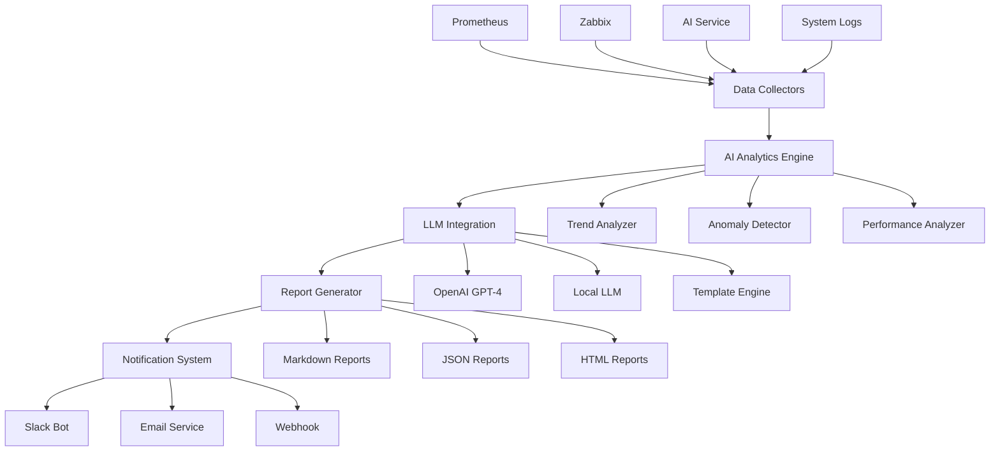

# 🤖 План реализации AI-аналитика для автоматических сводок

## 📋 Обзор проекта

**Цель**: Создать AI-систему, которая автоматически анализирует метрики CloudBridge Relay и генерирует интеллектуальные сводки на естественном языке.

**Временные рамки**: 2-3 недели  
**Приоритет**: Критический  
**Ожидаемый результат**: Автоматические сводки каждые 15 минут

---

## 🎯 **ФУНКЦИОНАЛЬНЫЕ ТРЕБОВАНИЯ**

### **1. Автоматический анализ метрик**
- Сбор данных из Prometheus, Zabbix, AI Service
- Анализ трендов и аномалий
- Выявление критических проблем
- Оценка производительности системы

### **2. Генерация сводок**
- Создание отчетов на естественном языке
- Структурированные рекомендации
- Приоритизация проблем
- Исторический контекст

### **3. Интеграция с уведомлениями**
- Slack/Teams интеграция
- Email уведомления
- Webhook для внешних систем
- Настраиваемые каналы

---

## 🏗️ **АРХИТЕКТУРА РЕШЕНИЯ**

### **Компоненты системы:**



---

## 💻 **ТЕХНИЧЕСКАЯ РЕАЛИЗАЦИЯ**

### **1. Основная структура**

```go
// internal/ai/analytics/analytics_engine.go
package analytics

import (
    "context"
    "time"
    "github.com/sashabaranov/go-openai"
)

type AIAnalyticsEngine struct {
    dataCollectors    map[string]DataCollector
    llmClient         *openai.Client
    reportGenerator   *ReportGenerator
    notificationSystem *NotificationSystem
    scheduler         *Scheduler
    logger            *zap.Logger
}

type DataCollector interface {
    CollectMetrics(ctx context.Context) (*MetricsData, error)
    GetName() string
}

type MetricsData struct {
    Timestamp     time.Time
    Source        string
    Metrics       map[string]interface{}
    Anomalies     []Anomaly
    Trends        []Trend
    Performance   *PerformanceData
}

type Anomaly struct {
    Type        string
    Severity    string
    Description string
    Value       float64
    Threshold   float64
    Timestamp   time.Time
}

type Trend struct {
    Metric      string
    Direction   string // "increasing", "decreasing", "stable"
    Change      float64
    Confidence  float64
    Period      string
}
```

### **2. Сборщики данных**

```go
// internal/ai/analytics/collectors/prometheus_collector.go
type PrometheusCollector struct {
    client *http.Client
    url    string
}

func (p *PrometheusCollector) CollectMetrics(ctx context.Context) (*MetricsData, error) {
    // Сбор метрик из Prometheus
    metrics := make(map[string]interface{})
    
    // AI метрики
    aiMetrics := map[string]float64{
        "anomalies_detected": p.getMetric("ai_anomalies_detected_total"),
        "predictions_made":   p.getMetric("ai_predictions_made_total"),
        "cpu_usage":         p.getMetric("ai_cpu_usage_percent"),
        "memory_usage":      p.getMetric("ai_memory_usage_bytes"),
        "active_alerts":     p.getMetric("ai_active_alerts"),
    }
    
    // Relay метрики
    relayMetrics := map[string]float64{
        "active_connections": p.getMetric("relay_active_connections"),
        "connections_total":  p.getMetric("relay_connections_total"),
        "uptime_seconds":     p.getMetric("relay_uptime_seconds"),
    }
    
    metrics["ai"] = aiMetrics
    metrics["relay"] = relayMetrics
    
    return &MetricsData{
        Timestamp: time.Now(),
        Source:    "prometheus",
        Metrics:   metrics,
    }, nil
}

// internal/ai/analytics/collectors/zabbix_collector.go
type ZabbixCollector struct {
    client *zabbix.Client
}

func (z *ZabbixCollector) CollectMetrics(ctx context.Context) (*MetricsData, error) {
    // Сбор метрик из Zabbix
    // Реализация аналогична PrometheusCollector
}
```

### **3. LLM интеграция**

```go
// internal/ai/analytics/llm/openai_client.go
type OpenAIClient struct {
    client *openai.Client
    model  string
}

func (o *OpenAIClient) GenerateAnalysis(data *MetricsData) (*AnalysisResult, error) {
    prompt := o.buildPrompt(data)
    
    resp, err := o.client.CreateChatCompletion(
        context.Background(),
        openai.ChatCompletionRequest{
            Model: o.model,
            Messages: []openai.ChatCompletionMessage{
                {
                    Role:    openai.ChatMessageRoleSystem,
                    Content: "You are an expert system administrator analyzing CloudBridge Relay metrics. Provide clear, actionable insights.",
                },
                {
                    Role:    openai.ChatMessageRoleUser,
                    Content: prompt,
                },
            },
            MaxTokens: 1000,
            Temperature: 0.7,
        },
    )
    
    if err != nil {
        return nil, err
    }
    
    return &AnalysisResult{
        Summary:     resp.Choices[0].Message.Content,
        Insights:    o.extractInsights(resp.Choices[0].Message.Content),
        Recommendations: o.extractRecommendations(resp.Choices[0].Message.Content),
    }, nil
}

func (o *OpenAIClient) buildPrompt(data *MetricsData) string {
    return fmt.Sprintf(`
Analyze the following CloudBridge Relay metrics and provide insights:

AI Service Metrics:
- Anomalies Detected: %.0f
- Predictions Made: %.0f
- CPU Usage: %.1f%%
- Memory Usage: %.1f MB
- Active Alerts: %.0f

Relay Service Metrics:
- Active Connections: %.0f
- Total Connections: %.0f
- Uptime: %.0f seconds

Anomalies Found:
%s

Trends Detected:
%s

Please provide:
1. Executive summary (2-3 sentences)
2. Key insights and patterns
3. Critical issues that need attention
4. Actionable recommendations
5. Performance assessment
`, 
        data.Metrics["ai"].(map[string]float64)["anomalies_detected"],
        data.Metrics["ai"].(map[string]float64)["predictions_made"],
        data.Metrics["ai"].(map[string]float64)["cpu_usage"],
        data.Metrics["ai"].(map[string]float64)["memory_usage"]/1024/1024,
        data.Metrics["ai"].(map[string]float64)["active_alerts"],
        data.Metrics["relay"].(map[string]float64)["active_connections"],
        data.Metrics["relay"].(map[string]float64)["connections_total"],
        data.Metrics["relay"].(map[string]float64)["uptime_seconds"],
        o.formatAnomalies(data.Anomalies),
        o.formatTrends(data.Trends),
    )
}
```

### **4. Генератор отчетов**

```go
// internal/ai/analytics/reports/report_generator.go
type ReportGenerator struct {
    templates map[string]*template.Template
}

func (r *ReportGenerator) GenerateReport(analysis *AnalysisResult) (*Report, error) {
    report := &Report{
        Timestamp: time.Now(),
        Summary:   analysis.Summary,
        Insights:  analysis.Insights,
        Recommendations: analysis.Recommendations,
        Format:    "markdown",
    }
    
    // Генерация Markdown отчета
    markdown := r.generateMarkdown(report)
    report.Content = markdown
    
    // Генерация HTML отчета
    html := r.generateHTML(report)
    report.HTMLContent = html
    
    return report, nil
}

func (r *ReportGenerator) generateMarkdown(report *Report) string {
    template := `# 🤖 CloudBridge Relay AI Analytics Report

**Generated**: {{.Timestamp.Format "2006-01-02 15:04:05"}}

## 📊 Executive Summary
{{.Summary}}

## 🔍 Key Insights
{{range .Insights}}
- {{.}}
{{end}}

## 🎯 Recommendations
{{range .Recommendations}}
- {{.}}
{{end}}

## 📈 Performance Metrics
- **AI Service Status**: ✅ Active
- **Anomaly Detection**: {{.AnomalyStats.Detected}} anomalies detected
- **Prediction Accuracy**: {{.AnomalyStats.Accuracy}}%
- **System Health**: {{.HealthStatus}}

---
*Report generated by CloudBridge AI Analytics Engine*
`
    
    t, _ := template.New("report").Parse(template)
    var buf bytes.Buffer
    t.Execute(&buf, report)
    return buf.String()
}
```

### **5. Система уведомлений**

```go
// internal/ai/analytics/notifications/notification_system.go
type NotificationSystem struct {
    slackClient *slack.Client
    emailClient *email.Client
    webhookURLs []string
}

func (n *NotificationSystem) SendReport(report *Report) error {
    // Slack уведомление
    if n.slackClient != nil {
        err := n.sendSlackNotification(report)
        if err != nil {
            return err
        }
    }
    
    // Email уведомление
    if n.emailClient != nil {
        err := n.sendEmailNotification(report)
        if err != nil {
            return err
        }
    }
    
    // Webhook уведомления
    for _, url := range n.webhookURLs {
        err := n.sendWebhookNotification(report, url)
        if err != nil {
            log.Printf("Failed to send webhook to %s: %v", url, err)
        }
    }
    
    return nil
}

func (n *NotificationSystem) sendSlackNotification(report *Report) error {
    blocks := []slack.Block{
        slack.NewHeaderBlock(
            slack.NewTextBlockObject("plain_text", "🤖 CloudBridge AI Analytics Report", false, false),
        ),
        slack.NewSectionBlock(
            slack.NewTextBlockObject("mrkdwn", report.Summary, false, false),
            nil, nil,
        ),
        slack.NewDividerBlock(),
        slack.NewSectionBlock(
            slack.NewTextBlockObject("mrkdwn", "*Key Insights:*", false, false),
            nil, nil,
        ),
    }
    
    for _, insight := range report.Insights {
        blocks = append(blocks, slack.NewSectionBlock(
            slack.NewTextBlockObject("mrkdwn", fmt.Sprintf("• %s", insight), false, false),
            nil, nil,
        ))
    }
    
    _, _, err := n.slackClient.PostMessage(
        "cloudbridge-alerts",
        slack.MsgOptionBlocks(blocks...),
    )
    
    return err
}
```

---

## 🚀 **ПЛАН РЕАЛИЗАЦИИ**

### **Неделя 1: Основа**
- [ ] Создание базовой структуры AIAnalyticsEngine
- [ ] Реализация PrometheusCollector
- [ ] Реализация ZabbixCollector
- [ ] Базовое тестирование сбора данных

### **Неделя 2: LLM интеграция**
- [ ] Интеграция с OpenAI API
- [ ] Создание системы промптов
- [ ] Реализация анализа данных
- [ ] Тестирование генерации сводок

### **Неделя 3: Отчеты и уведомления**
- [ ] Реализация ReportGenerator
- [ ] Создание шаблонов отчетов
- [ ] Интеграция с Slack/Email
- [ ] Настройка планировщика

---

## 📊 **НОВЫЕ API ENDPOINTS**

```bash
# AI Analytics API
POST /api/v1/ai/analytics/generate-report
GET  /api/v1/ai/analytics/reports
POST /api/v1/ai/analytics/analyze-trends
GET  /api/v1/ai/analytics/insights
POST /api/v1/ai/analytics/configure-notifications

# Примеры использования:
curl -X POST http://localhost:8083/api/v1/ai/analytics/generate-report \
  -H "Content-Type: application/json" \
  -d '{"timeRange": "1h", "includeRecommendations": true}'

curl -X GET http://localhost:8083/api/v1/ai/analytics/reports?limit=10
```

---

## 🔧 **КОНФИГУРАЦИЯ**

```yaml
# config/ai-analytics.yaml
ai_analytics:
  enabled: true
  schedule: "*/15 * * * *"  # Каждые 15 минут
  
  data_sources:
    prometheus:
      url: "http://prometheus:9090"
      enabled: true
    zabbix:
      url: "http://zabbix:10051"
      enabled: true
    ai_service:
      url: "http://ai-service:8083"
      enabled: true
  
  llm:
    provider: "openai"
    model: "gpt-4"
    api_key: "${OPENAI_API_KEY}"
    max_tokens: 1000
    temperature: 0.7
  
  notifications:
    slack:
      enabled: true
      webhook_url: "${SLACK_WEBHOOK_URL}"
      channel: "cloudbridge-alerts"
    email:
      enabled: true
      smtp_host: "smtp.gmail.com"
      smtp_port: 587
      username: "${EMAIL_USERNAME}"
      password: "${EMAIL_PASSWORD}"
      recipients: ["admin@cloudbridge.local"]
    webhooks:
      - url: "https://external-system.com/webhook"
        enabled: true
  
  report_formats:
    - "markdown"
    - "html"
    - "json"
  
  storage:
    enabled: true
    retention_days: 30
    path: "/var/lib/cloudbridge/analytics"
```

---

## 📈 **ОЖИДАЕМЫЕ РЕЗУЛЬТАТЫ**

### **Краткосрочные (1-2 недели):**
- ✅ Автоматический сбор метрик из всех источников
- ✅ Базовая генерация сводок на естественном языке
- ✅ Интеграция с Slack для уведомлений

### **Среднесрочные (2-3 недели):**
- ✅ Интеллектуальный анализ трендов и аномалий
- ✅ Персонализированные рекомендации
- ✅ Множественные форматы отчетов
- ✅ Настраиваемые каналы уведомлений

### **Долгосрочные (1-2 месяца):**
- ✅ Предиктивная аналитика
- ✅ Автоматическое исправление проблем
- ✅ Интеграция с внешними системами
- ✅ Машинное обучение на основе обратной связи

---

## 🎯 **ЗАКЛЮЧЕНИЕ**

Реализация AI-аналитика для автоматических сводок позволит:

1. **Автоматизировать мониторинг** - сводки каждые 15 минут
2. **Повысить осведомленность** - инсайты на естественном языке
3. **Ускорить реакцию** - мгновенные уведомления о проблемах
4. **Снизить нагрузку** - автоматизация рутинных задач

**Это первый шаг к созданию полностью автономной системы управления CloudBridge Relay!** 🚀
