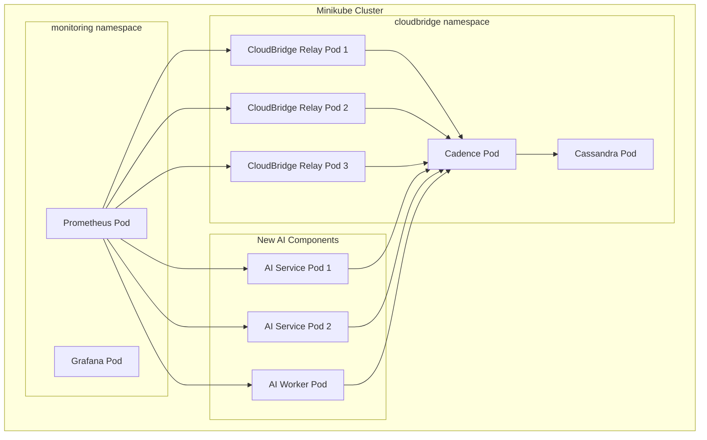

# 🚀 План интеграции AI с Cadence в Kubernetes (Minikube)

## 📋 Анализ текущей архитектуры

### ✅ **Существующая инфраструктура в Minikube:**



### **Текущие компоненты:**
- ✅ **CloudBridge Relay**: 3 пода в namespace `cloudbridge`
- ✅ **Cadence**: 1 под с workflow engine
- ✅ **Cassandra**: База данных для Cadence
- ✅ **Prometheus + Grafana**: Мониторинг
- ✅ **Kubernetes Services**: Внутренняя коммуникация

---

## 🎯 **План интеграции AI в Kubernetes**

### **Этап 1: Создание AI Service Deployment**

#### **1.1 AI Service Kubernetes Manifests**

```yaml
# k8s/deployments/ai-service-deployment.yaml
apiVersion: apps/v1
kind: Deployment
metadata:
  name: ai-service
  namespace: cloudbridge
  labels:
    app.kubernetes.io/name: ai-service
    app.kubernetes.io/version: "1.0.0"
    app.kubernetes.io/component: ai
    app.kubernetes.io/part-of: cloudbridge-relay
spec:
  replicas: 2
  selector:
    matchLabels:
      app.kubernetes.io/name: ai-service
      app.kubernetes.io/component: ai
  template:
    metadata:
      labels:
        app.kubernetes.io/name: ai-service
        app.kubernetes.io/component: ai
      annotations:
        prometheus.io/scrape: "true"
        prometheus.io/port: "8083"
        prometheus.io/path: "/metrics"
    spec:
      serviceAccountName: ai-service
      containers:
      - name: ai-service
        image: cloudbridge-ai:latest
        imagePullPolicy: IfNotPresent
        ports:
        - name: http
          containerPort: 8083
          protocol: TCP
        - name: metrics
          containerPort: 8084
          protocol: TCP
        env:
        - name: AI_PORT
          value: "8083"
        - name: CADENCE_HOST
          value: "cadence-service"
        - name: CADENCE_PORT
          value: "7933"
        - name: REDIS_HOST
          value: "redis-service"
        - name: REDIS_PORT
          value: "6379"
        - name: PROMETHEUS_HOST
          value: "prometheus-service"
        - name: PROMETHEUS_PORT
          value: "9090"
        resources:
          requests:
            memory: "1Gi"
            cpu: "500m"
          limits:
            memory: "2Gi"
            cpu: "1000m"
        livenessProbe:
          httpGet:
            path: /health
            port: 8083
          initialDelaySeconds: 30
          periodSeconds: 10
        readinessProbe:
          httpGet:
            path: /health
            port: 8083
          initialDelaySeconds: 5
          periodSeconds: 5
```

#### **1.2 AI Worker Deployment (для Cadence Activities)**

```yaml
# k8s/deployments/ai-worker-deployment.yaml
apiVersion: apps/v1
kind: Deployment
metadata:
  name: ai-worker
  namespace: cloudbridge
  labels:
    app.kubernetes.io/name: ai-worker
    app.kubernetes.io/component: ai-worker
spec:
  replicas: 2
  selector:
    matchLabels:
      app.kubernetes.io/name: ai-worker
      app.kubernetes.io/component: ai-worker
  template:
    metadata:
      labels:
        app.kubernetes.io/name: ai-worker
        app.kubernetes.io/component: ai-worker
    spec:
      serviceAccountName: ai-worker
      containers:
      - name: ai-worker
        image: cloudbridge-ai-worker:latest
        imagePullPolicy: IfNotPresent
        env:
        - name: CADENCE_HOST
          value: "cadence-service"
        - name: CADENCE_PORT
          value: "7933"
        - name: TASK_LIST
          value: "ai-task-list"
        resources:
          requests:
            memory: "512Mi"
            cpu: "250m"
          limits:
            memory: "1Gi"
            cpu: "500m"
```

### **Этап 2: Создание AI Cadence Activities**

#### **2.1 AI Activities для Kubernetes**

```go
// internal/cadence/activities/ai_kubernetes_activities.go

package activities

import (
    "context"
    "fmt"
    "time"
    
    "go.uber.org/zap"
    "github.com/twogc/cloudbridge-relay-installer/internal/ai"
    "github.com/twogc/cloudbridge-relay-installer/internal/ai/anomaly"
    "github.com/twogc/cloudbridge-relay-installer/internal/ai/predictive"
    "github.com/twogc/cloudbridge-relay-installer/internal/ai/routing"
)

// AnomalyDetectionActivity - activity для обнаружения аномалий в Kubernetes
func AnomalyDetectionActivity(ctx context.Context, metrics *anomaly.NetworkMetrics) (*anomaly.AnomalyResult, error) {
    logger := activity.GetLogger(ctx)
    logger.Info("Starting anomaly detection activity",
        zap.String("activity", "AnomalyDetectionActivity"),
        zap.Time("timestamp", metrics.Timestamp),
    )
    
    // Получаем AI сервис из контекста или создаем новый
    aiService := ai.GetAIService()
    if aiService == nil {
        return nil, fmt.Errorf("AI service not available")
    }
    
    // Выполняем обнаружение аномалий
    result, err := aiService.DetectAnomaly(metrics)
    if err != nil {
        logger.Error("Anomaly detection failed", zap.Error(err))
        return nil, err
    }
    
    logger.Info("Anomaly detection completed",
        zap.Bool("is_anomaly", result.IsAnomaly),
        zap.Float64("score", result.Score),
        zap.String("anomaly_type", result.AnomalyType),
    )
    
    return result, nil
}

// LoadPredictionActivity - activity для предсказания нагрузки
func LoadPredictionActivity(ctx context.Context, horizon int) (*predictive.LoadPrediction, error) {
    logger := activity.GetLogger(ctx)
    logger.Info("Starting load prediction activity",
        zap.String("activity", "LoadPredictionActivity"),
        zap.Int("horizon", horizon),
    )
    
    aiService := ai.GetAIService()
    if aiService == nil {
        return nil, fmt.Errorf("AI service not available")
    }
    
    prediction, err := aiService.PredictLoad(horizon)
    if err != nil {
        logger.Error("Load prediction failed", zap.Error(err))
        return nil, err
    }
    
    logger.Info("Load prediction completed",
        zap.Float64("confidence", prediction.Confidence),
        zap.Int("forecast_points", len(prediction.Forecast)),
    )
    
    return prediction, nil
}

// RouteOptimizationActivity - activity для оптимизации маршрутов
func RouteOptimizationActivity(ctx context.Context, source, destination string) (*routing.OptimizedRoute, error) {
    logger := activity.GetLogger(ctx)
    logger.Info("Starting route optimization activity",
        zap.String("activity", "RouteOptimizationActivity"),
        zap.String("source", source),
        zap.String("destination", destination),
    )
    
    aiService := ai.GetAIService()
    if aiService == nil {
        return nil, fmt.Errorf("AI service not available")
    }
    
    route, err := aiService.OptimizeRoute(source, destination)
    if err != nil {
        logger.Error("Route optimization failed", zap.Error(err))
        return nil, err
    }
    
    logger.Info("Route optimization completed",
        zap.String("protocol", route.Protocol),
        zap.Float64("latency", route.PredictedLatency),
        zap.Float64("confidence", route.Confidence),
    )
    
    return route, nil
}

// KubernetesMetricsCollectionActivity - сбор метрик из Kubernetes
func KubernetesMetricsCollectionActivity(ctx context.Context, namespace string) (map[string]interface{}, error) {
    logger := activity.GetLogger(ctx)
    logger.Info("Starting Kubernetes metrics collection",
        zap.String("activity", "KubernetesMetricsCollectionActivity"),
        zap.String("namespace", namespace),
    )
    
    // Здесь можно интегрировать с Kubernetes API для сбора метрик
    // Пока что возвращаем заглушку
    metrics := map[string]interface{}{
        "namespace": namespace,
        "pods": []map[string]interface{}{
            {
                "name": "cloudbridge-relay-1",
                "cpu_usage": 45.2,
                "memory_usage": 67.8,
                "network_in": 1024,
                "network_out": 2048,
            },
            {
                "name": "cloudbridge-relay-2", 
                "cpu_usage": 52.1,
                "memory_usage": 71.3,
                "network_in": 1156,
                "network_out": 1892,
            },
        },
        "services": []map[string]interface{}{
            {
                "name": "cloudbridge-relay-service",
                "endpoints": 3,
                "connections": 150,
            },
        },
        "timestamp": time.Now(),
    }
    
    logger.Info("Kubernetes metrics collection completed",
        zap.Int("pods_count", len(metrics["pods"].([]map[string]interface{}))),
    )
    
    return metrics, nil
}

// ModelTrainingActivity - обучение AI моделей
func ModelTrainingActivity(ctx context.Context, modelType string, trainingData map[string]interface{}) (map[string]interface{}, error) {
    logger := activity.GetLogger(ctx)
    logger.Info("Starting model training activity",
        zap.String("activity", "ModelTrainingActivity"),
        zap.String("model_type", modelType),
    )
    
    // Здесь будет логика обучения моделей
    // Пока что возвращаем заглушку
    result := map[string]interface{}{
        "model_type": modelType,
        "status": "completed",
        "accuracy": 0.95,
        "training_time": "2h 15m",
        "model_path": "/models/" + modelType + "_v1.0.gob",
        "timestamp": time.Now(),
    }
    
    logger.Info("Model training completed",
        zap.String("model_type", modelType),
        zap.Float64("accuracy", result["accuracy"].(float64)),
    )
    
    return result, nil
}
```

### **Этап 3: Обновление AI Service для Kubernetes**

#### **3.1 Kubernetes-aware AI Service**

```go
// internal/ai/kubernetes_service.go

package ai

import (
    "context"
    "fmt"
    "time"
    
    "go.uber.org/zap"
    "k8s.io/client-go/kubernetes"
    "k8s.io/client-go/rest"
    "k8s.io/client-go/tools/clientcmd"
)

// KubernetesAIService расширяет AI Service для работы в Kubernetes
type KubernetesAIService struct {
    *Service
    k8sClient *kubernetes.Clientset
    namespace string
}

// NewKubernetesAIService создает AI сервис для Kubernetes
func NewKubernetesAIService(config *Config, logger *zap.Logger, namespace string) (*KubernetesAIService, error) {
    // Создаем базовый AI сервис
    baseService, err := NewService(config, logger)
    if err != nil {
        return nil, fmt.Errorf("failed to create base AI service: %w", err)
    }
    
    // Создаем Kubernetes клиент
    k8sConfig, err := rest.InClusterConfig()
    if err != nil {
        // Fallback для локальной разработки
        k8sConfig, err = clientcmd.BuildConfigFromFlags("", "")
        if err != nil {
            return nil, fmt.Errorf("failed to create k8s config: %w", err)
        }
    }
    
    k8sClient, err := kubernetes.NewForConfig(k8sConfig)
    if err != nil {
        return nil, fmt.Errorf("failed to create k8s client: %w", err)
    }
    
    return &KubernetesAIService{
        Service:   baseService,
        k8sClient: k8sClient,
        namespace: namespace,
    }, nil
}

// CollectKubernetesMetrics собирает метрики из Kubernetes
func (kas *KubernetesAIService) CollectKubernetesMetrics() (map[string]interface{}, error) {
    ctx := context.Background()
    
    // Получаем информацию о подах
    pods, err := kas.k8sClient.CoreV1().Pods(kas.namespace).List(ctx, metav1.ListOptions{})
    if err != nil {
        return nil, fmt.Errorf("failed to list pods: %w", err)
    }
    
    // Получаем информацию о сервисах
    services, err := kas.k8sClient.CoreV1().Services(kas.namespace).List(ctx, metav1.ListOptions{})
    if err != nil {
        return nil, fmt.Errorf("failed to list services: %w", err)
    }
    
    metrics := map[string]interface{}{
        "namespace": kas.namespace,
        "pods": make([]map[string]interface{}, 0),
        "services": make([]map[string]interface{}, 0),
        "timestamp": time.Now(),
    }
    
    // Обрабатываем поды
    for _, pod := range pods.Items {
        podMetrics := map[string]interface{}{
            "name": pod.Name,
            "status": string(pod.Status.Phase),
            "node": pod.Spec.NodeName,
            "created": pod.CreationTimestamp.Time,
        }
        
        // Здесь можно добавить сбор метрик ресурсов
        // (требует интеграции с metrics-server или Prometheus)
        
        metrics["pods"] = append(metrics["pods"].([]map[string]interface{}), podMetrics)
    }
    
    // Обрабатываем сервисы
    for _, service := range services.Items {
        serviceMetrics := map[string]interface{}{
            "name": service.Name,
            "type": string(service.Spec.Type),
            "cluster_ip": service.Spec.ClusterIP,
            "ports": len(service.Spec.Ports),
        }
        
        metrics["services"] = append(metrics["services"].([]map[string]interface{}), serviceMetrics)
    }
    
    kas.logger.Info("Kubernetes metrics collected",
        zap.String("namespace", kas.namespace),
        zap.Int("pods", len(pods.Items)),
        zap.Int("services", len(services.Items)),
    )
    
    return metrics, nil
}

// StartKubernetesMonitoring запускает мониторинг Kubernetes ресурсов
func (kas *KubernetesAIService) StartKubernetesMonitoring() error {
    kas.logger.Info("Starting Kubernetes monitoring")
    
    go func() {
        ticker := time.NewTicker(30 * time.Second)
        defer ticker.Stop()
        
        for {
            select {
            case <-ticker.C:
                metrics, err := kas.CollectKubernetesMetrics()
                if err != nil {
                    kas.logger.Error("Failed to collect Kubernetes metrics", zap.Error(err))
                    continue
                }
                
                // Обрабатываем метрики через AI компоненты
                kas.ProcessKubernetesMetrics(metrics)
                
            case <-kas.ctx.Done():
                kas.logger.Info("Kubernetes monitoring stopped")
                return
            }
        }
    }()
    
    return nil
}

// ProcessKubernetesMetrics обрабатывает метрики Kubernetes через AI
func (kas *KubernetesAIService) ProcessKubernetesMetrics(metrics map[string]interface{}) {
    // Анализ аномалий в Kubernetes метриках
    if kas.anomalyDetector != nil {
        // Преобразуем Kubernetes метрики в NetworkMetrics
        networkMetrics := kas.convertK8sToNetworkMetrics(metrics)
        
        result, err := kas.anomalyDetector.DetectAnomaly(networkMetrics)
        if err != nil {
            kas.logger.Error("Failed to detect anomalies in K8s metrics", zap.Error(err))
        } else if result.IsAnomaly {
            kas.logger.Warn("Anomaly detected in Kubernetes metrics",
                zap.Float64("score", result.Score),
                zap.String("type", result.AnomalyType),
            )
        }
    }
    
    // Предсказание нагрузки на основе Kubernetes метрик
    if kas.loadPredictor != nil {
        // Добавляем точку данных для предсказания
        kas.loadPredictor.AddDataPoint(time.Now(), kas.calculateK8sLoad(metrics))
    }
}

// convertK8sToNetworkMetrics преобразует Kubernetes метрики в NetworkMetrics
func (kas *KubernetesAIService) convertK8sToNetworkMetrics(k8sMetrics map[string]interface{}) *anomaly.NetworkMetrics {
    // Простое преобразование - в реальной реализации будет более сложная логика
    pods := k8sMetrics["pods"].([]map[string]interface{})
    
    totalConnections := 0
    totalBytes := int64(0)
    
    for _, pod := range pods {
        // Здесь можно добавить логику подсчета соединений и трафика
        totalConnections += 10 // Заглушка
        totalBytes += 1024 * 1024 // Заглушка
    }
    
    return &anomaly.NetworkMetrics{
        Timestamp:           time.Now(),
        ConnectionsPerSecond: totalConnections,
        BytesPerSecond:      totalBytes,
        PacketLossRate:      0.01,
        AverageLatency:      50.0,
        CPUUsage:           45.0,
        MemoryUsage:        60.0,
        ActiveConnections:   totalConnections,
        FailedConnections:   0,
        ProtocolDistribution: map[string]int{
            "QUIC":      50,
            "WireGuard": 30,
            "TCP":       20,
        },
    }
}

// calculateK8sLoad рассчитывает нагрузку на основе Kubernetes метрик
func (kas *KubernetesAIService) calculateK8sLoad(metrics map[string]interface{}) float64 {
    pods := metrics["pods"].([]map[string]interface{})
    
    // Простой расчет нагрузки на основе количества подов
    load := float64(len(pods)) * 10.0
    
    return load
}
```

### **Этап 4: Kubernetes Services и ConfigMaps**

#### **4.1 AI Service Kubernetes Service**

```yaml
# k8s/services/ai-service.yaml
apiVersion: v1
kind: Service
metadata:
  name: ai-service
  namespace: cloudbridge
  labels:
    app.kubernetes.io/name: ai-service
    app.kubernetes.io/component: ai
spec:
  type: ClusterIP
  ports:
  - name: http
    port: 8083
    targetPort: 8083
    protocol: TCP
  - name: metrics
    port: 8084
    targetPort: 8084
    protocol: TCP
  selector:
    app.kubernetes.io/name: ai-service
    app.kubernetes.io/component: ai
---
apiVersion: v1
kind: Service
metadata:
  name: ai-service-nodeport
  namespace: cloudbridge
  labels:
    app.kubernetes.io/name: ai-service
    app.kubernetes.io/component: ai
spec:
  type: NodePort
  ports:
  - name: http
    port: 8083
    targetPort: 8083
    nodePort: 30083
    protocol: TCP
  selector:
    app.kubernetes.io/name: ai-service
    app.kubernetes.io/component: ai
```

#### **4.2 AI Configuration ConfigMap**

```yaml
# k8s/configmaps/ai-config.yaml
apiVersion: v1
kind: ConfigMap
metadata:
  name: ai-config
  namespace: cloudbridge
  labels:
    app.kubernetes.io/name: ai-config
    app.kubernetes.io/component: ai
data:
  ai-config.yaml: |
    ai:
      enabled: true
      mode: "kubernetes"
      models_path: "/app/models"
      redis_address: "redis-service:6379"
      redis_password: ""
      redis_db: 0
      kubernetes:
        namespace: "cloudbridge"
        monitoring_interval: "30s"
        metrics_collection: true
      anomaly_detection:
        enabled: true
        threshold: 0.8
        model_file: "anomaly_detector.gob"
        kubernetes_integration: true
      predictive_analytics:
        enabled: true
        model_file: "load_predictor.gob"
        forecast_horizon: 24
      intelligent_routing:
        enabled: true
        model_file: "route_optimizer.gob"
        kubernetes_aware: true
      security_intelligence:
        enabled: true
        model_file: "security_threat_model.gob"
```

### **Этап 5: Обновление Prometheus для AI метрик**

#### **5.1 Prometheus Config для AI**

```yaml
# k8s/configmaps/prometheus-ai-config.yaml
apiVersion: v1
kind: ConfigMap
metadata:
  name: prometheus-ai-config
  namespace: monitoring
data:
  prometheus.yml: |
    global:
      scrape_interval: 15s
      evaluation_interval: 15s
    
    scrape_configs:
    # Existing CloudBridge Relay metrics
    - job_name: 'cloudbridge-relay'
      static_configs:
      - targets: ['cloudbridge-relay-service:8084']
    
    # New AI Service metrics
    - job_name: 'ai-service'
      static_configs:
      - targets: ['ai-service:8084']
      scrape_interval: 10s
      metrics_path: '/metrics'
    
    # Cadence metrics
    - job_name: 'cadence'
      static_configs:
      - targets: ['cadence-service:7934']
    
    # Kubernetes metrics
    - job_name: 'kubernetes-pods'
      kubernetes_sd_configs:
      - role: pod
        namespaces:
          names:
          - cloudbridge
      relabel_configs:
      - source_labels: [__meta_kubernetes_pod_annotation_prometheus_io_scrape]
        action: keep
        regex: true
      - source_labels: [__meta_kubernetes_pod_annotation_prometheus_io_path]
        action: replace
        target_label: __metrics_path__
        regex: (.+)
```

---

## 🚀 **План развертывания в Minikube**

### **Шаг 1: Подготовка образов**

```bash
# Сборка AI Service образа
docker build -f Dockerfile.ai-service -t cloudbridge-ai:latest .

# Сборка AI Worker образа  
docker build -f Dockerfile.ai-worker -t cloudbridge-ai-worker:latest .

# Загрузка в Minikube
minikube image load cloudbridge-ai:latest
minikube image load cloudbridge-ai-worker:latest
```

### **Шаг 2: Развертывание AI компонентов**

```bash
# Применение AI манифестов
kubectl apply -f k8s/configmaps/ai-config.yaml
kubectl apply -f k8s/services/ai-service.yaml
kubectl apply -f k8s/deployments/ai-service-deployment.yaml
kubectl apply -f k8s/deployments/ai-worker-deployment.yaml

# Проверка развертывания
kubectl get pods -n cloudbridge -l app.kubernetes.io/component=ai
kubectl get services -n cloudbridge -l app.kubernetes.io/component=ai
```

### **Шаг 3: Тестирование интеграции**

```bash
# Port forwarding для тестирования
kubectl port-forward -n cloudbridge service/ai-service-nodeport 8083:8083 &

# Тестирование AI API
curl http://localhost:8083/health
curl http://localhost:8083/api/v1/ai/status

# Тестирование Cadence workflows
curl -X POST http://localhost:8083/api/v1/ai/anomaly/detect \
  -H "Content-Type: application/json" \
  -d '{"metrics": {...}}'
```

### **Шаг 4: Мониторинг**

```bash
# Проверка логов
kubectl logs -n cloudbridge -l app.kubernetes.io/name=ai-service

# Проверка метрик
kubectl port-forward -n monitoring service/prometheus 9090:9090 &
curl http://localhost:9090/api/v1/query?query=ai_anomaly_detections_total
```

---

## 🎯 **Преимущества Kubernetes интеграции**

### **1. Масштабируемость:**
- ✅ **Горизонтальное масштабирование** AI сервисов
- ✅ **Автоматическое масштабирование** на основе нагрузки
- ✅ **Распределенная обработка** AI задач

### **2. Отказоустойчивость:**
- ✅ **Автоматическое восстановление** после сбоев
- ✅ **Health checks** и readiness probes
- ✅ **Rolling updates** без простоя

### **3. Управляемость:**
- ✅ **Централизованная конфигурация** через ConfigMaps
- ✅ **Секреты** для чувствительных данных
- ✅ **Мониторинг** через Prometheus

### **4. Интеграция с существующей инфраструктурой:**
- ✅ **Единый namespace** с CloudBridge Relay
- ✅ **Общие сервисы** (Cadence, Cassandra)
- ✅ **Единый мониторинг** через Prometheus/Grafana

---

## 📋 **Итоговый план реализации**

### **Неделя 1: Kubernetes манифесты**
- [ ] Создать AI Service Deployment
- [ ] Создать AI Worker Deployment  
- [ ] Настроить Services и ConfigMaps
- [ ] Обновить Prometheus конфигурацию

### **Неделя 2: Kubernetes-aware AI Service**
- [ ] Реализовать KubernetesAIService
- [ ] Интегрировать с Kubernetes API
- [ ] Добавить сбор Kubernetes метрик
- [ ] Создать AI Cadence Activities

### **Неделя 3: Тестирование и развертывание**
- [ ] Сборка Docker образов
- [ ] Развертывание в Minikube
- [ ] Тестирование интеграции
- [ ] Настройка мониторинга

---

## 🏆 **Заключение**

**Интеграция AI с Cadence в Kubernetes (Minikube) обеспечит:**

1. **🚀 Масштабируемую AI платформу** с автоматическим масштабированием
2. **🔄 Надежную оркестрацию** AI процессов через Cadence
3. **📊 Полный мониторинг** AI компонентов через Prometheus
4. **🔧 Управляемую инфраструктуру** через Kubernetes
5. **🎯 Интеграцию с существующей системой** CloudBridge Relay

**AI система станет полноценной частью Kubernetes экосистемы CloudBridge Relay!** 🚀
