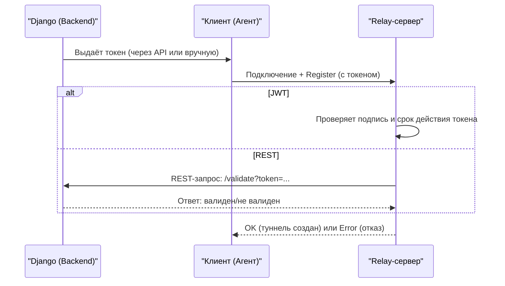

# Документация по реализации CloudBridge Relay

## Текущий статус проекта

### Реализованные компоненты

#### 1. Backend (Django)
- **Модели:**
  ```python
  class RelayServerConfig(models.Model):
      server = models.OneToOneField(Server, on_delete=models.CASCADE)
      relay_token = models.TextField()  # JWT токен
      relay_endpoint = models.CharField(max_length=255)
      relay_public_key = models.CharField(max_length=255)
      server_ip = models.GenericIPAddressField()
      tunnel_ip = models.GenericIPAddressField()
  ```

- **API Endpoints:**
  - `/servers/api/relay/generate-token/` - генерация JWT токена
  - `/servers/api/relay/validate-token/` - валидация токена

- **JWT Токен:**
  ```python
  payload = {
      'server_id': str(server.id),
      'company_id': str(server.company.id),
      'exp': datetime.datetime.utcnow() + datetime.timedelta(seconds=3600),
      'iat': datetime.datetime.utcnow(),
      'type': 'relay'
  }
  ```

#### 2. Frontend
- **UI компоненты:**
  - Выбор типа туннеля (Cloudflare/Relay)
  - Отображение токена
  - Копирование токена

- **JavaScript:**
  ```javascript
  async function fetchRelayToken(serverId) {
    const response = await fetch('/servers/api/relay/generate-token/', {
      method: 'POST',
      headers: {
        'Content-Type': 'application/json',
        'Accept': 'application/json',
        'X-CSRFToken': getCookie('csrftoken')
      },
      body: JSON.stringify({ server_id: serverId })
    });
    // ... обработка ответа
  }
  ```

#### 3. Установщик
- **PowerShell скрипт:**
  - Установка CloudBridge Relay
  - Регистрация токена
  - Интеграция с существующим установщиком Cloudflare

### Схема взаимодействия


## Что нужно реализовать

### 1. Relay-сервер
- [ ] Реализация проверки JWT-токена
- [ ] Обработка подключений от агентов
- [ ] Создание и управление туннелями
- [ ] Мониторинг состояния туннелей

### 2. Агент (CloudBridge Relay)
- [ ] Подключение к Relay-серверу
- [ ] Отправка токена при регистрации
- [ ] Обработка ответа от сервера
- [ ] Автоматическое переподключение

### 3. Безопасность
- [ ] Проверка подписи JWT
- [ ] Валидация срока действия токена
- [ ] Проверка прав доступа
- [ ] Защита от атак

### 4. Мониторинг и логирование
- [ ] Логирование подключений
- [ ] Мониторинг состояния туннелей
- [ ] Алерты при проблемах
- [ ] Метрики производительности

### 5. Документация
- [ ] API-документация
- [ ] Инструкции по установке
- [ ] Примеры использования
- [ ] Руководство по устранению неполадок

## Технические детали

### JWT Токен
```python
# Структура токена
{
    "server_id": "uuid",
    "company_id": "uuid",
    "exp": "timestamp",
    "iat": "timestamp",
    "type": "relay"
}

# Секрет для подписи
RELAY_JWT_SECRET = os.getenv('RELAY_JWT_SECRET', 'supersecret')
RELAY_JWT_EXP = int(os.getenv('RELAY_JWT_EXP', 3600))
```

### API Endpoints
```python
# Генерация токена
POST /servers/api/relay/generate-token/
{
    "server_id": "uuid"
}

# Валидация токена
GET /servers/api/relay/validate-token/?token=jwt_token
```

### Установщик
```powershell
# Основные функции
function Install-CloudBridgeRelay {
    # Проверка существующей установки
    # Скачивание дистрибутива
    # Установка и регистрация токена
}
```

## Следующие шаги

1. **Приоритет 1:**
   - Реализация проверки JWT на Relay-сервере
   - Разработка протокола взаимодействия

2. **Приоритет 2:**
   - Реализация агента
   - Добавление мониторинга

3. **Приоритет 3:**
   - Написание документации
   - Тестирование

## Контакты и ресурсы

- Репозиторий: [ссылка]
- Документация: [ссылка]
- Issue tracker: [ссылка]

## Примечания

- Все изменения в моделях требуют миграций
- Токены имеют ограниченный срок действия
- Необходимо обеспечить безопасное хранение секретов

---

Этот документ будет обновляться по мере реализации новых компонентов. Последнее обновление: [дата].