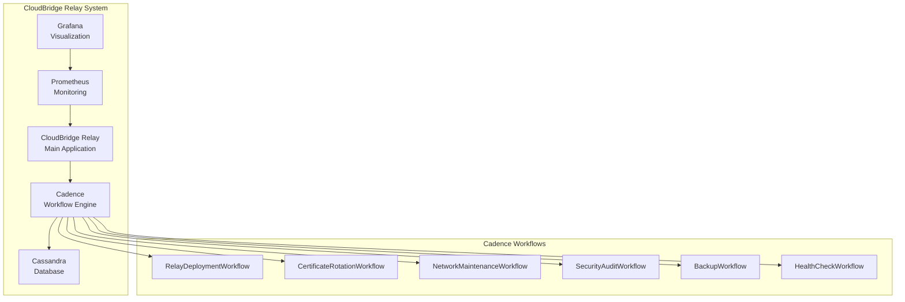

# 🔄 Роль Cadence в проекте CloudBridge Relay

## 📋 Обзор

**Cadence** - это критически важный компонент CloudBridge Relay, который выполняет роль **Workflow Engine** (движка рабочих процессов) для оркестрации сложных операций системы.

## 🎯 Основная роль Cadence

### 1. **🔄 Workflow Orchestration Engine**
Cadence служит центральным оркестратором для автоматизации сложных операций CloudBridge Relay:

- **Автоматизация развертывания** - управление процессом запуска и настройки компонентов
- **Оркестрация операций** - координация между различными модулями системы
- **Управление жизненным циклом** - автоматическое управление состоянием сервисов
- **Обработка ошибок** - автоматическое восстановление после сбоев

### 2. **🏗️ Архитектурная роль**



## 🔧 Конкретные функции Cadence

### 1. **Развертывание и инициализация**

#### RelayDeploymentWorkflow
```go
// Управляет развертыванием relay сервера
func RelayDeploymentWorkflow(ctx workflow.Context, input RelayDeploymentInput) error {
    // 1. Проверка конфигурации
    // 2. Подготовка WireGuard
    // 3. Настройка QUIC сервера
    // 4. Запуск сервисов
    // 5. Проверка здоровья
}
```

**Роль**: Автоматизирует сложный процесс развертывания CloudBridge Relay, включая:
- Валидацию конфигурации
- Настройку сетевых компонентов (WireGuard, QUIC)
- Запуск всех сервисов в правильном порядке
- Проверку готовности системы

### 2. **Управление сертификатами**

#### CertificateRotationWorkflow
```go
// Управляет ротацией сертификатов
func CertificateRotationWorkflow(ctx workflow.Context, input CertificateRotationInput) error {
    // 1. Генерация новых сертификатов
    // 2. Валидация сертификатов
    // 3. Обновление конфигурации
    // 4. Перезапуск сервисов
    // 5. Проверка работоспособности
}
```

**Роль**: Обеспечивает автоматическую ротацию SSL/TLS сертификатов для:
- WireGuard ключей
- QUIC сертификатов
- API endpoints
- Межсервисного взаимодействия

### 3. **Обслуживание сети**

#### NetworkMaintenanceWorkflow
```go
// Управляет обслуживанием сети
func NetworkMaintenanceWorkflow(ctx workflow.Context, input NetworkMaintenanceInput) error {
    // 1. Анализ топологии сети
    // 2. Оптимизация маршрутов
    // 3. Обновление конфигурации
    // 4. Тестирование соединений
}
```

**Роль**: Автоматизирует обслуживание P2P mesh сети:
- Мониторинг состояния соединений
- Автоматическое восстановление соединений
- Оптимизация маршрутизации
- Балансировка нагрузки

### 4. **Безопасность и аудит**

#### SecurityAuditWorkflow
```go
// Управляет аудитом безопасности
func SecurityAuditWorkflow(ctx workflow.Context, input SecurityAuditInput) error {
    // 1. Сканирование уязвимостей
    // 2. Проверка конфигурации
    // 3. Анализ логов
    // 4. Генерация отчетов
}
```

**Роль**: Обеспечивает автоматический аудит безопасности:
- Регулярные проверки безопасности
- Анализ уязвимостей
- Мониторинг подозрительной активности
- Генерация отчетов о безопасности

### 5. **Резервное копирование**

#### BackupWorkflow
```go
// Управляет резервным копированием
func BackupWorkflow(ctx workflow.Context, input BackupInput) error {
    // 1. Создание снимка данных
    // 2. Сжатие и шифрование
    // 3. Загрузка в хранилище
    // 4. Валидация бэкапа
}
```

**Роль**: Автоматизирует процесс резервного копирования:
- Регулярные бэкапы конфигурации
- Резервное копирование данных Cassandra
- Шифрование и сжатие данных
- Валидация целостности бэкапов

### 6. **Мониторинг здоровья**

#### HealthCheckWorkflow
```go
// Непрерывный мониторинг здоровья
func HealthCheckWorkflow(ctx workflow.Context, input HealthCheckInput) (*HealthCheckResult, error) {
    // Долгоживущий workflow (24/7)
    // Периодические проверки каждые 30 минут
    // Обработка сигналов управления
    // Автоматическое восстановление
}
```

**Роль**: Обеспечивает непрерывный мониторинг системы:
- Периодические проверки здоровья компонентов
- Автоматическое обнаружение проблем
- Инициация восстановительных процедур
- Уведомления о критических событиях

## 🏗️ Архитектурная интеграция

### 1. **Интеграция с основным приложением**

```go
// В cmd/relay/main.go
type CloudBridgeRelayServer struct {
    // ... другие компоненты
    cadenceClient *cadence.Client  // Cadence клиент
}

// Инициализация Cadence
if cfg.Cadence.Enabled {
    cadenceConfig := cadence.Config{
        HostPort: cfg.Cadence.HostPort,
        Domain:   cfg.Cadence.Domain,
        TaskList: cfg.Cadence.TaskList,
    }
    
    cadenceClient, err = cadence.NewClient(cadenceConfig, logger)
}
```

### 2. **API Endpoints для управления**

```go
// HTTP API для управления workflows
httpMux.HandleFunc("/api/v1/cadence/workflows/relay-deployment", ...)
httpMux.HandleFunc("/api/v1/cadence/workflows/certificate-rotation", ...)
httpMux.HandleFunc("/api/v1/cadence/workflows/network-maintenance", ...)
httpMux.HandleFunc("/api/v1/cadence/workflows/security-audit", ...)
httpMux.HandleFunc("/api/v1/cadence/workflows/backup", ...)
httpMux.HandleFunc("/api/v1/cadence/workflows/status", ...)
httpMux.HandleFunc("/api/v1/cadence/health", ...)
```

### 3. **Интеграция с базой данных**

```sql
-- Домен CloudBridge в Cassandra
INSERT INTO domains_by_name_v2 (
    name,
    domain,
    config,
    replication_config,
    is_global_domain
) VALUES (
    'cloudbridge',
    textAsBlob('{"id":"550e8400-e29b-41d4-a716-446655440000","name":"cloudbridge",...}'),
    textAsBlob('{"retention":30,"emit_metric":true,...}'),
    textAsBlob('{"active_cluster_name":"cloudbridge-cluster",...}'),
    true
);
```

## 📊 Конфигурация Cadence

### 1. **Основные настройки**

```yaml
# configs/cadence.yaml
cadence:
  domain: "cloudbridge-relay"
  client:
    hostPort: "localhost:7933"
    domain: "cloudbridge-relay"
  worker:
    taskListName: "cloudbridge-task-list"
    identity: "cloudbridge-worker"
  workflows:
    executionTimeout: "1h"
    decisionTimeout: "10s"
    activityStartToCloseTimeout: "5m"
```

### 2. **Retry политики**

```yaml
retry:
  initialInterval: "1s"
  maximumInterval: "10s"
  backoffCoefficient: 2.0
  maximumAttempts: 3
  critical:
    maximumAttempts: 5
    maximumInterval: "30s"
```

### 3. **Мониторинг и метрики**

```yaml
metrics:
  enabled: true
  scope: "cloudbridge"
  reportingInterval: "30s"
  enablePrometheus: true
  prometheusPort: 9091
```

## 🎯 Преимущества использования Cadence

### 1. **Надежность**
- ✅ **Автоматическое восстановление** после сбоев
- ✅ **Retry механизмы** для failed операций
- ✅ **Persistent execution** - workflows не теряются при перезапуске
- ✅ **Exactly-once execution** - гарантия выполнения

### 2. **Масштабируемость**
- ✅ **Горизонтальное масштабирование** workers
- ✅ **Load balancing** между workers
- ✅ **Distributed execution** across multiple nodes
- ✅ **High throughput** обработка

### 3. **Управляемость**
- ✅ **Visibility** - полная видимость выполнения workflows
- ✅ **Debugging** - детальные логи и история выполнения
- ✅ **Monitoring** - метрики и алерты
- ✅ **Control** - возможность остановки/перезапуска workflows

### 4. **Гибкость**
- ✅ **Dynamic workflows** - создание workflows на лету
- ✅ **Signal handling** - взаимодействие с running workflows
- ✅ **Timer support** - scheduled operations
- ✅ **Child workflows** - иерархическая структура

## 🔄 Workflow Patterns в CloudBridge Relay

### 1. **Saga Pattern**
```go
// Для сложных операций с компенсацией
func RelayDeploymentWorkflow(ctx workflow.Context, input RelayDeploymentInput) error {
    // 1. Setup WireGuard
    // 2. Setup QUIC
    // 3. Start Services
    // 4. Health Check
    
    // При ошибке - автоматическая компенсация
    if err != nil {
        // Rollback operations
        return err
    }
}
```

### 2. **Event Sourcing**
```go
// Сохранение всех событий для аудита
func SecurityAuditWorkflow(ctx workflow.Context, input SecurityAuditInput) error {
    // 1. Record audit start event
    // 2. Perform security checks
    // 3. Record findings
    // 4. Generate report
    // 5. Record completion event
}
```

### 3. **Circuit Breaker**
```go
// Защита от каскадных сбоев
func HealthCheckWorkflow(ctx workflow.Context, input HealthCheckInput) error {
    // 1. Check component health
    // 2. If failing - open circuit breaker
    // 3. Wait for recovery
    // 4. Close circuit breaker
}
```

## 📈 Мониторинг и наблюдаемость

### 1. **Метрики Cadence**
- **Workflow execution time** - время выполнения workflows
- **Activity success rate** - процент успешных activities
- **Queue depth** - глубина очереди задач
- **Worker utilization** - использование workers

### 2. **Интеграция с Prometheus**
```yaml
metrics:
  enablePrometheus: true
  prometheusPort: 9091
  reportingInterval: "30s"
```

### 3. **Grafana дашборды**
- **Workflow execution overview**
- **Activity performance metrics**
- **Error rates and trends**
- **System health indicators**

## 🚀 Практические примеры использования

### 1. **Автоматическое развертывание**
```bash
# Запуск workflow развертывания через API
curl -X POST http://localhost:9090/api/v1/cadence/workflows/relay-deployment \
  -H "Content-Type: application/json" \
  -d '{
    "config": {...},
    "wireguard_config": {...},
    "quic_config": {...}
  }'
```

### 2. **Ротация сертификатов**
```bash
# Запуск workflow ротации сертификатов
curl -X POST http://localhost:9090/api/v1/cadence/workflows/certificate-rotation \
  -H "Content-Type: application/json" \
  -d '{
    "certificate_type": "wireguard",
    "rotation_schedule": "monthly"
  }'
```

### 3. **Проверка статуса**
```bash
# Получение статуса workflow
curl http://localhost:9090/api/v1/cadence/workflows/status?workflow_id=relay-deployment-123
```

## 🎯 Заключение

### **Cadence в CloudBridge Relay выполняет роль:**

1. **🔄 Workflow Orchestrator** - центральный оркестратор сложных операций
2. **🛡️ Reliability Engine** - обеспечивает надежность и отказоустойчивость
3. **📊 Automation Platform** - автоматизирует рутинные операции
4. **🔍 Monitoring Hub** - обеспечивает видимость и контроль
5. **⚡ Performance Optimizer** - оптимизирует производительность системы

### **Ключевые преимущества:**
- ✅ **Автоматизация** сложных операций
- ✅ **Надежность** с автоматическим восстановлением
- ✅ **Масштабируемость** для роста системы
- ✅ **Управляемость** через API и мониторинг
- ✅ **Гибкость** для адаптации к изменениям

**Cadence превращает CloudBridge Relay из простого P2P relay сервера в интеллектуальную, самоуправляемую систему с автоматизированными операциями и высокой надежностью.**

---

*Анализ проведен: 7 сентября 2025*  
*Статус: Cadence успешно интегрирован и работает* 🎉
