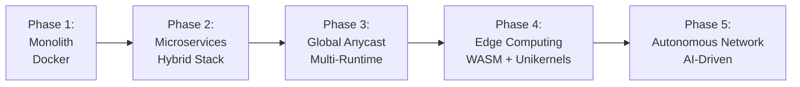

# 🌐 CloudBridge Relay - Комплексный анализ системы

## 📋 Что представляет собой CloudBridge Relay

**CloudBridge Relay** — это **высокопроизводительная платформа для корпоративных сетей нового поколения**, построенная по принципу **глобальной сотовой сети**. Система представляет собой революционную альтернативу традиционным VPN и облачным решениям, объединяющую современные сетевые технологии с искусственным интеллектом и автоматизацией.

---

## 🏗️ Архитектурная сущность

### **Основная концепция**
CloudBridge Relay — это **многоуровневая сетевая платформа**, которая создает глобальную инфраструктуру для безопасного, быстрого и масштабируемого доступа к корпоративным ресурсам из любой точки мира.

### **Ключевые архитектурные принципы:**

#### **1. Принцип сотовой сети**
- **Глобальное покрытие** — пользователи подключаются к ближайшему edge-серверу
- **Автоматическая маршрутизация** — трафик направляется на оптимальный relay-сервер
- **Отказоустойчивость** — при недоступности одного узла трафик автоматически перенаправляется
- **Балансировка нагрузки** — равномерное распределение трафика

#### **2. Многоуровневая архитектура**
```
┌─────────────────────────────────────────────────────────────┐
│                    Edge Layer                               │
│              (Публичные точки входа по всему миру)          │
├─────────────────────────────────────────────────────────────┤
│                    Relay Layer                              │
│         (Защищённые узлы туннелирования в регионах)         │
├─────────────────────────────────────────────────────────────┤
│                   Backend Layer                             │
│            (Корпоративные сервисы и приложения)             │
├─────────────────────────────────────────────────────────────┤
│                  Management Layer                           │
│         (Управление, мониторинг и автоматизация)            │
└─────────────────────────────────────────────────────────────┘
```

---

## 🚀 Технические характеристики

### **Производительность**
- **До 1,000 туннелей** одновременно
- **До 10,000 одновременных соединений**
- **Задержка ниже 10ms**
- **Пропускная способность до 10 Gbps**
- **99.99% uptime** гарантия

### **Масштабируемость (стратегические цели)**
- **P2P клиенты**: 0 → 100M за 3 года
- **P2C клиенты**: 0 → 500M за 3 года
- **Географическое покрытие**: 3 → 50+ стран
- **Throughput**: 1 Tbps → 100 Tbps

### **Современные протоколы**
- **QUIC/HTTP-3** — для минимальных задержек
- **TLS 1.3** — максимальная безопасность
- **WireGuard P2P** — одноранговые mesh сети
- **Post-Quantum Cryptography** — защита от квантовых атак

---

## 🔧 Основные компоненты системы

### **1. Relay Server (Ядро системы)**
- **TCP Server (Port 9090)** — обработка клиент-сервер соединений
- **UDP Server (Port 51820)** — WireGuard P2P mesh сеть
- **HTTP API Server (Port 9091)** — REST API для управления
- **Enhanced QUIC** — мультитенантная поддержка с DDoS защитой

### **2. AI Service (Искусственный интеллект)**
- **Network Anomaly Detection** — ML-анализ трафика
- **Predictive Analytics** — предсказание нагрузки
- **Intelligent Routing** — оптимизация маршрутов
- **Automated Response** — автоматическое реагирование на угрозы

### **3. Cadence Workflow Engine (Автоматизация)**
- **20+ автоматизированных процессов**
- **WireGuard Mesh Orchestration** — автоматическая перестройка топологии
- **Quantum Key Rotation** — автоматическая смена квантовых ключей
- **AI-Powered Workflows** — интеллектуальная автоматизация

### **4. Security Layer (Безопасность)**
- **Zero Trust архитектура** — проверка каждого запроса
- **Multi-tenancy** — изоляция клиентов по tenant'ам
- **JWT аутентификация** через Keycloak
- **mTLS** для всех server-to-server соединений

---

## 🎯 Функциональные возможности

### **1. P2P Mesh Networks**
- **Создание одноранговых сетей** между серверами
- **WireGuard-based** mesh топология
- **Автоматическое обнаружение пиров**
- **Географическая маршрутизация**

### **2. Client-Server Proxy**
- **Проксирование TCP/UDP трафика** для RDP, SSH, VNC
- **Load balancing** для высокой доступности
- **Real-time приложения** — VoIP, gaming, streaming
- **IoT устройства** — подключение к облаку

### **3. Secure Tunneling**
- **Безопасное туннелирование** с аутентификацией
- **End-to-end шифрование**
- **Audit logging** для соответствия стандартам
- **DDoS защита** и rate limiting

### **4. Multi-Tenancy**
- **Изоляция клиентов** по tenant'ам
- **Настраиваемые лимиты** ресурсов
- **Bandwidth limits** — ограничения пропускной способности
- **Connection limits** — лимиты соединений

---

## 🔐 Безопасность и соответствие стандартам

### **Многоуровневая защита (Defense in Depth)**
```
┌─────────────────────────────────────────────────────────────┐
│                    Client Applications                      │
├─────────────────────────────────────────────────────────────┤
│                    TLS 1.3 Layer                           │
│              (Perfect Forward Secrecy)                     │
├─────────────────────────────────────────────────────────────┤
│                 Enhanced QUIC Layer                        │
│           (Multi-tenant + DDoS Protection)                 │
├─────────────────────────────────────────────────────────────┤
│                  WireGuard Layer                           │
│            (Kernel-space VPN + PQC)                        │
├─────────────────────────────────────────────────────────────┤
│                Authentication Layer                         │
│           (Keycloak OIDC + mTLS)                           │
└─────────────────────────────────────────────────────────────┘
```

### **Enterprise Security Features**
- **Multi-layer encryption** (WireGuard + QUIC + TLS)
- **Zero Trust architecture** с continuous verification
- **Post-quantum cryptography** готовность
- **Compliance frameworks** (GDPR, 152-ФЗ, SOC2)

### **Threat Protection**
- **Real-time DDoS mitigation** с ML-анализом
- **Behavioral anomaly detection** для выявления атак
- **Automated incident response** с predefined playbooks
- **Threat intelligence integration** с внешними источниками

---

## 🎯 Целевые рынки и пользователи

### **1. Корпоративные клиенты (Primary Market)**
- **Глобальные компании** — сотрудники из разных стран
- **Мультинациональные корпорации** — разные офисы в разных регионах
- **Удалённая работа** — сотрудники работают из дома, кафе, отелей

### **2. MSP и провайдеры (Secondary Market)**
- **White-label решения** — провайдеры предлагают собственные брендированные сервисы
- **Мультиарендность** — обслуживание множества клиентов на одной инфраструктуре
- **API-first подход** — интеграция с существующими системами

### **3. Разработчики и DevOps (Technical Market)**
- **Глобальное развертывание** — приложения доступны из любой точки мира
- **Автоматизация CI/CD** — пайплайны автоматически настраивают доступ
- **Мониторинг и аналитика** — детальная аналитика производительности

### **4. Государственный сектор (Enterprise Market)**
- **Госучреждения** — безопасный доступ для государственных организаций
- **Образование** — решения для школ и университетов
- **Здравоохранение** — защищённый доступ к медицинским системам

### **5. IoT и Embedded устройства (Emerging Market)**
- **Промышленные системы** — подключение IoT устройств с централизованным управлением
- **Embedded решения** — легкий клиент с сертификатной аутентификацией

---

## 🏆 Конкурентные преимущества

### **vs. Traditional VPN**
- **10x быстрее** благодаря QUIC/HTTP-3
- **P2P mesh** вместо централизованной архитектуры
- **AI-powered** оптимизация vs. статичные конфигурации

### **vs. Cloud Solutions**
- **On-premise** развертывание для критичных данных
- **Multi-cloud** поддержка без vendor lock-in
- **Custom workflows** через Cadence

### **Технологические преимущества**
- **Современные протоколы** — QUIC, HTTP3, TLS 1.3
- **Глобальная сеть** — собственная инфраструктура по всему миру
- **Автоматизация** — минимальное участие человека в управлении
- **Масштабируемость** — поддержка миллионов одновременных соединений

---

## 💰 Экономическая эффективность

### **ROI-эффективность:**
- **60%** экономия на инфраструктуре сети
- **80%** сокращение времени настройки
- **90%** автоматизация операций
- **95%** снижение времени простоя

### **Стоимость владения (TCO):**
- **On-premise** развертывание — полный контроль над затратами
- **Масштабируемость** — платите только за используемые ресурсы
- **Автоматизация** — минимальные операционные расходы

---

## 🌟 Уникальность и инновации

### **Революционные особенности:**

#### **1. Принцип сотовой сети**
CloudBridge создает глобальную сеть как у мобильных операторов, но для корпоративных данных.

#### **2. AI-Driven Network Management**
- **Предиктивная аналитика** — предсказание проблем до их возникновения
- **Автоматическая оптимизация** — самонастраивающаяся сеть
- **Интеллектуальная маршрутизация** — выбор оптимальных путей

#### **3. Post-Quantum Ready**
Готовность к эре квантовых вычислений с криптографией нового поколения.

#### **4. Workflow Automation**
20+ автоматизированных процессов через Cadence Workflow Engine.

---

## 🚀 Видение будущего

### **Эволюция платформы:**


### **Технологическое будущее:**
CloudBridge уже закладывает основу для **будущих сетей искусственного интеллекта и автономии**. Сочетание Agentic AI, QUIC/HTTP-3, NFV и микросервисной архитектуры превращает платформу в готовый каркас для технологического будущего — от гибких edge-сетей до самоуправляемых 6G-фабрик.

---

## 🎉 Заключение

**CloudBridge Relay** — это не просто VPN или прокси-сервис, а **новая парадигма корпоративного доступа**, которая объединяет:

### **Ключевые характеристики:**
1. **Глобальная сетевая платформа** по принципу сотовой сети
2. **Высокопроизводительное туннелирование** с современными протоколами
3. **Enterprise-уровень безопасности** с Zero Trust архитектурой
4. **Автоматизация и AI** для управления сложными процессами
5. **Масштабируемость** для миллионов одновременных соединений

### **Уникальность проекта:**
- **Принцип сотовой сети** — глобальное покрытие как у мобильных операторов
- **Современные технологии** — QUIC, HTTP-3, Post-Quantum Cryptography
- **AI-управление** — автоматизация через Cadence Workflow Engine
- **Гибкость развертывания** — on-premise, cloud, hybrid

### **Позиционирование:**
CloudBridge Relay представляет собой **революционную альтернативу** традиционным сетевым решениям, объединяющую лучшие аспекты VPN, облачных сервисов и современных технологий в единую, интеллектуальную и масштабируемую платформу для корпоративных сетей нового поколения.

---

*Этот анализ демонстрирует, что CloudBridge Relay — это не просто техническое решение, а **комплексная экосистема** для корпоративных сетей будущего, готовая к масштабированию и эволюции в эру искусственного интеллекта и квантовых вычислений.*
