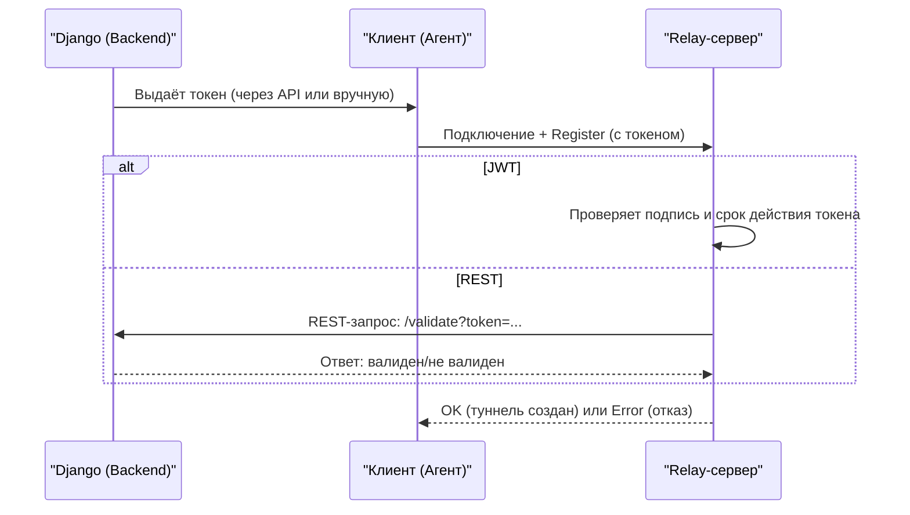

# CloudBridge Relay Server

Relay-сервер для безопасного проброса TCP-портов и туннелирования трафика между различными участниками через публично доступный сервер.

## Особенности

* **Безопасность**: 
  - Все соединения только исходящие, нет необходимости открывать порты на клиентах
  - TLS шифрование всех соединений
  - Поддержка mTLS (mutual TLS) для дополнительной безопасности
  - Интеграция с Cloudflare для управления сертификатами
* **Простота**: Минималистичный протокол на основе JSON
* **Надежность**: Автоматическое восстановление соединений, keepalive
* **Масштабируемость**: Ограничение количества туннелей, очистка неактивных соединений

## Установка

### Требования

* Ubuntu Server 22.04 LTS
* Go 1.21 или выше
* Cloudflare API токен (для управления сертификатами)

### Сборка

```bash
# Клонирование репозитория
git clone https://github.com/twogc/cloudbridge-relay-installer.git
cd cloudbridge-relay

# Сборка
./build.sh
```

### Установка на сервер

```bash
# Распаковка архива
tar xzf build/relay-installer.tar.gz

# Установка
sudo ./install.sh
```

## Конфигурация TLS

### Использование Cloudflare Edge Certificates

1. Получите API токен Cloudflare с правами на управление сертификатами
2. Настройте DNS записи для вашего домена в Cloudflare
3. Укажите параметры TLS в конфигурации:

```bash
cloudbridge-relay \
  -addr ":443" \
  -tls-cert /path/to/cert.pem \
  -tls-key /path/to/key.pem \
  -mtls-ca /path/to/ca.pem \
  -mtls-verify true
```

### Параметры TLS

* `-tls-cert`: Путь к сертификату TLS
* `-tls-key`: Путь к приватному ключу TLS
* `-mtls-ca`: Путь к CA сертификату для mTLS (опционально)
* `-mtls-verify`: Включить проверку клиентских сертификатов (по умолчанию false)

## Использование

### Запуск сервера

```bash
cloudbridge-relay -addr ":12345" -timeout 10m -max-tunnels 1000
```

Параметры:
* `-addr`: Адрес для прослушивания (по умолчанию ":12345")
* `-timeout`: Таймаут соединения (по умолчанию 10 минут)
* `-max-tunnels`: Максимальное количество туннелей (по умолчанию 1000)

### Управление сервисом

```bash
# Статус
systemctl status relay

# Запуск
systemctl start relay

# Остановка
systemctl stop relay

# Перезапуск
systemctl restart relay

# Просмотр логов
journalctl -u relay
```

## Протокол

### Формат сообщений

Все сообщения передаются в формате JSON с 4-байтным префиксом длины (BigEndian).

### Типы сообщений

* **Register**: Регистрация туннеля
  ```json
  {
    "type": "register",
    "token": "your-token",
    "version": "1.0.0"
  }
  ```

* **Config**: Ответ на регистрацию
  ```json
  {
    "type": "config",
    "token": "your-token",
    "public_url": "bore://your-token",
    "status": "ok"
  }
  ```

* **Connect**: Запрос на подключение
  ```json
  {
    "type": "connect",
    "token": "your-token"
  }
  ```

* **Ping/Pong**: Keepalive
  ```json
  {
    "type": "ping",
    "token": "your-token",
    "version": "1.0.0"
  }
  ```

* **Error**: Сообщение об ошибке
  ```json
  {
    "type": "error",
    "error": "error message"
  }
  ```

## Безопасность

* Все соединения только исходящие
* TLS шифрование всех соединений
* Поддержка mTLS для дополнительной безопасности
* Проброс осуществляется строго по токену
* Автоматическая очистка неактивных туннелей
* Ограничение на количество одновременных туннелей
* Интеграция с Cloudflare для управления сертификатами

## Логирование

Логи доступны через:
* systemd journal: `journalctl -u relay`
* Файлы логов: `/var/log/relay/`

## Лицензия

MIT

# CloudBridge Relay Installer

## Описание
CloudBridge Relay Installer — это инструмент для установки и настройки relay-сервера, который обеспечивает безопасное соединение между клиентами и серверами через туннели. Система поддерживает масштабирование, мониторинг и балансировку нагрузки.

## Возможности
- Безопасное туннелирование TCP-соединений
- Поддержка RDP и других TCP-протоколов
- Масштабирование через кластер relay-серверов
- Мониторинг производительности и состояния
- Балансировка нагрузки между серверами
- Ограничение количества соединений
- Защита от перегрузки

## Установка
1. Клонируйте репозиторий:
   ```bash
   git clone https://github.com/maxlanies/cloudbridge-relay-installer.git
   cd cloudbridge-relay-installer
   ```

2. Установите зависимости:
   ```bash
   go mod download
   ```

3. Соберите проект:
   ```bash
   ./build.sh
   ```

## Использование
### Запуск relay-сервера
```bash
./bin/relay -port 8080 \
           -token-validator rest \
           -token-endpoint http://your-django-server/validate \
           -max-connections 1000 \
           -rate-limit 100 \
           -rate-burst 200
```

### Запуск агента
```bash
./bin/agent -relay localhost:8080 -token your-token
```

### Запуск кластера relay-серверов
```bash
# Сервер 1
./bin/relay -port 8080 -cluster-port 8081

# Сервер 2
./bin/relay -port 8082 -cluster-port 8083

# Сервер 3
./bin/relay -port 8084 -cluster-port 8085
```

## Проверка токена
Relay-сервер проверяет токен, полученный от агента, с помощью Django (или локально, если используется JWT).  
Ниже приведена схема взаимодействия:



## Масштабирование
Система поддерживает горизонтальное масштабирование через кластер relay-серверов:

1. **Балансировка нагрузки:**
   - Round-robin распределение соединений
   - Автоматическое определение неработающих серверов
   - Перераспределение нагрузки при сбоях

2. **Мониторинг:**
   - Количество активных соединений
   - Количество отклонённых соединений
   - Длительность соединений
   - Объём переданных данных
   - Задержка запросов
   - Состояние серверов в кластере

3. **Ограничения:**
   - Максимальное количество соединений на сервер
   - Rate limiting по IP-адресам
   - Защита от перегрузки

## Мониторинг
Система предоставляет метрики в формате Prometheus:

```bash
# Просмотр метрик
curl http://localhost:8080/metrics
```

Основные метрики:
- `relay_active_connections` - количество активных соединений
- `relay_rejected_connections` - количество отклонённых соединений
- `relay_connection_duration_seconds` - длительность соединений
- `relay_bytes_transferred` - объём переданных данных
- `relay_errors` - количество ошибок
- `relay_latency_seconds` - задержка запросов

## Тестирование
Запустите тесты:
```bash
go test ./...
```

## Лицензия
Этот проект распространяется под проприетарной лицензией. Все права защищены.
Для получения лицензии или дополнительной информации, пожалуйста, свяжитесь с автором.

Copyright (c) 2024 Maksim Lanies. All Rights Reserved.