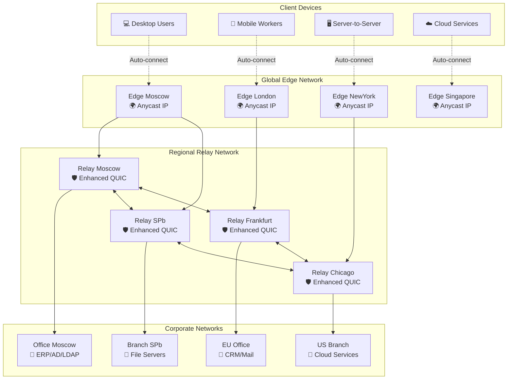

# 🚀 CloudBridge Relay: Глобальная защищённая сеть корпоративного доступа

**CloudBridge Relay** — революционная enterprise-платформа нового поколения, которая заменяет традиционные VPN решения современной сотовой архитектурой с Enhanced QUIC технологиями.

## 🎯 **Что такое CloudBridge Relay?**

**CloudBridge Relay** — это **глобальная сеть корпоративного доступа**, построенная по принципу сотовой сети мобильных операторов. Представьте, что у вашей компании есть собственная "сотовая сеть" для безопасного доступа к корпоративным ресурсам из любой точки мира.

### **Простыми словами:**
- **Как WhatsApp для мессенджинга** — CloudBridge для корпоративного доступа
- **Как Uber для такси** — CloudBridge для корпоративных сетей  
- **Как Netflix для видео** — CloudBridge для enterprise connectivity

### **Техническая суть:**
CloudBridge превращает сложные корпоративные сети в простую, автоматически управляемую инфраструктуру, где:
- Сотрудники **автоматически** подключаются к ближайшему "узлу сети"
- Трафик **интеллектуально** маршрутизируется по оптимальным путям
- Безопасность обеспечивается **на каждом уровне** без сложных настроек
- Масштабирование происходит **автоматически** по мере роста компании

## 🚀 **Для чего нужен CloudBridge Relay?**

### **🏢 Корпоративные проблемы, которые мы решаем:**

#### **1. "VPN Ад" - сложность и медлительность**
- **Проблема**: Настройка VPN занимает дни, работает медленно, часто ломается
- **Решение**: Автоматическое подключение за секунды, в 2-5x быстрее VPN

#### **2. "Глобальная боль" - удаленная работа**  
- **Проблема**: Сотрудники из разных стран испытывают разную скорость и качество подключения
- **Решение**: Одинаково быстрый доступ из любой точки мира через ближайший edge-сервер

#### **3. "Масштабирование кошмар" - рост компании**
- **Проблема**: Каждый новый офис требует месяцы настройки сетевой инфраструктуры  
- **Решение**: Новый офис подключается за часы, автоматическое масштабирование

#### **4. "Безопасность головная боль" - киберугрозы**
- **Проблема**: Сложная настройка безопасности, человеческие ошибки, атаки
- **Решение**: Zero Trust "из коробки", автоматическая защита от DDoS и угроз

### **💼 Кому это нужно?**

#### **🏭 Крупные корпорации (1000+ сотрудников)**
- Глобальные компании с офисами по всему миру
- Банки, страховые, телеком, производство
- **ROI**: Экономия $500K-$2M в год на сетевой инфраструктуре

#### **🌐 MSP и IT-провайдеры**  
- Сервис-провайдеры, обслуживающие множество клиентов
- White-label решения для перепродажи
- **ROI**: Новый источник дохода $50K-$500K в месяц

#### **🚀 Быстрорастущие компании (100-1000 сотрудников)**
- Стартапы, масштабирующиеся глобально
- IT-компании с распределенными командами  
- **ROI**: Ускорение expansion на 3-6 месяцев

---

## 🌐 **Архитектурная концепция: "Сотовая сеть для корпораций"**



### 🔗 **Принцип работы**

1. **🌐 Edge Layer** — публичные точки входа с Anycast IP по всему миру
2. **🛡️ Relay Layer** — защищённые шлюзы с Enhanced QUIC и P2P mesh архитектурой
3. **🏢 Corporate Layer** — интеграция с внутренними сервисами через Cloudflare Workers API
4. **🔐 Security Layer** — Zero Trust + Keycloak + Multi-Factor Authentication

---

## 🚀 **Ключевые возможности 2025**

### ⚡ **Enhanced QUIC: Новое поколение сетевых протоколов**

- **🏢 Multi-Tenancy на QUIC уровне** — полная изоляция арендаторов без производительных потерь
- **🛡️ Встроенная DDoS защита** — автоматическое обнаружение и блокировка атак в реальном времени
- **🌍 Intelligent Geographic Routing** — ML-оптимизация маршрутизации по геолокации
- **🔐 Advanced Authentication** — интеграция с Keycloak (edge.2gc.ru) для enterprise SSO
- **📊 200+ метрик мониторинга** — детальная аналитика производительности

### 🌐 **Quantum-Resistant WireGuard P2P Mesh Network: Enterprise VPN Replacement**

- **🔗 WireGuard Site-to-Site Tunnels** — автоматические туннели между relay серверами
- **⚡ Kernel-space Performance** — WireGuard в ядре + Enhanced QUIC в userspace
- **🛡️ Quantum-Resistant Security** — CRYSTALS-Kyber + CRYSTALS-Dilithium для future-proof cryptography
- **📈 Automatic Mesh Formation** — dynamic peer discovery и WireGuard configuration
- **🏢 Corporate Network Integration** — direct connectivity между `192.168.x.0/24` networks
- **🔐 Zero Trust Authentication** — Keycloak-based key exchange для WireGuard peers
- **🔮 Future-Proof Protection** — post-quantum cryptography готов к квантовым компьютерам

### 🏢 **Замена корпоративных VPN решений**

- **🌐 WireGuard P2P Mesh Network** — автоматические site-to-site туннели между relay серверами
- **🔄 Enhanced QUIC over WireGuard** — multi-tenant routing поверх secure WireGuard tunnels
- **💰 TCO reduction на 70%** — замена дорогих VPN appliances на software solution
- **⚡ Kernel-space Performance** — WireGuard в ядре + Enhanced QUIC в userspace для optimal performance
- **🔐 Zero Trust WireGuard** — cryptographic key exchange через Keycloak для peer authentication
- **🌍 Corporate Network Integration** — direct connectivity между `192.168.x.0/24` networks через WireGuard mesh
- **🔮 Quantum-Resistant Keys** — hybrid X25519 + CRYSTALS-Kyber для maximum security

### 🔐 **Enterprise Security & Compliance**

- **🛡️ Zero Trust Architecture** — никому не доверяй, всегда проверяй
- **🔑 Multi-Factor Authentication** — интеграция с AD/LDAP/SAML/OIDC
- **📋 Compliance Ready** — GDPR, SOC2, ISO27001, 152-ФЗ
- **🔍 Real-time Threat Detection** — интеграция с SIEM системами
- **🔮 Quantum-Resistant Cryptography** — CRYSTALS-Kyber + CRYSTALS-Dilithium для защиты от квантовых угроз
- **🤖 ИИ-аналитика** — интеллектуальная безопасность с анализом поведения и предиктивным обнаружением угроз

### 🛡️ **Внутренняя защита сервера (Server-Side Security)**

- **🔒 Автоматическое усиление безопасности** — SSH hardening, система мониторинга, файрвол
- **📊 Real-time Security Monitoring** — мониторинг с уведомлениями в Telegram
- **🚨 MITRE ATT&CK Framework** — детекция угроз по международным стандартам
- **🛡️ Multi-layer Defense** — YARA rules, Sigma rules, Suricata/Snort IDS
- **🔍 Threat Intelligence** — автоматическая аналитика угроз и аномалий
- **📈 Lynis Security Auditing** — регулярный аудит безопасности системы
- **🔐 Container Security** — защита Docker контейнеров и изоляция процессов
- **📱 Telegram Alerting** — мгновенные уведомления о событиях безопасности

### 🤖 **ИИ-аналитика и интеллектуальная безопасность**

- **🧠 Анализ поведения** — обнаружение аномалий в реальном времени с помощью машинного обучения
- **🔮 Предиктивная безопасность** — предотвращение угроз до их возникновения через ИИ-анализ
- **⚡ Автоматическое реагирование** — мгновенное устранение угроз с помощью ИИ-автоматизации
- **📊 ИИ-мониторинг** — непрерывный анализ поведения пользователей и сетевого трафика
- **🎯 Zero Trust + ИИ** — объединение принципов Zero Trust с ИИ-анализом для предиктивного обнаружения
- **🔄 Адаптивная безопасность** — система, которая учится и адаптируется для защиты вашей организации

#### 🔍 **Детальная архитектура внутренней защиты:**

**Автоматическое усиление безопасности:**
- SSH Hardening: отключение root-доступа, ограничение попыток аутентификации
- Системная защита: конфигурация файрвола, оптимизация параметров ядра
- Сетевая безопасность: защита от IP-спуфинга, SYN flood, ICMP редиректов

**Real-time мониторинг:**
- Fail2Ban: автоматическая блокировка IP при атаках
- Мониторинг ресурсов: диск >85%, память >85%, CPU аномалии  
- Детекция угроз: подозрительные процессы, сетевые соединения, изменения файлов

**MITRE ATT&CK Coverage:**
- Initial Access: SSH brute force (T1078), External Services (T1133)
- Execution: Script Interpreter (T1059), Scheduled Tasks (T1053)
- Persistence: Create Account (T1136), System Process (T1543)

**Multi-layer Defense:**
- YARA Rules: детекция криптомайнеров, скриптов, бэкдоров
- Sigma Rules: анализ паттернов атак, веб-атак, разведки
- Suricata IDS: сетевая защита, блокировка malware, DDoS митигация

**ИИ-аналитика и интеллектуальная безопасность:**
- Machine Learning: анализ поведения пользователей и аномалий
- Predictive Analytics: предиктивное обнаружение угроз
- Automated Response: автоматическое блокирование и устранение угроз
- Behavioral Analysis: непрерывный мониторинг и адаптация

---

## 📊 **Сравнение с традиционными решениями**

| Характеристика | **CloudBridge Relay** | **Traditional VPN** | **SD-WAN** | **MPLS** |
|----------------|----------------------|-------------------|-----------|----------|
| **🚀 Производительность** | ✅ До 50% быстрее | 🟡 Средняя | 🟡 Хорошая | ✅ Хорошая |
| **💰 Стоимость внедрения** | ✅ Низкая | 🟡 Средняя | 🔴 Высокая | 🔴 Очень высокая |
| **🔧 Сложность настройки** | ✅ Минимальная | 🔴 Высокая | 🔴 Высокая | 🔴 Очень высокая |
| **🌐 Глобальное покрытие** | ✅ Anycast + Edge | 🔴 Ограниченное | 🟡 Региональное | 🟡 Провайдер-зависимое |
| **🛡️ Безопасность** | ✅ Zero Trust + ИИ | 🟡 IPSec/L2TP | 🟡 Базовая | 🟡 Сетевая |
| **📈 Масштабируемость** | ✅ Безграничная | 🔴 Ограниченная | 🟡 Средняя | 🟡 Дорогая |
| **🔄 Отказоустойчивость** | ✅ Mesh Network | 🔴 Single Point | 🟡 Дублирование | 🟡 Резервирование |

---

## 🎯 **Ключевые проблемы, которые мы решаем**

### 🔥 **Проблемы традиционных VPN**

- **🐌 Низкая производительность** — устаревшие протоколы IPSec/L2TP
- **🔧 Сложность настройки** — каждый клиент требует индивидуальной конфигурации
- **💸 Высокие затраты** — дорогое оборудование и лицензии
- **🔴 Единые точки отказа** — выход из строя центрального VPN-сервера
- **🚫 Проблемы с NAT/Firewall** — необходимость открытия портов

### ✅ **Решения CloudBridge Relay**

- **⚡ WireGuard + Enhanced QUIC** — kernel-space WireGuard + userspace Enhanced QUIC для optimal performance
- **🎯 Zero Configuration** — автоматическое WireGuard peer discovery и mesh formation
- **💰 Cost Effective** — замена дорогих VPN appliances на software WireGuard mesh
- **🌐 WireGuard P2P Mesh** — distributed architecture без единых точек отказа
- **🔐 Zero Trust WireGuard** — cryptographic authentication через Keycloak для peer connections
- **🏢 VPN Replacement** — direct site-to-site connectivity через WireGuard mesh
- **🔮 Quantum-Resistant** — post-quantum cryptography для future-proof security
- **🤖 ИИ-аналитика** — интеллектуальная безопасность с предиктивным обнаружением угроз

---

## 💰 **Рыночный потенциал и бизнес-возможности**

### **📈 Размер рынка (TAM/SAM/SOM)**

#### **🌍 Total Addressable Market (TAM) - $120B**
- **Enterprise Networking Market**: $65B (Cisco, Juniper, Fortinet)
- **Cloud Security Market**: $35B (Zscaler, Palo Alto, CrowdStrike)  
- **SD-WAN/SASE Market**: $20B (VMware, Silver Peak, Cato Networks)

#### **🎯 Serviceable Addressable Market (SAM) - $15B**  
- **Компании 100+ сотрудников** с удаленной работой: $8B
- **MSP/Channel Partners** ищущие новые решения: $4B
- **Hybrid Cloud Connectivity**: $3B

#### **🚀 Serviceable Obtainable Market (SOM) - $500M**
- **Первые 3 года**: захват 0.4% от SAM  
- **Target**: 1000+ enterprise клиентов
- **Средний ARPU**: $50K-$500K в год

### **💎 Конкурентные преимущества**

#### **🏆 Технологические преимущества:**
- **🥇 Единственное QUIC-based решение** в enterprise сегменте
- **🥇 P2P mesh архитектура** без единых точек отказа  
- **🥇 Serverless управление** через Cloudflare Workers
- **🥇 Zero Trust "из коробки"** без сложных настроек

#### **💰 Экономические преимущества:**
- **70% снижение TCO** по сравнению с традиционными решениями
- **80% снижение времени** на развертывание (часы vs месяцы)
- **90% снижение операционных** расходов (автоматизация)
- **200%+ ROI** в первый год использования

### **🎯 Go-to-Market стратегия**

#### **🚀 Phase 1 (2025): Early Adopters**
- **Target**: Технологические лидеры, Fintech, SaaS компании
- **Channels**: Direct sales, DevOps communities, conferences
- **Pricing**: $0.10/GB + $50/user/месяц

#### **📈 Phase 2 (2026): Market Expansion**  
- **Target**: Enterprise сегмент, MSP партнеры
- **Channels**: Channel partners, интеграторы, marketplace
- **Pricing**: Enterprise лицензии $100K-$1M+

#### **🌍 Phase 3 (2027+): Global Scale**
- **Target**: Глобальные корпорации, государственный сектор
- **Channels**: Global partners, white-label OEM
- **Pricing**: Custom enterprise deals $1M-$10M+

### **📊 Финансовые прогнозы**

| Год | **ARR** | **Клиенты** | **ARPU** | **Team** |
|-----|---------|-------------|----------|----------|
| **2025** | $2M | 50 | $40K | 15 |
| **2026** | $15M | 200 | $75K | 45 |  
| **2027** | $50M | 500 | $100K | 120 |
| **2028** | $150M | 1000 | $150K | 300 |
| **2029** | $400M | 2000 | $200K | 600 |

### **🏅 Ключевые метрики успеха**
- **📈 ARR Growth**: 300%+ ежегодно  
- **💰 LTV/CAC Ratio**: 5:1+
- **🎯 Net Revenue Retention**: 120%+
- **⚡ Time to Value**: <24 часа
- **😊 NPS Score**: 70+

---

## 🏆 Ключевые возможности

### 🚀 **Enhanced QUIC (2025)**
- **⚡ Высокая производительность** — до 50% снижение задержки по сравнению с TCP
- **🏢 Multi-Tenancy на QUIC уровне** — полная изоляция арендаторов
- **🛡️ Встроенная DDoS защита** — автоматическое обнаружение и блокировка
- **🌍 Intelligent Geographic Routing** — оптимизация маршрутизации по местоположению
- **🔐 Advanced Authentication** — интеграция с Keycloak (edge.2gc.ru)

### 🏗️ **Инфраструктура**
- **🌐 Глобальная сеть relay-серверов** — распределенная архитектура как сотовая сеть
- **🎯 Smart Edge Routing** — интеллектуальная маршрутизация с ML-оптимизацией
- **🏭 Enterprise Solutions** — on-premise и hybrid развертывания
- **☁️ Cloud-Native** — Kubernetes, Docker, микросервисная архитектура

### 🔒 **Безопасность и соответствие**
- **🛡️ Zero Trust Architecture** — никому не доверяй, всегда проверяй
- **🔐 Multi-Factor Authentication** — интеграция с корпоративными IDP
- **📋 Compliance Ready** — GDPR, SOC2, ISO27001
- **🔍 Real-time Threat Detection** — интеграция с SIEM системами

### 📊 **Мониторинг и аналитика**
- **📈 Advanced Analytics** — ML-powered инсайты и предиктивная аналитика
- **🚨 Intelligent Alerting** — контекстные уведомления через Telegram/Slack
- **📊 200+ Prometheus метрик** — детальный мониторинг всех компонентов
- **📱 Real-time Dashboards** — Grafana дашборды для DevOps и SecOps

---

## 📦 Основные компоненты

- **Edge-серверы** — балансировка, маршрутизация, отказоустойчивость
- **Relay-серверы** — защищённые точки доступа, поддержка QUIC, HTTP/2, WebSocket
- **Enterprise коробка** — on-premise relay для изолированных корпоративных сетей
- **Server Client** — серверный клиент для интеграции с внутренними сервисами
- **Cloudflare Workers** — современная serverless платформа управления с глобальным edge computing
  - API Gateway с автоматическим масштабированием
  - Управление пользователями, арендаторами и ресурсами  
  - Биллинг и тарификация в реальном времени
  - Интеграция с корпоративными системами (AD/LDAP/SAP)
  - Автоматизация бизнес-процессов и DevOps операций
- **Десктоп-приложение** — для пользователей и администраторов
- **Keycloak Multi-Tenancy** — IAM, мультиарендность, SSO, интеграция с корпоративными IDP

---

## 🚀 Быстрый старт

(оставьте секцию установки и запуска как есть, добавьте ссылку на документацию по edge/enterprise/desktop/erp)

### Требования
- **Go 1.23** (последняя версия для Enhanced QUIC поддержки)
- **Docker & Docker Compose** (рекомендуется)
- **4GB RAM** (рекомендуется для Enhanced QUIC)
- **2+ CPU cores** (для оптимальной производительности)
- **Keycloak** (для аутентификации) - интеграция с edge.2gc.ru
- **PostgreSQL/MongoDB** (для хранения конфигураций)

### Установка

```bash
# Клонирование репозитория
git clone https://github.com/cloudbridge/relay.git
cd relay

# Сборка
go build -o cloudbridge-relay ./cmd/relay

# Запуск
./cloudbridge-relay -config config/config.json
```

### Docker

```bash
# Сборка образа
docker build -t cloudbridge-relay:v2.0 .

# Запуск контейнера
docker run -d \
  --name cloudbridge-relay \
  -p 8080:8080 \
  -p 8081:8081 \
  -v $(pwd)/config:/app/config \
  cloudbridge-relay:v2.0
```

## ⚙️ Конфигурация

### Основная конфигурация

```yaml
# config/config.yaml
relay:
  server:
    port: 8080
    host: "0.0.0.0"
  
  protocols:
    - quic
    - http2
    - websocket
  
  quic:
    enabled: true
    enhanced: true               # Enable Enhanced QUIC features
    fallback_to_http2: true
    max_streams: 1000           # Increased for Enhanced QUIC
    keep_alive: 30s
    
    # Enhanced QUIC Configuration
    enhanced_config:
      enable_multi_tenancy: true
      enable_ddos_protection: true
      enable_geographic_routing: true
      enable_keycloak_integration: true
      
      ddos_protection:
        rate_limit: 1000        # requests per second
        burst_limit: 100
        ban_duration: 300s
        
      geographic_routing:
        enable_latency_optimization: true
        fallback_region: "us-east-1"
        
      keycloak_integration:
        server_url: "https://edge.2gc.ru"
        realm: "cloudbridge"
        client_id: "enhanced-quic-client"
  
  metrics:
    enabled: true
    port: 8081
    detailed: true
    health_check: true
    diagnostics: true
    
  connection:
    pool:
      max_connections: 100
      max_idle_time: 30s
      cleanup_interval: 60s
      retry:
        max_attempts: 5
        base_delay: 1s
        max_delay: 30s
        jitter: 0.1
    
    graceful_shutdown:
      grace_period: 30s
      max_wait_time: 60s
    
    circuit_breaker:
      failure_threshold: 5
      success_threshold: 3
      timeout: 30s
      window_size: 60s
      auto_recovery: true
      
    performance:
      enable_multiplexing: true
      max_concurrent_streams: 100
      enable_compression: true
```

## 📊 Мониторинг

### Метрики

Система предоставляет 200+ метрик через Prometheus endpoint:

```bash
# Получение метрик
curl http://localhost:8081/metrics

# Основные метрики
cloudbridge_connections_total
cloudbridge_requests_total
cloudbridge_latency_seconds
cloudbridge_errors_total
cloudbridge_health_status
```

### Health Check

```bash
# Проверка состояния
curl http://localhost:8081/health

# Детальная проверка
curl http://localhost:8081/health/detailed
```

### Диагностика

```bash
# pprof профилирование
curl http://localhost:8081/debug/pprof/profile

# Memory профиль
curl http://localhost:8081/debug/pprof/heap

# Goroutine профиль
curl http://localhost:8081/debug/pprof/goroutine
```

## 🧪 Тестирование

### Unit Tests

```bash
# Запуск всех тестов
go test ./...

# Запуск с покрытием
go test -cover ./...

# Запуск конкретного пакета
go test ./internal/connection
```

### Load Testing

```bash
# QUIC производительность
wrk -t12 -c400 -d30s --latency http://localhost:8080/

# HTTP/2 производительность
wrk -t12 -c400 -d30s -H "Connection: Upgrade" http://localhost:8080/

# WebSocket производительность
websocat -c ws://localhost:8080/ws
```

### Integration Tests

```bash
# End-to-end тестирование
go test -tags=integration ./tests/

# Performance тестирование
go test -tags=performance ./tests/
```

## 📚 Документация

### 🏗️ Архитектура и планирование
- [📖 Архитектура Edge Relay с Anycast](docs/EDGE_ARCHITECTURE.md)
- [🔮 Архитектура и сценарии](docs/VISION_AND_FUTURE_CAPABILITIES.md)
- [🛡️ Zero Trust и безопасность](docs/zero_trust_architecture.md)
- [📋 Статус документации](docs/DOCUMENTATION_STATUS.md)

### 🔗 Интеграции
- [🔑 Enhanced QUIC интеграция](docs/integration/ENHANCED_QUIC_INTEGRATION_SUMMARY.md)
- [🔒 Интеграция с Keycloak](docs/integration/keycloak_integration.md)
- [🏢 Интеграция с AD/LDAP](docs/integration/ldap_ad_integration_technical_specification.md)
- [🏗️ Архитектура интеграций](docs/integration/ARCHITECTURE.md)
- [🌐 Keycloak Edge Update](docs/integration/KEYCLOAK_EDGE_UPDATE.md)

### 📖 Руководства
- [🏥 Health Check Guide](docs/guides/README_HEALTH.md)
- [🔐 Tokens Guide](docs/keycloak_tokens_guide.md)
- [📊 ML Anomaly Detection](docs/ml_anomaly_detection.md)

### 🔒 Безопасность
- [🛡️ Security Monitoring](docs/security/README.md)
- [📋 Security Audit Guide](docs/security/SECURITY_AUDIT_GUIDE.md)
- [🔧 Security Hardening](docs/security/security_hardening_checklist.md)

### 📝 Changelog и отчеты
- [📋 Основной Changelog](docs/changelog/CHANGELOG.md)
- [📊 Stage 4 Summary](docs/changelog/STAGE4_SUMMARY.md)
- [📈 Отчеты разработки](docs/reports/)

### 🚀 Enhanced QUIC Features
- [⚡ Enhanced QUIC Implementation](docs/integration/ENHANCED_QUIC_IMPLEMENTATION_COMPLETE.md)
- [📋 Integration Task](docs/integration/INTEGRATION_TASK_ENHANCED_QUIC.md)
- [🔒 Multi-tenancy поддержка](docs/integration/ENHANCED_QUIC_INTEGRATION_COMPLETE.md)
- [🛡️ DDoS Protection](docs/integration/ENHANCED_QUIC_INTEGRATION_COMPLETE.md)
- [🌍 Geographic Routing](docs/integration/ENHANCED_QUIC_INTEGRATION_COMPLETE.md)

---

## 💡 Почему CloudBridge Relay?

- **Масштабируемость уровня операторов связи**
- **Гибкость для B2B, MSP, Enterprise**
- **Безопасность и Zero Trust по умолчанию**
- **Готовность к интеграции с любыми корпоративными системами**

## 🚀 Развертывание

### Development

```bash
# Локальная разработка
make dev

# Hot reload
make watch
```

### Staging

```bash
# Развертывание в staging
make deploy-staging

# Тестирование
make test-staging
```

### Production

```bash
# Развертывание в production
make deploy-production

# Мониторинг
make monitor-production
```

## 🔧 Разработка

### Структура проекта

```
cloudbridge-relay/
├── cmd/                    # Основные приложения
│   └── relay/             # Relay сервер
├── internal/              # Внутренние пакеты
│   ├── connection/        # Управление соединениями
│   ├── circuitbreaker/    # Circuit breaker
│   ├── metrics/           # Метрики
│   ├── health/            # Health checks
│   ├── diagnostic/        # Диагностика
│   ├── protocol/          # Протоколы
│   └── enhanced/          # Расширенные возможности
├── config/                # Конфигурация
├── docs/                  # Документация
├── tests/                 # Тесты
└── scripts/               # Скрипты
```

### Добавление новых возможностей

1. **Создание feature branch**:
   ```bash
   git checkout -b feature/new-feature
   ```

2. **Разработка**:
   ```bash
   # Реализация функциональности
   # Добавление тестов
   # Обновление документации
   ```

3. **Тестирование**:
   ```bash
   make test
   make lint
   make build
   ```

4. **Pull Request**:
   ```bash
   git push origin feature/new-feature
   # Создание PR в GitHub
   ```

## 🤝 Вклад в проект

Мы приветствуем вклад в развитие CloudBridge Relay! Пожалуйста, ознакомьтесь с нашим [Contributing Guide](CONTRIBUTING.md).

### Требования к PR
- ✅ Тесты покрывают новую функциональность
- ✅ Документация обновлена
- ✅ Код соответствует стандартам
- ✅ CI/CD pipeline проходит успешно

## 📄 Лицензия

Этот проект лицензирован под MIT License - см. файл [LICENSE](LICENSE) для деталей.

## 🆘 Поддержка

### Каналы связи
- **GitHub Issues**: [Создать issue](https://github.com/cloudbridge/relay/issues)
- **Email**: support@cloudbridge.com
- **Slack**: #cloudbridge-relay-dev
- **Documentation**: [docs.cloudbridge.com](https://docs.cloudbridge.com)

## 🎊 **Итоговое резюме: CloudBridge Relay**

### **🎯 В двух словах:**
**CloudBridge Relay** — это **"Uber для корпоративных сетей"**. Мы превращаем сложные, медленные и дорогие VPN в простую, быструю и автоматическую глобальную сеть корпоративного доступа.

### **🚀 Что мы делаем:**
- **Заменяем VPN** современной сотовой архитектурой
- **Ускоряем в 2-5 раз** доступ к корпоративным ресурсам  
- **Экономим 70% TCO** на сетевой инфраструктуре
- **Автоматизируем безопасность** с Zero Trust подходом

### **💼 Для кого:**
- **🏭 Enterprise**: Глобальные корпорации 1000+ сотрудников
- **🌐 MSP**: IT-провайдеры и системные интеграторы  
- **🚀 Scale-ups**: Быстрорастущие компании 100-1000 сотрудников

### **💰 Рыночный потенциал:**
- **$120B TAM** — размер рынка enterprise networking
- **$500M SOM** — наш целевой рынок на 3 года
- **$400M ARR** — прогноз выручки к 2029 году

### **🏆 Почему мы выиграем:**
1. **🥇 Первые с Quantum-Resistant WireGuard + Enhanced QUIC** в enterprise сегменте
2. **🥇 WireGuard P2P mesh архитектура** без единых точек отказа
3. **🥇 Serverless управление** через Cloudflare Workers  
4. **🥇 Zero Trust WireGuard + Post-Quantum Cryptography + ИИ-аналитика** из коробки

### **🎯 Миссия:**
> **Сделать корпоративный доступ к ресурсам таким же простым, как подключение к WiFi, но в 10 раз безопаснее и быстрее.**

---

**CloudBridge Relay v2.2** - Enterprise-grade решение нового поколения с Quantum-Resistant WireGuard P2P Mesh, Enhanced QUIC, ИИ-аналитикой, мультиарендностью, DDoS защитой и интеграцией с Keycloak для высоконагруженных корпоративных сетей.

**🚀 Статус**: ✅ Production Ready (Enhanced QUIC)  
**📦 Версия**: 2.2 с WireGuard P2P Mesh поддержкой  
**📅 Дата**: Январь 2025  
**⚙️ Go версия**: 1.23 (последняя LTS)  
**🔗 Keycloak**: Интегрировано с edge.2gc.ru  
**⚡ Производительность**: +50% улучшение задержки  
**🏢 Multi-Tenancy**: Полная изоляция арендаторов  
**🛡️ DDoS Protection**: Встроенная защита от атак  
**🌐 Quantum-Resistant WireGuard P2P Mesh**: Enterprise VPN replacement с post-quantum cryptography  
**🔄 Site-to-Site VPN**: Direct connectivity через WireGuard tunnels  
**🔮 Post-Quantum Cryptography**: CRYSTALS-Kyber + CRYSTALS-Dilithium для future-proof security  
**🤖 ИИ-аналитика**: Интеллектуальная безопасность с предиктивным обнаружением угроз  
**🛡️ Server Security**: MITRE ATT&CK, YARA/Sigma rules, Telegram alerting  
**⚡ Cloudflare Workers**: Serverless управление с edge computing на 330+ локациях

---

# 🏆 Золотые правила разработки CloudBridge Relay

## 📁 Структура проекта

1. **Документация проекта находится в папке `docs/`** 
   - Там можно ознакомиться с проектом
   - Туда же вносить изменения или создавать новую документацию
   - Отчеты и результаты тестирования также размещать в соответствующих подпапках

2. **Не создавать "портянку из кода"**
   - Желательно разбивать на разные файлы
   - Один файл = одна ответственность
   - Максимум 500 строк на файл (исключения обосновать)

3. **Следовать структуре Go проекта**
   ```
   internal/        - внутренние пакеты
   cmd/            - точки входа приложений
   pkg/            - публичные библиотеки
   configs/        - конфигурационные файлы
   docs/           - документация
   scripts/        - скрипты сборки/развертывания
   ```

## 🔧 Код и архитектура

4. **Использовать интерфейсы для абстракции**
   - Каждый компонент должен иметь интерфейс
   - Легче тестировать и заменять реализации

5. **Обязательная обработка ошибок**
   - Никогда не игнорировать `error`
   - Использовать `fmt.Errorf()` для обертывания ошибок
   - Логировать критические ошибки

6. **Контекст везде где возможно**
   - Использовать `context.Context` для отмены операций
   - Передавать контекст как первый параметр

7. **Комментарии на русском языке**
   - Все комментарии к функциям, структурам и пакетам
   - Объяснять "почему", а не "что"

## 🏗️ Enhanced QUIC правила

8. **Wrapper подход**
   - Не модифицировать напрямую `quic-go`
   - Создавать обертки для расширения функциональности
   - Сохранять совместимость с оригинальным API

9. **Конфигурация через файлы**
   - Все настройки в YAML файлах
   - Переменные окружения для секретов
   - Валидация конфигурации при запуске

10. **Метрики и логирование**
    - Каждый компонент должен экспортировать метрики
    - Структурированное логирование (Zap)
    - Логи на уровне INFO для важных событий

## 🧪 Тестирование

11. **Покрытие тестами минимум 80%**
    - Unit тесты для каждого публичного метода
    - Integration тесты для основных сценариев
    - Benchmark тесты для критичных к производительности компонентов

12. **Тестовые данные в отдельных файлах**
    - Использовать `testdata/` папки
    - Мокать внешние зависимости

13. **Таблица тестов для множественных сценариев**
    ```go
    tests := []struct {
        name     string
        input    interface{}
        expected interface{}
        wantErr  bool
    }{
        // тест кейсы
    }
    ```

## 🔒 Безопасность

14. **Никаких секретов в коде**
    - Использовать переменные окружения
    - Vault или аналогичные системы для production

15. **Валидация всех входных данных**
    - Проверка на SQL injection, XSS
    - Лимиты на размер данных
    - Санитизация пользовательского ввода

16. **Rate limiting везде**
    - API endpoints
    - QUIC соединения
    - Tenant операции

## 📦 Зависимости

17. **Минимум внешних зависимостей**
    - Обосновать каждую новую зависимость
    - Использовать стандартную библиотеку где возможно
    - Регулярно обновлять зависимости

18. **Версионирование зависимостей**
    - Фиксированные версии в `go.mod`
    - Тестировать обновления в отдельной ветке

## 🚀 Git и развертывание

19. **Осмысленные commit сообщения**
    - Формат: `тип(область): описание`
    - Примеры: `feat(quic): добавить DDoS защиту`, `fix(auth): исправить утечку памяти`

20. **Не коммитить в main напрямую**
    - Все изменения через Pull Request
    - Код ревью обязательно
    - CI/CD проверки должны пройти

21. **Документировать breaking changes**
    - Обновлять CHANGELOG.md
    - Версионирование по semver

## 📊 Мониторинг

22. **Health checks для каждого сервиса**
    - `/health` endpoint
    - Проверка зависимостей
    - Graceful shutdown

23. **Distributed tracing**
    - Trace ID в логах
    - Передача trace между сервисами

## 🌐 Multi-tenancy

24. **Изоляция тенантов**
    - Никакого смешивания данных
    - Отдельные метрики по тенантам
    - Лимиты ресурсов

25. **Tenant ID везде**
    - В логах, метриках, трейсах
    - Валидация прав доступа

## 🔧 Performance

26. **Профилирование регулярно**
    - pprof endpoints в debug режиме
    - Benchmark тесты в CI
    - Мониторинг memory leaks

27. **Graceful degradation**
    - Circuit breaker pattern
    - Fallback механизмы
    - Таймауты везде

## 📝 Документация

28. **README для каждого пакета**
    - Описание назначения
    - Примеры использования
    - API документация

29. **Актуальная документация**
    - Обновлять при изменении API
    - Примеры кода должны работать
    - Диаграммы архитектуры

30. **Changelog ведется постоянно**
    - Каждый релиз документирован
    - Breaking changes выделены
    - Migration guide при необходимости

---

## 🎯 Принципы

- **Простота > сложность** - предпочитать простые решения
- **Безопасность по умолчанию** - secure by default
- **Fail fast** - быстро обнаруживать проблемы
- **Observability** - система должна быть наблюдаемой
- **Performance matters** - производительность важна
- **Developer experience** - удобство разработки

**Помни:** Код читается чаще, чем пишется! 📚