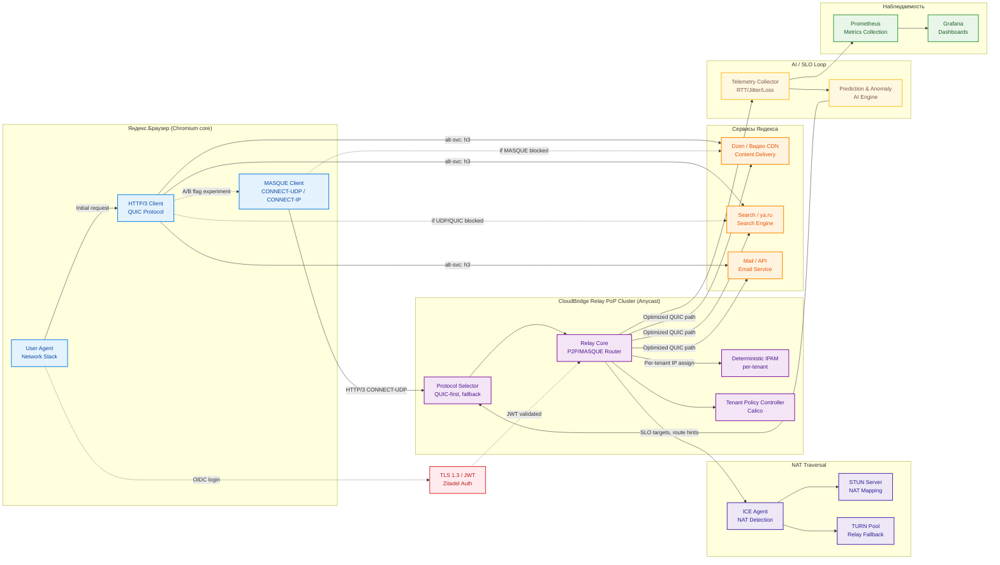

# CloudBridge Relay - Интеграция с Яндекс.Браузер

## Схема интеграции CloudBridge с Яндекс.Браузер

## Описание интеграции

### Яндекс.Браузер (Chromium core)
- **User Agent**: Сетевой стек браузера
- **HTTP/3 Client**: QUIC протокол для быстрого соединения
- **MASQUE Client**: Поддержка CONNECT-UDP/CONNECT-IP для туннелирования

### Сервисы Яндекса
- **Dzen/Видео CDN**: Контент-доставка и видео
- **Search/ya.ru**: Поисковая система
- **Mail/API**: Почтовый сервис и API

### CloudBridge Relay PoP Cluster
- **Protocol Selector**: Выбор протокола (QUIC-first, fallback)
- **Relay Core**: P2P/MASQUE маршрутизатор
- **Deterministic IPAM**: Управление IP-адресами по арендаторам
- **Tenant Policy Controller**: Calico политики изоляции

### NAT Traversal
- **ICE Agent**: Детекция NAT
- **STUN Server**: Маппинг NAT
- **TURN Pool**: Relay fallback

### AI / SLO Loop
- **Telemetry Collector**: Сбор метрик RTT/Jitter/Loss
- **Prediction & Anomaly**: AI движок для предсказаний

### Наблюдаемость
- **Prometheus**: Сбор метрик
- **Grafana**: Дашборды и визуализация

## Поток данных

### 1. Инициализация
- Пользователь открывает Яндекс.Браузер
- Браузер отправляет HTTP/3 запросы к сервисам Яндекса
- Обнаруживается поддержка alt-svc: h3

### 2. A/B эксперимент
- Браузер получает флаг для участия в эксперименте
- Активируется MASQUE клиент
- Устанавливается соединение с CloudBridge Relay

### 3. Ускорение трафика
- MASQUE туннелирует трафик через CloudBridge Relay
- Relay применяет оптимизации маршрутизации
- Трафик доставляется к сервисам Яндекса по оптимизированному пути

### 4. NAT Traversal
- ICE агент определяет тип NAT
- STUN сервер помогает с маппингом
- TURN сервер используется как fallback

### 5. AI оптимизация
- Собираются метрики производительности
- AI движок анализирует паттерны
- Применяются оптимизации маршрутизации

## Преимущества интеграции

1. **Ускорение трафика** - Оптимизированные маршруты к сервисам Яндекса
2. **NAT Traversal** - Обход ограничений NAT
3. **AI оптимизация** - Умная маршрутизация на основе метрик
4. **Полная наблюдаемость** - Мониторинг производительности
5. **Безопасность** - TLS 1.3 и JWT аутентификация
6. **Multi-tenancy** - Изоляция по арендаторам
7. **Fallback механизмы** - Надежность соединения

CloudBridge Relay обеспечивает интеллектуальное ускорение трафика для Яндекс.Браузера с полной поддержкой современных протоколов и AI-оптимизацией.
