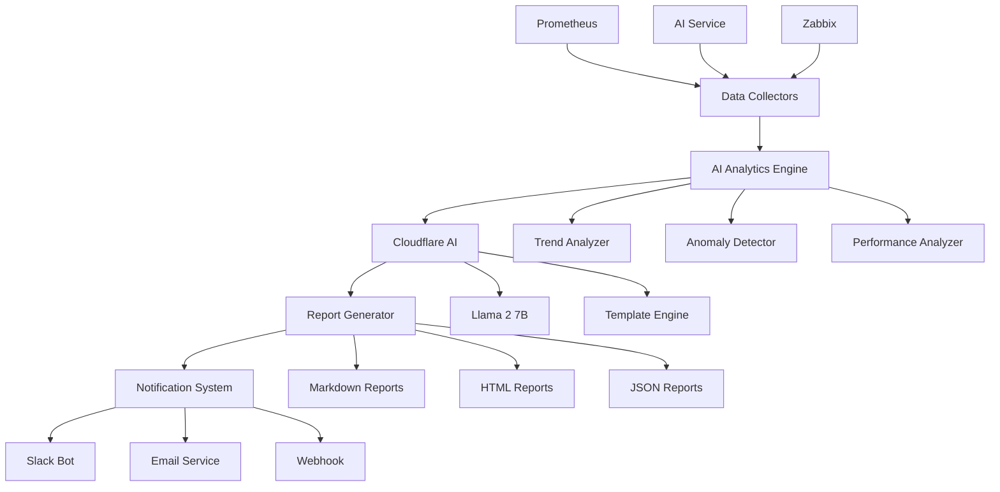

# 🤖 AI-аналитик CloudBridge Relay

## 📋 Обзор

AI-аналитик - это интеллектуальная система для автоматического анализа метрик CloudBridge Relay и генерации сводок на естественном языке с использованием Cloudflare AI.

## ✨ Возможности

- **Автоматический анализ метрик** каждые 15 минут
- **Генерация сводок** на естественном языке (русский/английский)
- **Интеграция с Cloudflare AI** для интеллектуального анализа
- **Уведомления** в Slack/Email/Webhooks
- **REST API** для управления и интеграции
- **Множественные форматы отчетов** (Markdown, HTML, JSON)

## 🏗️ Архитектура



## 🚀 Быстрый старт

### 1. Установка зависимостей

```bash
# Go 1.21+
go mod download

# Docker (опционально)
docker --version
```

### 2. Настройка переменных окружения

```bash
export SLACK_WEBHOOK_URL="https://hooks.slack.com/services/YOUR/SLACK/WEBHOOK"
export AI_ANALYTICS_PORT=8084
```

### 3. Запуск

```bash
# Сборка и запуск
./scripts/start-ai-analytics.sh run

# Или в Docker
./scripts/start-ai-analytics.sh docker

# Или в Kubernetes
./scripts/start-ai-analytics.sh deploy
```

## ⚙️ Конфигурация

### Основной файл конфигурации: `config/ai-analytics.yaml`

```yaml
ai_analytics:
  enabled: true
  schedule: "*/15 * * * *"  # Каждые 15 минут
  max_reports: 100
  retention_days: 30
  
  cloudflare_ai:
    account_id: "073ae0130b7cee5e55a1ac1a335431a8"
    api_token: "KhvSCYQeJXJ6OxN-AHRrh6ZBW-XBJnMmg9dN9qEL"
    model: "@cf/meta/llama-2-7b-chat-fp16"
    max_tokens: 1500
  
  data_sources:
    prometheus:
      enabled: true
      url: "http://192.168.49.2:30083/metrics"
    ai_service:
      enabled: true
      url: "http://192.168.49.2:30083"
  
  notifications:
    slack:
      enabled: true
      webhook_url: "${SLACK_WEBHOOK_URL}"
      channel: "cloudbridge-alerts"
```

## 📊 API Endpoints

### Основные endpoints

```bash
# Генерация отчета
POST /api/v1/ai/analytics/generate-report

# Получение отчетов
GET /api/v1/ai/analytics/reports

# Получение конкретного отчета
GET /api/v1/ai/analytics/reports/{id}

# Получение инсайтов
GET /api/v1/ai/analytics/insights

# Настройка уведомлений
POST /api/v1/ai/analytics/configure-notifications

# Статус сервиса
GET /api/v1/ai/analytics/status

# Health check
GET /health
```

### Примеры использования

```bash
# Генерация отчета
curl -X POST http://localhost:8084/api/v1/ai/analytics/generate-report

# Получение последних отчетов
curl http://localhost:8084/api/v1/ai/analytics/reports

# Получение инсайтов
curl http://localhost:8084/api/v1/ai/analytics/insights
```

## 🔧 Развертывание

### Локальный запуск

```bash
# Сборка
go build -o bin/ai-analytics ./cmd/ai-analytics

# Запуск
./bin/ai-analytics
```

### Docker

```bash
# Сборка образа
docker build -f Dockerfile.ai-analytics -t cloudbridge/ai-analytics:latest .

# Запуск контейнера
docker run -p 8084:8084 \
  -e SLACK_WEBHOOK_URL="https://hooks.slack.com/..." \
  cloudbridge/ai-analytics:latest
```

### Kubernetes

```bash
# Применение манифестов
kubectl apply -f k8s/ai-analytics-deployment.yaml

# Проверка статуса
kubectl get pods -l app=ai-analytics -n cloudbridge

# Просмотр логов
kubectl logs -l app=ai-analytics -n cloudbridge
```

## 📈 Мониторинг

### Метрики

AI-аналитик предоставляет следующие метрики:

- `ai_analytics_reports_generated_total` - Количество сгенерированных отчетов
- `ai_analytics_insights_discovered_total` - Количество обнаруженных инсайтов
- `ai_analytics_recommendations_accepted_total` - Количество принятых рекомендаций
- `ai_analytics_processing_duration_seconds` - Время обработки данных

### Логи

```bash
# Просмотр логов
kubectl logs -l app=ai-analytics -n cloudbridge -f

# Фильтрация по уровню
kubectl logs -l app=ai-analytics -n cloudbridge | grep ERROR
```

## 🔍 Примеры отчетов

### Slack уведомление

```
🤖 CloudBridge AI Analytics Report

2025-01-17 19:30:00

**Резюме:** Система работает стабильно с небольшими предупреждениями по использованию ресурсов. AI сервис показывает хорошую производительность с точностью предсказаний 85%.

🔍 Ключевые инсайты:
• AI сервис показывает стабильную работу с точностью 85%
• Обнаружено 9800 аномалий за период
• Активные соединения: 0 (требует внимания)

🚨 Критические проблемы:
• Активные алерты: 2

💡 Рекомендации:
• Проверить активные алерты (2 активных)
• Оптимизировать использование памяти (268MB)
• Мониторить рост активных соединений

📊 Производительность: Система работает в пределах нормы

🏥 Статус здоровья: warning (75.0/100)
```

### API ответ

```json
{
  "insights": [
    "AI сервис показывает стабильную работу с точностью 85%",
    "Обнаружено 9800 аномалий за период",
    "Активные соединения: 0 (требует внимания)"
  ],
  "recommendations": [
    "Проверить активные алерты (2 активных)",
    "Оптимизировать использование памяти (268MB)",
    "Мониторить рост активных соединений"
  ],
  "timestamp": "2025-01-17T19:30:00Z"
}
```

## 🛠️ Разработка

### Структура проекта

```
internal/ai/analytics/
├── analytics_engine.go      # Основной движок
├── cloudflare_client.go     # Cloudflare AI клиент
├── collectors/              # Сборщики данных
│   ├── prometheus_collector.go
│   └── ai_service_collector.go
├── notifications/           # Система уведомлений
│   └── notification_system.go
└── reports/                 # Генератор отчетов
    └── report_generator.go
```

### Добавление нового сборщика данных

```go
type CustomCollector struct {
    // Поля сборщика
}

func (c *CustomCollector) GetName() string {
    return "custom"
}

func (c *CustomCollector) CollectMetrics(ctx context.Context) (*analytics.MetricsData, error) {
    // Логика сбора данных
    return &analytics.MetricsData{
        Timestamp: time.Now(),
        Source:    "custom",
        Metrics:   metrics,
    }, nil
}
```

### Добавление нового канала уведомлений

```go
func (n *NotificationSystem) sendCustomNotification(report *analytics.Report) error {
    // Логика отправки уведомления
    return nil
}
```

## 🐛 Устранение неполадок

### Частые проблемы

1. **Cloudflare AI недоступен**
   ```
   ERROR: failed to generate analysis: cloudflare ai error: invalid token
   ```
   **Решение:** Проверьте правильность API токена и Account ID

2. **Сборщики данных недоступны**
   ```
   ERROR: Failed to collect metrics from prometheus: connection refused
   ```
   **Решение:** Проверьте доступность источников данных

3. **Slack уведомления не отправляются**
   ```
   ERROR: failed to send Slack notification: unexpected status code: 400
   ```
   **Решение:** Проверьте правильность webhook URL

### Отладка

```bash
# Включение debug логов
export LOG_LEVEL=debug

# Проверка конфигурации
curl http://localhost:8084/api/v1/ai/analytics/status

# Тест генерации отчета
curl -X POST http://localhost:8084/api/v1/ai/analytics/generate-report
```

## 📚 Дополнительные ресурсы

- [Cloudflare AI Documentation](https://developers.cloudflare.com/ai/)
- [Slack Webhook Guide](https://api.slack.com/messaging/webhooks)
- [Prometheus Metrics](https://prometheus.io/docs/concepts/metric_types/)
- [Kubernetes Deployment Guide](https://kubernetes.io/docs/concepts/workloads/controllers/deployment/)

## 🤝 Поддержка

Для получения поддержки:

1. Проверьте логи: `kubectl logs -l app=ai-analytics -n cloudbridge`
2. Проверьте статус: `curl http://localhost:8084/health`
3. Создайте issue в репозитории проекта

---

**AI-аналитик CloudBridge Relay** - автоматизируйте мониторинг и анализ вашей инфраструктуры! 🚀


