# Архитектура глобального Edge Relay с Anycast - Подробное описание

## Содержание

1. [Обзор архитектуры](#обзор-архитектуры)
2. [Ключевые компоненты](#ключевые-компоненты)
3. [Технологический стек](#технологический-стек)
4. [Глобальная схема развертывания](#глобальная-схема-развертывания)
5. [Поток обработки запросов](#поток-обработки-запросов)
6. [Безопасность и Zero Trust](#безопасность-и-zero-trust)
7. [Мониторинг и наблюдаемость](#мониторинг-и-наблюдаемость)
8. [Масштабирование и отказоустойчивость](#масштабирование-и-отказоустойчивость)
9. [Интеграции и экосистема](#интеграции-и-экосистема)
10. [Сценарии использования](#сценарии-использования)

---

## Обзор архитектуры

### Концепция "Сотовой сети"

CloudBridge Relay построен по принципу сотовой сети мобильных операторов:

- **Edge Relay** — "роуминговые хабы", определяют оптимальный relay по локации и нагрузке
- **Relay Server** — "базовые станции", обеспечивают защищённое подключение и маршрутизацию  
- **Клиенты** — "мобильные телефоны", автоматически подключаются к ближайшей "вышке"
- **Anycast IP** — единая точка входа, автоматически направляющая на ближайший edge

### Архитектурные принципы

1. **Глобальное покрытие** — пользователи подключаются к ближайшему edge-серверу
2. **Автоматическая маршрутизация** — трафик направляется на оптимальный relay-сервер
3. **Отказоустойчивость** — при недоступности одного узла трафик автоматически перенаправляется
4. **Балансировка нагрузки** — равномерное распределение трафика между доступными серверами
5. **Zero Trust** — проверка каждого запроса и соединения
6. **Мультиарендность** — полная изоляция ресурсов между клиентами

---

## Ключевые компоненты

### Сравнительная таблица: Edge Relay vs Relay Server

| Характеристика         | Edge Relay Server                | Relay Server                       |
|------------------------|----------------------------------|-------------------------------------|
| Назначение             | Публичная точка входа, маршрутизация, балансировка | Защищённое туннелирование, маршрутизация к внутренним сервисам |
| Пропускная способность | До 100 Gbps                      | До 10 Gbps                          |
| Протоколы              | QUIC/TLS 1.3, HTTP/2, WebSocket  | QUIC/TLS, WebSocket, HTTP/2, gRPC   |
| Балансировка нагрузки  | Да                               | Да                                  |
| Failover               | Anycast, автоматический          | Автоматическое переподключение      |
| Multi-tenancy          | Да (по SNI/Host)                 | Да (изоляция арендаторов)           |
| Интеграция с IAM       | Keycloak, OIDC, SAML             | AD, LDAP, SAML, OIDC                |
| Мониторинг             | Prometheus, Grafana              | Prometheus, Grafana                 |
| Автоматизация TLS      | Да (Cloudflare API)              | Нет                                 |
| DDoS защита            | Да (Cloudflare)                  | Нет                                 |

### Сравнительная таблица: Клиентские приложения

| Характеристика         | Desktop Client (Tauri/Svelte)    | Mobile Client (React Native)       | Server Client (Go)                 | IoT Client (Embedded)              |
|------------------------|----------------------------------|------------------------------------|-----------------------------------|-----------------------------------|
| Назначение             | Основной клиент для пользователей | Мобильный доступ к ресурсам        | Серверная интеграция              | IoT устройства и датчики          |
| Платформы              | Windows, macOS, Linux            | iOS, Android                       | Linux, Windows Server             | Linux, RTOS                        |
| Пользовательский интерфейс | Полнофункциональный UI        | Адаптивный мобильный UI            | CLI/API интерфейс                 | Минимальный UI/headless           |
| Аутентификация         | JWT + Keyring, MFA               | JWT + Secure Storage, Biometric    | Certificate-based, API Keys       | Certificate-based, Device ID      |
| Туннелирование         | CloudBridge Client + RDP/SSH      | CloudBridge Client + Web Access     | CloudBridge Client + API           | Lightweight Tunnel                |
| Системная интеграция   | Полная (процессы, порты, трей)   | Ограниченная (уведомления)         | Полная (сервисы, демоны)          | Минимальная                       |
| Автообновление         | Да                               | Да (через App Store)               | Да (package manager)              | Нет                                |
| Размер приложения      | ~50MB                            | ~30MB                              | ~10MB                             | ~2MB                              |
| Сетевые протоколы      | QUIC/TLS 1.3, WebSocket, HTTP/2  | QUIC/TLS 1.3, WebSocket            | QUIC/TLS 1.3, gRPC                | TLS 1.3, MQTT                     |
| Мониторинг             | Полный (метрики, логи, события)  | Базовый (статус, ошибки)           | Расширенный (метрики, алерты)     | Минимальный (статус)              |
| Сценарии использования  | Корпоративные пользователи       | Мобильные сотрудники               | Серверные интеграции              | IoT устройства                    |

### 1. Edge Relay Server

**Назначение:** Публичная точка входа, маршрутизация трафика по SNI/Host, балансировка нагрузки

**Основные функции:**
- Приём входящих соединений через Anycast IP
- Определение tenant по SNI (Server Name Indication)
- Edge routing — выбор оптимального relay-сервера
- Автоматизация TLS сертификатов
- Балансировка нагрузки между relay-серверами
- Мониторинг и метрики

**Технические характеристики:**
- Пропускная способность: до 100 Gbps на узел
- Поддержка протоколов: QUIC/TLS 1.3, HTTP/2, WebSocket
- Автоматическое создание поддоменов через Cloudflare API
- Интеграция с Keycloak для аутентификации

### 2. Relay Server

**Назначение:** Защищённое туннелирование трафика до внутренних сервисов

**Основные функции:**
- Установка защищённых туннелей с edge-серверами
- Маршрутизация трафика к внутренним сервисам
- Изоляция арендаторов (multi-tenancy)
- Поддержка множества протоколов (TCP, HTTP, gRPC)
- Failover и автоматическое переподключение

**Технические характеристики:**
- Пропускная способность: до 10 Gbps на узел
- Поддержка протоколов: QUIC/TLS, WebSocket, HTTP/2, gRPC
- Интеграция с корпоративными IDP (AD, LDAP, SAML)
- Мониторинг и алерты

### 3. Anycast IP Infrastructure

**Назначение:** Глобальная точка входа с автоматической маршрутизацией

**Реализация:**
- BGP анонсирование одного IP-адреса с множества edge-серверов
- Автоматический выбор ближайшего сервера по сетевой топологии
- Отказоустойчивость при недоступности отдельных узлов

**Провайдеры:**
- Cloudflare Spectrum
- AWS Global Accelerator
- Google Cloud Global Load Balancer
- Собственный BGP (для крупных развертываний)

### 4. Cloudflare DNS & Origin CA

**Назначение:** Автоматизация создания поддоменов и TLS сертификатов

**Функции:**
- Автоматическое создание поддоменов для новых арендаторов
- Выдача и обновление TLS сертификатов через Origin CA API
- GeoDNS для интеллектуальной маршрутизации
- DDoS защита и кэширование

### 5. ERP System (Django) - Центральная система управления

**Назначение:** Централизованная система управления бизнес-процессами, пользователями, туннелями и инфраструктурой CloudBridge Relay

**Основные функции:**

#### Управление арендаторами (Tenant Management)
- Создание и управление арендаторами системы
- Настройка доменов и поддоменов для каждого арендатора
- Управление лимитами ресурсов (туннели, соединения, пропускная способность)
- Брендинг и кастомизация для white-label решений
- Биллинг и тарификация использования ресурсов

#### Управление пользователями и доступом
- Интеграция с корпоративными системами аутентификации (AD, LDAP)
- Управление ролями и разрешениями пользователей
- Многофакторная аутентификация (MFA)
- Аудит действий пользователей и администраторов
- Управление сессиями и токенами доступа

#### Управление туннелями и маршрутизацией
- Создание и настройка туннелей для арендаторов
- Конфигурация маршрутизации между edge и relay серверами
- Мониторинг состояния туннелей и автоматическое восстановление
- Управление правилами доступа к внутренним сервисам
- Настройка балансировки нагрузки и failover

#### Инфраструктурное управление
- Управление edge и relay серверами
- Мониторинг производительности и доступности
- Автоматическое масштабирование ресурсов
- Управление TLS сертификатами и доменами
- Интеграция с облачными провайдерами (AWS, GCP, Azure)

#### API и интеграции
- REST API для внешних интеграций
- Webhook система для событий
- Интеграция с SIEM системами
- Поддержка Terraform Provider для IaC
- API для управления через CLI и SDK

#### Аналитика и отчётность
- Сбор и анализ метрик использования
- Генерация отчётов по производительности
- Аналитика безопасности и аудита
- Дашборды для администраторов и арендаторов
- Экспорт данных для внешних систем

**Технические характеристики:**
- **Фреймворк:** Django 4.x с Django REST Framework
- **База данных:** PostgreSQL с поддержкой мультиарендности
- **Кэширование:** Redis для сессий и кэша
- **Асинхронность:** Celery для фоновых задач
- **API:** REST API с OpenAPI/Swagger документацией
- **Безопасность:** JWT токены, CORS, rate limiting
- **Мониторинг:** Prometheus метрики, структурированное логирование

**Архитектурная роль:**
- **Центр управления** — единая точка управления всей инфраструктурой
- **Оркестратор** — координация работы edge и relay серверов
- **Хранилище конфигураций** — централизованное хранение настроек
- **Аналитический центр** — сбор и анализ всех метрик
- **Интеграционный хаб** — связующее звено между всеми компонентами

### 6. Desktop Client Application (Tauri/Svelte) - Десктопное приложение

**Назначение:** Основной клиентский интерфейс для пользователей CloudBridge Relay, обеспечивающий безопасное подключение к корпоративным ресурсам через защищённые туннели

**Основные функции:**

#### Аутентификация и управление сессиями
- **Интеграция с ERP системой** — аутентификация через Django REST API
- **Безопасное хранение токенов** — использование системного keyring для хранения refresh токенов
- **Автоматическое восстановление сессий** — проверка и обновление токенов при запуске
- **Многофакторная аутентификация** — поддержка MFA через Keycloak
- **Управление пользователями** — создание, редактирование и удаление пользователей

#### Управление подключениями и туннелями
- **Создание защищённых туннелей** — автоматическое создание CloudBridge Client соединений
- **RDP подключения** — запуск и управление Remote Desktop Protocol сессиями
- **SSH подключения** — создание и управление SSH туннелями
- **Мониторинг состояния** — отслеживание статуса всех активных подключений
- **Автоматическое переподключение** — восстановление соединений при сбоях

#### Системная интеграция
- **Управление процессами** — запуск и остановка системных процессов (cloudflared, RDP, SSH)
- **Сетевые порты** — автоматическое выделение и освобождение портов
- **Системные уведомления** — интеграция с системным треем и уведомлениями
- **Автозапуск** — настройка автоматического запуска при старте системы
- **Обновления** — автоматическое обновление приложения

#### Пользовательский интерфейс
- **Многоязычность** — поддержка русского и английского языков
- **Адаптивный дизайн** — современный UI на базе Svelte
- **Системный трей** — работа в фоновом режиме с иконкой в трее
- **Горячие клавиши** — быстрый доступ к основным функциям
- **Настройки** — конфигурация параметров подключения и интерфейса

#### Безопасность и соответствие
- **Шифрование данных** — AES-256 шифрование локально хранимых данных
- **Аудит действий** — логирование всех операций пользователя
- **Соответствие требованиям** — поддержка корпоративных политик безопасности
- **Изоляция процессов** — безопасное выполнение внешних приложений
- **Очистка данных** — безопасное удаление конфиденциальной информации

**Технические характеристики:**
- **Фреймворк:** Tauri 2.x (Rust + WebView)
- **Frontend:** Svelte 5.x с TypeScript
- **Сетевые протоколы:** QUIC/TLS 1.3, WebSocket, HTTP/2
- **Безопасность:** AES-256, JWT токены, системный keyring
- **Интеграции:** CloudBridge Client, RDP, SSH, ERP API
- **Платформы:** Windows, macOS, Linux
- **Размер:** ~50MB (включая cloudflared)

**Архитектурная роль:**
- **Клиентский интерфейс** — основной способ взаимодействия пользователей с системой
- **Туннельный клиент** — создание и управление защищёнными соединениями
- **Системный интегратор** — взаимодействие с операционной системой
- **Агент мониторинга** — сбор и отправка метрик о состоянии клиента
- **Кэш конфигураций** — локальное хранение настроек и токенов

### Архитектура десктопного приложения

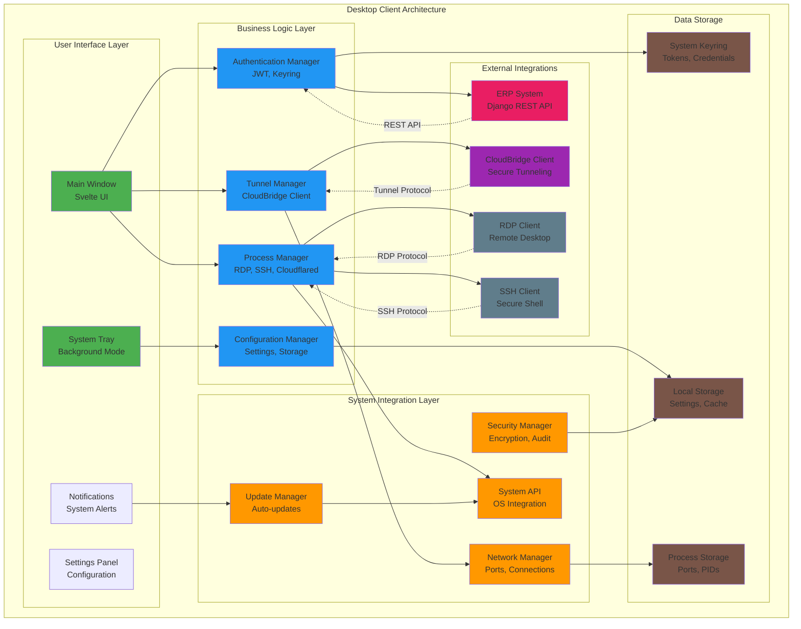

### Поток данных десктопного приложения

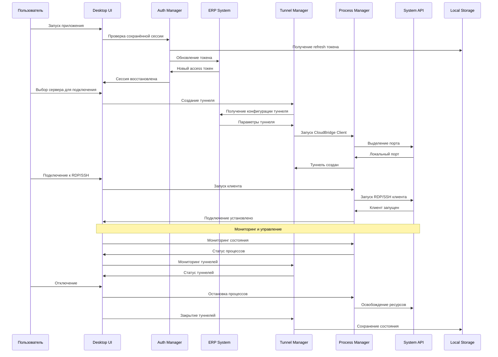

### 7. Server Client Application (Go) - Серверный клиент

**Назначение:** Высокопроизводительный серверный клиент для автоматизированной интеграции с CloudBridge Relay, обеспечивающий программный доступ к корпоративным ресурсам через защищённые туннели

**Основные функции:**

#### Программная интеграция и API
- **REST API клиент** — программный доступ к ERP системе через HTTP/2 и gRPC
- **Webhook обработчик** — приём и обработка событий от CloudBridge Relay
- **Автоматизация процессов** — интеграция с CI/CD пайплайнами и системами оркестрации
- **Скриптинг и CLI** — командная строка для автоматизации административных задач
- **SDK и библиотеки** — готовые библиотеки для интеграции с различными языками программирования

#### Управление туннелями и соединениями
- **Программное создание туннелей** — API для создания и управления защищёнными соединениями
- **Мониторинг состояния** — отслеживание статуса туннелей и автоматическое восстановление
- **Load balancing** — интеллектуальное распределение нагрузки между доступными серверами
- **Failover автоматизация** — автоматическое переключение при сбоях инфраструктуры
- **Connection pooling** — эффективное управление пулом соединений для высокой производительности

#### Системная интеграция
- **Systemd/Windows Service** — работа как системный сервис с автоматическим запуском
- **Docker контейнеризация** — готовые Docker образы для развертывания в контейнерах
- **Kubernetes интеграция** — поддержка Kubernetes Operator для оркестрации
- **Configuration management** — интеграция с Ansible, Puppet, Chef
- **Log aggregation** — отправка логов в централизованные системы (ELK, Splunk)

#### Безопасность и аутентификация
- **Certificate-based authentication** — аутентификация на основе сертификатов X.509
- **API Key management** — безопасное управление API ключами и токенами
- **Role-based access control** — детальное управление правами доступа
- **Audit logging** — подробное логирование всех операций для соответствия требованиям
- **Encryption at rest** — шифрование конфигураций и чувствительных данных

#### Мониторинг и метрики
- **Prometheus метрики** — экспорт метрик для мониторинга производительности
- **Health checks** — проверки состояния сервиса и зависимостей
- **Performance monitoring** — отслеживание производительности туннелей и соединений
- **Resource utilization** — мониторинг использования CPU, памяти и сети
- **Alerting integration** — интеграция с системами алертинга (PagerDuty, Slack)

#### DevOps и автоматизация
- **Infrastructure as Code** — поддержка Terraform Provider для управления инфраструктурой
- **CI/CD интеграция** — автоматизация развертывания и обновлений
- **Configuration templating** — шаблонизация конфигураций для разных окружений
- **Backup и restore** — автоматическое резервное копирование конфигураций
- **Version management** — управление версиями конфигураций и откат изменений

**Технические характеристики:**
- **Язык программирования:** Go 1.21+
- **Сетевые протоколы:** QUIC/TLS 1.3, gRPC, HTTP/2, WebSocket
- **Аутентификация:** X.509 сертификаты, JWT токены, API ключи
- **Интеграции:** ERP REST API, Prometheus, ELK Stack, Terraform
- **Платформы:** Linux (x86_64, ARM64), Windows Server, macOS
- **Размер:** ~10MB (статически слинкованный бинарный файл)
- **Ресурсы:** Минимальное потребление памяти (~50MB RAM)

**Архитектурная роль:**
- **API Gateway** — программный доступ к функциям CloudBridge Relay
- **Automation Engine** — автоматизация процессов и интеграций
- **Monitoring Agent** — сбор и отправка метрик о состоянии системы
- **Configuration Manager** — централизованное управление настройками
- **Security Enforcer** — обеспечение безопасности и соответствия требованиям

### Архитектура серверного клиента

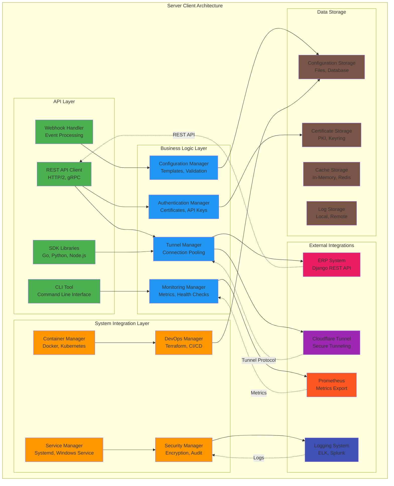

### Поток данных серверного клиента

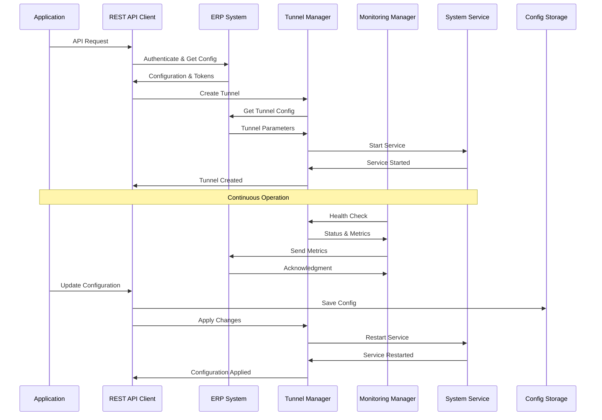

### 8. Keycloak Multi-Tenancy (IAM/SSO)

**Назначение:** Централизованная аутентификация и авторизация

**Возможности:**
- Мультиарендность с изоляцией realm'ов
- Интеграция с корпоративными IDP (AD, LDAP)
- Поддержка OIDC, SAML, OAuth 2.0
- MFA и условный доступ
- Управление ролями и разрешениями

---

## Технологический стек

### Сетевые технологии

| Компонент | Технологии | Описание |
|-----------|------------|----------|
| **Anycast** | BGP, Anycast IP | Глобальная точка входа |
| **DNS** | Cloudflare DNS, Route53 | Резолвинг доменов |
| **TLS** | TLS 1.3, QUIC | Шифрование трафика |
| **Протоколы** | HTTP/2, WebSocket, gRPC | Коммуникация между компонентами |

### Backend технологии

| Компонент | Технологии | Описание |
|-----------|------------|----------|
| **Edge Relay** | Go, QUIC/TLS 1.3, SNI | Высокопроизводительный edge-сервер |
| **Relay Server** | Go, gRPC, WebSocket | Туннелирование и маршрутизация |
| **ERP/Server Client** | Django, REST API | Корпоративная система управления |
| **IAM/SSO** | Keycloak, OIDC, SAML | Аутентификация и авторизация |

### Мониторинг и наблюдаемость

| Компонент | Технологии | Описание |
|-----------|------------|----------|
| **Метрики** | Prometheus, Grafana | Сбор и визуализация метрик |
| **Логи** | Loki, ELK Stack | Централизованное логирование |
| **Трейсинг** | Jaeger, Zipkin | Распределённая трассировка |
| **Алерты** | Alertmanager, PagerDuty | Уведомления о проблемах |

### Инфраструктура

| Компонент | Технологии | Описание |
|-----------|------------|----------|
| **Контейнеризация** | Docker, Kubernetes | Развертывание и оркестрация |
| **CI/CD** | GitHub Actions, ArgoCD | Автоматизация развертывания |
| **Инфраструктура как код** | Terraform, Ansible | Управление инфраструктурой |
| **Облачные провайдеры** | AWS, GCP, Azure | Глобальное развертывание |

---

## Глобальная схема развертывания

### Географическое распределение

```mermaid
flowchart TD
    subgraph "Global Edge Network"
        subgraph "Europe"
            Moscow["Moscow Edge Node<br/>100 Gbps<br/>Anycast IP"]
            SPb["St. Petersburg Edge Node<br/>50 Gbps<br/>Anycast IP"]
            London["London Edge Node<br/>100 Gbps<br/>Anycast IP"]
            Frankfurt["Frankfurt Edge Node<br/>50 Gbps<br/>Anycast IP"]
        end
        
        subgraph "Americas"
            NewYork["New York Edge Node<br/>100 Gbps<br/>Anycast IP"]
            Chicago["Chicago Edge Node<br/>50 Gbps<br/>Anycast IP"]
            SaoPaulo["São Paulo Edge Node<br/>50 Gbps<br/>Anycast IP"]
        end
        
        subgraph "Asia Pacific"
            Singapore["Singapore Edge Node<br/>100 Gbps<br/>Anycast IP"]
            Tokyo["Tokyo Edge Node<br/>50 Gbps<br/>Anycast IP"]
            Sydney["Sydney Edge Node<br/>50 Gbps<br/>Anycast IP"]
        end
    end
    
    subgraph "Regional Relay Networks"
        subgraph "Russia"
            Office1["Office 1 Relay<br/>10 Gbps<br/>Multi-tenant"]
            Office2["Office 2 Relay<br/>10 Gbps<br/>Multi-tenant"]
            Branch1["Branch 1 Relay<br/>5 Gbps<br/>Multi-tenant"]
            Branch2["Branch 2 Relay<br/>5 Gbps<br/>Multi-tenant"]
        end
        
        subgraph "Europe"
            EUOffice1["EU Office 1 Relay<br/>10 Gbps<br/>Multi-tenant"]
            EUOffice2["EU Office 2 Relay<br/>10 Gbps<br/>Multi-tenant"]
        end
        
        subgraph "USA"
            USOffice1["US Office 1 Relay<br/>10 Gbps<br/>Multi-tenant"]
            USOffice2["US Office 2 Relay<br/>10 Gbps<br/>Multi-tenant"]
        end
    end
    
    subgraph "Client Devices"
        Desktop["Desktop Client<br/>(Tauri/Svelte)"]
        Mobile["Mobile Client<br/>(React Native)"]
        Server["Server Client<br/>(Go)"]
        IoT["IoT Device<br/>(Embedded)"]
    end
    
    %% Edge to Relay connections
    Moscow --> Office1
    Moscow --> Office2
    SPb --> Branch1
    SPb --> Branch2
    
    London --> EUOffice1
    Frankfurt --> EUOffice2
    
    NewYork --> USOffice1
    Chicago --> USOffice2
    
    %% Relay to Client connections
    Office1 --> Desktop
    Office2 --> Server
    Branch1 --> Mobile
    Branch2 --> IoT
    
    %% ERP System connections
    ERPSystem["ERP System<br/>(Django)<br/>Central Management"]
    
    ERPSystem -.->|Configuration| Moscow
    ERPSystem -.->|Configuration| SPb
    ERPSystem -.->|Configuration| London
    ERPSystem -.->|Configuration| Frankfurt
    ERPSystem -.->|Configuration| NewYork
    ERPSystem -.->|Configuration| Chicago
    ERPSystem -.->|Configuration| SaoPaulo
    ERPSystem -.->|Configuration| Singapore
    ERPSystem -.->|Configuration| Tokyo
    ERPSystem -.->|Configuration| Sydney
    
    ERPSystem -.->|Management| Office1
    ERPSystem -.->|Management| Office2
    ERPSystem -.->|Management| Branch1
    ERPSystem -.->|Management| Branch2
    ERPSystem -.->|Management| EUOffice1
    ERPSystem -.->|Management| EUOffice2
    ERPSystem -.->|Management| USOffice1
    ERPSystem -.->|Management| USOffice2
    
    %% Styling
    style Moscow fill:#4CAF50
    style SPb fill:#4CAF50
    style London fill:#4CAF50
    style Frankfurt fill:#4CAF50
    style NewYork fill:#4CAF50
    style Chicago fill:#4CAF50
    style SaoPaulo fill:#4CAF50
    style Singapore fill:#4CAF50
    style Tokyo fill:#4CAF50
    style Sydney fill:#4CAF50
    style Office1 fill:#2196F3
    style Office2 fill:#2196F3
    style Branch1 fill:#2196F3
    style Branch2 fill:#2196F3
    style EUOffice1 fill:#2196F3
    style EUOffice2 fill:#2196F3
    style USOffice1 fill:#2196F3
    style USOffice2 fill:#2196F3
    style Desktop fill:#FF9800
    style Mobile fill:#FF9800
    style Server fill:#FF9800
    style IoT fill:#FF9800
    style ERPSystem fill:#E91E63
```

### Архитектура Anycast

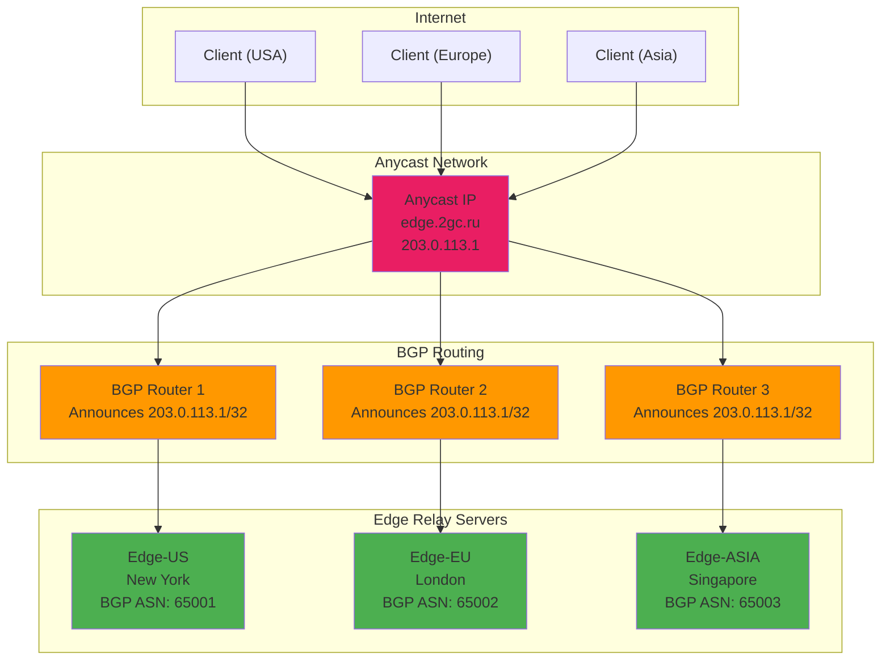

---

## Поток обработки запросов

### Детальный процесс обработки

| Шаг | Действие | Технология | Описание |
|-----|----------|------------|----------|
| **1** | DNS резолвинг | Cloudflare DNS | Клиент резолвит edge.2gc.ru на Anycast IP |
| **2** | BGP маршрутизация | BGP/Anycast | Трафик направляется на ближайший edge-сервер |
| **3** | TLS handshake | TLS 1.3 + SNI | Установка защищённого соединения с определением tenant |
| **4** | Tenant определение | SNI parsing | Извлечение tenant из SNI (tenant1.tenant.edge.2gc.ru) |
| **5** | Edge routing | REST API + in-memory DB | Выбор оптимального relay-сервера для tenant |
| **6** | Relay connection | QUIC/TLS + gRPC | Установка защищённого туннеля до relay-сервера |
| **7** | Backend routing | TCP/HTTP | Доставка трафика до целевого сервиса |
| **8** | Monitoring | Prometheus + Grafana | Сбор метрик на каждом этапе |

### Роль десктопного приложения в потоке обработки

#### Предварительная подготовка (Desktop Client)
| Шаг | Действие | Компонент | Описание |
|-----|----------|-----------|----------|
| **1** | Аутентификация пользователя | Auth Manager | Проверка учетных данных через ERP API |
| **2** | Получение конфигурации | ERP Integration | Загрузка доступных серверов и сервисов |
| **3** | Создание туннеля | Tunnel Manager | Запуск cloudflared процесса |
| **4** | Выделение ресурсов | Process Manager | Резервирование портов и процессов |
| **5** | Установка соединения | Network Manager | Подключение к edge-серверу |

#### Интеграция с основным потоком
- **Туннелирование трафика** — десктопное приложение создаёт локальный туннель через cloudflared
- **Маршрутизация** — весь трафик пользователя проходит через защищённый туннель
- **Мониторинг** — приложение отслеживает состояние соединений и отправляет метрики
- **Управление сессиями** — автоматическое восстановление соединений при сбоях

### Схема потока данных

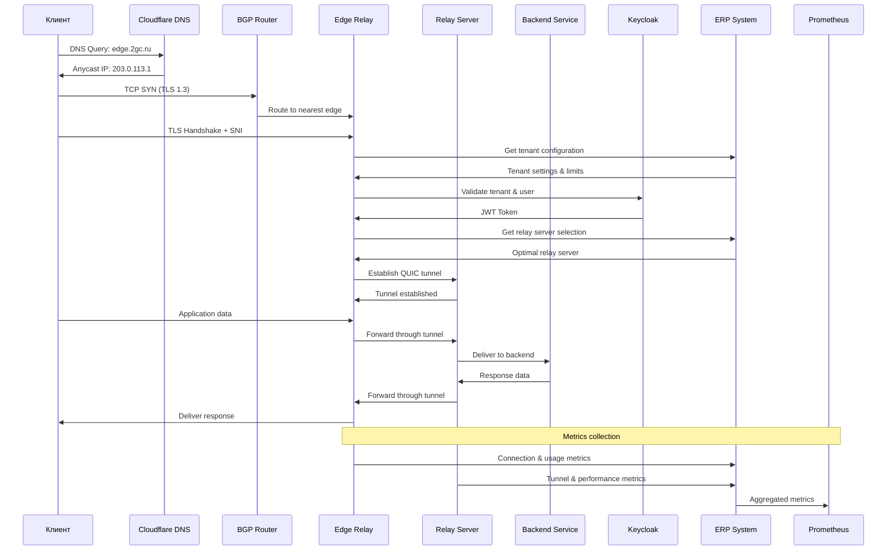

### Edge Routing Logic

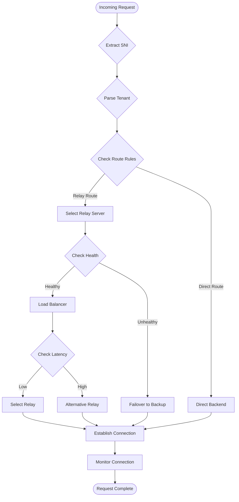

### Архитектура ERP системы

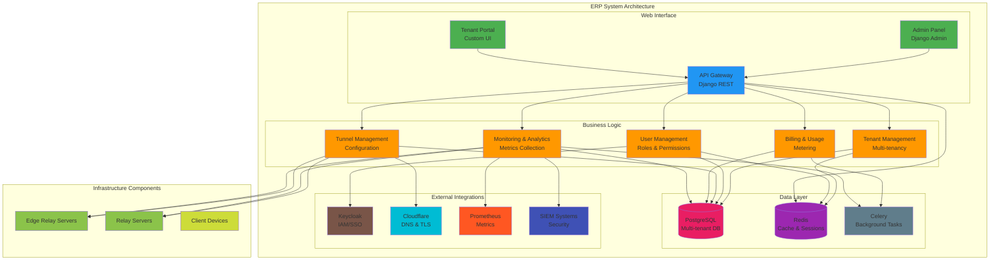
```

---

## Безопасность и Zero Trust

### Многоуровневая безопасность

#### 1. Сетевой уровень
- **Anycast IP** — скрытие реальных IP-адресов edge-серверов
- **DDoS защита** — Cloudflare защита от атак
- **TLS 1.3** — современное шифрование трафика
- **QUIC** — защита от перехвата и подмены

#### 2. Аутентификация и авторизация
- **Multi-factor authentication** — двухфакторная аутентификация
- **JWT tokens** — безопасные токены доступа
- **OIDC/SAML** — интеграция с корпоративными IDP
- **Role-based access control** — управление доступом по ролям

#### 3. Изоляция арендаторов
- **Network isolation** — изоляция на сетевом уровне
- **Process isolation** — изоляция процессов
- **Resource limits** — ограничения ресурсов
- **Audit logging** — детальное логирование

#### 4. Безопасность десктопного приложения
- **Шифрование локальных данных** — AES-256 шифрование настроек и кэша
- **Системный keyring** — безопасное хранение токенов в системном хранилище
- **Изоляция процессов** — запуск внешних приложений в изолированной среде
- **Аудит действий пользователя** — логирование всех операций и подключений
- **Защита от перехвата** — предотвращение перехвата токенов и паролей
- **Автоматическая очистка** — безопасное удаление конфиденциальных данных при выходе

### Zero Trust принципы

```mermaid
flowchart TD
    subgraph "Zero Trust Architecture"
        subgraph "Identity Verification"
            Auth[Authentication]
            Authz[Authorization]
            MFA[MFA Verification]
        end
        
        subgraph "Device Trust"
            DeviceHealth[Device Health Check]
            Compliance[Compliance Validation]
            RiskScore[Risk Scoring]
        end
        
        subgraph "Network Security"
            Microseg[Microsegmentation]
            Encryption[End-to-End Encryption]
            Monitoring[Continuous Monitoring]
        end
        
        subgraph "Application Security"
            AppAuth[Application Authentication]
            DataProtection[Data Protection]
            AccessControl[Access Control]
        end
    end
    
    Auth --> Authz
    Authz --> MFA
    MFA --> DeviceHealth
    DeviceHealth --> Compliance
    Compliance --> RiskScore
    RiskScore --> Microseg
    Microseg --> Encryption
    Encryption --> Monitoring
    Monitoring --> AppAuth
    AppAuth --> DataProtection
    DataProtection --> AccessControl
```

### Безопасность данных

| Аспект | Мера защиты | Описание |
|--------|-------------|----------|
| **Шифрование в покое** | AES-256 | Шифрование всех данных на диске |
| **Шифрование в движении** | TLS 1.3 | Шифрование всех сетевых соединений |
| **Шифрование ключей** | HSM/KMS | Безопасное хранение ключей шифрования |
| **Аудит доступа** | SIEM | Централизованный аудит всех операций |
| **Соответствие** | GDPR, SOC 2 | Соответствие международным стандартам |

---

## Мониторинг и наблюдаемость

### Таблица метрик и KPI

| Метрика                | Компонент         | KPI (пример)         | Пороговое значение | Описание                       |
|------------------------|-------------------|----------------------|--------------------|---------------------------------|
| Connection rate        | Edge Relay        | >10 000 conn/sec     | 15 000             | Новые соединения в секунду      |
| Active connections     | Edge/Relay        | >100 000             | 120 000            | Активные соединения             |
| Latency                | Edge/Relay        | <30 ms               | 50 ms              | Средняя задержка                |
| Error rate             | Edge/Relay        | <0.1%                | 0.5%               | Процент ошибок                  |
| Bandwidth utilization  | Edge/Relay        | >80%                 | 95%                | Использование канала            |
| TLS handshake time     | Edge Relay        | <100 ms              | 200 ms             | Время установки TLS             |
| Tunnel count           | Relay Server      | >500                 | 1000               | Активные туннели                |
| Backend connectivity   | Relay Server      | >99.99%              | 99.9%              | Доступность backend сервисов     |
| Resource usage         | Edge/Relay        | CPU < 70%, RAM < 80% | CPU 90%, RAM 95%   | Использование ресурсов          |
| Tenant isolation       | Relay Server      | 100%                 | 100%               | Изоляция арендаторов            |
| Client connectivity    | Desktop Client    | >99.9%               | 99.5%              | Доступность клиентского приложения |
| Tunnel establishment   | Desktop Client    | <5 сек               | 10 сек             | Время создания туннеля           |
| Process management     | Desktop Client    | 100%                 | 100%               | Управление системными процессами |
| Resource cleanup       | Desktop Client    | 100%                 | 100%               | Очистка ресурсов при выходе      |

### Диаграмма: Распределение трафика по регионам

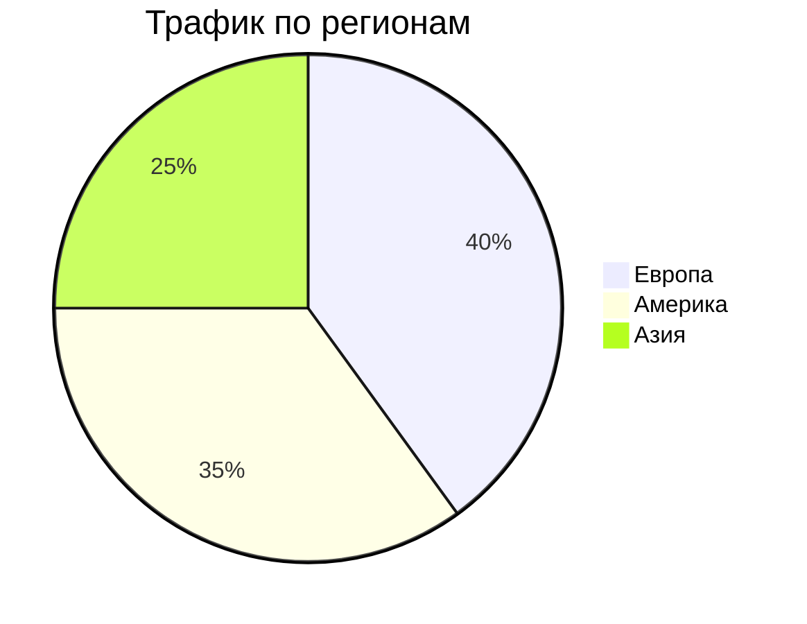

### Диаграмма: Сравнение производительности компонентов

```mermaid
bar
    title Пропускная способность компонентов (Gbps)
    "Edge Relay Server" : 100
    "Relay Server" : 10
```

### Flowchart: Сценарии отказа и восстановления

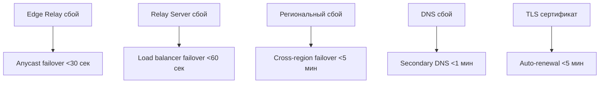

### Дашборды и визуализация

#### DevOps дашборды
- **Infrastructure Overview** — общий обзор инфраструктуры
- **Performance Metrics** — метрики производительности
- **Error Tracking** — отслеживание ошибок
- **Capacity Planning** — планирование мощностей

#### SecOps дашборды
- **Security Events** — события безопасности
- **Access Logs** — логи доступа
- **Threat Detection** — обнаружение угроз
- **Compliance Reports** — отчёты о соответствии

#### Business дашборды
- **User Analytics** — аналитика пользователей
- **Tenant Usage** — использование арендаторами
- **Revenue Metrics** — метрики доходов
- **Geographic Insights** — географическая аналитика

---

## Масштабирование и отказоустойчивость

### Горизонтальное масштабирование

#### Edge Relay масштабирование
- **Auto-scaling** — автоматическое масштабирование по нагрузке
- **Load balancing** — балансировка нагрузки между edge-серверами
- **Geographic distribution** — распределение по географическим регионам
- **Anycast failover** — автоматическое переключение при сбоях

#### Relay Server масштабирование
- **Cluster mode** — работа в кластерном режиме
- **Connection pooling** — пул соединений для оптимизации
- **Resource limits** — ограничения ресурсов на арендатора
- **Tenant isolation** — изоляция ресурсов между арендаторами

### Отказоустойчивость

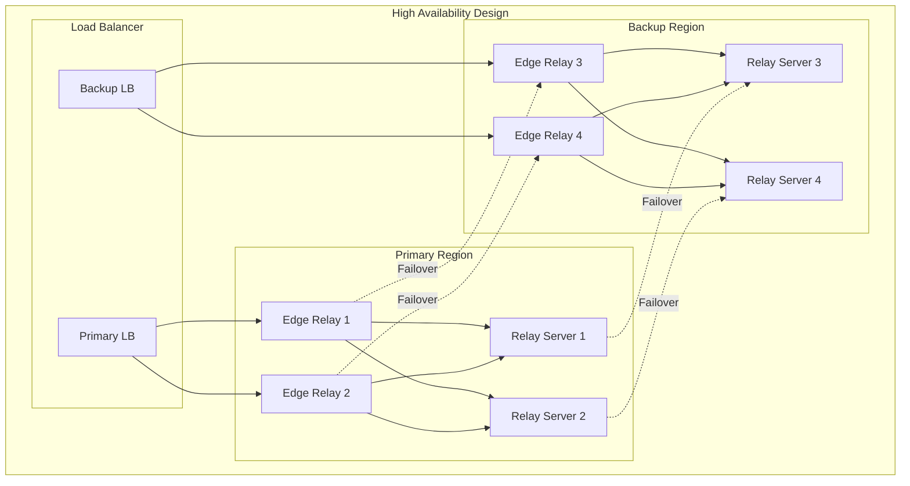

### Стратегии восстановления

| Тип сбоя | Стратегия восстановления | Время восстановления |
|----------|-------------------------|---------------------|
| **Edge Relay сбой** | Anycast failover | <30 секунд |
| **Relay Server сбой** | Load balancer failover | <60 секунд |
| **Региональный сбой** | Cross-region failover | <5 минут |
| **DNS сбой** | Secondary DNS | <1 минута |
| **TLS сертификат** | Auto-renewal | <5 минут |

### Производительность и оптимизация

#### Оптимизация сети
- **TCP optimization** — оптимизация TCP параметров
- **Connection pooling** — переиспользование соединений
- **Compression** — сжатие данных
- **Caching** — кэширование статического контента

#### Оптимизация приложений
- **Goroutines** — асинхронная обработка в Go
- **Memory pooling** — пул памяти для снижения GC
- **Zero-copy** — передача данных без копирования
- **Batch processing** — пакетная обработка запросов

---

## Интеграции и экосистема

### Корпоративные интеграции

#### Identity Providers
- **Active Directory** — интеграция с Windows AD
- **LDAP** — поддержка LDAP серверов
- **SAML 2.0** — федерация аутентификация
- **OIDC** — современные протоколы аутентификации

#### SIEM системы
- **Splunk** — отправка логов и событий
- **ELK Stack** — интеграция с Elasticsearch
- **QRadar** — IBM Security QRadar
- **Splunk Enterprise Security** — расширенная аналитика

#### Cloud провайдеры
- **AWS** — интеграция с AWS сервисами
- **Azure** — Microsoft Azure интеграция
- **Google Cloud** — GCP интеграция
- **Kubernetes** — оркестрация контейнеров

### API и автоматизация

#### REST API

**Основные эндпоинты ERP системы:**

| Категория | Эндпоинт | Метод | Описание |
|-----------|----------|-------|----------|
| **Tenant Management** | `/api/v1/tenants/` | GET, POST | Управление арендаторами |
| | `/api/v1/tenants/{id}/` | GET, PUT, DELETE | Операции с конкретным арендатором |
| | `/api/v1/tenants/{id}/domains/` | GET, POST | Управление доменами арендатора |
| | `/api/v1/tenants/{id}/limits/` | GET, PUT | Управление лимитами ресурсов |
| **User Management** | `/api/v1/users/` | GET, POST | Управление пользователями |
| | `/api/v1/users/{id}/` | GET, PUT, DELETE | Операции с пользователем |
| | `/api/v1/users/{id}/roles/` | GET, PUT | Управление ролями пользователя |
| | `/api/v1/users/{id}/sessions/` | GET, DELETE | Управление сессиями |
| **Tunnel Management** | `/api/v1/tunnels/` | GET, POST | Управление туннелями |
| | `/api/v1/tunnels/{id}/` | GET, PUT, DELETE | Операции с туннелем |
| | `/api/v1/tunnels/{id}/status/` | GET | Статус туннеля |
| | `/api/v1/tunnels/{id}/config/` | GET, PUT | Конфигурация туннеля |
| **Infrastructure** | `/api/v1/edge-servers/` | GET | Список edge серверов |
| | `/api/v1/relay-servers/` | GET | Список relay серверов |
| | `/api/v1/edge-servers/{id}/status/` | GET | Статус edge сервера |
| | `/api/v1/relay-servers/{id}/status/` | GET | Статус relay сервера |
| **Monitoring** | `/api/v1/metrics/` | GET | Метрики системы |
| | `/api/v1/metrics/tenants/{id}/` | GET | Метрики арендатора |
| | `/api/v1/metrics/tunnels/{id}/` | GET | Метрики туннеля |
| | `/api/v1/alerts/` | GET, POST | Управление алертами |
| **Billing** | `/api/v1/billing/usage/` | GET | Использование ресурсов |
| | `/api/v1/billing/invoices/` | GET | Счета и инвойсы |
| | `/api/v1/billing/rates/` | GET, PUT | Тарифы и цены |
| **Configuration** | `/api/v1/config/global/` | GET, PUT | Глобальные настройки |
| | `/api/v1/config/tenants/{id}/` | GET, PUT | Настройки арендатора |
| | `/api/v1/config/tls/` | GET, PUT | Настройки TLS |

**Спецификация API:**
```json
{
  "authentication": "JWT Bearer Token",
  "rate_limiting": "1000 requests/minute",
  "versioning": "Semantic versioning",
  "documentation": "OpenAPI/Swagger",
  "webhooks": {
    "tunnel_events": "/api/v1/webhooks/tunnels",
    "user_events": "/api/v1/webhooks/users",
    "billing_events": "/api/v1/webhooks/billing",
    "alert_events": "/api/v1/webhooks/alerts"
  }
}
```

#### Webhooks
- **Tunnel events** — события создания/удаления туннелей
- **User events** — события аутентификации пользователей
- **Alert events** — события мониторинга и алертов
- **Tenant events** — события управления арендаторами

#### Terraform Provider
```hcl
resource "cloudbridge_relay_tenant" "example" {
  name = "example-tenant"
  domain = "example.tenant.edge.2gc.ru"
  max_tunnels = 100
  max_connections = 1000
  bandwidth_limit = "100Mbps"
}
```

### DevOps инструменты

#### CI/CD интеграции
- **GitHub Actions** — автоматизация сборки и деплоя
- **GitLab CI** — интеграция с GitLab
- **Jenkins** — поддержка Jenkins pipelines
- **ArgoCD** — GitOps деплой

#### Мониторинг интеграции
- **Prometheus** — сбор метрик
- **Grafana** — визуализация
- **Datadog** — APM и мониторинг
- **New Relic** — производительность приложений

---

## Сценарии использования

### Таблица сценариев использования

| Сценарий                | Требования                                      | Решение                                      |
|-------------------------|-------------------------------------------------|----------------------------------------------|
| Глобальная компания     | Безопасный доступ, интеграция с AD, GDPR, HA     | Edge-серверы в регионах, Keycloak, изоляция  |
| Удалённая работа        | Безопасный доступ, простота, аудит, защита       | Десктоп-клиент, Zero Trust, MFA, логирование |
| White-label для MSP     | Брендирование, мультиарендность, API, биллинг    | ERP система с white-label, REST API, биллинг |
| Enterprise коробка      | Контроль, интеграция с SIEM, кастомизация        | On-premise ERP, SIEM, поддержка, обучение    |
| Высоконагруженное приложение | Минимальные задержки, масштабирование, HA   | Edge-серверы, QUIC/TLS, авто-масштабирование |
| IoT/embedded            | Лёгкий клиент, безопасность, централиз. управление | Go клиент, cert-based auth, API, мониторинг  |

### Сценарии использования десктопного приложения

#### Корпоративные пользователи
- **Удалённая работа** — безопасный доступ к корпоративным ресурсам из дома
- **Бизнес-поездки** — подключение к офисной сети из гостиниц и кафе
- **Работа с клиентами** — демонстрация внутренних систем через защищённые туннели
- **Разработка** — доступ к тестовым и продакшн серверам

#### Администраторы и IT-специалисты
- **Управление серверами** — RDP/SSH доступ к серверам инфраструктуры
- **Мониторинг систем** — доступ к панелям мониторинга и управления
- **Резервное копирование** — безопасная передача данных между локациями
- **Устранение неполадок** — удалённая диагностика и исправление проблем

#### MSP и консультанты
- **White-label решения** — брендированные клиенты для клиентов
- **Управление множественными клиентами** — переключение между разными организациями
- **Техническая поддержка** — безопасный доступ к системам клиентов
- **Аудит и отчётность** — сбор метрик использования и производительности

### Сценарии использования серверного клиента

#### DevOps и автоматизация
- **CI/CD пайплайны** — автоматическое создание туннелей для тестовых и продакшн окружений
- **Infrastructure as Code** — управление инфраструктурой через Terraform и Ansible
- **Kubernetes интеграция** — автоматическое развертывание сервисов в кластерах
- **Monitoring automation** — автоматическое подключение к системам мониторинга

#### Корпоративные интеграции
- **ERP системы** — программная интеграция с корпоративными системами управления
- **SIEM интеграция** — автоматическая отправка логов безопасности
- **Backup системы** — автоматическое резервное копирование через защищённые туннели
- **Database replication** — синхронизация баз данных между локациями

#### Масштабные развертывания
- **Multi-site deployments** — управление множественными локациями
- **Load balancing** — автоматическое распределение нагрузки между серверами
- **Failover automation** — автоматическое переключение при сбоях
- **Capacity management** — автоматическое масштабирование ресурсов

#### Безопасность и соответствие
- **Audit automation** — автоматический сбор логов для аудита
- **Compliance reporting** — автоматическая генерация отчётов о соответствии
- **Security monitoring** — интеграция с системами безопасности
- **Access control** — программное управление доступом к ресурсам

---

## SWOT-анализ CloudBridge Relay

| Сильные стороны (Strengths) | Слабые стороны (Weaknesses) |
|-----------------------------|-----------------------------|
| Глобальное покрытие         | Сложность внедрения         |
| Высокая производительность  | Требования к инфраструктуре |
| Zero Trust безопасность     | Зависимость от облачных провайдеров |
| Масштабируемость            | Необходимость интеграции с внешними IAM |
| Мультиарендность            | Высокая стоимость для on-premise |

| Возможности (Opportunities) | Угрозы (Threats) |
|-----------------------------|------------------|
| AI/ML для умной маршрутизации| Кибератаки       |
| Квантовая криптография       | DDoS             |
| Edge computing               | Регуляторные риски|
| 5G интеграция                | Конкуренция      |
| Blockchain идентификация     | Ошибки конфигурации|

---

## Рекомендации по развитию

1. Внедрение AI/ML для предиктивной маршрутизации и обнаружения аномалий.
2. Разработка поддержки квантово-устойчивых алгоритмов шифрования.
3. Расширение edge computing для обработки данных на границе.
4. Интеграция с 5G сетями для мобильных сценариев.
5. Разработка модулей для автоматического соответствия новым регуляторным требованиям.
6. Улучшение инструментов визуализации и аналитики для DevOps и SecOps.

---

## Матрица рисков

### Оценка рисков по вероятности и влиянию

| Риск | Вероятность | Влияние | Уровень риска | Меры снижения |
|------|-------------|---------|---------------|---------------|
| DDoS атака | Высокая | Критическое | 🔴 Высокий | Cloudflare защита, Anycast failover |
| Утечка данных | Средняя | Критическое | 🔴 Высокий | Zero Trust, шифрование, аудит |
| Сбой edge-сервера | Средняя | Высокое | 🟡 Средний | Anycast, автоматический failover |
| Сбой relay-сервера | Средняя | Высокое | 🟡 Средний | Load balancer, резервные серверы |
| Региональный сбой | Низкая | Критическое | 🟡 Средний | Cross-region failover |
| Ошибка конфигурации | Средняя | Среднее | 🟡 Средний | Infrastructure as Code, тестирование |
| Недоступность DNS | Низкая | Высокое | 🟢 Низкий | Secondary DNS, резервные провайдеры |
| Истечение TLS сертификата | Низкая | Среднее | 🟢 Низкий | Автоматическое обновление |
| Недостаток ресурсов | Средняя | Среднее | 🟡 Средний | Автоматическое масштабирование |
| Регуляторные изменения | Низкая | Высокое | 🟡 Средний | Мониторинг требований, адаптация |

### Диаграмма матрицы рисков

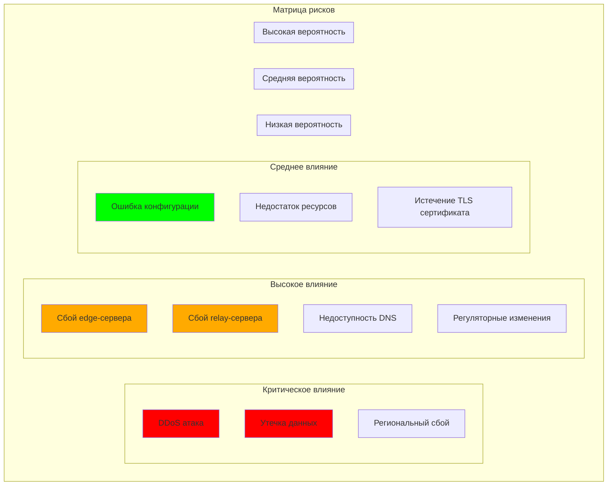

---

## Конкурентный анализ

### Сравнение с аналогичными решениями

| Характеристика | CloudBridge Relay | AWS App Mesh | Istio Service Mesh | WireGuard | OpenVPN |
|----------------|-------------------|-------------------|--------------|-------------------|-----------|
| **Архитектура** | Edge + Relay | Service Mesh | Service Mesh | VPN | VPN |
| **Глобальное покрытие** | ✅ Anycast | ❌ Regional | ❌ Cluster | ❌ Point-to-point | ❌ Point-to-point |
| **Zero Trust** | ✅ Полная | ⚠️ Частичная | ⚠️ Частичная | ❌ Нет | ❌ Нет |
| **Multi-tenancy** | ✅ Изоляция | ⚠️ Сложная | ⚠️ Сложная | ❌ Нет | ❌ Нет |
| **Производительность** | 100 Gbps | 10 Gbps | 10 Gbps | 1 Gbps | 100 Mbps |
| **Простота развертывания** | ✅ Простое | ❌ Сложное | ❌ Сложное | ⚠️ Среднее | ⚠️ Среднее |
| **On-premise** | ✅ Да | ⚠️ Hybrid | ✅ Да | ✅ Да | ✅ Да |
| **Интеграция с IAM** | ✅ AD, LDAP, SAML | ⚠️ AWS IAM | ⚠️ Kubernetes | ❌ Нет | ❌ Нет |
| **Мониторинг** | ✅ Prometheus, Grafana | ⚠️ CloudWatch | ✅ Prometheus | ❌ Нет | ❌ Нет |
| **Стоимость** | ⚠️ Средняя | ❌ Высокая | ✅ Низкая | ✅ Низкая | ✅ Низкая |

### Ключевые преимущества CloudBridge Relay

1. **Гибридная архитектура** - сочетает преимущества edge и relay подходов
2. **Полная мультиарендность** - изоляция на всех уровнях
3. **On-premise поддержка** - полный контроль над инфраструктурой
4. **Богатая экосистема** - интеграция с корпоративными системами
5. **Масштабируемость** - от малых до крупных развертываний

### Позиционирование на рынке

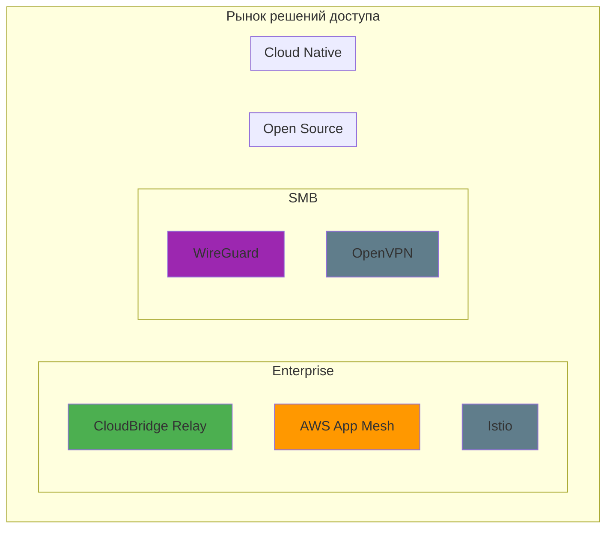

---

## Оценка безопасности

### Автоматизированные инструменты безопасности

Оценка безопасности CloudBridge Relay проводится с помощью автоматизированных инструментов:

| Инструмент | Назначение | Интеграция |
|------------|------------|------------|
| **gosec** | Статический анализ Go кода | CI/CD pipeline |
| **safety** | Аудит Python зависимостей | CI/CD pipeline |
| **Lynis** | Системный hardening | Автоматический аудит |
| **Trivy** | Сканирование контейнеров | CI/CD pipeline |
| **Snyk** | Аудит зависимостей | CI/CD pipeline |

### Процессы безопасности

1. **Статический анализ кода** - автоматическая проверка всех коммитов
2. **Аудит зависимостей** - регулярное обновление и проверка уязвимостей
3. **Системный hardening** - автоматическая настройка безопасности серверов
4. **Мониторинг безопасности** - встроенные алерты о критических событиях
5. **Подробная отчётность** - детальные отчеты по всем проверкам

### Соответствие стандартам

| Стандарт | Статус | Описание |
|----------|--------|----------|
| **Zero Trust** | ✅ Полное | Проверка каждого запроса и соединения |
| **GDPR** | ✅ Соответствие | Защита персональных данных |
| **SOC 2** | ⚠️ Частичное | Аудит в процессе |
| **ISO 27001** | ⚠️ Частичное | Внедрение в процессе |
| **NIST CSF** | ✅ Соответствие | Cybersecurity Framework |

### Коробочная версия

Коробочная версия CloudBridge Relay поддерживает:
- ✅ **Мультиарендность** - полная изоляция клиентов
- ✅ **Zero Trust** - современные принципы безопасности
- ✅ **Интеграция с IDP** - поддержка корпоративных систем
- ✅ **Мониторинг** - встроенные инструменты наблюдения
- ✅ **Автоматизация** - CI/CD и Infrastructure as Code

Соответствует современным требованиям дата-центров и корпоративных стандартов безопасности.

---

## Заключение

Архитектура глобального Edge Relay с Anycast представляет собой современное решение для обеспечения безопасного, быстрого и масштабируемого доступа к корпоративным ресурсам из любой точки мира.

### Ключевые преимущества

1. **Глобальное покрытие** — пользователи подключаются к ближайшему edge-серверу
2. **Высокая производительность** — минимальные задержки и высокая пропускная способность
3. **Отказоустойчивость** — автоматическое переключение при сбоях
4. **Безопасность** — Zero Trust архитектура и современные протоколы шифрования
5. **Масштабируемость** — горизонтальное масштабирование и автоматическое управление нагрузкой
6. **Мультиарендность** — полная изоляция ресурсов между клиентами
7. **Интеграция** — богатая экосистема интеграций с корпоративными системами
8. **Удобство использования** — интуитивный десктопный клиент с автоматизацией процессов

### Будущие направления развития

1. **AI/ML интеграция** — умная маршрутизация и предсказание проблем
2. **Квантовая криптография** — защита от квантовых атак
3. **Edge computing** — обработка данных на edge-серверах
4. **5G интеграция** — оптимизация для мобильных сетей
5. **Blockchain** — децентрализованное управление идентификацией
6. **Улучшение десктопного клиента** — AI-ассистент, голосовое управление, AR/VR интерфейсы
7. **Интеграция с корпоративными системами** — Active Directory, LDAP, SIEM, ITSM
8. **Автоматизация развертывания** — zero-touch provisioning, групповые политики

CloudBridge Relay представляет собой готовое решение для создания глобальной инфраструктуры корпоративного доступа, построенной по принципу сотовой сети, обеспечивающей безопасность, производительность и масштабируемость для современных корпоративных сред.

---

## Роль ERP системы в архитектуре CloudBridge Relay

### Центральная система управления

ERP система на базе Django является **центральным оркестратором** всей инфраструктуры CloudBridge Relay. Она выполняет роль "мозга" системы, координируя работу всех компонентов и обеспечивая единую точку управления.

### Ключевые функции ERP системы

#### 1. **Оркестрация инфраструктуры**
- **Конфигурация edge и relay серверов** — централизованное управление настройками всех серверов
- **Автоматическое масштабирование** — мониторинг нагрузки и автоматическое добавление ресурсов
- **Failover управление** — координация переключения при сбоях компонентов
- **Балансировка нагрузки** — интеллектуальное распределение трафика между серверами

#### 2. **Мультиарендность и изоляция**
- **Tenant isolation** — полная изоляция ресурсов между арендаторами
- **Resource quotas** — управление лимитами ресурсов для каждого арендатора
- **Custom branding** — поддержка white-label решений для MSP
- **Billing integration** — автоматический учёт использования ресурсов

#### 3. **Безопасность и соответствие**
- **Centralized authentication** — интеграция с корпоративными IDP
- **Audit logging** — детальное логирование всех операций
- **Compliance reporting** — отчёты для соответствия регуляторным требованиям
- **Security monitoring** — интеграция с SIEM системами

#### 4. **API и интеграции**
- **REST API** — программный доступ ко всем функциям системы
- **Webhook system** — уведомления о событиях в реальном времени
- **Terraform Provider** — управление инфраструктурой как код
- **CLI tools** — командная строка для администраторов

### Архитектурные преимущества

#### **Единая точка истины**
- Все конфигурации хранятся централизованно
- Синхронизация настроек между компонентами
- Версионирование конфигураций

#### **Масштабируемость**
- Горизонтальное масштабирование ERP системы
- Кэширование для высокой производительности
- Асинхронная обработка фоновых задач

#### **Надёжность**
- Репликация базы данных
- Автоматическое резервное копирование
- Мониторинг состояния системы

#### **Гибкость**
- Модульная архитектура Django
- Поддержка плагинов и расширений
- Кастомизация под требования клиентов

### Интеграция с компонентами системы

| Компонент | Тип интеграции | Описание |
|-----------|----------------|----------|
| **Edge Relay** | Configuration API | Управление настройками и получение метрик |
| **Relay Server** | Management API | Конфигурация туннелей и мониторинг состояния |
| **Keycloak** | SSO Integration | Аутентификация и авторизация пользователей |
| **Cloudflare** | DNS/TLS API | Управление доменами и сертификатами |
| **Prometheus** | Metrics Export | Экспорт метрик для мониторинга |
| **SIEM Systems** | Log Export | Отправка логов безопасности |

### Сценарии использования ERP системы

#### **Для администраторов системы**
- Мониторинг состояния всей инфраструктуры
- Управление арендаторами и их ресурсами
- Настройка глобальных параметров системы
- Анализ производительности и планирование мощностей

#### **Для арендаторов (MSP/Enterprise)**
- Управление своими пользователями и туннелями
- Мониторинг использования ресурсов
- Настройка безопасности и доступа
- Получение отчётов и аналитики

#### **Для интеграций**
- API для автоматизации процессов
- Webhook для событий в реальном времени
- Terraform для управления инфраструктурой
- SIEM интеграция для безопасности

### Техническая реализация

#### **Django приложения**
- `tenants` — управление арендаторами
- `users` — управление пользователями
- `tunnels` — управление туннелями
- `infrastructure` — управление серверами
- `billing` — биллинг и учёт ресурсов
- `monitoring` — сбор и анализ метрик
- `api` — REST API и webhook

#### **База данных**
- PostgreSQL с поддержкой мультиарендности
- Схемы для изоляции данных арендаторов
- Индексы для быстрого поиска
- Репликация для высокой доступности

#### **Кэширование**
- Redis для сессий и кэша
- Кэширование конфигураций
- Кэширование метрик
- Pub/Sub для уведомлений

#### **Фоновые задачи**
- Celery для асинхронных операций
- Планировщик задач
- Обработка webhook
- Генерация отчётов

### Заключение

ERP система является **критически важным компонентом** архитектуры CloudBridge Relay, обеспечивающим централизованное управление, масштабируемость и интеграцию всех компонентов системы. Без неё невозможно эффективное управление глобальной инфраструктурой и предоставление качественных услуг арендаторам.

---

## Роль десктопного приложения в архитектуре CloudBridge Relay

### Ключевой компонент пользовательского опыта

Десктопное приложение на базе Tauri/Svelte является **основным интерфейсом взаимодействия** пользователей с системой CloudBridge Relay. Оно выполняет роль "умного клиента", который автоматизирует сложные процессы подключения и обеспечивает безопасный доступ к корпоративным ресурсам.

### Архитектурная роль

#### **Точка входа пользователя**
- Единый интерфейс для всех типов подключений (RDP, SSH, Web)
- Автоматическое управление аутентификацией и сессиями
- Интуитивное управление туннелями и соединениями

#### **Системный интегратор**
- Взаимодействие с операционной системой (процессы, порты, трей)
- Интеграция с внешними приложениями (RDP клиенты, SSH терминалы)
- Управление системными ресурсами и настройками

#### **Агент безопасности**
- Безопасное хранение токенов в системном keyring
- Шифрование локальных данных и настроек
- Аудит всех действий пользователя

#### **Мониторинг и аналитика**
- Сбор метрик о состоянии подключений
- Отправка данных о производительности в ERP систему
- Локальное логирование для диагностики проблем

### Технические преимущества

#### **Кроссплатформенность**
- Единая кодовая база для Windows, macOS и Linux
- Нативная производительность благодаря Rust backend
- Современный UI на базе Svelte

#### **Безопасность**
- Компиляция в нативный код без интерпретатора
- Минимальная поверхность атаки
- Интеграция с системными механизмами безопасности

#### **Производительность**
- Быстрый запуск и отзывчивый интерфейс
- Эффективное управление памятью
- Оптимизированная работа с сетью

#### **Удобство использования**
- Автоматическое восстановление соединений
- Системный трей для работы в фоне
- Автообновление без вмешательства пользователя

### Интеграция с экосистемой

#### **С ERP системой**
- REST API для аутентификации и получения конфигураций
- WebSocket для real-time уведомлений
- Синхронизация настроек и метрик

#### **С инфраструктурой**
- CloudBridge Client для создания защищённых соединений
- Edge Relay для оптимальной маршрутизации
- Relay Server для доступа к внутренним сервисам

#### **С корпоративными системами**
- Active Directory/LDAP для аутентификации
- SIEM системы для аудита безопасности
- ITSM системы для управления инцидентами

### Заключение

Десктопное приложение является **неотъемлемой частью** архитектуры CloudBridge Relay, обеспечивающей простоту использования, безопасность и производительность для конечных пользователей. Оно превращает сложную инфраструктуру в простой и интуитивный инструмент для безопасного доступа к корпоративным ресурсам из любой точки мира.

---

## Роль серверного клиента в архитектуре CloudBridge Relay

### Ключевой компонент автоматизации и интеграции

Серверный клиент на базе Go является **основным инструментом автоматизации и программной интеграции** с системой CloudBridge Relay. Он выполняет роль "автоматизированного агента", который обеспечивает программный доступ к функциям системы и интегрируется с корпоративными процессами и инфраструктурой.

### Архитектурная роль

#### **API Gateway и интеграция**
- Программный доступ ко всем функциям CloudBridge Relay через REST API
- Интеграция с корпоративными системами и процессами
- Автоматизация рутинных операций и административных задач
- Поддержка webhook для обработки событий в реальном времени

#### **DevOps и автоматизация**
- Интеграция с CI/CD пайплайнами для автоматического развертывания
- Поддержка Infrastructure as Code через Terraform Provider
- Автоматическое управление туннелями и соединениями
- Интеграция с системами оркестрации (Kubernetes, Docker)

#### **Системный сервис**
- Работа как системный сервис (systemd, Windows Service)
- Автоматический запуск и восстановление при сбоях
- Управление жизненным циклом туннелей и соединений
- Интеграция с системами мониторинга и алертинга

#### **Агент безопасности и соответствия**
- Certificate-based аутентификация для высокой безопасности
- Детальное логирование всех операций для аудита
- Интеграция с SIEM системами для мониторинга безопасности
- Поддержка корпоративных политик безопасности

### Технические преимущества

#### **Высокая производительность**
- Нативная производительность Go без интерпретатора
- Эффективное управление памятью и горутинами
- Статическая компиляция для минимального размера
- Оптимизированные сетевые протоколы (QUIC, gRPC)

#### **Надёжность и стабильность**
- Автоматическое восстановление соединений при сбоях
- Graceful shutdown и обработка ошибок
- Мониторинг состояния и health checks
- Подробное логирование для диагностики проблем

#### **Масштабируемость**
- Поддержка множественных туннелей и соединений
- Connection pooling для эффективного использования ресурсов
- Автоматическое масштабирование под нагрузку
- Интеграция с системами балансировки нагрузки

#### **Гибкость и расширяемость**
- Модульная архитектура с плагинами
- Поддержка различных протоколов и форматов данных
- Конфигурируемые шаблоны и настройки
- API для создания кастомных интеграций

### Интеграция с экосистемой

#### **С ERP системой**
- REST API для получения конфигураций и управления ресурсами
- Webhook для обработки событий и уведомлений
- Синхронизация метрик и состояния системы
- Управление пользователями и правами доступа

#### **С инфраструктурой**
- CloudBridge Client для создания защищённых соединений
- Edge Relay для оптимальной маршрутизации трафика
- Relay Server для доступа к внутренним сервисам
- Prometheus для экспорта метрик производительности

#### **С корпоративными системами**
- Active Directory/LDAP для аутентификации
- SIEM системы для мониторинга безопасности
- ITSM системы для управления инцидентами
- Backup системы для резервного копирования

#### **С DevOps инструментами**
- Terraform для управления инфраструктурой
- Ansible/Puppet/Chef для конфигурационного управления
- Kubernetes для оркестрации контейнеров
- Jenkins/GitLab CI для автоматизации процессов

### Сценарии интеграции

#### **Корпоративная автоматизация**
- Автоматическое создание туннелей для новых проектов
- Интеграция с системами мониторинга и алертинга
- Автоматическое резервное копирование через защищённые туннели
- Синхронизация данных между различными локациями

#### **DevOps процессы**
- Интеграция с CI/CD пайплайнами для автоматического развертывания
- Управление инфраструктурой через Terraform
- Автоматическое масштабирование ресурсов под нагрузку
- Мониторинг производительности и состояния сервисов

#### **Безопасность и соответствие**
- Автоматический сбор логов для аудита безопасности
- Интеграция с SIEM системами для мониторинга угроз
- Генерация отчётов о соответствии регуляторным требованиям
- Автоматическое управление сертификатами и ключами

#### **Масштабные развертывания**
- Управление множественными локациями и серверами
- Автоматическое распределение нагрузки между узлами
- Failover и disaster recovery автоматизация
- Централизованное управление конфигурациями

### Заключение

Серверный клиент является **критически важным компонентом** архитектуры CloudBridge Relay для автоматизации и интеграции. Он обеспечивает программный доступ к функциям системы, автоматизирует сложные процессы и интегрируется с корпоративной инфраструктурой. Без него невозможно эффективное управление масштабными развертываниями и интеграция с современными DevOps практиками.

Серверный клиент превращает CloudBridge Relay из простого VPN-решения в полноценную платформу для автоматизации корпоративных процессов, обеспечивая безопасность, производительность и масштабируемость для современных корпоративных сред.