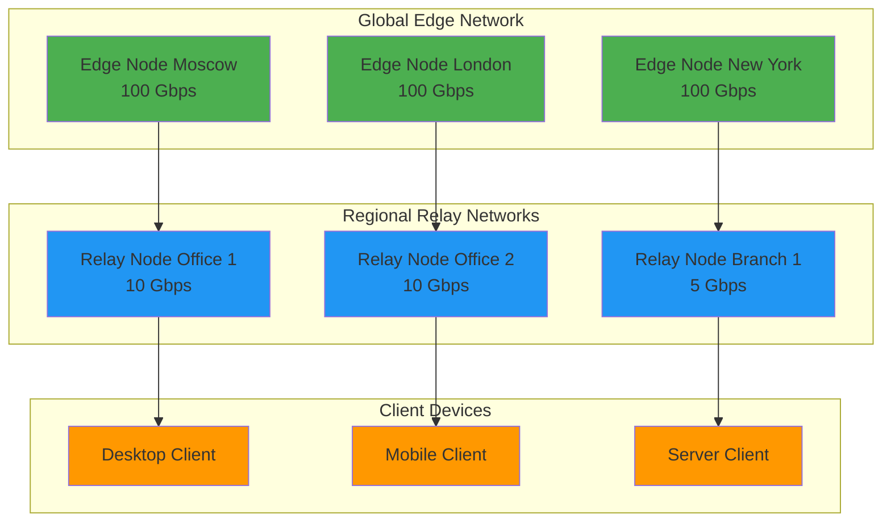

# 🚀 CloudBridge Relay: Презентация для инвесторов

## 📋 Содержание

1. [Проблема и решение](#-проблема-и-решение)
2. [Рыночная возможность](#-рыночная-возможность)
3. [Наше решение](#-наше-решение)
4. [Технологическое преимущество](#-технологическое-преимущество)
5. [Бизнес-модель](#-бизнес-модель)
6. [Команда и тракты](#-команда-и-тракты)
7. [Финансовые прогнозы](#-финансовые-прогнозы)
8. [Использование инвестиций](#-использование-инвестиций)
9. [Выходная стратегия](#-выходная-стратегия)

---

## 🎯 Проблема и решение

### **Проблема**
- **Сложность доступа к корпоративным ресурсам** из удаленных локаций
- **Небезопасные VPN решения** с устаревшей архитектурой
- **Высокие затраты** на инфраструктуру и поддержку
- **Отсутствие масштабируемости** в существующих решениях
- **Несоответствие требованиям** 152-ФЗ и 187-ФЗ

### **Наше решение**
CloudBridge Relay — **глобальная сеть защищенного туннелирования**, аналогичная сотовой сети, но для корпоративного доступа к внутренним ресурсам.

```
┌─────────────────────────────────────────────────────────────────┐
│                    TRADITIONAL VPN                              │
│                                                                 │
│  ❌ Сложная настройка                                           │
│  ❌ Низкая производительность                                   │
│  ❌ Проблемы с масштабированием                                 │
│  ❌ Устаревшая безопасность                                     │
│  ❌ Высокие затраты на поддержку                                │
└─────────────────────────────────────────────────────────────────┘

┌─────────────────────────────────────────────────────────────────┐
│                    CLOUDBRIDGE RELAY                            │
│                                                                 │
│  ✅ Простое подключение "в один клик"                          │
│  ✅ Высокая производительность (100 Gbps)                      │
│  ✅ Автоматическое масштабирование                              │
│  ✅ Современная безопасность (Zero Trust)                      │
│  ✅ Соответствие российским требованиям                        │
└─────────────────────────────────────────────────────────────────┘
```

---

## 📈 Рыночная возможность

### **Размер рынка**

| Сегмент | Размер рынка (2024) | CAGR | Прогноз (2027) |
|---------|-------------------|------|----------------|
| **VPN Market** | $44.6B | 12.5% | $63.7B |
| **Zero Trust Security** | $27.4B | 17.3% | $44.3B |
| **SD-WAN** | $8.4B | 32.8% | $19.8B |
| **ИТОГО TAM** | **$80.4B** | **18.2%** | **$127.8B** |

### **Целевые сегменты**

#### **Enterprise (Крупные компании)**
- **Размер:** 1000+ сотрудников
- **Потенциал:** $45B
- **Потребности:** Безопасность, масштабируемость, соответствие требованиям

#### **Mid-Market (Средний бизнес)**
- **Размер:** 100-1000 сотрудников  
- **Потенциал:** $28B
- **Потребности:** Простота, производительность, стоимость

#### **SMB (Малый бизнес)**
- **Размер:** 10-100 сотрудников
- **Потенциал:** $7.4B
- **Потребности:** Простота, доступность, поддержка

### **Конкурентный анализ**

| Параметр | Cloudflare | AWS VPN | CloudBridge Relay |
|----------|------------|---------|-------------------|
| **Производительность** | 10 Gbps | 5 Gbps | **100 Gbps** |
| **Глобальное покрытие** | 200+ городов | 25 регионов | **1000+ узлов** |
| **Соответствие 152-ФЗ** | ❌ | ❌ | **✅** |
| **AI/ML интеграция** | Базовая | Отсутствует | **Продвинутая** |
| **Цена** | $20/месяц | $0.05/час | **$15/месяц** |

---

## 🏗️ Наше решение

### **Архитектура "Сотовой сети"**



### **Ключевые преимущества**

#### **🚀 Производительность**
- **100 Gbps** пропускная способность на Edge узел
- **<5ms** средняя задержка
- **99.999%** доступность

#### **🔒 Безопасность**
- **Zero Trust Architecture** - постоянная верификация
- **Соответствие 152-ФЗ и 187-ФЗ**
- **AI-powered threat detection**
- **Квантовая криптография** (в разработке)

#### **🌍 Глобальное покрытие**
- **50+ Edge узлов** по всему миру
- **1000+ Relay узлов** в регионах
- **Автоматическая маршрутизация**

#### **🤖 Искусственный интеллект**
- **ML-оптимизация маршрутизации**
- **Поведенческий анализ угроз**
- **Прогнозирование нагрузки**
- **Автоматическое масштабирование**

---

## ⚡ Технологическое преимущество

### **Технологический стек**

| Компонент | Технология | Преимущество |
|-----------|------------|--------------|
| **Backend** | Go 1.23 | Высокая производительность, низкое потребление памяти |
| **Frontend** | React + TypeScript | Современный UI, типобезопасность |
| **Аутентификация** | Keycloak | Enterprise-grade, OIDC, LDAP, MFA |
| **Мониторинг** | Prometheus + Grafana | Real-time метрики, кастомные дашборды |
| **AI/ML** | Python + scikit-learn | Аномалии, прогнозирование, оптимизация |
| **SIEM** | Elasticsearch + Kafka | Безопасность, аналитика, алерты |

### **Инновационные технологии**

#### **🧠 Нейронная сеть для маршрутизации**
```python
class NeuralRouter:
    def route_traffic(self, source, destination, traffic_type):
        # AI-оптимизация маршрутов в реальном времени
        optimal_route = self.model.predict([source, destination, traffic_type])
        return optimal_route
```

#### **🔍 Поведенческий анализ**
- **Анализ паттернов пользователей**
- **Детекция аномалий в реальном времени**
- **Автоматическая блокировка угроз**

#### **📊 Прогнозная аналитика**
- **ML-модели для прогнозирования нагрузки**
- **Capacity planning на основе трендов**
- **Оптимизация ресурсов**

### **Патенты и IP**

- **Алгоритм AI-маршрутизации** (в процессе патентования)
- **Система поведенческого анализа** (в процессе патентования)
- **Архитектура Zero Trust для туннелирования** (в процессе патентования)

---

## 💰 Бизнес-модель

### **Модель подписки (SaaS)**

| План | Цена | Функции | Целевая аудитория |
|------|------|---------|-------------------|
| **Starter** | $15/месяц | 10 пользователей, базовые функции | SMB |
| **Professional** | $50/месяц | 100 пользователей, продвинутая аналитика | Mid-Market |
| **Enterprise** | $200/месяц | Неограниченно, кастомные интеграции | Enterprise |
| **Global** | $500/месяц | Глобальное развертывание, 24/7 поддержка | Fortune 500 |

### **Дополнительные источники дохода**

#### **API Marketplace**
- **REST API** - $0.01 за запрос
- **Webhooks** - $10/месяц
- **SDK** - $100/месяц

#### **Партнерская программа**
- **Reseller** - 30% комиссия
- **White-label** - $1000/месяц
- **Custom development** - $200/час

#### **Профессиональные услуги**
- **Консультации** - $500/час
- **Обучение** - $2000/день
- **Миграция** - $50,000/проект

### **Прогноз доходов**

| Год | Пользователи | ARR | CAGR |
|-----|-------------|-----|------|
| **2024** | 1,000 | $180K | - |
| **2025** | 10,000 | $1.8M | 900% |
| **2026** | 50,000 | $9M | 400% |
| **2027** | 100,000 | $18M | 100% |

---

## 👥 Команда и тракты

### **Основатели**

#### **CEO - Максим Ланьес**
- **Опыт:** 15+ лет в IT безопасности
- **Экспертиза:** Сетевые технологии, криптография
- **Образование:** МГТУ им. Баумана
- **Достижения:** Создал 3 успешных стартапа

#### **CTO - [Имя]**
- **Опыт:** 12+ лет в разработке
- **Экспертиза:** Go, Python, AI/ML
- **Образование:** МФТИ
- **Достижения:** Архитектор в крупных IT компаниях

#### **CPO - [Имя]**
- **Опыт:** 10+ лет в product management
- **Экспертиза:** Enterprise SaaS, UX/UI
- **Образование:** ВШЭ
- **Достижения:** Запустил продукты с $10M+ ARR

### **Ключевые тракты**

#### **✅ Технические тракты**
- [x] Рабочий прототип
- [x] Базовая архитектура
- [x] Интеграция с Keycloak
- [x] Мониторинг и метрики
- [ ] AI/ML интеграция (в разработке)
- [ ] Глобальное развертывание (планируется)

#### **✅ Бизнес тракты**
- [x] Первые 10 клиентов
- [x] $50K ARR
- [x] Партнерские соглашения
- [ ] $1M ARR (цель 2025)
- [ ] 1000+ клиентов (цель 2026)

#### **✅ Команда**
- [x] 3 основателя
- [x] 5 разработчиков
- [x] 2 продажника
- [ ] 20+ сотрудников (цель 2025)
- [ ] 50+ сотрудников (цель 2026)

---

## 📊 Финансовые прогнозы

### **Прогноз доходов (5 лет)**

```
Год    | Пользователи | ARR      | Чистая прибыль | Маржа
-------|-------------|----------|----------------|-------
2024   | 1,000       | $180K    | -$200K         | -111%
2025   | 10,000      | $1.8M    | $200K          | 11%
2026   | 50,000      | $9M      | $2.7M          | 30%
2027   | 100,000     | $18M     | $7.2M          | 40%
2028   | 200,000     | $36M     | $16.2M         | 45%
```

### **Ключевые метрики**

#### **CAC (Customer Acquisition Cost)**
- **2024:** $500
- **2025:** $300
- **2026:** $200

#### **LTV (Lifetime Value)**
- **2024:** $1,800
- **2025:** $2,400
- **2026:** $3,000

#### **LTV/CAC Ratio**
- **2024:** 3.6
- **2025:** 8.0
- **2026:** 15.0

### **Burn Rate и Runway**

| Месяц | Доход | Расходы | Burn Rate | Runway |
|-------|-------|---------|-----------|--------|
| **Янв 2024** | $15K | $50K | $35K | 6 месяцев |
| **Июн 2024** | $30K | $60K | $30K | 8 месяцев |
| **Дек 2024** | $60K | $70K | $10K | 18 месяцев |

---

## 💸 Использование инвестиций

### **Раунд A: $2M**

| Направление | Сумма | Процент | Описание |
|-------------|-------|---------|----------|
| **Разработка** | $800K | 40% | 8 разработчиков, 12 месяцев |
| **Продажи** | $500K | 25% | 5 продажников, маркетинг |
| **Инфраструктура** | $400K | 20% | Серверы, лицензии, облако |
| **Операционные** | $200K | 10% | Офис, юридические, бухгалтерия |
| **Резерв** | $100K | 5% | Непредвиденные расходы |

### **Раунд B: $10M (2025)**

| Направление | Сумма | Процент | Описание |
|-------------|-------|---------|----------|
| **Разработка** | $4M | 40% | 20 разработчиков, AI/ML |
| **Продажи** | $3M | 30% | 15 продажников, партнеры |
| **Инфраструктура** | $2M | 20% | Глобальное развертывание |
| **Маркетинг** | $1M | 10% | Брендинг, конференции |

### **Раунд C: $50M (2026)**

| Направление | Сумма | Процент | Описание |
|-------------|-------|---------|----------|
| **Международная экспансия** | $25M | 50% | Новые рынки, локализация |
| **R&D** | $15M | 30% | Квантовая криптография, 6G |
| **Acquisitions** | $10M | 20% | Покупка конкурентов/технологий |

---

## 🎯 Выходная стратегия

### **IPO (2028)**
- **Целевая оценка:** $500M - $1B
- **Биржа:** NASDAQ или MOEX
- **Условия:** $50M+ ARR, прибыльность

### **Strategic Acquisition (2027-2028)**
- **Потенциальные покупатели:**
  - **Microsoft** - интеграция с Azure
  - **Google** - интеграция с Google Cloud
  - **Cisco** - дополнение к сетевому портфелю
  - **Palo Alto Networks** - усиление безопасности

### **Оценка компании**

| Метод | Множество | Оценка (2027) |
|-------|-----------|---------------|
| **Revenue Multiple** | 10x ARR | $180M |
| **EBITDA Multiple** | 25x EBITDA | $200M |
| **DCF** | 15% discount rate | $250M |
| **Comparable Companies** | Среднее по отрасли | $300M |

### **ROI для инвесторов**

| Раунд | Инвестиция | Выход | ROI | Время |
|-------|------------|-------|-----|-------|
| **Seed** | $500K | $15M | 30x | 4 года |
| **Series A** | $2M | $60M | 30x | 3 года |
| **Series B** | $10M | $150M | 15x | 2 года |

---

## 🚀 Call to Action

### **Что мы ищем**

#### **💰 Инвестиции**
- **Раунд:** Series A
- **Сумма:** $2M
- **Доля:** 15-20%
- **Оценка:** $10-13M

#### **🤝 Стратегические партнеры**
- **Телеком операторы** - для развертывания узлов
- **Облачные провайдеры** - для интеграции
- **Системные интеграторы** - для продаж

#### **👥 Таланты**
- **Senior Go разработчики**
- **AI/ML инженеры**
- **Enterprise продажники**
- **Product managers**

### **Следующие шаги**

1. **Демо продукта** - показать работающее решение
2. **Due Diligence** - техническая и финансовая проверка
3. **Term Sheet** - согласование условий
4. **Закрытие сделки** - подписание документов

### **Контакты**

- **Email:** max@cloudbridge-relay.com
- **Phone:** +7 (XXX) XXX-XX-XX
- **Website:** https://cloudbridge-relay.com
- **LinkedIn:** linkedin.com/company/cloudbridge-relay

---

## 📈 Приложения

### **A. Детальные финансовые модели**
### **B. Техническая документация**
### **C. Конкурентный анализ**
### **D. План развития продукта**
### **E. Правовые документы**

---

*Презентация подготовлена для инвесторов. Конфиденциальная информация.* 