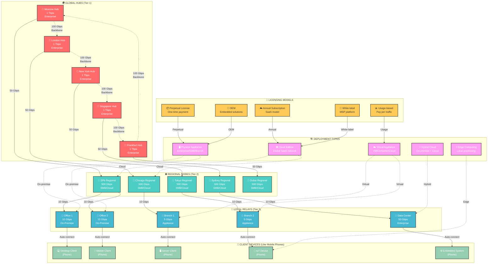

# 🚀 CloudBridge Relay: Видение и будущие возможности

## 🌟 Видение проекта

CloudBridge Relay стремится стать **глобальной сетью защищенного корпоративного доступа**, аналогичной сотовой сети, но для бизнес-пользователей. Как сотовые вышки обеспечивают связь для мобильных телефонов, наши relay-серверы создают защищенную сеть для корпоративных устройств и сервисов.

### 🎯 Ключевые принципы

- **🔒 Безопасность превыше всего** — соответствие российским и международным стандартам
- **🌍 Глобальное покрытие** — сеть узлов по всему миру, как сотовые вышки
- **⚡ Высокая производительность** — минимальная задержка и максимальная пропускная способность
- **🔄 Автоматическое масштабирование** — адаптация к нагрузке в реальном времени
- **💼 Enterprise-ready** — готовность для корпоративного использования
- **🛒 Гибкие модели лицензирования** — от коробочных решений до SaaS

---

## 🏗️ Архитектура: Аналогия с сотовой сетью

### 📡 Полная архитектура CloudBridge Relay



### 🔄 Принцип работы (как в сотовой сети)

1. **Подключение клиента** — устройство автоматически подключается к ближайшему relay-серверу
2. **Маршрутизация** — трафик направляется через оптимальный путь в сети
3. **Балансировка** — нагрузка распределяется между доступными серверами
4. **Переключение** — при смене местоположения клиент подключается к новому серверу
5. **Безопасность** — весь трафик шифруется и защищается

---

## 💼 Модели лицензирования и развертывания

### 📦 **1. Коробочные решения (On-Premise)**

#### **Физические Appliances**
- **Enterprise Appliance:** Высокопроизводительные серверы для крупных компаний
- **SMB Appliance:** Компактные решения для среднего бизнеса
- **Branch Appliance:** Легкие устройства для филиалов
- **Perpetual License:** Пожизненная лицензия с поддержкой

#### **Виртуальные Appliances**
- **VM Edition:** Виртуальные машины для VMware/Hyper-V
- **Container Edition:** Docker-контейнеры для гибкого развертывания
- **Cloud Appliance:** Готовые образы для AWS/Azure/GCP
- **Usage-based License:** Оплата по объему трафика

### ☁️ **2. Cloud Edition (SaaS)**

#### **Глобальная сеть relay-серверов**
- **Автоматическое подключение:** Клиенты подключаются к ближайшему серверу
- **Глобальное покрытие:** Серверы в 50+ странах
- **Масштабирование:** Автоматическое увеличение ресурсов
- **Годовая подписка:** Предсказуемые расходы

#### **Модели подписки**
```yaml
Cloud Editions:
  Starter:
    price: "$99/month"
    users: "до 50"
    bandwidth: "100 GB"
    support: "Email"
  
  Professional:
    price: "$299/month"
    users: "до 500"
    bandwidth: "1 TB"
    support: "Phone + Email"
  
  Enterprise:
    price: "$999/month"
    users: "неограниченно"
    bandwidth: "10 TB"
    support: "24/7 Premium"
```

### 🤝 **3. MSP/White-label решения**

#### **Платформа для сервис-провайдеров**
- **White-label:** Собственный брендинг
- **Multi-tenant:** Изоляция клиентов
- **Billing integration:** Встроенная система биллинга
- **Revenue sharing:** Разделение доходов

#### **OEM партнерство**
- **Embedded solutions:** Встраивание в продукты партнеров
- **Custom development:** Разработка под требования
- **Joint marketing:** Совместное продвижение
- **Technical support:** Поддержка партнеров

### 🔄 **4. Гибридные модели**

#### **Hybrid Cloud**
- **On-premise + Cloud:** Комбинация локальных и облачных серверов
- **Smart routing:** Умная маршрутизация между компонентами
- **Data sovereignty:** Контроль над данными
- **Cost optimization:** Оптимизация затрат

#### **Edge Computing**
- **Local processing:** Обработка данных на границе
- **Reduced latency:** Минимальная задержка
- **Bandwidth savings:** Экономия трафика
- **Offline capability:** Работа без интернета

---

## 🚀 Будущие возможности

### 🌐 **1. Глобальная сеть узлов (как сотовые вышки)**

#### **Tier 1: Global Hubs (как магистральные вышки)**
- **Географическое распределение:** 20+ узлов в ключевых городах
- **Пропускная способность:** 1 Tbps на узел
- **Международные каналы:** Прямые соединения между континентами
- **99.999% доступность:** Максимальная надежность

#### **Tier 2: Regional Nodes (как региональные вышки)**
- **Локальное присутствие:** 200+ узлов в регионах
- **Быстрое подключение:** <5ms задержка
- **Автоматическое масштабирование:** Создание узлов по требованию
- **Load balancing:** Распределение нагрузки

#### **Tier 3: Local Relays (как микро-вышки)**
- **Корпоративные сети:** 10,000+ локальных узлов
- **On-premise deployment:** Локальное развертывание
- **Hybrid connectivity:** Связь с облачной сетью
- **Custom policies:** Корпоративные политики

### 🤖 **2. Искусственный интеллект и машинное обучение**

#### **AI-оптимизация сети (как умная сетевая маршрутизация)**
```python
class NetworkOptimizer:
    def optimize_routing(self, traffic_patterns, node_loads):
        # Анализ паттернов трафика (как анализ движения абонентов)
        # Предсказание нагрузки (как прогноз пиковых часов)
        # Оптимизация маршрутов (как выбор оптимальной вышки)
        return optimal_routes
```

#### **Умная детекция угроз**
- **Поведенческий анализ:** Обнаружение аномалий в реальном времени
- **Автоматический ответ:** Блокировка подозрительной активности
- **Прогнозирование атак:** Предупреждение о потенциальных угрозах
- **Адаптивная безопасность:** Обучение на новых типах угроз

### 📊 **3. Продвинутая аналитика и мониторинг**

#### **Real-time дашборды (как мониторинг сотовой сети)**
- **Глобальная карта сети:** Визуализация всех узлов и соединений
- **Тепловые карты:** Нагрузка по регионам и времени
- **Метрики производительности:** Задержка, пропускная способность, ошибки
- **Аналитика пользователей:** Поведение и паттерны использования

#### **Прогнозная аналитика**
- **Capacity planning:** Планирование ресурсов на основе трендов
- **Anomaly detection:** Обнаружение необычной активности
- **Performance optimization:** Рекомендации по улучшению
- **Business intelligence:** Аналитика для принятия решений

### 🔐 **4. Расширенная безопасность**

#### **Zero Trust Architecture**
- **Постоянная верификация:** Проверка каждого запроса
- **Минимальные привилегии:** Доступ только к необходимым ресурсам
- **Шифрование end-to-end:** Защита данных на всех этапах
- **Аудит всех действий:** Полная трассируемость

#### **Квантовая криптография**
- **Post-quantum algorithms:** Алгоритмы, устойчивые к квантовым атакам
- **Quantum key distribution:** Распределение ключей через квантовые каналы
- **Гибридная криптография:** Сочетание классических и квантовых методов

### 🌍 **5. Глобальная экосистема**

#### **API Marketplace**
- **REST API:** Программный доступ к функциям сети
- **Webhooks:** Интеграция с внешними системами
- **SDK для разработчиков:** Библиотеки для популярных языков
- **Plugin ecosystem:** Расширения от сообщества

#### **Партнерская программа**
- **Reseller program:** Возможность перепродажи услуг
- **White-label solutions:** Брендированные решения для партнеров
- **Revenue sharing:** Разделение доходов с партнерами
- **Technical support:** Поддержка партнеров

### 🚀 **6. Инновационные технологии**

#### **5G/6G интеграция**
- **Network slicing:** Выделенные виртуальные сети
- **Edge computing:** Обработка данных на границе сети
- **Ultra-low latency:** Задержка менее 1ms
- **Massive IoT:** Поддержка миллионов устройств

#### **Blockchain интеграция**
- **Decentralized identity:** Самоуправляемые идентификаторы
- **Smart contracts:** Автоматизация бизнес-процессов
- **Token economics:** Внутренняя экономика сети
- **Distributed governance:** Децентрализованное управление

---

## 📈 Дорожная карта развития

### 🎯 **Phase 1: Foundation (2024)**
- [x] Базовая архитектура Relay сервера
- [x] Интеграция с Keycloak
- [x] Базовый мониторинг
- [ ] Улучшение админ-панели
- [ ] Документация и тестирование
- [ ] Первые коробочные решения

### 🚀 **Phase 2: Scaling (2025)**
- [ ] Горизонтальное масштабирование
- [ ] Географическое распределение узлов
- [ ] Cloud Edition (SaaS)
- [ ] MSP/White-label платформа
- [ ] Продвинутая аналитика
- [ ] API для интеграций

### 🌟 **Phase 3: Intelligence (2026)**
- [ ] AI/ML интеграция
- [ ] Умная детекция угроз
- [ ] Прогнозная аналитика
- [ ] Автоматическая оптимизация
- [ ] Zero Trust архитектура
- [ ] OEM партнерства

### 🌍 **Phase 4: Global (2027)**
- [ ] Глобальная сеть узлов (1000+)
- [ ] Партнерская программа
- [ ] Marketplace
- [ ] Blockchain интеграция
- [ ] 5G/6G поддержка
- [ ] Квантовая криптография

---

## 💡 Инновационные идеи

### 🧠 **Нейронная сеть для маршрутизации (как умная сетевая маршрутизация)**
```python
class NeuralRouter:
    def __init__(self):
        self.model = self.build_model()
    
    def route_traffic(self, source, destination, traffic_type):
        # Использование нейронной сети для выбора оптимального маршрута
        # (как выбор оптимальной сотовой вышки)
        optimal_route = self.model.predict([source, destination, traffic_type])
        return optimal_route
```

### 🌐 **Виртуальная реальность для управления сетью**
- **VR дашборд:** Управление сетью в виртуальной реальности
- **3D визуализация:** Трехмерное представление сети (как карта сотовой сети)
- **Gesture control:** Управление жестами
- **Collaborative VR:** Совместная работа в VR

### 🧬 **Генетические алгоритмы для оптимизации**
```python
class GeneticOptimizer:
    def optimize_network_topology(self, constraints):
        # Генетический алгоритм для оптимизации топологии сети
        # (как оптимизация расположения сотовых вышек)
        population = self.initialize_population()
        for generation in range(max_generations):
            population = self.evolve(population)
        return self.best_solution(population)
```

### 🎯 **Квантовые вычисления для криптографии**
- **Quantum-resistant algorithms:** Алгоритмы, устойчивые к квантовым атакам
- **Quantum key distribution:** Распределение ключей через квантовые каналы
- **Quantum random number generation:** Генерация истинно случайных чисел

---

## 🎯 Цели и метрики

### 📊 **Технические метрики**
- **Пропускная способность:** 10 Tbps глобальной сети
- **Задержка:** <3ms средняя задержка
- **Доступность:** 99.999% uptime
- **Безопасность:** 0 успешных атак
- **Глобальное покрытие:** 200+ стран

### 💼 **Бизнес метрики**
- **Пользователи:** 10M+ активных пользователей
- **Узлы:** 100,000+ узлов по всему миру
- **Доход:** $1B+ годовой доход
- **Партнеры:** 10,000+ партнеров
- **Лицензии:** 50% SaaS, 30% On-premise, 20% Hybrid

### 🌍 **Социальные метрики**
- **Глобальное покрытие:** 200+ стран
- **Экологичность:** Carbon-neutral инфраструктура
- **Доступность:** Поддержка развивающихся стран
- **Образование:** Программы обучения и сертификации

---

## 🔮 Видение будущего

CloudBridge Relay станет **основой цифровой инфраструктуры будущего**, обеспечивая безопасный, быстрый и надежный доступ к корпоративным ресурсам из любой точки мира. Как сотовые сети изменили мобильную связь, наша сеть изменит корпоративный доступ к ресурсам.

### 🌟 **Миссия**
Создать глобальную сеть, которая делает корпоративные ресурсы доступными, безопасными и быстрыми для всех, везде и всегда — как сотовые сети для мобильной связи.

### 🎯 **Видение**
Стать стандартом де-факто для корпоративного туннелирования и безопасного доступа к ресурсам в цифровом мире, предлагая гибкие модели лицензирования от коробочных решений до SaaS.

### 💼 **Бизнес-модель**
- **Коробочные решения:** Perpetual и usage-based лицензии
- **Cloud Edition:** Годовые подписки с глобальной сетью
- **MSP/White-label:** Платформа для сервис-провайдеров
- **OEM:** Встраивание в продукты партнеров

---

*Этот документ будет обновляться по мере развития проекта и появления новых технологий и возможностей.* 