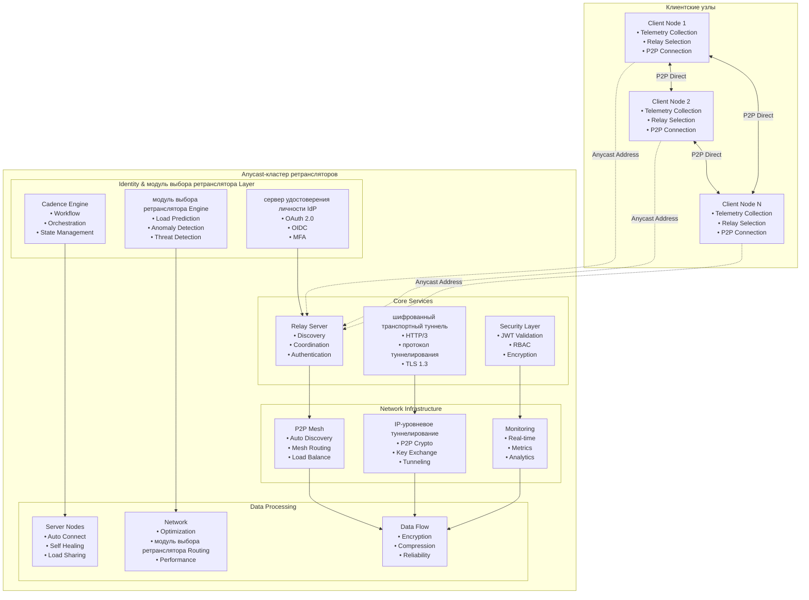
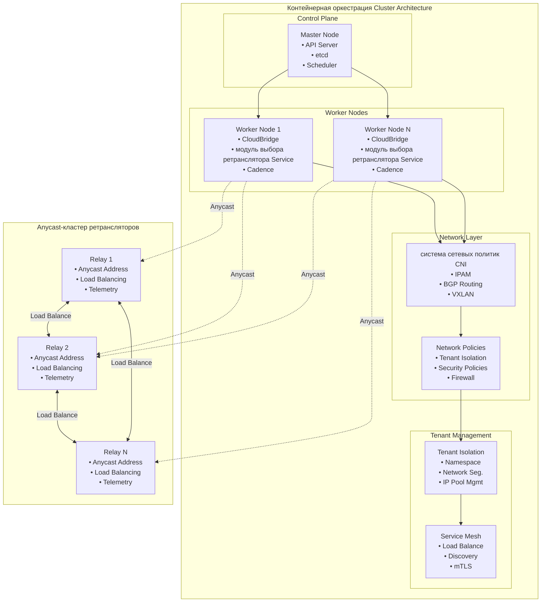
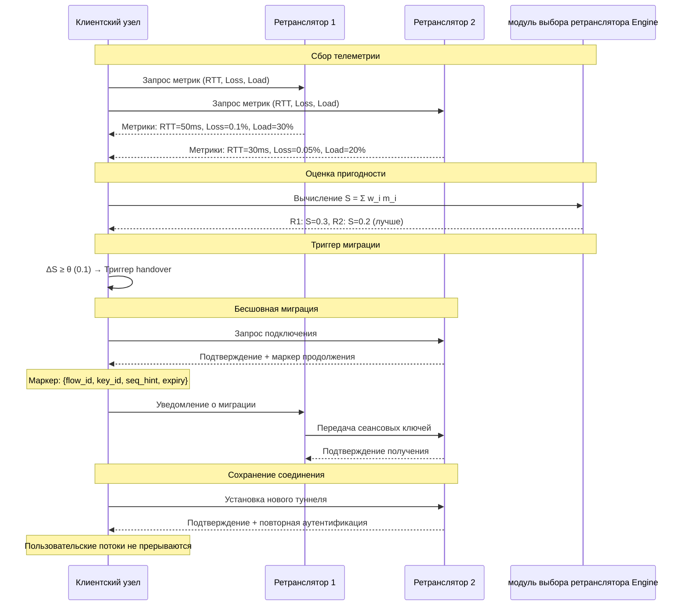
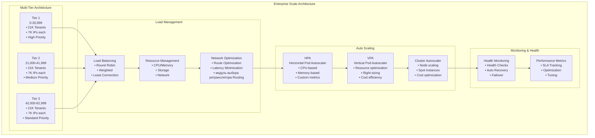
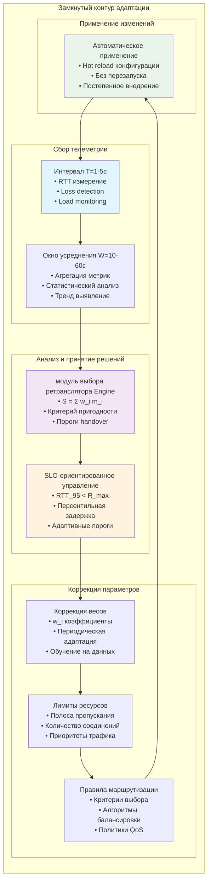

# Способ и система построения масштабируемой защищённой одноранговой сети с anycast-кластером ретрансляторов и адаптивным выбором маршрутов

## Реферат

Предложены способ, система и машиночитаемый носитель для построения защищённой одноранговой сети с anycast-кластером ретрансляторов. Клиентский узел собирает телеметрию, ранжирует ретрансляторы и инициирует handover активного туннеля при деградации качества. Решение совмещает приоритет прямого P2P-канала после ICE-согласования, бесшовную миграцию по маркеру продолжения сеанса, детерминированный IPAM per-tenant и SLO-ориентированный замкнутый контур коррекции. Технический результат — снижение задержки и потерь при масштабировании, повышение отказоустойчивости и изоляции арендаторов.

## Область техники

Изобретение относится к передаче данных и построению защищённых сетей, в частности к способам и системам построения масштабируемых overlay-сетей с использованием anycast-кластеров ретрансляторов и адаптивным выбором маршрутов на основе телеметрии. Известны решения по построению overlay-сетей, VPN-туннелированию, anycast-распределению трафика и клиент-зависимому управлению сетевыми соединениями.

## Уровень техники

При классическом anycast выбор узла делает сеть по BGP на сетевом уровне, без учёта качества путей клиента, клиент им не управляет. В CDN существует client-assisted/end-user mapping (клиентские пробы/DNS-steering), но это иной уровень — не миграция активных туннелей внутри anycast и без интеграции с per-tenant IPAM/SLO-контуром. Известно, что для бесшовности применимы механизмы миграции соединений и мультиплексирования потоков транспорта. Для P2P-достижимости стандартно применяют ICE/STUN/TURN.

Совместное применение клиентского выбора внутри anycast-кластера + маркера продолжения сеанса для handover + предпочтения P2P-канала с ICE + детерминированного IPAM per-tenant + SLO-замкнутого контура не выявлено в известных решениях.

## Раскрытие изобретения

**Технический результат**: снижение задержки и потерь при масштабировании, повышение отказоустойчивости и изоляции арендаторов.

**Существенные признаки**:

*Необходимые признаки:*
- anycast-кластер ретрансляторов с единым адресом
- клиентский выбор ретранслятора на основе телеметрии
- бесшовная миграция соединений между ретрансляторами
- детерминированное управление адресным пространством per-tenant
- замкнутый контур адаптации параметров системы

*Дополнительные признаки:*
- приоритет прямого P2P-соединения с ICE-согласованием
- маркер продолжения сеанса для handover
- SLO-ориентированное управление с поддержанием персентильных показателей

## Отличительные признаки относительно уровня техники

### 1. Anycast с клиентским выбором ретранслятора
**Новизна**: В отличие от традиционного anycast, где выбор ретранслятора делает сеть, в предлагаемом решении добавлен клиентский слой ранжирования ретрансляторов внутри anycast-группы и инициируемый клиентом handover.

**Техническое решение**:
- Клиент получает телеметрию (задержка, потери, загрузка) от всех ретрансляторов в anycast-группе с интервалом T (например, 1–5 с), окно усреднения W (например, 10–60 с)
- Модуль выбора ретранслятора вычисляет оценку пригодности каждого ретранслятора по критерию S = Σ w_i m_i, где m_i ∈ {RTT, Loss, Jitter, Load, Cost}, Σ w_i = 1, w_i ≥ 0
- Автоматический выбор оптимального ретранслятора на основе критериев качества с триггером handover при ΔS ≥ θ (например, порог 0.05-0.1) и/или RTT_95 > R_max в течение K (например, 3-5) интервалов подряд

### 2. Бесшовная миграция с сохранением сеансов
**Новизна**: Обеспечение непрерывности соединений при миграции между ретрансляторами без разрыва пользовательских потоков.

**Техническое решение**:
- Обмен маркером продолжения сеанса {flow_id, key_ref, seq_hint, expiry} между ретрансляторами, где flow_id — идентификатор потока, key_ref — ссылка на ключ, seq_hint — подсказка порядкового номера, expiry — время годности
- Повторное установление ключей без разрыва потоков
- Сохранение идентификаторов потока и сеансовых ключей

### 3. Детерминированный IPAM per-tenant
**Новизна**: Функция отображения tenant→подсеть с исключением коллизий и возможностью переаллокации по эпохам.

**Техническое решение**:
- Детерминированная функция f(tenant_id, epoch)→подсеть, пример: f(tenant_id) = 10.x.y.0/24, где x,y — биты хэша tenant_id
- Поддержка до 63,000 тенантов в диапазоне 10.0.0.0/8 (из 65,536 возможных /24 подсетей резервируется ~2,536 адресов для служебных нужд: управляющие подсети, резерв для масштабирования, системные сервисы)
- Автоматическое выделение и освобождение адресного пространства с разрешением конфликтов сменой epoch

### 4. Замкнутый контур адаптации
**Новизна**: Периодическая коррекция весов маршрутов и лимитов ресурсов на основе агрегированной телеметрии.

**Техническое решение**:
- SLO-ориентированная коррекция параметров системы с периодичностью (например, каждые 30-60 секунд) пропорционально ошибке
- Адаптивное перераспределение трафика между путями с ограничением шага изменения весов (например, Δw ≤ 0.1)
- Автоматическая оптимизация критериев отбора ретрансляторов для удержания RTT₉₅ и PLR в заданных пределах

## Ключевые инновации

### 1. Интеллектуальная P2P Mesh Сеть
- **Автоматическое обнаружение пиров**: Система автоматически находит и подключается к доступным серверам в сети
- **Оптимизированная маршрутизация**: Модуль принятия решений анализирует качество соединений и выбирает оптимальные маршруты
- **Адаптивная топология**: Сеть автоматически перестраивается при изменении доступности узлов

### 2. Многоуровневая система безопасности
- **Централизованная аутентификация**: Единая система управления доступом через сервер удостоверения личности
- **JWT-токены с метаданными**: Безопасные токены доступа с встроенной бизнес-информацией
- **Шифрование на уровне IP**: Все трафик шифруется с использованием шифрованного транспортного туннеля

### 3. Модуль принятия решений в реальном времени
- **Предсказательная аналитика**: Модуль принятия решений предсказывает нагрузку и обнаруживает аномалии
- **Автоматическое обнаружение угроз**: Система безопасности с модулем принятия решений
- **Оптимизация производительности**: Динамическая настройка параметров сети
## Архитектура системы

### Anycast-кластер ретрансляторов с клиентским выбором

**Ключевая инновация**: В отличие от традиционного anycast, где выбор ретранслятора делает сеть, в предлагаемом решении добавлен клиентский слой ранжирования ретрансляторов внутри anycast-группы и инициируемый клиентом handover.

#### **Anycast-кластер ретрансляторов**
- **Единый anycast-адрес** для кластера ретрансляторов
- **Клиентский выбор ретранслятора** на основе телеметрии (задержка, потери, загрузка)
- **Бесшовная миграция** между ретрансляторами с сохранением сеансовых ключей
- **Детерминированный IPAM** per-tenant с функцией отображения tenant→подсеть

#### **Замкнутый контур адаптации**
- **Периодическая коррекция** весов маршрутов и лимитов ресурсов
- **Агрегированная телеметрия** для принятия решений
- **SLO-ориентированная** коррекция параметров системы

### Общая концепция P2P Mesh сети

P2P Mesh сеть создается из нескольких серверных клиентов, которые автоматически обнаруживают друг друга и устанавливают прямые соединения. Каждый сервер может выступать как клиентом, так и маршрутизатором для других серверов.

### Диаграмма 1: Топология P2P Mesh сети

```
                    ┌─────────────────────────────────┐
                    │        Relay Server            │
                    │      (Discovery Hub)           │
                    │   • Peer Discovery             │
                    │   • Authentication            │
                    │   • Route Coordination         │
                    └─────────────┬───────────────────┘
                                  │
                    ┌─────────────┴───────────────────┐
                    │                                 │
        ┌───────────▼───────────┐    ┌───────────────▼───────────┐
        │    Server Node #1     │    │    Server Node #2        │
        │  • модуль выбора ретранслятора Analytics      │    │  • модуль выбора ретранслятора Analytics          │
        │  • P2P Routing       │    │  • P2P Routing            │
        │  • Security Layer    │    │  • Security Layer        │
        │  • Mesh Protocol     │    │  • Mesh Protocol          │
        └───────────┬───────────┘    └───────────────┬───────────┘
                    │                                │
                    └────────────────┬───────────────┘
                                     │
                    ┌─────────────────▼─────────────────┐
                    │         Server Node #3            │
                    │      • модуль выбора ретранслятора Analytics               │
                    │      • P2P Routing                │
                    │      • Security Layer             │
                    │      • Mesh Protocol               │
                    └───────────────────────────────────┘
```

### Диаграмма 2: Архитектура компонентов

```
┌─────────────────────────────────────────────────────────────────┐
│                    CloudBridge Platform                         │
├─────────────────────────────────────────────────────────────────┤
│  Identity & Access Management Layer                            │
│  ┌─────────────────┐    ┌─────────────────┐                    │
│  │  сервер удостоверения личности IdP   │    │  JWT Tokens     │                    │
│  │  • OAuth 2.0   │    │  • Metadata     │                    │
│  │  • OIDC        │    │  • RBAC         │                    │
│  └─────────────────┘    └─────────────────┘                    │
├─────────────────────────────────────────────────────────────────┤
│  модуль выбора ретранслятора & Analytics Layer                                          │
│  ┌─────────────────┐    ┌─────────────────┐                    │
│  │  модуль выбора ретранслятора Engine     │    │  Monitoring     │                    │
│  │  • Prediction  │    │  • Metrics      │                    │
│  │  • Anomaly     │    │  • Alerts       │                    │
│  └─────────────────┘    └─────────────────┘                    │
├─────────────────────────────────────────────────────────────────┤
│  P2P Mesh Networking Layer                                     │
│  ┌─────────────────┐    ┌─────────────────┐                    │
│  │  Peer Discovery │    │  Mesh Routing   │                    │
│  │  • Auto-detect  │    │  • Optimization │                    │
│  │  • Validation   │    │  • Load Balance │                    │
│  └─────────────────┘    └─────────────────┘                    │
├─────────────────────────────────────────────────────────────────┤
│  Security & Encryption Layer                                   │
│  ┌─────────────────┐    ┌─────────────────┐                    │
│  │  IP-уровневое туннелирование с обменом ключами (в частных вариантах — VPN-протоколы)      │    │  TLS 1.3        │                    │
│  │  • P2P Crypto   │    │  • Transport     │                    │
│  │  • Key Exchange│    │  • Certificate   │                    │
│  └─────────────────┘    └─────────────────┘                    │
└─────────────────────────────────────────────────────────────────┘
```
### Диаграмма 3: Процесс работы системы

```
┌─────────────────────────────────────────────────────────────────┐
│                    Процесс инициализации сети                  │
├─────────────────────────────────────────────────────────────────┤
│  Шаг 1: Аутентификация                                          │
│  ┌─────────────┐    ┌─────────────┐    ┌─────────────┐          │
│  │   Client    │───▶│  сервер удостоверения личности    │───▶│  JWT Token  │          │
│  │  Request    │    │    IdP      │    │  + Metadata │          │
│  └─────────────┘    └─────────────┘    └─────────────┘          │
├─────────────────────────────────────────────────────────────────┤
│  Шаг 2: Регистрация в сети                                      │
│  ┌─────────────┐    ┌─────────────┐    ┌─────────────┐          │
│  │   Client    │───▶│   Relay     │───▶│  Peer ID    │          │
│  │  Register   │    │   Server    │    │  Assignment │          │
│  └─────────────┘    └─────────────┘    └─────────────┘          │
├─────────────────────────────────────────────────────────────────┤
│  Шаг 3: Обнаружение пиров                                       │
│  ┌─────────────┐    ┌─────────────┐    ┌─────────────┐          │
│  │   Client    │───▶│   Relay     │───▶│  Peer List  │          │
│  │  Discovery  │    │   Server    │    │  + Metadata │          │
│  └─────────────┘    └─────────────┘    └─────────────┘          │
├─────────────────────────────────────────────────────────────────┤
│  Шаг 4: Установка P2P соединений                               │
│  ┌─────────────┐    ┌─────────────┐    ┌─────────────┐          │
│  │   Client    │◄──▶│   Peer      │◄──▶│   Client    │          │
│  │  A (P2P)    │    │  Connection │    │  B (P2P)    │          │
│  └─────────────┘    └─────────────┘    └─────────────┘          │
├─────────────────────────────────────────────────────────────────┤
│  Шаг 5: модуль выбора ретранслятора оптимизация маршрутов                               │
│  ┌─────────────┐    ┌─────────────┐    ┌─────────────┐          │
│  │   модуль выбора ретранслятора        │───▶│  Route      │───▶│  Optimal    │          │
│  │  Analysis   │    │  Selection  │    │  Path       │          │
│  └─────────────┘    └─────────────┘    └─────────────┘          │
└─────────────────────────────────────────────────────────────────┘
```

### Диаграмма 4: модуль выбора ретранслятора система прогнозирования и мониторинга

```
┌─────────────────────────────────────────────────────────────────┐
│                    модуль выбора ретранслятора Engine - Интеллектуальный анализ         │
├─────────────────────────────────────────────────────────────────┤
│  ┌─────────────────┐    ┌─────────────────┐    ┌─────────────────┐│
│  │  Load Prediction│    │ Anomaly Detection│    │ Threat Detection││
│  │  • Network Load │    │ • Traffic Anomaly│    │ • Attack Pattern││
│  │  • Performance  │    │ • Performance   │    │ • Brute Force  ││
│  │  • Capacity     │    │ • Resource Usage │    │ • Suspicious    ││
│  └─────────────────┘    └─────────────────┘    └─────────────────┘│
├─────────────────────────────────────────────────────────────────┤
│  ┌─────────────────┐    ┌─────────────────┐    ┌─────────────────┐│
│  │ Route Optimization│   │ Security Analysis│   │ Predictive      ││
│  │ • Path Selection│    │ • Risk Assessment│   │ Analytics      ││
│  │ • Load Balancing│    │ • Threat Level   │   │ • Future Trends ││
│  │ • Latency Min   │    │ • Security Score │   │ • Capacity Plan ││
│  └─────────────────┘    └─────────────────┘    └─────────────────┘│
├─────────────────────────────────────────────────────────────────┤
│  ┌─────────────────┐    ┌─────────────────┐    ┌─────────────────┐│
│  │ Real-time       │    │ Machine Learning│    │ Decision Engine ││
│  │ Monitoring      │    │ Models          │    │ • Auto Actions  ││
│  │ • Metrics       │    │ • Neural Networks│   │ • Alerts       ││
│  │ • Alerts        │    │ • Deep Learning │   │ • Optimizations││
│  └─────────────────┘    └─────────────────┘    └─────────────────┘│
└─────────────────────────────────────────────────────────────────┘
```

### Диаграмма 5: Cadence - Оркестрация долгоживущих процессов

```
┌─────────────────────────────────────────────────────────────────┐
│                    Cadence Workflow Engine                      │
├─────────────────────────────────────────────────────────────────┤
│  ┌─────────────────┐    ┌─────────────────┐    ┌─────────────────┐│
│  │ Workflow        │    │ Activity       │    │ Timer Service   ││
│  │ Orchestration   │    │ Execution       │    │ • Scheduled     ││
│  │ • Long-running  │    │ • Task Processing│   │ • Delayed       ││
│  │ • Stateful      │    │ • Retry Logic    │   │ • Periodic      ││
│  │ • Reliable      │    │ • Error Handling │   │ • Timeout       ││
│  └─────────────────┘    └─────────────────┘    └─────────────────┘│
├─────────────────────────────────────────────────────────────────┤
│  ┌─────────────────┐    ┌─────────────────┐    ┌─────────────────┐│
│  │ Event Sourcing  │    │ State Management│    │ Fault Tolerance ││
│  │ • Event History │    │ • State Machine │    │ • Failure Recovery││
│  │ • Audit Trail   │    │ • State Transitions│  │ • Retry Policies││
│  │ • Replay        │    │ • Persistence    │   │ • Circuit Breaker││
│  └─────────────────┘    └─────────────────┘    └─────────────────┘│
├─────────────────────────────────────────────────────────────────┤
│  ┌─────────────────┐    ┌─────────────────┐    ┌─────────────────┐│
│  │ Distributed    │    │ Scalability     │    │ Monitoring      ││
│  │ Execution      │    │ • Auto Scaling  │    │ • Metrics       ││
│  │ • Multi-node   │    │ • Load Balancing│    │ • Health Checks ││
│  │ • Load Distr.  │    │ • Resource Mgmt │    │ • Performance   ││
│  └─────────────────┘    └─────────────────┘    └─────────────────┘│
└─────────────────────────────────────────────────────────────────┘
```

### Диаграмма 6: Интегрированная система безопасности

```
┌─────────────────────────────────────────────────────────────────┐
│                    Security & Threat Detection System          │
├─────────────────────────────────────────────────────────────────┤
│  ┌─────────────────┐    ┌─────────────────┐    ┌─────────────────┐│
│  │ сервер удостоверения личности IdP     │    │ JWT Validation  │    │ RBAC Engine     ││
│  │ • OAuth 2.0     │    │ • Token Verify  │    │ • Role Mapping  ││
│  │ • OIDC          │    │ • Signature     │    │ • Permission   ││
│  │ • MFA Support   │    │ • Expiration     │    │ • Access Control││
│  └─────────────────┘    └─────────────────┘    └─────────────────┘│
├─────────────────────────────────────────────────────────────────┤
│  ┌─────────────────┐    ┌─────────────────┐    ┌─────────────────┐│
│  │ модуль выбора ретранслятора Threat       │    │ Network         │    │ Security        ││
│  │ Detection       │    │ Monitoring      │    │ Analytics      ││
│  │ • Attack Pattern│    │ • Traffic Flow  │    │ • Risk Score   ││
│  │ • Anomaly       │    │ • Connection    │    │ • Threat Level ││
│  │ • Brute Force   │    │ • Performance   │    │ • Security Trend││
│  └─────────────────┘    └─────────────────┘    └─────────────────┘│
├─────────────────────────────────────────────────────────────────┤
│  ┌─────────────────┐    ┌─────────────────┐    ┌─────────────────┐│
│  │ Encryption      │    │ Audit &         │    │ Incident        ││
│  │ Layer           │    │ Compliance      │    │ Response        ││
│  │ • TLS 1.3       │    │ • Event Logging │    │ • Auto Block    ││
│  │ • IP-уровневое туннелирование с обменом ключами (в частных вариантах — VPN-протоколы)     │    │ • Audit Trail   │    │ • Alert System ││
│  │ • Key Exchange  │    │ • Compliance    │    │ • Recovery      ││
│  └─────────────────┘    └─────────────────┘    └─────────────────┘│
└─────────────────────────────────────────────────────────────────┘
```

### Диаграмма 7: шифрованный транспортный туннель поверх UDP с поддержкой датаграмм и потоков (в частных вариантах — HTTP/3/QUIC) протокол и HTTP/3 туннелирование

```
┌─────────────────────────────────────────────────────────────────┐
│                    шифрованный транспортный туннель поверх UDP с поддержкой датаграмм и потоков (в частных вариантах — HTTP/3/QUIC) Protocol Stack                          │
├─────────────────────────────────────────────────────────────────┤
│  ┌─────────────────┐    ┌─────────────────┐    ┌─────────────────┐│
│  │ HTTP/3 Layer    │    │ шифрованный транспортный туннель поверх UDP с поддержкой датаграмм и потоков (в частных вариантах — HTTP/3/QUIC) Transport  │    │ UDP Transport   ││
│  │ • HTTP/3        │    │ • Connection    │    │ • Datagram      ││
│  │ • Streams       │    │ • Multiplexing  │    │ • Reliability  ││
│  │ • Headers       │    │ • Flow Control  │    │ • Congestion    ││
│  └─────────────────┘    └─────────────────┘    └─────────────────┘│
├─────────────────────────────────────────────────────────────────┤
│  ┌─────────────────┐    ┌─────────────────┐    ┌─────────────────┐│
│  │ протокол туннелирования (в частных вариантах — MASQUE) Protocol │    │ TLS 1.3         │    │ Connection      ││
│  │ • CONNECT-UDP   │    │ • Encryption    │    │ Management      ││
│  │ • CONNECT-IP    │    │ • Authentication│    │ • Handshake     ││
│  │ • HTTP Datagrams│    │ • Key Exchange  │    │ • Migration     ││
│  └─────────────────┘    └─────────────────┘    └─────────────────┘│
├─────────────────────────────────────────────────────────────────┤
│  ┌─────────────────┐    ┌─────────────────┐    ┌─────────────────┐│
│  │ Performance     │    │ Security        │    │ Reliability     ││
│  │ • 0-RTT         │    │ • Perfect Fwd   │    │ • Retransmission││
│  │ • Multiplexing  │    │ • Forward Secrecy│   │ • Error Recovery││
│  │ • Flow Control  │    │ • Certificate   │    │ • Connection    ││
│  └─────────────────┘    └─────────────────┘    └─────────────────┘│
└─────────────────────────────────────────────────────────────────┘
```

## Компоненты системы

| Компонент | Назначение | Технология |
|-----------|------------|------------|
| **Relay Server** | Discovery, координация, аутентификация | Высокопроизводительный API с шифрованием, TLS 1.3 |
| **Server Clients** | P2P соединения, маршрутизация | IP-уровневое туннелирование с обменом ключами, шифрованный транспортный туннель поверх UDP с поддержкой датаграмм и потоков (в частных вариантах — VPN-протоколы, HTTP/3/QUIC) |
| **Peer Discovery** | Автоматический поиск пиров | HTTP/3, WebSocket |
| **Mesh Routing** | Интеллектуальная маршрутизация трафика | Специализированный протокол |
| **модуль выбора ретранслятора Engine** | Анализ и оптимизация сети | Машинное обучение |
| **Cadence Engine** | Оркестрация долгоживущих процессов | Движок рабочих процессов |
| **шифрованный транспортный туннель поверх UDP с поддержкой датаграмм и потоков (в частных вариантах — HTTP/3/QUIC) Transport** | Современный транспортный протокол | HTTP/3, протокол туннелирования (в частных вариантах — MASQUE) |
| **Security Layer** | Аутентификация и шифрование | JWT, TLS, IP-уровневое туннелирование |
| **контейнерная оркестрация (в частных вариантах — Kubernetes)** | Контейнерная оркестрация | Контейнерная оркестрация, Pods, Services |
| **система сетевых политик CNI** | Сетевая изоляция и IPAM | система сетевых политик, BGP, VXLAN |
| **Tenant Proxy** | Проксирование тенантов | Gateway, Load Balancer |
| **Service Mesh** | Управление сервисами | сервис-меш, Envoy, mTLS |
| **IP Pool Manager** | Управление IP пулами | IPAM, Subnet Management |
| **высокопроизводительный API с шифрованием (в частных вариантах — gRPC) Server** | Высокопроизводительный API | TLS 1.3, RBAC, Streaming |
| **CloudBridge Client** | Cross-platform клиент | Multi-transport, P2P, Service |

### Диаграмма 8: Архитектура системы с anycast-кластером



### Диаграмма 9: Контейнерная оркестрация с сетевыми политиками



### Диаграмма 10: Изоляция тенантов и управление IP-пулами

```mermaid
graph TB
    subgraph "Multi-Tenant Network Isolation"
        subgraph "Tenant A"
            TA[Tenant A<br/>• Namespace: A<br/>• IP Pool: 10.100.1.0/24<br/>• Services: Relay A, модуль выбора ретранслятора A]
        end
        
        subgraph "Tenant B"
            TB[Tenant B<br/>• Namespace: B<br/>• IP Pool: 10.100.2.0/24<br/>• Services: Relay B, модуль выбора ретранслятора B]
        end
        
        subgraph "Tenant C"
            TC[Tenant C<br/>• Namespace: C<br/>• IP Pool: 10.100.3.0/24<br/>• Services: Relay C, модуль выбора ретранслятора C]
        end
        
        subgraph "Network Policies"
            CP[система сетевых политик Policies<br/>• Tenant A → Deny B,C<br/>• Tenant B → Deny A,C<br/>• Tenant C → Deny A,B]
            NS[Network Segmentation<br/>• VXLAN<br/>• BGP Routes<br/>• Overlay Networks]
            SE[Security Enforcement<br/>• Firewall<br/>• ACL Rules<br/>• Traffic Filtering]
        end
        
        subgraph "IP Management"
            IPM[IP Pool Management<br/>• 10.0.0.0/8<br/>• 63,000 Tenants<br/>• Subnet Management]
            AA[Auto Allocation<br/>• Dynamic<br/>• Per Tenant<br/>• Auto Assign]
            SM[Scale Management<br/>• Up to 63K Tenants<br/>• Auto Expand<br/>• Resource Optimization]
        end
    end
    
    subgraph "Детерминированный IPAM"
        DET[Детерминированная функция<br/>f(tenant_id, epoch) → подсеть<br/>• Исключение коллизий<br/>• Плановая переаллокация]
        HASH[Хэш-функция<br/>x,y = bits(hash(tenant_id))<br/>• 10.x.y.0/24<br/>• 63,000 тенантов]
    end
    
    TA --> CP
    TB --> CP
    TC --> CP
    CP --> NS
    NS --> SE
    SE --> IPM
    IPM --> AA
    AA --> SM
    
    DET --> IPM
    HASH --> DET
```

### Диаграмма 11: Процесс бесшовной миграции



### Диаграмма 12: Масштабирование до 63,000 тенантов



### Диаграмма 13: Замкнутый контур адаптации



### Диаграмма 14: Tenant Proxy и Service Mesh

```
┌─────────────────────────────────────────────────────────────────┐
│                Tenant Proxy & Service Mesh                     │
├─────────────────────────────────────────────────────────────────┤
│  ┌─────────────────┐    ┌─────────────────┐    ┌─────────────────┐│
│  │  Tenant         │    │  Proxy           │    │  Service        ││
│  │  Gateway        │    │  Layer           │    │  Mesh           ││
│  │ • Ingress       │    │ • Request        │    │ • Service       ││
│  │ • Load Balance  │    │   Routing        │    │   Discovery     ││
│  │ • SSL Term.     │    │ • Auth           │    │ • Load Balance  ││
│  └─────────────────┘    └─────────────────┘    └─────────────────┘│
├─────────────────────────────────────────────────────────────────┤
│  ┌─────────────────┐    ┌─────────────────┐    ┌─────────────────┐│
│  │  Traffic         │    │  Security        │    │  Monitoring     ││
│  │  Management      │    │  Policies        │    │  & Analytics    ││
│  │ • Rate Limiting  │    │ • mTLS           │    │ • Metrics       ││
│  │ • Circuit Breaker│    │ • RBAC           │    │ • Tracing       ││
│  │ • Retry Logic    │    │ • Encryption     │    │ • Logging       ││
│  └─────────────────┘    └─────────────────┘    └─────────────────┘│
├─────────────────────────────────────────────────────────────────┤
│  ┌─────────────────┐    ┌─────────────────┐    ┌─────────────────┐│
│  │  Multi-Tenant   │    │  Namespace      │    │  Resource        ││
│  │  Isolation      │    │  Management     │    │  Quotas          ││
│  │ • Network Seg.  │    │ • Auto Create   │    │ • CPU Limits     ││
│  │ • Data Isolation│    │ • Auto Delete   │    │ • Memory Limits  ││
│  │ • Policy Enforce│    │ • Lifecycle     │    │ • Storage Limits ││
│  └─────────────────┘    └─────────────────┘    └─────────────────┘│
└─────────────────────────────────────────────────────────────────┘
```

### Диаграмма 13: высокопроизводительный API с шифрованием (в частных вариантах — gRPC) Architecture с TLS 1.3 и RBAC

```mermaid
graph TB
    subgraph "высокопроизводительный API с шифрованием (в частных вариантах — gRPC) Server Architecture"
        subgraph "Security Layer"
            TLS[TLS 1.3 Security<br/>• Certificates<br/>• mTLS Support<br/>• Cipher Suites]
            RBAC[RBAC Middleware<br/>• JWT Validation<br/>• Role Mapping<br/>• Permission Control]
            RL[Rate Limiting<br/>• 100 req/min<br/>• Burst Control<br/>• Tenant Quotas]
        end
        
        subgraph "высокопроизводительный API с шифрованием (в частных вариантах — gRPC) Services"
            CS[Control Service<br/>• Hello<br/>• Authenticate<br/>• GetStatus]
            TS[Tunnel Service<br/>• CreateTunnel<br/>• DestroyTunnel<br/>• ListTunnels]
            HS[Heartbeat Service<br/>• SendHeartbeat<br/>• GetStats<br/>• Health Check]
        end
        
        subgraph "Integration Layer"
            ZIT[сервер удостоверения личности Integration<br/>• JWT Tokens<br/>• OAuth 2.0<br/>• OIDC]
            PROM[система мониторинга Metrics<br/>• высокопроизводительный API с шифрованием (в частных вариантах — gRPC) Metrics<br/>• Performance<br/>• Health]
            AUDIT[Audit Logging<br/>• Security Events<br/>• Access Logs<br/>• Compliance]
        end
    end
    
    TLS --> CS
    RBAC --> TS
    RL --> HS
    CS --> ZIT
    TS --> PROM
    HS --> AUDIT
```

### Диаграмма 14: CloudBridge Client Architecture

```mermaid
graph TB
    subgraph "CloudBridge Client Platform"
        subgraph "Transport Layer"
            TL[Transport Layer<br/>• высокопроизводительный API с шифрованием (в частных вариантах — gRPC)<br/>• шифрованный транспортный туннель поверх UDP с поддержкой датаграмм и потоков (в частных вариантах — HTTP/3/QUIC)<br/>• WebSocket<br/>• JSON]
            AM[Authentication Manager<br/>• JWT Tokens<br/>• сервер удостоверения личности<br/>• OAuth 2.0<br/>• OIDC]
            P2P[P2P Mesh Manager<br/>• шифрованный транспортный туннель поверх UDP с поддержкой датаграмм и потоков (в частных вариантах — HTTP/3/QUIC)<br/>• ICE/STUN<br/>• TURN<br/>• Auto Switch]
        end
        
        subgraph "Core Services"
            TM[Tunnel Manager<br/>• Local Ports<br/>• Remote Hosts<br/>• Port Forward]
            PO[Performance Optimizer<br/>• High Throughput<br/>• Low Latency<br/>• Balanced]
            MS[Metrics System<br/>• система мониторинга<br/>• Pushgateway<br/>• Health Check]
        end
        
        subgraph "Management"
            SM[Service Management<br/>• Install<br/>• Start/Stop<br/>• Status]
            CW[Config Watcher<br/>• Hot Reload<br/>• TLS Reload<br/>• Auth Reload]
            HM[Heartbeat Manager<br/>• Keep Alive<br/>• Health Check<br/>• Auto Reconnect]
        end
    end
    
    TL --> TM
    AM --> PO
    P2P --> MS
    TM --> SM
    PO --> CW
    MS --> HM
```

## Алгоритм работы системы

### Этап 1: Инициализация и регистрация
1. **Подключение к Relay Server** - Установка защищенного соединения с центральным сервером
2. **Аутентификация через сервер удостоверения личности** - Получение JWT токена с метаданными
3. **Регистрация в peer registry** - Получение уникального идентификатора в сети
4. **Инициализация IP-уровневое туннелирование с обменом ключами (в частных вариантах — VPN-протоколы)** - Настройка P2P шифрования
5. **Запуск peer discovery** - Активация автоматического поиска пиров
6. **Активация mesh network** - Включение интеллектуальной маршрутизации

### Этап 2: Обнаружение и подключение пиров
1. **Запрос списка пиров** - Получение доступных узлов от Relay Server
2. **Фильтрация по политикам** - Проверка whitelist и security policies
3. **Проверка доступности** - Тестирование качества соединений
4. **Установка P2P соединений** - Создание прямых туннелей между узлами
5. **Обновление routing table** - Добавление новых маршрутов в таблицу маршрутизации

### Этап 3: модуль выбора ретранслятора оптимизация и мониторинг
1. **Анализ качества соединений** - Измерение латентности и пропускной способности
2. **Выбор оптимальных маршрутов** - модуль выбора ретранслятора алгоритмы для выбора лучших путей
3. **Автоматическое переключение** - Динамическая оптимизация маршрутов
4. **Мониторинг безопасности** - Обнаружение аномалий и угроз
5. **Предсказательная аналитика** - Прогнозирование нагрузки и оптимизация

## Инновационные особенности

### 1. Гибридная стратегия маршрутизации
- **Прямые соединения** - Приоритет прямых P2P туннелей для минимальной латентности
- **Relay fallback** - Автоматическое переключение на центральный сервер при недоступности прямых соединений
- **модуль выбора ретранслятора оптимизация** - Динамический выбор маршрутов на основе анализа производительности

### 2. Адаптивная топология сети
- **Автоматическое обнаружение** - Система самостоятельно находит и подключается к доступным узлам
- **Самоорганизация** - Сеть автоматически перестраивается при изменении доступности узлов
- **Отказоустойчивость** - Множественные пути для обеспечения непрерывности соединений

### 3. Интеллектуальная маршрутизация
- **Анализ производительности** - Непрерывный мониторинг качества соединений
- **Автоматическое переключение** - Динамическое изменение маршрутов при ухудшении качества
- **Load balancing** - Распределение нагрузки между доступными путями
- **Predictive routing** - Предсказание оптимальных маршрутов на основе исторических данных

### 4. Многоуровневая система безопасности
- **Централизованная аутентификация** - Единая точка управления доступом
- **JWT токены с метаданными** - Безопасные токены с встроенной бизнес-информацией
- **Шифрование на уровне IP** - Полное шифрование всего трафика
- **Perfect Forward Secrecy** - Защита от компрометации ключей

## Система безопасности

### 1. Многоуровневая аутентификация
- **Централизованная аутентификация** - Единая точка входа через сервер удостоверения личности Identity Provider
- **JWT токены с метаданными** - Безопасные токены с встроенной бизнес-информацией
- **Multi-Factor Authentication** - Дополнительная защита для критических операций
- **Role-Based Access Control** - Гранулярные права доступа на основе ролей

### 2. Современное шифрование
- **TLS 1.3** - Современное шифрование для всех соединений
- **IP-уровневое туннелирование с обменом ключами (в частных вариантах — VPN-протоколы) P2P** - Шифрование на уровне IP для прямых соединений
- **Certificate Pinning** - Защита от MITM атак
- **Perfect Forward Secrecy** - Защита от компрометации ключей

### 3. модуль выбора ретранслятора мониторинг безопасности
- **Real-time Threat Detection** - модуль выбора ретранслятора анализ подозрительной активности
- **Anomaly Detection** - Обнаружение необычных паттернов трафика
- **Brute Force Protection** - Автоматическая блокировка атак
- **Security Events Logging** - Полное логирование событий безопасности

### 4. Сетевая изоляция
- **Tenant Isolation** - Полная изоляция между различными организациями
- **Whitelist Filtering** - Контролируемый доступ к ресурсам
- **Network Segmentation** - Логическое разделение сетевых сегментов
- **Traffic Encryption** - Шифрование всего трафика на всех уровнях

## модуль выбора ретранслятора мониторинг и аналитика

### 1. Интеллектуальная система мониторинга
- **Real-time Analytics** - Анализ производительности в реальном времени
- **Predictive Monitoring** - Предсказание проблем до их возникновения
- **Anomaly Detection** - Автоматическое обнаружение аномалий в работе сети
- **Performance Optimization** - Динамическая оптимизация параметров сети

### 2. Категории метрик

#### модуль выбора ретранслятора Performance Metrics
- **Processing Time** - Время обработки модуль выбора ретранслятора запросов
- **Response Time** - Время отклика модуль выбора ретранслятора сервиса
- **Throughput** - Пропускная способность модуль выбора ретранслятора
- **Anomaly Detections** - Обнаружение аномалий
- **Queue Length** - Длина очереди модуль выбора ретранслятора

#### P2P Network Metrics
- **Round Trip Time** - Время отклика между узлами
- **Congestion Window** - Окно перегрузки
- **Throughput** - Входящий/исходящий трафик
- **Packet Loss Rate** - Потеря пакетов
- **Active Routes** - Активные маршруты

#### Security Metrics
- **Security Events** - Общее количество событий безопасности
- **Failed Logins** - Неудачные попытки входа
- **Blocked IPs** - Заблокированные IP адреса
- **Suspicious Activities** - Подозрительные активности

#### System Performance Metrics
- **Uptime** - Время работы сервера
- **Memory Usage** - Использование памяти
- **CPU Usage** - Использование процессора
- **Network Connections** - Количество сетевых соединений

## Преимущества изобретения

### 1. Технические преимущества
- **Автоматическое создание сети** - Система самостоятельно настраивает P2P соединения
- **модуль выбора ретранслятора оптимизация** - Модуль принятия решений непрерывно оптимизирует производительность
- **Отказоустойчивость** - Множественные пути обеспечивают непрерывность соединений
- **Масштабируемость** - Система автоматически адаптируется к росту сети

### 2. Безопасность
- **End-to-end шифрование** - Все данные шифруются от источника до получателя
- **Централизованная аутентификация** - Единая система управления доступом
- **модуль выбора ретранслятора мониторинг угроз** - Автоматическое обнаружение и блокировка атак
- **Tenant isolation** - Полная изоляция между различными организациями

### 3. Производительность
- **Минимальная латентность** - Прямые P2P соединения обеспечивают минимальные задержки
- **Автоматическая оптимизация** - Система самостоятельно выбирает оптимальные маршруты
- **Load balancing** - Распределение нагрузки между доступными путями
- **Predictive routing** - Предсказание оптимальных маршрутов

### 4. Управляемость
- **Централизованное управление** - Единая точка контроля всей сети
- **Автоматическое обнаружение** - Система самостоятельно находит и подключается к узлам
- **Self-healing** - Автоматическое восстановление при сбоях
- **Real-time мониторинг** - Непрерывный контроль состояния сети

### 5. Enterprise масштабирование
- **До 63,000 изолированных тенантов** - Поддержка enterprise-уровня изоляции
- **Автоматическое управление IP пулами** - Динамическое выделение IP адресов
- **контейнерная оркестрация (в частных вариантах — Kubernetes)-native архитектура** - Полная интеграция с K8s экосистемой
- **система сетевых политик сетевые политики** - Гранулярный контроль сетевого трафика
- **Multi-tier архитектура** - Трехуровневая система приоритетов
- **Auto-scaling** - Автоматическое масштабирование ресурсов

## Заключение

### Инновационность решения

2GC CloudBridge Global Network представляет собой принципиально новое решение для создания интеллектуальных P2P сетей с использованием искусственного интеллекта для оптимизации маршрутизации и обеспечения безопасности. Ключевые инновации включают:

1. **Автоматическое создание P2P сетей** - Система самостоятельно настраивает и поддерживает mesh-соединения между удаленными серверами
2. **модуль выбора ретранслятора оптимизированная маршрутизация** - Модуль принятия решений непрерывно анализирует и оптимизирует маршруты передачи данных
3. **Многоуровневая система безопасности** - Интеграция современных протоколов шифрования с централизованной аутентификацией
4. **Предсказательная аналитика** - модуль выбора ретранслятора система предсказывает проблемы и оптимизирует производительность сети

### Краткое описание чертежей

1. **Фигура 1** - Топология anycast-кластера ретрансляторов
2. **Фигура 2** - Диаграмма модулей клиентского узла
3. **Фигура 3** - Схема бесшовного handover между ретрансляторами
4. **Фигура 4** - Архитектура детерминированного IPAM per-tenant
5. **Фигура 5** - Замкнутый контур адаптации параметров системы
6. **Фигура 6** - Модуль принятия решений с входами и выходами
7. **Фигура 7** - Multi-transport архитектура с автоматическим переключением

#### 1. **P2P Mesh Networking с автоматическим обнаружением**
```go
// Автоматическое обнаружение пиров каждые 30 секунд
func (pm *P2PManager) processDiscoveredPeers(ctx context.Context) {
    ticker := time.NewTicker(30 * time.Second)
    // Гибридная стратегия маршрутизации: direct, mesh, relay
    routing_strategy: "hybrid"  // wireguard_first, performance_optimal, geographic_optimal
}
```

#### 2. **модуль выбора ретранслятора система с множественными алгоритмами машинного обучения**
```go
// Реальные модели машинного обучения
type RealLoadPredictor struct {
    arimaModel           NewARIMAModel(2, 1, 2)
    exponentialSmoothing NewExponentialSmoothing(0.3, 0.1, 0.1, 24)
    linearRegression     NewLinearRegression(0.01, 5)
    neuralNetwork        NewNeuralNetwork(0.01, []int{5, 10, 5, 1})
    ensemble             NewEnsemblePredictor()
}

// Обнаружение аномалий с Isolation Forest
func (ad *RealAnomalyDetector) DetectAnomaly(features []float64) (float64, bool, error) {
    score := ad.isolationForest.Predict(features)
    isAnomaly := score > ad.threshold
}
```

#### 3. **протокол туннелирования (в частных вариантах — MASQUE) HTTP/3 туннелирование (RFC 9297, RFC 9298, RFC 9484)**
```go
// CONNECT-UDP и CONNECT-IP с HTTP Datagrams
func (s *Server) handleпротокол туннелирования (в частных вариантах — MASQUE)Relay(conn *quic.Conn, peerID string, data []byte) error {
    // Определение типа туннеля (CONNECT-UDP/CONNECT-IP) 
    // Обработка HTTP Datagrams (RFC 9297)
    // Проверка изоляции tenant
    // Пересылка через соответствующий протокол
}
```

#### 4. **Cadence Workflow Orchestration для долгоживущих процессов**
```go
// Оркестрация создания туннелей через Cadence
func (c *CadenceP2PIntegration) OrchestrateTunnelCreation(ctx context.Context, tenantID, peerID string, config map[string]interface{}) error {
    workflowID := fmt.Sprintf("tunnel-creation-%s-%s", tenantID, peerID)
    input := workflows.P2Pшифрованный транспортный туннель поверх UDP с поддержкой датаграмм и потоков (в частных вариантах — HTTP/3/QUIC)TunnelWorkflowInput{
        TenantID:      tenantID,
        PeerID:        peerID,
        Operation:     "create",
        TunnelConfig:  config,
    }
    _, err := c.cadenceClient.ExecuteWorkflow(ctx, workflowID, input)
}
```

#### 5. **Масштабирование до 63,000 тенантов с IP Pool Management**
```go
// Алгоритм выделения подсетей для 63,000 тенантов
func (rm *RelayManager) allocateSubnetForTenant(tenantID string) (string, error) {
    // Алгоритм: используем диапазон 10.0.0.0/8 с ограничением до 63,000 тенантов
    // Формат: 10.x.y.0/24 где x = (tenantIndex/256), y = (tenantIndex%256)
    // Ограничение: tenantIndex < 63,000
    tenantIndex := rm.getTenantIndex(tenantID)
    if tenantIndex >= 63000 {
        return "", fmt.Errorf("maximum tenant limit reached: 63,000")
    }
    x := tenantIndex / 256
    y := tenantIndex % 256
    candidateNet := fmt.Sprintf("10.%d.%d.0/24", x, y)
    // Поддержка до 63,000 тенантов
    // Математика: 246 строк по 256 тенантов + 24 тенанта в последней строке = 63,000
    // Проверка: 246*256 + 24 = 62,976 + 24 = 63,000
}
```

#### 6. **система сетевых политик Network Policies для tenant isolation**
```yaml
# Полная изоляция тенантов через система сетевых политик
apiVersion: projectcalico.org/v3
kind: NetworkPolicy
metadata:
  name: tenant-216420165-isolation
spec:
  selector: tenant.cloudbridge.io/id == "tenant-216420165"
  # Блокировать межтенантный трафик
  - action: Deny
    destination:
      selector: has(tenant.cloudbridge.io/id) && tenant.cloudbridge.io/id != "tenant-216420165"
```

#### 7. **сервер удостоверения личности JWT аутентификация с fallback**
```go
// JWT валидация с поддержкой fallback секрета
func (p *сервер удостоверения личностиProvider) ValidateToken(ctx context.Context, token string) (*TokenInfo, error) {
    claims := jwt.MapClaims{}
    parsedToken, err := jwt.ParseWithClaims(token, claims, func(token *jwt.Token) (interface{}, error) {
        return []byte(p.fallbackSecret), nil
    })
    // Извлечение enterprise metadata
    tenantID, _ := claims["tenant_id"].(string)
    serverID, _ := claims["server_id"].(string)
}
```

#### 8. **VXLAN Overlay для enterprise масштабирования**
```go
// VXLAN overlay для мега-масштаба
type VXLANOverlayManager struct {
    overlays      map[string]*VXLANOverlay  // tenantID -> overlay
    vniCounter    int32                     // VNI counter
    underlayNet   *net.IPNet                // Underlay сеть
}

// Создание VXLAN инфраструктуры
func (vm *VXLANOverlayManager) createVXLANInfrastructure(overlay *VXLANOverlay) error {
    // VXLAN device с уникальным VNI
    cmd := exec.Command("ip", "link", "add", overlay.VXLANDevice, "type", "vxlan",
        "id", strconv.Itoa(int(overlay.VNI)),
        "local", overlay.LocalVTEP,
        "dstport", "4789")
}
```

#### 9. **высокопроизводительный API с шифрованием (в частных вариантах — gRPC) с TLS 1.3 и RBAC аутентификацией**
```go
// высокопроизводительный API с шифрованием (в частных вариантах — gRPC) сервер с TLS 1.3 и RBAC middleware
func NewServer(config Config, authAdapter *auth.Adapter) (*Server, error) {
    // TLS конфигурация с сертификатами
    if config.TLSEnabled {
        creds, err := credentials.NewServerTLSFromFile(config.CertFile, config.KeyFile)
        opts = append(opts, grpc.Creds(creds))
    }
    
    // RBAC middleware для контроля доступа
    rbacMiddleware := NewRBACMiddleware(authAdapter, logger)
    opts = append(opts,
        grpc.UnaryInterceptor(grpc_middleware.ChainUnaryServer(
            rbacMiddleware.UnaryInterceptor(),   // RBAC контроль
            rateLimiter.RateLimitingInterceptor(), // Rate limiting
        )),
    )
}

// JWT аутентификация в высокопроизводительный API с шифрованием (в частных вариантах — gRPC)
func (rbac *RBACMiddleware) extractAndValidateToken(ctx context.Context) (*auth.TokenInfo, error) {
    md, ok := metadata.FromIncomingContext(ctx)
    authHeaders := md.Get("authorization")
    token := strings.TrimPrefix(authHeaders[0], "Bearer ")
    
    // Валидация JWT токена через сервер удостоверения личности
    tokenInfo, err := rbac.authAdapter.ValidateToken(ctx, token)
    return tokenInfo, nil
}
```

#### 10. **высокопроизводительный API с шифрованием (в частных вариантах — gRPC) Services с полной RBAC моделью**
```go
// Конфигурация разрешений для высокопроизводительный API с шифрованием (в частных вариантах — gRPC) методов
permissions["/relay.v1.ControlService/Hello"] = []string{"peer", "client", "admin", "user"}
permissions["/relay.v1.ControlService/Authenticate"] = []string{"peer", "client", "admin"}
permissions["/relay.v1.TunnelService/CreateTunnel"] = []string{"peer", "client"}
permissions["/relay.v1.HeartbeatService/SendHeartbeat"] = []string{"peer", "client"}
permissions["/relay.v1.AdminService/ManageTenant"] = []string{"admin"}

// Rate limiting per tenant (100 requests/minute)
func (rbac *RBACMiddleware) checkRateLimit(tenantID string) error {
    if currentLimit > 100 {
        return fmt.Errorf("tenant %s exceeded rate limit", tenantID)
    }
}
```

#### 11. **CloudBridge Client с multi-transport поддержкой**
```go
// Cross-platform клиент с поддержкой множественных протоколов
type Client struct {
    config              *types.Config
    transportAdapter    *TransportAdapter
    useTransportAdapter bool
    authManager         *auth.AuthManager
    p2pManager          *p2p.Manager
    tunnelManager       *tunnel.Manager
    heartbeatMgr        *heartbeat.Manager
    metrics             *metrics.Metrics
    optimizer           *performance.Optimizer
}

// Поддержка высокопроизводительный API с шифрованием (в частных вариантах — gRPC), шифрованный транспортный туннель поверх UDP с поддержкой датаграмм и потоков (в частных вариантах — HTTP/3/QUIC), WebSocket, JSON транспортов
func (c *Client) Connect() error {
    if c.useTransportAdapter {
        // высокопроизводительный API с шифрованием (в частных вариантах — gRPC) transport с TLS 1.3
        return c.transportAdapter.Connect()
    }
    // Legacy JSON transport
    return c.legacyConnect()
}
```

#### 12. **P2P Mesh Client с автоматическим переключением**
```go
// P2P mesh клиент с шифрованный транспортный туннель поверх UDP с поддержкой датаграмм и потоков (в частных вариантах — HTTP/3/QUIC) + ICE/STUN/TURN
func (c *Client) initializeP2PManager(token *jwt.Token) error {
    p2pConfig, err := p2p.ExtractP2PConfigFromToken(c.authManager, token)
    if err != nil {
        return fmt.Errorf("failed to extract P2P config: %w", err)
    }
    
    // Создание P2P менеджера с HTTP API
    c.p2pManager = p2p.NewManagerWithAPI(p2pConfig, apiConfig, c.authManager, c.tokenString, p2pLogger)
    
    // Запуск P2P mesh с retry логикой
    return c.p2pManager.Start()
}
```

#### 13. **Service Management для enterprise deployment**
```go
// Управление клиентом как системным сервисом
func runServiceInstall(cmd *cobra.Command, args []string) error {
    // Получение пути к исполняемому файлу
    execPath, err := os.Executable()
    
    // Создание конфигурации сервиса с токеном
    if err := createServiceConfig(configFile, token); err != nil {
        return fmt.Errorf("failed to create service config: %w", err)
    }
    
    // Установка сервиса
    return service.Install(execPath)
}
```

#### 14. **Config Hot Reload с TLS и Auth перезагрузкой**
```go
// Hot reload конфигурации без перезапуска
func (c *Client) handleConfigChange(oldConfig, newConfig *types.Config) error {
    // Обновление TLS настроек
    if oldConfig.Relay.TLS.VerifyCert != newConfig.Relay.TLS.VerifyCert {
        c.logger.Info("TLS settings changed, reconnecting...")
        // Переподключение с новыми TLS настройками
        go func() {
            c.Disconnect()
            time.Sleep(1 * time.Second)
            c.Connect()
        }()
    }
    
    // Обновление аутентификации
    if oldConfig.Auth.Secret != newConfig.Auth.Secret {
        c.logger.Info("Auth credentials changed, re-authenticating...")
        go func() {
            c.Authenticate(newConfig.Auth.Secret)
        }()
    }
}
```

### Практическая значимость

Изобретение решает актуальные проблемы современной сетевой инфраструктуры:
- **Автоматизация** - Устраняет необходимость ручной настройки сетевых соединений
- **Безопасность** - Обеспечивает end-to-end шифрование и защиту от угроз
- **Производительность** - Оптимизирует маршрутизацию для минимальных задержек
- **Масштабируемость** - Автоматически адаптируется к росту сети

## Технические инновации масштабирования

### Enterprise масштабирование до 63,000 тенантов

#### **Multi-tier архитектура**
- **Tier 1 (0-20,999)**: 21,000 тенантов с высоким приоритетом
- **Tier 2 (21,000-41,999)**: 21,000 тенантов со средним приоритетом  
- **Tier 3 (42,000-62,999)**: 21,000 тенантов со стандартным приоритетом
- **Каждый tier**: 7,000 IP адресов на тенанта для изоляции

#### **IP Pool Management инновации**
```go
// Алгоритм выделения подсетей для 63,000 тенантов
func (rm *RelayManager) allocateSubnetForTenant(tenantID string) (string, error) {
    // Использование всего 10.0.0.0/8 диапазона
    // Формат: 10.x.y.0/24 где x = subnetCounter/256, y = subnetCounter%256
    x := rm.subnetCounter / 256
    y := rm.subnetCounter % 256
    candidateNet := fmt.Sprintf("10.%d.%d.0/24", x, y)
    // Поддержка до 63,000 подсетей (256*256)
}
```

#### **контейнерная оркестрация (в частных вариантах — Kubernetes)-native масштабирование**
- **система сетевых политик CNI** - Network policies для tenant isolation
- **VXLAN overlay** - Поддержка 16M+ тенантов
- **Auto-scaling** - HPA, VPA, Cluster Autoscaler
- **Service Mesh** - сервис-меш/Envoy с mTLS

#### **модуль выбора ретранслятора оптимизированное масштабирование**
- **Load prediction** - ARIMA, Neural Networks, Ensemble методы
- **Anomaly detection** - Isolation Forest для выявления проблем
- **Route optimization** - Multi-armed bandit алгоритмы
- **Resource management** - Автоматическое распределение ресурсов

### Технические инновации производительности

#### **Multi-transport архитектура**
- **высокопроизводительный API с шифрованием (в частных вариантах — gRPC)** - Высокопроизводительный API с TLS 1.3
- **шифрованный транспортный туннель поверх UDP с поддержкой датаграмм и потоков (в частных вариантах — HTTP/3/QUIC)** - HTTP/3 с протокол туннелирования (в частных вариантах — MASQUE) туннелированием
- **WebSocket** - Fallback для ограниченных сетей
- **IP-уровневое туннелирование с обменом ключами (в частных вариантах — VPN-протоколы)** - Legacy VPN поддержка

#### **P2P Mesh оптимизация**
- **ICE/STUN/TURN** - NAT traversal с автоматическим обнаружением
- **DERP fallback** - Обход блокировок UDP
- **Auto-switching** - Динамическое переключение протоколов
- **Load balancing** - Распределение нагрузки между путями

#### **Security инновации**
- **JWT с enterprise metadata** - Богатые токены с бизнес-информацией
- **RBAC с granular permissions** - Точный контроль доступа
- **PQC готовность** - FIPS 203/204/205 алгоритмы
- **Zero Trust архитектура** - Проверка каждого соединения

### Инновации мониторинга и аналитики

#### **Real-time метрики**
- **система мониторинга интеграция** - Сбор метрик в реальном времени
- **Pushgateway** - Централизованный сбор метрик
- **Health checks** - Автоматическая проверка состояния
- **Performance tracking** - Отслеживание производительности

#### **модуль выбора ретранслятора powered аналитика**
- **Predictive analytics** - Прогнозирование проблем
- **Behavioral analysis** - Анализ поведения пользователей
- **Threat detection** - Обнаружение угроз в реальном времени
- **Automated response** - Автоматическое реагирование на инциденты

### Архитектурные инновации

#### **Microservices архитектура**
- **Cadence workflows** - Оркестрация долгоживущих процессов
- **Event sourcing** - Аудит и восстановление состояния
- **Fault tolerance** - Отказоустойчивость с retry policies
- **Distributed execution** - Выполнение на множественных узлах

#### **Cloud-native дизайн**
- **контейнерная оркестрация (в частных вариантах — Kubernetes)-first** - Полная интеграция с K8s
- **Container orchestration** - Автоматическое управление контейнерами
- **Service discovery** - Автоматическое обнаружение сервисов
- **Config management** - Hot reload без перезапуска

### Области применения

- **Enterprise networking** - Корпоративные сети с высокими требованиями к безопасности
- **Cloud infrastructure** - Облачная инфраструктура с распределенными сервисами
- **IoT networks** - Сети интернета вещей с большим количеством устройств
- **Edge computing** - Периферийные вычисления с требованиями к низкой латентности

## Формула изобретения

### Независимый пункт 1 (СПОСОБ)

1. **Способ** построения защищённой одноранговой сети между множеством клиентских узлов, включающий:
   a) публикацию единым anycast-адресом кластера ретрансляторов;
   b) приём на клиентском узле телеметрии с периодом **T** и усреднением по окну **W**, включающей задержку, потери и загрузку ретрансляторов;
   c) вычисление нормированной оценки S = Σ wᵢ mᵢ, где mᵢ ∈ {RTT, Loss, Jitter, Load, Cost}, Σ wᵢ = 1;
   d) установление шифрованного транспортного туннеля между клиентом и выбранным ретранслятором, поддерживающего миграцию соединения;
   e) после ICE-согласования попытку установления прямого P2P-соединения и переключение при лучшем значении S;
   f) при условии ΔS ≥ θ и/или превышении RTT₉₅ > Rₘₐₓ в течение **K** последовательных интервалов — бесшовную миграцию туннеля на другой ретранслятор через обмен маркером продолжения {flow_id, key_ref, seq_hint, expiry}, сохраняя ключи и идентификаторы;
   g) детерминированное распределение IP-адресов per-tenant функцией f(tenant_id, epoch) → подсеть (напр. /24), разрешение коллизий сменой epoch;
   h) замкнутый контур адаптации: периодическая коррекция весов wᵢ, лимитов полосы и правил маршрутизации на основе телеметрии для удержания целевых RTT₉₅ и PLR.

### Независимый пункт 2 (СИСТЕМА)

2. **Система**, содержащая:
   – anycast-кластер ретрансляторов, сконфигурированных принимать трафик на общем anycast-адресе и выполнять терминaцию шифрованных туннелей;
   – клиентские узлы, содержащие модуль измерения телеметрии, модуль вычисления оценки пригодности ретрансляторов, модуль установления туннелей, модуль P2P-соединений и модуль миграции соединений;
   – модуль управления адресным пространством, настроенный на детерминированное выделение подсетей per-tenant;
   – модуль адаптивного управления, настроенный на периодическую корректировку параметров системы на основе телеметрии,
   при этом система выполнена с возможностью осуществления способа по п.1.

### Независимый пункт 3 (Носитель)

3. **Машиночитаемый носитель**, содержащий команды, которые при исполнении процессором клиентского узла заставляют его выполнять этапы способа по п.1.

### Зависимые пункты

4. По п.1, где handover выполняется без разрыва потоков путём повторной аутентификации ключа сеанса по key_ref с сохранением идентификатора потока flow_id.

5. По п.1, где шифрованный транспортный туннель поддерживает инкапсуляцию пользовательских датаграмм и/или IP-пакетов через HTTP/3 с MASQUE: CONNECT-UDP/CONNECT-IP, HTTP Datagrams; при недоступности UDP после N (например, 3-5) неудачных попыток — даунгрейд до TCP-несущей с сохранением аутентификации.

6. По п.1, где установлению прямого однорангового соединения предшествует ICE-согласование кандидатов, а выбор между прямым каналом и ретрансляцией выполняется сравнением метрик качества.

7. По п.1, где бесшовная миграция осуществляется путём обмена маркером продолжения сеанса {flow_id, key_ref, seq_hint, expiry}, включающим идентификатор потока и ссылку на актуальные сеансовые ключи, с их повторным подтверждением без разрыва пользовательских потоков.

8. По п.1, где критерий пригодности включает взвешенную нормированную сумму задержки, потерь, джиттера, загрузки ретранслятора и стоимости, с периодической корректировкой весовых коэффициентов.

9. По п.1, где замкнутый контур адаптации поддерживает SLO-ориентированное управление с поддержанием персентильной задержки ниже заданного порога.

10. По п.1, где выполняется многопутевая передача с рейтинговым перераспределением трафика между несколькими активными путями, синхронизированными по порядковым номерам для избежания дублирования и обеспечения правильной сборки пакетов.

11. По п.1, где детерминированное распределение адресного пространства включает отображение f(tenant_id, epoch)→подсеть (например, /24 или /26) в 10.0.0.0/8; разрешение коллизий сменой epoch с контролем пересечений; обратимость отображения для аудита.

12. По п.1, где для каждого арендатора автоматически формируется политика сетевой изоляции, запрещающая межтенантный трафик вне явно разрешённых правил.

13. По п.1, где аутентификация выполняется по криптографическим удостоверениям узлов и маркерам доступа с атрибутами арендатора; тип маркера не ограничен.

14. По п.2, где ретрансляторы сигнализируют перегрузку и отклоняют новые сессии при Load>φ (где φ — порог загрузки, например, 80-90%), инициируя клиентский handover.

## Приложение

### Примеры реализации ключевых алгоритмов

#### 1. **P2P Mesh Networking с автоматическим обнаружением**
```go
// Автоматическое обнаружение пиров каждые 30 секунд
func (pm *P2PManager) processDiscoveredPeers(ctx context.Context) {
    ticker := time.NewTicker(30 * time.Second)
    // Гибридная стратегия маршрутизации: direct, mesh, relay
    routing_strategy: "hybrid"  // wireguard_first, performance_optimal, geographic_optimal
}
```

#### 2. **модуль выбора ретранслятора система с множественными алгоритмами машинного обучения**
```go
// Реальные модели машинного обучения
type RealLoadPredictor struct {
    arimaModel           NewARIMAModel(2, 1, 2)
    exponentialSmoothing NewExponentialSmoothing(0.3, 0.1, 0.1, 24)
    linearRegression     NewLinearRegression(0.01, 5)
    neuralNetwork        NewNeuralNetwork(0.01, []int{5, 10, 5, 1})
    ensemble             NewEnsemblePredictor()
}

// Обнаружение аномалий с Isolation Forest
func (ad *RealAnomalyDetector) DetectAnomaly(features []float64) (float64, bool, error) {
    score := ad.isolationForest.Predict(features)
    isAnomaly := score > ad.threshold
}
```

#### 3. **протокол туннелирования (в частных вариантах — MASQUE) HTTP/3 туннелирование (RFC 9297, RFC 9298, RFC 9484)**
```go
// CONNECT-UDP и CONNECT-IP с HTTP Datagrams
func (s *Server) handleMASQUERelay(conn *quic.Conn, peerID string, data []byte) error {
    // Определение типа туннеля (CONNECT-UDP/CONNECT-IP) 
    // Обработка HTTP Datagrams (RFC 9297)
    // Проверка изоляции tenant
    // Пересылка через соответствующий протокол
}
```

#### 4. **Cadence Workflow Orchestration для долгоживущих процессов**
```go
// Оркестрация создания туннелей через Cadence
func (c *CadenceP2PIntegration) OrchestrateTunnelCreation(ctx context.Context, tenantID, peerID string, config map[string]interface{}) error {
    workflowID := fmt.Sprintf("tunnel-creation-%s-%s", tenantID, peerID)
    input := workflows.P2PQUICTunnelWorkflowInput{
        TenantID:      tenantID,
        PeerID:        peerID,
        Operation:     "create",
        TunnelConfig:  config,
    }
    _, err := c.cadenceClient.ExecuteWorkflow(ctx, workflowID, input)
}
```

#### 5. **Масштабирование до 63,000 тенантов с IP Pool Management**
```go
// Алгоритм выделения подсетей для 63,000 тенантов
func (rm *RelayManager) allocateSubnetForTenant(tenantID string) (string, error) {
    // Алгоритм: используем диапазон 10.0.0.0/8 с ограничением до 63,000 тенантов
    // Формат: 10.x.y.0/24 где x = (tenantIndex/256), y = (tenantIndex%256)
    // Ограничение: tenantIndex < 63,000
    tenantIndex := rm.getTenantIndex(tenantID)
    if tenantIndex >= 63000 {
        return "", fmt.Errorf("maximum tenant limit reached: 63,000")
    }
    x := tenantIndex / 256
    y := tenantIndex % 256
    candidateNet := fmt.Sprintf("10.%d.%d.0/24", x, y)
    // Поддержка до 63,000 тенантов
    // Математика: 246 строк по 256 тенантов + 24 тенанта в последней строке = 63,000
    // Проверка: 246*256 + 24 = 62,976 + 24 = 63,000
}
```

#### 6. **система сетевых политик Network Policies для tenant isolation**
```yaml
# Полная изоляция тенантов через система сетевых политик
apiVersion: projectcalico.org/v3
kind: NetworkPolicy
metadata:
  name: tenant-216420165-isolation
spec:
  selector: tenant.cloudbridge.io/id == "tenant-216420165"
  # Блокировать межтенантный трафик
  - action: Deny
    destination:
      selector: has(tenant.cloudbridge.io/id) && tenant.cloudbridge.io/id != "tenant-216420165"
```

#### 7. **сервер удостоверения личности JWT аутентификация с fallback**
```go
// JWT валидация с поддержкой fallback секрета
func (p *сервер удостоверения личностиProvider) ValidateToken(ctx context.Context, token string) (*TokenInfo, error) {
    claims := jwt.MapClaims{}
    parsedToken, err := jwt.ParseWithClaims(token, claims, func(token *jwt.Token) (interface{}, error) {
        return []byte(p.fallbackSecret), nil
    })
    // Извлечение enterprise metadata
    tenantID, _ := claims["tenant_id"].(string)
    serverID, _ := claims["server_id"].(string)
}
```

#### 8. **VXLAN Overlay для enterprise масштабирования**
```go
// VXLAN overlay для мега-масштаба
type VXLANOverlayManager struct {
    overlays      map[string]*VXLANOverlay  // tenantID -> overlay
    vniCounter    int32                     // VNI counter
    underlayNet   *net.IPNet                // Underlay сеть
}

// Создание VXLAN инфраструктуры
func (vm *VXLANOverlayManager) createVXLANInfrastructure(overlay *VXLANOverlay) error {
    // VXLAN device с уникальным VNI
    cmd := exec.Command("ip", "link", "add", overlay.VXLANDevice, "type", "vxlan",
        "id", strconv.Itoa(int(overlay.VNI)),
        "local", overlay.LocalVTEP,
        "dstport", "4789")
}
```

#### 9. **высокопроизводительный API с шифрованием (в частных вариантах — gRPC) с TLS 1.3 и RBAC аутентификацией**
```go
// высокопроизводительный API с шифрованием (в частных вариантах — gRPC) сервер с TLS 1.3 и RBAC middleware
func NewServer(config Config, authAdapter *auth.Adapter) (*Server, error) {
    // TLS конфигурация с сертификатами
    if config.TLSEnabled {
        creds, err := credentials.NewServerTLSFromFile(config.CertFile, config.KeyFile)
        opts = append(opts, grpc.Creds(creds))
    }
    
    // RBAC middleware для контроля доступа
    rbacMiddleware := NewRBACMiddleware(authAdapter, logger)
    opts = append(opts,
        grpc.UnaryInterceptor(grpc_middleware.ChainUnaryServer(
            rbacMiddleware.UnaryInterceptor(),   // RBAC контроль
            rateLimiter.RateLimitingInterceptor(), // Rate limiting
        )),
    )
}

// JWT аутентификация в высокопроизводительный API с шифрованием (в частных вариантах — gRPC)
func (rbac *RBACMiddleware) extractAndValidateToken(ctx context.Context) (*auth.TokenInfo, error) {
    md, ok := metadata.FromIncomingContext(ctx)
    authHeaders := md.Get("authorization")
    token := strings.TrimPrefix(authHeaders[0], "Bearer ")
    
    // Валидация JWT токена через сервер удостоверения личности
    tokenInfo, err := rbac.authAdapter.ValidateToken(ctx, token)
    return tokenInfo, nil
}
```

#### 10. **высокопроизводительный API с шифрованием (в частных вариантах — gRPC) Services с полной RBAC моделью**
```go
// Конфигурация разрешений для высокопроизводительный API с шифрованием (в частных вариантах — gRPC) методов
permissions["/relay.v1.ControlService/Hello"] = []string{"peer", "client", "admin", "user"}
permissions["/relay.v1.ControlService/Authenticate"] = []string{"peer", "client", "admin"}
permissions["/relay.v1.TunnelService/CreateTunnel"] = []string{"peer", "client"}
permissions["/relay.v1.HeartbeatService/SendHeartbeat"] = []string{"peer", "client"}
permissions["/relay.v1.AdminService/ManageTenant"] = []string{"admin"}

// Rate limiting per tenant (100 requests/minute)
func (rbac *RBACMiddleware) checkRateLimit(tenantID string) error {
    if currentLimit > 100 {
        return fmt.Errorf("tenant %s exceeded rate limit", tenantID)
    }
}
```

#### 11. **CloudBridge Client с multi-transport поддержкой**
```go
// Cross-platform клиент с поддержкой множественных протоколов
type Client struct {
    config              *types.Config
    transportAdapter    *TransportAdapter
    useTransportAdapter bool
    authManager         *auth.AuthManager
    p2pManager          *p2p.Manager
    tunnelManager       *tunnel.Manager
    heartbeatMgr        *heartbeat.Manager
    metrics             *metrics.Metrics
    optimizer           *performance.Optimizer
}

// Поддержка высокопроизводительный API с шифрованием (в частных вариантах — gRPC), шифрованный транспортный туннель поверх UDP с поддержкой датаграмм и потоков (в частных вариантах — HTTP/3/QUIC), WebSocket, JSON транспортов
func (c *Client) Connect() error {
    if c.useTransportAdapter {
        // высокопроизводительный API с шифрованием (в частных вариантах — gRPC) transport с TLS 1.3
        return c.transportAdapter.Connect()
    }
    // Legacy JSON transport
    return c.legacyConnect()
}
```

#### 12. **P2P Mesh Client с автоматическим переключением**
```go
// P2P mesh клиент с шифрованный транспортный туннель поверх UDP с поддержкой датаграмм и потоков (в частных вариантах — HTTP/3/QUIC) + ICE/STUN/TURN
func (c *Client) initializeP2PManager(token *jwt.Token) error {
    p2pConfig, err := p2p.ExtractP2PConfigFromToken(c.authManager, token)
    if err != nil {
        return fmt.Errorf("failed to extract P2P config: %w", err)
    }
    
    // Создание P2P менеджера с HTTP API
    c.p2pManager = p2p.NewManagerWithAPI(p2pConfig, apiConfig, c.authManager, c.tokenString, p2pLogger)
    
    // Запуск P2P mesh с retry логикой
    return c.p2pManager.Start()
}
```

#### 13. **Service Management для enterprise deployment**
```go
// Управление клиентом как системным сервисом
func runServiceInstall(cmd *cobra.Command, args []string) error {
    // Получение пути к исполняемому файлу
    execPath, err := os.Executable()
    
    // Создание конфигурации сервиса с токеном
    if err := createServiceConfig(configFile, token); err != nil {
        return fmt.Errorf("failed to create service config: %w", err)
    }
    
    // Установка сервиса
    return service.Install(execPath)
}
```

#### 14. **Config Hot Reload с TLS и Auth перезагрузкой**
```go
// Hot reload конфигурации без перезапуска
func (c *Client) handleConfigChange(oldConfig, newConfig *types.Config) error {
    // Обновление TLS настроек
    if oldConfig.Relay.TLS.VerifyCert != newConfig.Relay.TLS.VerifyCert {
        c.logger.Info("TLS settings changed, reconnecting...")
        // Переподключение с новыми TLS настройками
        go func() {
            c.Disconnect()
            time.Sleep(1 * time.Second)
            c.Connect()
        }()
    }
    
    // Обновление аутентификации
    if oldConfig.Auth.Secret != newConfig.Auth.Secret {
        c.logger.Info("Auth credentials changed, re-authenticating...")
        go func() {
            c.Authenticate(newConfig.Auth.Secret)
        }()
    }
}
```

#### 15. **IP Pool Management инновации**
```go
// Алгоритм выделения подсетей для 63,000 тенантов
func (rm *RelayManager) allocateSubnetForTenant(tenantID string) (string, error) {
    // Использование всего 10.0.0.0/8 диапазона
    // Формат: 10.x.y.0/24 где x = subnetCounter/256, y = subnetCounter%256
    x := rm.subnetCounter / 256
    y := rm.subnetCounter % 256
    candidateNet := fmt.Sprintf("10.%d.%d.0/24", x, y)
    // Поддержка до 63,000 подсетей (256*256)
}
```

