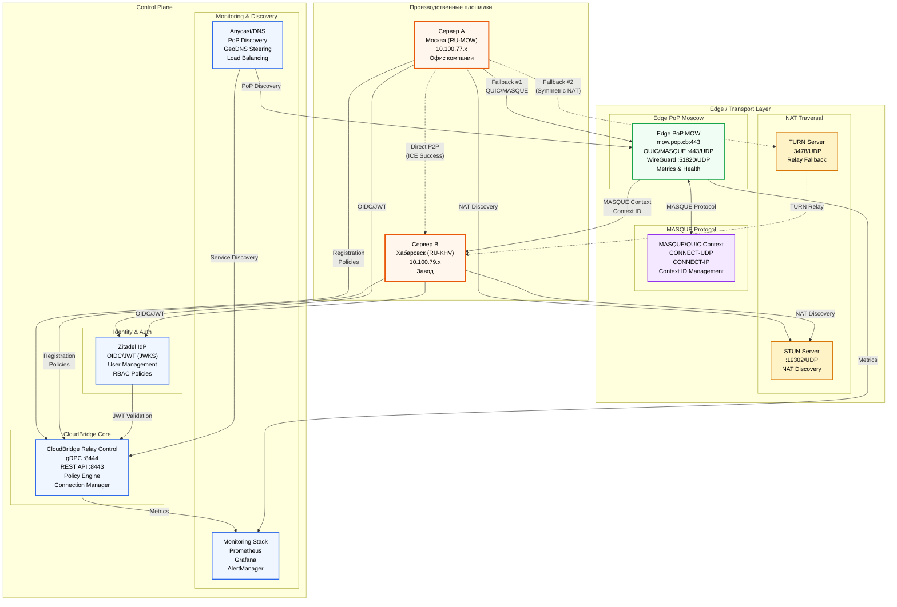
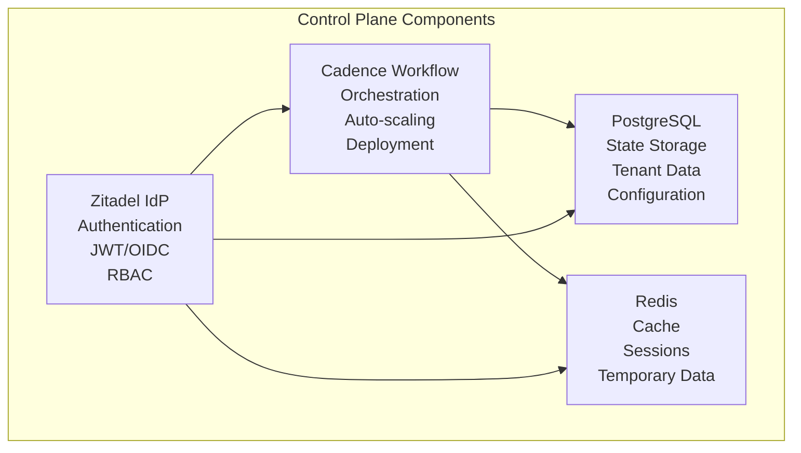
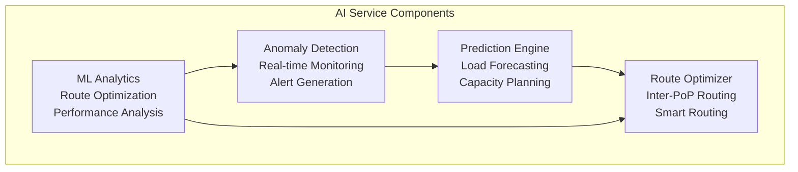
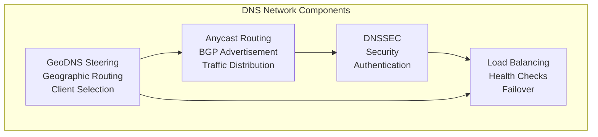
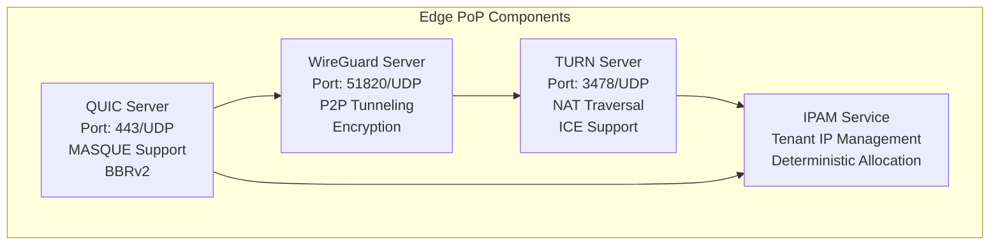
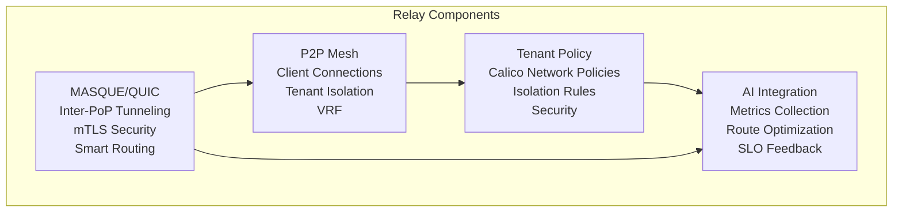
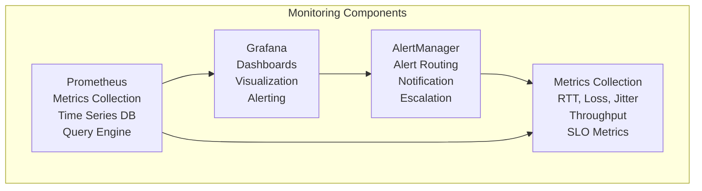
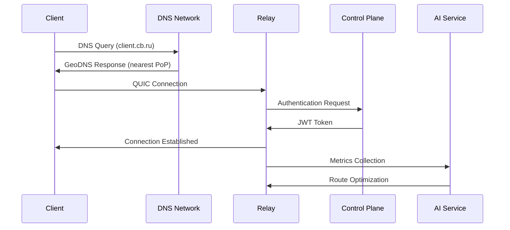
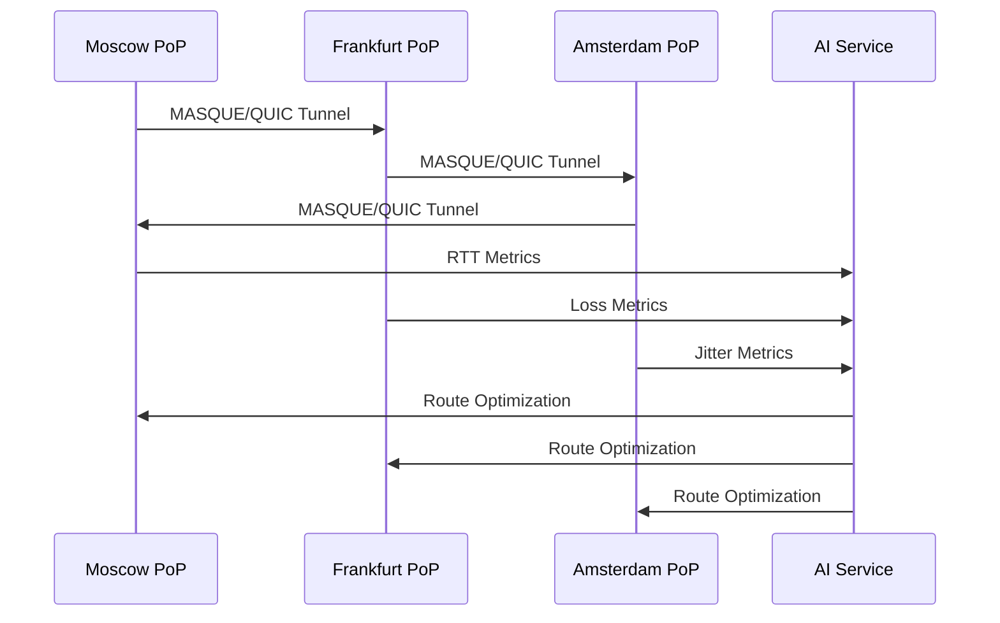
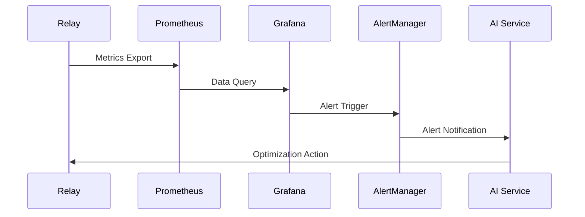

# CloudBridge Complete Architecture

## ASCII Architecture Overview

```
┌─────────────────────────────────────────────────────────────────────────────────┐
│ CloudBridge Platform Architecture │
├─────────────────────────────────────────────────────────────────────────────────┤
│ │
│ ┌─────────────────┐ ┌─────────────────┐ ┌─────────────────┐ │
│ │ Control Plane │ │ AI Service │ │ DNS Network │ │
│ │ │ │ │ │ │ │
│ │ • Zitadel IdP │ │ • ML Analytics │ │ • GeoDNS │ │
│ │ • Cadence │ │ • Route Opt │ │ • Anycast │ │
│ │ • PostgreSQL │ │ • Anomaly Det │ │ • DNSSEC │ │
│ │ • Redis │ │ • Prediction │ │ • Load Bal │ │
│ └─────────────────┘ └─────────────────┘ └─────────────────┘ │
│ │ │ │ │
│ └───────────────────────┼───────────────────────┘ │
│ │ │
│ ┌─────────────────────────────────┼─────────────────────────────────┐ │
│ │ Edge PoP Layer │ │
│ │ │ │
│ │ ┌─────────────┐ ┌─────────────┐ ┌─────────────┐ │ │
│ │ │ Moscow PoP │ │Frankfurt PoP│ │Amsterdam PoP│ │ │
│ │ │ RU-MOW │ │ EU-FRA │ │ EU-AMS │ │ │
│ │ │ │ │ │ │ │ │ │
│ │ │ QUIC: 443 │ │ QUIC: 443 │ │ QUIC: 443 │ │ │
│ │ │ WG: 51820 │ │ WG: 51820 │ │ WG: 51820 │ │ │
│ │ │ TURN: 3478 │ │ TURN: 3478 │ │ TURN: 3478 │ │ │
│ │ └─────────────┘ └─────────────┘ └─────────────┘ │ │
│ │ │ │ │ │ │
│ │ └───────────────────┼───────────────────┘ │ │
│ │ │ │ │
│ │ ┌───────────────────────────┼───────────────────────────┐ │ │
│ │ │ Relay Layer │ │ │
│ │ │ │ │ │
│ │ │ ┌─────────────┐ ┌─────────────┐ ┌─────────────┐ │ │
│ │ │ │CB Relay MOW │ │CB Relay FRA │ │CB Relay AMS │ │ │
│ │ │ │ │ │ │ │ │ │ │
│ │ │ │ Port: 9090 │ │ Port: 9090 │ │ Port: 9090 │ │ │
│ │ │ │ MASQUE/QUIC │ │ MASQUE/QUIC │ │ MASQUE/QUIC │ │ │
│ │ │ │ P2P Mesh │ │ P2P Mesh │ │ P2P Mesh │ │ │
│ │ │ └─────────────┘ └─────────────┘ └─────────────┘ │ │
│ │ │ │ │ │ │ │
│ │ │ └───────────────────┼───────────────────┘ │ │
│ │ │ │ │ │
│ │ │ ┌───────────────────┼───────────────────┐ │ │
│ │ │ │ Inter-PoP MASQUE/QUIC Tunnels │ │ │
│ │ │ │ mTLS Secured │ │ │
│ │ │ │ Smart Routing │ │ │
│ │ │ └───────────────────────────────────────┘ │ │
│ │ └──────────────────────────────────────────────────────────┘ │
│ └─────────────────────────────────────────────────────────────────────────┘
│ │
│ ┌─────────────────────────────────────────────────────────────────────────┐
│ │ Client Layer │
│ │ │
│ │ ┌─────────────────┐ ┌─────────────────┐ │
│ │ │ CloudBridge │ │ Yandex.Browser │ │
│ │ │ Client │ │ │ │
│ │ │ │ │ • Chromium Core │ │
│ │ │ • Windows │ │ • HTTP/3 Client │ │
│ │ │ • Linux │ │ • MASQUE Client │ │
│ │ │ • macOS │ │ • QUIC Support │ │
│ │ │ │ │ │ │
│ │ │ • P2P Connect │ │ • Web Services │ │
│ │ │ • MASQUE/QUIC │ │ • Dzen, Search │ │
│ │ │ • WireGuard │ │ • Mail, API │ │
│ │ └─────────────────┘ └─────────────────┘ │
│ └─────────────────────────────────────────────────────────────────────────┘
│ │
│ ┌─────────────────────────────────────────────────────────────────────────┐
│ │ Monitoring Layer │
│ │ │
│ │ ┌─────────────────┐ ┌─────────────────┐ ┌─────────────────┐ │
│ │ │ Prometheus │ │ Grafana │ │ AlertManager │ │
│ │ │ │ │ │ │ │ │
│ │ │ • Metrics Coll │ │ • Dashboards │ │ • Alert Routing │ │
│ │ │ • Time Series │ │ • Visualization │ │ • Notifications │ │
│ │ │ • Query Engine │ │ • Alerting │ │ • Escalation │ │
│ │ └─────────────────┘ └─────────────────┘ └─────────────────┘ │
│ └─────────────────────────────────────────────────────────────────────────┘
└─────────────────────────────────────────────────────────────────────────────────┘
```

## Data Flow Architecture

```
┌─────────────────────────────────────────────────────────────────────────────────┐
│ Data Flow Overview │
├─────────────────────────────────────────────────────────────────────────────────┤
│ │
│ Client Request Flow: │
│ ┌─────────┐ ┌─────────┐ ┌─────────┐ ┌─────────┐ ┌─────────┐ │
│ │ Client │───▶│ DNS │───▶│ GeoDNS │───▶│ PoP │───▶│ Relay │ │
│ │ │ │ Query │ │ Steering │ │ Selection│ │ Server │ │
│ └─────────┘ └─────────┘ └─────────┘ └─────────┘ └─────────┘ │
│ │ │ │
│ │ ▼ │
│ │ ┌─────────┐ │
│ │ │Control │ │
│ │ │ Plane │ │
│ │ │ Auth │ │
│ │ └─────────┘ │
│ │ │ │
│ │ ▼ │
│ │ ┌─────────┐ │
│ │ │ JWT │ │
│ │ │ Token │ │
│ │ └─────────┘ │
│ │ │ │
│ │ ▼ │
│ │ ┌─────────┐ │
│ │ │P2P │ │
│ │ │Connection│ │
│ │ │Established│ │
│ └─────────────────────────────────────────────────────────└─────────┘ │
│ │
│ Inter-PoP Communication: │
│ ┌─────────┐ ┌─────────┐ ┌─────────┐ ┌─────────┐ ┌─────────┐ │
│ │ Moscow │◀──▶│Frankfurt│◀──▶│Amsterdam│◀──▶│ Moscow │◀──▶│ AI │ │
│ │ PoP │ │ PoP │ │ PoP │ │ PoP │ │ Service │ │
│ │ │ │ │ │ │ │ │ │ │ │
│ │MASQUE/ │ │MASQUE/ │ │MASQUE/ │ │MASQUE/ │ │Route │ │
│ │QUIC │ │QUIC │ │QUIC │ │QUIC │ │Optimize │ │
│ │mTLS │ │mTLS │ │mTLS │ │mTLS │ │ │ │
│ └─────────┘ └─────────┘ └─────────┘ └─────────┘ └─────────┘ │
│ │ │ │ │ │ │
│ └───────────────┼───────────────┼───────────────┼───────────────┘ │
│ │ │ │ │
│ ▼ ▼ ▼ │
│ ┌─────────┐ ┌─────────┐ ┌─────────┐ │
│ │Metrics │ │Metrics │ │Metrics │ │
│ │RTT/Loss │ │RTT/Loss │ │RTT/Loss │ │
│ │Jitter │ │Jitter │ │Jitter │ │
│ └─────────┘ └─────────┘ └─────────┘ │
│ │
│ Monitoring Flow: │
│ ┌─────────┐ ┌─────────┐ ┌─────────┐ ┌─────────┐ ┌─────────┐ │
│ │ Relay │───▶│Prometheus│───▶│ Grafana │───▶│AlertMgr │───▶│ AI │ │
│ │ Metrics │ │ │ │ │ │ │ │ Service │ │
│ │ │ │Time │ │Dashboards│ │Alert │ │ │ │
│ │RTT/Loss │ │Series │ │Viz │ │Routing │ │Optimize │ │
│ │Jitter │ │DB │ │Alerting │ │Notify │ │Action │ │
│ │Throughput│ │ │ │ │ │ │ │ │ │
│ └─────────┘ └─────────┘ └─────────┘ └─────────┘ └─────────┘ │
└─────────────────────────────────────────────────────────────────────────────────┘
```

## Network Topology

```
┌─────────────────────────────────────────────────────────────────────────────────┐
│ Network Topology Overview │
├─────────────────────────────────────────────────────────────────────────────────┤
│ │
│ Internet │
│ ┌─────────────────────────────────────────────────────────────────────────┐ │
│ │ │ │
│ │ ┌─────────────────┐ ┌─────────────────┐ │ │
│ │ │ Clients │ │ Web Services │ │ │
│ │ │ │ │ │ │ │
│ │ │ • Windows │ │ • Dzen │ │ │
│ │ │ • Linux │ │ • Search │ │ │
│ │ │ • macOS │ │ • Mail │ │ │
│ │ │ • Yandex.Br │ │ • API │ │ │
│ │ └─────────────────┘ └─────────────────┘ │ │
│ │ │ │ │ │
│ │ │ │ │ │
│ │ ▼ ▼ │ │
│ │ ┌─────────────────────────────────────────────────────────────────┐ │ │
│ │ │ CloudBridge Platform │ │ │
│ │ │ │ │ │
│ │ │ ┌─────────────────────────────────────────────────────────┐ │ │ │
│ │ │ │ Control Plane │ │ │ │
│ │ │ │ │ │ │ │
│ │ │ │ ┌─────────┐ ┌─────────┐ ┌─────────┐ ┌─────────┐ │ │ │ │
│ │ │ │ │Zitadel │ │Cadence │ │PostgreSQL│ │ Redis │ │ │ │ │
│ │ │ │ │IdP │ │Workflow │ │ │ │ │ │ │ │ │
│ │ │ │ └─────────┘ └─────────┘ └─────────┘ └─────────┘ │ │ │ │
│ │ │ │ │ │ │ │ │ │ │ │
│ │ │ │ └─────────────┼─────────────┼─────────────┘ │ │ │ │
│ │ │ │ │ │ │ │ │ │
│ │ │ │ ┌─────────┐ ┌─────────┐ ┌─────────┐ ┌─────────┐ │ │ │ │
│ │ │ │ │AI Service│ │DNS │ │Monitoring│ │Load │ │ │ │ │
│ │ │ │ │ │ │Network │ │ │ │Balancer │ │ │ │ │
│ │ │ │ └─────────┘ └─────────┘ └─────────┘ └─────────┘ │ │ │ │
│ │ │ └─────────────────────────────────────────────────────────┘ │ │ │
│ │ │ │ │ │
│ │ │ ┌─────────────────────────────────────────────────────────┐ │ │ │
│ │ │ │ Edge PoP Layer │ │ │ │
│ │ │ │ │ │ │ │
│ │ │ │ ┌─────────┐ ┌─────────┐ ┌─────────┐ │ │ │ │
│ │ │ │ │ Moscow │ │Frankfurt│ │Amsterdam│ │ │ │ │
│ │ │ │ │ RU-MOW │ │ EU-FRA │ │ EU-AMS │ │ │ │ │
│ │ │ │ │ │ │ │ │ │ │ │ │ │
│ │ │ │ │ QUIC │ │ QUIC │ │ QUIC │ │ │ │ │
│ │ │ │ │ WG │ │ WG │ │ WG │ │ │ │ │
│ │ │ │ │ TURN │ │ TURN │ │ TURN │ │ │ │ │
│ │ │ │ └─────────┘ └─────────┘ └─────────┘ │ │ │ │
│ │ │ │ │ │ │ │ │ │ │
│ │ │ │ └───────────────┼───────────────┘ │ │ │ │
│ │ │ │ │ │ │ │ │
│ │ │ │ ┌─────────────────────┼─────────────────────┐ │ │ │ │
│ │ │ │ │ CloudBridge Relay │ │ │ │ │
│ │ │ │ │ │ │ │ │ │
│ │ │ │ │ ┌─────────┐ ┌─────────┐ ┌─────────┐ │ │ │ │ │
│ │ │ │ │ │Relay MOW│ │Relay FRA│ │Relay AMS│ │ │ │ │ │
│ │ │ │ │ │ │ │ │ │ │ │ │ │ │ │
│ │ │ │ │ │Port:9090│ │Port:9090│ │Port:9090│ │ │ │ │ │
│ │ │ │ │ │MASQUE │ │MASQUE │ │MASQUE │ │ │ │ │ │
│ │ │ │ │ │P2P Mesh │ │P2P Mesh │ │P2P Mesh │ │ │ │ │ │
│ │ │ │ │ └─────────┘ └─────────┘ └─────────┘ │ │ │ │ │
│ │ │ │ │ │ │ │ │ │ │ │ │
│ │ │ │ │ └───────────────┼───────────────┘ │ │ │ │ │
│ │ │ │ │ │ │ │ │ │ │
│ │ │ │ │ ┌─────────────┼─────────────┐ │ │ │ │ │
│ │ │ │ │ │ Inter-PoP MASQUE/QUIC │ │ │ │ │ │
│ │ │ │ │ │ mTLS Secured │ │ │ │ │ │
│ │ │ │ │ │ Smart Routing │ │ │ │ │ │
│ │ │ │ │ └───────────────────────────┘ │ │ │ │ │
│ │ │ │ └─────────────────────────────────────────────┘ │ │ │ │
│ │ │ └─────────────────────────────────────────────────────────┘ │ │ │
│ │ └─────────────────────────────────────────────────────────────────┘ │ │
│ └─────────────────────────────────────────────────────────────────────────┘ │
└─────────────────────────────────────────────────────────────────────────────────┘
```

## Общая архитектура CloudBridge Platform



## Детальная архитектура компонентов

### 1. CloudBridge Control Plane


### 2. CloudBridge AI Service


### 3. CloudBridge DNS Network


### 4. CloudBridge Edge PoP


### 5. CloudBridge Relay


### 6. CloudBridge Monitoring


## Поток данных и взаимодействие

### 1. Client Connection Flow


### 2. Inter-PoP Communication


### 3. Monitoring and Alerting


## Ключевые особенности архитектуры

### **CloudBridge Relay - Центральный компонент**
- **Расположение**: В каждом Edge PoP узле
- **Функции**: P2P mesh networking, MASQUE/QUIC tunneling, tenant isolation
- **Порты**: 9090/UDP (QUIC), 8444/TCP (gRPC), 51820/UDP (WireGuard)
- **Интеграция**: С Control Plane, AI Service, Monitoring

### **Inter-PoP Mesh Network**
- **Протокол**: MASQUE/QUIC с mTLS
- **Маршрутизация**: AI-оптимизированная на основе телеметрии
- **Изоляция**: Per-tenant VRF и Calico Network Policies
- **Масштабирование**: Горизонтальное и вертикальное

### **AI/ML Intelligence**
- **Route Optimization**: Динамическая оптимизация маршрутов
- **Anomaly Detection**: Обнаружение аномалий в реальном времени
- **Load Forecasting**: Предсказание нагрузки и планирование ресурсов
- **SLO Feedback**: Замкнутый контур оптимизации

### **Security & Compliance**
- **mTLS**: Все меж-PoP соединения
- **Tenant Isolation**: Полная изоляция на сетевом уровне
- **DNSSEC**: Безопасность DNS
- **Audit Logging**: Полное логирование операций

## Component Interaction Flow

```
┌─────────────────────────────────────────────────────────────────────────────────┐
│ Component Interaction Flow │
├─────────────────────────────────────────────────────────────────────────────────┤
│ │
│ ┌─────────────────────────────────────────────────────────────────────────┐ │
│ │ Client Connection Sequence │ │
│ │ │ │
│ │ 1. Client Request │ │
│ │ ┌─────────┐ │ │
│ │ │ Client │───▶ DNS Query (client.cb.ru) │ │
│ │ └─────────┘ │ │
│ │ │ │
│ │ 2. DNS Resolution │ │
│ │ ┌─────────┐ ┌─────────┐ ┌─────────┐ │ │
│ │ │ DNS │───▶│ GeoDNS │───▶│ Nearest │ │ │
│ │ │ Server │ │ Steering │ │ PoP │ │ │
│ │ └─────────┘ └─────────┘ └─────────┘ │ │
│ │ │ │
│ │ 3. PoP Selection │ │
│ │ ┌─────────┐ ┌─────────┐ ┌─────────┐ │ │
│ │ │ Moscow │ │Frankfurt│ │Amsterdam│ │ │
│ │ │ RU-MOW │ │ EU-FRA │ │ EU-AMS │ │ │
│ │ └─────────┘ └─────────┘ └─────────┘ │ │
│ │ ▲ │ │
│ │ │ Selected based on: │ │
│ │ │ • Geographic proximity │ │
│ │ │ • Load balancing │ │
│ │ │ • Health status │ │
│ │ │ │
│ │ 4. Relay Connection │ │
│ │ ┌─────────┐ ┌─────────┐ ┌─────────┐ │ │
│ │ │ Client │───▶│ Relay │───▶│Control │ │ │
│ │ │ │ │ Server │ │ Plane │ │ │
│ │ └─────────┘ └─────────┘ └─────────┘ │ │
│ │ │ │
│ │ 5. Authentication │ │
│ │ ┌─────────┐ ┌─────────┐ ┌─────────┐ │ │
│ │ │ Relay │───▶│Zitadel │───▶│ JWT │ │ │
│ │ │ Server │ │ IdP │ │ Token │ │ │
│ │ └─────────┘ └─────────┘ └─────────┘ │ │
│ │ │ │
│ │ 6. P2P Connection Established │ │
│ │ ┌─────────┐ ┌─────────┐ ┌─────────┐ │ │
│ │ │ Client │◀──▶│ Relay │◀──▶│ Other │ │ │
│ │ │ │ │ Server │ │ Clients │ │ │
│ │ └─────────┘ └─────────┘ └─────────┘ │ │
│ └─────────────────────────────────────────────────────────────────────────┘ │
│ │
│ ┌─────────────────────────────────────────────────────────────────────────┐ │
│ │ Inter-PoP Communication Flow │ │
│ │ │ │
│ │ ┌─────────┐ ┌─────────┐ ┌─────────┐ ┌─────────┐ │ │
│ │ │ Moscow │◀──▶│Frankfurt│◀──▶│Amsterdam│◀──▶│ Moscow │ │ │
│ │ │ PoP │ │ PoP │ │ PoP │ │ PoP │ │ │
│ │ │ │ │ │ │ │ │ │ │ │
│ │ │MASQUE/ │ │MASQUE/ │ │MASQUE/ │ │MASQUE/ │ │ │
│ │ │QUIC │ │QUIC │ │QUIC │ │QUIC │ │ │
│ │ │mTLS │ │mTLS │ │mTLS │ │mTLS │ │ │
│ │ └─────────┘ └─────────┘ └─────────┘ └─────────┘ │ │
│ │ │ │ │ │ │ │
│ │ └───────────────┼───────────────┼───────────────┘ │ │
│ │ │ │ │ │
│ │ ▼ ▼ │ │
│ │ ┌─────────┐ ┌─────────┐ │ │
│ │ │Metrics │ │Metrics │ │ │
│ │ │RTT/Loss │ │RTT/Loss │ │ │
│ │ │Jitter │ │Jitter │ │ │
│ │ └─────────┘ └─────────┘ │ │
│ │ │ │
│ │ ┌─────────────────────────────────────────────────────────────────┐ │ │
│ │ │ AI Service Integration │ │ │
│ │ │ │ │ │
│ │ │ ┌─────────┐ ┌─────────┐ ┌─────────┐ ┌─────────┐ │ │ │
│ │ │ │Metrics │───▶│AI │───▶│Route │───▶│Optimize │ │ │ │
│ │ │ │Collection│ │Analytics│ │Analysis │ │Action │ │ │ │
│ │ │ └─────────┘ └─────────┘ └─────────┘ └─────────┘ │ │ │
│ │ │ │ │ │ │ │ │ │
│ │ │ ▼ ▼ ▼ ▼ │ │ │
│ │ │ ┌─────────┐ ┌─────────┐ ┌─────────┐ ┌─────────┐ │ │ │
│ │ │ │RTT/Loss │ │ML │ │Smart │ │Route │ │ │ │
│ │ │ │Jitter │ │Models │ │Routing │ │Update │ │ │ │
│ │ │ │Throughput│ │Training │ │Decision │ │Applied │ │ │ │
│ │ │ └─────────┘ └─────────┘ └─────────┘ └─────────┘ │ │ │
│ │ └─────────────────────────────────────────────────────────────────┘ │ │
│ └─────────────────────────────────────────────────────────────────┘ │
│ │
│ ┌─────────────────────────────────────────────────────────────────────────┐ │
│ │ Monitoring and Alerting Flow │ │
│ │ │ │
│ │ ┌─────────┐ ┌─────────┐ ┌─────────┐ ┌─────────┐ │ │
│ │ │ Relay │───▶│Prometheus│───▶│ Grafana │───▶│AlertMgr │ │ │
│ │ │ Metrics │ │ │ │ │ │ │ │ │
│ │ │ │ │Time │ │Dashboards│ │Alert │ │ │
│ │ │RTT/Loss │ │Series │ │Viz │ │Routing │ │ │
│ │ │Jitter │ │DB │ │Alerting │ │Notify │ │ │
│ │ │Throughput│ │ │ │ │ │ │ │ │
│ │ └─────────┘ └─────────┘ └─────────┘ └─────────┘ │ │
│ │ │ │ │ │ │ │
│ │ └───────────────┼───────────────┼───────────────┘ │ │
│ │ │ │ │ │
│ │ ▼ ▼ │ │
│ │ ┌─────────┐ ┌─────────┐ │ │
│ │ │SLO │ │Alert │ │ │
│ │ │Metrics │ │Actions │ │ │
│ │ │Tracking │ │Executed │ │ │
│ │ └─────────┘ └─────────┘ │ │
│ └─────────────────────────────────────────────────────────────────────────┘ │
└─────────────────────────────────────────────────────────────────────────────────┘
```

## Security Architecture

```
┌─────────────────────────────────────────────────────────────────────────────────┐
│ Security Architecture Overview │
├─────────────────────────────────────────────────────────────────────────────────┤
│ │
│ ┌─────────────────────────────────────────────────────────────────────────┐ │
│ │ Security Layers │ │
│ │ │ │
│ │ ┌─────────────────────────────────────────────────────────────────┐ │ │
│ │ │ Authentication Layer │ │ │
│ │ │ │ │ │
│ │ │ ┌─────────┐ ┌─────────┐ ┌─────────┐ ┌─────────┐ │ │ │
│ │ │ │Zitadel │ │ JWT │ │ OIDC │ │ RBAC │ │ │ │
│ │ │ │IdP │ │ Tokens │ │ Protocol│ │ Access │ │ │ │
│ │ │ │ │ │ │ │ │ │ Control │ │ │ │
│ │ │ └─────────┘ └─────────┘ └─────────┘ └─────────┘ │ │ │
│ │ └─────────────────────────────────────────────────────────────────┘ │ │
│ │ │ │
│ │ ┌─────────────────────────────────────────────────────────────────┐ │ │
│ │ │ Encryption Layer │ │ │
│ │ │ │ │ │
│ │ │ ┌─────────┐ ┌─────────┐ ┌─────────┐ ┌─────────┐ │ │ │
│ │ │ │ TLS 1.3 │ │ mTLS │ │WireGuard│ │ MASQUE │ │ │ │
│ │ │ │ │ │ │ │ │ │ │ │ │ │
│ │ │ │Client │ │Inter-PoP│ │P2P │ │Tunneling│ │ │ │
│ │ │ │Server │ │Comm │ │Tunnels │ │ │ │ │ │
│ │ │ └─────────┘ └─────────┘ └─────────┘ └─────────┘ │ │ │
│ │ └─────────────────────────────────────────────────────────────────┘ │ │
│ │ │ │
│ │ ┌─────────────────────────────────────────────────────────────────┐ │ │
│ │ │ Network Security Layer │ │ │
│ │ │ │ │ │
│ │ │ ┌─────────┐ ┌─────────┐ ┌─────────┐ ┌─────────┐ │ │ │
│ │ │ │Calico │ │Network │ │Firewall │ │DNSSEC │ │ │ │
│ │ │ │Policies │ │Isolation│ │Rules │ │Security │ │ │ │
│ │ │ │ │ │ │ │ │ │ │ │ │ │
│ │ │ │Tenant │ │VRF │ │Ingress │ │DNS │ │ │ │
│ │ │ │Isolation│ │Routing │ │Egress │ │Auth │ │ │ │
│ │ │ └─────────┘ └─────────┘ └─────────┘ └─────────┘ │ │ │
│ │ └─────────────────────────────────────────────────────────────────┘ │ │
│ └─────────────────────────────────────────────────────────────────────────┘ │
│ │
│ ┌─────────────────────────────────────────────────────────────────────────┐ │
│ │ Security Monitoring │ │
│ │ │ │
│ │ ┌─────────┐ ┌─────────┐ ┌─────────┐ ┌─────────┐ │ │
│ │ │Security │ │Audit │ │Threat │ │Incident │ │ │
│ │ │Events │ │Logging │ │Detection│ │Response │ │ │
│ │ │ │ │ │ │ │ │ │ │ │
│ │ │Auth │ │All │ │Anomaly │ │Alert │ │ │
│ │ │Failures │ │Actions │ │Detection│ │Escalation│ │ │
│ │ │Access │ │Tracked │ │ML-based │ │Auto │ │ │
│ │ │Attempts │ │Logged │ │Analysis │ │Response │ │ │
│ │ └─────────┘ └─────────┘ └─────────┘ └─────────┘ │ │
│ └─────────────────────────────────────────────────────────────────────────┘ │
└─────────────────────────────────────────────────────────────────────────────────┘
```

## Заключение

**CloudBridge Relay** является центральным компонентом архитектуры, обеспечивающим:

1. **P2P mesh networking** между клиентами
2. **Inter-PoP MASQUE tunneling** для глобальной связности
3. **Tenant isolation** и безопасность
4. **AI-оптимизированную маршрутизацию**
5. **Интеграцию** со всеми компонентами платформы

Архитектура обеспечивает масштабируемость, отказоустойчивость и высокую производительность для enterprise-grade P2P mesh networking решения.
