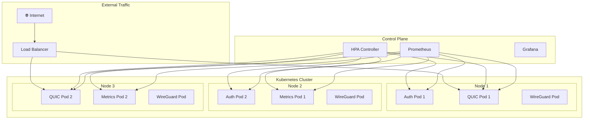
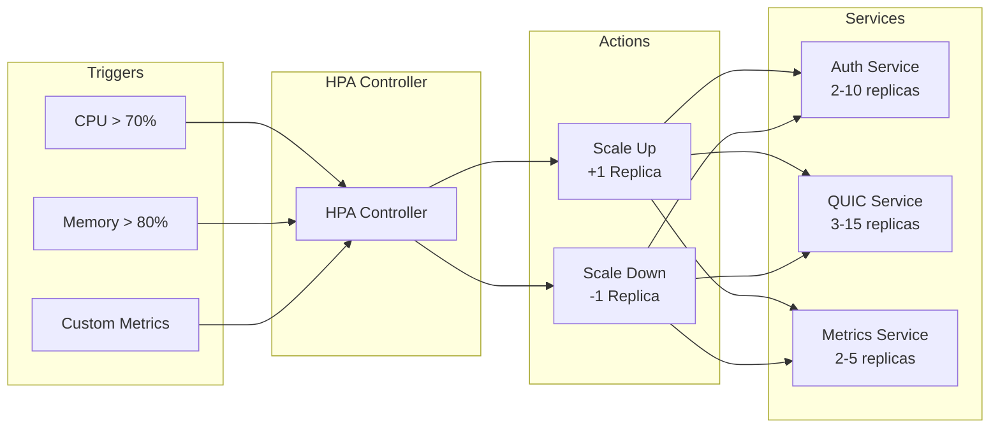
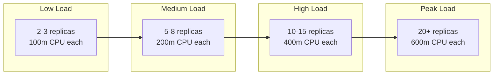

# 🚀 Kubernetes масштабирование CloudBridge Relay

## 📊 Архитектура масштабирования в K8s

## 🔄 HPA (Horizontal Pod Autoscaler)

## 📈 Масштабирование по нагрузке

## 🎯 Ключевые компоненты

### 1. **Deployments** (для HTTP сервисов)
- Auth Service: 2-10 реплик
- Metrics Service: 2-5 реплик
- QUIC Service: 3-15 реплик

### 2. **DaemonSet** (для сетевых сервисов)
- WireGuard: 1 под на каждый узел

### 3. **HPA** (автоматическое масштабирование)
- CPU > 70% → Scale Up
- Memory > 80% → Scale Up
- Custom metrics → Scale Up/Down

### 4. **Services** (сетевой доступ)
- ClusterIP для внутренних сервисов
- LoadBalancer для внешних сервисов
- NodePort для WireGuard

## 📊 Ресурсы и лимиты

| Сервис | Requests | Limits | Replicas |
|--------|----------|--------|----------|
| Auth | 100m CPU, 256Mi RAM | 500m CPU, 1Gi RAM | 2-10 |
| Metrics | 100m CPU, 128Mi RAM | 300m CPU, 512Mi RAM | 2-5 |
| QUIC | 200m CPU, 512Mi RAM | 1000m CPU, 2Gi RAM | 3-15 |
| WireGuard | 50m CPU, 64Mi RAM | 200m CPU, 256Mi RAM | 1/node |

## ✅ Преимущества Kubernetes

- **Автоматическое масштабирование** через HPA
- **Высокая доступность** - поды по узлам
- **Self-healing** - автоматическое восстановление
- **Rolling updates** - обновления без простоя
- **Resource management** - точные лимиты
- **Monitoring** - встроенный Prometheus Stack

---

**Статус**: ✅ Готов к масштабированию  
**Платформа**: Kubernetes  
**Автоматизация**: Полная
