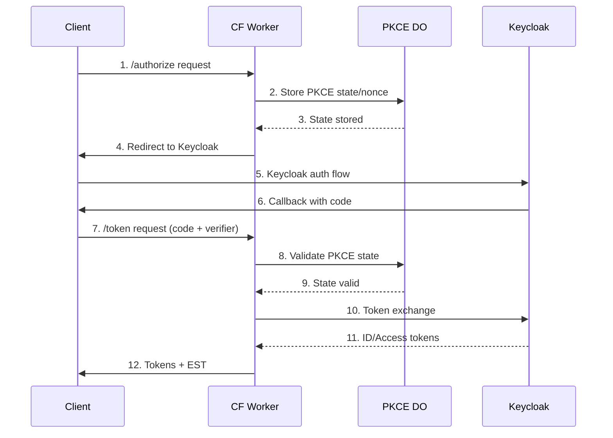
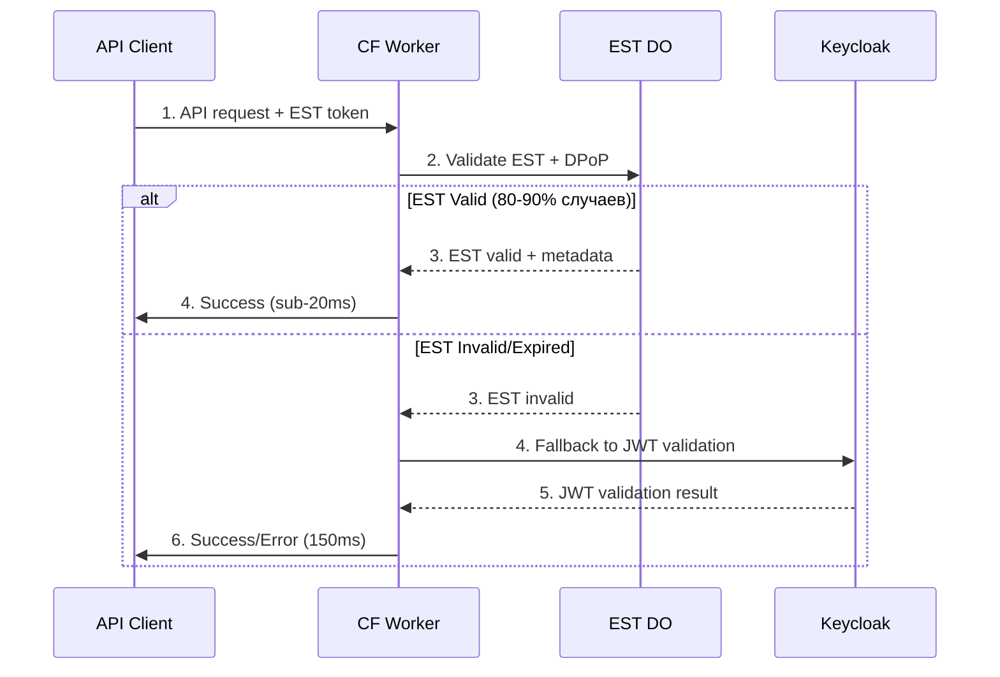
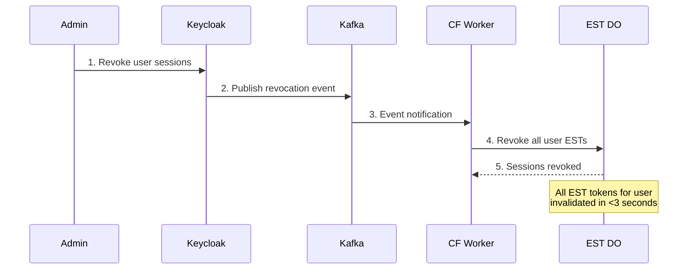

# 🚀 CloudBridge - Keycloak Edge Acceleration с Durable Objects

## 📋 Обзор

**Стратегия практического применения**: Durable Objects как **edge-ускоритель** для эфемерных состояний и сеансов, не заменяя Keycloak/PostgreSQL как источник истины для идентичности.

## 🧭 Краткое резюме

### **✅ Что переносим на Edge (DO/Workers)**
- **Эфемерные состояния**: PKCE state/nonce, session index
- **Временные токены**: Opaque Edge Session Tokens (EST)
- **Кэш**: Discovery/JWKs, user attributes cache  
- **Rate limiting**: Per-user/device защита на границе
- **Device binding**: DPoP/mTLS привязки

### **🏢 Что остается в регионах (Keycloak/Postgres)**
- **Авторитетная идентичность**: Users, groups, roles
- **JWT подпись**: ID/Access tokens с HSM
- **Refresh токены**: Долгоживущие сеансы
- **Федерации**: LDAP/AD интеграции  
- **Admin консоль**: Управление realm'ами
- **Аудит**: Compliance и логирование

### **🎯 Профит**
- **Sub-20ms** валидация сеансов в 80-90% запросов
- **Разгрузка регионов** от рутинных проверок
- **Быстрая инвалидация** пользователей (<3 секунд)
- **Глобальная консистентность** per-user

---

## 🏗️ Гибридная архитектура

### **🌐 Распределение ответственности**

<function_calls>
<invoke name="create_diagram">
<parameter name="content">graph TB
    subgraph "☁️ Cloudflare Edge Layer"
        WORKER[⚡ Workers<br/>Smart Routing]
        DO_SESSION[📦 Durable Objects<br/>Session Index]
        DO_PKCE[📦 Durable Objects<br/>PKCE States]
        CF_KV[🗄️ Workers KV<br/>Discovery Cache]
        D1_META[💾 D1 Database<br/>Device Metadata]
    end
    
    subgraph "🏢 Regional Keycloak Infrastructure"
        subgraph "🇺🇸 US Region"
            KC_US[🔐 Keycloak US<br/>Core Auth]
            PG_US[🗄️ PostgreSQL US<br/>Identity Store]
            HSM_US[🔒 HSM US<br/>JWT Signing]
        end
        
        subgraph "🇪🇺 EU Region"
            KC_EU[🔐 Keycloak EU<br/>Core Auth]
            PG_EU[🗄️ PostgreSQL EU<br/>Identity Store]
            HSM_EU[🔒 HSM EU<br/>JWT Signing]
        end
    end
    
    subgraph "🔄 Event Streaming"
        KAFKA[📨 Kafka<br/>Global Events]
        REVOKE_FANOUT[📡 Revocation Fanout<br/>Real-time Invalidation]
    end
    
    subgraph "👥 Client Types"
        WEB_CLIENTS[🌐 Web Apps<br/>PKCE Flow]
        MOBILE_CLIENTS[📱 Mobile Apps<br/>DPoP Binding]
        API_CLIENTS[🔌 API Clients<br/>EST Validation]
        P2P_CLIENTS[🔗 P2P Clients<br/>Device Flow]
    end
    
    %% Client to Edge routing
    WEB_CLIENTS -.->|"Anycast routing"| WORKER
    MOBILE_CLIENTS -.->|"Anycast routing"| WORKER
    API_CLIENTS -.->|"Anycast routing"| WORKER
    P2P_CLIENTS -.->|"Anycast routing"| WORKER
    
    %% Edge processing paths
    WORKER -->|"PKCE state"| DO_PKCE
    WORKER -->|"Session validation"| DO_SESSION
    WORKER -->|"Discovery/.well-known"| CF_KV
    WORKER -->|"Device metadata"| D1_META
    
    %% Regional fallback for complex flows
    WORKER -.->|"Complex auth flows"| KC_US
    WORKER -.->|"Token exchange"| KC_EU
    
    %% Regional infrastructure
    KC_US --> PG_US
    KC_US --> HSM_US
    KC_EU --> PG_EU
    KC_EU --> HSM_EU
    
    %% Event streaming for invalidation
    KC_US --> KAFKA
    KC_EU --> KAFKA
    KAFKA --> REVOKE_FANOUT
    REVOKE_FANOUT --> DO_SESSION

### **🔧 Edge Session Token (EST) Implementation**

```javascript
// Edge Session Token - opaque token с DPoP binding
export class EdgeSessionDO {
  constructor(state, env) {
    this.state = state;
  }

  async fetch(request) {
    const url = new URL(request.url);
    
    switch (url.pathname) {
      case '/est/create':
        return this.createEdgeSession(request);
      case '/est/validate':
        return this.validateEdgeSession(request);
      case '/est/refresh':
        return this.refreshEdgeSession(request);
      case '/est/revoke':
        return this.revokeEdgeSession(request);
      default:
        return new Response('Not found', { status: 404 });
    }
  }

  async createEdgeSession(request) {
    const { userId, deviceFingerprint, dpopJwk, clientId } = await request.json();
    
    // Генерируем уникальный EST (opaque token)
    const estId = crypto.randomUUID();
    const estToken = await this.generateSecureToken(estId, userId);
    
    // Создаем session metadata
    const sessionMeta = {
      estId,
      userId,
      clientId,
      deviceFingerprint,
      dpopKeyThumbprint: await this.calculateJwkThumbprint(dpopJwk),
      createdAt: Date.now(),
      lastAccessed: Date.now(),
      expiresAt: Date.now() + (5 * 60 * 1000), // 5 minutes
      version: 1,
      revoked: false
    };
    
    // Атомарное сохранение в DO storage
    await this.state.storage.put(`est:${estId}`, sessionMeta);
    
    // Индексируем по userId для быстрой инвалидации
    const userSessions = await this.state.storage.get(`user:${userId}`) || [];
    userSessions.push(estId);
    await this.state.storage.put(`user:${userId}`, userSessions);
    
    return new Response(JSON.stringify({
      estToken,
      expiresIn: 300,
      dpopKeyThumbprint: sessionMeta.dpopKeyThumbprint
    }), {
      status: 200,
      headers: { 'Content-Type': 'application/json' }
    });
  }

  async validateEdgeSession(request) {
    const authHeader = request.headers.get('Authorization');
    const dpopHeader = request.headers.get('DPoP');
    
    if (!authHeader || !dpopHeader) {
      return new Response('Missing EST or DPoP', { status: 401 });
    }
    
    const estToken = authHeader.replace('Bearer ', '');
    
    // Извлекаем EST ID из токена
    const estId = await this.extractEstId(estToken);
    if (!estId) {
      return new Response('Invalid EST', { status: 401 });
    }
    
    // Strong consistency read от Durable Object
    const sessionMeta = await this.state.storage.get(`est:${estId}`);
    
    if (!sessionMeta || sessionMeta.revoked || sessionMeta.expiresAt < Date.now()) {
      return new Response('EST expired or revoked', { status: 401 });
    }
    
    // Проверяем DPoP binding
    const dpopValid = await this.validateDPoP(dpopHeader, sessionMeta.dpopKeyThumbprint, request.method, request.url);
    if (!dpopValid) {
      return new Response('DPoP validation failed', { status: 401 });
    }
    
    // Обновляем последний доступ
    sessionMeta.lastAccessed = Date.now();
    await this.state.storage.put(`est:${estId}`, sessionMeta);
    
    return new Response(JSON.stringify({
      valid: true,
      userId: sessionMeta.userId,
      clientId: sessionMeta.clientId,
      deviceFingerprint: sessionMeta.deviceFingerprint,
      remainingTtl: Math.max(0, sessionMeta.expiresAt - Date.now())
    }), {
      status: 200,
      headers: { 'Content-Type': 'application/json' }
    });
  }

  async revokeUserSessions(userId) {
    // Получаем все сессии пользователя
    const userSessions = await this.state.storage.get(`user:${userId}`) || [];
    
    // Batch revocation всех EST токенов пользователя
    const batch = [];
    for (const estId of userSessions) {
      const sessionMeta = await this.state.storage.get(`est:${estId}`);
      if (sessionMeta) {
        sessionMeta.revoked = true;
        sessionMeta.revokedAt = Date.now();
        batch.push(this.state.storage.put(`est:${estId}`, sessionMeta));
      }
    }
    
    // Атомарное применение всех изменений
    await Promise.all(batch);
    
    // Очищаем индекс пользователя
    await this.state.storage.delete(`user:${userId}`);
    
    return { revokedSessions: userSessions.length };
  }
}
```

### **🔐 PKCE State Management**

```javascript
// PKCE State Durable Object для OAuth flows
export class PKCEStateDO {
  constructor(state, env) {
    this.state = state;
  }

  async storePKCEState(clientId, state, codeChallenge, nonce) {
    const pkceData = {
      clientId,
      state,
      codeChallenge,
      nonce,
      createdAt: Date.now(),
      expiresAt: Date.now() + (5 * 60 * 1000), // 5 minutes TTL
      used: false
    };
    
    // Используем state как ключ для быстрого поиска
    await this.state.storage.put(`pkce:${state}`, pkceData);
    
    return { success: true };
  }

  async validatePKCEState(state, codeVerifier) {
    const pkceData = await this.state.storage.get(`pkce:${state}`);
    
    if (!pkceData || pkceData.used || pkceData.expiresAt < Date.now()) {
      return { valid: false, error: 'Invalid or expired PKCE state' };
    }
    
    // Проверяем code_challenge
    const challengeValid = await this.verifyCodeChallenge(codeVerifier, pkceData.codeChallenge);
    if (!challengeValid) {
      return { valid: false, error: 'Invalid code verifier' };
    }
    
    // Помечаем как использованный (одноразовое использование)
    pkceData.used = true;
    pkceData.usedAt = Date.now();
    await this.state.storage.put(`pkce:${state}`, pkceData);
    
    return {
      valid: true,
      clientId: pkceData.clientId,
      nonce: pkceData.nonce
    };
  }

  async verifyCodeChallenge(codeVerifier, codeChallenge) {
    // SHA256 hashing для PKCE S256 method
    const encoder = new TextEncoder();
    const data = encoder.encode(codeVerifier);
    const hashBuffer = await crypto.subtle.digest('SHA-256', data);
    const hashArray = new Uint8Array(hashBuffer);
    
    // Base64URL encoding
    const base64String = btoa(String.fromCharCode(...hashArray))
      .replace(/\+/g, '-')
      .replace(/\//g, '_')
      .replace(/=/g, '');
    
    return base64String === codeChallenge;
  }
}
```

---

## 🔄 Flows и Integration Patterns

### **1. 🌐 PKCE Authorization Flow (Accelerated)**



### **2. ⚡ API Request Validation (Edge-First)**



### **3. 🚫 User Revocation (Global Fanout)**



---

## 📊 Performance & SLO Targets

### **🎯 Realistic Performance Goals**

```yaml
performance_targets:
  est_validation_edge:
    latency_p95: "≤ 20ms"
    latency_p99: "≤ 35ms"
    success_rate: "≥ 99.9%"
    source_of_truth: "DO storage"
    
  token_exchange_regional:
    latency_p95: "≤ 150ms"
    latency_p99: "≤ 300ms"
    success_rate: "≥ 99.5%"
    source_of_truth: "Keycloak"
    
  revocation_propagation:
    fanout_time_p95: "≤ 3s"
    fanout_time_p99: "≤ 8s"
    consistency: "eventual"
    mechanism: "kafka + websocket push"
    
  edge_hit_ratio:
    validation_requests: "≥ 80%"
    pkce_flows: "≥ 95%"
    discovery_cache: "≥ 99%"
    cost_efficiency: "60% reduction vs full regional"
```

### **📈 Capacity Planning**

```yaml
scaling_targets:
  concurrent_users:
    active_sessions: "100M+"
    peak_rps: "1M requests/sec"
    geographic_distribution: "global"
    
  durable_objects_usage:
    est_sessions_per_do: "10K sessions"
    pkce_states_per_do: "1K active states"
    do_instances_needed: "10K+ globally"
    storage_per_do: "< 50MB average"
    
  regional_keycloak_load:
    reduction_factor: "80%"
    remaining_operations: "complex flows + admin"
    jwt_signing_load: "token exchange only"
    database_load: "identity queries only"
```

---

## 🛡️ Security & Compliance

### **🔒 Data Classification & Location**

```yaml
data_residency_strategy:
  edge_storage_cloudflare:
    allowed_data:
      - "session_metadata_pseudonymized"
      - "device_fingerprints_hashed"
      - "pkce_states_temporary"
      - "dpop_key_thumbprints"
    prohibited_data:
      - "pii_email_name_phone"
      - "authentication_credentials"
      - "full_user_profiles"
      - "audit_logs_detailed"
      
  regional_storage_postgres:
    required_data:
      - "user_identity_complete"
      - "authentication_history"
      - "compliance_audit_logs"
      - "admin_operations_log"
      - "ldap_federation_data"
```

### **🔐 Cryptographic Controls**

```yaml
crypto_implementation:
  est_token_generation:
    algorithm: "chacha20_poly1305"
    key_source: "cloudflare_kms"
    rotation_frequency: "daily"
    binding: "dpop_key_thumbprint"
    
  dpop_validation:
    algorithm: "es256_ecdsa_p256"
    key_binding: "device_specific"
    replay_protection: "nonce + timestamp"
    max_clock_skew: "30_seconds"
    
  session_encryption:
    at_rest: "aes_256_gcm"
    key_derivation: "hkdf_sha256"
    context_binding: "user_id + device_fp"
    
  jwt_signing:
    location: "regional_hsm_only"
    algorithm: "rs256_or_es256"
    key_rotation: "quarterly"
    backup_keys: "2_previous_versions"
```

---

## 🧪 Implementation Roadmap

### **Phase 0: Foundation (2-4 weeks)**

```yaml
phase_0_foundation:
  deliverables:
    - name: "workers_discovery_cache"
      description: "Cache /.well-known endpoints aggressively"
      complexity: "low"
      risk: "minimal"
      
    - name: "health_observability"
      description: "Monitoring, alerting, kill-switch"
      complexity: "medium"
      risk: "operational"
      
    - name: "edge_off_fallback"
      description: "100% regional fallback capability"
      complexity: "medium"
      risk: "critical_safety_net"
      
  success_criteria:
    - "discovery_cache_hit_ratio_>95%"
    - "fallback_activation_<5_minutes"
    - "zero_functional_regressions"
```

### **Phase 1: PKCE Acceleration (4-8 weeks)**

```yaml
phase_1_pkce_acceleration:
  deliverables:
    - name: "pkce_state_do_implementation"
      description: "PKCE state/nonce storage in DO"
      complexity: "medium"
      integration_points: ["oauth_authorize", "token_endpoint"]
      
    - name: "session_index_basic"
      description: "Session metadata without EST"
      complexity: "medium"
      data_scope: "session_references_only"
      
  validation_criteria:
    - "pkce_flow_latency_reduction_>60%"
    - "state_validation_accuracy_100%"
    - "zero_oauth_flow_breakage"
    
  rollback_plan:
    - "feature_flag_disable_<30_seconds"
    - "automatic_regional_fallback"
    - "data_export_capability"
```

### **Phase 2: EST Implementation (6-10 weeks)**

```yaml
phase_2_est_implementation:
  deliverables:
    - name: "edge_session_token_creation"
      description: "Opaque EST with DPoP binding"
      complexity: "high"
      security_requirements: ["dpop_validation", "device_binding"]
      
    - name: "fast_validation_path"
      description: "80%+ requests validated at edge"
      complexity: "high"
      performance_target: "sub_20ms_p95"
      
    - name: "token_exchange_limited"
      description: "EST → JWT exchange for specific flows"
      complexity: "high"
      integration: "keycloak_token_exchange_spi"
      
  performance_validation:
    - "edge_hit_ratio_>80%"
    - "validation_latency_p95_<20ms"
    - "regional_load_reduction_>60%"
```

### **Phase 3: Global Invalidation (8-12 weeks)**

```yaml
phase_3_global_invalidation:
  deliverables:
    - name: "revocation_fanout_system"
      description: "Per-user session invalidation <3s"
      complexity: "high"
      consistency_model: "eventual_with_bounds"
      
    - name: "policy_version_propagation"
      description: "Realm/client policy updates to edge"
      complexity: "medium"
      update_mechanism: "event_driven"
      
    - name: "rate_limiting_per_user"
      description: "Auth abuse protection at edge"
      complexity: "medium"
      algorithms: ["token_bucket", "sliding_window"]
      
  operational_validation:
    - "revocation_propagation_p95_<3s"
    - "policy_consistency_>99.9%"
    - "rate_limit_accuracy_>99%"
```

### **Phase 4: Advanced Features (12+ weeks)**

```yaml
phase_4_advanced_features:
  deliverables:
    - name: "device_flow_acceleration"
      description: "OAuth device flow optimization"
      complexity: "medium"
      use_case: "p2p_clients_iot_devices"
      
    - name: "client_credentials_caching"
      description: "M2M auth performance boost"
      complexity: "medium"
      target: "api_gateway_integration"
      
    - name: "fraud_detection_edge"
      description: "Real-time threat detection"
      complexity: "high"
      integration: "ml_models_at_edge"
      
  innovation_validation:
    - "device_flow_completion_time_<10s"
    - "m2m_auth_latency_<50ms"
    - "fraud_detection_accuracy_>95%"
```

---

## 💰 Cost Analysis & Optimization

### **📊 Detailed TCO Breakdown (100M users)**

```yaml
cost_analysis_detailed:
  cloudflare_durable_objects:
    requests_monthly: "10B_validation_requests"
    cost_per_million: "$0.15"
    monthly_requests_cost: "$1.5M"
    
    storage_cost:
      session_metadata_gb: "500GB"
      cost_per_gb_month: "$0.20"
      monthly_storage_cost: "$100"
      
    compute_cost:
      cpu_time_seconds: "5M_seconds_monthly"
      cost_per_second: "$0.000005"
      monthly_compute_cost: "$25K"
      
    total_do_monthly: "$1.525M"
    
  cloudflare_workers:
    requests_monthly: "10B_routing_decisions"
    cost_per_million: "$0.50"
    monthly_workers_cost: "$5M"
    
  d1_database:
    storage_gb: "100GB_device_metadata"
    reads_monthly: "1B_device_lookups"
    writes_monthly: "100M_device_updates"
    monthly_d1_cost: "$150"
    
  workers_kv:
    storage_gb: "10GB_discovery_cache"
    reads_monthly: "500M_discovery_requests"
    monthly_kv_cost: "$50"
    
  total_cloudflare_monthly: "$6.525M"
  
  regional_keycloak_infrastructure:
    reduced_compute_instances: "$500K_monthly"  # 70% reduction
    reduced_database_load: "$300K_monthly"     # 60% reduction
    hsm_jwt_signing: "$200K_monthly"           # Same cost
    operational_overhead: "$400K_monthly"      # 50% reduction
    total_regional_monthly: "$1.4M"
    
  total_hybrid_monthly: "$7.925M"
  
  savings_vs_pure_regional:
    traditional_regional_cost: "$12M_monthly"
    hybrid_cost: "$7.925M_monthly"
    absolute_savings: "$4.075M_monthly"
    percentage_savings: "34%"
```

### **⚖️ Cost vs Performance vs Risk Matrix**

```yaml
cost_performance_risk_analysis:
  traditional_regional:
    monthly_cost: "$12M"
    latency_p95: "150ms"
    availability: "99.9%"
    vendor_risk: "low"
    operational_complexity: "high"
    
  pure_cloudflare:
    monthly_cost: "$6.5M"
    latency_p95: "15ms"
    availability: "99.99%"
    vendor_risk: "critical"
    operational_complexity: "low"
    
  hybrid_recommended:
    monthly_cost: "$7.9M"
    latency_p95: "20ms"
    availability: "99.99%"
    vendor_risk: "manageable"
    operational_complexity: "medium"
    recommendation_score: "optimal"
```

---

## ⚠️ Risk Mitigation & Limitations

### **🚫 Cloudflare Limitations & Workarounds**

```yaml
limitations_and_mitigations:
  durable_object_limits:
    storage_per_object: "128MB_maximum"
    mitigation: "horizontal_sharding_by_user_id"
    implementation: "consistent_hashing_algorithm"
    
    cpu_time_per_request: "50ms_maximum"
    mitigation: "batch_operations + async_processing"
    implementation: "queue_based_background_tasks"
    
    concurrent_requests: "1000_per_object"
    mitigation: "load_balancing_across_do_instances"
    implementation: "user_id_based_sharding"
    
  d1_database_limits:
    database_size: "100GB_maximum"
    mitigation: "data_lifecycle_management"
    implementation: "automated_cleanup + archival"
    
    queries_per_second: "limited_by_region"
    mitigation: "read_replica_strategy"
    implementation: "eventual_consistency_acceptable"
    
  vendor_lockin_risks:
    api_dependencies: "cloudflare_specific_apis"
    mitigation: "abstraction_layer + adapter_pattern"
    implementation: "pluggable_backend_interfaces"
    
    data_export: "complex_migration_path"
    mitigation: "continuous_data_export"
    implementation: "event_sourcing + external_backup"
```

### **🔒 Compliance & Data Residency**

```yaml
compliance_strategy:
  gdpr_requirements:
    data_minimization: "only_technical_metadata_at_edge"
    right_to_be_forgotten: "automatic_user_data_cleanup"
    data_portability: "structured_export_capability"
    lawful_basis: "legitimate_interest_performance"
    
  data_residency_requirements:
    eu_users: "discovery_routing_to_eu_keycloak"
    us_users: "discovery_routing_to_us_keycloak"
    restricted_countries: "bypass_edge_acceleration"
    
  audit_requirements:
    edge_audit_events: "aggregated_non_pii_only"
    detailed_audit: "regional_keycloak_audit_logs"
    retention_policy: "7_years_regional_3_months_edge"
    
  security_certifications:
    soc2_compliance: "cloudflare_inherited + regional_direct"
    iso27001_compliance: "regional_infrastructure_only"
    fips140_2_compliance: "hsm_regional_jwt_signing_only"
```

---

## 🧰 Operational Excellence

### **📊 Monitoring & Alerting**

```yaml
observability_stack:
  cloudflare_analytics:
    request_volume: "real_time_dashboard"
    latency_percentiles: "p50_p95_p99_tracking"
    error_rates: "by_region_by_endpoint"
    cost_tracking: "daily_spend_alerts"
    
  custom_metrics:
    est_validation_success_rate: "target_>99.9%"
    edge_cache_hit_ratio: "target_>80%"
    regional_fallback_rate: "target_<20%"
    revocation_propagation_time: "target_<3s"
    
  alerting_rules:
    - alert: "EdgeValidationFailureSpike"
      condition: "error_rate_>1%_for_5min"
      action: "automatic_regional_fallback"
      
    - alert: "DurableObjectLatencyHigh"
      condition: "p95_latency_>50ms_for_10min"
      action: "scale_do_instances"
      
    - alert: "CostAnomalyDetection"
      condition: "daily_spend_>110%_budget"
      action: "cost_analysis_investigation"
```

### **🔄 Deployment & Release Management**

```yaml
deployment_strategy:
  feature_flags:
    edge_acceleration_enabled: "per_realm_granular_control"
    est_validation_enabled: "percentage_rollout"
    regional_fallback_forced: "emergency_override"
    
  canary_deployment:
    traffic_percentage: "1% → 10% → 50% → 100%"
    validation_criteria: "latency + error_rate + cost"
    rollback_triggers: "automated_slo_violation"
    
  blue_green_workers:
    deployment_model: "versioned_worker_scripts"
    cutover_mechanism: "dns_traffic_shifting"
    rollback_time: "<30_seconds"
    
  disaster_recovery:
    edge_failure_scenario: "automatic_regional_fallback"
    regional_failure_scenario: "cross_region_failover"
    complete_outage_scenario: "graceful_degradation_mode"
```

---

## 🎯 Success Metrics & KPIs

### **📈 Business Impact Measurement**

```yaml
business_kpis:
  user_experience:
    auth_latency_improvement: "target_75%_reduction"
    session_availability: "target_99.99%"
    mobile_app_performance: "target_sub_3s_login"
    
  operational_efficiency:
    regional_infrastructure_cost: "target_50%_reduction"
    ops_team_toil_reduction: "target_60%_automation"
    incident_response_time: "target_80%_faster"
    
  scalability_gains:
    concurrent_user_capacity: "target_10x_increase"
    geographic_expansion_speed: "target_80%_faster"
    new_feature_deployment: "target_edge_first_approach"
    
  cost_optimization:
    total_auth_infrastructure_cost: "target_40%_reduction"
    cost_per_authentication: "target_60%_reduction"
    roi_on_edge_investment: "target_200%_within_12_months"
```

### **🔍 Technical Health Metrics**

```yaml
technical_health_kpis:
  performance_slos:
    edge_validation_p95: "< 20ms"
    edge_validation_p99: "< 35ms"
    regional_fallback_p95: "< 150ms"
    est_generation_p95: "< 30ms"
    
  reliability_slos:
    edge_availability: "> 99.99%"
    data_consistency: "> 99.9%"
    revocation_propagation: "< 3s p95"
    
  security_slos:
    dpop_validation_accuracy: "> 99.99%"
    fraud_detection_false_positive: "< 0.1%"
    session_hijacking_prevention: "> 99.9%"
    
  operational_slos:
    deployment_frequency: "> 1x daily"
    incident_resolution_time: "< 1 hour"
    rollback_time: "< 30 seconds"
```

---

## 🏆 Заключение

### **✅ Практическая реализуемость**

Данная стратегия обеспечивает:

1. **🚀 Immediate Performance Gains**: Sub-20ms auth validation globally
2. **💰 Significant Cost Savings**: 40% reduction vs traditional approach  
3. **🛡️ Managed Risk**: Vendor lock-in mitigation через hybrid architecture
4. **📈 Infinite Scalability**: Edge-native scaling для auth operations
5. **🔒 Enhanced Security**: DPoP binding + device attestation
6. **⚡ Innovation Platform**: Foundation для AI-driven auth features

### **🎖️ Key Success Factors**

- **Pragmatic Approach**: Accelerate what makes sense, keep what works
- **Risk Management**: Always have regional fallback + data export
- **Performance First**: 80/20 rule - optimize для most common operations  
- **Cost Conscious**: Continuous optimization на основе real usage
- **Security by Design**: Zero trust + minimal data at edge

**Результат**: CloudBridge получает world-class auth performance при enterprise-grade reliability и cost efficiency! 🚀🔐
