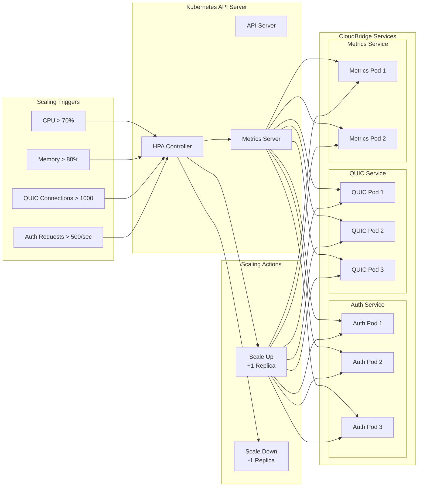
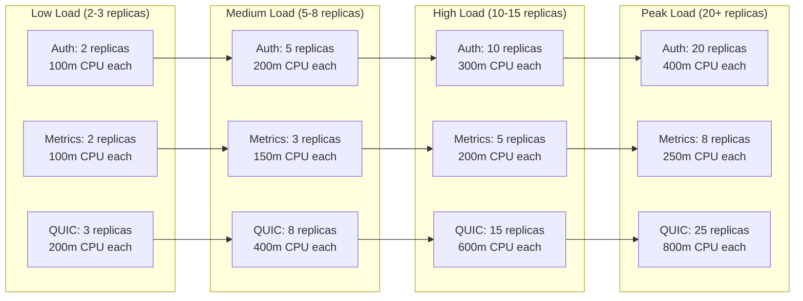
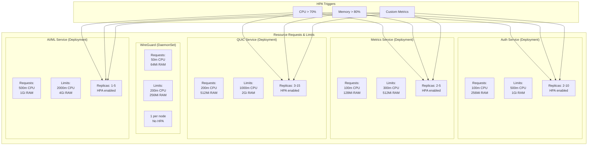

# 🚀 Архитектура масштабирования CloudBridge Relay в Kubernetes

## 📊 Общая архитектура масштабирования в K8s

```mermaid
graph TB
    subgraph "External Traffic"
        Internet[🌐 Internet]
        LB[Load Balancer<br/>VK Cloud]
    end
    
    subgraph "Kubernetes Cluster - kubernetes-cluster-6379"
        subgraph "Node 1 (4 vCPU / 16 GB)"
            subgraph "Auth Service (Deployment)"
                AUTH1[Auth Pod 1<br/>100-500m CPU<br/>256Mi-1Gi RAM]
                AUTH2[Auth Pod 2<br/>100-500m CPU<br/>256Mi-1Gi RAM]
            end
            
            subgraph "QUIC Service (Deployment)"
                QUIC1[QUIC Pod 1<br/>200-1000m CPU<br/>512Mi-2Gi RAM]
                QUIC2[QUIC Pod 2<br/>200-1000m CPU<br/>512Mi-2Gi RAM]
            end
            
            subgraph "WireGuard (DaemonSet)"
                WG1[WireGuard Pod<br/>50-200m CPU<br/>64Mi-256Mi RAM]
            end
        end
        
        subgraph "Node 2 (4 vCPU / 16 GB)"
            subgraph "Metrics Service (Deployment)"
                METRICS1[Metrics Pod 1<br/>100-300m CPU<br/>128Mi-512Mi RAM]
                METRICS2[Metrics Pod 2<br/>100-300m CPU<br/>128Mi-512Mi RAM]
            end
            
            subgraph "AI/ML Service (Deployment)"
                AI1[AI/ML Pod 1<br/>500-2000m CPU<br/>1Gi-4Gi RAM]
            end
            
            subgraph "WireGuard (DaemonSet)"
                WG2[WireGuard Pod<br/>50-200m CPU<br/>64Mi-256Mi RAM]
            end
        end
        
        subgraph "Node 3 (4 vCPU / 16 GB)"
            subgraph "Additional Services"
                QUIC3[QUIC Pod 3<br/>200-1000m CPU<br/>512Mi-2Gi RAM]
                AUTH3[Auth Pod 3<br/>100-500m CPU<br/>256Mi-1Gi RAM]
            end
            
            subgraph "WireGuard (DaemonSet)"
                WG3[WireGuard Pod<br/>50-200m CPU<br/>64Mi-256Mi RAM]
            end
        end
    end
    
    subgraph "Kubernetes Control Plane"
        subgraph "HPA Controllers"
            HPA_AUTH[HPA Auth<br/>2-10 replicas]
            HPA_METRICS[HPA Metrics<br/>2-5 replicas]
            HPA_QUIC[HPA QUIC<br/>3-15 replicas]
            HPA_AI[HPA AI/ML<br/>1-5 replicas]
        end
        
        subgraph "Monitoring Stack"
            PROMETHEUS[Prometheus<br/>500m-1 CPU<br/>1Gi-2Gi RAM]
            GRAFANA[Grafana<br/>200-500m CPU<br/>256Mi-512Mi RAM]
            ALERTMANAGER[Alertmanager<br/>100-300m CPU<br/>128Mi-512Mi RAM]
        end
    end
    
    subgraph "Storage Layer"
        PVC_AUTH[(Auth PVC<br/>1Gi)]
        PVC_METRICS[(Metrics PVC<br/>2Gi)]
        PVC_PROMETHEUS[(Prometheus PVC<br/>10Gi)]
        PVC_GRAFANA[(Grafana PVC<br/>2Gi)]
    end
    
    Internet --> LB
    LB --> QUIC1
    LB --> QUIC2
    LB --> QUIC3
    
    HPA_AUTH --> AUTH1
    HPA_AUTH --> AUTH2
    HPA_AUTH --> AUTH3
    
    HPA_METRICS --> METRICS1
    HPA_METRICS --> METRICS2
    
    HPA_QUIC --> QUIC1
    HPA_QUIC --> QUIC2
    HPA_QUIC --> QUIC3
    
    HPA_AI --> AI1
    
    PROMETHEUS --> AUTH1
    PROMETHEUS --> AUTH2
    PROMETHEUS --> AUTH3
    PROMETHEUS --> METRICS1
    PROMETHEUS --> METRICS2
    PROMETHEUS --> QUIC1
    PROMETHEUS --> QUIC2
    PROMETHEUS --> QUIC3
    PROMETHEUS --> AI1
    
    AUTH1 --> PVC_AUTH
    AUTH2 --> PVC_AUTH
    AUTH3 --> PVC_AUTH
    
    METRICS1 --> PVC_METRICS
    METRICS2 --> PVC_METRICS
    
    PROMETHEUS --> PVC_PROMETHEUS
    GRAFANA --> PVC_GRAFANA
```



## 🔄 HPA (Horizontal Pod Autoscaler) Архитектура



## 🌐 Сетевая архитектура в Kubernetes

```mermaid
graph TB
    subgraph "External Network"
        Internet[🌐 Internet]
        VK_LB[VK Cloud Load Balancer<br/>95.163.250.127]
    end
    
    subgraph "Kubernetes Network (10.100.0.0/16)"
        subgraph "Services Layer"
            AUTH_SVC[Auth Service<br/>ClusterIP: 10.100.1.10:8083]
            METRICS_SVC[Metrics Service<br/>ClusterIP: 10.100.1.11:8084]
            QUIC_SVC[QUIC Service<br/>LoadBalancer: 10.100.1.12:4433]
            WG_SVC[WireGuard Service<br/>NodePort: 10.100.1.13:51820]
        end
        
        subgraph "Pods Layer"
            AUTH_POD1[Auth Pod 1<br/>10.100.2.10:8083]
            AUTH_POD2[Auth Pod 2<br/>10.100.2.11:8083]
            AUTH_POD3[Auth Pod 3<br/>10.100.2.12:8083]
            
            METRICS_POD1[Metrics Pod 1<br/>10.100.2.20:8084]
            METRICS_POD2[Metrics Pod 2<br/>10.100.2.21:8084]
            
            QUIC_POD1[QUIC Pod 1<br/>10.100.2.30:4433]
            QUIC_POD2[QUIC Pod 2<br/>10.100.2.31:4433]
            QUIC_POD3[QUIC Pod 3<br/>10.100.2.32:4433]
            
            WG_POD1[WireGuard Pod 1<br/>10.100.2.40:51820]
            WG_POD2[WireGuard Pod 2<br/>10.100.2.41:51820]
            WG_POD3[WireGuard Pod 3<br/>10.100.2.42:51820]
        end
    end
    
    subgraph "Monitoring Network"
        PROMETHEUS_SVC[Prometheus Service<br/>ClusterIP: 10.100.1.100:9090]
        GRAFANA_SVC[Grafana Service<br/>ClusterIP: 10.100.1.101:3000]
    end
    
    Internet --> VK_LB
    VK_LB --> QUIC_SVC
    VK_LB --> WG_SVC
    
    AUTH_SVC --> AUTH_POD1
    AUTH_SVC --> AUTH_POD2
    AUTH_SVC --> AUTH_POD3
    
    METRICS_SVC --> METRICS_POD1
    METRICS_SVC --> METRICS_POD2
    
    QUIC_SVC --> QUIC_POD1
    QUIC_SVC --> QUIC_POD2
    QUIC_SVC --> QUIC_POD3
    
    WG_SVC --> WG_POD1
    WG_SVC --> WG_POD2
    WG_SVC --> WG_POD3
    
    PROMETHEUS_SVC --> AUTH_POD1
    PROMETHEUS_SVC --> AUTH_POD2
    PROMETHEUS_SVC --> AUTH_POD3
    PROMETHEUS_SVC --> METRICS_POD1
    PROMETHEUS_SVC --> METRICS_POD2
    PROMETHEUS_SVC --> QUIC_POD1
    PROMETHEUS_SVC --> QUIC_POD2
    PROMETHEUS_SVC --> QUIC_POD3
```



## 📈 Масштабирование по нагрузке



## 🎯 Kubernetes ресурсы и лимиты



## 🔧 Kubernetes манифесты для масштабирования

### HPA для Auth Service:
```yaml
apiVersion: autoscaling/v2
kind: HorizontalPodAutoscaler
metadata:
  name: auth-service-hpa
  namespace: cloudbridge
spec:
  scaleTargetRef:
    apiVersion: apps/v1
    kind: Deployment
    name: auth-service
  minReplicas: 2
  maxReplicas: 10
  metrics:
  - type: Resource
    resource:
      name: cpu
      target:
        type: Utilization
        averageUtilization: 70
  - type: Resource
    resource:
      name: memory
      target:
        type: Utilization
        averageUtilization: 80
  - type: Object
    object:
      metric:
        name: requests-per-second
      describedObject:
        apiVersion: v1
        kind: Service
        name: auth-service
      target:
        type: AverageValue
        averageValue: 500
```

### HPA для QUIC Service:
```yaml
apiVersion: autoscaling/v2
kind: HorizontalPodAutoscaler
metadata:
  name: quic-service-hpa
  namespace: cloudbridge
spec:
  scaleTargetRef:
    apiVersion: apps/v1
    kind: Deployment
    name: quic-service
  minReplicas: 3
  maxReplicas: 15
  metrics:
  - type: Resource
    resource:
      name: cpu
      target:
        type: Utilization
        averageUtilization: 70
  - type: Object
    object:
      metric:
        name: active-connections
      describedObject:
        apiVersion: v1
        kind: Service
        name: quic-service
      target:
        type: AverageValue
        averageValue: 1000
```

## 🎯 Преимущества Kubernetes масштабирования

### ✅ Автоматическое масштабирование
- HPA контролирует количество реплик
- Реагирует на CPU, Memory, Custom metrics
- Масштабирование в реальном времени

### ✅ Высокая доступность
- Поды распределены по узлам
- Автоматическое восстановление при сбоях
- Rolling updates без простоя

### ✅ Эффективное использование ресурсов
- Точные лимиты CPU/Memory
- Оптимизация использования ресурсов
- Возможность oversubscription

### ✅ Простое управление
- kubectl команды
- Helm charts
- VK Cloud консоль

### ✅ Мониторинг и алерты
- Prometheus для метрик
- Grafana для визуализации
- Alertmanager для уведомлений

---

**Статус**: ✅ Готов к масштабированию  
**Платформа**: Kubernetes  
**Автоматизация**: Полная  
**Мониторинг**: Интегрированный
