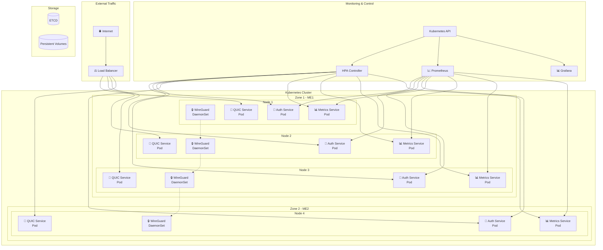
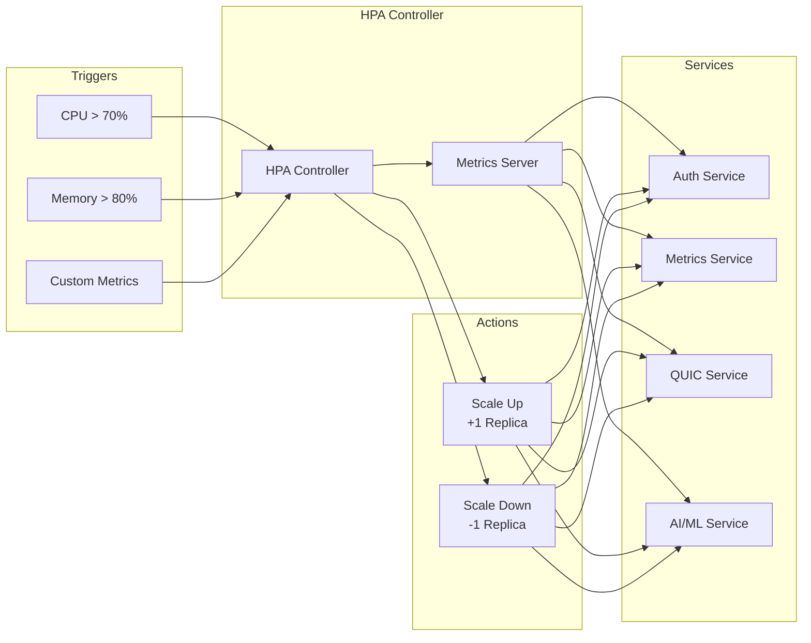
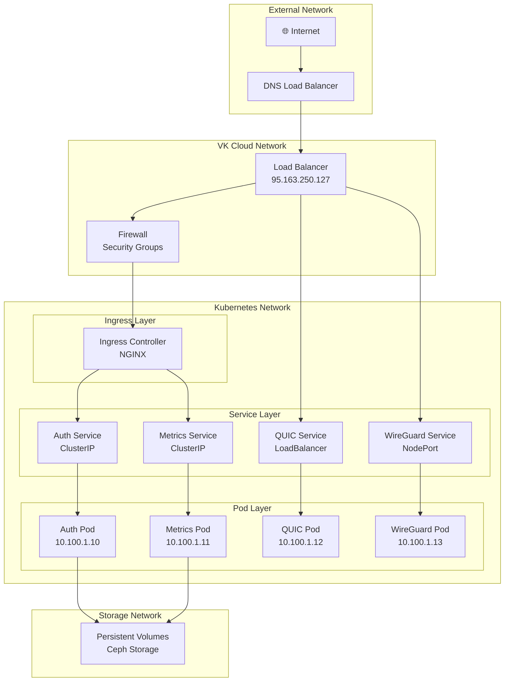
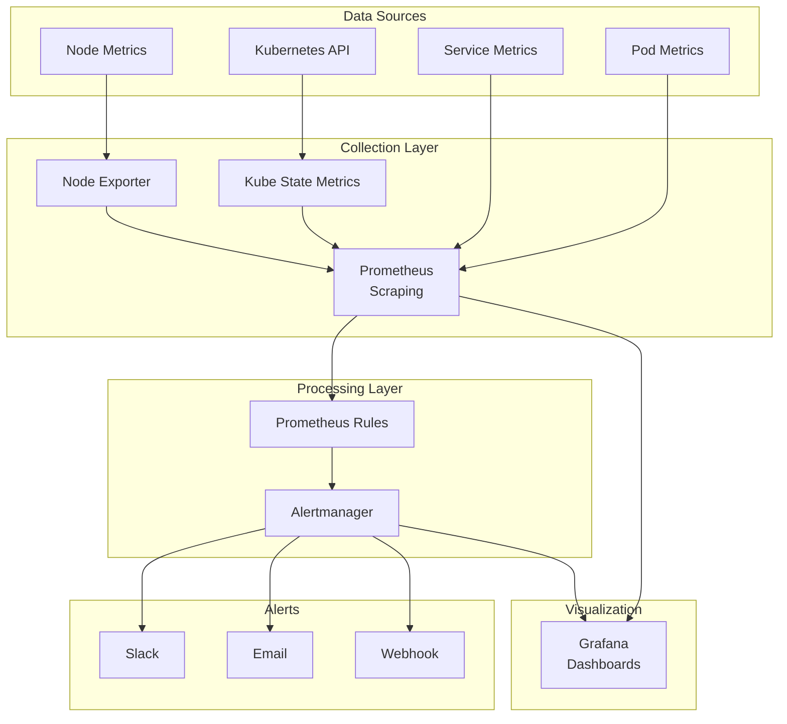
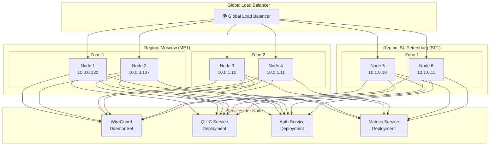
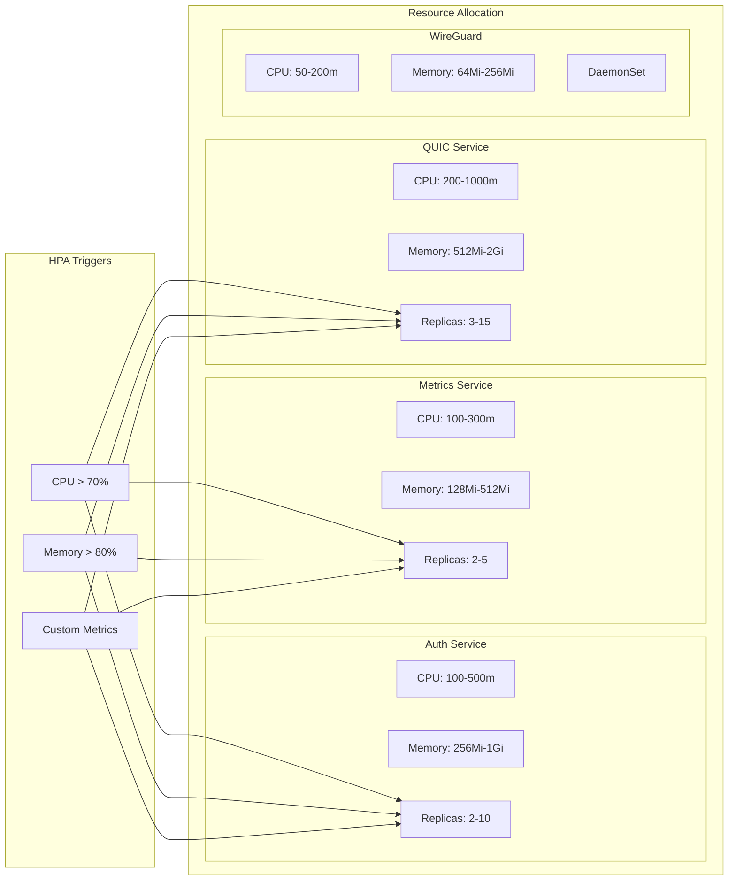

# 🏗️ Архитектура масштабирования CloudBridge Relay

## 📊 Общая архитектура масштабирования

## 🔄 Автоматическое масштабирование (HPA)

## 🌐 Сетевая архитектура

## 📈 Мониторинг и алерты

## 🚀 Географическое распределение

## 📊 Ресурсы и лимиты

## 🎯 Ключевые принципы масштабирования

### 1. **Горизонтальное масштабирование**
- Увеличение количества реплик сервисов
- Распределение нагрузки между подами
- Автоматическое масштабирование через HPA

### 2. **Вертикальное масштабирование**
- Увеличение ресурсов узлов
- Оптимизация лимитов CPU/Memory
- Добавление GPU узлов для AI/ML

### 3. **Географическое распределение**
- Мульти-зональное развертывание
- Региональные кластеры
- Глобальный load balancer

### 4. **Автоматическое восстановление**
- Self-healing подов
- Rolling updates
- Health checks и readiness probes

### 5. **Мониторинг и алерты**
- Prometheus для сбора метрик
- Grafana для визуализации
- Alertmanager для уведомлений

---

**Статус**: ✅ Архитектура готова  
**Масштабируемость**: Высокая  
**Доступность**: 99.9%  
**Автоматизация**: Полная
