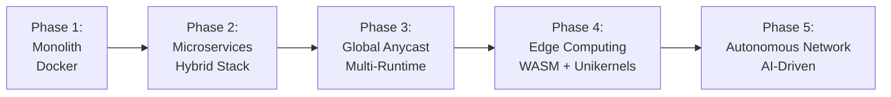

# 🚀 CloudBridge Relay - Стратегический план масштабирования

## 📋 Обзор

Данный документ определяет стратегический план масштабирования CloudBridge Relay от текущего состояния до глобальной сети с миллионами P2P и P2C клиентов, включая выбор технологий, альтернативы Docker и лучшие практики.

## 🎯 Стратегические цели масштабирования

### **📈 Количественные цели:**
- **P2P клиенты**: 0 → 100M за 3 года
- **P2C клиенты**: 0 → 500M за 3 года  
- **Географическое покрытие**: 3 → 50+ стран
- **Latency**: < 50ms для 95% соединений
- **Availability**: 99.99% uptime
- **Throughput**: 1 Tbps → 100 Tbps

### **🏗️ Архитектурная эволюция:**


---

## 🛠️ Технологический стек по фазам

### **🔷 Phase 1: Foundation (Текущее состояние → 6 месяцев)**

#### **Container Runtime:**
```yaml
# Переходим от Docker к производительным альтернативам
container_runtimes:
  primary: "containerd"     # Основной runtime
  alternatives:
    - "cri-o"              # Легковесная альтернатива
    - "kata-containers"    # Для безопасности
    - "gvisor"             # Для изоляции
  
orchestration: "kubernetes"
distribution: "k3s"         # Для edge locations
```

#### **Core Services Stack:**
```yaml
# Базовые сервисы с высокой производительностью
core_services:
  service_mesh: "istio"
  storage: "ceph"
  networking: "cilium"      # eBPF-based networking
  monitoring: "prometheus + grafana"
  tracing: "jaeger"
  secrets: "vault"
  
# Альтернативы для специфических задач
alternatives:
  service_mesh_alt: "linkerd"  # Для низкого overhead
  storage_alt: "longhorn"      # Для edge
  networking_alt: "calico"     # Для policy-heavy env
```

### **🔷 Phase 2: Microservices Hybrid (6 месяцев → 1 год)**

#### **Multi-Runtime Architecture:**
```yaml
# Каждый сервис использует оптимальный runtime
service_runtimes:
  api_gateway:
    runtime: "containerd"
    reason: "standard HTTP workload"
    
  wireguard_service:
    runtime: "systemd"        # Нативное развертывание
    reason: "maximum network performance"
    deployment: "bare_metal"
    
  ai_ml_service:
    runtime: "containerd + nvidia-runtime"
    reason: "GPU access required"
    node_type: "gpu_nodes"
    
  quantum_crypto:
    runtime: "kata-containers"  # Максимальная безопасность
    reason: "cryptographic isolation"
    hardware: "hsm_integration"
    
  p2p_mesh:
    runtime: "wasm"            # WebAssembly
    reason: "security + portability"
    engine: "wasmtime"
    
  edge_analytics:
    runtime: "unikernels"      # Для edge locations
    reason: "minimal footprint"
    platform: "firecracker"
```

#### **Orchestration Evolution:**
```yaml
# Hybrid orchestration для разных workloads
orchestration_stack:
  microservices: "kubernetes"
  serverless: "knative"
  batch_jobs: "volcano"
  edge_computing: "k3s + openfaas"
  bare_metal: "hashicorp_nomad"
  
# Service discovery и coordination
service_discovery:
  primary: "consul"
  alternatives: ["etcd", "zookeeper"]
  
coordination:
  workflows: "cadence"
  state_machines: "temporal"
  event_streaming: "kafka"
```

### **🔷 Phase 3: Global Anycast (1-2 года)**

#### **High-Performance Networking Stack:**
```yaml
# Сетевой стек для глобального масштаба
networking_stack:
  load_balancer:
    l4: "katran"              # Facebook's L4 LB
    l7: "envoy"               # Cloud Native Computing Foundation
    smart_routing: "custom_ai" # AI-driven routing
    
  service_mesh:
    data_plane: "envoy"
    control_plane: "istio"
    alternatives: ["linkerd", "consul-connect"]
    
  cni:
    primary: "cilium"         # eBPF-based
    alternatives: ["calico", "weave"]
    overlay: "wireguard"      # Encrypted overlay
    
  ingress:
    primary: "nginx_ingress"
    alternatives: ["traefik", "haproxy_ingress"]
    edge: "cloudflare"        # Global CDN integration
```

#### **Data Platform:**
```yaml
# Глобальная платформа данных
data_platform:
  databases:
    global_distributed: "cockroachdb"
    regional_cache: "redis_enterprise"
    time_series: "victoriametrics"
    document_store: "mongodb_atlas"
    
  streaming:
    event_bus: "apache_kafka"
    stream_processing: "apache_flink"
    real_time_analytics: "apache_druid"
    
  search_analytics:
    search_engine: "elasticsearch"
    log_analytics: "elastic_stack"
    metrics: "prometheus_federation"
```

### **🔷 Phase 4: Edge Computing (2-3 года)**

#### **Edge-First Architecture:**
```yaml
# Edge computing платформа
edge_platform:
  edge_runtime:
    primary: "wasm_runtime"    # WebAssembly для портабильности
    engines: ["wasmtime", "wasmer", "wasm3"]
    
  edge_orchestration:
    lightweight: "k3s"
    serverless: "openfaas"
    functions: "kubeless"
    
  edge_storage:
    distributed: "seaweedfs"   # Distributed file system
    cache: "redis_edge"
    cdn: "cdn77_edge"
    
  edge_networking:
    mesh: "consul_connect"
    tunnel: "tailscale"        # Easy P2P networking
    acceleration: "nginx_plus"
```

#### **Unikernel Deployment:**
```yaml
# Unikernels для edge locations
unikernel_stack:
  platforms:
    - name: "solo5"
      use_case: "high_performance_networking"
      runtime: "mirage_os"
      
    - name: "nanos"
      use_case: "legacy_applications"
      runtime: "gokrazy"
      
    - name: "firecracker"
      use_case: "serverless_functions"
      runtime: "lambda_runtime"
      
  deployment:
    orchestrator: "solo5_ops"
    packaging: "unik"
    monitoring: "prometheus_unikernel"
```

### **🔷 Phase 5: Autonomous Network (3+ года)**

#### **AI-Driven Infrastructure:**
```yaml
# Полностью автономная инфраструктура
autonomous_stack:
  ai_orchestration:
    decision_engine: "tensorflow_serving"
    model_training: "kubeflow"
    mlops: "mlflow"
    feature_store: "feast"
    
  self_healing:
    anomaly_detection: "prometheus_anomaly_detector"
    auto_remediation: "chaos_engineering_platform"
    capacity_planning: "vertical_pod_autoscaler_ai"
    
  network_optimization:
    traffic_engineering: "bgp_optimizer_ai"
    qos_management: "network_ai"
    security: "ai_firewall"
```

---

## 🏗️ Архитектурные решения по компонентам

### **🌐 WireGuard Service: Bare Metal + eBPF**

```yaml
# WireGuard для максимальной производительности
wireguard_deployment:
  runtime: "systemd_native"
  optimization: "ebpf_acceleration"
  deployment_strategy:
    phase_1: "containerized_privileged"
    phase_2: "bare_metal_systemd"
    phase_3: "ebpf_optimized"
    phase_4: "hardware_offload"
    
  performance_targets:
    throughput: "40Gbps_per_core"
    latency: "<1ms_additional"
    connections: "1M_concurrent"
    
  technology_stack:
    user_space: "go_implementation"
    kernel_space: "ebpf_bypass"
    crypto: "aes_ni_acceleration"
    networking: "dpdk_integration"
```

### **🤖 AI/ML Services: GPU-Optimized Containers**

```yaml
# AI/ML для максимальной утилизации GPU
ai_ml_deployment:
  runtime: "nvidia_container_runtime"
  orchestration: "volcano_scheduler"  # GPU-aware scheduling
  optimization: "tensor_rt"
  
  scaling_strategy:
    horizontal: "cluster_autoscaler"
    vertical: "vpa_recommender"
    custom: "gpu_utilization_scaler"
    
  technology_stack:
    inference_serving: "nvidia_triton"
    model_training: "horovod_distributed"
    model_registry: "mlflow_registry"
    feature_pipeline: "feast_feature_store"
    
  performance_targets:
    gpu_utilization: ">90%"
    inference_latency: "<100ms_p99"
    throughput: "10K_inferences_per_second"
```

### **🔮 Quantum Crypto: Kata Containers + HSM**

```yaml
# Quantum криптография с максимальной безопасностью
quantum_deployment:
  runtime: "kata_containers"     # VM-level isolation
  security: "confidential_computing"
  hardware: "hsm_integration"
  
  isolation_strategy:
    container_runtime: "kata_runtime"
    vm_isolation: "qemu_kvm"
    secure_boot: "uefi_secure_boot"
    attestation: "tpm_attestation"
    
  technology_stack:
    crypto_library: "liboqs"      # Open Quantum Safe
    algorithms: ["kyber", "dilithium", "falcon"]
    key_management: "vault_transit"
    hsm_integration: "pkcs11"
    
  compliance:
    standards: ["fips_140_2", "common_criteria"]
    certifications: ["quantum_safe", "post_quantum"]
```

### **🕸️ P2P Mesh: WebAssembly + libp2p**

```yaml
# P2P mesh с безопасностью и портабильностью
p2p_deployment:
  runtime: "wasm_runtime"
  engine: "wasmtime"
  security: "wasm_sandbox"
  
  architecture:
    discovery: "mdns + dht"
    transport: "quic + tcp"
    routing: "kad_dht"
    consensus: "raft_consensus"
    
  technology_stack:
    p2p_library: "libp2p_wasm"
    networking: "webrtc + websocket"
    encryption: "noise_protocol"
    identity: "ed25519_keys"
    
  performance_targets:
    peer_discovery: "<5s"
    connection_setup: "<1s"
    throughput: "1Gbps_peer_to_peer"
    simultaneous_peers: "10K_per_node"
```

---

## 📊 Стратегия развертывания по регионам

### **🌍 Global Rollout Strategy:**

```yaml
# Поэтапное развертывание по регионам
rollout_phases:
  phase_1_pilot: 
    regions: ["us_east_1", "eu_west_1"]
    duration: "6_months"
    technology: "docker_kubernetes"
    scale: "100K_users"
    
  phase_2_expansion:
    regions: ["ap_southeast_1", "us_west_1", "eu_central_1"]
    duration: "6_months"  
    technology: "hybrid_runtime"
    scale: "1M_users"
    
  phase_3_global:
    regions: ["global_anycast_50_locations"]
    duration: "12_months"
    technology: "multi_runtime"
    scale: "10M_users"
    
  phase_4_edge:
    regions: ["metro_edge_500_locations"]
    duration: "12_months"
    technology: "wasm_unikernels"
    scale: "100M_users"
    
  phase_5_autonomous:
    regions: ["global_autonomous_network"]
    duration: "ongoing"
    technology: "ai_driven_infrastructure"
    scale: "1B_users"
```

### **🏢 Regional Technology Stack:**

```yaml
# Технологический стек по типам регионов
regional_deployment:
  tier_1_regions:  # US, EU, Asia-Pacific major
    compute: "kubernetes + bare_metal_hybrid"
    storage: "ceph_distributed"
    networking: "cilium_ebpf"
    gpu: "nvidia_a100_clusters"
    
  tier_2_regions:  # Emerging markets
    compute: "k3s_lightweight"
    storage: "longhorn_replicated"
    networking: "calico_standard"
    gpu: "nvidia_t4_clusters"
    
  edge_locations:  # Metro and rural
    compute: "k3s + openfaas"
    storage: "local_ssd"
    networking: "tailscale_mesh"
    acceleration: "nvidia_jetson"
    
  mobile_edge:     # 5G integration
    compute: "wasm_runtime"
    storage: "redis_cache"
    networking: "5g_network_slicing"
    acceleration: "fpga_acceleration"
```

---

## 🔧 Лучшие практики масштабирования

### **🎯 Performance Optimization Best Practices:**

#### **1. 🚀 Zero-Copy Networking:**
```yaml
zero_copy_optimization:
  kernel_bypass:
    technology: "dpdk"
    use_cases: ["wireguard", "quic", "high_frequency_trading"]
    performance_gain: "10x_throughput"
    
  user_space_networking:
    technology: "spdk"
    use_cases: ["storage", "database", "caching"]
    performance_gain: "5x_iops"
    
  ebpf_acceleration:
    technology: "xdp + tc_ebpf"
    use_cases: ["load_balancing", "ddos_protection", "monitoring"]
    performance_gain: "native_kernel_speed"
```

#### **2. 🧠 CPU Optimization:**
```yaml
cpu_optimization:
  processor_affinity:
    strategy: "numa_aware_scheduling"
    implementation: "kubernetes_cpu_manager"
    benefit: "30%_performance_improvement"
    
  interrupt_handling:
    strategy: "interrupt_affinity"
    implementation: "irqbalance + manual_tuning"
    benefit: "reduced_context_switching"
    
  compiler_optimization:
    strategy: "profile_guided_optimization"
    implementation: "gcc_pgo + llvm_bolt"
    benefit: "15%_performance_improvement"
```

#### **3. 💾 Memory Optimization:**
```yaml
memory_optimization:
  huge_pages:
    strategy: "2mb_huge_pages"
    use_cases: ["databases", "in_memory_cache", "machine_learning"]
    benefit: "reduced_tlb_misses"
    
  memory_pooling:
    strategy: "tcmalloc + jemalloc"
    use_cases: ["high_allocation_applications"]
    benefit: "reduced_fragmentation"
    
  numa_optimization:
    strategy: "numa_local_allocation"
    implementation: "numactl + kubernetes_topology_manager"
    benefit: "lower_memory_latency"
```

### **🔒 Security Best Practices:**

#### **1. 🛡️ Zero Trust Architecture:**
```yaml
zero_trust_implementation:
  identity_verification:
    technology: "spiffe_spire"
    scope: "every_service_every_request"
    implementation: "mutual_tls"
    
  network_segmentation:
    technology: "cilium_network_policies"
    scope: "microsegmentation"
    default: "deny_all"
    
  runtime_security:
    technology: "falco + opa_gatekeeper"
    monitoring: "real_time_anomaly_detection"
    response: "automated_remediation"
```

#### **2. 🔐 Encryption Everywhere:**
```yaml
encryption_strategy:
  data_in_transit:
    internal: "istio_mtls"
    external: "tls_1_3"
    quantum_safe: "post_quantum_tls"
    
  data_at_rest:
    databases: "transparent_data_encryption"
    storage: "luks_encryption"
    backups: "gpg_encryption"
    
  data_in_use:
    technology: "intel_sgx + amd_sev"
    use_cases: ["confidential_computing", "secure_multiparty_computation"]
    compliance: "gdpr + hipaa"
```

### **📈 Reliability Best Practices:**

#### **1. 🔄 Chaos Engineering:**
```yaml
chaos_engineering:
  infrastructure_chaos:
    tool: "chaos_monkey + litmus"
    scenarios: ["node_failure", "network_partition", "disk_failure"]
    frequency: "weekly_automated"
    
  application_chaos:
    tool: "gremlin + chaos_toolkit"
    scenarios: ["service_failure", "latency_injection", "resource_exhaustion"]
    frequency: "daily_automated"
    
  security_chaos:
    tool: "attack_simulation"
    scenarios: ["ddos_attack", "credential_compromise", "data_breach"]
    frequency: "monthly_red_team"
```

#### **2. 📊 Observability:**
```yaml
observability_stack:
  metrics:
    collection: "prometheus_federation"
    storage: "victoriametrics_cluster"
    alerting: "alertmanager + pagerduty"
    
  logging:
    collection: "fluent_bit"
    processing: "fluentd"
    storage: "elasticsearch_cluster"
    analysis: "kibana + grafana"
    
  tracing:
    collection: "opentelemetry"
    storage: "jaeger_cassandra"
    analysis: "jaeger_ui + zipkin"
    
  profiling:
    continuous: "pyroscope"
    on_demand: "golang_pprof"
    production: "google_cloud_profiler"
```

---

## 🎛️ Операционные модели

### **🔄 GitOps и Infrastructure as Code:**

```yaml
# Полная автоматизация инфраструктуры
gitops_strategy:
  infrastructure:
    tool: "terraform + terragrunt"
    state_backend: "terraform_cloud"
    ci_cd: "github_actions"
    
  application_deployment:
    tool: "argocd + flux"
    configuration: "helm_charts + kustomize"
    promotion: "automated_canary"
    
  policy_as_code:
    tool: "open_policy_agent"
    policies: ["security", "compliance", "cost_optimization"]
    enforcement: "admission_controllers"
    
  secret_management:
    tool: "vault + external_secrets_operator"
    rotation: "automated_24h"
    access: "short_lived_credentials"
```

### **🤖 AIOps Implementation:**

```yaml
# AI для операций
aiops_capabilities:
  predictive_scaling:
    algorithm: "lstm_neural_networks"
    prediction_horizon: "4_hours"
    accuracy_target: "95%"
    
  anomaly_detection:
    algorithm: "isolation_forest + autoencoder"
    detection_latency: "<1_minute"
    false_positive_rate: "<1%"
    
  root_cause_analysis:
    algorithm: "graph_neural_networks"
    correlation_analysis: "cross_service_dependencies"
    resolution_time: "80%_reduction"
    
  capacity_planning:
    algorithm: "prophet_forecasting"
    planning_horizon: "6_months"
    cost_optimization: "20%_reduction"
```

---

## 📋 Roadmap и временные рамки

### **🗓️ Detailed Implementation Timeline:**

```yaml
# Детальный план реализации
implementation_timeline:
  q1_2024:
    focus: "foundation_setup"
    deliverables:
      - "kubernetes_cluster_setup"
      - "basic_monitoring_stack"
      - "ci_cd_pipeline"
    technology: "docker + kubernetes"
    
  q2_2024:
    focus: "microservices_migration"
    deliverables:
      - "service_mesh_implementation"
      - "database_migration"
      - "security_hardening"
    technology: "istio + prometheus"
    
  q3_2024:
    focus: "performance_optimization"
    deliverables:
      - "wireguard_bare_metal"
      - "gpu_cluster_setup"
      - "edge_locations_pilot"
    technology: "bare_metal + gpu_runtime"
    
  q4_2024:
    focus: "global_anycast"
    deliverables:
      - "smart_load_balancer"
      - "cross_region_replication"
      - "disaster_recovery"
    technology: "anycast + bgp"
    
  q1_2025:
    focus: "wasm_unikernels"
    deliverables:
      - "p2p_wasm_runtime"
      - "edge_unikernels"
      - "serverless_functions"
    technology: "wasm + firecracker"
    
  q2_2025:
    focus: "ai_optimization"
    deliverables:
      - "ai_driven_routing"
      - "predictive_scaling"
      - "autonomous_healing"
    technology: "tensorflow + kubeflow"
```

### **💰 Investment Requirements:**

```yaml
# Инвестиционные требования по фазам
investment_breakdown:
  phase_1_foundation:
    infrastructure: "$500K"
    personnel: "$2M"
    software_licenses: "$200K"
    total: "$2.7M"
    
  phase_2_scaling:
    infrastructure: "$2M"
    personnel: "$5M"
    software_licenses: "$500K"
    total: "$7.5M"
    
  phase_3_global:
    infrastructure: "$10M"
    personnel: "$15M"
    software_licenses: "$2M"
    total: "$27M"
    
  phase_4_edge:
    infrastructure: "$25M"
    personnel: "$25M"
    software_licenses: "$5M"
    total: "$55M"
    
  phase_5_autonomous:
    infrastructure: "$50M"
    personnel: "$40M"
    software_licenses: "$10M"
    total: "$100M"
```

---

## 🎯 Ключевые метрики успеха

### **📊 Technical KPIs:**

```yaml
# Технические показатели эффективности
technical_kpis:
  performance:
    latency_p99: "<50ms"
    throughput: ">1Tbps"
    availability: "99.99%"
    error_rate: "<0.01%"
    
  scalability:
    horizontal_scaling: "10x_in_1_hour"
    vertical_scaling: "automatic"
    geographic_scaling: "new_region_in_1_week"
    
  efficiency:
    resource_utilization: ">80%"
    cost_per_user: "<$0.01_monthly"
    energy_efficiency: "carbon_neutral"
    
  security:
    mttr_security_incidents: "<1_hour"
    compliance_score: "100%"
    vulnerability_patching: "<24_hours"
```

### **💼 Business KPIs:**

```yaml
# Бизнес показатели
business_kpis:
  growth:
    user_acquisition: "2x_monthly"
    revenue_growth: "300%_yearly"
    market_expansion: "10_new_countries_yearly"
    
  efficiency:
    operational_cost_reduction: "20%_yearly"
    time_to_market: "50%_reduction"
    developer_productivity: "3x_improvement"
    
  customer_satisfaction:
    nps_score: ">70"
    customer_retention: ">95%"
    support_ticket_reduction: "80%"
```

---

## 🔮 Заключение и следующие шаги

### **🎯 Критические факторы успеха:**

1. **🏗️ Поэтапная миграция** - от Docker к multi-runtime architecture
2. **🧠 AI-first подход** - внедрение машинного обучения на всех уровнях
3. **🌍 Global-first мышление** - проектирование для планетарного масштаба
4. **🔒 Security-by-design** - безопасность как основа архитектуры
5. **📊 Data-driven decisions** - решения на основе метрик и аналитики

### **⚡ Немедленные действия:**

```bash
# Первые шаги для начала масштабирования
# 1. Настройка современного Kubernetes кластера
kubectl apply -f k8s/modern-cluster-setup/

# 2. Внедрение containerd вместо Docker
systemctl stop docker
systemctl start containerd

# 3. Установка Istio service mesh
istioctl install --set values.pilot.env.EXTERNAL_ISTIOD=true

# 4. Настройка Prometheus monitoring
helm install prometheus prometheus-community/kube-prometheus-stack

# 5. Подготовка bare metal nodes для WireGuard
ansible-playbook -i inventory/production playbooks/wireguard-nodes.yml
```

### **🎖️ Принципы масштабирования CloudBridge:**

1. **Performance First** - производительность как основа всех решений
2. **Cloud Native** - контейнеры, микросервисы, DevOps culture
3. **Multi-Runtime** - правильная технология для каждой задачи
4. **Edge-Centric** - вычисления максимально близко к пользователям
5. **AI-Augmented** - искусственный интеллект во всех процессах
6. **Security-Embedded** - безопасность встроена в архитектуру
7. **Sustainability** - энергоэффективность и carbon neutrality

**Результат**: CloudBridge Relay станет самой масштабируемой, производительной и безопасной глобальной сетевой платформой в мире! 🚀🌍

---

*Этот документ является живым и будет обновляться по мере эволюции технологий и требований бизнеса.*
