# 📊 Mermaid Charts для CloudBridge Relay

## 🏗️ Архитектура системы

### Основная архитектура

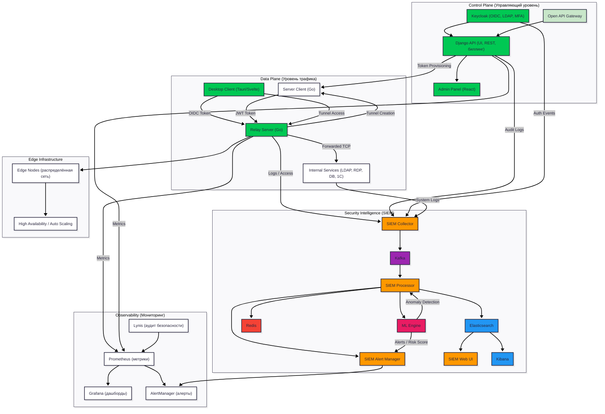

## 🌐 Глобальная сеть узлов

### Географическое распределение

```mermaid
---
config:
  layout: dagre
  theme: redux
  look: neo
---
flowchart TD
    subgraph "Global Edge Network"
        subgraph "Europe"
            Moscow["Moscow Edge Node<br/>100 Gbps"]
            SPb["St. Petersburg Edge Node<br/>50 Gbps"]
            London["London Edge Node<br/>100 Gbps"]
            Frankfurt["Frankfurt Edge Node<br/>50 Gbps"]
        end
        
        subgraph "Americas"
            NewYork["New York Edge Node<br/>100 Gbps"]
            Chicago["Chicago Edge Node<br/>50 Gbps"]
            SaoPaulo["São Paulo Edge Node<br/>50 Gbps"]
        end
        
        subgraph "Asia Pacific"
            Singapore["Singapore Edge Node<br/>100 Gbps"]
            Tokyo["Tokyo Edge Node<br/>50 Gbps"]
            Sydney["Sydney Edge Node<br/>50 Gbps"]
        end
    end
    
    subgraph "Regional Relay Networks"
        subgraph "Russia"
            Office1["Office 1 Relay<br/>10 Gbps"]
            Office2["Office 2 Relay<br/>10 Gbps"]
            Branch1["Branch 1 Relay<br/>5 Gbps"]
            Branch2["Branch 2 Relay<br/>5 Gbps"]
        end
        
        subgraph "Europe"
            EUOffice1["EU Office 1 Relay<br/>10 Gbps"]
            EUOffice2["EU Office 2 Relay<br/>10 Gbps"]
        end
        
        subgraph "USA"
            USOffice1["US Office 1 Relay<br/>10 Gbps"]
            USOffice2["US Office 2 Relay<br/>10 Gbps"]
        end
    end
    
    subgraph "Client Devices"
        Desktop["Desktop Client"]
        Mobile["Mobile Client"]
        Server["Server Client"]
        IoT["IoT Device"]
    end
    
    %% Edge to Relay connections
    Moscow --> Office1
    Moscow --> Office2
    SPb --> Branch1
    SPb --> Branch2
    
    London --> EUOffice1
    Frankfurt --> EUOffice2
    
    NewYork --> USOffice1
    Chicago --> USOffice2
    
    %% Relay to Client connections
    Office1 --> Desktop
    Office2 --> Server
    Branch1 --> Mobile
    Branch2 --> IoT
    
    %% Styling
    style Moscow fill:#4CAF50
    style SPb fill:#4CAF50
    style London fill:#4CAF50
    style Frankfurt fill:#4CAF50
    style NewYork fill:#4CAF50
    style Chicago fill:#4CAF50
    style SaoPaulo fill:#4CAF50
    style Singapore fill:#4CAF50
    style Tokyo fill:#4CAF50
    style Sydney fill:#4CAF50
    
    style Office1 fill:#2196F3
    style Office2 fill:#2196F3
    style Branch1 fill:#2196F3
    style Branch2 fill:#2196F3
    style EUOffice1 fill:#2196F3
    style EUOffice2 fill:#2196F3
    style USOffice1 fill:#2196F3
    style USOffice2 fill:#2196F3
    
    style Desktop fill:#FF9800
    style Mobile fill:#FF9800
    style Server fill:#FF9800
    style IoT fill:#FF9800
```

## 🔄 Сценарии использования

### 1. Подключение клиента к корпоративным ресурсам

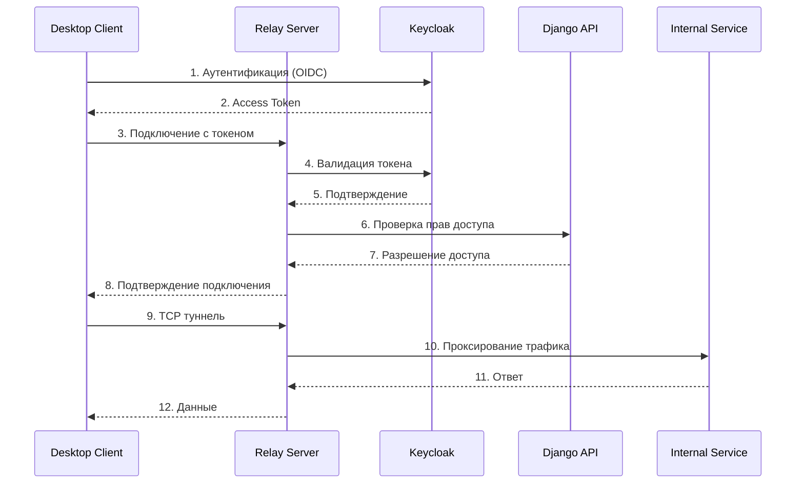

### 2. Автоматическое масштабирование

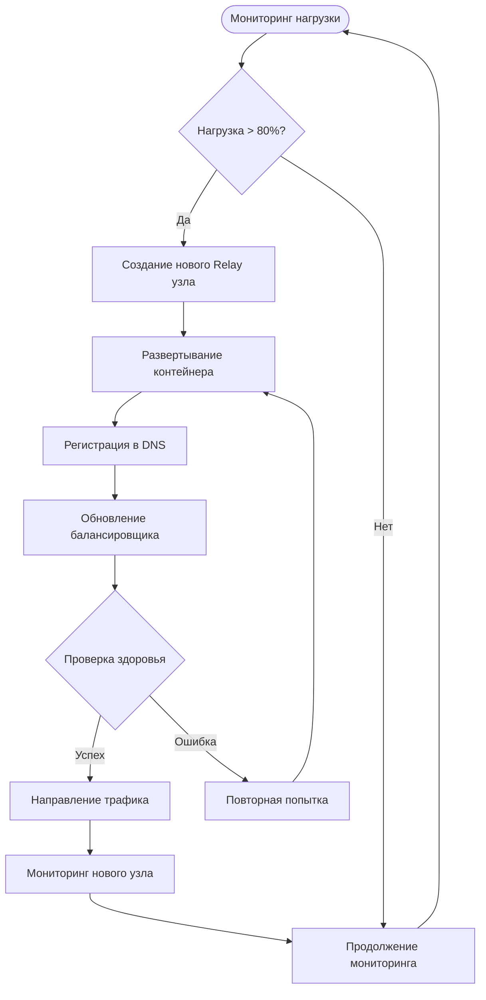

### 3. Детекция и блокировка угроз

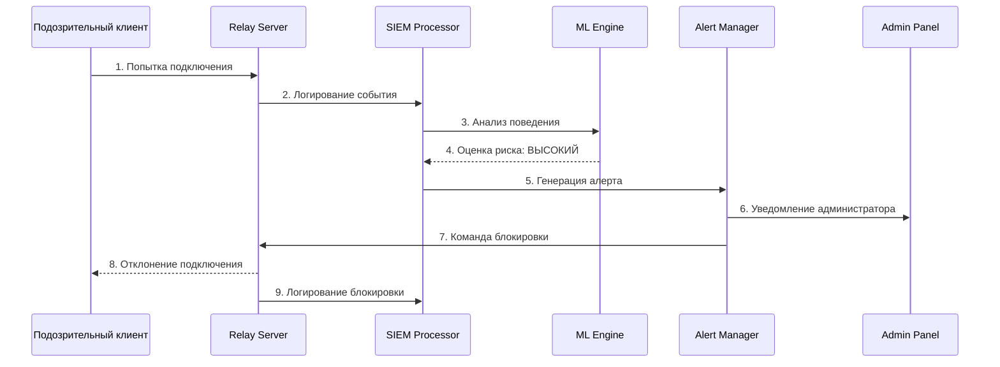

### 4. Географическая маршрутизация

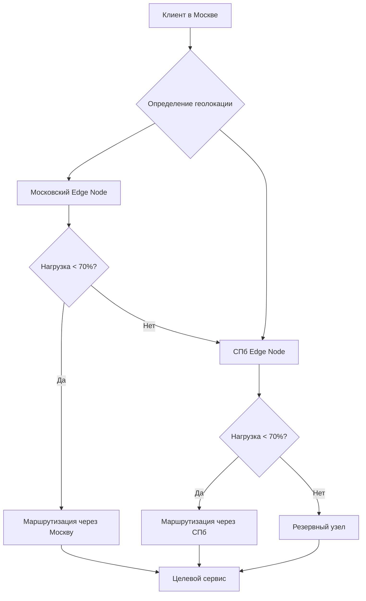

## 📊 Мониторинг и метрики

### Система метрик

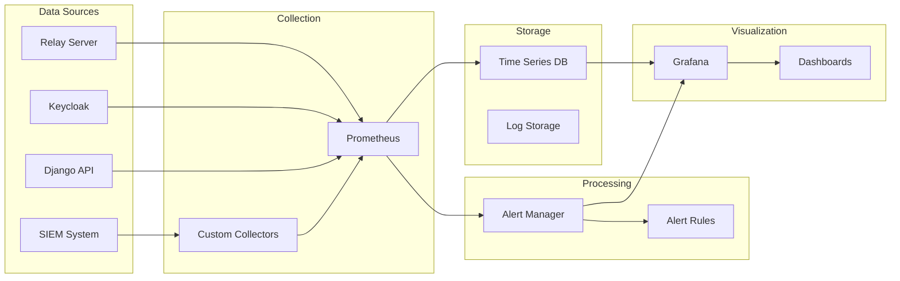

### Дашборд метрик

```mermaid
graph TD
    subgraph "Real-time Metrics"
        Connections[Активные подключения]
        Throughput[Пропускная способность]
        Latency[Задержка]
        Errors[Ошибки]
    end
    
    subgraph "Business Metrics"
        Users[Активные пользователи]
        Tunnels[Активные туннели]
        Regions[Активность по регионам]
        Revenue[Доход]
    end
    
    subgraph "Security Metrics"
        Threats[Обнаруженные угрозы]
        Blocks[Блокировки]
        AuthFailures[Ошибки аутентификации]
        Compliance[Соответствие требованиям]
    end
    
    subgraph "Infrastructure Metrics"
        CPU[Использование CPU]
        Memory[Использование памяти]
        Disk[Использование диска]
        Network[Сетевая активность]
    end
    
    Connections --> Dashboard[Главный дашборд]
    Throughput --> Dashboard
    Latency --> Dashboard
    Errors --> Dashboard
    
    Users --> Dashboard
    Tunnels --> Dashboard
    Regions --> Dashboard
    Revenue --> Dashboard
    
    Threats --> Dashboard
    Blocks --> Dashboard
    AuthFailures --> Dashboard
    Compliance --> Dashboard
    
    CPU --> Dashboard
    Memory --> Dashboard
    Disk --> Dashboard
    Network --> Dashboard
```

## 🤖 AI/ML интеграция

### Машинное обучение в сети

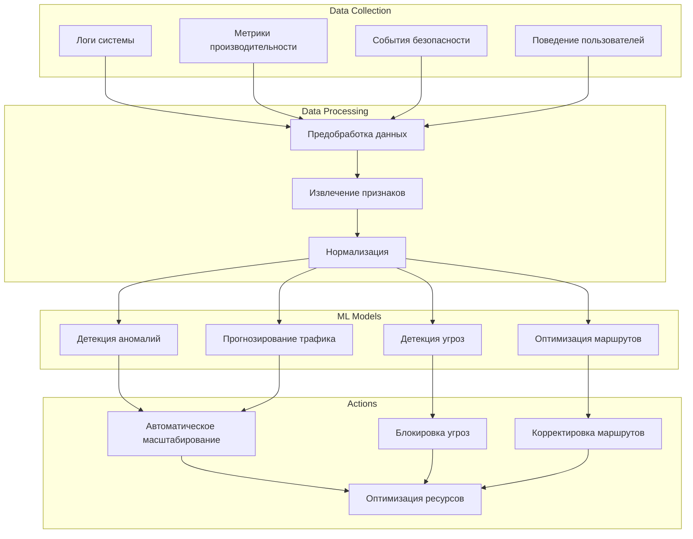

## 🔐 Безопасность

### Zero Trust Architecture

```mermaid
flowchart TD
    subgraph "Identity Verification"
        User[Пользователь]
        Device[Устройство]
        Location[Местоположение]
        Time[Время доступа]
    end
    
    subgraph "Continuous Monitoring"
        Behavior[Поведение]
        Network[Сетевая активность]
        Application[Активность приложений]
        Data[Доступ к данным]
    end
    
    subgraph "Risk Assessment"
        RiskScore[Оценка риска]
        ThreatIntel[Угрозы]
        Compliance[Соответствие]
        Policy[Политики]
    end
    
    subgraph "Access Control"
        Allow[Разрешить доступ]
        Deny[Отклонить доступ]
        Challenge[Дополнительная проверка]
        Limit[Ограничить доступ]
    end
    
    User --> Behavior
    Device --> Network
    Location --> Application
    Time --> Data
    
    Behavior --> RiskScore
    Network --> ThreatIntel
    Application --> Compliance
    Data --> Policy
    
    RiskScore --> Allow
    ThreatIntel --> Deny
    Compliance --> Challenge
    Policy --> Limit
```

## 🌍 Глобальная экосистема

### Партнерская сеть

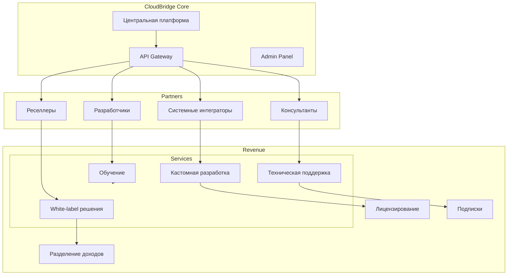

---

## 📝 Использование диаграмм

Эти Mermaid диаграммы можно использовать для:

1. **Документации** - визуализация архитектуры и процессов
2. **Презентаций** - демонстрация возможностей системы
3. **Планирования** - обсуждение будущих функций
4. **Обучения** - объяснение работы системы новым сотрудникам
5. **Маркетинга** - показ преимуществ и возможностей

### Интеграция с документацией

Диаграммы можно встраивать в:
- README.md
- Техническую документацию
- Пользовательские руководства
- Маркетинговые материалы
- Презентации для инвесторов

### Автоматическое обновление

Рекомендуется настроить автоматическое обновление диаграмм при изменении кода или конфигурации системы. 