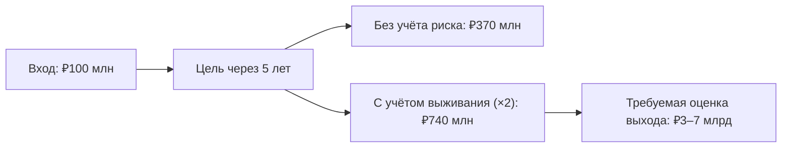

# CloudBridge — Финансовая модель (усреднённые допущения)

**Дата:** 21 сентября 2026
**Статус:** **РАБОЧИЙ ЧЕРНОВИК.** Все цифры — усреднённые оценки-заглушки
для проверки логики модели. **Не для показа инвестору до замены на точные данные.**

> **Как пользоваться.** Каждая цифра помечена:
> - `[ИСХ]` — взято из документов проекта 2025 (требует перепроверки)
> - `[ОЦН]` — моя усреднённая оценка, заменить на точную
> - `[ВЕРИФ]` — проверено по источнику, менять не нужно
>
> После глубокого анализа замените `[ОЦН]` на реальные значения и пересчитайте.

---

## 1. Ключевое изменение против модели 2025

| Параметр | Модель 2025 | На сентябрь 2026 | Влияние |
|---|---|---|---|
| Ставка ЦБ | не зафиксирована в документах | **14,00%** `[ВЕРИФ]` | Критично: меняет дисконт |
| Ставка дисконтирования | ~20–25% (подразумевалась) | **28–32%** `[ОЦН]` | Оценка падает на 30–50% |
| Стоимость капитала | низкая | **высокая** | Инфраструктура дороже |

**Почему дисконт вырос:** ставка 14% + премия за риск pre-revenue стадии (12–15 п.п.)
= **26–29%**. Для проекта без выручки и PoP реалистично **28–32%**.

**Следствие:** при ставке 14% безрисковая доходность ~13–15%. Инвестор сравнивает
проект с депозитом/ОФЗ. Обещание «10–20x за 5 лет» **обесценилось**: та же доходность
достижима с меньшим риском.

---

## 2. Модель-заглушка: базовый сценарий

Все цифры `[ОЦН]` — усреднённые, для проверки логики.

### 2.1. Рынок

| Метрика | Значение | Метка |
|---|---|---|
| TAM (РФ, Enterprise VPN + IoT + Remote Access, 2026) | ₽50–65 млрд | `[ИСХ]` — **источник не подтверждён**, требует платного отчёта |
| CAGR | 15–18% | `[ИСХ]` |
| SAM | ₽25–35 млрд | `[ИСХ]` — на 2026 требует пересчёта |
| SOM (реалистично к 2029) | ₽0,5–2 млрд | `[ОЦН]` — **снижено** против 2025 (₽2–4 млрд) |

> TAM из модели 2025 проверить не удалось. Если инвестор запросит источник —
> цифра не защищается. До подтверждения использовать осторожно.

### 2.2. Юнит-экономика

| Параметр | 2025 | 2026 `[ОЦН]` | Комментарий |
|---|---|---|---|
| ACV (годовой контракт) | ₽0,5–2 млн | **₽0,6–1,5 млн** | Снижено: конкуренция давит цену |
| CAC | ₽200–500 тыс | **₽350–600 тыс** | Дороже: продажи усложнились |
| Sales cycle | 3–6 мес | **6–9 мес** | Дольше: больше конкурентов в тендере |
| LTV | ₽3–10 млн | **₽2,5–7 млн** | Пересчёт под удержание 3 года |
| LTV/CAC | 6–10x | **4–6x** | Ниже нормы «здорового» SaaS |
| Gross margin | 70–80% | **65–75%** | Инфраструктура дороже |

> **LTV/CAC 4–6x — пограничная зона.** Классический ориентир — 3x минимум, 5x+ хорошо.
> При снижении ACV и росте CAC модель теряет привлекательность.

### 2.3. Прогноз выручки: 2025 vs 2026

| Год | ARR (модель 2025) | ARR (2026, `[ОЦН]`) | Причина разрыва |
|---|---|---|---|
| 2026 | ₽25–45 млн | **₽0** | Проект заморожен, PoP нет |
| 2027 | — | **₽5–15 млн** | Пилоты + первые контракты |
| 2028 | ₽120–220 млн | **₽30–70 млн** | Сдвиг на 1–2 года |
| 2029 | ₽600M–1,2B | **₽90–200 млн** | Радикально ниже |

**Главное:** модель 2025 предполагала ₽25–45 млн уже в 2026. Фактически — ноль.
Горизонт сдвинулся минимум на 1,5–2 года, а целевые уровни ниже в 4–6 раз.

### 2.4. Расходы `[ОЦН]`

Считаю от базы 2025 (₽380 тыс/мес минимум, ₽850 тыс/мес с командой) с поправкой на инфляцию:

| Статья | 2025 `[ИСХ]` | 2026 `[ОЦН]` |
|---|---|---|
| Первоначальные затраты | ₽500 тыс | **₽700 тыс–1,2 млн** |
| Ежемесячно (минимум) | ₽380 тыс | **₽500–650 тыс** |
| Ежемесячно (команда 5 чел.) | ₽850 тыс | **₽1,2–1,6 млн** |
| **Год (минимум)** | ₽5,06 млн | **₽6,5–8 млн** |
| **Год (с командой)** | ₽10,7 млн | **₽15–20 млн** |

 **Не учтено в базе 2025:** расходы на оформление IP (см. `IP_OWNERSHIP_PLAN.md`) —
оценка, юрист, патентование. `[ОЦН]` **₽1,5–3 млн** единоразово.

### 2.5. Сколько нужно и на сколько хватит

| Сценарий | Сумма | Runway | Что успеваем |
|---|---|---|---|
| Минимальный | ₽15–25 млн | 12–15 мес | PoP + команда 3–4 + пилоты |
| Базовый | ₽30–50 млн | 18–24 мес | PoP + команда 5–7 + продажи |
| Прежний Ask | ₽50–100 млн | 24–30 мес | Может быть **завышен** для текущей стадии |

> **Рекомендация.** При отсутствии PoP, клиентов и юрлица запрашивать ₽50–100 млн
> рискованно: инвестор не увидит, за что платит. **₽20–40 млн выглядит защитимее** —
> сумма достаточна, чтобы дойти до первых клиентов, и её легче обосновать.

---

## 3. Оценка компании (усреднённо)

### Проблема с методом 2025

Модель 2025 давала оценку **через мультипликатор к будущему ARR** (5–10x):
₽25–45 млн ARR × 5–10 = ₽300–500 млн post-money.

**Почему так нельзя сейчас:**
- ARR = 0. Мультипликатор не к чему применять.
- Выручки не будет минимум 12–18 месяцев.
- При ставке 28–32% будущие деньги весят сильно меньше.

### Что работает для pre-revenue

| Метод | Результат `[ОЦН]` | Комментарий |
|---|---|---|
| **Затратный** (сколько вложено) | ₽3–8 млн | Прямые затраты на разработку |
| **Сравнительный** (аналоги на стадии) | ₽40–120 млн pre-money | Очень широкий разброс |
| **Venture method** (обратный счёт) | ₽80–250 млн | Требует целевой доходности |

> **Разрыв между затратным (₽3–8 млн) и venture method (₽80–250 млн) — в 20–30 раз.**
> Это нормально для pre-seed: инвестор платит за потенциал, не за активы.
> Итоговая цифра — результат переговоров, а не расчёта.

### Влияние ставки на требуемую доходность

При ставке 14% инвестор хочет ≥30–35% годовых в рублях. Чтобы дать 30% при входе
в ₽100 млн, через 5 лет нужно вернуть ₽370 млн + учесть 100% риск потери:

Это означает: обещание «₽5–10 млрд exit» из модели 2025 **остаётся на грани** — оно
едва покрывает требование по доходности с учётом риска. Запас прочности тонкий.

---

## 4. Что нужно заменить после глубокого анализа

Приоритет по важности:

| # | Параметр | Почему критично |
|---|---|---|
| 1 | **Затраты на разработку** (факт) | База для затратного метода и оценки IP |
| 2 | **ACV и CAC** (реальные или бенчмарк) | Определяют, работает ли юнит-экономика |
| 3 | **Сумма и условия инвестора** | Без них модель не имеет смысла |
| 4 | **TAM с платным источником** | Сейчас цифра не защищается |
| 5 | **Расходы на IP-оформление** | Считаю ₽1,5–3 млн, нужна точная смета |
| 6 | **Стоимость PoP** | База 2025 по VK Cloud, проверить актуальность |

---

## 5. Честный вывод по цифрам

Три вывода, которые важны для разговора:

**1. Модель 2025 не «устарела» — она перевернулась.**
При ARR = 0 и ставке 14% оценка через мультипликатор невозможна. Разговор идёт о
стоимости возможности, а не о стоимости бизнеса.

**2. Прежний Ask (₽50–100 млн) выглядит завышенным.**
Без PoP, клиентов и юрлица обосновать его трудно. ₽20–40 млн защитимее.

**3. Обещание 10–20x за 5–6 лет почти не оставляет запаса.**
При ставке 14% та же доходность доступна с меньшим риском. Придётся предлагать
либо больше, либо убедительнее обосновывать защищённость технологии — а именно
здесь, как показал конкурентный анализ, у проекта слабое место.

---

**Источники:** `INVESTOR_PITCH_RU.md`, `RUSSIA_INFRASTRUCTURE_COST_ESTIMATE.md`
(2025-10-13); ключевая ставка — cbr.ru (верифицировано 21.09.2026).

**Не использовано:** IDC, Gartner, РБК Исследования — нет доступа.
