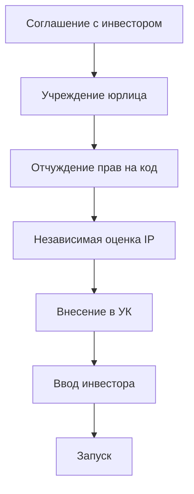

# CloudBridge — Инвестиционный меморандум

**Версия:** черновик с плейсхолдерами
**Дата:** 21 сентября 2026

> ⚠️ **СТАТУС ДОКУМЕНТА.** Разделы, помеченные `{{ }}`, требуют данных от инвестора.
> До заполнения — **не отправлять инвестору**. Всё остальное — проверяемые факты
> из репозиториев проекта, зафиксированные на 21.09.2026.

---

## Executive Summary

CloudBridge — программное обеспечение для организации защищённой связи между
устройствами через интернет, построенное на протоколах QUIC и MASQUE.
Разработано как self-hosted решение: заказчик разворачивает его в своей инфраструктуре.

**Что предлагается:** доля в{{ доля }}% во вновь создаваемом{{ форма: ООО / АО }}
за{{ сумма }} ₽.

**Состояние на сегодня — честно:**

| Есть | Нет |
|---|---|
| Работающий relay + клиент на Go, проверены в лаборатории | Развёрнутой сети (PoP), демо |
| ~300+ файлов кода, документация, проектная проработка | Клиентов, выручки, пилотов |
| Команда: основатель (техническая экспертиза) | Юрлица, команды найма |
| | Сертификаций (ФСТЭК, реестр отечественного ПО) |

**Мы не заявляем продукт. Мы предлагаем профинансировать его создание.**

---

## 1. Что реально сделано

Раздел описывает **проверяемое** состояние. Основание — внутренний технический аудит
`REALITY_CHECK_vs_CODE.md` (июль 2026), сверенный с кодом 21.09.2026.

### 1.1. Подтверждённый актив

**Self-hosted relay + клиент, лабораторно проверены.** Сборка проходит
(`go build ./cmd/relay`, `go build ./cmd/cloudbridge-client` — проверено 21.09.2026).

Автоматизированный набор тестов (`cloudbridge-client/scripts/all-smoke.sh`) прогоняет:

1. Проверку работоспособности (health)
2. P2P-соединение
3. Двухточечное взаимодействие (mesh)
4. gRPC-туннель с реальной передачей TCP-трафика
5. CLI-туннель end-to-end
6. QUIC-аутентификацию и обмен PING/PONG
7. Многопользовательский QUIC-mesh

> **Для технической проверки (Tech Diligence).** Инвестор может развернуть и запустить
> это самостоятельно. Готовы предоставить доступ к среде.

### 1.2. Чего нет

Внутренний аудит от июля 2026 оценивает состояние честно:

| Направление | Готовность (0–5) |
|---|---|
| Архитектура (направление выбрано верно) | 4 |
| Лабораторная связность (один relay) | 4–5 |
| Готовая к продаже сеть (multi-PoP) | **0–1** |
| Продвинутый транспорт (MASQUE/FEC/AI) | 1–2 |
| Общая готовность к видению | **~20–30%** |

**Прямая формулировка:** сеть существует в коде, но не развёрнута. PoP-узлов — ноль.

### 1.3. Расхождение, которое нужно знать

Материалы 2025 года заявляли «82% готовности» и «неделю до запуска». **Это неверно.**
Внутренний аудит, проведённый тем же основателем, даёт ~20–30%. Документы 2025 года
помечены как устаревшие в самом репозитории.

Мы предпочитаем показать это расхождение сами, чем позволить найти его при проверке.

---

## 2. Рынок

### 2.1. Макроэкономический контекст

**Ключевая ставка ЦБ РФ — 14,00%** (на 21.09.2026, cbr.ru).

Это определяет условия разговора: безрисковая доходность ~13–15% годовых.
Проект обязан обещать существенно больше с поправкой на риск.

### 2.2. Целевой рынок

| Метрика | Значение | Достоверность |
|---|---|---|
| TAM (РФ) | {{ TAM }} | ⚠️ оценка 2025, **требует подтверждения отчётом** |
| SAM | {{ SAM }} | ⚠️ то же |
| SOM (реалистично) | {{ SOM }} | требует пересчёта под 2026 |

> ⚠️ **Честно.** Цифры TAM из материалов 2025 (₽45–65 млрд) мы **не можем подтвердить
> публичным источником**. Платные отчёты (IDC, Gartner, РБК) недоступны. Если инвестор
> запросит обоснование — его сейчас нет. Либо подтвердим вместе, либо снимем цифру.

### 2.3. Конкурентная среда

Рынок за 2026 год консолидировался. Подробный разбор — в `COMPETITIVE_ANALYSIS_2026.md`.
Кратко:

| Конкурент | Позиция |
|---|---|
| **NetBird** | Open-source, self-hosted, от €6/юзер. **Прямой конкурент** |
| **Tailscale** | $8–18/юзер, лидер сегмента |
| **Ideco** | Российский вендор, NGFW с ZTNA/SD-WAN/ML IPS |

**Ключевой вопрос, на который у нас есть ответ ниже** (раздел 3.2): почему заказчик
выберет CloudBridge.

---

## 3. Технология и отличие

### 3.1. Что разрабатывается

Транспортное ядро на **QUIC (RFC 9000) и MASQUE (RFC 9297)** — вместо WireGuard,
на котором построены конкуренты. Собственная реализация с поддержкой
мультитенантности и P2P-соединений.

### 3.2. Почему это имеет значение

**Важно быть честными:** «QUIC вместо WireGuard» само по себе — не преимущество.
Заказчику нужна работающая связность, а не протокол.

Преимущество возникает в **конкретном сценарии**: QUIC работает там, где WireGuard
неприменим — в веб-инфраструктуре, где соединение идёт через HTTP/3-совместимые
каналы и стандартные порты.

> ⚠️ **Это гипотеза, а не подтверждённый факт.** Спрос в этом сценарии не проверялся.
> Для проверки нужен хотя бы один заказчик с такой задачей. Это одна из целей
> финансирования.

**Если гипотеза не подтвердится**, продукт конкурирует с NetBird напрямую — и
преимущества не имеет.

---

## 4. Предлагаемая модель бизнеса

### 4.1. Монетизация (проект)

1. **Enterprise-лицензии** — {{ ACV }} за контракт/год
2. **Managed-сервис** — {{ цена }}/месяц (в перспективе)
3. **Профессиональные услуги** — внедрение

**Модель лицензирования:** open-core — проприетарное ядро (транспорт) плюс открытые
клиенты. Обоснование — в `IP_OWNERSHIP_PLAN.md`.

> ⚠️ **Несоответствие, требующее решения.** Материалы 2025 заявляли продукт как
> «open source», но `LICENSE` ядра — **PROPRIETARY, All Rights Reserved**. Один из
> репозиториев — Apache 2.0, ещё два — MIT. **Лицензионная модель не определена.**
> Это надо зафиксировать до сделки.

### 4.2. Экономика (усреднённые оценки)

| Параметр | Значение | Метка |
|---|---|---|
| ACV | {{ ACV }} | `[ОЦН]` требует подтверждения |
| CAC | {{ CAC }} | `[ОЦН]` |
| LTV/CAC | 4–6x | ⚠️ пограничная зона |
| Gross margin | 65–75% | `[ОЦН]` |

> Полная модель с пересчётом под ставку 14% — в `FINANCIAL_MODEL_2026.md`.

---

## 5. Финансовые условия сделки

### 5.1. Предложение

| Параметр | Значение |
|---|---|
| Сумма | **{{ сумма }} ₽** |
| Форма | **{{ ООО / АО }}** |
| Доля инвестора | **{{ доля }}%** |
| Оценка pre-money | **{{ оценка }} ₽** |
| Оценка post-money | **{{ оценка + сумма }} ₽** |

### 5.2. Использование средств

| Статья | Доля | Сумма |
|---|---|---|
| Команда (инженеры, продажи) | {{ % }} | {{ }} ₽ |
| Инфраструктура (PoP) | {{ % }} | {{ }} ₽ |
| Оформление IP и сертификация | {{ % }} | {{ }} ₽ |
| Резерв | {{ % }} | {{ }} ₽ |

**Runway:** {{ N }} месяцев.

> 🚩 **Обязательная статья, которую нельзя пропустить:** оформление прав на IP.
> Юрлица нет, права на код не оформлены. Без этого сделка не закроется.
> Оценка затрат — ₽1,5–3 млн (юрист, независимая оценка, регистрация).
> Подробно: `IP_OWNERSHIP_PLAN.md`.

### 5.3. Структура сделки

**Срок выхода на сделку:** 2–4 месяца (оформление IP — критичный путь).

---

## 6. Риски

Честный список. Инвестор найдёт их сам — лучше от нас.

| # | Риск | Серьёзность | Митигация |
|---|---|---|---|
| 1 | **Нет подтверждённого спроса** на QUIC-подход | Высокая | Первый пилот до масштабирования |
| 2 | **NetBird занимает ту же нишу** бесплатно | Высокая | Дифференциация по сценарию |
| 3 | **Нет юрлица и оформленного IP** | Блокирующая | План готов, 2–4 мес |
| 4 | **Один основатель в команде** | Высокая | Найм — приоритет №1 после сделки |
| 5 | **Проект стоял 11 месяцев** | Средняя | Требует переоценки темпа |
| 6 | **TAM не подтверждён** | Средняя | Подтвердить отчётом |
| 7 | **Расхождения в документации** | Средняя | Исправлено, помечено |
| 8 | **Сертификаций нет** | Средняя | ФСТЭК — в план расходов |

---

## 7. Что требуется от инвестора, помимо денег

{{ пожелания: связи в enterprise-сегменте, доступ к пилотным заказчикам,
экспертиза в продажах B2B }}

---

## 8. Дорожная карта (проект)

| Срок | Цель |
|---|---|
| 0–3 мес | Учреждение юрлица, оформление IP |
| 3–6 мес | Найм команды, первый PoP |
| 6–12 мес | Первый платящий пилот |
| 12–18 мес | {{ N }} PoP, выход на повторяемую выручку |

> ⚠️ Сроки — усреднённые. Реальные зависят от суммы и скорости найма.

---

## 9. Приложения

| Документ | Содержание |
|---|---|
| `REALITY_CHECK_vs_CODE.md` | Технический аудит: claim ↔ код |
| `MARKET_ANALYSIS_2026.md` | Рынок на сентябрь 2026 |
| `COMPETITIVE_ANALYSIS_2026.md` | Конкуренты |
| `FINANCIAL_MODEL_2026.md` | Модель с пересчётом под ставку 14% |
| `IP_OWNERSHIP_PLAN.md` | Оформление прав |

---

## Что заполнить перед отправкой

**Блокирующие:**

- [ ] `{{ сумма }}`, `{{ доля }}`, `{{ форма }}`, `{{ оценка }}`
- [ ] `{{ TAM/SAM/SOM }}` — подтвердить источником либо снять
- [ ] `{{ ACV }}`, `{{ CAC }}` — реальные или бенчмарк
- [ ] Лицензионная модель (open-core / проприетарная)

**Желательные:**

- [ ] `{{ € }}` использование средств с процентами
- [ ] `{{ пожелания }}` к инвестору
- [ ] Дорожная карта с реальными цифрами

---

**Документ подготовлен:** 21.09.2026
**Основание:** внутренняя документация проекта, открытые источники, аудит кода.
**Статус:** черновик, не для внешнего использования до заполнения плейсхолдеров.
