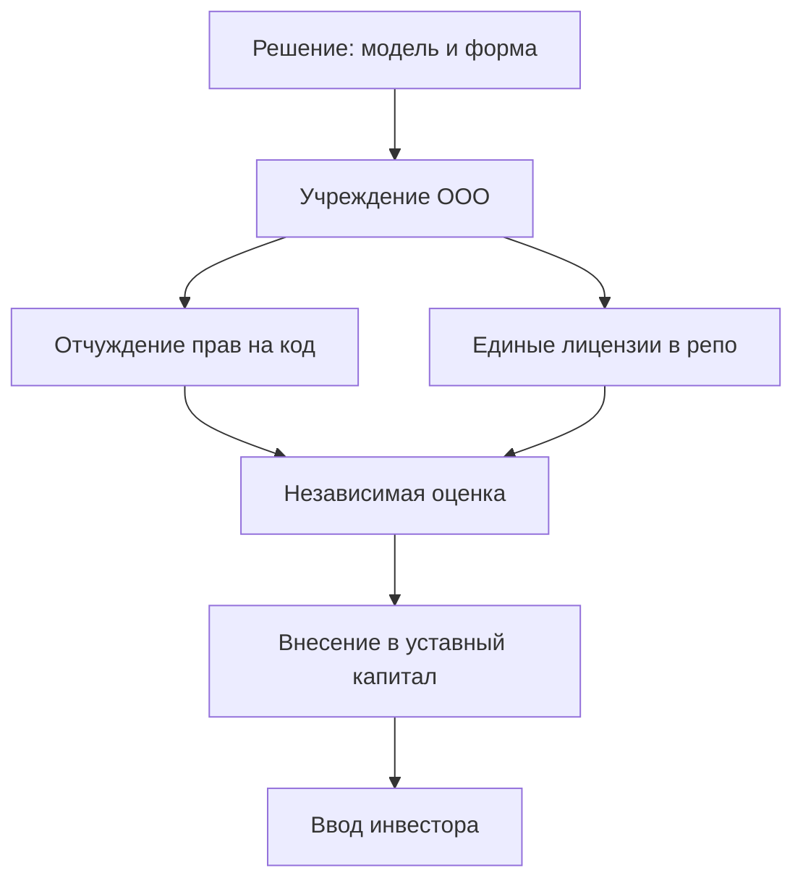

# CloudBridge — План оформления интеллектуальной собственности

**Дата подготовки:** 21 сентября 2026
**Назначение:** привести IP в состояние, при котором сделка с инвестором возможна
**Статус:** черновик для принятия решений; не является юридическим заключением

> ⚠️ **Дисклеймер.** Это инженерно-организационный план, а не юридическая консультация.
> Пункты, помеченные **[ЮРИСТ]**, требуют российского IP-юриста.
> Стоимость и сроки — ориентировочные оценки, требуют уточнения.

---

## 1. Главный риск: IP нельзя внести в капитал в текущем виде

Инвестор входит в новое юрлицо, а вклады в уставный капитал бывают денежными и неденежными.
**Код — это неденежный вклад.** Чтобы его внести, нужно, чтобы ООО/АО принадлежали права
на него. Сейчас права не оформлены, и, что хуже, ситуация внутренне противоречива.

### 1.1 Лицензии противоречат друг другу

Проверено 21.09.2026 по файлам `LICENSE` в каждом репозитории:

| Репозиторий | Лицензия | Проблема |
|---|---|---|
| `cloudbridge-relay-installer` | **Proprietary**, «All Rights Reserved», **Maksim Lanies** | Закрытая лицензия, держатель — физлицо |
| `cloudbridge-client` | **Apache 2.0** | Открытая, разрешительная |
| `cloudbridge-scalable-relay` | **MIT**, «2GC Development» | Открытая |
| `cloudbridge-docs` | **MIT**, «2GC CloudBridge Global Network» | Открытая |
| `cloudbridge-dns-network` | **отсутствует** | Все права по умолчанию у автора, но неясность |
| `cloudbridge-monitoring` | **отсутствует** | То же |
| `cloudbridge-control-plane` | **отсутствует** | То же |
| `cloudbridge-edge-pops` | **отсутствует** | То же |
| `CLOUDBRIDGE_STRATEGY` | **отсутствует** | То же |

**Суть проблемы:** ядро (relay-installer) — проприетарное и принадлежит физлицу. Периферия —
под MIT и Apache 2.0, то есть **уже открыта и выдана всем желающим навсегда**.

**Apache 2.0 и MIT не отзываются.** Если `cloudbridge-client` опубликован под Apache 2.0,
любой может использовать, менять и распространять его — и отменить это нельзя, только
выпустить следующую версию под другой лицензией. Это не блокер, но инвестор об этом спросит.

### 1.2 Стратегия заявляла open-source, а ядро — проприетарное

В `INVESTORS.md` и питче продукт описывается как **open source** («прозрачность и
импортонезависимость»). Фактически ядро под проприетарной лицензией с запретом
копирования и модификации. **Это прямое расхождение**, которое инвестор найдёт за минуту.

Требуется определиться: продукт **open-core** (открытое ядро + коммерческие модули)
или полностью проприетарный. Сейчас модель не определена, а материалы заявляют одно,
файлы говорят другое.

### 1.3 Авторство размыто

В коммитах фигурируют:

```
CloudBridge Developer <dev@cloudbridge.ru>        ← домен, которого может не быть
ubuntu@relay-01.mcs.local / @2gc-relay-server     ← серверные аккаунты
Lanies Maksim <m.lanies@2gc.io>                   ← корпоративный
Maksim Lanies <91416159+mlanies@users.noreply.github.com>
Your Name <you@example.com>                       ← дефолтный git-конфиг
Ваше Имя <you@example.com>                        ← тоже дефолтный
2GC Development <dev@2gc.ru>
```

Это означает, что **прослеживаемость авторства отсутствует**. Для юриста это проблема:
нужно доказать, что все права принадлежат одному лицу (или собрать отчуждения со всех,
кто писал). Часть коммитов сделана с машин, где git был настроен по умолчанию —
формально это не создаёт прав третьих лиц, но требует объяснения.

Отдельно: **40+ коммитов в `cloudbridge-relay-installer` сделаны с `ubuntu@relay-01.mcs.local`**
— если это была арендованная или чужая инфраструктура, нужно убедиться, что по договору
аренды результаты работы принадлежат вам.

### 1.4 Владение репозиториями

Репозитории размещены на GitHub в организации **`twogc`**. Юрлица `2GC` не существует
(АО и АНО не зарегистрированы). Значит, формально организация принадлежит физлицу.
При создании ООО/АО права нужно будет переоформить — либо аккуратно, через
лицензионный договор, либо через отчуждение.

### 1.5 Сторонний код

Зависимости (`go.mod`) — обычные разрешительные лицензии (MIT, Apache 2.0, BSD).
Копилефт-зависимостей (GPL/AGPL), которые заражали бы проприетарный продукт,
**не обнаружено**. Это хорошая новость.

⚠️ Но требуется **полный аудит лицензий зависимостей** перед сделкой:
список в `go.mod` длинный, включая `mattn/go-sqlite3`, `projectcalico/api`, Cadence и др.

Отдельно: в `CLOUDBRIDGE_STRATEGY/.../ebpf-utilities/README.md` есть упоминание GPL/AGPL —
нужно проверить, не планировалось ли включать GPL-код в проприетарный продукт.

---

## 2. План действий по этапам

### Этап 0. Решения, которые нужно принять до юриста (1–2 недели)

Это не юридические, а продуктовые решения. Без них юрист не сможет работать.

| # | Решение | Варианты |
|---|---|---|
| 1 | **Лицензионная модель** | Open-core / полностью проприетарный / MIT для всего |
| 2 | **Кто владелец IP** | Физлицо (вы) с последующей передачей в ООО/АО, или сразу юрлицо |
| 3 | **Судьба MIT/Apache-репозиториев** | Принять как публичные (что уже необратимо) и строить open-core |
| 4 | **Форма юрлица** | ООО (проще, дешевле) или АО (нужен под опционы и раунды) |

> **Рекомендация.** Для ситуации «один основатель, ещё нет выручки, входит частный
> инвестор» — **ООО**, модель **open-core**: проприетарное ядро (relay + MASQUE
> transport) и открытые клиенты/утилиты. Это соответствует тому, что уже фактически
> сложилось в репозиториях, и не требует «отматывать» публикацию под MIT.

### Этап 1. Инвентаризация (2–3 недели)

- [ ] **1.1. Аудит авторства.** Пройти по всем коммитам, составить карту: кто, что, когда.
      Определить, есть ли вклад третьих лиц, помимо основателя.
- [ ] **1.2. Аудит зависимостей.** Полный список лицензий всех прямых и транзитивных
      зависимостей. Пометить всё, что не MIT/Apache/BSD.
- [ ] **1.3. Аудит инфраструктуры.** Проверить договоры аренды серверов, с которых
      велась работа (`mcs.local`, `2gc-relay-server`), на предмет принадлежности результатов.
- [ ] **1.4. Проверка доменов и аккаунтов.** `2gc.ru`, `2gc.io`, `cloudbridge.ru`,
      GitHub-организация `twogc` — кому принадлежат, на кого оформлены.

**Результат:** документ «IP Inventory» — что есть, кому принадлежит, что под вопросом.

### Этап 2. Юридическое оформление **[ЮРИСТ]** (3–6 недель)

- [ ] **2.1. Отчуждение прав в юрлицо.** Договор об отчуждении исключительных прав
      от физлица в ООО/АО (или лицензионный договор — тут выбор за юристом и инвестором).
- [ ] **2.2. Служебные произведения.** Оформить, что код создан в рамках трудовых
      обязанностей — это будущая защита при найме разработчиков.
- [ ] **2.3. Привести лицензии в порядок.** Единая лицензионная модель во всех
      репозиториях: LICENSE, COPYRIGHT, NOTICE.
- [ ] **2.4. Проверка на конфликты.** Убедиться, что передача IP не нарушает
      ранее выданные MIT/Apache-лицензии.

### Этап 3. Оценка для вклада в капитал **[ЮРИСТ]** (2–4 недели)

Для внесения IP как неденежного вклада нужна **независимая оценка**:

- [ ] **3.1. Привлечь оценщика** (обязательно по 135-ФЗ для неденежных вкладов в УК).
- [ ] **3.2. Оценка ПО** — обычно затратным методом (сколько стоило разработать).
- [ ] **3.3. Согласовать оценку с инвестором** — она влияет на размер вашей доли.
- [ ] **3.4. Внести в уставный капитал** с подтверждающими документами.

> ⚠️ **Важно для переговоров.** Оценка ПО затратным методом, скорее всего, даст
> скромную цифру относительно ожиданий. Если разработка велась силами одного человека
> плюс AI-ассистент, формальные затраты невелики. Это аргумент для инвестора —
> «вы получаете задешево» — но и риск для вашей доли: не ждите, что код оценят дорого.

### Этап 4. Защита (параллельно, 4–12 месяцев)

- [ ] **4.1. Регистрация ПО в Роспатенте.** Программы регистрируются как объекты
      авторского права; это формальность, но даёт официальный документ.
- [ ] **4.2. Проверка патентоспособности.** Оценить, есть ли решения, которые можно
      защитить патентом (например, методы AI-маршрутизации, если они реализованы).
      **[ЮРИСТ]** — нужен патентный поиск.
- [ ] **4.3. Ноу-хау.** Оформить режим коммерческой тайны на то, что не патентуется.
- [ ] **4.4. Товарный знак.** Зарегистрировать «CloudBridge» / «2GC» — проверить
      доступность, там может быть конфликт с существующими знаками.

---

## 3. Критичный путь к сделке

Минимальный набор, без которого инвестор не сможет войти:



**Оценка сроков:** 2–4 месяца от старта до готовности принять деньги.
Для pre-seed это долго — инвестор может остыть. Стоит обсудить с ним
**оплату работ по оформлению как часть сделки** (условие закрытия).

---

## 4. Что сказать инвестору

Честная формулировка ситуации:

> «Код написан и работает. Права на него юридически не оформлены, потому что юрлица
> ещё нет. Предлагаем зафиксировать в соглашении: IP отчуждается в создаваемое ООО
> как часть сделки, с независимой оценкой. Это 2–4 месяца работы и X рублей;
> предлагаем разделить или учесть их в структуре сделки.»

Это честно и **проверяемо**. Альтернатива — умолчать и надеяться, что инвестор не
заметит противоречие между «open source» в питче и PROPRIETARY в LICENSE. Заметит.

---

## 5. Открытые вопросы к основателю

1. **Кто писал код, кроме вас?** Были ли подрядчики, партнёры, соавторы?
2. **С каких серверов велась разработка?** (`mcs.local`, `2gc-relay-server`) — по договору
   аренды, результаты принадлежат вам?
3. **Домены `2gc.ru`, `2gc.io`, `cloudbridge.ru`** — оформлены на вас или на кого-то ещё?
4. **Осознанно ли ядро под PROPRIETARY, а периферия под MIT?** Или это историческая случайность?
5. **Есть ли намерение публиковать ядро в open source?** Если да — нужен другой план защиты.

---

**Верифицировано 21.09.2026:** лицензии в 9 репозиториях, авторы коммитов, отсутствие
GPL/AGPL-зависимостей в `go.mod` (прямые зависимости), расположение репозиториев.

**Не проверено:** юридические детали (требуется юрист), статус доменов, договоры аренды
инфраструктуры, полный транзитивный лицензионный аудит зависимостей.
