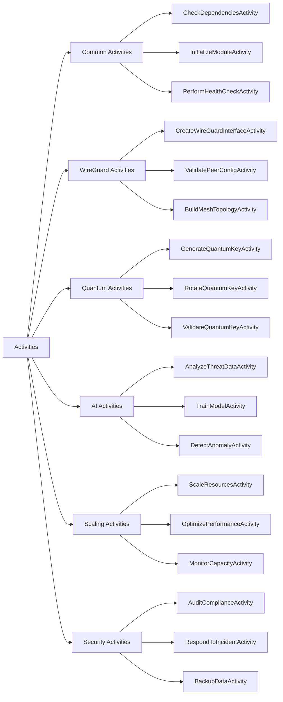

# ⚡ CloudBridge Relay - Cadence Activities Guide

## 📋 Обзор

Activities в Cadence представляют собой атомарные операции, которые выполняют конкретную работу. В отличие от workflows, activities могут взаимодействовать с внешними системами, делать недетерминированные операции и иметь побочные эффекты.

## 🏗️ Архитектура Activities

### Категории Activities



## 🔧 Common Activities

### CheckDependenciesActivity

**Описание**: Проверяет доступность зависимостей модуля.

**Сигнатура**:
```go
func CheckDependenciesActivity(ctx context.Context, dependencies []string) (string, error)
```

**Параметры**:
- `dependencies`: Список зависимостей для проверки

**Возвращает**:
- `string`: Результат проверки ("all_dependencies_available", "missing_dependencies")

**Пример использования**:
```go
dependencies := []string{"database", "redis", "wireguard"}
result, err := workflow.ExecuteActivity(ctx, "CheckDependenciesActivity", dependencies).Get(ctx, &result)
```

### InitializeModuleActivity

**Описание**: Инициализирует модуль системы с заданной конфигурацией.

**Сигнатура**:
```go
func InitializeModuleActivity(ctx context.Context, moduleName string, configuration map[string]interface{}) (string, error)
```

**Поддерживаемые модули**:
- `core`: Основные компоненты системы
- `wireguard`: WireGuard интеграция
- `quantum`: Квантовая криптография
- `ai`: AI/ML компоненты

**Время выполнения**: 1-4 секунды в зависимости от модуля

### PerformHealthCheckActivity

**Описание**: Выполняет проверку здоровья компонента системы.

**Параметры**:
- `checkType`: Тип проверки (core, network, security, performance)
- `component`: Компонент для проверки
- `config`: Конфигурация проверки

**Возвращаемые метрики**:
```go
result := map[string]interface{}{
    "cpu_usage":     25.5,
    "memory_usage":  45.2,
    "latency":       12.3,
    "status":        "healthy",
    "score":         0.92,
}
```

### ValidateConfigurationActivity

**Описание**: Валидирует конфигурацию на корректность.

**Проверки**:
- Наличие обязательных полей
- Корректность типов данных
- Валидность диапазонов значений
- Предупреждения о потенциальных проблемах

### GetSystemMetricsActivity

**Описание**: Собирает системные метрики.

**Поддерживаемые типы метрик**:
- `cpu`: Загрузка процессора
- `memory`: Использование памяти
- `disk`: Использование диска
- `network`: Сетевые метрики
- `connections`: Метрики соединений

### ExecuteCommandActivity

**Описание**: Выполняет системные команды с проверкой безопасности.

**Разрешенные команды**:
- `systemctl`: Управление службами
- `docker`: Docker операции
- `kubectl`: Kubernetes операции
- `wireguard`: WireGuard операции
- `cadence`: Cadence операции

**Безопасность**: Команды проверяются по whitelist перед выполнением.

## 🌐 WireGuard Activities

### ValidatePeerConfigActivity

**Описание**: Валидирует конфигурацию WireGuard пира.

**Проверки**:
- Формат публичного ключа (44 символа Base64)
- Корректность allowed IPs
- Валидность endpoint
- Наличие обязательных полей

**Пример конфигурации пира**:
```json
{
  "public_key": "xTIBA5rboUvnH4htodjb6e697QjS4WSWgpfE5DBe4Fg=",
  "allowed_ips": ["10.0.0.0/24", "192.168.1.0/24"],
  "endpoint": "peer.example.com:51820",
  "persistent_keepalive": 25
}
```

### CreateWireGuardInterfaceActivity

**Описание**: Создает новый WireGuard интерфейс для пира.

**Процесс создания**:
1. Генерация пары ключей для пира
2. Создание сетевого интерфейса
3. Назначение IP адреса из пула
4. Настройка порта прослушивания
5. Применение конфигурации

**Возвращаемые данные**:
```json
{
  "interface_name": "wg-12345678",
  "private_key": "private_key_12345678",
  "public_key": "public_key_12345678",
  "assigned_ip": "10.0.0.15/24",
  "listen_port": 52345,
  "status": "created"
}
```

### AnalyzeMeshTopologyActivity

**Описание**: Анализирует текущую mesh топологию сети.

**Анализируемые параметры**:
- Общее количество возможных соединений
- Количество активных соединений
- Неудачные соединения
- Средняя задержка в сети
- Эффективность сети
- Узкие места (bottleneck peers)

**Рекомендации по оптимизации**:
- Переход на hub-spoke для некоторых соединений
- Проверка connectivity между пирами
- Оптимизация маршрутизации

### PlanMeshTopologyActivity

**Описание**: Планирует оптимальную mesh топологию.

**Поддерживаемые типы топологий**:

1. **Full Mesh**: Каждый пир соединен с каждым
   - Максимальная отказоустойчивость
   - Минимальная задержка
   - Высокое потребление ресурсов

2. **Hub-Spoke**: Один центральный узел (hub)
   - Минимальное количество соединений
   - Простое управление
   - Единая точка отказа

3. **Hybrid**: Комбинация full mesh и hub-spoke
   - Баланс между производительностью и ресурсами
   - Гибкость конфигурации

### BuildMeshTopologyActivity

**Описание**: Строит mesh топологию согласно плану.

**Процесс построения**:
1. Создание соединений согласно плану
2. Установка WireGuard туннелей
3. Настройка маршрутизации
4. Проверка связности
5. Применение конфигурации

**Обработка ошибок**:
- Retry для временных сбоев
- Fallback на альтернативные маршруты
- Логирование неудачных соединений

### MonitorPeerActivity

**Описание**: Мониторинг состояния WireGuard пира.

**Собираемые метрики**:
```json
{
  "connection_status": "connected",
  "last_handshake": "2024-01-01T12:00:00Z",
  "bytes_received": 47185920,
  "bytes_sent": 24117248,
  "latency_ms": 12.5,
  "packet_loss_percent": 0.1,
  "throughput_mbps": 85.3,
  "encryption_status": "active"
}
```

## 🔐 Quantum Activities

### GenerateQuantumKeyActivity

**Описание**: Генерирует новые квантово-устойчивые ключи.

**Поддерживаемые алгоритмы**:
- **CRYSTALS-Kyber**: Квантово-устойчивый обмен ключами
- **CRYSTALS-Dilithium**: Квантово-устойчивые цифровые подписи
- **Falcon**: Компактные подписи
- **SPHINCS+**: Stateless подписи

**Уровни безопасности**:
- Level 1 (128 бит): Базовая защита
- Level 3 (192 бит): Рекомендуемая защита
- Level 5 (256 бит): Максимальная защита

### ValidateQuantumKeyActivity

**Описание**: Валидирует квантовые ключи на корректность и безопасность.

**Проверки**:
- Математическая корректность ключа
- Соответствие алгоритму
- Проверка энтропии
- Тестирование криптографических свойств

### ReplaceQuantumKeyActivity

**Описание**: Безопасная замена квантового ключа.

**Процесс замены**:
1. Проверка готовности нового ключа
2. Синхронизация с партнерами
3. Переключение на новый ключ
4. Верификация работоспособности
5. Безопасное удаление старого ключа

### SecureDeleteQuantumKeyActivity

**Описание**: Безопасное удаление квантового ключа из памяти и хранилища.

**Методы удаления**:
- Перезапись памяти случайными данными
- Множественная перезапись (DoD 5220.22-M)
- Физическое уничтожение носителей (при необходимости)
- Верификация удаления

## 🤖 AI Activities

### CollectThreatDataActivity

**Описание**: Сбор данных для анализа угроз.

**Источники данных**:
- Системные логи (syslog, журналы приложений)
- Сетевой трафик (netflow, packet captures)
- Поведенческие данные пользователей
- Внешние feed'ы угроз

**Временные окна**:
- `1h`: Последний час (реалтайм анализ)
- `24h`: Последние сутки (детальный анализ)
- `7d`: Последняя неделя (трендовый анализ)
- `30d`: Последний месяц (глубокий анализ)

### PerformRealtimeThreatAnalysisActivity

**Описание**: Анализ угроз в реальном времени.

**AI модели**:
- Обнаружение аномалий в сетевом трафике
- Классификация типов атак
- Предсказание векторов атак
- Оценка серьезности угроз

**Типы угроз**:
- DDoS атаки
- Попытки вторжения
- Malware активность
- Аномальное поведение пользователей

### AnalyzeUserBehaviorActivity

**Описание**: Анализ поведения пользователей для обнаружения аномалий.

**Анализируемые паттерны**:
```json
{
  "login_patterns": {
    "usual_times": ["09:00-18:00"],
    "usual_locations": ["office", "home"],
    "usual_devices": ["laptop-001", "mobile-123"]
  },
  "access_patterns": {
    "frequent_resources": ["/api/users", "/dashboard"],
    "data_volume": "normal",
    "session_duration": "30-120min"
  },
  "risk_indicators": {
    "off_hours_access": false,
    "new_device": false,
    "unusual_location": false,
    "high_data_volume": false
  }
}
```

### TrainModelActivity

**Описание**: Обучение AI моделей на исторических данных.

**Этапы обучения**:
1. Подготовка данных (очистка, нормализация)
2. Разделение на train/validation/test
3. Выбор архитектуры модели
4. Обучение с валидацией
5. Тестирование производительности
6. Сохранение модели

**Гиперпараметры**:
```json
{
  "learning_rate": 0.001,
  "batch_size": 64,
  "epochs": 100,
  "dropout": 0.2,
  "regularization": "l2"
}
```

## 📈 Scaling Activities

### CollectScalingMetricsActivity

**Описание**: Сбор метрик для принятия решений о масштабировании.

**Метрики ресурсов**:
- CPU utilization (%)
- Memory utilization (%)
- Disk I/O (IOPS, throughput)
- Network utilization (bandwidth, PPS)
- Queue depth
- Response time

### AnalyzeScalingNeedActivity

**Описание**: Анализ необходимости масштабирования на основе метрик.

**Пороговые значения**:
```json
{
  "scale_up_thresholds": {
    "cpu": 70,
    "memory": 80,
    "disk_io": 85,
    "network": 75
  },
  "scale_down_thresholds": {
    "cpu": 30,
    "memory": 40,
    "disk_io": 25,
    "network": 25
  }
}
```

**Алгоритмы анализа**:
- Простые пороговые значения
- Скользящее среднее
- Предиктивный анализ трендов
- Машинное обучение

### PerformScalingActivity

**Описание**: Выполнение операций масштабирования.

**Операции масштабирования**:
- **Scale Up**: Увеличение ресурсов
  - Добавление CPU/памяти
  - Создание новых инстансов
  - Увеличение пропускной способности

- **Scale Down**: Уменьшение ресурсов
  - Graceful shutdown инстансов
  - Освобождение ресурсов
  - Оптимизация использования

### OptimizeResourceUsageActivity

**Описание**: Оптимизация использования ресурсов без изменения их количества.

**Стратегии оптимизации**:
- Перераспределение нагрузки
- Дефрагментация ресурсов
- Кэширование часто используемых данных
- Оптимизация алгоритмов

## 🛡️ Security Activities

### GetComplianceRequirementsActivity

**Описание**: Получение требований соответствия для выбранного фреймворка.

**Поддерживаемые фреймворки**:

1. **ISO 27001**: Международный стандарт ISMS
2. **SOC 2**: Service Organization Control 2
3. **GDPR**: General Data Protection Regulation
4. **PCI DSS**: Payment Card Industry Data Security Standard
5. **NIST**: NIST Cybersecurity Framework

### AuditSecurityAreaActivity

**Описание**: Аудит конкретной области безопасности.

**Области аудита**:
- **Network Security**: Сетевая безопасность
- **Data Protection**: Защита данных
- **Access Control**: Контроль доступа
- **Infrastructure Security**: Безопасность инфраструктуры

**Результат аудита**:
```json
{
  "area": "network_security",
  "passed_controls": [
    "firewall_configured",
    "intrusion_detection_active",
    "network_segmentation_implemented"
  ],
  "failed_controls": [
    "weak_ssl_configuration",
    "missing_network_monitoring"
  ],
  "compliance_score": 0.75
}
```

### AnalyzeIncidentActivity

**Описание**: Анализ инцидента безопасности.

**Типы инцидентов**:
- `security_breach`: Нарушение безопасности
- `data_leak`: Утечка данных
- `ddos`: DDoS атака
- `malware`: Malware инфекция

**Уровни серьезности**:
- `low`: Низкий (минимальное воздействие)
- `medium`: Средний (ограниченное воздействие)
- `high`: Высокий (значительное воздействие)
- `critical`: Критический (критическое воздействие)

### ContainIncidentActivity

**Описание**: Сдерживание инцидента безопасности.

**Действия сдерживания**:
- Изоляция пораженных систем
- Блокировка вредоносного трафика
- Отключение скомпрометированных аккаунтов
- Активация аварийных процедур

### PerformBackupActivity

**Описание**: Выполнение резервного копирования.

**Типы резервного копирования**:
- **Full**: Полная копия всех данных
- **Incremental**: Только изменения с последнего backup
- **Differential**: Изменения с последнего full backup
- **Snapshot**: Моментальный снимок состояния

**Проверки резервных копий**:
- Верификация целостности
- Тест восстановления
- Проверка шифрования
- Соответствие политике хранения

## 🔧 Лучшие практики Activities

### Идемпотентность

Activities должны быть идемпотентными - повторное выполнение с теми же параметрами должно давать тот же результат:

```go
func CreateResourceActivity(ctx context.Context, resourceID string) error {
    // Проверяем, существует ли ресурс
    if resourceExists(resourceID) {
        return nil // Ресурс уже существует - успех
    }
    
    // Создаем ресурс только если его нет
    return createResource(resourceID)
}
```

### Обработка ошибок

```go
func RobustActivity(ctx context.Context, param string) (string, error) {
    // Валидация входных параметров
    if param == "" {
        return "", fmt.Errorf("параметр не может быть пустым")
    }
    
    // Временные ошибки - пусть Cadence повторит
    if isTemporaryError(err) {
        return "", err
    }
    
    // Постоянные ошибки - не повторять
    if isPermanentError(err) {
        return "", activity.NonRetryableError(err)
    }
    
    return result, nil
}
```

### Heartbeat для долгих операций

```go
func LongRunningActivity(ctx context.Context, data []string) error {
    for i, item := range data {
        // Отправляем heartbeat каждые 10% прогресса
        if i%10 == 0 {
            activity.RecordHeartbeat(ctx, i)
        }
        
        // Выполняем работу
        processItem(item)
    }
    return nil
}
```

### Логирование

```go
func WellLoggedActivity(ctx context.Context, param string) (string, error) {
    logger := activity.GetLogger(ctx)
    
    logger.Info("Activity started",
        zap.String("parameter", param),
        zap.Time("start_time", time.Now()),
    )
    
    defer func() {
        logger.Info("Activity completed")
    }()
    
    // Основная логика
    result, err := doWork(param)
    
    if err != nil {
        logger.Error("Activity failed", zap.Error(err))
        return "", err
    }
    
    logger.Info("Activity succeeded", zap.String("result", result))
    return result, nil
}
```

### Конфигурация Retry

```go
retryPolicy := &workflow.RetryPolicy{
    InitialInterval:    1 * time.Second,
    BackoffCoefficient: 2.0,
    MaximumInterval:    30 * time.Second,
    MaximumAttempts:    3,
    NonRetryableErrorTypes: []string{
        "ValidationError",
        "PermissionDenied",
    },
}

activityOptions := workflow.ActivityOptions{
    StartToCloseTimeout: 10 * time.Minute,
    HeartbeatTimeout:    30 * time.Second,
    RetryPolicy:         retryPolicy,
}
```

## 📊 Мониторинг Activities

### Метрики

Все activities автоматически экспортируют метрики:

- `cadence_activity_executions_total`: Общее количество выполнений
- `cadence_activity_duration_seconds`: Длительность выполнения
- `cadence_activity_errors_total`: Количество ошибок
- `cadence_activity_retries_total`: Количество повторов

### Алерты

```yaml
- alert: ActivityFailureRate
  expr: rate(cadence_activity_errors_total[5m]) > 0.1
  labels:
    severity: warning

- alert: ActivityLatency
  expr: cadence_activity_duration_seconds > 60
  labels:
    severity: critical
```

## 🔍 Отладка Activities

### Просмотр логов activities

```bash
# Фильтр по activity type
kubectl logs -f cadence-worker | grep "ValidatePeerConfigActivity"

# Просмотр через Cadence Web UI
http://localhost:8088/domain/cloudbridge-relay
```

### Тестирование activities

```go
func TestValidatePeerConfigActivity(t *testing.T) {
    testSuite := &testsuite.WorkflowTestSuite{}
    env := testSuite.NewTestActivityEnvironment()
    
    activities := &WireGuardActivities{}
    env.RegisterActivity(activities.ValidatePeerConfigActivity)
    
    config := map[string]interface{}{
        "public_key": "valid_key_here",
        "allowed_ips": []string{"10.0.0.0/24"},
        "endpoint": "peer.example.com:51820",
    }
    
    val, err := env.ExecuteActivity(activities.ValidatePeerConfigActivity, config)
    assert.NoError(t, err)
    
    var result map[string]interface{}
    err = val.Get(&result)
    assert.NoError(t, err)
    assert.True(t, result["valid"].(bool))
}
```

## 📚 Дополнительные ресурсы

- [Workflow Guide](./WORKFLOW_GUIDE.md)
- [Deployment Guide](./DEPLOYMENT_GUIDE.md)
- [Cadence Activity Documentation](https://cadenceworkflow.io/docs/concepts/activities/)
- [Best Practices](https://cadenceworkflow.io/docs/go-client/activities#best-practices)

---

**📝 Примечание**: Activities являются строительными блоками workflows. Правильное проектирование activities критично для надежности и производительности всей системы.
