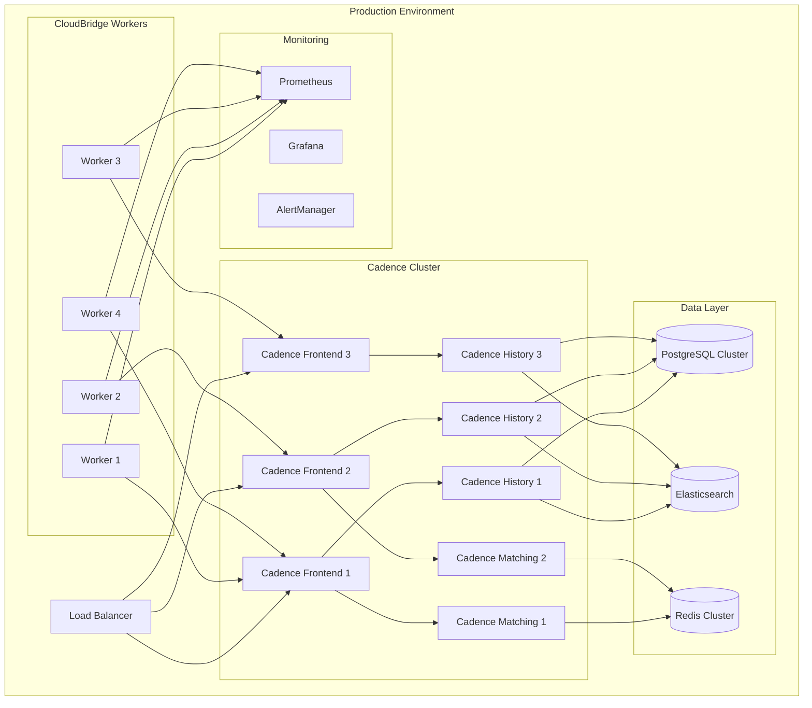

# 🚀 CloudBridge Relay - Cadence Deployment Guide

## 📋 Обзор

Данное руководство описывает процесс развертывания Cadence Workflow в CloudBridge Relay для различных сред: development, staging и production.

## 🏗️ Архитектура развертывания



## 🔧 Предварительные требования

### Системные требования

#### Minimum (Development)
- **CPU**: 2 cores
- **RAM**: 4 GB
- **Disk**: 20 GB SSD
- **Network**: 100 Mbps

#### Recommended (Staging)
- **CPU**: 4 cores
- **RAM**: 8 GB
- **Disk**: 50 GB SSD
- **Network**: 1 Gbps

#### Production
- **CPU**: 8+ cores per node
- **RAM**: 16+ GB per node
- **Disk**: 100+ GB NVMe SSD
- **Network**: 10+ Gbps

### Зависимости

#### Обязательные
- **Go**: 1.23+
- **Docker**: 20.10+
- **Docker Compose**: 2.0+
- **PostgreSQL**: 12+
- **Redis**: 6.0+

#### Опциональные
- **Kubernetes**: 1.25+
- **Helm**: 3.0+
- **Elasticsearch**: 7.0+
- **Prometheus**: 2.0+
- **Grafana**: 8.0+

## 📦 Установка Cadence Server

### Docker Compose (Development)

Создайте `docker-compose.cadence.yml`:

```yaml
version: '3.8'

services:
  # PostgreSQL для Cadence
  cadence-postgres:
    image: postgres:15
    environment:
      POSTGRES_DB: cadence
      POSTGRES_USER: cadence
      POSTGRES_PASSWORD: cadence
    ports:
      - "5432:5432"
    volumes:
      - cadence_postgres_data:/var/lib/postgresql/data
    networks:
      - cadence-network

  # Redis для Cadence
  cadence-redis:
    image: redis:7-alpine
    ports:
      - "6379:6379"
    volumes:
      - cadence_redis_data:/data
    networks:
      - cadence-network

  # Cadence Server
  cadence:
    image: ubercadence/server:1.2.9-auto-setup
    environment:
      - DB=postgres
      - DB_PORT=5432
      - POSTGRES_USER=cadence
      - POSTGRES_PWD=cadence
      - POSTGRES_SEEDS=cadence-postgres
      - DYNAMIC_CONFIG_FILE_PATH=config/dynamicconfig/development.yaml
      - ENABLE_VISIBILITY_ON_ES=false
    ports:
      - "7933:7933"  # Frontend gRPC
      - "7934:7934"  # Frontend membership
      - "7935:7935"  # History gRPC
      - "7936:7936"  # History membership
      - "7937:7937"  # Matching gRPC
      - "7938:7938"  # Matching membership
      - "7939:7939"  # Worker gRPC
      - "7940:7940"  # Worker membership
    depends_on:
      - cadence-postgres
      - cadence-redis
    networks:
      - cadence-network
    volumes:
      - ./config/cadence:/etc/cadence/config

  # Cadence Web UI
  cadence-web:
    image: ubercadence/web:v3.4.0
    environment:
      - CADENCE_TCHANNEL_PEERS=cadence:7933
      - CADENCE_WEB_PORT=8088
    ports:
      - "8088:8088"
    depends_on:
      - cadence
    networks:
      - cadence-network

volumes:
  cadence_postgres_data:
  cadence_redis_data:

networks:
  cadence-network:
    driver: bridge
```

Запуск:
```bash
# Запуск Cadence инфраструктуры
docker-compose -f docker-compose.cadence.yml up -d

# Проверка статуса
docker-compose -f docker-compose.cadence.yml ps

# Проверка логов
docker-compose -f docker-compose.cadence.yml logs cadence
```

### Kubernetes (Production)

#### Helm Chart

Создайте `values.yaml`:

```yaml
# values.yaml
cadence:
  server:
    replicaCount: 3
    
    image:
      repository: ubercadence/server
      tag: "1.2.9"
      
    resources:
      requests:
        cpu: 500m
        memory: 1Gi
      limits:
        cpu: 2000m
        memory: 4Gi
        
    config:
      persistence:
        default:
          driver: "sql"
          sql:
            driver: "postgres"
            host: "postgres.cadence.svc.cluster.local"
            port: 5432
            database: "cadence"
            user: "cadence"
            password: "cadence_password"
            
      redis:
        host: "redis.cadence.svc.cluster.local"
        port: 6379
        
  web:
    enabled: true
    replicaCount: 2
    
    image:
      repository: ubercadence/web
      tag: "v3.4.0"
      
  worker:
    enabled: true
    replicaCount: 4
    
    image:
      repository: cloudbridge/cadence-worker
      tag: "latest"
      
postgresql:
  enabled: true
  auth:
    postgresPassword: "postgres_password"
    database: "cadence"
    username: "cadence"
    password: "cadence_password"
    
  primary:
    persistence:
      enabled: true
      size: 100Gi
      storageClass: "fast-ssd"
      
redis:
  enabled: true
  architecture: replication
  
  master:
    persistence:
      enabled: true
      size: 50Gi
      storageClass: "fast-ssd"
```

Развертывание:
```bash
# Добавление Helm репозитория
helm repo add cadence https://cadenceworkflow.github.io/helm-charts

# Создание namespace
kubectl create namespace cadence

# Установка Cadence
helm install cadence cadence/cadence \
  --namespace cadence \
  --values values.yaml

# Проверка статуса
kubectl get pods -n cadence
kubectl get services -n cadence
```

## ⚙️ Конфигурация CloudBridge Worker

### Конфигурационный файл

Обновите `configs/cadence.yaml`:

```yaml
cadence:
  domain: "cloudbridge-relay"
  serviceName: "cloudbridge-cadence"
  
  client:
    hostPort: "cadence:7933"  # Development
    # hostPort: "cadence.cadence.svc.cluster.local:7933"  # Kubernetes
    domain: "cloudbridge-relay"
    dataConverter: "json"
    
  worker:
    maxConcurrentActivityExecutionSize: 1000
    maxConcurrentWorkflowTaskExecutionSize: 1000
    maxConcurrentLocalActivityExecutionSize: 1000
    maxTaskListActivitiesPerSecond: 100000
    taskListName: "cloudbridge-task-list"
    identity: "cloudbridge-worker-${HOSTNAME}"
    
  workflows:
    executionTimeout: "1h"
    decisionTimeout: "10s"
    activityStartToCloseTimeout: "5m"
    workflowStartToCloseTimeout: "1h"
    
  retry:
    initialInterval: "1s"
    maximumInterval: "10s"
    backoffCoefficient: 2.0
    maximumAttempts: 3
    
  logging:
    level: "info"
    enableStructuredLogging: true
    logWorkflowHistory: true
    
  metrics:
    enabled: true
    scope: "cloudbridge"
    reportingInterval: "30s"
    enablePrometheus: true
    prometheusPort: 9091
```

### Переменные окружения

```bash
# Production environment
export CADENCE_DOMAIN="cloudbridge-relay"
export CADENCE_HOST_PORT="cadence-frontend.cadence.svc.cluster.local:7933"
export CADENCE_WORKER_IDENTITY="cloudbridge-worker-${HOSTNAME}"
export CADENCE_TASK_LIST="cloudbridge-task-list"

# Logging
export LOG_LEVEL="info"
export LOG_FORMAT="json"

# Metrics
export PROMETHEUS_PORT="9091"
export METRICS_ENABLED="true"

# Security
export CADENCE_TLS_ENABLED="true"
export CADENCE_TLS_CERT_PATH="/etc/ssl/certs/cadence.crt"
export CADENCE_TLS_KEY_PATH="/etc/ssl/private/cadence.key"
```

## 🐳 Dockerfile для CloudBridge Worker

```dockerfile
# Build stage
FROM golang:1.23-alpine AS builder

WORKDIR /app
COPY go.mod go.sum ./
RUN go mod download

COPY . .
RUN CGO_ENABLED=0 GOOS=linux go build -a -installsuffix cgo -o cadence-worker cmd/cadence-worker/main.go

# Runtime stage
FROM alpine:3.18

RUN apk --no-cache add ca-certificates tzdata
WORKDIR /root/

# Copy binary
COPY --from=builder /app/cadence-worker .

# Copy configs
COPY --from=builder /app/configs ./configs

# Create non-root user
RUN addgroup -g 1001 -S cadence && \
    adduser -u 1001 -D -S -G cadence cadence

USER cadence

EXPOSE 9091

HEALTHCHECK --interval=30s --timeout=10s --start-period=5s --retries=3 \
  CMD wget --no-verbose --tries=1 --spider http://localhost:9091/health || exit 1

CMD ["./cadence-worker"]
```

## 🔐 Безопасность

### TLS/SSL конфигурация

```yaml
# configs/cadence-tls.yaml
cadence:
  client:
    enableTLS: true
    tlsCertPath: "/etc/ssl/certs/client.crt"
    tlsKeyPath: "/etc/ssl/private/client.key"
    tlsCAPath: "/etc/ssl/certs/ca.crt"
    serverName: "cadence.example.com"
    
  security:
    enableAuthorization: true
    authorizationProvider: "keycloak"
    enableAuditLogging: true
    enableEncryption: true
```

### RBAC для Kubernetes

```yaml
# rbac.yaml
apiVersion: v1
kind: ServiceAccount
metadata:
  name: cadence-worker
  namespace: cadence

---
apiVersion: rbac.authorization.k8s.io/v1
kind: ClusterRole
metadata:
  name: cadence-worker
rules:
- apiGroups: [""]
  resources: ["pods", "services", "configmaps"]
  verbs: ["get", "list", "watch"]
- apiGroups: ["apps"]
  resources: ["deployments", "replicasets"]
  verbs: ["get", "list", "watch", "update", "patch"]

---
apiVersion: rbac.authorization.k8s.io/v1
kind: ClusterRoleBinding
metadata:
  name: cadence-worker
subjects:
- kind: ServiceAccount
  name: cadence-worker
  namespace: cadence
roleRef:
  kind: ClusterRole
  name: cadence-worker
  apiGroup: rbac.authorization.k8s.io
```

### Network Policies

```yaml
# network-policy.yaml
apiVersion: networking.k8s.io/v1
kind: NetworkPolicy
metadata:
  name: cadence-network-policy
  namespace: cadence
spec:
  podSelector: {}
  policyTypes:
  - Ingress
  - Egress
  ingress:
  - from:
    - namespaceSelector:
        matchLabels:
          name: cadence
    ports:
    - protocol: TCP
      port: 7933
    - protocol: TCP
      port: 9091
  egress:
  - to:
    - namespaceSelector:
        matchLabels:
          name: cadence
  - to: []
    ports:
    - protocol: TCP
      port: 5432  # PostgreSQL
    - protocol: TCP
      port: 6379  # Redis
    - protocol: TCP
      port: 53    # DNS
    - protocol: UDP
      port: 53    # DNS
```

## 📊 Мониторинг и обсервабельность

### Prometheus конфигурация

```yaml
# prometheus-config.yaml
scrape_configs:
- job_name: 'cadence-server'
  static_configs:
  - targets: ['cadence:9090']
  scrape_interval: 15s
  metrics_path: /metrics

- job_name: 'cloudbridge-workers'
  kubernetes_sd_configs:
  - role: pod
    namespaces:
      names:
      - cadence
  relabel_configs:
  - source_labels: [__meta_kubernetes_pod_label_app]
    action: keep
    regex: cloudbridge-worker
  - source_labels: [__meta_kubernetes_pod_annotation_prometheus_io_port]
    action: replace
    target_label: __address__
    regex: (.+)
    replacement: ${1}:9091
```

### Grafana Dashboard

```json
{
  "dashboard": {
    "title": "CloudBridge Cadence Monitoring",
    "panels": [
      {
        "title": "Workflow Executions",
        "type": "graph",
        "targets": [
          {
            "expr": "rate(cadence_workflow_executions_total[5m])",
            "legendFormat": "{{workflow_type}} - {{status}}"
          }
        ]
      },
      {
        "title": "Activity Executions",
        "type": "graph",
        "targets": [
          {
            "expr": "rate(cadence_activity_executions_total[5m])",
            "legendFormat": "{{activity_type}} - {{status}}"
          }
        ]
      },
      {
        "title": "Worker Health",
        "type": "stat",
        "targets": [
          {
            "expr": "cadence_worker_connections",
            "legendFormat": "Active Workers"
          }
        ]
      }
    ]
  }
}
```

### Алерты

```yaml
# alerts.yaml
groups:
- name: cadence.rules
  rules:
  - alert: CadenceWorkflowFailureRate
    expr: rate(cadence_workflow_errors_total[5m]) > 0.05
    for: 2m
    labels:
      severity: warning
    annotations:
      summary: "High Cadence workflow failure rate"
      description: "Workflow failure rate is {{ $value }} errors per second"

  - alert: CadenceWorkerDown
    expr: up{job="cloudbridge-workers"} == 0
    for: 1m
    labels:
      severity: critical
    annotations:
      summary: "Cadence worker is down"
      description: "Cadence worker {{ $labels.instance }} has been down for more than 1 minute"

  - alert: CadenceQueueDepth
    expr: cadence_worker_queue_depth > 1000
    for: 5m
    labels:
      severity: warning
    annotations:
      summary: "High Cadence queue depth"
      description: "Queue depth is {{ $value }} on {{ $labels.instance }}"
```

## 🧪 Тестирование развертывания

### Health Checks

```bash
#!/bin/bash
# health-check.sh

echo "Checking Cadence Server health..."
curl -f http://cadence:8088/health || exit 1

echo "Checking CloudBridge Worker health..."
curl -f http://cloudbridge-worker:9091/health || exit 1

echo "Testing domain registration..."
cadence domain register --domain cloudbridge-relay || exit 1

echo "Testing workflow execution..."
cadence workflow start \
  --domain cloudbridge-relay \
  --task_list cloudbridge-task-list \
  --workflow_type HealthCheckWorkflow \
  --execution_timeout 60 \
  --input '{"component": "test"}' || exit 1

echo "All health checks passed!"
```

### Load Testing

```bash
#!/bin/bash
# load-test.sh

echo "Starting load test..."

# Запуск 100 workflows параллельно
for i in {1..100}; do
  cadence workflow start \
    --domain cloudbridge-relay \
    --task_list cloudbridge-task-list \
    --workflow_type PeerLifecycleWorkflow \
    --input "{\"peer_id\": \"test-peer-${i}\", \"operation\": \"add\"}" &
done

wait
echo "Load test completed!"
```

## 🔄 CI/CD Integration

### GitHub Actions

```yaml
# .github/workflows/cadence-deploy.yml
name: Deploy Cadence Workers

on:
  push:
    branches: [main]
    paths: ['internal/cadence/**']

jobs:
  test:
    runs-on: ubuntu-latest
    steps:
    - uses: actions/checkout@v3
    
    - uses: actions/setup-go@v3
      with:
        go-version: 1.23
        
    - name: Run Cadence tests
      run: |
        go test ./internal/cadence/... -v
        
  build:
    needs: test
    runs-on: ubuntu-latest
    steps:
    - uses: actions/checkout@v3
    
    - name: Build Docker image
      run: |
        docker build -t cloudbridge/cadence-worker:${{ github.sha }} .
        
    - name: Push to registry
      run: |
        docker push cloudbridge/cadence-worker:${{ github.sha }}
        
  deploy:
    needs: build
    runs-on: ubuntu-latest
    if: github.ref == 'refs/heads/main'
    steps:
    - name: Deploy to Kubernetes
      run: |
        helm upgrade cloudbridge-cadence ./helm/cadence \
          --set worker.image.tag=${{ github.sha }} \
          --namespace cadence
```

## 🔧 Troubleshooting

### Общие проблемы

#### 1. Worker не может подключиться к Cadence

**Симптомы**: 
- `connection refused` ошибки
- Worker не появляется в Cadence Web UI

**Решение**:
```bash
# Проверка сетевой связности
telnet cadence-server 7933

# Проверка DNS резолюции
nslookup cadence-server

# Проверка конфигурации
grep -A 5 "hostPort" configs/cadence.yaml
```

#### 2. Workflows не выполняются

**Симптомы**:
- Workflows остаются в состоянии `running`
- Activities не запускаются

**Решение**:
```bash
# Проверка task lists
cadence task-list describe --domain cloudbridge-relay --task_list cloudbridge-task-list

# Проверка worker регистрации
kubectl logs -l app=cloudbridge-worker

# Проверка метрик
curl http://worker:9091/metrics | grep cadence_worker
```

#### 3. Высокая задержка workflows

**Симптомы**:
- Workflows выполняются медленно
- Таймауты activities

**Решение**:
```bash
# Анализ метрик производительности
kubectl top pods -n cadence

# Проверка ресурсов базы данных
kubectl logs -l app=postgresql -n cadence

# Анализ Cadence метрик
curl http://cadence:9090/metrics | grep latency
```

### Диагностические команды

```bash
# Список доменов
cadence domain list

# Статус домена
cadence domain describe --domain cloudbridge-relay

# Список workflows
cadence workflow list --domain cloudbridge-relay

# Детали workflow
cadence workflow show --workflow_id <id> --run_id <run_id>

# Список task lists
cadence task-list list --domain cloudbridge-relay

# Worker информация
cadence task-list describe --domain cloudbridge-relay --task_list cloudbridge-task-list
```

## 📚 Дополнительные ресурсы

### Документация
- [Workflow Guide](./WORKFLOW_GUIDE.md)
- [Activities Guide](./ACTIVITIES_GUIDE.md)
- [Cadence Documentation](https://cadenceworkflow.io/docs/)
- [CloudBridge Architecture](../EDGE_ARCHITECTURE.md)

### Инструменты
- [Cadence CLI](https://github.com/uber/cadence/tree/master/tools/cli)
- [Cadence Web UI](https://github.com/uber/cadence-web)
- [Helm Charts](https://github.com/cadenceworkflow/helm-charts)

### Поддержка
- [GitHub Issues](https://github.com/twogc/cloudbridge-relay-installer/issues)
- [Cadence Community](https://cadenceworkflow.io/community)
- Email: support@cloudbridge.io

---

**🎯 Заключение**: Правильное развертывание Cadence критично для надежности CloudBridge Relay. Следуйте данному руководству и лучшим практикам для обеспечения стабильной работы системы.
