# 🔄 CloudBridge Relay - Cadence Workflows Guide

## 📋 Обзор

Данное руководство описывает все Cadence Workflows, реализованные в CloudBridge Relay для оркестрации критических операций системы.

## 🏗️ Архитектура Workflows

### Иерархия Workflows

```mermaid
graph TD
    A[CloudBridgeMainWorkflow] --> B[ModuleInitializationWorkflow]
    A --> C[HealthCheckWorkflow]
    A --> D[WireGuard Workflows]
    A --> E[Quantum Workflows]
    A --> F[AI Workflows]
    A --> G[Scaling Workflows]
    A --> H[Security Workflows]
    
    D --> D1[PeerLifecycleWorkflow]
    D --> D2[MeshTopologyWorkflow]
    D --> D3[ConnectionRecoveryWorkflow]
    D --> D4[LoadBalancingWorkflow]
    
    E --> E1[QuantumKeyRotationWorkflow]
    E --> E2[KeyValidationWorkflow]
    E --> E3[AlgorithmMigrationWorkflow]
    E --> E4[SecurityAuditWorkflow]
    
    F --> F1[ThreatAnalysisWorkflow]
    F --> F2[BehaviorMonitoringWorkflow]
    F --> F3[AutomatedResponseWorkflow]
    F --> F4[ModelTrainingWorkflow]
    
    G --> G1[AutoScalingWorkflow]
    G --> G2[ResourceOptimizationWorkflow]
    G --> G3[PerformanceMonitoringWorkflow]
    G --> G4[CapacityPlanningWorkflow]
    
    H --> H1[SecurityComplianceWorkflow]
    H --> H2[AuditLoggingWorkflow]
    H --> H3[IncidentResponseWorkflow]
    H --> H4[BackupRecoveryWorkflow]
```



## 🎯 Основные Workflows

### CloudBridgeMainWorkflow

**Описание**: Главный workflow, координирующий все операции CloudBridge Relay.

**Входные параметры**:
```go
type CloudBridgeMainWorkflowInput struct {
    Domain        string                 `json:"domain"`
    Configuration map[string]interface{} `json:"configuration"`
    StartTime     time.Time              `json:"start_time"`
}
```

**Основные функции**:
- Инициализация всех модулей системы
- Запуск дочерних workflows в фоновом режиме
- Непрерывный мониторинг системы
- Обработка команд управления через сигналы

**Жизненный цикл**:
1. Инициализация модулей через `ModuleInitializationWorkflow`
2. Запуск мониторинга здоровья через `HealthCheckWorkflow`
3. Запуск специализированных workflows для каждого компонента
4. Основной цикл мониторинга с обработкой сигналов
5. Graceful shutdown при получении команды остановки

### ModuleInitializationWorkflow

**Описание**: Workflow для инициализации модулей системы.

**Входные параметры**:
```go
type ModuleInitializationInput struct {
    ModuleName    string                 `json:"module_name"`
    Configuration map[string]interface{} `json:"configuration"`
    Dependencies  []string               `json:"dependencies"`
}
```

**Процесс инициализации**:
1. Проверка зависимостей модуля
2. Инициализация модуля с конфигурацией
3. Проверка здоровья инициализированного модуля
4. Возврат статуса инициализации

### HealthCheckWorkflow

**Описание**: Workflow для непрерывного мониторинга здоровья системы.

**Особенности**:
- Долгоживущий workflow (работает 24/7)
- Периодические проверки каждые 30 минут
- Проверка различных компонентов: core, network, security, performance
- Автоматическое вычисление health score

## 🌐 WireGuard Workflows

### PeerLifecycleWorkflow

**Описание**: Управление жизненным циклом WireGuard пиров.

**Поддерживаемые операции**:
- `add`: Добавление нового пира
- `remove`: Удаление пира
- `update`: Обновление конфигурации пира
- `monitor`: Непрерывный мониторинг пира

**Процесс добавления пира**:
1. Валидация конфигурации пира
2. Создание WireGuard интерфейса
3. Регистрация пира в системе
4. Проверка готовности к работе

### MeshTopologyWorkflow

**Описание**: Построение и управление mesh топологией WireGuard сети.

**Типы топологий**:
- `full_mesh`: Полная mesh сеть (каждый с каждым)
- `hub_spoke`: Hub-spoke топология
- `hybrid`: Гибридная топология

**Процесс построения**:
1. Анализ существующей топологии
2. Планирование новой топологии
3. Построение соединений согласно плану
4. Валидация и тестирование топологии

### ConnectionRecoveryWorkflow

**Описание**: Восстановление неудачных соединений в WireGuard сети.

**Стратегии восстановления**:
- `immediate`: Немедленное восстановление всех соединений параллельно
- `gradual`: Постепенное восстановление с задержками
- `scheduled`: Запланированное восстановление в оптимальное время

### LoadBalancingWorkflow

**Описание**: Балансировка нагрузки между WireGuard пирами.

**Стратегии балансировки**:
- `round_robin`: Круговая балансировка
- `least_connections`: По наименьшему количеству соединений
- `weighted`: Взвешенная балансировка
- `geographic`: Географическая балансировка

## 🔐 Quantum Workflows

### QuantumKeyRotationWorkflow

**Описание**: Автоматическая ротация квантовых ключей.

**Политики ротации**:
- `time_based`: По времени (например, каждые 30 дней)
- `usage_based`: По использованию (количество операций)
- `event_based`: По событиям (обнаружение угроз)

**Процесс ротации**:
1. Проверка необходимости ротации
2. Генерация нового квантового ключа
3. Валидация нового ключа
4. Постепенная замена старого ключа
5. Безопасное удаление старого ключа
6. Обновление ссылок в системе

### KeyValidationWorkflow

**Описание**: Валидация квантовых ключей.

**Типы валидации**:
- `integrity`: Проверка целостности ключей
- `security`: Проверка безопасности
- `compliance`: Проверка соответствия стандартам
- `performance`: Проверка производительности

### AlgorithmMigrationWorkflow

**Описание**: Миграция между квантовыми алгоритмами.

**Режимы миграции**:
- `immediate`: Немедленная миграция всех ключей
- `gradual`: Постепенная миграция с задержками
- `scheduled`: Запланированная миграция

### SecurityAuditWorkflow

**Описание**: Аудит безопасности квантовой криптографии.

**Области аудита**:
- `keys`: Аудит квантовых ключей
- `algorithms`: Аудит алгоритмов
- `protocols`: Аудит протоколов
- `compliance`: Аудит соответствия стандартам

## 🤖 AI Workflows

### ThreatAnalysisWorkflow

**Описание**: Анализ угроз с использованием машинного обучения.

**Типы анализа**:
- `realtime`: Анализ в реальном времени
- `batch`: Пакетный анализ
- `deep`: Глубокий анализ
- `predictive`: Предиктивный анализ

**Источники данных**:
- `logs`: Системные логи
- `network`: Сетевой трафик
- `behavior`: Поведение пользователей
- `external`: Внешние источники угроз

### BehaviorMonitoringWorkflow

**Описание**: Мониторинг поведения пользователей и аномалий.

**Периоды мониторинга**:
- `continuous`: Непрерывный мониторинг
- `periodic`: Периодический мониторинг
- `triggered`: Мониторинг по триггерам

### AutomatedResponseWorkflow

**Описание**: Автоматическое реагирование на угрозы.

**Политики реагирования**:
- `immediate`: Немедленное реагирование
- `escalated`: Эскалированное реагирование
- `manual_approval`: Реагирование с ручным подтверждением

**Типы действий**:
- `block`: Блокировка
- `quarantine`: Карантин
- `alert`: Оповещение
- `log`: Логирование

### ModelTrainingWorkflow

**Описание**: Обучение и переобучение AI моделей.

**Типы моделей**:
- `anomaly_detection`: Обнаружение аномалий
- `threat_classification`: Классификация угроз
- `behavior_analysis`: Анализ поведения

**Режимы обучения**:
- `full`: Полное обучение с нуля
- `incremental`: Инкрементальное обучение
- `transfer`: Трансферное обучение

## 📈 Scaling Workflows

### AutoScalingWorkflow

**Описание**: Автоматическое масштабирование ресурсов.

**Политики масштабирования**:
- `reactive`: Реактивное (на основе текущих метрик)
- `predictive`: Предиктивное (на основе прогнозов)
- `scheduled`: Запланированное масштабирование

**Типы ресурсов**:
- `compute`: Вычислительные ресурсы
- `memory`: Память
- `network`: Сетевые ресурсы
- `storage`: Хранилище

### ResourceOptimizationWorkflow

**Описание**: Оптимизация использования ресурсов.

**Типы оптимизации**:
- `cost`: Оптимизация стоимости
- `performance`: Оптимизация производительности
- `efficiency`: Оптимизация эффективности
- `hybrid`: Гибридная оптимизация

### PerformanceMonitoringWorkflow

**Описание**: Мониторинг производительности системы.

**Области мониторинга**:
- `system`: Системные метрики
- `application`: Метрики приложений
- `network`: Сетевые метрики
- `database`: Метрики базы данных

### CapacityPlanningWorkflow

**Описание**: Планирование емкости и ресурсов.

**Горизонты планирования**:
- `1m`: 1 месяц
- `3m`: 3 месяца
- `6m`: 6 месяцев
- `1y`: 1 год

## 🛡️ Security Workflows

### SecurityComplianceWorkflow

**Описание**: Проверка соответствия требованиям безопасности.

**Фреймворки соответствия**:
- `iso27001`: ISO 27001
- `soc2`: SOC 2
- `gdpr`: GDPR
- `pci_dss`: PCI DSS
- `nist`: NIST Framework

### AuditLoggingWorkflow

**Описание**: Аудит системы логирования.

**Типы анализа логов**:
- `realtime`: Анализ в реальном времени
- `batch`: Пакетный анализ
- `forensic`: Форензический анализ

### IncidentResponseWorkflow

**Описание**: Реагирование на инциденты безопасности.

**Фазы реагирования**:
1. **Analysis**: Анализ инцидента
2. **Containment**: Сдерживание
3. **Eradication**: Искоренение
4. **Recovery**: Восстановление
5. **Lessons Learned**: Извлечение уроков

### BackupRecoveryWorkflow

**Описание**: Резервное копирование и восстановление.

**Типы резервного копирования**:
- `full`: Полное резервное копирование
- `incremental`: Инкрементальное
- `differential`: Дифференциальное
- `snapshot`: Снимки

## 🔧 Лучшие практики

### Детерминированность Workflows

1. **Не используйте `time.Now()`** - используйте `workflow.Now(ctx)`
2. **Не используйте `time.Sleep()`** - используйте `workflow.Sleep(ctx, duration)`
3. **Не используйте горутины** - используйте `workflow.Go(ctx, func)`
4. **Не используйте `range` по maps** - порядок итерации недетерминирован

### Обработка ошибок

```go
// Правильно
err := workflow.ExecuteActivity(ctx, activity, params).Get(ctx, &result)
if err != nil {
    logger.Error("Activity failed", zap.Error(err))
    return nil, err
}

// Неправильно
workflow.ExecuteActivity(ctx, activity, params).Get(ctx, &result) // Игнорирование ошибки
```

### Использование логирования

```go
// Правильно
logger := workflow.GetLogger(ctx)
logger.Info("Starting workflow", zap.String("workflow_id", workflowID))

// Неправильно
log.Println("Starting workflow") // Не воспроизводимо при replay
```

### Конфигурация timeouts

```go
activityOptions := workflow.ActivityOptions{
    StartToCloseTimeout: 10 * time.Minute,
    HeartbeatTimeout:    30 * time.Second,
    RetryPolicy: &workflow.RetryPolicy{
        InitialInterval:    time.Second,
        BackoffCoefficient: 2.0,
        MaximumInterval:    time.Minute,
        MaximumAttempts:    3,
    },
}
```

## 📊 Мониторинг Workflows

### Метрики

Все workflows автоматически экспортируют следующие метрики:

- `cadence_workflow_executions_total`: Общее количество выполнений
- `cadence_workflow_duration_seconds`: Длительность выполнения
- `cadence_workflow_errors_total`: Количество ошибок
- `cadence_active_workflows`: Количество активных workflows

### Алерты

Рекомендуемые алерты:

```yaml
- alert: WorkflowFailureRate
  expr: rate(cadence_workflow_errors_total[5m]) > 0.05
  labels:
    severity: warning
  annotations:
    summary: "High workflow failure rate"

- alert: WorkflowLatency
  expr: cadence_workflow_duration_seconds > 300
  labels:
    severity: critical
  annotations:
    summary: "Workflow execution too slow"
```

## 🔍 Отладка Workflows

### Просмотр истории выполнения

```bash
# Через Cadence CLI
cadence workflow show --workflow_id <workflow_id> --run_id <run_id>

# Через Cadence Web UI
http://localhost:8088
```

### Логирование

Все workflows используют структурированное логирование с контекстом:

```go
logger.Info("Workflow step completed",
    zap.String("workflow_type", "PeerLifecycleWorkflow"),
    zap.String("peer_id", peerID),
    zap.String("operation", "add"),
    zap.Duration("duration", duration),
)
```

## 📚 Дополнительные ресурсы

- [Cadence Documentation](https://cadenceworkflow.io/docs/)
- [Activities Guide](./ACTIVITIES_GUIDE.md)
- [Deployment Guide](./DEPLOYMENT_GUIDE.md)
- [CloudBridge Architecture](../EDGE_ARCHITECTURE.md)

---

**📝 Примечание**: Данное руководство описывает workflows на уровне дизайна. Конкретные параметры и поведение могут изменяться в зависимости от версии и конфигурации системы.
