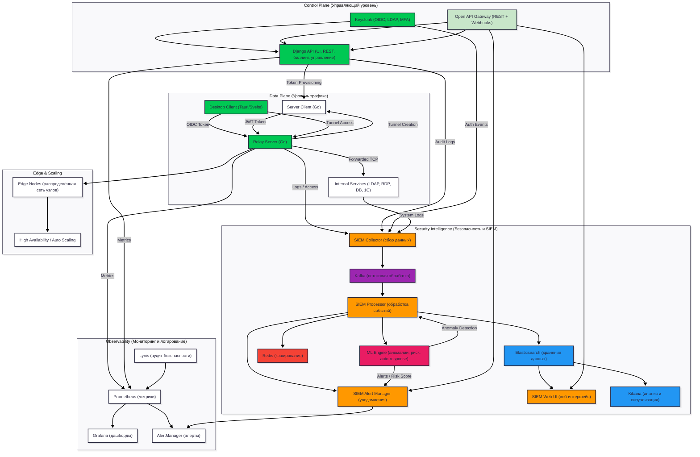

# 🏗️ Архитектура CloudBridge Relay + SIEM

## Диаграмма архитектуры



## 📊 Компоненты SIEM системы

### 🔍 **SIEM Collector**
- Сбор данных из CloudBridge Relay
- Сбор событий аутентификации из Keycloak
- Сбор системных логов
- Отправка данных в Kafka

### ⚙️ **SIEM Processor**
- Обработка событий безопасности
- Детекция угроз (brute force, подозрительные IP)
- Обогащение данных (геолокация, информация об IP)
- Сохранение в Elasticsearch

### 🚨 **SIEM Alert Manager**
- Генерация уведомлений
- Поддержка Telegram, Email, Slack
- Дедупликация и фильтрация
- Эскалация инцидентов

### 🌐 **SIEM Web UI**
- Веб-интерфейс для управления
- Дашборды и статистика
- API для интеграций
- Мониторинг здоровья системы

### 💾 **Хранилище данных**
- **Elasticsearch** - основное хранилище событий
- **Kibana** - анализ и визуализация
- **Kafka** - потоковая обработка
- **Redis** - кэширование и сессии

### 🤖 **ML Engine**
- Анализ аномалий
- Оценка рисков
- Автоматические ответы
- Поведенческий анализ

## 🔗 Интеграции

### **Внутренние интеграции**
- CloudBridge Relay - логи туннелей и аутентификации
- Keycloak - события аутентификации и авторизации
- Django API - аудит и метрики
- Prometheus - метрики производительности

### **Внешние интеграции**
- Telegram - мгновенные уведомления
- Email - детальные отчеты
- Slack - командные уведомления
- Webhook - интеграция с внешними системами

## 🛡️ Безопасность

### **Соответствие требованиям**
- ✅ 152-ФЗ "О персональных данных"
- ✅ 187-ФЗ "О безопасности критической информационной инфраструктуры"
- ✅ ГОСТ Р 57580.1-2017
- ✅ ГОСТ Р 57580.2-2017

### **Функции безопасности**
- Шифрование данных в покое и в движении
- Аудит всех действий
- Многофакторная аутентификация
- Ротация ключей и сертификатов

## 📈 Масштабируемость

### **Горизонтальное масштабирование**
- Множественные экземпляры коллекторов
- Кластеризация Elasticsearch
- Партиционирование Kafka
- Балансировка нагрузки

### **Высокая доступность**
- Репликация данных
- Автоматическое восстановление
- Мониторинг здоровья
- Резервное копирование

## 🚀 Развертывание

### **Docker Compose**
```bash
cd siem
./start_siem.sh
```

### **Kubernetes**
```bash
kubectl apply -f k8s/
```

### **Мониторинг**
- Prometheus метрики
- Grafana дашборды
- Логирование в Elasticsearch
- Алерты через AlertManager 