# CloudBridge Relay - Глобальная архитектурная диаграмма

## Полная архитектура системы в одной диаграмме

```mermaid
graph TB
    subgraph "CENTRAL CONTROL PLANE"
        subgraph "AUTHENTICATION & AUTHORIZATION"
            Z[Zitadel IdP<br/>User Management<br/>JWT/OAuth2/OIDC<br/>RBAC Policies]
            JWT[JWT Validation<br/>Token Verification<br/> Session Management]
        end
        
        subgraph "⚙️ ORCHESTRATION & WORKFLOW"
            C[⚙️ Cadence Hub<br/> Workflow Engine<br/>Task Orchestration<br/> Auto-scaling]
            WF[ Workflows<br/>Edge Management<br/> Auto-scaling<br/>Performance]
        end
        
        subgraph "💾 DATA & CACHE"
            P[🗄️ PostgreSQL<br/>💾 State Database<br/>Metrics Storage<br/>Analytics]
            R[Redis<br/>Cache Layer<br/>Real-time Data<br/> Session Store]
        end
        
        subgraph "MONITORING & OBSERVABILITY"
            PROM[Prometheus<br/>Metrics Collection<br/>Query Engine<br/>Alerting]
            GRAF[Grafana<br/>Dashboards<br/>Visualization<br/>Analytics]
            AM[AlertManager<br/>📧 Notifications<br/>🔔 Alerts<br/>📱 PagerDuty]
        end
        
        subgraph "SECURITY & COMPLIANCE"
            SBOM[SBOM Scanner<br/>Supply Chain<br/>Vulnerability Check]
            COSIGN[Cosign<br/>📝 Artifact Signing<br/>Verification]
            MTLS[mTLS Manager<br/>Certificate Rotation<br/> Auto-renewal]
        end
    end
    
    subgraph " EDGE RELAY NODES"
        subgraph " MOSCOW PoP (RU-MOW)"
            M1[QUIC Server<br/>Port: 443/UDP<br/>MASQUE/QUIC<br/>Multi-tenant]
            M2[WireGuard<br/>Port: 51820/UDP<br/> P2P Connections<br/>Direct Links]
            M3[ TURN Server<br/>Port: 3478/UDP<br/>NAT Traversal<br/>ICE/STUN/TURN]
            M4[IPAM Agent<br/> O1 Allocation<br/>Tenant Isolation<br/>Performance]
            M5[Prometheus Metrics<br/>Health Checks<br/>Performance Data<br/>Real-time]
        end
        
        subgraph " FRANKFURT PoP (EU-FRA)"
            F1[QUIC Server<br/>Port: 443/UDP<br/>MASQUE/QUIC<br/>Multi-tenant]
            F2[WireGuard<br/>Port: 51820/UDP<br/> P2P Connections<br/>Direct Links]
            F3[ TURN Server<br/>Port: 3478/UDP<br/>NAT Traversal<br/>ICE/STUN/TURN]
            F4[IPAM Agent<br/> O1 Allocation<br/>Tenant Isolation<br/>Performance]
            F5[Prometheus Metrics<br/>Health Checks<br/>Performance Data<br/>Real-time]
        end
        
        subgraph " NEW YORK PoP (US-NYC)"
            N1[QUIC Server<br/>Port: 443/UDP<br/>MASQUE/QUIC<br/>Multi-tenant]
            N2[WireGuard<br/>Port: 51820/UDP<br/> P2P Connections<br/>Direct Links]
            N3[ TURN Server<br/>Port: 3478/UDP<br/>NAT Traversal<br/>ICE/STUN/TURN]
            N4[IPAM Agent<br/> O1 Allocation<br/>Tenant Isolation<br/>Performance]
            N5[Prometheus Metrics<br/>Health Checks<br/>Performance Data<br/>Real-time]
        end
    end
    
    subgraph "🤖 AI/ML INTELLIGENCE LAYER"
        subgraph "🧠 SMART ROUTING ENGINE"
            SRE[Smart Routing Engine<br/>Traffic Analysis<br/> Dynamic Routing<br/>Optimization]
            RO[ Route Optimizer<br/>Path Selection<br/>Cost Optimization<br/>Performance]
            CM[Cost Matrix<br/> Cost Calculation<br/>Metrics Analysis<br/>Optimization]
        end
        
        subgraph "ANALYTICS & PREDICTION"
            AI[🤖 AI Engine<br/>Machine Learning<br/>Pattern Recognition<br/>Predictive Analytics]
            PM[Prometheus Client<br/>Metrics Collection<br/>Data Analysis<br/>Real-time]
            CC[ Cadence Client<br/> Workflow Execution<br/>Task Management<br/> Automation]
        end
    end
    
    subgraph "CLIENT LAYER"
        subgraph "💻 CLIENTS"
            C1[💻 Client A<br/>Moscow<br/>QUIC Connection<br/>Secure Tunnel]
            C2[💻 Client B<br/>Frankfurt<br/>QUIC Connection<br/>Secure Tunnel]
            C3[💻 Client C<br/>New York<br/>QUIC Connection<br/>Secure Tunnel]
        end
        
        subgraph "ANYCAST/DNS"
            ANY[Anycast BGP<br/>GeoDNS Steering<br/>Latency-based<br/> Load Balancing]
            DNS[ GeoDNS<br/>Location-based<br/>Performance<br/> Failover]
        end
    end
    
    subgraph "INTER-POP MESH NETWORK"
        subgraph "MESH CONNECTIVITY"
            MESH[Inter-PoP Mesh<br/>MASQUE/QUIC<br/>Multi-tenant<br/> Load Balancing]
            CONTEXT[Context Multiplexing<br/> Per-tenant Contexts<br/>Flow Management<br/> Dynamic Routing]
        end
        
        subgraph " ROUTING POLICIES"
            IS[Ingress Selection<br/>Anycast BGP<br/> GeoDNS Steering<br/>Latency-based]
            IP_R[Inter-PoP Routing<br/>RTT/Loss/Jitter<br/> Load Balancing<br/>Cost Optimization]
            EP_R[Egress Routing<br/>Destination Mapping<br/>Dynamic Adjustment<br/>Quality Metrics]
            TQ[Tenant QoS/Quota<br/>Per-tenant Limits<br/> Rate Limiting<br/>Billing Metrics]
        end
    end
    
    subgraph "EXTERNAL CONNECTIVITY"
        subgraph " ORIGIN SERVERS"
            O1[ DC London<br/>UK<br/>Origin Server<br/>Content Delivery]
            O2[ SaaS US-East<br/>USA<br/>Cloud Service<br/>Application Server]
            O3[ DC Frankfurt<br/>EU<br/>Origin Server<br/>Content Delivery]
        end
    end
    
    %% Control Plane to Edge connections
    Z -.->|API| M1
    C -.->|API| M1
    P -.->|API| M1
    R -.->|API| M1
    
    Z -.->|API| F1
    C -.->|API| F1
    P -.->|API| F1
    R -.->|API| F1
    
    Z -.->|API| N1
    C -.->|API| N1
    P -.->|API| N1
    R -.->|API| N1
    
    %% AI/ML connections
    SRE --> RO
    SRE --> CM
    SRE --> AI
    AI --> PM
    AI --> CC
    
    %% Client connections
    C1 -->|Anycast| M1
    C2 -->|Anycast| F1
    C3 -->|Anycast| N1
    
    %% Inter-PoP mesh connections
    M1 <==>|MESH| F1
    F1 <==>|MESH| N1
    N1 <==>|MESH| M1
    
    %% Egress connections
    M1 -->|Egress| O1
    F1 -->|Egress| O2
    N1 -->|Egress| O3
    
    %% Monitoring connections
    M5 --> PROM
    F5 --> PROM
    N5 --> PROM
    
    PROM --> GRAF
    PROM --> AM
    
    %% Security connections
    SBOM --> M1
    SBOM --> F1
    SBOM --> N1
    
    COSIGN --> M1
    COSIGN --> F1
    COSIGN --> N1
    
    MTLS --> M1
    MTLS --> F1
    MTLS --> N1
    
    %% Styling
    classDef control fill:#e3f2fd,stroke:#1976d2,stroke-width:3px,color:#000
    classDef auth fill:#f3e5f5,stroke:#7b1fa2,stroke-width:2px,color:#000
    classDef orchestration fill:#e8f5e8,stroke:#388e3c,stroke-width:2px,color:#000
    classDef data fill:#fff3e0,stroke:#f57c00,stroke-width:2px,color:#000
    classDef monitoring fill:#fce4ec,stroke:#c2185b,stroke-width:2px,color:#000
    classDef security fill:#e0f2f1,stroke:#00695c,stroke-width:2px,color:#000
    classDef moscow fill:#fff3e0,stroke:#f57c00,stroke-width:2px,color:#000
    classDef frankfurt fill:#fce4ec,stroke:#c2185b,stroke-width:2px,color:#000
    classDef newyork fill:#e0f2f1,stroke:#00695c,stroke-width:2px,color:#000
    classDef ai fill:#f3e5f5,stroke:#7b1fa2,stroke-width:2px,color:#000
    classDef client fill:#e8f5e8,stroke:#388e3c,stroke-width:2px,color:#000
    classDef mesh fill:#fff3e0,stroke:#f57c00,stroke-width:2px,color:#000
    classDef origin fill:#fce4ec,stroke:#c2185b,stroke-width:2px,color:#000
    
    class Z,JWT auth
    class C,WF orchestration
    class P,R data
    class PROM,GRAF,AM monitoring
    class SBOM,COSIGN,MTLS security
    class M1,M2,M3,M4,M5 moscow
    class F1,F2,F3,F4,F5 frankfurt
    class N1,N2,N3,N4,N5 newyork
    class SRE,RO,CM,AI,PM,CC ai
    class C1,C2,C3,ANY,DNS client
    class MESH,CONTEXT,IS,IP_R,EP_R,TQ mesh
    class O1,O2,O3 origin
```

## Ключевые компоненты архитектуры:

### **Central Control Plane**
- **Authentication**: Zitadel IdP, JWT validation
- **⚙️ Orchestration**: Cadence Hub, Workflows
- **💾 Data**: PostgreSQL, Redis
- **Monitoring**: Prometheus, Grafana, AlertManager
- **Security**: SBOM, Cosign, mTLS

### **Edge Relay Nodes**
- ** Moscow PoP**: RU-MOW region
- ** Frankfurt PoP**: EU-FRA region  
- ** New York PoP**: US-NYC region
- **Services**: QUIC, WireGuard, TURN, IPAM, Metrics

### **AI/ML Intelligence**
- **🧠 Smart Routing**: Route optimization, Cost matrix
- **Analytics**: AI engine, Predictive analytics
- ** Automation**: Cadence workflows, Auto-scaling

### **Client Layer**
- **💻 Clients**: Multi-platform, Secure tunnels
- **Anycast/DNS**: GeoDNS, Latency-based routing

### **Inter-PoP Mesh**
- **Mesh Network**: MASQUE/QUIC, Multi-tenant
- ** Routing Policies**: Ingress, Inter-PoP, Egress, QoS

### **External Connectivity**
- ** Origin Servers**: Global content delivery
- **Performance**: Optimized routing, Quality metrics

## **Преимущества архитектуры:**

1. **Глобальная масштабируемость** - Multi-region deployment
2. **🤖 AI-оптимизация** - Smart routing и predictive analytics
3. **Zero-trust безопасность** - mTLS, SBOM, Cosign
4. **Multi-tenancy** - Полная изоляция арендаторов
5. **Полная наблюдаемость** - SLO, метрики, алерты
6. ** Автоматическое масштабирование** - Dynamic load management
7. ** Географическая оптимизация** - Location-based routing
8. **Kubernetes-native** - Современная оркестрация

**CloudBridge Relay - это современная, интеллектуальная и масштабируемая платформа для P2P mesh networking с глобальной архитектурой и AI-оптимизацией.**
