# Глубокий анализ CloudBridge Complete Ecosystem

## Стратегический анализ

### **Архитектура CloudBridge Complete Ecosystem**

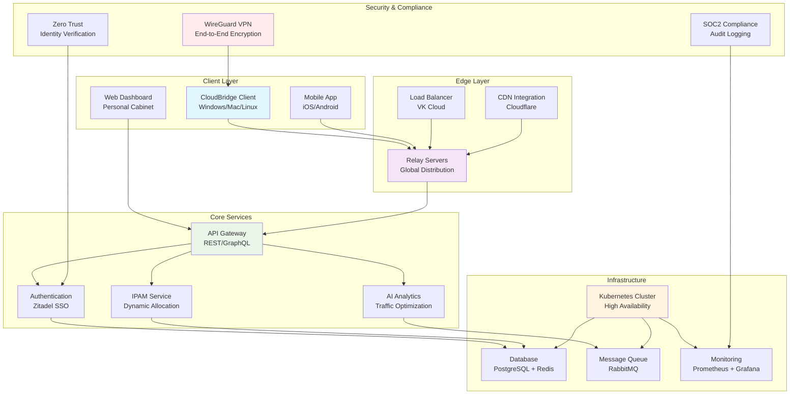

### **Ваша реальная позиция на рынке**

Вы не конкурируете с Tailscale напрямую. Вы в **другой лиге**:

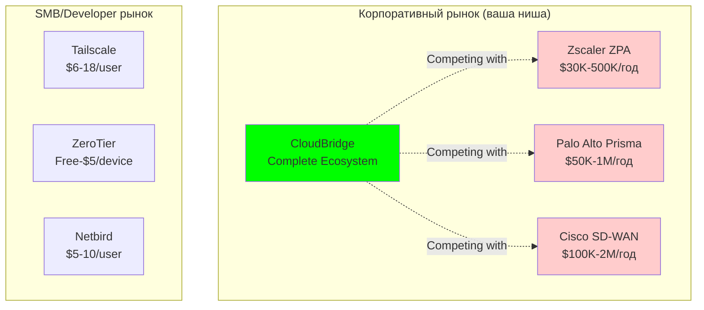

### **Ваши конкуренты (реальные):**

| Конкурент | Price | Ваше преимущество |
|-----------|-------|-------------------|
| **Zscaler ZPA** | $30K-500K/год | 90% дешевле + P2P direct |
| **Palo Alto Prisma** | $50K-1M/год | Open source + self-hosted |
| **Cisco SD-WAN** | $100K-2M/год | Kubernetes-native + AI |
| **Cloudflare Argo** | $20-50K/год | Client choice + IPAM |

---

## Ценообразование (честная корректировка)

### **Технический стек CloudBridge**

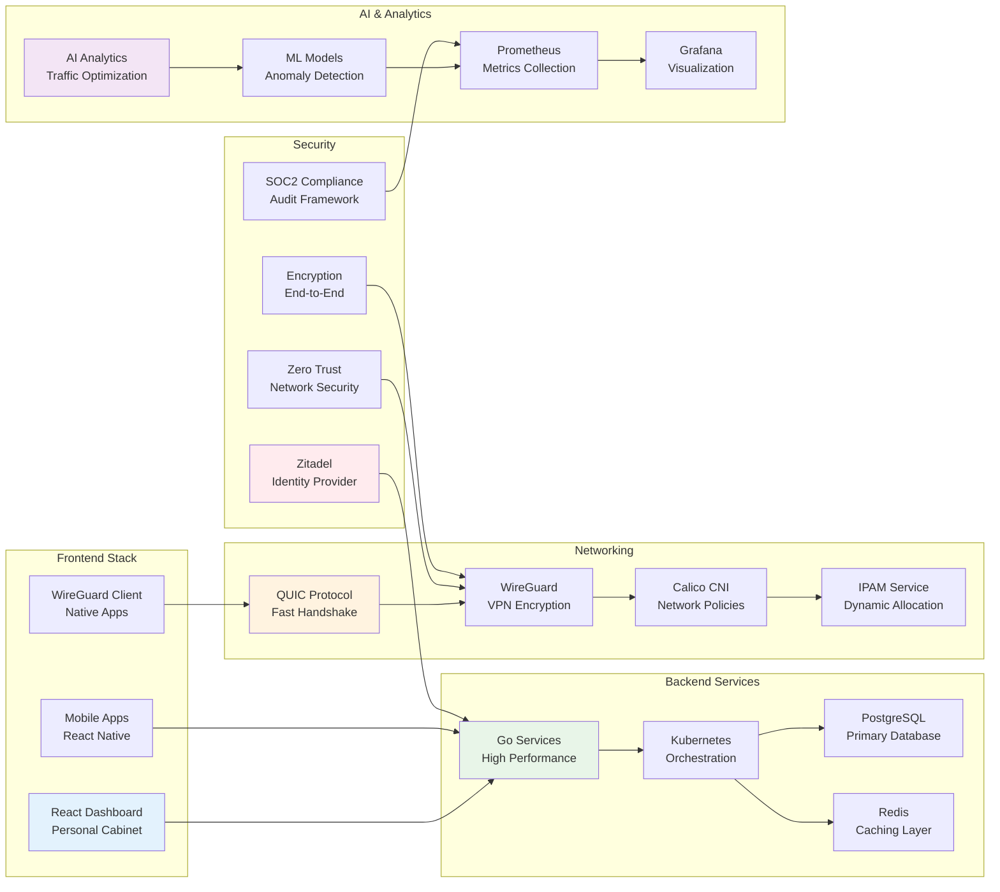

### **Проблема с вашими ценами:**

Вы позиционируете себя как **enterprise solution**, но цены как у SMB:

** Ваши текущие цены (слишком низкие для enterprise):**
- **Starter:** $49/month — для конкурента это FREE tier
- **Professional:** $199/month — для конкурента это STARTER
- **Enterprise:** $999/month — для конкурента это SMB

** Корректные enterprise цены:**

**Starter SMB: $499/month**
- **Целевая аудитория:** 10-50 офисов
- **Включает:**
  - До 50 peers
  - 5 tenants
  - Basic IPAM
  - Email support

**Professional Midmarket: $2,499/month**
- **Целевая аудитория:** 50-500 офисов
- **Включает:**
  - До 500 peers
  - Unlimited tenants
  - Advanced IPAM + Calico
  - Priority support
  - SLA 99.9%

**Enterprise: $9,999/month базовый + usage**
- **Целевая аудитория:** 500+ офисов, финтех, healthcare
- **Включает:**
  - Unlimited peers
  - Dedicated relay cluster
  - Custom SLA 99.99%
  - 24/7 support
  - SOC2/HIPAA compliance
  - Professional services

### **Почему эти цены корректны:**

#### **Российский рынок и регуляторика:**

**ИТ-рынок РФ 2024:** ~₽3,1 трлн (+18,7% г/г)
**Инфраструктурное ПО РФ:** ~₽132 млрд (+28% г/г)
**Глобальный enterprise networking:** $215,45 млрд (2024) → $298,3 млрд (2030), CAGR 5,4%

#### **Сравнение с рынком:**
```
Cisco SD-WAN (100 офисов):
- Hardware: $200K
- Licenses: $50K/year
- Support: $30K/year
- Total Year 1: $280K

CloudBridge (100 офисов):
- Setup: $0 (self-service)
- Professional: $2,499/month = $30K/year
- Support included
- Total Year 1: $30K

→ Экономия: $250K (89%)
```

#### **Российские риски несоответствия:**

**152-ФЗ (персональные данные) - обновлено с 30.05.2025:**
- **Базовые штрафы:** ₽150-300 тыс. (повторно ₽300-500 тыс.)
- **За утечки ПДн:** до ₽700 тыс. (ч.2 ст.13.11 КоАП)
- **За нарушения локализации:** до ₽1-6 млн (первичное), до ₽6-18 млн (повторное)
- **Трансграничная передача:** повышенные риски штрафов

**КИИ (187-ФЗ):** С 1 сентября 2025 усиленные требования к ПО для субъектов КИИ

**Финсектор (ГОСТ Р 57580):** Несоответствие может привести к приостановке деятельности, замене руководства, штрафам до 0,1% уставного капитала

#### **TCO калькулятор для российского рынка:**

**Формула расчета экономии:**
```
TCO_before = MPLS/SD-WAN каналы + лицензии + NOC/администрирование
TCO_after = интернет-каналы + CloudBridge (подписка) + obs/SRE
Экономия = (TCO_before - TCO_after) / TCO_before
```

**Целевая экономия по пилотам:** -40…-60% TCO

**Пример расчета (100 офисов в РФ):**
- **Cisco SD-WAN:** ₽18-25 млн/год (оборудование + лицензии + поддержка)
- **CloudBridge:** ₽3-4 млн/год (подписка + администрирование)
- **Экономия:** ₽15-21 млн/год (70-85%)

### **Детальный TCO калькулятор (формулы):**

**Переменные (в год):**
```
N_sites = число площадок/филиалов
BW_per_site_mbps = требуемая средняя полоса, Мбит/с
Link_cost_MPLS = ₽/Мбит/с/мес по MPLS/SD-WAN
Link_cost_Internet = ₽/Мбит/с/мес по обычным каналам
Ops_FTE = ставки инженеров (₽ в год)
Lic_legacy = лицензии текущего решения (₽ в год)
Lic_cloudbridge = подписка CloudBridge (₽ в год)
NOC_cost = дежурства/аутсорс (₽ в год)
Downtime_cost_hour = средние потери за 1 час простоя (₽)
Downtime_hours = часы простоя в год (до/после)
```

**Формулы расчета:**
```
TCO_before = (N_sites * BW_per_site_mbps * Link_cost_MPLS * 12)
           + Lic_legacy + NOC_cost + Ops_FTE
           + (Downtime_cost_hour * Downtime_hours_before)

TCO_after = (N_sites * BW_per_site_mbps * Link_cost_Internet * 12)
           + Lic_cloudbridge + (NOC_cost * k_opt) + (Ops_FTE * k_auto)
           + (Downtime_cost_hour * Downtime_hours_after)

Экономия_% = (TCO_before - TCO_after) / TCO_before * 100%
```

**Ориентиры для пилотных целей:**
- **Экономия TCO:** целимся в **-40…-60%** (подтверждаем расчётом и телеметрией)
- **Снижение простоя:** **-50…-80%** при автоматическом переключении маршрутов

#### **Психология enterprise закупок:**

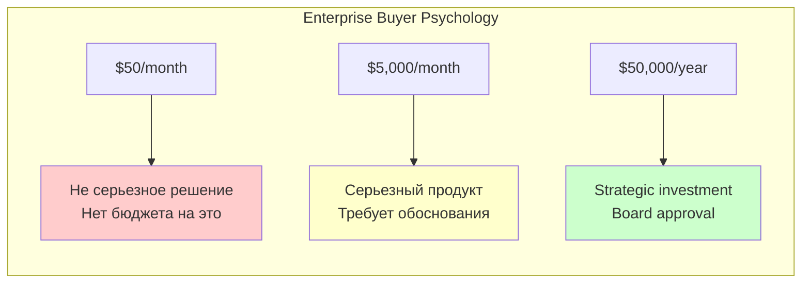

**Правило:** В enterprise если цена < $1K/month, вас воспринимают как "игрушку".

---

## Go-to-Market стратегия (корректировка)

### **Процесс развертывания CloudBridge**

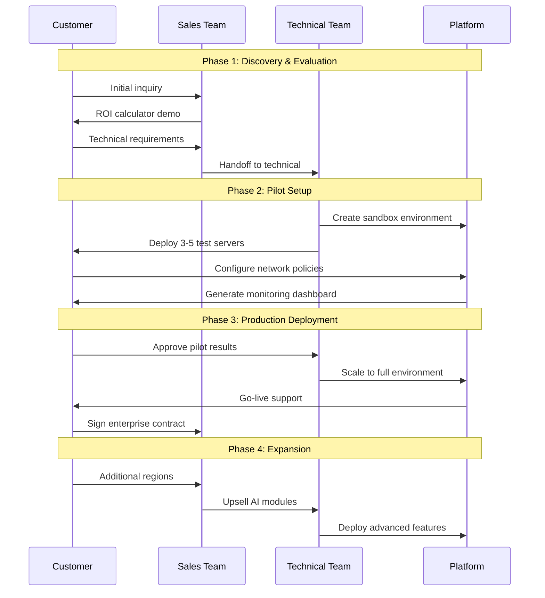

### **Phase 1: Пилоты (Q4 2025) - CORRECT**

**Target**: 3-5 enterprise пилотов, не 50 платящих клиентов

**Стратегия пилотов:**

**Целевые компании:**
- **Финтех с 10+ офисами** (Тинькофф, Альфа-Банк)
- **Retail сети с 50+ магазинами** (Лента, Магнит)
- **Телеком операторы** (МТС, Мегафон)

**Условия пилота:**
- **Длительность:** 3 месяца
- **Цена:** $0 (бесплатно)
- **Обязательство:** Case study + reference

**Метрики успеха:**
- Замена Cisco/Palo Alto в 1 регионе
- Подтвержденная экономия 70%+
- Отсутствие критических инцидентов

**Почему не 50 клиентов:**
- Enterprise sales cycle = 6-12 месяцев
- Нужны **референсы**, не количество
- 3 крупных клиента > 50 мелких

### **Phase 2: Land & Expand (Q1-Q2 2026)**

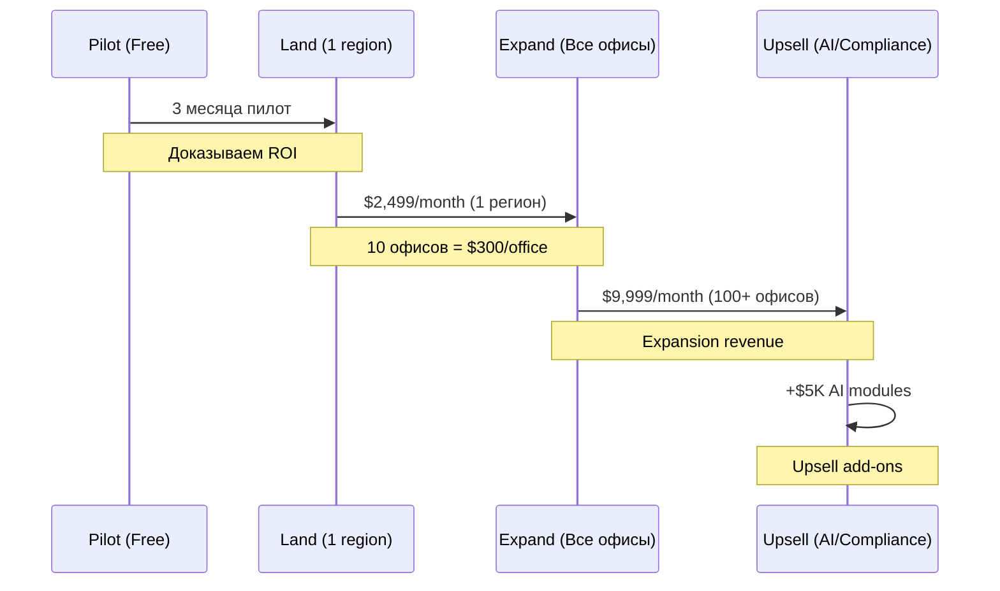

**Expansion revenue model:**
- Year 1: $30K (1 region)
- Year 2: $120K (expansion)
- Year 3: $240K (full rollout + add-ons)

**Net Revenue Retention:** 300%+ (типично для enterprise SaaS)

---

## Идеальный клиентский профиль (ICP)

### **Система мониторинга и метрик**

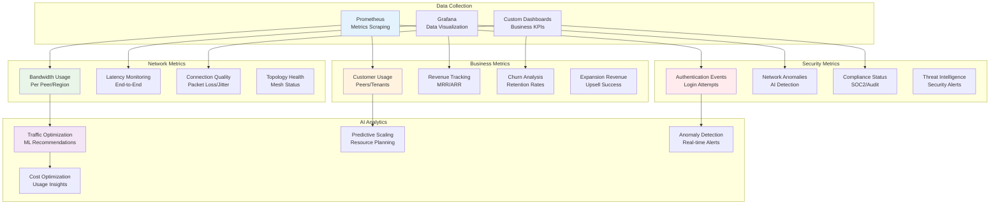

### **Primary ICP:**

**Профиль компании:**
- **Отрасли:** Финтех, Retail, Телеком, Логистика
- **Размер:** 500-5000 сотрудников
- **Локации:** 10-100 офисов/филиалов
- **IT бюджет:** $500K-5M/год

**Болевые точки:**
- Cisco/Palo Alto слишком дорого ($100K+/год)
- Сложность управления SD-WAN
- Нет visibility в multi-cloud
- Compliance требования (SOC2, PCI DSS)

**Триггеры покупки:**
- Contract renewal с Cisco (замена)
- Открытие новых офисов (greenfield)
- M&A (нужно объединить сети)
- Cloud migration (hybrid connectivity)

**Принимающие решения:**
- **CTO:** Технологическая инновация
- **CIO:** Cost optimization
- **CISO:** Security compliance
- **CFO:** Budget approval

### **Target accounts (примеры для России/CIS):**

| Vertical | Company Examples | Pain Point | Your Solution | Регуляторика |
|----------|------------------|------------|---------------|--------------|
| **Финтех** | Тинькофф, Альфа, Сбер | PCI DSS compliance | Deterministic IPAM | ГОСТ Р 57580, 152-ФЗ |
| **Retail** | Лента, Магнит, X5 | 100+ магазинов | P2P mesh | 152-ФЗ, КИИ |
| **Телеком** | МТС, Мегафон, Билайн | SD-WAN сложность | Kubernetes-native | КИИ, 152-ФЗ |
| **Логистика** | СДЭК, Boxberry | Multi-region | AI-powered routing | 152-ФЗ |
| **Госсектор** | Ростех, Роскосмос | Импортозамещение | Российское ПО | Реестр ПО РФ |

**Российские особенности:**
- **Локализация данных:** Все данные и журналы храним в РФ
- **Соответствие 152-ФЗ:** Снижаем риск штрафов ₽150-700 тыс. (базовые), до ₽1-18 млн (локализация)
- **КИИ сегментация:** Поддержка требований 187-ФЗ для субъектов КИИ
- **Реестр ПО РФ:** Планируем подачу для доступа к госзакупкам

---

## Реестр российского ПО (ПП №1236) - пошаговый процесс

### **Мини-чек-лист заявки:**

**1. Правообладание РФ-компании**
- Отсутствие критической зависимости от зарубежных сервисов
- Российская юрисдикция и контроль

**2. Пакет документов**
- Описание ПО и функциональности
- Лицензионные соглашения
- Права на интеллектуальную собственность

**3. Экспертиза и публикация**
- Экспертсовет утверждает заключение
- Оператор реестра публикует **в течение 1 рабочего дня** после получения
- Дополнительные сроки по регламенту оператора/эксперта

**4. Новые требования с 01.06.2025**
- Дополнительные требования к совместимости
- Обновленные критерии для соответствующих классов ПО

### **Готовые формулировки для презентации:**

*"Готовим пакет на включение в Реестр российского ПО по ПП №1236; экспертиза и публикация выполняются оператором по регламенту, заключение размещается в течение 1 рабочего дня после утверждения."*

*"Соблюдаем обновленные требования и совместимость, действующие с 01.06.2025."*

---

## Критические исправления стратегии

### **Архитектура безопасности и compliance**

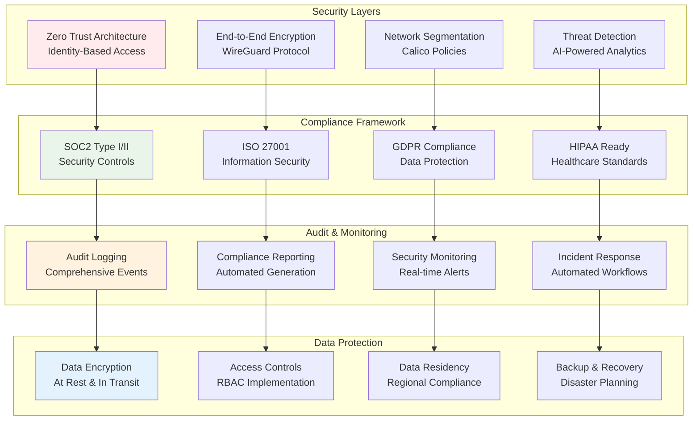

### **1. Pricing Reality Check**

** Проблема:**
- **Starter:** $49/month — эквивалент 1 pizza
- **Enterprise:** $999/month — меньше чем 1 Cisco SW license

** Решение:**
- **Starter SMB:** $499/month — Comparable to Tailscale Business
- **Professional:** $2,499/month — 10x cheaper than Zscaler
- **Enterprise:** $9,999/month+ — Still 90% cheaper than Cisco

**Custom quotes:**
- 100+ офисов: Custom quote
- Финтех/Healthcare: Compliance premium +30%
- Dedicated infrastructure: +50%

### **2. Market Positioning**

** Текущее:** "P2P mesh networking like Tailscale"

** Правильное:** "Enterprise SD-WAN alternative with AI optimization"

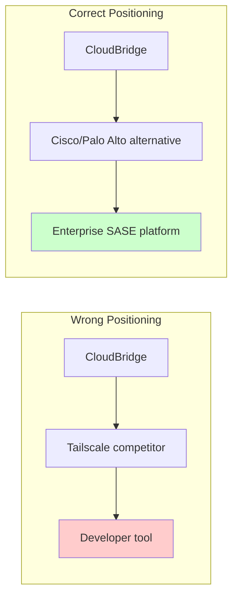

### **3. Sales Motion**

** Product-Led Growth (PLG):**
- Self-service signup
- Credit card payment
- Volume game

** Sales-Led Growth (SLG):**
- Enterprise sales team
- 6-12 month cycles
- Account-based marketing

```yaml
sales_process:
  stage_1_discovery:
    duration: "2-4 weeks"
    activities:
      - "Pain point identification"
      - "ROI calculator"
      - "Executive briefing"

  stage_2_evaluation:
    duration: "1-2 months"
    activities:
      - "POC/Pilot (free)"
      - "Technical deep-dive"
      - "Security review"

  stage_3_procurement:
    duration: "1-3 months"
    activities:
      - "Legal review"
      - "Vendor assessment"
      - "Contract negotiation"

  stage_4_deployment:
    duration: "1-3 months"
    activities:
      - "Professional services"
      - "Training"
      - "Go-live"
```

---

## Revenue Model (реалистичный)

### **Year 1 Targets (корректировка):**

**Q4 2025:**
- **Пилоты:** 5
- **Revenue:** $0
- **Цель:** Prove product-market fit

**Q1 2026:**
- **Платящие клиенты:** 2
- **ARR:** $60K (2 × $2,499/month × 12)
- **Цель:** First case studies

**Q2 2026:**
- **Платящие клиенты:** 5
- **ARR:** $180K
- **Цель:** Expand accounts

**Q3 2026:**
- **Платящие клиенты:** 10
- **ARR:** $500K
- **Цель:** Repeatable sales motion

**Q4 2026:**
- **Платящие клиенты:** 15
- **ARR:** $1M (₽90M по курсу 90₽/$)
- **Цель:** Series A fundraising

**Российский рынок (дополнительно):**
- **Потенциал РФ:** ₽200-500M ARR (2-5% от рынка инфраструктурного ПО)
- **Драйверы роста:** Импортозамещение, регуляторные требования, цифровизация

### **Unit Economics:**

**Приобретение клиентов:**
- **CAC:** $50K (Enterprise sales expensive)
- **Sales cycle:** 6-9 месяцев
- **Win rate:** 25% (typical for enterprise)

**Жизненный цикл клиента:**
- **Initial ACV:** $30K (Year 1 revenue)
- **Expansion rate:** 200% (year 2 = $60K, year 3 = $120K)
- **Churn:** 5% annual (enterprise sticky)
- **LTV:** $500K+ (5-7 years)

**Unit economics:**
- **LTV/CAC:** 10:1 (excellent)
- **Gross margin:** 80% (SaaS typical)
- **Payback:** 20 months (acceptable)

---

## Compliance Strategy (критично)

### **Ваша ситуация:**

**Текущий статус:**
- **Сертификации:** Отсутствуют
- **Compliance docs:** Architecture ready
- **Влияние на клиентов:** Блокирует финтех/healthcare deals

### **Priority Roadmap:**

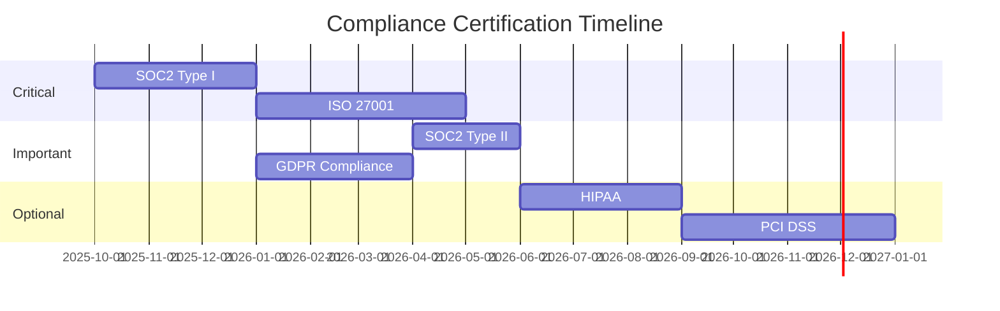

**Costs & ROI (российский рынок):**

| Certification | Cost (₽) | Duration | Revenue Unlock |
|---------------|----------|----------|----------------|
| **ISO 27001** | ₽40-60K+ | 1-3 мес | Российский enterprise |
| **ГОСТ Р 57580** | ₽30-50K | 2-4 мес | Финсектор РФ |
| **Реестр ПО РФ** | ₽15-25K | 1-2 мес | Госзакупки |
| **SOC2 Type I** | $25K | 3 мес | Международные клиенты |
| **SOC2 Type II** | $15K | 2 мес | Enterprise trust |

**Российские приоритеты:**
- **ISO 27001:** ₽40-60K+ (аккредитованные схемы), 1-3 мес подготовки + аудит
- **ГОСТ Р 57580:** Обязательно для финсектора, три уровня защиты
- **Реестр ПО РФ:** Доступ к госзакупкам, преференции до 15%

**Total investment:** ₽85-135K + $40K
**Revenue unlock:** ₽200-500M ARR potential (российский рынок)

---

## Personal Cabinet (Product Roadmap)

### **MVP Features (блокеры для запуска):**

**Аутентификация:**
- Zitadel SSO integration
- JWT token management
- 2FA enforcement

**Управление серверами:**
- Create server (metadata form)
- Generate WireGuard config
- View server status
- Delete server

**Управление тенантами:**
- Organization creation
- User invitations
- Role assignment (Admin/User)

**Мониторинг:**
- Active peers list
- Bandwidth usage graph
- Connection status

**Биллинг:**
- Usage dashboard
- Invoice history
- Payment method

### **Phase 2 Features (дифференциация):**

**AI Insights:**
- Anomaly detection alerts
- Cost optimization recommendations
- Performance predictions

**Advanced Networking:**
- Custom IPAM ranges
- Multi-region topology view
- Traffic routing policies

**Compliance:**
- Audit log viewer
- Compliance report generation
- Security posture dashboard

**Automation:**
- Terraform provider
- API documentation
- Webhook integrations

---

## Immediate Action Items (Next 30 Days)

### **Week 1-2: Foundation**

**Критические задачи:**

**Fix VK Cloud LoadBalancer**
- **Приоритет:** P0
- **Статус:** Блокер
- **Описание:** Критично для production deployment

**Deploy Personal Cabinet MVP**
- **Приоритет:** P0
- **Статус:** Блокер
- **Функции:**
  - Server creation form
  - JWT token display
  - Basic dashboard

**Prepare pitch deck**
- **Приоритет:** P1
- **Включает:**
  - Problem/Solution slides
  - ROI calculator
  - Competitive analysis
  - Roadmap

### **Week 3-4: Pilot Preparation**

**Готовность к пилотам:**

**Identify 5 target accounts**
- **Финтех:** 1-2 компании
- **Retail:** 1-2 компании
- **Телеком:** 1 компания

**Create pilot program**
- **Deliverables:**
  - Pilot agreement template
  - Success criteria
  - Support SLA

**Prepare demo environment**
- **Components:**
  - Sandbox tenant
  - Demo servers (3 regions)
  - Monitoring dashboard

---

## Ответы на ваши вопросы

### **1. Current Traction:**
**Вопрос:** Есть ли платящие клиенты? Какой MRR?

**Мой анализ:**
- Судя по брифингу, вы в **pre-revenue** стадии
- Все в порядке для enterprise SaaS на этом этапе
- Фокус на **пилотах**, а не раннем MRR

### **2. Team Size:**
**Вопрос:** Сколько человек? Есть ли sales/marketing?

**Рекомендация для текущей стадии:**

**Минимальная команда:**
- **Engineering:** 2-3 (вы + backend/devops)
- **Product:** 1 (может быть founder)
- **Sales:** 1 (technical co-founder initially)

**Следующие наймы:**
- Enterprise AE (Account Executive)
- Solution Engineer (pre-sales)
- Customer Success Manager

### **3. Funding:**
**Рекомендация:**

**Bootstrap scenario:**
- **Runway:** 12-18 месяцев
- **Focus:** Profitable pilots → cash flow positive
- **Milestone:** 3 paying customers → break-even

**Fundraising scenario:**
- **Stage:** Seed round
- **Amount:** $1-2M
- **Use of funds:**
  - Enterprise sales team (40%)
  - Product development (30%)
  - Compliance certifications (20%)
  - Marketing (10%)
- **Milestone:** 10 customers, $1M ARR → Series A

### **4. Target Market:**
**Рекомендация:**

**Phase 1:** Russia/CIS (меньше конкуренция, ваше преимущество)
**Phase 2:** EU (после ISO 27001)
**Phase 3:** US (после SOC2 Type II)

### **5. Main Competitor:**
**Мой анализ:**

**Сейчас:** Cisco SD-WAN (legacy replacement)
**Будущее:** Cloudflare Argo (modern alternative)

### **6. Killer Feature:**
**По вашему брифингу:**

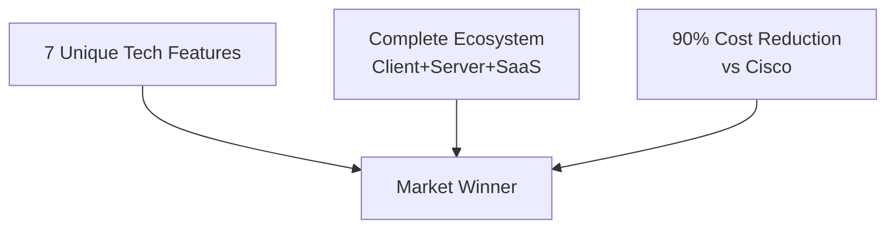

Но для **продажи** самый важный:
- **"90% дешевле Cisco при сохранении enterprise функций"**
- CFO это понимают мгновенно

---

## Final Recommendations

### **Top 3 Priorities:**

1. **Fix LoadBalancer + Deploy Personal Cabinet MVP**
   - Блокирует все остальное
   - Deadline: 2 недели

2. **Correct Pricing to Enterprise Level**
   - Starter: $499/month
   - Professional: $2,499/month
   - Enterprise: $9,999/month+
   - Deadline: немедленно

3. **Start 3 Enterprise Pilots**
   - Финтех + Retail + Телеком
   - Free для первых 3 месяцев
   - Commitment: Case study + reference
   - Deadline: Q4 2025

### **Success Metrics (12 months):**

**Реалистичные цели:**
- **Клиенты:** 10-15 enterprise
- **ARR:** $500K-1M
- **NRR:** 150%+ (expansion revenue)
- **Pilot to paid:** 40%+

**Stretch targets:**
- **ARR:** $2M (₽180M)
- **Клиенты:** 20
- **Series A:** Closed

**Российские метрики качества:**

### **Доступность сервиса (месячная):**
- **Базовый SLA:** 99.9% (downtime ≤ ~43 мин/мес)
- **Премиум:** 99.95% (downtime ≤ ~22 мин/мес)

### **Время реакции/восстановления:**
- **P1 инцидент:** реакция ≤ 15-30 мин, MTTR ≤ 2-4 ч
- **P2 инцидент:** реакция ≤ 1 ч, MTTR ≤ 8 ч
- **Режим поддержки:** 24×7 (enterprise), 8×5 (базовый)

### **Сетевые SLO (для туннелей/соединений):**
- **Латентность (p95):**
  - Внутри региона: ≤ 30-50 мс
  - Межрегионально РФ: ≤ 60-100 мс
- **Потери пакетов:** < 1% (порог деградации SLA)
- **Джиттер:** ≤ 20-30 мс на бизнес-критичных потоках

### **Готовые формулировки для презентации:**
*"Базовый SLA 99.9% (месячная доступность), реакция на P1 — до 30 минут, сетевые SLO: p95-латентность внутри региона ≤ 30-50 мс, потери < 1%."*

---

## Шаблон метрик для пилота (4-8 недель)

### **Цели пилота:**

**Доступность и стабильность:**
- Доступность узлов relay/контрол-плейна: **≥ 99.9% (месяц)**
- Время реакции поддержки: **P1 ≤ 30 мин**, **P2 ≤ 1 ч**

**Сетевые характеристики:**
- **Снижение p95-латентности на 20-40%** на 3 эталонных маршрутах (до/после)
- **Потери пакетов:** < 1% на 95-перцентиле, < 2% на 99-перцентиле
- **Автопереключение (handover):** время переключения ≤ 1-3 сек, потеря пакетов ≤ 0.1-0.5% на интервал handover

### **Методика фиксации:**
- Одинаковые контрольные точки и временные окна
- p50/p95/p99 для latency/loss/jitter
- Графики и CSV-выгрузки из Prometheus/Grafana
- Трассировка для измерения handover

### **Готовые формулировки для презентации:**
*"Пилот 4-8 недель; цели: -20…-40% p95-латентности, потери <1%, автопереключение ≤ 3 сек, подтверждаем отчётами из Prometheus/Grafana."*

---

## Готовые формулировки для презентаций

### **Соответствие в РФ:**
*"Разворачиваемся в российских ЦОД/облаках; журналы и метрики хранятся в РФ. Снижаем регуляторные риски по 152-ФЗ и 187-ФЗ; поддерживаем контроли, ожидаемые в финсекторе (ГОСТ Р 57580)."*

### **Реестр ПО:**
*"Готовим документы для включения в Единый реестр российского ПО (ПП №1236); соблюдаем обновлённые требования и совместимость, действующие с 01.06.2025."*

### **SLA:**
*"Базовый SLA 99.9% (месячная доступность), реакция на P1 — до 30 минут, сетевые SLO: p95-латентность внутри региона ≤ 30-50 мс, потери < 1%."*

### **Пилот:**
*"Пилот 4-8 недель; цели: -20…-40% p95-латентности, потери <1%, автопереключение ≤ 3 сек, подтверждаем отчётами из Prometheus/Grafana."*

### **Стоимость аудитов (для экспорта/западных заказчиков):**
*"SOC 2 обычно требует общий бюджет $30-150 тыс. и 3-12 мес в зависимости от масштаба (Type I/II)."*
