# Архитектура Edge-развертывания CloudBridge Relay

## Обзор проекта CloudBridge

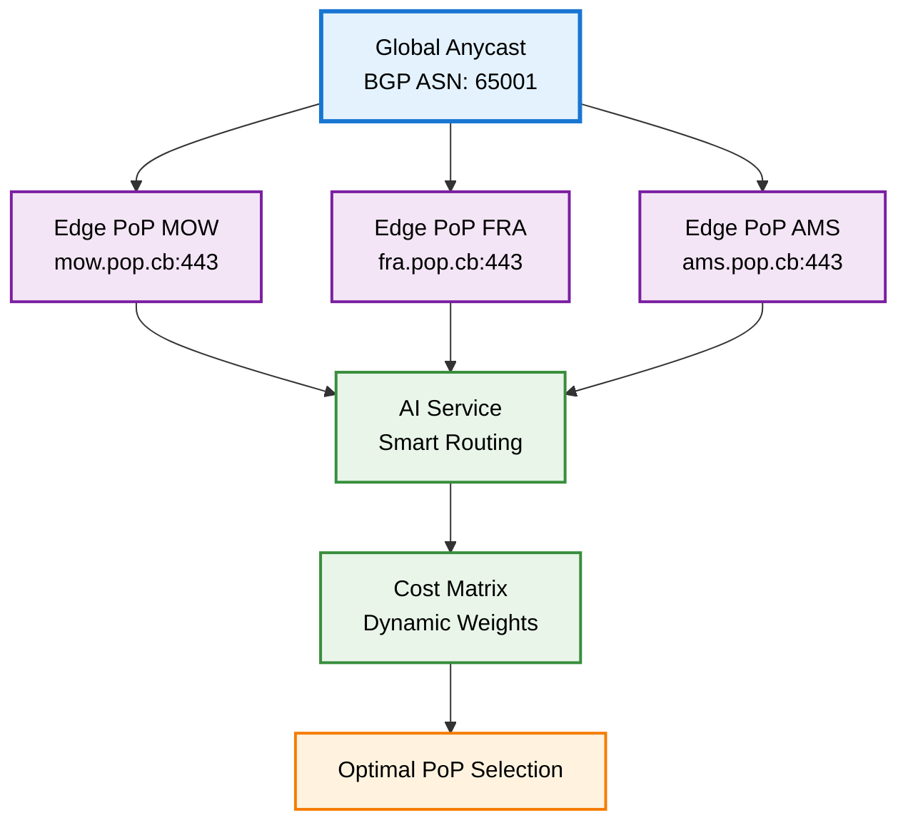

**CloudBridge** - это enterprise-grade P2P mesh networking platform с AI-оптимизированной маршрутизацией, которая обеспечивает:

- **Global Anycast** с BGP ASN 65001 для оптимальной маршрутизации
- **Edge PoP** в Moscow, Frankfurt, Amsterdam для глобального покрытия
- **AI Service** для умной маршрутизации и оптимизации трафика
- **Cost Matrix** с динамическими весами на основе реальных метрик
- **Optimal PoP Selection** для выбора лучшего маршрута

---

## Общая архитектура Edge-сети

### 1. **Централизованная архитектура управления**

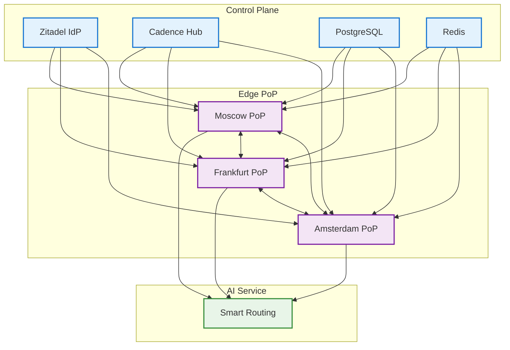

### 2. **Zitadel - Единственный IdP**

**Архитектурное решение**: Централизованный Zitadel IdP для всех relay серверов

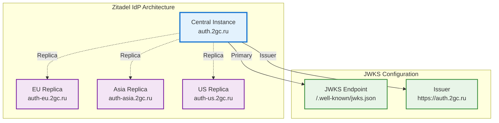

**Преимущества централизованного Zitadel**:
- Единая система аутентификации
- ентрализованное управление пользователями
- диная политика безопасности
- прощенное управление ролями и правами

### 3. **Централизованная система управления через Cadence**

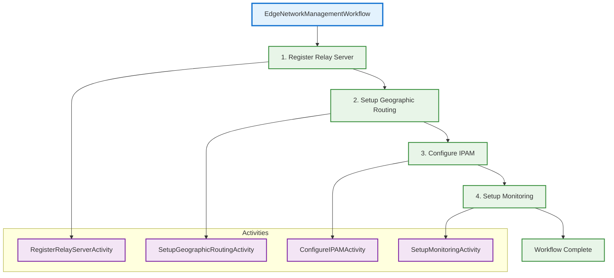

## Географическая маршрутизация и координация

### 1. **Умная маршрутизация на основе геолокации**

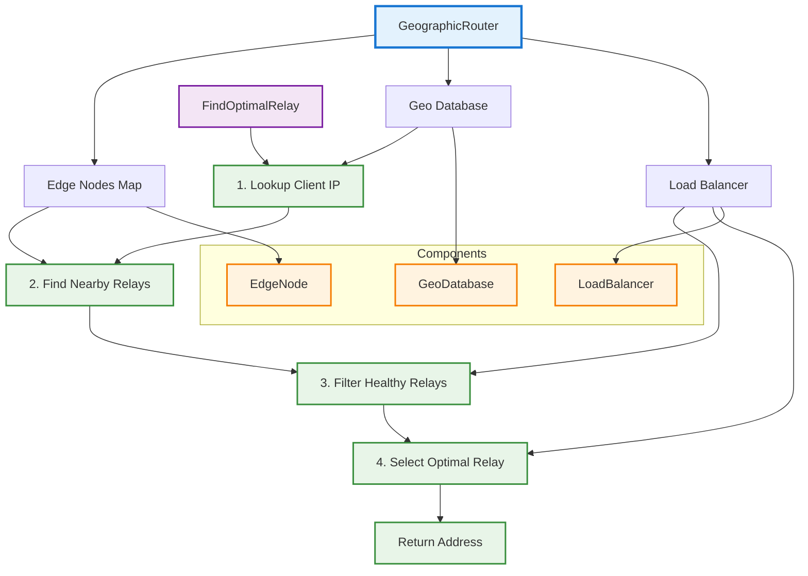

### 2. **Координация между relay серверами**

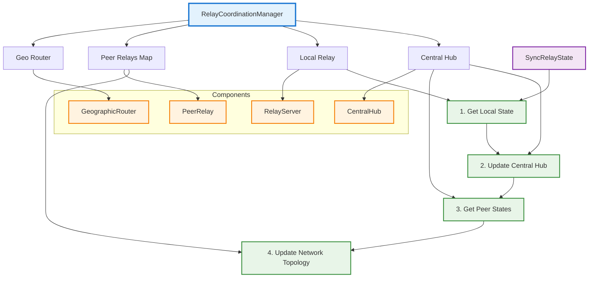

## Центральный пункт управления (Control Plane)

### 1. **Архитектура Control Plane**

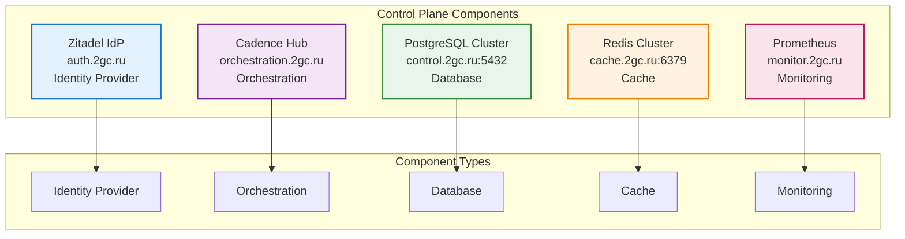

### 2. **API для управления relay серверами**

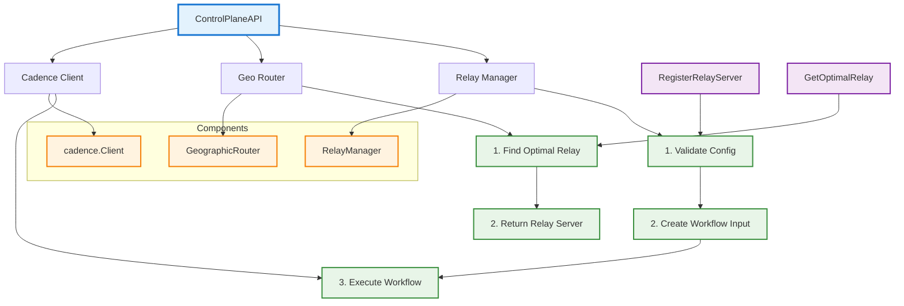

## Система координации и обмена данными

### 1. **Протокол обмена между relay серверами**

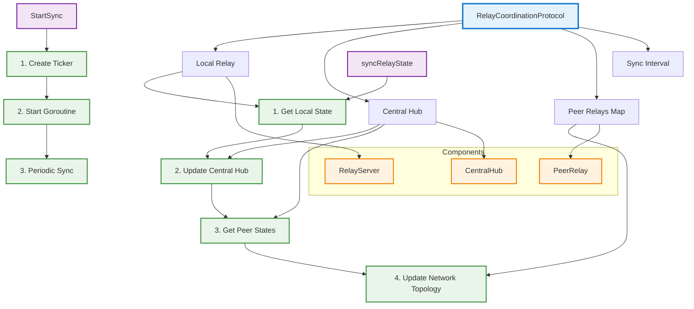

### 2. **Умная маршрутизация трафика**

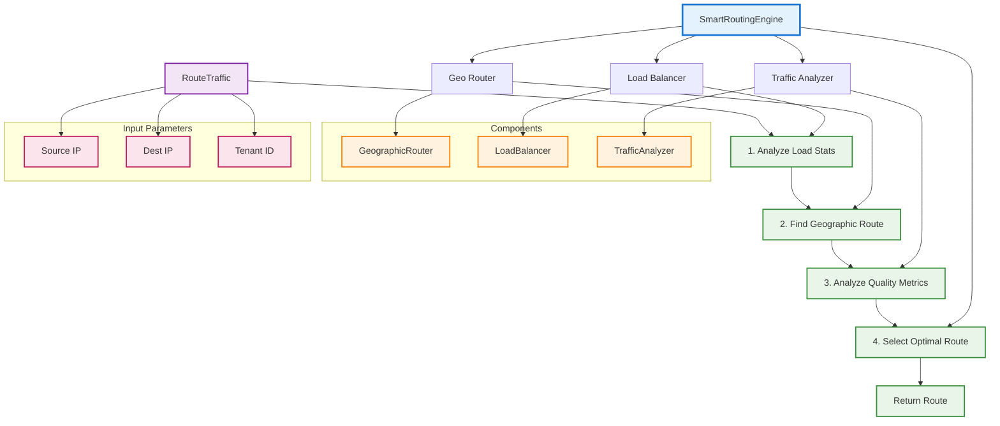

## Мониторинг и управление

### 1. **Централизованный мониторинг**

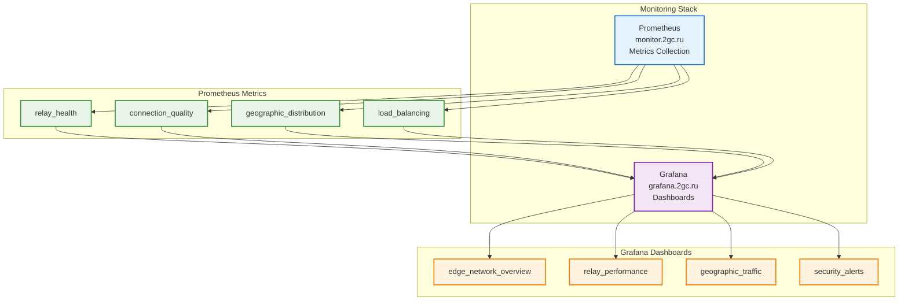

### 2. **Автоматическое масштабирование**

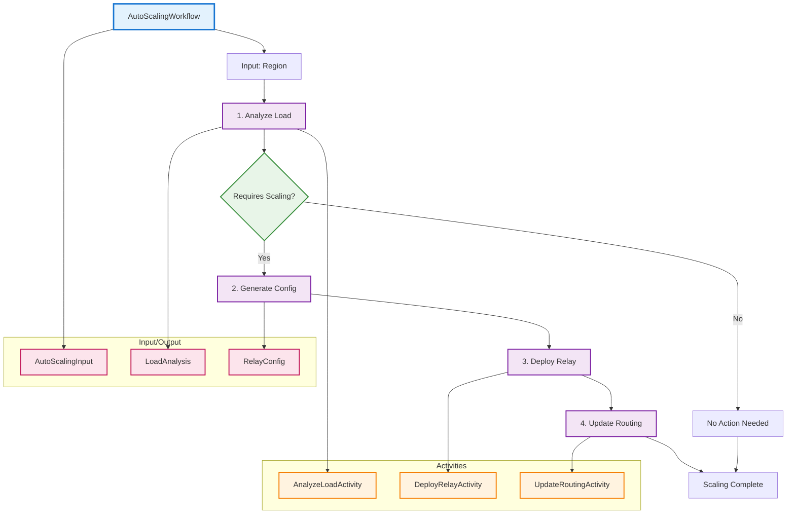

## План развертывания Edge-сети

### 1. **Этап 1: Централизованная инфраструктура**

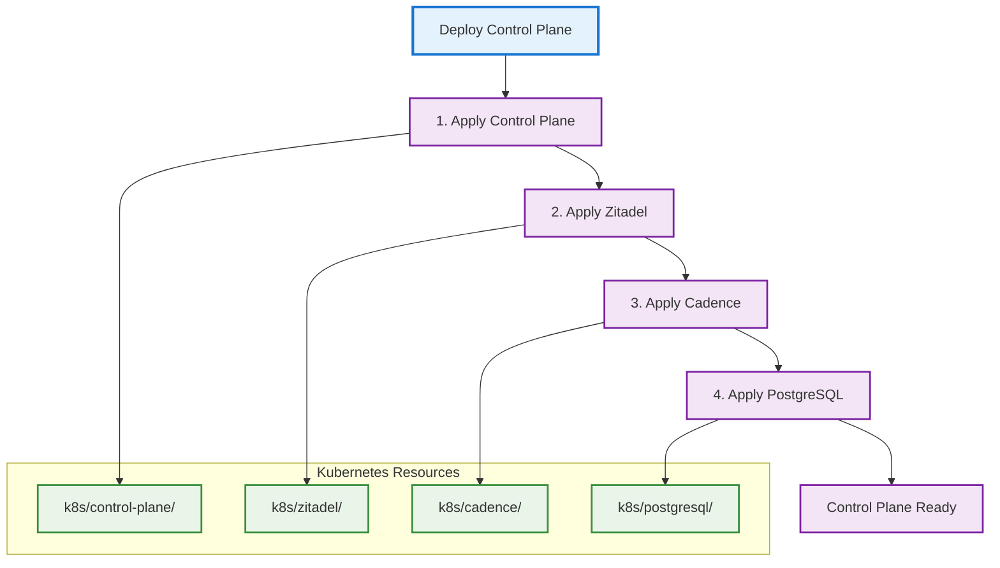

### 2. **Этап 2: Региональные relay серверы**

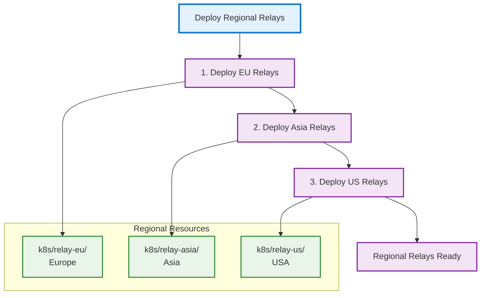

### 3. **Этап 3: Настройка координации**

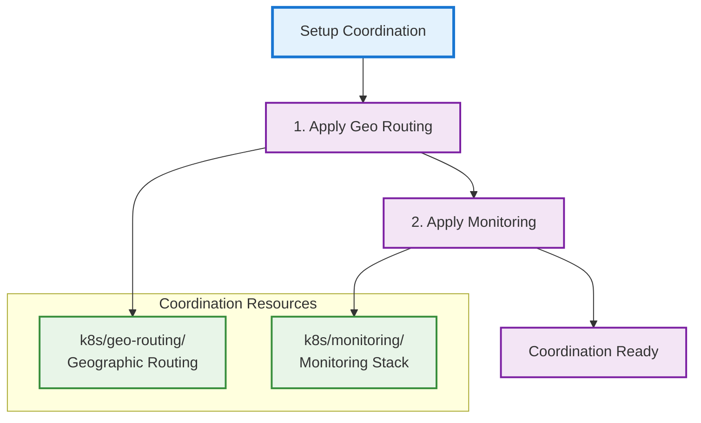

## Ключевые преимущества архитектуры

1. **Централизованное управление**: Единый Zitadel IdP и Cadence Hub
2. **Географическая оптимизация**: Умная маршрутизация на основе геолокации
3. **Автоматическая координация**: Обмен состоянием между relay серверами
4. **Масштабируемость**: Автоматическое развертывание новых relay серверов
5. **Отказоустойчивость**: Резервирование и автоматическое восстановление

Эта архитектура обеспечивает эффективное управление edge-сетью с централизованным контролем и умной маршрутизацией трафика.

## Целевая архитектура CloudBridge PoP↔PoP

### **Схема меж-PoP связности**

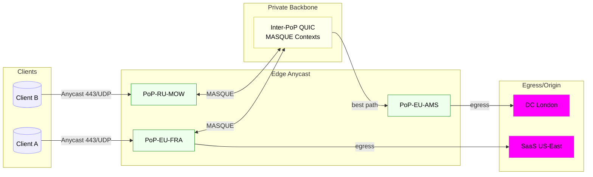

### **Роли компонентов**

- **Ingress PoP (Edge)**: принимает клиентские QUIC/MASQUE/WG подключения (443/UDP/TCP fallback), маркирует трафик `tenant-id`
- **Backbone PoP**: держит **постоянные QUIC-соединения** к соседям (mesh/partial-mesh), мультиплексирует **Context ID** per-tenant/per-flow
- **Egress PoP**: выбирает лучший выход «в мир» к целевому DC/Origin с учётом качества/стоимости
- **Control Plane (Центр)**: реестр PoP, оркестрация (Cadence), политика маршрутизации, телеметрия, JWKS, маппинг egress-правил

### **Плоскости связности**

#### **Control-plane**
- **Протокол:** gRPC mTLS (8444/TCP) + сервисный JWT `role=relay`
- **Функции:** реестр PoP, здоровье/нагрузка, таблица соседей, политики egress, выдача ключей для mTLS QUIC

#### **Data-plane**
- **Вход клиента:** QUIC/HTTP3 (MASQUE) на 443/UDP (или 9090/UDP), fallback WebSocket/TCP 443
- **Меж-PoP:** **MASQUE CONNECT-UDP / CONNECT-IP** поверх QUIC c **Datagrams**; один QUIC-линк ↔ много **Context ID** (tenant/flow)
- **Fallback бэкбона:** L3 **WireGuard** между PoP (если UDP/QUIC режут) — поверх него можно везти MASQUE

### **Политики маршрутизации**

- **Вход (Ingress selection):** Anycast BGP (если есть провайдер) **или** GeoDNS (Latency-based / Geo steering)
- **Меж-PoP (Backbone path):** выбор соседа по **RTT/loss/jitter/загруженности/стоимости**, гистерезис против флаппинга
- **Egress:** таблица `dest_prefix → egress_pop` + динамическая поправка по метрикам (Argo-подобно)
- **Tenant QoS/Quota:** лимиты потоков/битрейта per-tenant, приоритетные классы

### **Изоляция и безопасность**

- **Пер-tenant контексты:** `tenant-id` → VRF/таблица маршрутизации + Calico GNP (allow-intra / default-deny)
- **mTLS повсюду:** меж-PoP QUIC и control-plane — только по mTLS (серты от внутреннего CA, ротация через External Secrets)
- **Supply chain:** SBOM + cosign подпись образов; проверка в admission

### **SLO (первый набор)**

- **p95 handover меж-PoP:** ≤ **300 ms**
- **% Direct P2P клиентов:** ≥ **60%** (остальное — через PoP)
- **p95 RTT клиент↔egress:** −20% vs baseline
- **Ошибка установления туннеля:** < **1%**
- **MTTR PoP-линка:** < **15 мин**

## Готовность к пилотам vs GA

### *Что уже достаточно для пилота**

- **Централизованный IdP (Zitadel)** и оркестрация (Cadence) — ок
- **Модель «control plane в центре / edge-relays по регионам»** — ок
- **Гео-роутинг + health/load фильтры** — ок как первая версия
- **Базовые метрики/мониторинг/скейлинг** — ок

### **Что нужно добить (минимум до GA)**

#### **1. Надёжность Control Plane**

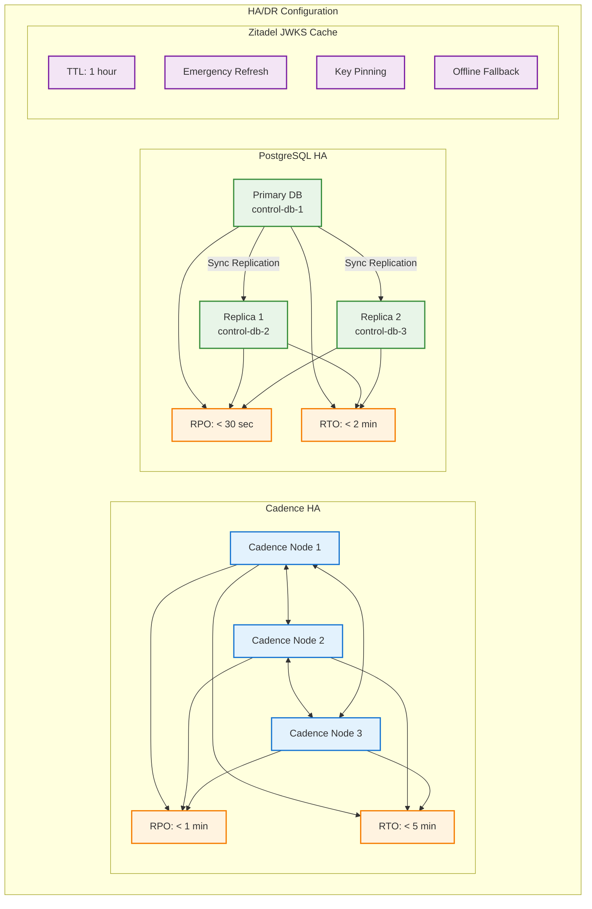

**Критические требования:**
- *HA/DR**: актив-актив для Cadence, Postgres (sync/async реплика), чёткий **RPO/RTO**
- *JWKS-кеш** Zitadel с **аварийным обновлением** и TTL/пиннингом ключей
- *Zero-trust mTLS** между всеми сервисами (не только TLS 1.3 наружу), ротация сертов

#### **2. Edge Bootstrap & ZTP (Zero Touch Provisioning)**

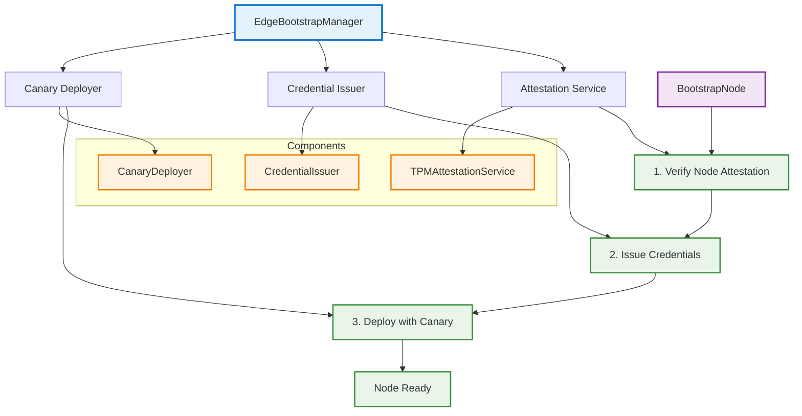

**Критические требования:**
- *Процедура ввода узла**: secure bootstrap, **attestation (TPM/UKI)**, выдача кредов
- *Canary-обновления** релев и **автоматический rollback** (версионирование схем/протоколов)

#### **3. Маршрутизация/переключение**

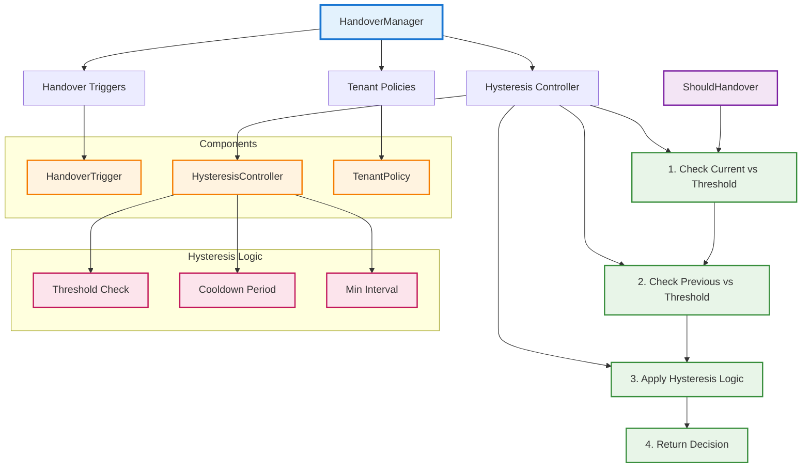

**Критические требования:**
- andover-логика (триггеры по **loss/jitter/RTT** + гистерезис), защита от флаппинга
- *Политики по арендаторам** в роутинге (квоты, приоритеты, платные классы сервиса)
- *Anycast/DNS-стратегия** для входа клиентов + pin-fallback при деградации

#### **4. Согласованность и координация**

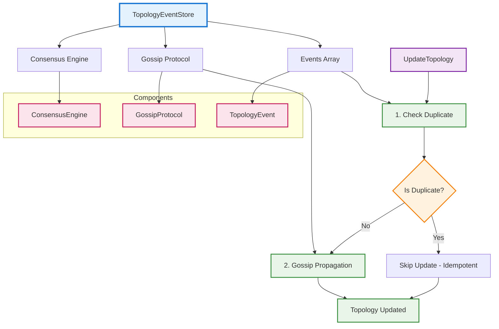

**Критические требования:**
- сточник истины для **топологии**: event-sourcing/госсип + **идемпотентные** апдейты
- AP-компромиссы: что eventual, что нужно строго (например, лимиты/кредиты)

#### **5. Безопасность и цепочка поставок**

```yaml
# SBOM и подпись артефактов
security:
  sbom:
    tool: "syft"
    format: "spdx-json"
    output: "artifacts/sbom.json"
  
  signing:
    tool: "cosign"
    key: "cosign.key"
    policy: "fail-closed"
  
  secrets:
    management: "external-secrets"
    kms: "vault"
    rotation: "automatic"
  
  pq_crypto:
    hybrid_tls: true
    default: "classical"
    compatibility: "fallback"
```

**Критические требования:**
- *SBOM + подпись артефактов (cosign)**, политика «fail-closed» на верификацию
- *External Secrets** + KMS/внешний Vault, политика ротации
- Q-крипто: явно указать **где включено** (hybrid TLS?), дефолты и совместимость

#### **6. Наблюдаемость (SLO-контур)**

```mermaid
graph TB
    subgraph "SLO Configuration"
        subgraph "SLO Targets"
            T1[RTT p95<br/>< 50ms]
            T2[Handover p95<br/>< 300ms]
            T3[P2P Percentage<br/>≥ 60%]
            T4[Error Budget<br/>< 5%]
        end
        
        subgraph "Monitoring"
            M1[SLO-based Alerts]
            M2[SLO Dashboard]
            M3[OpenTelemetry Tracing]
        end
        
        subgraph "Artifacts"
            A1[qlog enabled]
            A2[pcap enabled]
            A3[Retention: 30 days]
            A4[PII Filtered]
        end
    end
    
    T1 --> M1
    T2 --> M1
    T3 --> M1
    T4 --> M1
    
    M1 --> M2
    M2 --> M3
    
    M3 --> A1
    M3 --> A2
    A1 --> A3
    A2 --> A3
    A3 --> A4
    
    classDef targets fill:#e8f5e8,stroke:#388e3c,stroke-width:2px
    classDef monitoring fill:#e3f2fd,stroke:#1976d2,stroke-width:2px
    classDef artifacts fill:#f3e5f5,stroke:#7b1fa2,stroke-width:2px
    
    class T1,T2,T3,T4 targets
    class M1,M2,M3 monitoring
    class A1,A2,A3,A4 artifacts
```

**Критические требования:**
- LO: **p95 RTT, p95 handover-time, %P2P, error-budget**; алерты по SLO, не по метрикам
- *qlog/pcap артефакты** для QUIC/MASQUE interop, retention и приватность
- рассировка (OpenTelemetry) сквозь control- и data-plane

#### **7. NAT/масштаб/TURN**

```mermaid
graph TD
    A[NATMatrixManager] --> B[NAT Types Map]
    A --> C[TURN Pools Map]
    A --> D[Rate Limiter]
    
    E[TURNAntiAbuse] --> F[Rate Limits Map]
    E --> G[Cost Tracking Map]
    E --> H[Abuse Detection]
    
    subgraph "NAT Components"
        I[NATType]
        J[TURNPool]
        K[RateLimiter]
    end
    
    B --> I
    C --> J
    D --> K
    
    subgraph "Anti-Abuse Components"
        L[RateLimits]
        M[CostTracking]
        N[AbuseDetector]
    end
    
    F --> L
    G --> M
    H --> N
    
    classDef manager fill:#e3f2fd,stroke:#1976d2,stroke-width:3px
    classDef antiabuse fill:#f3e5f5,stroke:#7b1fa2,stroke-width:2px
    classDef natcomponent fill:#e8f5e8,stroke:#388e3c,stroke-width:2px
    classDef abusecomponent fill:#fff3e0,stroke:#f57c00,stroke-width:2px
    
    class A manager
    class E antiabuse
    class I,J,K natcomponent
    class L,M,N abusecomponent
```

**Критические требования:**
- атрица NAT-типов с таргетами **%direct vs %relay** по регионам
- улы TURN-IP, анти-абьюз, rate-limit, учёт стоимости трафика

#### **8. Клиент/дистрибуция**

```yaml
# Enterprise дистрибуция
client_distribution:
  mdm:
    platforms: ["intune", "jamf", "gpo"]
    profiles: "auto-generated"
  
  installation:
    silent_install: true
    auto_update: true
    crash_reports: true
  
  compatibility:
    version_matrix: "server-client"
    graceful_deprecation: true
```

**Критические требования:**
- *MDM/GPO/Intune/Jamf** профили, **silent-install**, auto-update, crash-reports
- овместимость версий (server↔client) и **graceful deprecation**

#### **9. Политики и комплаенс**

```yaml
# Data residency и комплаенс
compliance:
  data_residency:
    eu: "eu-only"
    ru: "ru-only"
    us: "us-only"
  
  logging:
    pii_filtering: true
    retention: "configurable"
    export: "on-demand"
  
  runbooks:
    incidents: "automated"
    on_call: "scheduled"
    disaster_drills: "quarterly"
```

**Критические требования:**
- ata-residency (EU/RU/US), логирование без PII, **retention** и экспорт по запросу
- unbooks: инциденты, регламенты on-call, disaster-дрили

#### **10. Экономика и лимиты**

```mermaid
graph TD
    A[TenantQuotaManager] --> B[Quotas Map]
    A --> C[Billing Engine]
    A --> D[Rate Limiter]
    
    E[TenantQuota] --> F[Connections]
    E --> G[Bitrate]
    E --> H[Masks]
    E --> I[Cost]
    
    subgraph "Manager Components"
        J[TenantQuota]
        K[BillingEngine]
        L[RateLimiter]
    end
    
    B --> J
    C --> K
    D --> L
    
    subgraph "Quota Fields"
        M[Connections: int64]
        N[Bitrate: int64]
        O[Masks: int64]
        P[Cost: float64]
    end
    
    F --> M
    G --> N
    H --> O
    I --> P
    
    classDef manager fill:#e3f2fd,stroke:#1976d2,stroke-width:3px
    classDef quota fill:#f3e5f5,stroke:#7b1fa2,stroke-width:2px
    classDef component fill:#e8f5e8,stroke:#388e3c,stroke-width:2px
    classDef field fill:#fff3e0,stroke:#f57c00,stroke-width:2px
    
    class A manager
    class E quota
    class J,K,L component
    class M,N,O,P field
```

**Критические требования:**
- er-tenant **quota/rate limiting** (соединения/битрейт/маски), billing-метрики

## Быстрые артефакты (2 недели)

### **Приоритетные задачи:**

1. **SLO-дашборд**: `RTT p95`, `handover p95`, `%P2P`, `relay-ratio`, `error-budget`
2. **Handover-машина состояний** с гистерезисом (убирает флаппинг)
3. **JWKS-кеш** с offline-пином + алерты на ротацию ключей
4. **Canary-деплой** для edge (1/N нод) + автороллбэк
5. **SBOM (Syft)** + подписание (cosign) в CI
6. **ZTP-скрипт** ввода узла (bootstrap token → mTLS cert)

### **Контракт готовности (acceptance):**

- `handover p95 < 300 ms`
- `%P2P ≥ 60%` в целевых сетях
- `JWT failover < 30 s`
- `MTTR < 15 min`

## Итог

**Этап развития для edge-пилота — правильный.**

Для **GA** не хватает:
- HA/DR control-plane
- ZTP/обновления
- Строгий mTLS/подпись артефактов
- Чёткий SLO-контур
- Handover-гистерезис
- Клиентская дистрибуция enterprise-класса
- Политики комплаенса

**Добей пункты выше — и архитектура будет уверенно «production-grade» не только по коду, но и по операциям.**

## ⚙️ Конфигурация меж-PoP MASQUE

### **1. Helm-values для меж-PoP MASQUE**

```mermaid
graph TB
    subgraph "Inter-PoP MASQUE Configuration"
        subgraph "QUIC Settings"
            Q1[Port UDP: 9090]
            Q2[Datagrams: true]
            Q3[BBRv2: true]
            Q4[ACK Frequency: true]
            Q5[Keepalive: 10s]
        end
        
        subgraph "mTLS Security"
            M1[Enabled: true]
            M2[CA Secret: cb-ca-bundle]
            M3[Cert: cb-interpop-cert]
        end
        
        subgraph "MASQUE Features"
            MA1[CONNECT-UDP: true]
            MA2[CONNECT-IP: true]
            MA3[Max Contexts: 16384]
            MA4[Tenant Header: x-cb-tenant]
        end
        
        subgraph "Neighbor PoPs"
            N1[EU-AMS<br/>ams.pop.cb:443]
            N2[EU-FRA<br/>fra.pop.cb:443]
            N3[RU-MOW<br/>mow.pop.cb:443]
        end
    end
    
    Q1 --> MA1
    Q2 --> MA2
    Q3 --> MA3
    Q4 --> MA4
    Q5 --> MA4
    
    M1 --> M2
    M2 --> M3
    
    MA1 --> N1
    MA2 --> N2
    MA3 --> N3
    MA4 --> N1
    MA4 --> N2
    MA4 --> N3
    
    classDef quic fill:#e3f2fd,stroke:#1976d2,stroke-width:2px
    classDef mtls fill:#f3e5f5,stroke:#7b1fa2,stroke-width:2px
    classDef masque fill:#e8f5e8,stroke:#388e3c,stroke-width:2px
    classDef neighbors fill:#fff3e0,stroke:#f57c00,stroke-width:2px
    
    class Q1,Q2,Q3,Q4,Q5 quic
    class M1,M2,M3 mtls
    class MA1,MA2,MA3,MA4 masque
    class N1,N2,N3 neighbors
```

### **2. Политика egress (ConfigMap)**

```yaml
apiVersion: v1
kind: ConfigMap
metadata: { name: cb-egress-policy }
data:
  policy.yaml: |
    defaults:
      max_cost_class: standard
    prefixes:
      - cidr: "51.144.0.0/12"   # Azure UK
        prefer: ["eu-ams","eu-fra"]
      - cidr: "172.16.0.0/12"   # Corp-LON
        prefer: ["eu-ams"]
    tenants:
      tenant-216420165:
        class: premium
        min_link_health: "loss<0.5%,rtt<80ms"
```

### **3. Handover-гистерезис (env)**

```yaml
HOVER_TRIGGER_RTT_MS=50         # прирост к базовой медиане
HOVER_TRIGGER_LOSS=0.5          # %
HOVER_MIN_STAY_S=30             # анти-флаппинг
HOVER_WARMUP_PARALLEL=true      # прогрев альтернативы
```

### **4. Anycast/GeoDNS**

- **Вариант A (рекоменд.):** Anycast BGP через провайдера (единообразный 443/UDP/TCP)
- **Вариант B:** GeoDNS latency-based (Cloudflare DNS/NS1/Route53), пулы: `eu`, `ru`, `asia`, `us`

## 🛠️ План внедрения (4 шага)

### **Шаг 1: PoP-Mesh (стенд)**
- 3 PoP (MOW/FRA/AMS), включить inter-PoP QUIC
- Собрать метрики (RTT/loss/jitter, handover-time)

### **Шаг 2: Egress-политики**
- Завести таблицу префиксов/направлений
- Включить динамику по телеметрии

### **Шаг 3: Anycast/GeoDNS**
- Поднять шарды DNS/Anycast
- Свести клиентов к ближайшему PoP

### **Шаг 4: Hardening**
- mTLS ротация, SBOM+cosign gate
- Canary+rollback, SLO-алерты

## Набор тестов (acceptance)

### **Interop тесты**
- CONNECT-UDP/IP + HTTP Datagrams (qlog/pcap)

### **Handover soak тесты**
- 24–72h под нагрузкой, p95 < 300 ms

### **UDP-блокировки**
- Fallback WS/TCP 443, проверка доступности

### **Egress A/B тесты**
- Измерить выигрыш по p95 RTT vs «в лоб»

### **Tenant isolation**
- Сквозные тесты Calico VRF/политик

## Итоговая архитектура

**CloudBridge PoP↔PoP** обеспечивает:

1. **Глобальную связность** через anycast edge PoP
2. **Оптимальную маршрутизацию** через private backbone
3. **Tenant-изоляцию** на сетевом уровне
4. **Enterprise-безопасность** с mTLS и supply chain
5. **SLO-гарантии** для production workloads

Эта архитектура готова к масштабированию от пилотов до глобального production deployment!

## Умная маршрутизация CloudBridge (Argo-аналог)

### **🔹 Что делает Argo у Cloudflare**

| Компонент              | Что делает                                                                                               |
| ---------------------- | -------------------------------------------------------------------------------------------------------- |
| **Argo Smart Routing** | Динамически выбирает маршрут между PoP'ами Cloudflare, обходя перегруженные/потерянные участки интернета |
| **Telemetry Engine**   | Сбор RTT, loss, jitter по миллионам потоков (real-time BBR feedback + active probes)                     |
| **Decision Engine**    | ML-модель выбирает *лучший следующий PoP* на основе latency, congestion, packet loss и исторических SLO  |
| **Traffic Steering**   | Перенаправление потоков на "чистые" маршруты внутри сети Cloudflare                                      |
| **Control Plane**      | Управляет таблицей "PoP↔PoP cost matrix" и политикой балансировки                                        |

### **🔹 Как мы реализуем аналог в CloudBridge**

#### **Data-plane (физическая часть)**

MASQUE/QUIC линк = «внутренняя артерия» между PoP.

- Меж-PoP постоянные QUIC-соединения → дешёвые keepalive-пинг-пары
- Все меж-PoP пути измеряются в реальном времени:
  - `rtt`, `jitter`, `loss`, `throughput`, `queue_delay`
  - Экспорт в Prometheus + AI/ML pipeline (`ai-service`)

#### **Control-plane (мозг маршрутизации)**

```mermaid
graph LR
    A[Prometheus Metrics] --> B[AI Analytics Engine]
    B --> C[Cost Matrix<br/>per PoP]
    C --> D[Routing Policy Engine]
    D --> E[Relay Router Agents]
    E -->|Update| F[Inter-PoP QUIC<br/>Contexts]
    
    classDef metrics fill:#e3f2fd,stroke:#1976d2,stroke-width:2px
    classDef ai fill:#f3e5f5,stroke:#7b1fa2,stroke-width:2px
    classDef routing fill:#e8f5e8,stroke:#388e3c,stroke-width:2px
    classDef agents fill:#fff3e0,stroke:#f57c00,stroke-width:2px
    
    class A metrics
    class B,C ai
    class D,E routing
    class F agents
```

Cadence workflow + AI service работают как **Argo Brain**:

- AI/ML-движок пересчитывает **стоимость линков** каждые 30–60 с
- Контроллер применяет новую таблицу маршрутизации (PoP↔PoP) на ходу
- Все relay-ноды обновляют весовые коэффициенты в локальных таблицах (`/var/lib/cloudbridge/routing.json`)

#### **Routing Algorithm**

```mermaid
graph TD
    A[SelectOptimalPath] --> B[Input: src, dst, matrix]
    B --> C[Define Score Function]
    C --> D[Apply Dijkstra Algorithm]
    D --> E[Return Optimal Path]
    
    subgraph "Score Weights"
        F[Latency: 0.5]
        G[Loss: 0.3]
        H[Jitter: 0.2]
    end
    
    C --> F
    C --> G
    C --> H
    
    subgraph "Algorithm Steps"
        I[1. Calculate Link Scores]
        J[2. Build Cost Matrix]
        K[3. Find Shortest Path]
        L[4. Return Path]
    end
    
    D --> I
    I --> J
    J --> K
    K --> L
    
    classDef function fill:#e3f2fd,stroke:#1976d2,stroke-width:3px
    classDef input fill:#f3e5f5,stroke:#7b1fa2,stroke-width:2px
    classDef weight fill:#e8f5e8,stroke:#388e3c,stroke-width:2px
    classDef step fill:#fff3e0,stroke:#f57c00,stroke-width:2px
    
    class A function
    class B input
    class F,G,H weight
    class I,J,K,L step
```

> При деградации любого линка handover выполняется мгновенно (make-before-break QUIC контексты)

### **🔹 Где CloudBridge превосходит Argo**

```mermaid
graph TB
    subgraph "Cloudflare Argo"
        A1[QUIC/HTTP3<br/>внутри сети]
        A2[Только внутри<br/>Cloudflare]
        A3[Телеметрия<br/>based]
        A4[Нет Multi-Tenancy]
        A5[Частичный SLO loop]
    end
    
    subgraph "CloudBridge Relay"
        B1[MASQUE/QUIC<br/>открытый стандарт]
        B2[Самостоятельная сеть<br/>VK Cloud, ATLEX, Selectel]
        B3[AI/ML анализ<br/>Prometheus метрик]
        B4[Изоляция per-tenant<br/>VRF + Calico]
        B5[Полный SLO-контур<br/>latency/loss → AI feedback]
    end
    
    A1 -.->|vs| B1
    A2 -.->|vs| B2
    A3 -.->|vs| B3
    A4 -.->|vs| B4
    A5 -.->|vs| B5
    
    classDef argo fill:#ffebee,stroke:#d32f2f,stroke-width:2px
    classDef cloudbridge fill:#e8f5e8,stroke:#4caf50,stroke-width:2px
    
    class A1,A2,A3,A4,A5 argo
    class B1,B2,B3,B4,B5 cloudbridge
```

| Возможность               | Cloudflare Argo                     | CloudBridge Relay                                                         |
| ------------------------- | ----------------------------------- | ------------------------------------------------------------------------- |
| **Протокол передачи**     | QUIC/HTTP3 (внутри сети Cloudflare) | MASQUE/QUIC открытый стандарт                                             |
| **Топология**             | Только внутри Cloudflare            | Самостоятельная сеть PoP, можно размещать PoP в VK Cloud, ATLEX, Selectel |
| **Адаптация**             | На основе телеметрии                | На основе **AI/ML анализа Prometheus метрик** + предсказания нагрузки     |
| **Multi-Tenancy**         | Отсутствует                         | Изоляция per-tenant (VRF + Calico policies)                               |
| **QoS/SLO feedback loop** | Частично                            | Полный **SLO-замкнутый контур**: latency/loss → AI feedback → reroute     |
| **Handover**              | Прозрачный внутри Cloudflare        | Прозрачный **между любыми PoP CloudBridge**                               |
| **Open deployment**       | Только у Cloudflare                 | Разворачивается где угодно, RU/EU локализованно                           |

### **🔹 Архитектура умного маршрута CloudBridge**

```mermaid
graph TB
    subgraph "AI Control Plane"
        M1[Metrics Collector]
        M2[AI Analyzer]
        M3[Routing Policy Engine]
    end
    
    subgraph "Edge Mesh"
        P1[PoP MOW]
        P2[PoP FRA]
        P3[PoP AMS]
        P4[PoP SGP]
    end
    
    M1 --> M2
    M2 --> M3
    M3 -->|Push via gRPC| P1
    M3 -->|Push via gRPC| P2
    M3 -->|Push via gRPC| P3
    M3 -->|Push via gRPC| P4
    
    P1 <-->|MASQUE/QUIC| P2
    P2 <-->|MASQUE/QUIC| P3
    P3 <-->|MASQUE/QUIC| P4
    
    classDef control fill:#e1f5fe,stroke:#01579b,stroke-width:2px
    classDef pop fill:#f3e5f5,stroke:#4a148c,stroke-width:2px
    
    class M1,M2,M3 control
    class P1,P2,P3,P4 pop
```

**Поток данных:**

1. Каждый PoP экспортирует метрики (`relay_rtt`, `relay_loss`, `relay_bw`)
2. AI-сервис агрегирует, строит **матрицу стоимости (PoP↔PoP)**
3. Контроллер пересчитывает маршруты и пушит обновления
4. Relays обновляют MASQUE контексты без обрывов
5. Grafana показывает «умную карту маршрутов» (Argo-style heatmap)

### **🔹 Компоненты для продакшена**

| Компонент                  | Реализация                                                            |
| -------------------------- | --------------------------------------------------------------------- |
| **Telemetry Agents**       | встроены в relay, экспорт в `/metrics` (Prometheus)                   |
| **AI Service**             | уже есть (`internal/ai/service.go`), добавить `RouteOptimizer` модуль |
| **Cost Matrix Storage**    | PostgreSQL или Redis (ключ `pop_a:pop_b`)                             |
| **Routing Policy Updater** | Cadence workflow `UpdateRoutingPolicy`                                |
| **Visualization**          | Grafana Dashboard `Inter-PoP Routing Health`                          |
| **Alerts**                 | `if relay_rtt_p95 > 150ms OR relay_loss > 1%` → trigger `reroute`     |

### **🔹 Конфигурация умной маршрутизации**

```mermaid
graph TB
    subgraph "Smart Routing Configuration"
        subgraph "Routing Mode"
            R1[Mode: Smart]
        end
        
        subgraph "Metrics Weights"
            W1[Latency: 0.5]
            W2[Loss: 0.3]
            W3[Jitter: 0.2]
        end
        
        subgraph "Thresholds"
            T1[Reroute Latency: 40ms]
            T2[Reroute Loss: 1.0%]
        end
        
        subgraph "Topology"
            P1[RU-MOW<br/>peers: EU-FRA, EU-AMS]
            P2[EU-FRA<br/>peers: RU-MOW, EU-AMS, US-NYC]
            P3[EU-AMS<br/>peers: EU-FRA, RU-MOW]
        end
        
        subgraph "AI Service"
            A1[Endpoint: ai-service.cloudbridge:8083]
            A2[Model: routing_optimizer_v2]
        end
    end
    
    R1 --> W1
    R1 --> W2
    R1 --> W3
    
    W1 --> T1
    W2 --> T2
    W3 --> T1
    
    T1 --> P1
    T2 --> P2
    T1 --> P3
    
    P1 --> A1
    P2 --> A1
    P3 --> A1
    A1 --> A2
    
    classDef mode fill:#e3f2fd,stroke:#1976d2,stroke-width:2px
    classDef weights fill:#f3e5f5,stroke:#7b1fa2,stroke-width:2px
    classDef thresholds fill:#e8f5e8,stroke:#388e3c,stroke-width:2px
    classDef topology fill:#fff3e0,stroke:#f57c00,stroke-width:2px
    classDef ai fill:#fce4ec,stroke:#c2185b,stroke-width:2px
    
    class R1 mode
    class W1,W2,W3 weights
    class T1,T2 thresholds
    class P1,P2,P3 topology
    class A1,A2 ai
```

### **🔹 Живой цикл "умного маршрута"**

```mermaid
graph TD
    A[1️⃣ Baseline<br/>PoP MOW–FRA RTT = 80ms] --> B[2️⃣ Anomaly Detection<br/>RTT grows to 130ms]
    B --> C[3️⃣ AI Decision<br/>FRA → AMS via AMS path<br/>RTT = 70ms]
    C --> D[4️⃣ Cadence Workflow<br/>HandoverRelayLink]
    D --> E[5️⃣ Parallel Path<br/>New QUIC context to AMS]
    E --> F[6️⃣ Seamless Handover<br/>Traffic switches]
    F --> G[ RTT Restored<br/>AI learns from feedback]
    G --> A
    
    classDef baseline fill:#e8f5e8,stroke:#4caf50,stroke-width:2px
    classDef anomaly fill:#fff3e0,stroke:#ff9800,stroke-width:2px
    classDef decision fill:#e3f2fd,stroke:#2196f3,stroke-width:2px
    classDef action fill:#f3e5f5,stroke:#9c27b0,stroke-width:2px
    classDef success fill:#e8f5e8,stroke:#4caf50,stroke-width:2px
    
    class A,G baseline
    class B anomaly
    class C decision
    class D,E,F action
```

| Этап                                                    | Действие          |
| ------------------------------------------------------- | ----------------- |
| 1️⃣ Сеть работает: PoP MOW–FRA RTT = 80 мс              | baseline          |
| 2️⃣ AI обнаруживает рост RTT до 130 мс                  | anomaly detected  |
| 3️⃣ AI советует: FRA → AMS (через AMS-путь RTT = 70 мс) | reroute decision  |
| 4️⃣ Cadence запускает workflow `HandoverRelayLink`      | make-before-break |
| 5️⃣ Relay MOW открывает новый QUIC-контекст к AMS       | parallel path     |
| 6️⃣ Трафик переключается, старый путь закрывается       | seamless handover |
| TT восстановлен → AI записывает обучение в модель    | feedback loop     |

### **🔹 RouteOptimizer модуль (псевдокод)**

```mermaid
graph TD
    A[RouteOptimizer] --> B[Cost Matrix]
    A --> C[AI Model]
    A --> D[Prometheus Client]
    A --> E[Cadence Client]
    
    F[OptimizeRoutes] --> G[1. Collect Metrics]
    G --> H[2. AI Analysis]
    H --> I[3. Update Cost Matrix]
    I --> J[4. Execute Workflow]
    J --> K[Routes Optimized]
    
    D --> G
    C --> H
    B --> I
    E --> J
    
    subgraph "Components"
        L[CostMatrix]
        M[MLModel]
        N[PrometheusClient]
        O[cadence.Client]
    end
    
    B --> L
    C --> M
    D --> N
    E --> O
    
    classDef optimizer fill:#e3f2fd,stroke:#1976d2,stroke-width:3px
    classDef method fill:#f3e5f5,stroke:#7b1fa2,stroke-width:2px
    classDef step fill:#e8f5e8,stroke:#388e3c,stroke-width:2px
    classDef component fill:#fff3e0,stroke:#f57c00,stroke-width:2px
    
    class A optimizer
    class F method
    class G,H,I,J,K step
    class L,M,N,O component
```

## Итоговая архитектура

**CloudBridge PoP↔PoP** с умной маршрутизацией обеспечивает:

1. **Глобальную связность** через anycast edge PoP
2. **AI-оптимизированную маршрутизацию** через private backbone
3. **Tenant-изоляцию** на сетевом уровне
4. **Enterprise-безопасность** с mTLS и supply chain
5. **SLO-гарантии** для production workloads
6. **Argo-аналог** с превосходством в multi-tenancy и локализации

**CloudBridge реализует функциональный аналог Argo Smart Routing**, при этом:
- будет **самообучающимся** (AI/ML feedback)
- работает в **мульти-облачной среде** (VK Cloud, ATLEX, EU PoP)
- обеспечивает **tenant-aware QoS** и compliance
- может работать как **локализованный "умный WAN"** без зависимости от Cloudflare

Эта архитектура готова к масштабированию от пилотов до глобального production deployment!