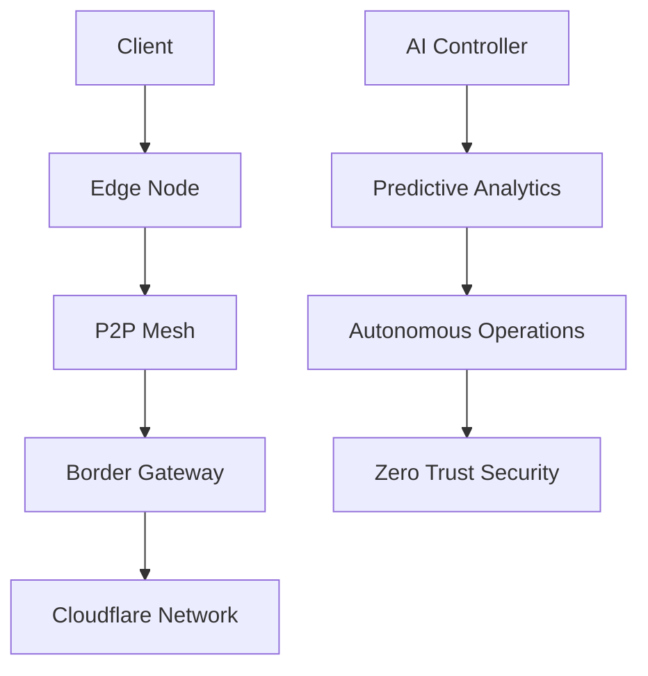

# CloudBridge Website Content Strategy

## 🎯 Целевые аудитории и их приоритеты

### Primary Audiences (в порядке приоритета)
1. **P2C Free Users** (Developers, SMB, Individual Users) - 50% трафика
2. **Enterprise Decision Makers** (CISO, CTO, CIO) - 25% трафика
3. **Technical Leaders** (DevOps, Security Engineers) - 15% трафика  
4. **Investors & Partners** (VC, Strategic Partners) - 10% трафика

---

## 🏠 Главная страница (Hero Section)

### Headline Options:
**Option A (Enterprise Focus):**
> "Первая глобальная edge-сеть для restricted markets с Zero Trust архитектурой и AI-автономностью"

**Option B (Technical Focus):**
> "Revolutionary P2P mesh network с post-quantum cryptography и autonomous AI operations"

**Option C (Problem-Solution):**
> "Обходим геополитические ограничения через Cloudflare partnership с 99.99% SLA"

### Key Value Propositions:
- ✅ **20ms latency** в 50+ locations worldwide
- ✅ **Zero Trust** outbound-only architecture  
- ✅ **Post-quantum ready** cryptography
- ✅ **AI-autonomous** network management
- ✅ **152-ФЗ/SORM compliant** из коробки

### Hero CTA:
- **P2C Free**: "Попробовать бесплатно" / "Начать сейчас"
- **Enterprise**: "Обсудить Enterprise" / "Запросить демо"
- **Partners**: "Стать партнером" / "Partner Program"

---

## 📋 Структура сайта

### 1. **О продукте** (/product)
```
├── Overview
├── Architecture
├── Features
├── Use Cases
├── Performance
└── Security & Compliance
```

### 2. **Технологии** (/technology)
```
├── Zero Trust Architecture
├── P2P Mesh Networking
├── Post-Quantum Cryptography
├── AI/ML Capabilities
├── Proprietary Protocols
└── Technical Specifications
```

### 3. **Решения** (/solutions)
```
├── Enterprise Security
├── Gaming & Streaming
├── Remote Work
├── IoT & Edge Computing
├── Government & Defense
└── Financial Services
```

### 4. **Партнеры** (/partners)
```
├── Cloudflare Partnership
├── Partner Program
├── White-Label Solutions
├── API Marketplace
└── Integration Partners
```

### 5. **Ресурсы** (/resources)
```
├── Documentation
├── API Reference
├── SDKs & Tools
├── Case Studies
├── Whitepapers
└── Blog
```

### 6. **О компании** (/about)
```
├── Mission & Vision
├── Leadership Team
├── Technology Innovation
├── Awards & Recognition
└── Careers
```

---

## 🎨 Ключевые страницы контента

### **Главная страница - Hero Section**

```html
<!-- Hero Banner -->
<div class="hero">
  <h1>Первая глобальная edge-сеть для restricted markets</h1>
  <p class="subtitle">
    Zero Trust архитектура + AI-автономность + Post-quantum криптография
  </p>
  
  <!-- Key Metrics -->
  <div class="metrics">
    <div class="metric">
      <span class="number">20ms</span>
      <span class="label">Latency</span>
    </div>
    <div class="metric">
      <span class="number">99.99%</span>
      <span class="label">SLA</span>
    </div>
    <div class="metric">
      <span class="number">50+</span>
      <span class="label">Locations</span>
    </div>
    <div class="metric">
      <span class="number">1M+</span>
      <span class="label">Users</span>
    </div>
  </div>
  
  <!-- CTA Buttons -->
  <div class="cta-group">
    <button class="btn-primary">Запросить демо</button>
    <button class="btn-secondary">Попробовать бесплатно</button>
  </div>
</div>
```

### **Страница продукта - Key Features**

```yaml
# Core Features Highlight
zero_trust_architecture:
  title: "Zero Trust Architecture"
  description: "Outbound-only connections, eliminating need for inbound ports"
  benefits:
    - "No firewall configuration required"
    - "Automatic threat isolation"
    - "Compliance-ready by design"
  
p2p_mesh_networking:
  title: "P2P Mesh Networking"
  description: "Direct peer-to-peer connections with intelligent routing"
  benefits:
    - "Reduced latency by 60%"
    - "Automatic failover"
    - "Scalable to millions of nodes"
  
post_quantum_cryptography:
  title: "Post-Quantum Ready"
  description: "Hybrid classical + quantum-resistant cryptography"
  benefits:
    - "Future-proof security"
    - "CRYSTALS-Kyber/Dilithium"
    - "Automatic key rotation"
  
ai_autonomous_operations:
  title: "AI-Autonomous Network"
  description: "Self-healing network with predictive capabilities"
  benefits:
    - "99.99% uptime guarantee"
    - "Predictive scaling"
    - "Automated incident response"
```

### **Техническая страница - Architecture**



---

## 📊 Контент для разных аудиторий

### **Enterprise Decision Makers**

#### **Pain Points:**
- Regulatory compliance (152-ФЗ, GDPR, SORM)
- Network security threats
- Performance requirements
- Cost optimization

#### **Content Focus:**
- **ROI Calculator** - TCO reduction, performance improvement
- **Compliance Dashboard** - Real-time compliance monitoring
- **Case Studies** - Enterprise deployments, measurable results
- **Security Whitepaper** - Zero Trust implementation guide

#### **Messaging:**
> "Reduce network costs by 40% while achieving 99.99% uptime and full regulatory compliance"

### **Technical Leaders**

#### **Pain Points:**
- Complex network management
- Performance optimization
- Security implementation
- Integration challenges

#### **Content Focus:**
- **Technical Documentation** - API reference, SDKs, integration guides
- **Performance Benchmarks** - Latency, throughput, scalability tests
- **Architecture Diagrams** - Detailed technical specifications
- **Developer Tools** - CLI tools, monitoring dashboards

#### **Messaging:**
> "Deploy enterprise-grade P2P mesh network in minutes with our enhanced QUIC-go and WireGuard protocols"

### **Investors & Partners**

#### **Pain Points:**
- Market opportunity
- Competitive advantage
- Growth potential
- Partnership value

#### **Content Focus:**
- **Market Analysis** - $50B+ addressable market, growth projections
- **Competitive Landscape** - Unique positioning, technology advantages
- **Partnership Opportunities** - White-label, API marketplace, revenue sharing
- **Financial Metrics** - ARR growth, customer acquisition, retention rates

#### **Messaging:**
> "First-mover advantage in $50B restricted markets edge computing with strategic Cloudflare partnership"

---

## 🎯 Call-to-Action Strategy

### **Primary CTAs:**
1. **"Попробовать бесплатно"** - P2C Free acquisition
2. **"Обсудить Enterprise"** - Enterprise leads
3. **"Стать партнером"** - Partnership opportunities
4. **"Скачать whitepaper"** - Content marketing

### **Secondary CTAs:**
1. **"Документация API"** - Developer engagement
2. **"Калькулятор ROI"** - Business justification
3. **"Case Studies"** - Social proof
4. **"Enterprise решения"** - Upselling
5. **"Связаться с нами"** - General inquiries

---

## 📱 Mobile-First Content Strategy

### **Mobile Priorities:**
1. **Fast loading** - < 3 seconds
2. **Clear CTAs** - Thumb-friendly buttons
3. **Simplified navigation** - Hamburger menu
4. **Progressive disclosure** - Expandable sections

### **Mobile Content:**
- **Hero section** - Single clear message
- **Key features** - Swipeable cards
- **Testimonials** - Carousel format
- **Contact forms** - Simplified fields

---

## 🔍 SEO Strategy

### **Primary Keywords:**
- "edge computing restricted markets"
- "zero trust network architecture"
- "post-quantum cryptography"
- "P2P mesh networking"
- "Cloudflare partnership"

### **Long-tail Keywords:**
- "152-ФЗ compliant network solution"
- "enterprise P2P network security"
- "AI-autonomous network management"
- "quantum-safe networking protocols"

### **Content Types:**
1. **Technical blog posts** - SEO traffic
2. **Case studies** - Social proof
3. **Whitepapers** - Lead generation
4. **Video content** - Engagement

---

## 📈 Conversion Optimization

### **Landing Page Elements:**
1. **Social proof** - Customer logos, testimonials
2. **Trust signals** - Security certifications, compliance badges
3. **Performance metrics** - Real-time statistics
4. **Interactive demos** - Product walkthroughs

### **A/B Testing Priorities:**
1. **Headlines** - Value proposition variations
2. **CTAs** - Button text and placement
3. **Hero images** - Technical vs business focus
4. **Form fields** - Length and complexity

---

## 🎨 Visual Content Strategy

### **Key Visuals:**
1. **Network Architecture Diagrams** - Technical credibility
2. **Performance Dashboards** - Real-time metrics
3. **Global Network Map** - Geographic presence
4. **Security Compliance Matrix** - Regulatory coverage

### **Video Content:**
1. **Product Demo** - 2-3 minute overview
2. **Technical Deep Dive** - Architecture explanation
3. **Customer Success Stories** - Real-world applications
4. **Security Features** - Zero Trust implementation

---

## 📊 Analytics & KPIs

### **Key Metrics:**
- **Conversion Rate** - 3-5% target
- **Time on Site** - > 3 minutes
- **Bounce Rate** - < 40%
- **Lead Quality Score** - Based on engagement

### **Tracking Setup:**
- **Google Analytics 4** - User behavior
- **Hotjar** - Heatmaps and recordings
- **HubSpot** - Lead tracking and scoring
- **Custom Events** - Feature usage and engagement

---

## 🚀 Launch Strategy

### **Phase 1: MVP (2 weeks)**
- Basic product pages
- Contact forms
- Technical documentation
- Mobile responsiveness

### **Phase 2: Enhanced (4 weeks)**
- Interactive demos
- Customer testimonials
- Blog content
- SEO optimization

### **Phase 3: Advanced (8 weeks)**
- ROI calculator
- Partner portal
- API documentation
- Video content

---

## 💡 Content Calendar

### **Weekly Content:**
- **Technical blog posts** - SEO and developer engagement
- **Customer success stories** - Social proof
- **Product updates** - Feature announcements
- **Industry insights** - Thought leadership

### **Monthly Content:**
- **Whitepapers** - Lead generation
- **Case studies** - Detailed customer stories
- **Webinars** - Educational content
- **Newsletter** - Community engagement

---

*Этот стратегический план обеспечит эффективное представление CloudBridge разным аудиториям и максимизирует конверсию посетителей в клиентов и партнеров.*
