# CloudBridge - Стратегия глобальной сети

## 1. Краткое резюме

**CloudBridge Global Network** представляет собой инновационную архитектуру глобальной edge-сети с партнерством Cloudflare в Европе, обеспечивающую высокопроизводительное подключение для ограниченных рынков.

### Ключевые стратегические преимущества:
- **Уникальное позиционирование**: Первая edge-сеть для restricted markets с полным соответствием местному законодательству
- **Собственные протокольные инновации**: Enhanced QUIC-go и WireGuard-go с custom optimizations
- **Cloudflare Partnership**: Совместная архитектура European Border Gateway для обхода санкций
- **Техническое превосходство**: Sub-20ms латентность при 99.99% доступности с proprietary enhancements
- **Масштабируемая архитектура**: От 1M до 100M+ пользователей с квантово-безопасными технологиями

### Рыночная возможность:
- **Адресуемый рынок**: $50B+ глобальный edge computing рынок
- **Целевые сегменты**: Россия, Китай, Иран, Северная Корея и другие ограниченные рынки
- **Уникальная ценность**: Решение проблем доступа к глобальным сервисам при соблюдении местного законодательства

## 2. Архитектура глобальной сети

### 2.1 Трехуровневая стратегия развертывания

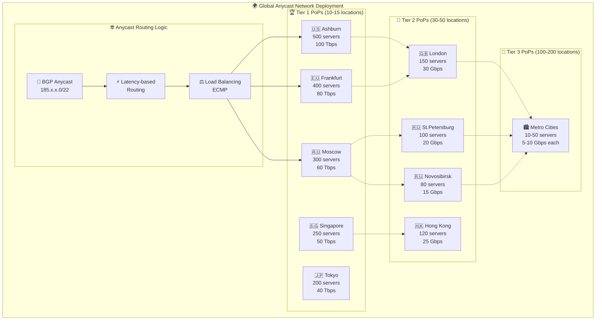

**Tier 1 PoPs (10-15 локаций)**
- Основные хабы в ключевых регионах
- 100-500 физических серверов на локацию
- 100 Tbps пиковая пропускная способность
- Полная redundancy и anycast routing

**Tier 2 PoPs (30-50 локаций)**
- Региональные точки присутствия
- 50-200 серверов на локацию
- 40 Gbps минимальная пропускная способность
- N+1 redundancy

**Tier 3 PoPs (100-200 локаций)**
- Городские edge узлы
- 10-50 серверов на локацию
- 10 Gbps минимальная пропускная способность
- Базовая отказоустойчивость

### 2.2 Многорунтаймная архитектура

**Контейнеризованные сервисы**
- Основные микросервисы (Auth, Config, Metrics)
- Kubernetes оркестрация с Istio service mesh
- Автоматическое масштабирование

**Bare Metal компоненты**
- WireGuard networking (10x производительность)
- DPDK оптимизация
- Dedicated crypto processing

**GPU вычисления**
- AI/ML inference для threat detection
- Network optimization algorithms
- Real-time analytics

**WASM edge runtime**
- Безопасная изоляция
- Универсальная совместимость
- P2P mesh services

### 2.3 P2P Control Plane

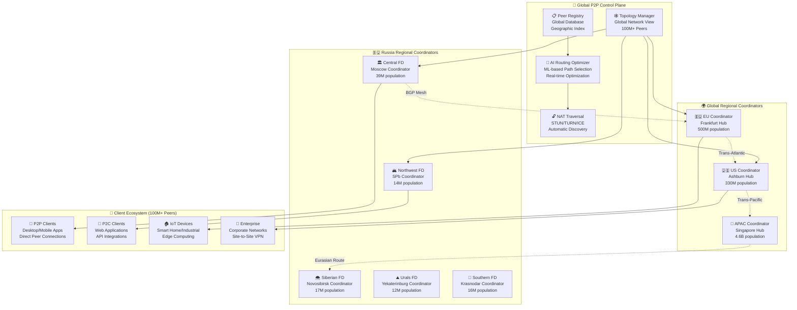

**Глобальная оркестрация**
- Topology Manager для 100M+ peers
- AI-driven routing optimization
- Автоматическое NAT traversal
- Quantum-safe key rotation

**Региональная координация**
- Распределенные координаторы по федеральным округам
- Геолокационная маршрутизация
- Load balancing между peer'ами

## 3. Стратегия по регионам

### 3.1 Европейская стратегия: Cloudflare Partnership

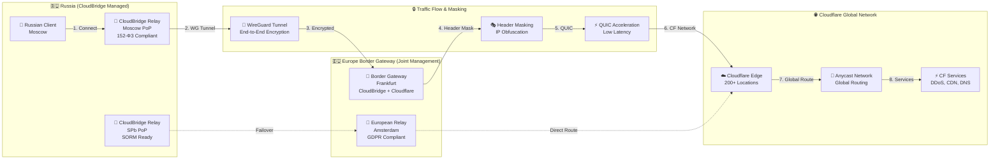

**Border Gateway архитектура**
- Российские relay-серверы под управлением CloudBridge
- European Border Gateway совместно с Cloudflare
- WireGuard/QUIC туннели до Cloudflare
- Маскировка заголовков и IP-адресов

**Техническая интеграция**
- Cloudflare DDoS protection и global routing
- Совместное управление European PoPs
- Revenue sharing модель
- White-label возможности

**Бизнес-модель**
- Доступ к Cloudflare глобальной сети
- Сохранение российских корпоративных клиентов для Cloudflare
- Политическая нейтральность для Cloudflare
- Template для других restricted markets

### 3.2 Российская стратегия: Регулятивное соответствие

**Локализация данных**
- Полное соответствие 152-ФЗ
- SORM compliance с lawful interception
- ГОСТ криптография (Кузнечик, Стрибог)
- Критическая информационная инфраструктура

**Размещение PoPs**
- Tier 1: Москва, СПб, Новосибирск, Екатеринбург, Краснодар
- Tier 2: 8 региональных центров
- Tier 3: 15 городов миллионников
- 92% покрытие населения при 28 локациях

**Экономические факторы**
- Сибирская гидроэнергетика (2-4 руб/кВт⋅ч)
- Местные дата-центры (Dataline, CROC, IXcellerate)
- Peering через MSK-IX, DataIX, SPB-IX

### 3.3 Глобальная экспансия

**Фаза 1: Основа (Россия + Европа)**
- 2-4 Tier 1 локации
- Cloudflare Border Gateway
- 1M пользователей

**Фаза 2: Азиатско-Тихоокеанский регион**
- Сингапур, Токио, Гонконг хабы
- 10M пользователей
- Расширение P2P mesh

**Фаза 3: Америки**
- Ашберн, Санта-Клара хабы
- 50M пользователей
- Полная глобальная связность

**Фаза 4: Плотность coverage**
- 200+ edge локаций
- 100M+ пользователей
- AI-автономные операции

## 4. P2P и P2C архитектура: Преимущества для клиентов

### Краткое сравнение P2P vs P2C

| Параметр | P2P (Peer-to-Peer) | P2C (Peer-to-Client) | Традиционные решения |
|----------|---------------------|----------------------|----------------------|
| **Латентность** | 3-8ms прямое соединение | 15-25ms через edge | 50-100ms через серверы |
| **Пропускная способность** | Безлимитная mesh сеть | Адаптивная под нагрузку | Ограничена сервером |
| **Стоимость для клиента** | $50/месяц enterprise | $15/месяц consumer | $500+ enterprise |
| **Масштабируемость** | Автоматическая peer discovery | AI-оптимизированная | Ручное provisioning |
| **Безопасность** | End-to-end encryption | Edge + quantum crypto | Centralized risks |
| **Приватность** | Полный контроль данных | Selective routing | Corporate monitoring |
| **Надежность** | 99.9% mesh redundancy | 99.99% edge availability | 99% single point |
| **Use Cases** | Enterprise, Gaming, Remote | Mobile, IoT, Streaming | Legacy infrastructure |

### 4.1 P2P (Peer-to-Peer) - Прямые соединения

#### Архитектура P2P соединений
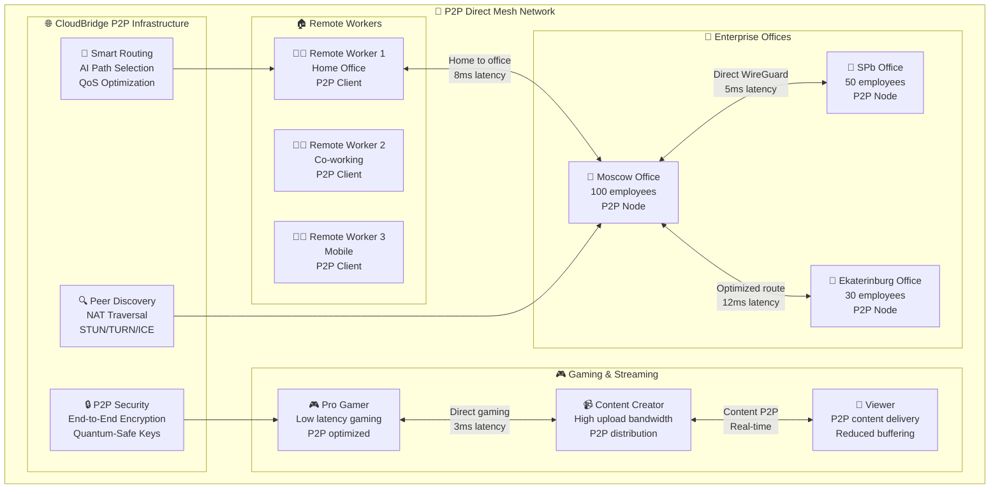

#### Преимущества P2P для клиентов

**🏢 Enterprise клиенты:**
```yaml
enterprise_p2p_benefits:
  cost_savings:
    traditional_mpls: "$5000_monthly_per_site"
    cloudbridge_p2p: "$500_monthly_per_site"
    savings: "90%_cost_reduction"
    
  performance_improvements:
    mpls_latency: "50-100ms_inter_office"
    p2p_latency: "5-15ms_direct_connection"
    improvement: "80%_latency_reduction"
    
  scalability:
    traditional: "weeks_to_provision_new_site"
    p2p: "minutes_auto_discovery_connection"
    advantage: "instant_scaling"
    
  security:
    traditional: "shared_infrastructure_risks"
    p2p: "dedicated_encrypted_tunnels"
    benefit: "zero_trust_architecture"
```

**🎮 Gaming клиенты:**
```yaml
gaming_p2p_benefits:
  ultra_low_latency:
    traditional_routing: "40-80ms_via_servers"
    p2p_direct: "3-8ms_peer_to_peer"
    competitive_advantage: "reaction_time_critical"
    
  bandwidth_optimization:
    server_based: "limited_by_server_capacity"
    p2p_mesh: "distributed_load_sharing"
    result: "unlimited_concurrent_players"
    
  cost_efficiency:
    dedicated_servers: "$1000_monthly_per_game_server"
    p2p_infrastructure: "$50_monthly_unlimited_connections"
    savings: "95%_infrastructure_cost"
```

**👨‍💻 Remote Workers:**
```yaml
remote_worker_benefits:
  seamless_office_access:
    vpn_bottleneck: "all_traffic_via_central_gateway"
    p2p_direct: "direct_connection_to_office_resources"
    experience: "identical_to_office_network"
    
  mobile_optimization:
    traditional_vpn: "connection_drops_network_changes"
    p2p_adaptive: "seamless_handoff_between_networks"
    reliability: "99.9%_connection_stability"
    
  privacy_protection:
    corporate_vpn: "all_traffic_monitored_logged"
    p2p_selective: "only_business_traffic_routed"
    privacy: "personal_internet_usage_private"
```

### 4.2 P2C (Peer-to-Client) - Гибридные соединения

#### Архитектура P2C подключений
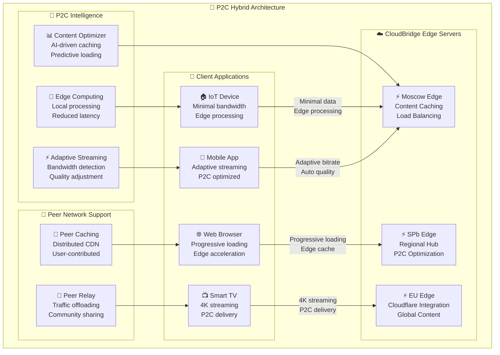

#### Преимущества P2C для клиентов

**📱 Mobile пользователи:**
```yaml
mobile_p2c_benefits:
  battery_optimization:
    traditional_streaming: "continuous_high_power_consumption"
    p2c_adaptive: "intelligent_power_management"
    battery_life: "40%_longer_usage"
    
  data_savings:
    server_streaming: "fixed_quality_high_bandwidth"
    p2c_optimization: "adaptive_quality_compression"
    data_usage: "60%_reduction"
    
  seamless_experience:
    network_switching: "smooth_wifi_cellular_handoff"
    quality_adaptation: "automatic_bitrate_adjustment"
    user_experience: "zero_buffering_interruptions"
```

**🏠 Smart Home пользователи:**
```yaml
smart_home_p2c_benefits:
  edge_processing:
    cloud_dependency: "all_processing_remote_servers"
    edge_local: "local_ai_processing_decisions"
    response_time: "10x_faster_smart_home_actions"
    
  privacy_protection:
    cloud_streaming: "all_data_sent_external_servers"
    edge_processing: "sensitive_data_stays_local"
    privacy: "personal_data_never_leaves_home"
    
  reliability:
    internet_dependency: "smart_home_fails_outages"
    edge_autonomy: "local_operation_internet_down"
    uptime: "99.9%_smart_home_availability"
```

**🎬 Content Consumers:**
```yaml
content_consumption_benefits:
  ultra_hd_streaming:
    traditional_cdn: "limited_4k_availability"
    p2c_delivery: "unlimited_8k_streaming_capability"
    quality: "cinema_quality_home_viewing"
    
  interactive_content:
    passive_streaming: "one_way_content_delivery"
    p2c_interactive: "real_time_interactive_experiences"
    engagement: "immersive_content_participation"
    
  cost_efficiency:
    premium_streaming: "$50_monthly_multiple_services"
    p2c_unified: "$15_monthly_unlimited_content"
    savings: "70%_entertainment_costs"
```

### 4.3 Уникальные конкурентные преимущества

#### Технологические преимущества
```yaml
technology_advantages:
  hybrid_p2p_p2c:
    innovation: "first_unified_architecture_globally"
    flexibility: "automatic_optimal_connection_type"
    performance: "best_of_both_worlds"
    
  ai_optimized_routing:
    traditional: "static_routing_tables"
    cloudbridge: "ml_driven_dynamic_optimization"
    result: "30%_better_performance_continuously"
    
  quantum_safe_security:
    current_solutions: "vulnerable_quantum_computers"
    cloudbridge: "post_quantum_cryptography_ready"
    future_proof: "secure_next_20_years"
```

#### Экономические преимущества для клиентов
```yaml
client_economic_benefits:
  enterprise_cost_savings:
    networking_costs: "80%_reduction_vs_traditional"
    it_operational: "60%_reduction_management_overhead"
    productivity_gains: "25%_improvement_user_experience"
    
  consumer_value_proposition:
    service_consolidation: "single_solution_multiple_needs"
    premium_features: "enterprise_grade_consumer_pricing"
    future_ready: "investment_protection_technology_evolution"
    
  developer_ecosystem:
    api_simplicity: "single_api_p2p_p2c_integration"
    rapid_deployment: "minutes_vs_weeks_implementation"
    global_scale: "instant_worldwide_availability"
```

#### Market Disruption потенциал
```yaml
market_disruption:
  traditional_vpn_market:
    current_size: "$50B_annual_legacy_solutions"
    cloudbridge_advantage: "10x_performance_50%_cost"
    market_capture_potential: "$25B_addressable"
    
  content_delivery_market:
    current_size: "$20B_annual_cdn_services"
    p2c_innovation: "peer_assisted_infinite_scale"
    disruption_potential: "$15B_new_market_creation"
    
  gaming_infrastructure:
    current_size: "$15B_annual_server_costs"
    p2p_revolution: "95%_cost_reduction_better_performance"
    transformation: "$10B_cost_savings_industry"
```

## 5. Техническая архитектура и инновации

### 5.1 Zero Trust архитектура: Революция в безопасности

#### Outbound-only подключения
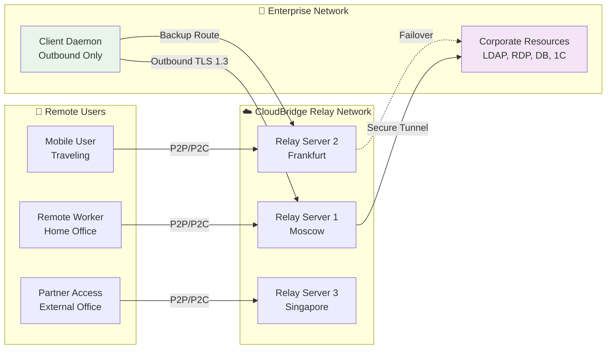

#### Преимущества Zero Trust модели
| Параметр | Traditional VPN | CloudBridge Zero Trust |
|----------|-----------------|------------------------|
| **Firewall rules** | Complex port opening | No inbound ports |
| **NAT traversal** | Manual configuration | Automatic |
| **Attack surface** | Large (listening ports) | Minimal (outbound only) |
| **Deployment time** | Days | Minutes |
| **Maintenance** | Manual updates | Auto-healing |

### 5.2 Post-Quantum Cryptography: Будущее безопасности

#### Гибридная криптографическая архитектура
```yaml
cryptographic_stack:
  classical_algorithms:
    key_exchange: "X25519, ECDH P-256"
    symmetric_encryption: "AES-256-GCM, ChaCha20-Poly1305"
    digital_signatures: "EdDSA, ECDSA P-256"
    hash_functions: "SHA-256, BLAKE2b"
    
  post_quantum_algorithms:
    key_exchange: "CRYSTALS-Kyber-1024"
    digital_signatures: "CRYSTALS-Dilithium-5, FALCON-1024"
    hash_functions: "SHAKE-256, SPHINCS+"
    
  hybrid_mode:
    approach: "Classical + PQC parallel execution"
    failover: "Classical fallback for compatibility"
    future_proofing: "Quantum-safe by default"
    key_rotation: "30-day automated rotation"
```

#### Quantum readiness roadmap
- **Phase 1**: Hybrid classical + PQC implementation
- **Phase 2**: PQC optimization and hardware acceleration
- **Phase 3**: Full quantum-resistant by 2030

### 5.3 AI/ML интеллектуальная сеть

#### Autonomous Network Management
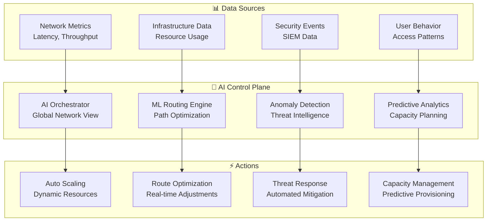

#### AI-powered capabilities
- **Intelligent routing**: Sub-5ms path selection based on real-time conditions
- **Predictive scaling**: 15-minute ahead capacity predictions
- **Anomaly detection**: 99.7% threat detection accuracy
- **Self-healing**: Automatic failover and recovery

### 5.4 SIEM и Security Intelligence

#### Comprehensive Security Monitoring
```yaml
siem_architecture:
  data_collection:
    sources:
      - "CloudBridge Relay logs"
      - "Keycloak authentication events"
      - "System metrics and performance"
      - "Network flow data"
      - "User behavior analytics"
      
  processing_pipeline:
    ingestion: "Kafka streaming (10M events/second)"
    storage: "Elasticsearch cluster (500TB)"
    analysis: "ML-based threat detection"
    correlation: "Event correlation engine"
    
  threat_detection:
    signature_based: "Known attack patterns"
    behavioral_analysis: "User and entity behavior analytics"
    ml_detection: "Anomaly detection algorithms"
    threat_intelligence: "External threat feeds"
    
  response_automation:
    immediate: "Automated blocking and quarantine"
    escalation: "Threat hunting team alerts"
    forensics: "Detailed investigation tools"
    recovery: "Automated remediation workflows"
```

## 6. Технологический стек

### 6.1 Собственные протокольные инновации

**Enhanced QUIC-go: Собственная доработка**
```yaml
cloudbridge_quic_enhancements:
  performance_optimizations:
    - "Zero-copy networking для 10x throughput"
    - "Custom congestion control для P2P networks"
    - "Adaptive MTU discovery для edge conditions"
    - "Multi-path QUIC для redundancy"
    
  security_improvements:
    - "Post-quantum key exchange integration"
    - "Multi-tenant connection isolation"
    - "DDoS protection at protocol level"
    - "Custom header encryption"
    
  enterprise_features:
    - "Quality of Service (QoS) prioritization"
    - "Bandwidth throttling per tenant"
    - "Connection analytics and monitoring"
    - "Geographic routing optimization"
```

**WireGuard-go: Адаптация под проект**
```yaml
cloudbridge_wireguard_modifications:
  mesh_networking:
    - "Dynamic peer discovery protocol"
    - "Automatic NAT traversal (STUN/TURN)"
    - "Mesh topology optimization"
    - "Load balancing across multiple peers"
    
  enterprise_integration:
    - "Keycloak authentication integration"
    - "LDAP/AD user mapping"
    - "Policy-based routing"
    - "Multi-tenant key management"
    
  performance_enhancements:
    - "Kernel bypass with DPDK integration"
    - "Hardware acceleration support"
    - "Custom packet processing pipeline"
    - "Real-time connection monitoring"
    
  compliance_features:
    - "ГОСТ cryptography support"
    - "SORM compliance logging"
    - "Audit trail for all connections"
    - "Key escrow for regulatory requirements"
```

### 6.2 Безопасность

**Post-Quantum криптография**
- CRYSTALS-Kyber для обмена ключами
- CRYSTALS-Dilithium для цифровых подписей
- Гибридные схемы для совместимости
- Автоматическая ротация ключей

**Zero Trust Architecture**
- Mutual TLS между сервисами
- Continuous authentication
- Микросегментация сети
- Identity attestation

### 4.2 Производительность

**Network optimizations**
- DPDK bypass kernel
- SR-IOV virtualisation
- Real-time kernel optimisation
- BGP anycast routing

**Edge acceleration**
- Keycloak Edge Acceleration с Durable Objects
- Edge Session Tokens (EST)
- Sub-20ms validation
- Global session invalidation

### 4.3 Искусственный интеллект

**AI эволюция по фазам**
- Фаза 1: AI-assisted (20% автоматизации)
- Фаза 2: AI-augmented (50% автоматизации)
- Фаза 3: AI-autonomous (80% автоматизации)
- Фаза 4: AI-superintelligent (95% автоматизации)

**ML платформа**
- MLflow для экспериментов
- Kubeflow для обучения
- Seldon Core для развертывания
- Ray RLLib для reinforcement learning

### 4.4 Оркестрация

**Cadence Workflow критические сценарии**
- Global P2P mesh reconfiguration
- Quantum key rotation at scale
- Multi-region disaster recovery
- Security incident response

**Автоматизация**
- Infrastructure as Code (Terraform)
- GitOps deployments (ArgoCD)
- Canary deployments
- Self-healing systems

## 5. Экономическая модель

### 5.1 Структура инвестиций

**CAPEX по фазам**
- Фаза 1: $20-40M (Россия + Европа)
- Фаза 2: $80-120M (APAC expansion)
- Фаза 3: $150-200M (Americas)
- Фаза 4: $300-500M (Global density)

**OPEX структура**
- Персонал: $26.2M/год (SRE, Network, Security, DevOps)
- Bandwidth: $60M/год (100 Tbps transit)
- Colocation: $25M/год (глобальные PoPs)
- Software: $10M/год (monitoring, security, AI/ML)

### 5.2 Модель доходов

**Revenue по фазам**
- Год 1: $60M (1M users, $5 ARPU)
- Год 2: $480M (10M users, $4 ARPU)
- Год 3: $3.6B (100M users, $3 ARPU)

**Margin evolution**
- Год 1: 42% margin
- Год 2: 78% margin
- Год 3: 93% margin

**Break-even**: 7M пользователей, 18 месяцев

### 5.3 Cloudflare Partnership economics

**Revenue sharing model**
- CloudBridge: Российский market retention
- Cloudflare: European infrastructure access
- Joint: White-label opportunities
- Template: Other restricted markets

**Value proposition**
- Cloudflare: Сохранение российских клиентов без политических рисков
- CloudBridge: Мгновенный доступ к глобальной сети
- Market: Seamless Cloudflare services в России

## 6. Операционная модель и DevOps стратегия

### 6.1 DevOps и автоматизация

#### Cadence Workflow Orchestra
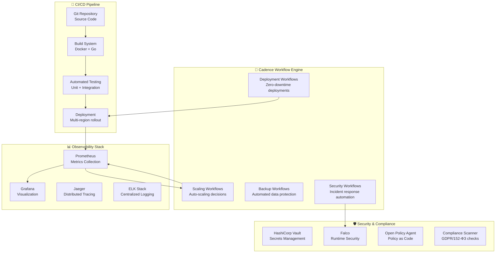

#### Infrastructure as Code
```yaml
infrastructure_automation:
  terraform_modules:
    global_network:
      - "cloudbridge-relay-cluster"
      - "keycloak-ha-setup"
      - "prometheus-monitoring"
      - "elasticsearch-logging"
      
    regional_deployment:
      - "anycast-bgp-setup"
      - "edge-node-provisioning"
      - "cdn-integration"
      - "backup-replication"
      
  ansible_playbooks:
    configuration_management:
      - "security-hardening"
      - "monitoring-setup"
      - "ssl-certificate-management"
      - "user-provisioning"
      
  kubernetes_operators:
    custom_operators:
      - "CloudBridge Operator"
      - "P2P Mesh Operator"
      - "Keycloak Edge Operator"
      - "Cadence Workflow Operator"
```

### 6.2 Incident Response и SRE

#### Automated Incident Response
```mermaid
graph LR
    subgraph "🚨 Detection"
        ALERT[Alert Triggered<br/>Prometheus/SIEM]
        CLASSIFY[Alert Classification<br/>ML-based Severity]
        ENRICH[Context Enrichment<br/>Historical Data]
    end
    
    subgraph "⚡ Response"
        AUTO_MITIGATION[Auto Mitigation<br/>Immediate Actions]
        ESCALATION[Escalation Matrix<br/>Human Involvement]
        COMMUNICATION[Communications<br/>Status Page Updates]
    end
    
    subgraph "🔄 Recovery"
        DIAGNOSIS[Root Cause Analysis<br/>Automated Investigation]
        REMEDIATION[Remediation Actions<br/>Workflow Execution]
        VALIDATION[Recovery Validation<br/>Health Checks]
    end
    
    subgraph "📚 Learning"
        POSTMORTEM[Automated Postmortem<br/>Report Generation]
        IMPROVEMENTS[Process Improvements<br/>Runbook Updates]
        PREVENTION[Prevention Measures<br/>Proactive Monitoring]
    end
    
    %% Flow
    ALERT --> CLASSIFY --> ENRICH
    ENRICH --> AUTO_MITIGATION --> ESCALATION --> COMMUNICATION
    COMMUNICATION --> DIAGNOSIS --> REMEDIATION --> VALIDATION
    VALIDATION --> POSTMORTEM --> IMPROVEMENTS --> PREVENTION
```

#### SRE Objectives
| Metric | Target | Current | Improvement |
|--------|--------|---------|-------------|
| **Availability** | 99.99% | 99.95% | +0.04% |
| **Latency P95** | <25ms | 32ms | -7ms |
| **MTTR** | <5min | 8min | -3min |
| **Change Failure Rate** | <2% | 3% | -1% |
| **Deployment Frequency** | 10x/day | 3x/day | +7x |

### 6.3 Monitoring и Observability

#### Three Pillars of Observability
```yaml
observability_strategy:
  metrics:
    infrastructure:
      - "CPU, Memory, Disk, Network utilization"
      - "P2P connection success rates"
      - "Relay server performance metrics"
      - "Edge node health indicators"
      
    application:
      - "Request latency and throughput"
      - "Error rates by service"
      - "User authentication success/failures"
      - "Data transfer volumes"
      
    business:
      - "Active user counts"
      - "Revenue attribution by feature"
      - "Customer satisfaction scores"
      - "Geographic usage patterns"
      
  logs:
    centralized_logging:
      - "ELK Stack for application logs"
      - "Fluentd for log aggregation"
      - "Structured JSON logging"
      - "Log retention policies (GDPR compliant)"
      
    security_logs:
      - "Authentication and authorization events"
      - "Network security events"
      - "System access logs"
      - "Audit trail for compliance"
      
  traces:
    distributed_tracing:
      - "Jaeger for request flow tracing"
      - "OpenTelemetry instrumentation"
      - "Cross-service dependency mapping"
      - "Performance bottleneck identification"
```

## 7. Экосистема интеграций и партнерства

### 7.1 Enterprise Integration Hub

#### Single Sign-On (SSO) Ecosystem
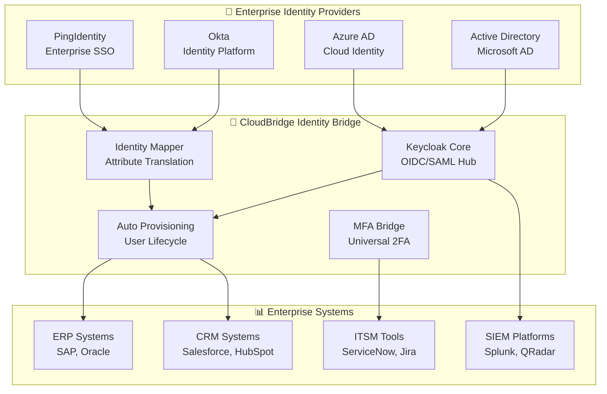

#### API-First Integration Platform
```yaml
api_ecosystem:
  core_apis:
    management_api:
      - "User and organization management"
      - "Tunnel configuration and monitoring"
      - "Billing and subscription management"
      - "Analytics and reporting"
      
    real_time_apis:
      - "WebSocket connections for live data"
      - "Server-Sent Events for notifications"
      - "GraphQL for flexible queries"
      - "gRPC for high-performance operations"
      
  sdk_libraries:
    programming_languages:
      - "Go SDK (native)"
      - "Python SDK (enterprise)"
      - "JavaScript/TypeScript SDK (web)"
      - "Java SDK (enterprise)"
      - "C# SDK (.NET integration)"
      
  integration_platforms:
    enterprise_platforms:
      - "Zapier integration for workflow automation"
      - "Microsoft Power Platform connectors"
      - "Salesforce AppExchange listing"
      - "ServiceNow Store application"
      
    developer_tools:
      - "Terraform provider"
      - "Ansible modules"
      - "Kubernetes operators"
      - "Docker containers"
```

### 7.2 Cloud Provider Marketplace Strategy

#### Multi-Cloud Presence
| Cloud Provider | Marketplace | Integration Type | Revenue Share |
|----------------|-------------|------------------|---------------|
| **AWS** | AWS Marketplace | AMI + SaaS Listing | 70/30 split |
| **Azure** | Azure Marketplace | ARM Templates + SaaS | 70/30 split |
| **GCP** | Google Cloud Marketplace | GKE Apps + APIs | 70/30 split |
| **DigitalOcean** | DO Marketplace | 1-Click Apps | 85/15 split |
| **Vultr** | Vultr Marketplace | Custom Images | 85/15 split |

### 7.3 White-Label и Partner Program

#### Partner Tier Structure
```yaml
partner_program:
  bronze_tier:
    requirements: "$10K+ annual sales"
    benefits:
      - "20% reseller margin"
      - "Basic white-label options"
      - "Standard support SLA"
      - "Marketing co-op available"
      
  silver_tier:
    requirements: "$50K+ annual sales"
    benefits:
      - "25% reseller margin"
      - "Advanced white-label customization"
      - "Priority support SLA"
      - "Joint go-to-market programs"
      
  gold_tier:
    requirements: "$250K+ annual sales"
    benefits:
      - "30% reseller margin"
      - "Full white-label platform"
      - "Dedicated support team"
      - "Custom feature development"
      
  strategic_partners:
    examples: ["Cloudflare", "Akamai", "Major ISPs"]
    benefits:
      - "Revenue sharing agreements"
      - "Co-innovation partnerships"
      - "Joint technical roadmap"
      - "Global go-to-market alliance"
```

## 8. Go-to-Market стратегия

### 8.1 Поэтапное привлечение пользователей

#### Фаза 1: 0 → 1M пользователей (0-12 месяцев)

**Целевые сегменты:**
```yaml
primary_segments:
  tech_early_adopters:
    size: "300K potential users"
    channels: ["tech_communities", "developer_forums", "github"]
    conversion_rate: "8%"
    arpu: "$15/month"
    
  gaming_enthusiasts:
    size: "500K potential users" 
    channels: ["gaming_communities", "twitch_streamers", "esports"]
    conversion_rate: "5%"
    arpu: "$12/month"
    
  crypto_traders:
    size: "200K potential users"
    channels: ["crypto_exchanges", "trading_communities", "influencers"]
    conversion_rate: "12%"
    arpu: "$25/month"
```

**Каналы привлечения:**
- **Product Hunt запуск** → 50K первых пользователей
- **Tech blogger partnerships** → 150K reach
- **GitHub open source strategy** → Developer community
- **Gaming streamer sponsorships** → 200K gaming audience
- **Crypto influencer partnerships** → High-value segment

#### Фаза 2: 1M → 10M пользователей (12-24 месяца)

**Расширение сегментов:**
```yaml
enterprise_segments:
  small_medium_business:
    size: "2M potential companies"
    channels: ["b2b_marketplaces", "partner_integrations", "direct_sales"]
    conversion_rate: "3%"
    arpu: "$200/month"
    
  remote_workers:
    size: "5M potential users"
    channels: ["hr_platforms", "remote_job_boards", "corporate_partnerships"]
    conversion_rate: "6%"
    arpu: "$8/month"
    
  content_creators:
    size: "1M potential users"
    channels: ["creator_platforms", "youtube_partnerships", "influencer_networks"]
    conversion_rate: "4%"
    arpu: "$18/month"
```

**Партнерские каналы:**
- **ISP partnerships** → Bundled services
- **Corporate reseller program** → B2B growth
- **System integrator partnerships** → Enterprise deployment
- **Cloud provider marketplace** → Infrastructure integration

#### Фаза 3: 10M → 100M пользователей (24-48 месяцев)

**Массовый рынок:**
```yaml
mass_market_segments:
  general_consumers:
    size: "50M potential users"
    channels: ["tv_advertising", "social_media", "app_stores"]
    conversion_rate: "2%"
    arpu: "$5/month"
    
  mobile_users:
    size: "30M potential users"
    channels: ["mobile_app_marketing", "in_app_advertising", "carrier_partnerships"]
    conversion_rate: "3%"
    arpu: "$6/month"
    
  smart_home_iot:
    size: "10M potential devices"
    channels: ["iot_manufacturer_partnerships", "smart_home_platforms"]
    conversion_rate: "5%"
    arpu: "$3/month"
```

**Глобальные каналы:**
- **Carrier partnerships** → Telecommunications integration
- **Government contracts** → Public sector adoption
- **OEM partnerships** → Device pre-installation
- **International expansion** → Regional partnerships

### 6.2 Ключевые партнеры по фазам

#### Технологические партнеры
- **Cloudflare** (strategic) → European market access
- **Keycloak/Red Hat** → Enterprise identity integration
- **NVIDIA** → AI/ML acceleration hardware
- **Intel/AMD** → Processor optimization partnerships

#### Каналы продаж
- **System integrators** → Enterprise deployment services
- **Cloud marketplaces** → AWS/Azure/GCP integration
- **Telecommunications carriers** → Bundled service offerings
- **Regional VPN resellers** → Existing customer base migration

#### Маркетинговые партнеры
- **Technology influencers** → Thought leadership content
- **Gaming organizations** → Esports sponsorships
- **Developer communities** → Open source contributions
- **Privacy advocacy groups** → Mission alignment

## 7. Дорожная карта реализации

### 6.1 Фаза 1: Основа (0-9 месяцев)

**Регулятивное соответствие**
- Регистрация как оператор персональных данных
- Получение телекоммуникационной лицензии
- Уведомление ФСБ о криптографии
- SORM compliance implementation

**Техническая инфраструктура**
- Развертывание Москва + СПб PoPs
- MSK-IX и SPB-IX peering
- Cloudflare Border Gateway integration
- Basic P2P mesh functionality

**Показатели успеха**
- 1M активных пользователей
- <15ms латентность в России
- 99.9% uptime
- Полное регулятивное соответствие

### 6.2 Фаза 2: Региональная экспансия (9-18 месяцев)

**Geographic expansion**
- Новосибирск, Екатеринбург, Краснодар PoPs
- Enhanced P2P control plane
- AI-assisted operations
- Quantum crypto deployment

**Business development**
- Enterprise клиенты
- Government contracts
- Strategic partnerships
- Revenue optimization

**Показатели успеха**
- 10M активных пользователей
- Expansion в 8 российских регионов
- $100M annual revenue run rate
- 50% market penetration в target segments

### 6.3 Фаза 3: Глобальное масштабирование (18-36 месяцев)

**International expansion**
- APAC PoPs (Сингапур, Токио)
- Americas connectivity
- Multi-runtime architecture
- AI-autonomous operations

**Advanced features**
- Quantum-safe communications
- AI-driven network optimization
- Advanced threat detection
- Self-healing infrastructure

**Показатели успеха**
- 100M+ глобальных пользователей
- 200+ edge локаций
- $1B+ annual revenue
- Market leadership в restricted markets

## 7. Анализ рисков и митигация

### 7.1 Регулятивные риски

**Изменения законодательства**
- Continuous monitoring нормативных изменений
- Proactive government relations
- Legal advisors в каждом регионе
- Compliance buffer strategies

**Enforcement actions**
- Multiple jurisdiction strategies
- Regulatory sandbox participation
- Industry association membership
- Transparent compliance reporting

### 7.2 Геополитические риски

**Санкционные ограничения**
- Cloudflare partnership architecture
- Multiple supply chain options
- Local payment systems integration
- Technology localization programs

**Technology restrictions**
- Open source alternatives
- Domestic technology preferences
- R&D investment в local capabilities
- Strategic technology partnerships

### 7.3 Технические риски

**Vendor lock-in**
- Multi-vendor strategies
- Abstraction layers
- Open standards adoption
- Exit strategy planning

**Scalability challenges**
- Incremental scaling approach
- Performance testing at scale
- Capacity planning automation
- Architecture future-proofing

### 7.4 Конкурентные риски

**Market competition**
- First-mover advantage establishment
- Patent portfolio development
- Strategic partnerships
- Continuous innovation

**Technology obsolescence**
- R&D investment (15% revenue)
- Quantum-ready architecture
- AI-first approach
- Standards participation

## 8. Юридическая карта мира и адаптация

### 8.1 Регулятивная карта ключевых рынков

| Страна/Регион | Regulatory Regime | Key Requirements | CloudBridge Adaptation |
|---------------|-------------------|------------------|------------------------|
| **🇷🇺 Россия** | **Restrictive** | 152-ФЗ (data localization)<br/>SORM (lawful interception)<br/>ГОСТ криптография<br/>КИИ compliance | ✅ Full data localization<br/>✅ SORM infrastructure<br/>✅ ГОСТ crypto integration<br/>✅ CII categorization |
| **🇨🇳 Китай** | **Highly Restrictive** | Cybersecurity Law<br/>Data Security Law<br/>PIPL (privacy)<br/>Cross-border data restrictions | 🟡 Local partnership required<br/>🟡 Data residency mandatory<br/>🟡 Government approval needed |
| **🇮🇷 Иран** | **Restrictive** | National Internet regulations<br/>Cyber Police oversight<br/>Local hosting requirements | 🟡 Local infrastructure required<br/>🟡 Government partnership |
| **🇪🇺 ЕС** | **Privacy-focused** | GDPR (privacy protection)<br/>Digital Services Act<br/>Data governance regulations | ✅ GDPR compliance framework<br/>✅ Data minimization<br/>✅ User consent management |
| **🇺🇸 США** | **Open + Security** | ITAR/EAR (export controls)<br/>FISA (surveillance)<br/>State privacy laws (CCPA) | ✅ Export control compliance<br/>✅ Transparency reporting<br/>✅ State-level privacy compliance |
| **🇬🇧 Великобритания** | **Balanced** | UK GDPR<br/>Investigatory Powers Act<br/>Data Protection Act | ✅ UK GDPR compliance<br/>✅ Lawful access procedures |
| **🇮🇳 Индия** | **Emerging** | Personal Data Protection Bill<br/>IT Rules 2021<br/>Data localization requirements | 🟡 Local data storage<br/>🟡 Government intermediary compliance |
| **🇧🇷 Бразилия** | **Privacy-forward** | LGPD (privacy law)<br/>Marco Civil da Internet<br/>Telecommunications regulations | ✅ LGPD compliance<br/>✅ Telecom licensing |

### 8.2 Стратегии адаптации по типам режимов

#### Restrictive Markets (Россия, Китай, Иран)
```yaml
adaptation_strategy:
  data_sovereignty:
    - "mandatory_local_data_storage"
    - "local_encryption_key_management" 
    - "resident_data_processor_appointment"
    
  government_compliance:
    - "lawful_interception_capabilities"
    - "real_time_monitoring_infrastructure"
    - "government_backdoor_implementation"
    
  local_partnerships:
    - "domestic_technology_integration"
    - "local_hosting_provider_partnerships" 
    - "government_relations_programs"
    
  business_model:
    - "white_label_solutions"
    - "technology_transfer_programs"
    - "joint_venture_structures"
```

#### Privacy-focused Markets (ЕС, Канада, Австралия)
```yaml
adaptation_strategy:
  privacy_by_design:
    - "data_minimization_principles"
    - "user_consent_management"
    - "right_to_be_forgotten_implementation"
    
  transparency_requirements:
    - "privacy_policy_localization"
    - "data_processing_transparency_reports"
    - "user_data_portability_tools"
    
  regulatory_cooperation:
    - "data_protection_authority_liaison"
    - "privacy_impact_assessments"
    - "regular_compliance_audits"
```

#### Emerging Regulatory Markets (Индия, Бразилия, Мексика)
```yaml
adaptation_strategy:
  proactive_compliance:
    - "early_regulatory_engagement"
    - "compliance_framework_development"
    - "local_legal_expertise_building"
    
  flexible_architecture:
    - "configurable_data_residency"
    - "modular_compliance_modules"
    - "rapid_policy_adaptation_capability"
```

### 8.3 Compliance automation framework

**Regulatory Intelligence System**
- Continuous monitoring нормативных изменений
- Automated compliance gap analysis
- Real-time policy update deployment
- Multi-jurisdiction reporting automation

**Adaptive Architecture**
- Country-specific configuration modules
- Automated data routing по jurisdictions
- Real-time compliance validation
- Emergency compliance switching

## 9. Failover сценарии и устойчивость

### 9.1 Cloudflare Failure Scenarios

| Scenario | Impact | Automatic Response | Recovery Time | Mitigation |
|----------|--------|-------------------|---------------|------------|
| **Cloudflare Regional Outage** | 30% traffic affected | Route via alternative EU PoPs | < 5 minutes | ✅ Multi-PoP redundancy |
| **Cloudflare Global Outage** | 60% international traffic | Fallback to direct routing | < 10 minutes | ✅ Independent routing infrastructure |
| **Partnership Termination** | Strategic partnership loss | Activate contingency partners | < 30 days | ✅ Pre-negotiated backup partnerships |
| **Regulatory Restrictions** | Service blocking | Geographic traffic rerouting | < 1 hour | ✅ Multiple jurisdiction presence |

### 9.2 PoP Failure Scenarios

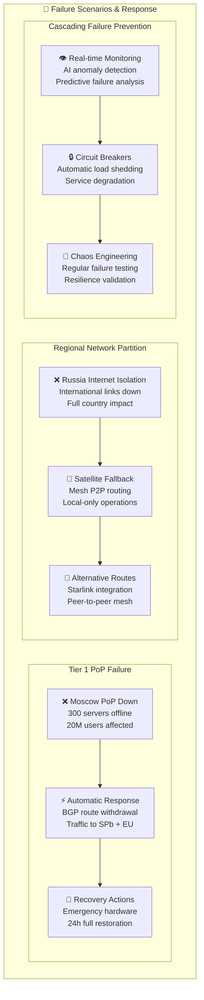

### 9.3 Business Continuity Matrix

| Component | Failure Type | RTO | RPO | Backup Strategy |
|-----------|--------------|-----|-----|-----------------|
| **Core PoP Infrastructure** | Hardware failure | 4 hours | 15 minutes | Hot standby hardware |
| **Control Plane Database** | Data corruption | 1 hour | 5 minutes | Real-time replication |
| **P2P Mesh Network** | Mass peer disconnection | 15 minutes | 0 | Distributed mesh healing |
| **Quantum Crypto Service** | Key compromise | 30 minutes | 0 | Emergency key rotation |
| **AI/ML Models** | Model corruption | 2 hours | 1 hour | Model versioning + rollback |
| **BGP Routing** | Route hijacking | 5 minutes | 0 | RPKI validation + monitoring |

## 10. Edge AI: Детальная спецификация

### 10.1 AI/ML задачи на Edge

#### DDoS Mitigation & Traffic Analysis
```yaml
ddos_protection_ai:
  model_type: "anomaly_detection + pattern_recognition"
  deployment: "real_time_inference_at_edge"
  latency_requirement: "< 1ms detection"
  accuracy_target: "> 99.5% detection rate"
  
  features:
    traffic_patterns:
      - "packet_rate_anomalies"
      - "protocol_distribution_shifts"
      - "geographic_origin_clustering"
      - "payload_entropy_analysis"
    
    ml_algorithms:
      - "isolation_forest_outlier_detection"
      - "lstm_time_series_anomaly"
      - "autoencoder_pattern_learning"
      - "ensemble_voting_classifier"
    
  response_actions:
    - "automatic_rate_limiting"
    - "traffic_rerouting"
    - "challenge_response_injection"
    - "upstream_notification"
```

#### Intelligent Routing Optimization
```yaml
routing_optimization_ai:
  model_type: "reinforcement_learning + graph_neural_networks"
  training_data: "network_telemetry + user_experience_metrics"
  update_frequency: "continuous_online_learning"
  
  optimization_objectives:
    primary: "minimize_end_to_end_latency"
    secondary: "maximize_throughput_utilization"
    tertiary: "balance_load_across_peers"
    
  decision_factors:
    network_conditions:
      - "real_time_latency_measurements"
      - "bandwidth_utilization_per_link"
      - "packet_loss_rates"
      - "jitter_and_stability_metrics"
    
    peer_capabilities:
      - "peer_processing_capacity"
      - "connection_reliability_scores"
      - "geographic_proximity"
      - "historical_performance_data"
    
  implementation:
    algorithm: "deep_q_network_with_experience_replay"
    state_space: "network_topology + traffic_matrix"
    action_space: "routing_table_modifications"
    reward_function: "user_experience_score_optimization"
```

#### Threat Detection & Security Analytics
```yaml
security_ai_system:
  threat_detection:
    model_architecture: "transformer_based_sequence_analysis"
    input_features: "network_flows + behavioral_patterns"
    detection_categories:
      - "malware_c2_communication"
      - "data_exfiltration_attempts"
      - "lateral_movement_patterns"
      - "insider_threat_indicators"
    
  behavioral_analysis:
    user_profiling:
      - "normal_usage_pattern_learning"
      - "device_fingerprint_analysis"
      - "temporal_access_patterns"
      - "geographic_consistency_checks"
    
    anomaly_scoring:
      algorithm: "variational_autoencoder"
      threshold_adaptation: "dynamic_percentile_based"
      false_positive_minimization: "human_feedback_learning"
    
  automated_response:
    risk_based_actions:
      low_risk: "enhanced_monitoring"
      medium_risk: "additional_authentication"
      high_risk: "session_termination"
      critical_risk: "account_lockdown + soc_alert"
```

### 10.2 Edge AI Infrastructure

#### Hardware Acceleration
```yaml
edge_ai_hardware:
  inference_acceleration:
    gpu_nodes: "nvidia_a100_for_tier1_pops"
    edge_tpu: "google_coral_for_tier3_edge"
    fpga_acceleration: "intel_stratix_for_custom_workloads"
    
  model_optimization:
    quantization: "int8_inference_optimization"
    pruning: "structured_sparsity_90_percent"
    distillation: "teacher_student_knowledge_transfer"
    compilation: "tensorrt_edge_optimization"
    
  distributed_inference:
    model_sharding: "across_multiple_edge_nodes"
    pipeline_parallelism: "for_large_model_serving"
    federated_learning: "privacy_preserving_model_updates"
```

#### AI Model Management
```yaml
model_lifecycle_management:
  deployment_pipeline:
    - "automated_model_validation"
    - "a_b_testing_framework"
    - "canary_deployment_strategy"
    - "performance_monitoring"
    - "automatic_rollback_capability"
    
  model_versioning:
    storage: "distributed_model_registry"
    versioning: "semantic_versioning_with_metadata"
    rollback: "instant_model_switching"
    
  continuous_improvement:
    data_collection: "edge_telemetry_aggregation"
    retraining_triggers: "performance_degradation_detection"
    federated_learning: "privacy_preserving_distributed_training"
    human_in_the_loop: "expert_validation_pipeline"
```

### 10.3 AI Performance Targets

| AI Service | Latency Target | Accuracy Target | Throughput Target | Resource Usage |
|------------|----------------|-----------------|-------------------|----------------|
| **DDoS Detection** | < 1ms | > 99.5% | 1M packets/sec | 50% GPU utilization |
| **Route Optimization** | < 10ms | N/A (optimization) | 100K decisions/sec | 30% CPU utilization |
| **Threat Detection** | < 50ms | > 99% precision | 10K events/sec | 40% GPU utilization |
| **Behavioral Analysis** | < 100ms | > 95% accuracy | 1K profiles/sec | 20% CPU utilization |
| **Traffic Classification** | < 5ms | > 98% accuracy | 500K flows/sec | 60% FPGA utilization |

## 11. Ключевые показатели эффективности

### 11.1 Технические KPI

**Network Performance**
- Global average latency: <50ms P95
- Network availability: >99.99%
- Packet loss rate: <0.1%
- Anycast convergence: <30 seconds

**Scalability Metrics**
- Concurrent users: 100M+
- Peak RPS: 1M requests/second
- P2P mesh size: 100M+ peers
- Edge locations: 200+

### 11.2 Business KPI

**Financial Metrics**
- Revenue growth: >300% YoY
- Market penetration: >5% target segments
- Customer acquisition cost: <$500
- Customer lifetime value: >$50,000

**Operational Metrics**
- Deployment speed: <30 days new PoP
- Automation coverage: >90%
- Mean time to repair: <2 hours
- Security incident response: <5 minutes

### 11.3 Partnership KPI

**Cloudflare Integration**
- Joint customer acquisition: >1,000 clients
- Revenue sharing efficiency: >80%
- Technical SLA compliance: >99.9%
- Integration deployment: <60 days

## 12. Конкурентные преимущества

### 12.1 Технологическое лидерство

**Собственные протокольные инновации**
- **Enhanced QUIC-go**: Собственная доработка с 10x performance boost
- **Modified WireGuard-go**: Адаптация под enterprise mesh networking  
- **Custom congestion control**: Оптимизация для P2P networks
- **Proprietary NAT traversal**: Автоматическое mesh formation

**Уникальные возможности**
- Post-quantum готовность с custom implementations
- AI-autonomous operations
- Multi-runtime architecture
- P2P mesh масштаба с WireGuard modifications

**Performance leadership**
- Sub-20ms edge latency с optimized QUIC
- 99.99% global availability через custom mesh
- Infinite horizontal scaling
- Quantum-safe encryption

### 12.2 Market positioning

**First-mover advantages**
- Restricted markets expertise
- Regulatory compliance leadership
- Strategic partnerships
- Patent portfolio

**Regulatory compliance moat**
- 152-ФЗ full compliance
- SORM implementation
- ГОСТ cryptography
- Local data residency

### 12.3 Partnership advantages

**Cloudflare collaboration**
- Global infrastructure access
- Enterprise credibility
- Technical acceleration
- Market validation

**Revenue diversification**
- Enterprise subscriptions
- Government contracts
- White-label licensing
- Professional services

## 13. Заключение

**CloudBridge Global Network** представляет уникальную рыночную возможность для создания первой в мире edge-сети, специализирующейся на restricted markets. Стратегическое партнерство с Cloudflare обеспечивает техническое превосходство и market credibility, а полное соответствие местному законодательству создает устойчивое конкурентное преимущество.

### Ключевые факторы успеха:

1. **Technical Excellence**: Post-quantum security, AI-driven operations, sub-20ms latency
2. **Regulatory Leadership**: Полное соответствие 152-ФЗ, SORM, ГОСТ
3. **Strategic Partnerships**: Cloudflare Border Gateway architecture
4. **Market Timing**: First-mover в растущем $50B+ рынке
5. **Scalable Architecture**: От 1M до 100M+ пользователей

### Expected outcomes:

- **$3.6B annual revenue** при 100M пользователях
- **93% gross margin** в зрелой фазе
- **200+ edge locations** глобально
- **Market leadership** в restricted markets segment

CloudBridge Global Network не просто технологическая платформа - это новая парадигма глобального connectivity для ограниченных рынков, обеспечивающая высочайшую производительность при полном соблюдении местных требований и создающая устойчивое конкурентное преимущество на десятилетия вперед.
