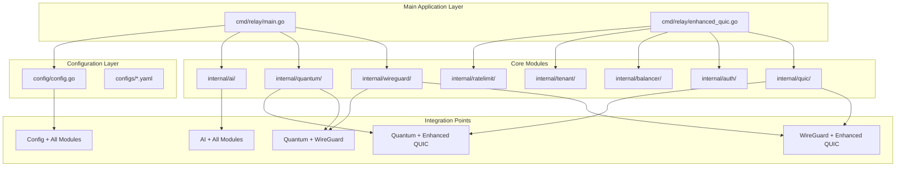

# Техническое задание: Интеграция новых модулей CloudBridge Relay

## 📋 **Обзор задачи**

**Цель**: Интегрировать новые модули (WireGuard P2P Mesh, Post-Quantum Cryptography, AI Analytics) в существующую архитектуру CloudBridge Relay и обеспечить корректную работу всех связей между модулями.

**Приоритет**: Критический  
**Срок**: 2-3 недели  
**Статус**: В разработке  

---

## 🏗️ **Архитектурная схема интеграции**



---

## 🎯 **Задача 1: Обновление конфигурации**

### **1.1 Обновить `config/config.go`**

**Файл**: `config/config.go`  
**Статус**: ❌ Не выполнено  

**Добавить новые секции конфигурации:**

```go
// Enhanced QUIC Configuration
EnhancedQUIC struct {
    Enabled         bool   `json:"enabled"`
    MaxStreams      int    `json:"max_streams"`
    KeepAlive       bool   `json:"keep_alive"`
    IdleTimeout     string `json:"idle_timeout"`
    HandshakeTimeout string `json:"handshake_timeout"`
    DDoSProtection  bool   `json:"ddos_protection"`
    GeographicRouting bool `json:"geographic_routing"`
    KeycloakIntegration bool `json:"keycloak_integration"`
} `json:"enhanced_quic"`

// WireGuard P2P Mesh Configuration
WireGuard struct {
    Enabled     bool   `json:"enabled"`
    Interface   struct {
        Name       string `json:"name"`
        ListenPort int    `json:"listen_port"`
        Address    string `json:"address"`
    } `json:"interface"`
    Discovery   struct {
        RegistryURL       string `json:"registry_url"`
        HeartbeatInterval string `json:"heartbeat_interval"`
        MaxPeers          int    `json:"max_peers"`
    } `json:"discovery"`
    Mesh       struct {
        Enabled           bool   `json:"enabled"`
        AutoDiscovery     bool   `json:"auto_discovery"`
        MaxConnections    int    `json:"max_connections"`
        RoutingStrategy   string `json:"routing_strategy"`
    } `json:"mesh"`
    SiteToSite struct {
        Enabled           bool   `json:"enabled"`
        CorporateNetworks []struct {
            NetworkID     string `json:"network_id"`
            CIDR          string `json:"cidr"`
            TenantID      string `json:"tenant_id"`
        } `json:"corporate_networks"`
    } `json:"site_to_site"`
} `json:"wireguard"`

// Post-Quantum Cryptography Configuration
Quantum struct {
    Enabled         bool   `json:"enabled"`
    Algorithm       string `json:"algorithm"`
    HybridMode      bool   `json:"hybrid_mode"`
    KeySize         int    `json:"key_size"`
    SignatureScheme string `json:"signature_scheme"`
    FallbackEnabled bool   `json:"fallback_enabled"`
    KeyRotationDays int    `json:"key_rotation_days"`
    WireGuard       struct {
        Enabled bool `json:"enabled"`
    } `json:"wireguard"`
    EnhancedQUIC    struct {
        Enabled bool `json:"enabled"`
    } `json:"enhanced_quic"`
} `json:"quantum"`

// AI Analytics Configuration
AI struct {
    Enabled           bool   `json:"enabled"`
    BehaviorAnalysis  struct {
        Enabled       bool    `json:"enabled"`
        ModelPath     string  `json:"model_path"`
        Threshold     float64 `json:"threshold"`
        LearningRate  float64 `json:"learning_rate"`
    } `json:"behavior_analysis"`
    PredictiveSecurity struct {
        Enabled    bool    `json:"enabled"`
        Confidence float64 `json:"confidence"`
    } `json:"predictive_security"`
    AutomatedResponse struct {
        Enabled bool `json:"enabled"`
    } `json:"automated_response"`
    Monitoring struct {
        Enabled      bool   `json:"enabled"`
        DashboardURL string `json:"dashboard_url"`
        RefreshRate  string `json:"refresh_rate"`
    } `json:"monitoring"`
} `json:"ai"`
```

### **1.2 Создать конфигурационные файлы**

**Файлы для создания:**
- `configs/wireguard.yaml`
- `configs/quantum.yaml`
- `configs/ai.yaml`
- `configs/enhanced_quic.yaml` (обновить существующий)

**Пример `configs/wireguard.yaml`:**
```yaml
wireguard:
  enabled: true
  interface:
    name: "wg0"
    listen_port: 51820
    address: "10.100.1.1/24"
  discovery:
    registry_url: "https://registry.cloudbridge.com"
    heartbeat_interval: "30s"
    max_peers: 50
  mesh:
    enabled: true
    auto_discovery: true
    max_connections: 100
    routing_strategy: "hybrid"
  site_to_site:
    enabled: true
    corporate_networks:
      - network_id: "office-moscow"
        cidr: "192.168.1.0/24"
        tenant_id: "moscow-tenant"
      - network_id: "office-spb"
        cidr: "192.168.2.0/24"
        tenant_id: "spb-tenant"
```

---

## 🎯 **Задача 2: Интеграция WireGuard P2P Mesh**

### **2.1 Расширить `internal/wireguard/wireguard.go`**

**Файл**: `internal/wireguard/wireguard.go`  
**Статус**: ✅ Базовая структура создана  

**Добавить методы:**

```go
// WireGuardInterface методы
func (wgi *WireGuardInterface) Start() error
func (wgi *WireGuardInterface) Stop() error
func (wgi *WireGuardInterface) AddPeer(peer *WireGuardPeer) error
func (wgi *WireGuardInterface) RemovePeer(publicKey string) error
func (wgi *WireGuardInterface) GetStatus() map[string]interface{}

// MeshTopology методы
func (mt *MeshTopology) AddPeer(peerID string, peer *WireGuardPeer) error
func (mt *MeshTopology) RemovePeer(peerID string) error
func (mt *MeshTopology) GetOptimalRoute(destination string) ([]string, error)
func (mt *MeshTopology) UpdateRoutingTable() error

// PeerDiscovery методы
func (pd *PeerDiscovery) Start() error
func (pd *PeerDiscovery) Stop() error
func (pd *PeerDiscovery) DiscoverPeers() ([]*DiscoveredPeer, error)
func (pd *PeerDiscovery) RegisterLocalPeer() error

// QUICOverWireGuard методы
func (qowg *QUICOverWireGuard) Start() error
func (qowg *QUICOverWireGuard) Stop() error
func (qowg *QUICOverWireGuard) CreateConnection(peerID string) (interface{}, error)

// HybridRouter методы
func (hr *HybridRouter) RouteRequest(clientIP, destination string) (string, error)
func (hr *HybridRouter) SetRoutingStrategy(strategy RoutingStrategy) error
func (hr *HybridRouter) GetRoutingStats() map[string]interface{}

// SiteToSiteManager методы
func (ssm *SiteToSiteManager) AddCorporateNetwork(network *CorporateNetwork) error
func (ssm *SiteToSiteManager) CreateSiteRoute(from, to string) (*SiteRoute, error)
func (ssm *SiteToSiteManager) GetVPNReplacementStatus() map[string]bool
```

### **2.2 Создать интеграционные тесты**

**Файл**: `internal/wireguard/integration_test.go`
```go
package wireguard

import (
    "testing"
    "time"
)

func TestWireGuardMeshIntegration(t *testing.T) {
    // Тест интеграции WireGuard mesh
}

func TestQUICOverWireGuardIntegration(t *testing.T) {
    // Тест QUIC поверх WireGuard
}

func TestHybridRoutingIntegration(t *testing.T) {
    // Тест hybrid routing
}

func TestSiteToSiteIntegration(t *testing.T) {
    // Тест site-to-site connectivity
}
```

---

## 🎯 **Задача 3: Интеграция Post-Quantum Cryptography**

### **3.1 Расширить `internal/quantum/quantum.go`**

**Файл**: `internal/quantum/quantum.go`  
**Статус**: ✅ Базовая структура создана  

**Добавить методы:**

```go
// PQCConfig методы
func (pqc *PQCConfig) Validate() error
func (pqc *PQCConfig) GetAlgorithmInfo() map[string]interface{}

// PQCKeyPair методы
func (pqk *PQCKeyPair) Generate() error
func (pqk *PQCKeyPair) Validate() error
func (pqk *PQCKeyPair) Rotate() error

// HybridKeyPair методы
func (hkp *HybridKeyPair) Generate() error
func (hkp *HybridKeyPair) Combine() error
func (hkp *HybridKeyPair) Validate() error

// QuantumWireGuardInterface методы
func (qwg *QuantumWireGuardInterface) Start() error
func (qwg *QuantumWireGuardInterface) Stop() error
func (qwg *QuantumWireGuardInterface) ExchangeKeys(peerID string) error
func (qwg *QuantumWireGuardInterface) ValidateQuantumSignature(data, signature []byte) error

// QuantumEnhancedQUIC методы
func (qeq *QuantumEnhancedQUIC) Start() error
func (qeq *QuantumEnhancedQUIC) Stop() error
func (qeq *QuantumEnhancedQUIC) GenerateCertificate() error
func (qeq *QuantumEnhancedQUIC) ValidateCertificate(cert *QuantumCertificate) error
```

### **3.2 Создать PQC алгоритмы (заглушки)**

**Файл**: `internal/quantum/algorithms.go`
```go
package quantum

// CRYSTALS-Kyber implementation (заглушка)
func GenerateKyberKeyPair(level PQCKeySize) (*PQCKeyPair, error) {
    // Заглушка для CRYSTALS-Kyber
    return &PQCKeyPair{
        Algorithm: PQCKyber,
        KeySize:   level,
        CreatedAt: time.Now(),
        ExpiresAt: time.Now().AddDate(0, 0, 30),
    }, nil
}

// CRYSTALS-Dilithium implementation (заглушка)
func GenerateDilithiumKeyPair(level PQCKeySize) (*PQCKeyPair, error) {
    // Заглушка для CRYSTALS-Dilithium
    return &PQCKeyPair{
        Algorithm: PQCDilithium,
        KeySize:   level,
        CreatedAt: time.Now(),
        ExpiresAt: time.Now().AddDate(0, 0, 30),
    }, nil
}

// Hybrid key exchange
func PerformHybridKeyExchange(classical, quantum *PQCKeyPair) (*HybridKeyPair, error) {
    // Заглушка для hybrid key exchange
    return &HybridKeyPair{
        Classical: &ClassicalKeyPair{Algorithm: "X25519"},
        Quantum:   quantum,
        Combined:  []byte("hybrid-key"),
    }, nil
}
```

---

## 🎯 **Задача 4: Интеграция AI Analytics**

### **4.1 Расширить `internal/ai/ai.go`**

**Файл**: `internal/ai/ai.go`  
**Статус**: ✅ Базовая структура создана  

**Добавить методы:**

```go
// BehaviorAnalyzer методы
func (ba *BehaviorAnalyzer) Start() error
func (ba *BehaviorAnalyzer) Stop() error
func (ba *BehaviorAnalyzer) AnalyzeUserBehavior(userID string, event interface{}) error
func (ba *BehaviorAnalyzer) DetectAnomaly(userID string) (float64, error)
func (ba *BehaviorAnalyzer) UpdateUserProfile(userID string, event interface{}) error

// PredictiveSecurity методы
func (ps *PredictiveSecurity) Start() error
func (ps *PredictiveSecurity) Stop() error
func (ps *PredictiveSecurity) PredictThreat(indicators []ThreatIndicator) (*ThreatPrediction, error)
func (ps *PredictiveSecurity) AddThreatModel(model *ThreatModel) error
func (ps *PredictiveSecurity) GetThreatPredictions() map[string]*ThreatPrediction

// AutomatedResponse методы
func (ar *AutomatedResponse) Start() error
func (ar *AutomatedResponse) Stop() error
func (ar *AutomatedResponse) AddResponseRule(rule *ResponseRule) error
func (ar *AutomatedResponse) TriggerResponse(event interface{}) error
func (ar *AutomatedResponse) GetResponseHistory() []ResponseEvent

// AIMonitoring методы
func (aim *AIMonitoring) Start() error
func (aim *AIMonitoring) Stop() error
func (aim *AIMonitoring) AddMetric(metric *AIMetric) error
func (aim *AIMonitoring) CreateAlert(alert *AIAlert) error
func (aim *AIMonitoring) GetDashboard() *AIDashboard
```

### **4.2 Создать AI интеграции**

**Файл**: `internal/ai/integrations.go`
```go
package ai

// Интеграция с WireGuard
func (ba *BehaviorAnalyzer) AnalyzeWireGuardBehavior(peerID string, event interface{}) error {
    // Анализ поведения WireGuard peers
}

// Интеграция с Enhanced QUIC
func (ba *BehaviorAnalyzer) AnalyzeQUICBehavior(connectionID string, event interface{}) error {
    // Анализ поведения QUIC соединений
}

// Интеграция с Post-Quantum
func (ps *PredictiveSecurity) PredictQuantumThreats() error {
    // Предикция угроз для квантовой криптографии
}

// Интеграция с автоматическим реагированием
func (ar *AutomatedResponse) RespondToWireGuardThreat(threat *ThreatPrediction) error {
    // Автоматическое реагирование на угрозы WireGuard
}
```

---

## 🎯 **Задача 5: Обновление main.go**

### **5.1 Исправить инициализацию в `cmd/relay/main.go`**

**Файл**: `cmd/relay/main.go`  
**Статус**: ❌ Требует исправления  

**Проблемы для исправления:**
1. `cfg.EnhancedQUIC.Enabled` - поле не существует
2. `cfg.WireGuard.Enabled` - поле не существует  
3. `cfg.Quantum.Enabled` - поле не существует
4. `cfg.AI.Enabled` - поле не существует

**Решение:**
```go
// Временное решение до обновления конфигурации
enhancedEnabled := false // cfg.EnhancedQUIC.Enabled
wireGuardEnabled := false // cfg.WireGuard.Enabled  
quantumEnabled := false // cfg.Quantum.Enabled
aiAnalyticsEnabled := false // cfg.AI.Enabled

// После обновления конфигурации заменить на:
enhancedEnabled := cfg.EnhancedQUIC.Enabled
wireGuardEnabled := cfg.WireGuard.Enabled
quantumEnabled := cfg.Quantum.Enabled
aiAnalyticsEnabled := cfg.AI.Enabled
```

### **5.2 Добавить новые поля в Server struct**

**Обновить возвращаемый Server struct:**
```go
return &Server{
    config:                cfg,
    logger:                loggerInstance,
    tunnelManager:         tunnelManager,
    metricsServer:         metricsServer,
    authAdapter:           authAdapter,
    circuitBreaker:        circuitBreaker,
    healthChecker:         healthChecker,
    enhancedQUICManager:   enhancedQUICManager,
    tenantManager:         tenantMgr,
    loadBalancer:          loadBal,
    ipRateLimit:           ipRateLimit,
    enhancedKeycloakAuth:  enhancedKeycloakAuth,
    enhancedEnabled:       enhancedEnabled,
    
    // WireGuard P2P Mesh components
    wireGuardEnabled:      wireGuardEnabled,
    wireGuardInterface:    wireGuardInterface,
    wireGuardMesh:         wireGuardMesh,
    wireGuardPeerDiscovery: wireGuardPeerDiscovery,
    quicOverWireGuard:     quicOverWireGuard,
    hybridRouter:          hybridRouter,
    siteToSiteManager:     siteToSiteManager,
    
    // Post-Quantum Cryptography components
    quantumEnabled:        quantumEnabled,
    quantumConfig:         quantumConfig,
    quantumWireGuard:      quantumWireGuard,
    quantumEnhancedQUIC:   quantumEnhancedQUIC,
    
    // AI Analytics components
    aiAnalyticsEnabled:    aiAnalyticsEnabled,
    aiBehaviorAnalyzer:    aiBehaviorAnalyzer,
    aiPredictiveSecurity:  aiPredictiveSecurity,
    aiAutomatedResponse:   aiAutomatedResponse,
    aiMonitoring:          aiMonitoring,
    
    ctx:                   ctx,
    cancel:                cancel,
    startTime:             time.Now(),
}, nil
```

---

## 🎯 **Задача 6: Создание интеграционных тестов**

### **6.1 Создать `cmd/relay/integration_test.go`**

**Файл**: `cmd/relay/integration_test.go`
```go
package main

import (
    "testing"
    "time"
)

func TestFullModuleIntegration(t *testing.T) {
    // Тест полной интеграции всех модулей
}

func TestWireGuardEnhancedQUICIntegration(t *testing.T) {
    // Тест интеграции WireGuard + Enhanced QUIC
}

func TestQuantumWireGuardIntegration(t *testing.T) {
    // Тест интеграции Quantum + WireGuard
}

func TestAIEnhancedQUICIntegration(t *testing.T) {
    // Тест интеграции AI + Enhanced QUIC
}

func TestAllModulesTogether(t *testing.T) {
    // Тест всех модулей вместе
}
```

### **6.2 Создать `internal/integration/module_integration_test.go`**

**Файл**: `internal/integration/module_integration_test.go`
```go
package integration

import (
    "testing"
    "github.com/twogc/cloudbridge-relay-installer/internal/wireguard"
    "github.com/twogc/cloudbridge-relay-installer/internal/quantum"
    "github.com/twogc/cloudbridge-relay-installer/internal/ai"
    "github.com/twogc/cloudbridge-relay-installer/internal/quic"
)

func TestWireGuardQuantumIntegration(t *testing.T) {
    // Тест интеграции WireGuard + Quantum
}

func TestAIWireGuardIntegration(t *testing.T) {
    // Тест интеграции AI + WireGuard
}

func TestQuantumEnhancedQUICIntegration(t *testing.T) {
    // Тест интеграции Quantum + Enhanced QUIC
}

func TestAIPredictiveSecurityIntegration(t *testing.T) {
    // Тест интеграции AI Predictive Security
}
```

---

## 🎯 **Задача 7: Обновление метрик и мониторинга**

### **7.1 Создать `internal/metrics/wireguard.go`**

**Файл**: `internal/metrics/wireguard.go`
```go
package metrics

import (
    "github.com/prometheus/client_golang/prometheus"
    "github.com/prometheus/client_golang/prometheus/promauto"
)

var (
    wireGuardPeersTotal = promauto.NewGauge(
        prometheus.GaugeOpts{
            Name: "wireguard_peers_total",
            Help: "Total number of WireGuard peers",
        },
    )
    
    wireGuardConnectionsActive = promauto.NewGauge(
        prometheus.GaugeOpts{
            Name: "wireguard_connections_active",
            Help: "Number of active WireGuard connections",
        },
    )
    
    wireGuardBytesTransferred = promauto.NewCounterVec(
        prometheus.CounterOpts{
            Name: "wireguard_bytes_transferred_total",
            Help: "Total bytes transferred via WireGuard",
        },
        []string{"direction", "peer_id"},
    )
    
    wireGuardHandshakeDuration = promauto.NewHistogram(
        prometheus.HistogramOpts{
            Name: "wireguard_handshake_duration_seconds",
            Help: "WireGuard handshake duration in seconds",
        },
    )
)
```

### **7.2 Создать `internal/metrics/quantum.go`**

**Файл**: `internal/metrics/quantum.go`
```go
package metrics

import (
    "github.com/prometheus/client_golang/prometheus"
    "github.com/prometheus/client_golang/prometheus/promauto"
)

var (
    quantumKeyExchangesTotal = promauto.NewCounter(
        prometheus.CounterOpts{
            Name: "quantum_key_exchanges_total",
            Help: "Total number of quantum key exchanges",
        },
    )
    
    quantumKeyRotationDuration = promauto.NewHistogram(
        prometheus.HistogramOpts{
            Name: "quantum_key_rotation_duration_seconds",
            Help: "Quantum key rotation duration in seconds",
        },
    )
    
    quantumSignatureValidations = promauto.NewCounterVec(
        prometheus.CounterOpts{
            Name: "quantum_signature_validations_total",
            Help: "Total number of quantum signature validations",
        },
        []string{"algorithm", "status"},
    )
)
```

### **7.3 Создать `internal/metrics/ai.go`**

**Файл**: `internal/metrics/ai.go`
```go
package metrics

import (
    "github.com/prometheus/client_golang/prometheus"
    "github.com/prometheus/client_golang/prometheus/promauto"
)

var (
    aiAnomalyDetections = promauto.NewCounterVec(
        prometheus.CounterOpts{
            Name: "ai_anomaly_detections_total",
            Help: "Total number of AI anomaly detections",
        },
        []string{"severity", "type"},
    )
    
    aiThreatPredictions = promauto.NewCounterVec(
        prometheus.CounterOpts{
            Name: "ai_threat_predictions_total",
            Help: "Total number of AI threat predictions",
        },
        []string{"threat_type", "confidence_level"},
    )
    
    aiAutomatedResponses = promauto.NewCounterVec(
        prometheus.CounterOpts{
            Name: "ai_automated_responses_total",
            Help: "Total number of AI automated responses",
        },
        []string{"action_type", "success"},
    )
    
    aiResponseTime = promauto.NewHistogram(
        prometheus.HistogramOpts{
            Name: "ai_response_time_seconds",
            Help: "AI response time in seconds",
        },
    )
)
```

---

## 🎯 **Задача 8: Обновление health checks**

### **8.1 Расширить `internal/health/health.go`**

**Добавить новые health checks:**

```go
// WireGuard health check
func WireGuardHealthCheck(name string, wgInterface *wireguard.WireGuardInterface) HealthCheck {
    return func(ctx context.Context) error {
        if wgInterface == nil {
            return fmt.Errorf("WireGuard interface not initialized")
        }
        
        status := wgInterface.GetStatus()
        if status == nil {
            return fmt.Errorf("WireGuard interface status unavailable")
        }
        
        return nil
    }
}

// Quantum health check
func QuantumHealthCheck(name string, quantumConfig *quantum.PQCConfig) HealthCheck {
    return func(ctx context.Context) error {
        if quantumConfig == nil {
            return fmt.Errorf("Quantum configuration not initialized")
        }
        
        if !quantumConfig.Enabled {
            return fmt.Errorf("Quantum cryptography disabled")
        }
        
        return nil
    }
}

// AI Analytics health check
func AIHealthCheck(name string, aiMonitoring *ai.AIMonitoring) HealthCheck {
    return func(ctx context.Context) error {
        if aiMonitoring == nil {
            return fmt.Errorf("AI monitoring not initialized")
        }
        
        if !aiMonitoring.Enabled {
            return fmt.Errorf("AI monitoring disabled")
        }
        
        return nil
    }
}
```

---

## 🎯 **Задача 9: Создание документации**

### **9.1 Создать `docs/integration/MODULE_INTEGRATION_GUIDE.md`**

**Файл**: `docs/integration/MODULE_INTEGRATION_GUIDE.md`
```markdown
# Руководство по интеграции модулей CloudBridge Relay

## Обзор

Данное руководство описывает интеграцию новых модулей:
- WireGuard P2P Mesh Network
- Post-Quantum Cryptography  
- AI Analytics

## Архитектура интеграции

### WireGuard + Enhanced QUIC
- WireGuard обеспечивает базовую mesh сеть
- Enhanced QUIC работает поверх WireGuard
- Hybrid routing для оптимальной производительности

### Quantum + WireGuard
- Квантово-устойчивые ключи для WireGuard
- Hybrid схемы (Classical + Quantum)
- Автоматическая ротация ключей

### AI + All Modules
- Анализ поведения для всех модулей
- Предиктивная безопасность
- Автоматическое реагирование

## Конфигурация

### WireGuard Configuration
```yaml
wireguard:
  enabled: true
  interface:
    name: "wg0"
    listen_port: 51820
```

### Quantum Configuration
```yaml
quantum:
  enabled: true
  algorithm: "kyber"
  hybrid_mode: true
```

### AI Configuration
```yaml
ai:
  enabled: true
  behavior_analysis:
    enabled: true
    threshold: 0.8
```

## Тестирование

### Unit Tests
```bash
go test ./internal/wireguard/...
go test ./internal/quantum/...
go test ./internal/ai/...
```

### Integration Tests
```bash
go test ./cmd/relay/ -tags=integration
go test ./internal/integration/...
```

## Мониторинг

### Prometheus Metrics
- `wireguard_peers_total`
- `quantum_key_exchanges_total`
- `ai_anomaly_detections_total`

### Health Checks
- `/health/wireguard`
- `/health/quantum`
- `/health/ai`

## Troubleshooting

### Common Issues
1. WireGuard interface not starting
2. Quantum key generation failing
3. AI model loading errors

### Debug Commands
```bash
# Check WireGuard status
wg show

# Check quantum keys
curl http://localhost:8080/health/quantum

# Check AI status
curl http://localhost:8080/health/ai
```
```

---

## 📊 **Критерии приемки**

### ✅ **Обязательные требования:**
1. **Компиляция без ошибок** - все модули компилируются без ошибок
2. **Конфигурация работает** - новые секции конфигурации загружаются корректно
3. **Инициализация модулей** - все модули инициализируются без ошибок
4. **Интеграционные тесты** - все интеграционные тесты проходят
5. **Метрики работают** - Prometheus метрики экспортируются корректно
6. **Health checks** - health endpoints возвращают корректный статус

### ✅ **Дополнительные требования:**
1. **Документация** - создана полная документация по интеграции
2. **Логирование** - добавлено структурированное логирование для всех модулей
3. **Error handling** - корректная обработка ошибок во всех модулях
4. **Graceful shutdown** - корректное завершение работы всех модулей

---

## 🚀 **План выполнения**

### **Неделя 1:**
- [ ] Задача 1: Обновление конфигурации
- [ ] Задача 2.1: Расширение WireGuard модуля
- [ ] Задача 3.1: Расширение Quantum модуля
- [ ] Задача 4.1: Расширение AI модуля

### **Неделя 2:**
- [ ] Задача 5: Обновление main.go
- [ ] Задача 6: Создание интеграционных тестов
- [ ] Задача 7: Обновление метрик
- [ ] Задача 8: Обновление health checks

### **Неделя 3:**
- [ ] Задача 9: Создание документации
- [ ] Тестирование всех интеграций
- [ ] Исправление найденных проблем
- [ ] Финальная проверка и рефакторинг

---

## 🔧 **Инструменты и зависимости**

### **Необходимые зависимости:**
```go
// WireGuard
"golang.zx2c4.com/wireguard/wgctrl"
"golang.zx2c4.com/wireguard/wgctrl/wgtypes"

// Quantum (заглушки)
"github.com/cloudflare/circl/sign/dilithium"
"github.com/cloudflare/circl/kem/kyber"

// AI (заглушки)
"github.com/sashabaranov/go-openai"
"gonum.org/v1/gonum/mat"
```

### **Инструменты разработки:**
- Go 1.23
- Prometheus для метрик
- Grafana для дашбордов
- Jaeger для трейсинга (опционально)

---

## 📞 **Контакты и поддержка**

**Ответственный разработчик**: [Имя разработчика]  
**Ревьюер**: [Имя ревьюера]  
**Deadline**: [Дата]  

**Каналы связи:**
- Slack: #cloudbridge-dev
- Email: dev@cloudbridge.com
- Jira: CLOUD-XXX

---

**Статус**: 🟡 В разработке  
**Последнее обновление**: [Дата]  
**Версия**: 1.0
