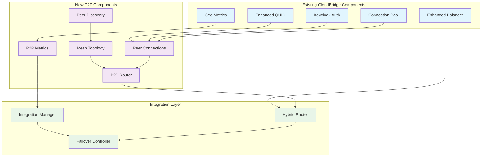
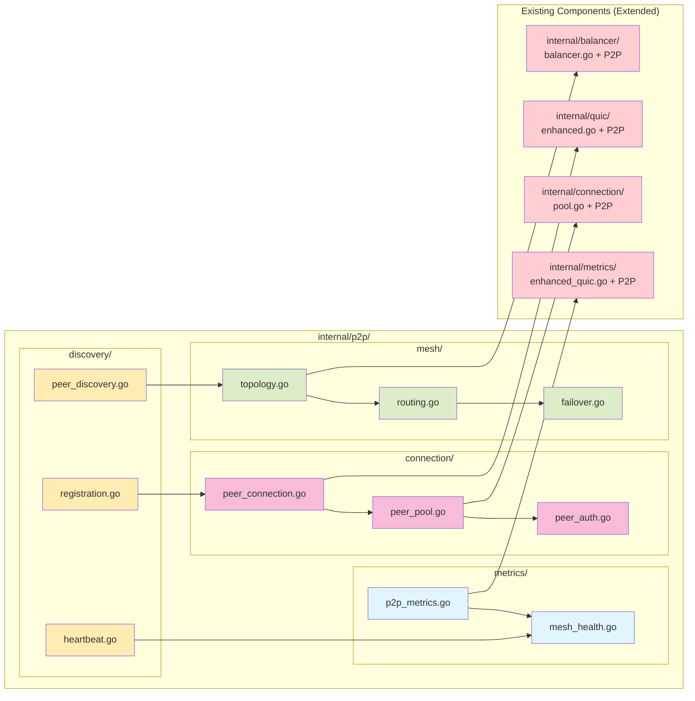
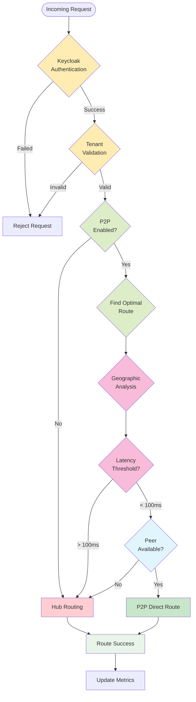
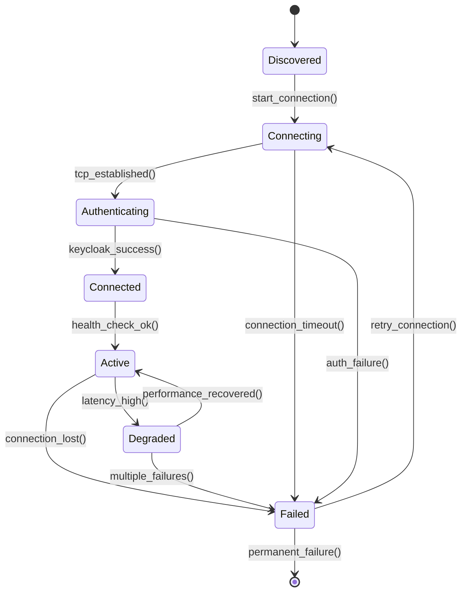
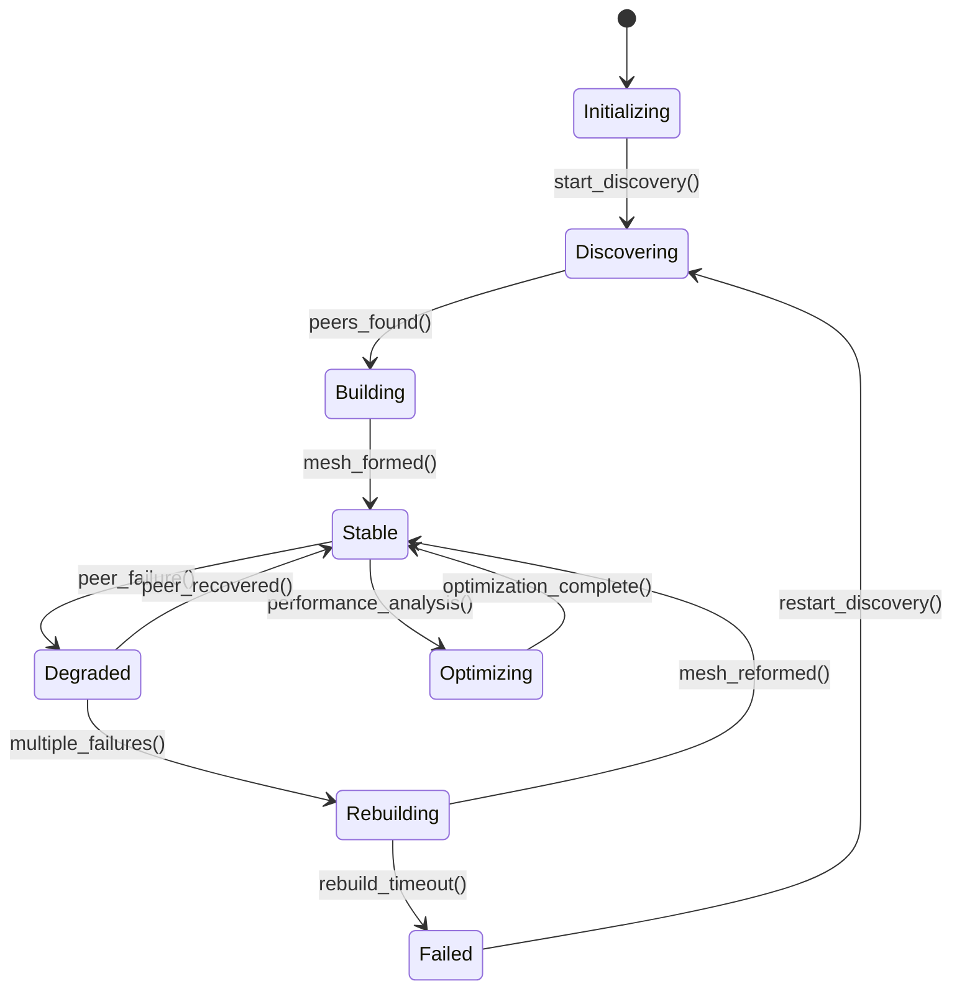
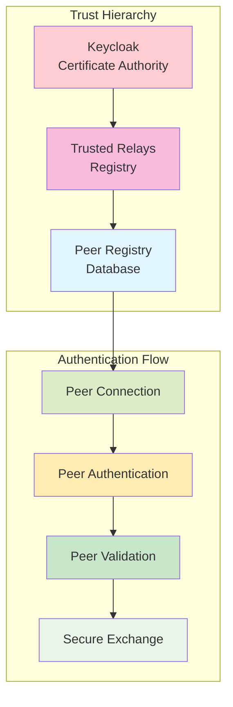

# P2P Network Architecture Overview для CloudBridge Relay

## 🏗️ **Архитектурная схема P2P интеграции**

### **Высокоуровневая архитектура**



### **Детальная схема модулей**



---

## 🔗 **Интеграционные точки**

### **1. Enhanced QUIC + P2P**
```go
// internal/quic/enhanced.go - расширения
type EnhancedConnection struct {
    // Existing fields...
    
    // P2P extensions
    peerConnections map[string]*p2p.PeerConnection
    meshRouter      *p2p.MeshRouter
    p2pEnabled      bool
}
```

### **2. Balancer + P2P Router**
```go
// internal/balancer/balancer.go - расширения
type Balancer struct {
    // Existing fields...
    
    // P2P extensions
    p2pRouter    *p2p.P2PRouter
    meshTopology *p2p.MeshTopology
    hybridMode   bool
}
```

### **3. Connection Pool + Peer Pool**
```go
// internal/connection/pool.go - расширения
type ConnectionPool struct {
    // Existing fields...
    
    // P2P extensions
    peerPool     *p2p.PeerConnectionPool
    p2pEnabled   bool
}
```

---

## 📊 **Data Flow Architecture**

### **Request Routing Decision Tree**



---

## 🏛️ **Component Interaction Matrix**

| Component | Enhanced QUIC | Balancer | Auth | Metrics | P2P Router | Mesh Topology |
|-----------|---------------|----------|------|---------|------------|---------------|
| **Peer Discovery** | ❌ | ✅ Geo | ✅ Auth | ✅ Peer Count | ✅ Routes | ✅ Topology |
| **P2P Router** | ✅ Connections | ✅ Routing | ❌ | ✅ Routes | - | ✅ Mesh |
| **Mesh Topology** | ✅ Peer Conns | ✅ Servers | ❌ | ✅ Mesh Size | ✅ Routes | - |
| **Peer Pool** | ✅ QUIC Conns | ❌ | ✅ Peer Auth | ✅ Pool Stats | ✅ Connections | ✅ Peers |
| **Failover Mgr** | ✅ Reconnect | ✅ Fallback | ❌ | ✅ Failures | ✅ Backup | ✅ Health |

**Legend:**
- ✅ Direct Integration
- ❌ No Direct Interaction
- 🔄 Bidirectional
- ➡️ One-way Dependency

---

## 🎯 **Key Design Decisions**

### **1. Hybrid Architecture (не pure P2P)**
**Решение**: Комбинация Hub-and-Spoke + P2P Mesh
**Обоснование**: 
- Fallback to hub при P2P failures
- Gradual adoption для клиентов
- Optimal performance для different scenarios

### **2. Enhanced QUIC как foundation**
**Решение**: P2P поверх Enhanced QUIC, не parallel
**Обоснование**:
- Reuse multi-tenancy logic
- Unified authentication через Keycloak
- Consistent metrics и monitoring

### **3. Geographic-first routing**
**Решение**: Использовать существующий GeographicRouter
**Обоснование**:
- Proven algorithm уже работает
- Extension вместо rewrite
- Consistent с existing behavior

### **4. Opt-in P2P adoption**
**Решение**: Feature toggle для P2P
**Обоснование**:
- Zero risk для existing clients
- Gradual rollout возможен
- A/B testing capability

---

## 🔄 **State Management**

### **Peer State Machine**



### **Mesh State Management**



---

## 📈 **Scalability Considerations**

### **Mesh Size Limits**
- **Recommended**: 10-20 peers per region
- **Maximum**: 50 peers total per mesh
- **Connection limit**: 10 concurrent P2P connections per relay

### **Performance Thresholds**
- **P2P latency advantage**: < 100ms threshold
- **Failover time**: < 5 seconds
- **Discovery time**: < 30 seconds для new peers

### **Resource Usage**
- **Memory overhead**: < 10% для P2P features
- **CPU overhead**: < 5% для routing decisions
- **Network overhead**: < 2% для mesh maintenance

---

## 🛡️ **Security Architecture**

### **Trust Model**



### **Security Layers**
1. **Transport Security**: TLS 1.3 для all P2P connections
2. **Authentication**: Keycloak JWT tokens для peer identity
3. **Authorization**: Tenant-based access control
4. **Data Integrity**: QUIC built-in integrity checks
5. **Audit Trail**: Complete P2P activity logging

---

**Документ готов для технической review и implementation planning!** 🚀
