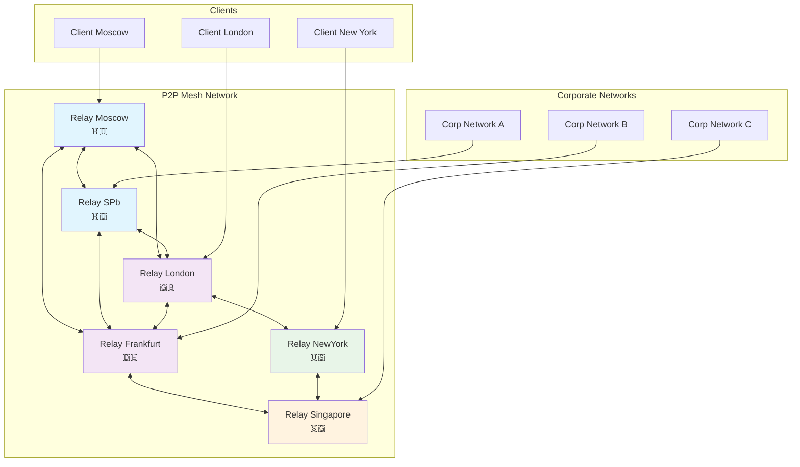

# Техническое задание: Реализация P2P Network в CloudBridge Relay

## 📋 **Общая информация**

- **Проект**: CloudBridge Relay
- **Задача**: Интеграция P2P Mesh Network
- **Версия**: v2.2
- **Дата создания**: Январь 2025
- **Приоритет**: Высокий
- **Срок реализации**: 10-12 недель

---

## 🎯 **Цель проекта**

Интегрировать **P2P Mesh Network** в существующую архитектуру CloudBridge Relay для создания:

- **Прямых server-to-server соединений** с децентрализованной архитектурой
- **Автоматического peer discovery** и mesh topology management
- **Интеллектуальной маршрутизации** через оптимальные peer paths
- **Fault tolerance** с автоматическим failover между peers
- **Performance optimization** за счет direct peer connections

---

## 🏗️ **Архитектурная концепция**

### **Принцип "Mesh of Relays"**



### **Ключевые принципы**

1. **Hybrid Architecture**: Hub-and-spoke + P2P mesh для оптимальной производительности
2. **Geographic Optimization**: Использование существующего GeographicRouter для P2P routing
3. **Enhanced QUIC Integration**: P2P поверх Enhanced QUIC для мультитенантности
4. **Zero Trust P2P**: Все peer connections через Keycloak authentication
5. **Intelligent Routing**: Автоматический выбор между hub и P2P paths

---

## 🔧 **Технические требования**

### **1. Совместимость с существующей архитектурой**

#### **✅ Должно сохраниться:**
- Полная совместимость с Enhanced QUIC
- Интеграция с Keycloak authentication
- Multi-tenancy support
- Existing connection pool management
- Metrics и monitoring
- Zero Trust architecture

#### **✅ Должно расширяться:**
- `internal/balancer` → P2P peer selection
- `internal/quic/enhanced.go` → P2P connections
- `internal/connection/pool.go` → Peer connection pooling
- `cmd/relay/main.go` → P2P initialization

### **2. Новые компоненты для реализации**

```
internal/
├── p2p/
│   ├── discovery/
│   │   ├── peer_discovery.go           # Обнаружение peers
│   │   ├── registration.go             # Регистрация в mesh
│   │   └── heartbeat.go               # Health checking peers
│   ├── mesh/
│   │   ├── topology.go                # Управление mesh topology
│   │   ├── routing.go                 # P2P routing algorithms
│   │   └── failover.go               # Автоматический failover
│   ├── connection/
│   │   ├── peer_connection.go         # P2P connection management
│   │   ├── peer_pool.go              # Pool peer connections
│   │   └── peer_auth.go              # Keycloak auth for peers
│   └── metrics/
│       ├── p2p_metrics.go            # P2P-specific metrics
│       └── mesh_health.go            # Mesh health metrics
```

---

## 📝 **Детальный план реализации**

### **🔸 Phase 1: Foundation (Недели 1-3)**

#### **Week 1: Peer Discovery Infrastructure**

**Задачи:**
1. **Создать `internal/p2p/discovery/peer_discovery.go`**
```go
type PeerDiscovery struct {
    config        *P2PConfig
    localPeerID   string
    knownPeers    map[string]*PeerInfo
    geoRouter     *quic.GeographicRouter  // Интеграция с существующим
    keycloakAuth  *quic.KeycloakAuth      // Использовать существующий
    mu            sync.RWMutex
}

type PeerInfo struct {
    ID              string    `json:"id"`
    Address         string    `json:"address"`
    Region          string    `json:"region"`
    Capabilities    []string  `json:"capabilities"`
    LastSeen        time.Time `json:"last_seen"`
    HealthScore     float64   `json:"health_score"`
    ConnectionCount int32     `json:"connection_count"`
    TenantSupport   []string  `json:"tenant_support"`
}

// Методы
func (pd *PeerDiscovery) RegisterPeer(peer *PeerInfo) error
func (pd *PeerDiscovery) DiscoverPeers(region string) ([]*PeerInfo, error)
func (pd *PeerDiscovery) GetOptimalPeer(clientRegion, tenantID string) (*PeerInfo, error)
```

2. **Создать `internal/p2p/discovery/registration.go`**
```go
type PeerRegistration struct {
    localInfo     *PeerInfo
    discovery     *PeerDiscovery
    registryURL   string
    heartbeatTick time.Duration
}

func (pr *PeerRegistration) RegisterWithMesh() error
func (pr *PeerRegistration) UpdateCapabilities(caps []string) error
func (pr *PeerRegistration) Unregister() error
```

3. **Создать `configs/p2p.yaml`**
```yaml
p2p:
  enabled: true
  discovery:
    registry_url: "https://edge.2gc.ru/p2p/registry"
    heartbeat_interval: "30s"
    discovery_interval: "5m"
    max_peers: 50
  mesh:
    auto_connect: true
    max_connections: 10
    connection_timeout: "30s"
    failover_threshold: 3
  routing:
    algorithm: "geographic_optimal"
    fallback_to_hub: true
    direct_threshold: "100ms"
```

**Результат Week 1:**
- ✅ Базовая инфраструктура peer discovery
- ✅ Конфигурация P2P
- ✅ Unit тесты для discovery

#### **Week 2: Peer Connection Management**

**Задачи:**
1. **Создать `internal/p2p/connection/peer_connection.go`**
```go
type PeerConnection struct {
    peerInfo      *PeerInfo
    quicConn      *quic.EnhancedConnection  // Используем Enhanced QUIC
    tenantManager *quic.TenantManager       // Мультитенантность
    auth          *quic.KeycloakAuth        // Keycloak интеграция
    metrics       *P2PMetrics
    state         ConnectionState
    mu            sync.RWMutex
}

type ConnectionState int
const (
    StateDisconnected ConnectionState = iota
    StateConnecting
    StateConnected
    StateAuthenticated
    StateFailed
)

func (pc *PeerConnection) Connect(ctx context.Context) error
func (pc *PeerConnection) Authenticate(tenantID string) error
func (pc *PeerConnection) SendData(data []byte, tenantID string) error
func (pc *PeerConnection) Close() error
```

2. **Создать `internal/p2p/connection/peer_pool.go`**
```go
type PeerConnectionPool struct {
    connections   map[string]*PeerConnection
    pool          *connection.ConnectionPool  // Интеграция с существующим
    discovery     *discovery.PeerDiscovery
    maxConns      int
    mu            sync.RWMutex
}

func (pcp *PeerConnectionPool) GetConnection(peerID, tenantID string) (*PeerConnection, error)
func (pcp *PeerConnectionPool) CreateConnection(peer *PeerInfo) (*PeerConnection, error)
func (pcp *PeerConnectionPool) CloseConnection(peerID string) error
func (pcp *PeerConnectionPool) HealthCheck() error
```

**Результат Week 2:**
- ✅ P2P connection management
- ✅ Integration с Enhanced QUIC
- ✅ Keycloak authentication для peers

#### **Week 3: Basic Mesh Topology**

**Задачи:**
1. **Создать `internal/p2p/mesh/topology.go`**
```go
type MeshTopology struct {
    localPeerID     string
    connectedPeers  map[string]*PeerConnection
    routingTable    *RoutingTable
    geoRouter       *quic.GeographicRouter
    balancer        *balancer.Balancer      // Интеграция с существующим
    mu              sync.RWMutex
}

type RoutingTable struct {
    directRoutes   map[string]string  // destination -> peer
    meshRoutes     map[string][]string // destination -> [peer1, peer2]
    hubFallback    map[string]string  // destination -> hub
}

func (mt *MeshTopology) AddPeer(peer *PeerConnection) error
func (mt *MeshTopology) RemovePeer(peerID string) error
func (mt *MeshTopology) UpdateRoutingTable() error
func (mt *MeshTopology) GetOptimalRoute(destination, tenantID string) (*Route, error)
```

**Результат Week 3:**
- ✅ Базовая mesh topology
- ✅ Routing table management
- ✅ Интеграция с Geographic Router

### **🔸 Phase 2: Core P2P Functionality (Недели 4-6)**

#### **Week 4: P2P Routing Engine**

**Задачи:**
1. **Создать `internal/p2p/mesh/routing.go`**
```go
type P2PRouter struct {
    topology      *MeshTopology
    geoRouter     *quic.GeographicRouter
    metrics       *P2PMetrics
    routingAlgo   RoutingAlgorithm
}

type RoutingAlgorithm int
const (
    AlgoGeographic RoutingAlgorithm = iota
    AlgoLatency
    AlgoLoadBalanced
    AlgoHybrid
)

type Route struct {
    Type        RouteType
    Peers       []*PeerInfo
    EstLatency  time.Duration
    Confidence  float64
    TenantID    string
}

func (pr *P2PRouter) FindOptimalRoute(dest, tenantID string) (*Route, error)
func (pr *P2PRouter) UpdatePeerMetrics(peerID string, latency time.Duration) error
func (pr *P2PRouter) ShouldUseDirect(dest string) bool
```

2. **Расширить `internal/balancer/balancer.go`**
```go
// Добавить в существующий Balancer
type Balancer struct {
    // ... существующие поля ...
    
    // Новые P2P поля
    p2pEnabled    bool
    p2pRouter     *p2p.P2PRouter
    meshTopology  *p2p.MeshTopology
}

// Новые методы
func (b *Balancer) GetServerP2P(clientIP, tenantID string) (*Server, *p2p.Route, error)
func (b *Balancer) EnableP2P(router *p2p.P2PRouter) error
func (b *Balancer) RouteViaP2P(dest, tenantID string) (*p2p.Route, error)
```

**Результат Week 4:**
- ✅ P2P routing engine
- ✅ Integration с существующим балансировщиком
- ✅ Hybrid routing (hub + P2P)

#### **Week 5: Enhanced QUIC P2P Integration**

**Задачи:**
1. **Расширить `internal/quic/enhanced.go`**
```go
// Добавить в EnhancedConfig
type EnhancedConfig struct {
    // ... существующие поля ...
    
    // P2P configuration
    P2PEnabled          bool                `yaml:"p2p_enabled"`
    P2PMeshManager      *p2p.MeshTopology   `yaml:"-"`
    P2PConnectionPool   *p2p.PeerConnectionPool `yaml:"-"`
    P2PRouter          *p2p.P2PRouter      `yaml:"-"`
}

// Добавить в EnhancedConnection
type EnhancedConnection struct {
    // ... существующие поля ...
    
    // P2P fields
    peerConnections map[string]*p2p.PeerConnection
    meshTopology    *p2p.MeshTopology
    p2pEnabled      bool
}

// Новые методы
func (ec *EnhancedConnection) ConnectToPeer(peerID, tenantID string) error
func (ec *EnhancedConnection) SendViaPeer(data []byte, dest, tenantID string) error
func (ec *EnhancedConnection) RouteOptimally(data []byte, dest, tenantID string) error
```

2. **Создать `internal/quic/p2p_router.go`**
```go
type EnhancedP2PRouter struct {
    enhancedConfig *EnhancedConfig
    p2pRouter      *p2p.P2PRouter
    tenantManager  *TenantManager
    auth           *KeycloakAuth
}

func (epr *EnhancedP2PRouter) RouteWithTenant(data []byte, dest, tenantID string) error
func (epr *EnhancedP2PRouter) AuthenticatedRoute(data []byte, dest, token string) error
```

**Результат Week 5:**
- ✅ Enhanced QUIC + P2P integration
- ✅ Tenant-aware P2P routing
- ✅ Keycloak auth для P2P

#### **Week 6: Failover & Resilience**

**Задачи:**
1. **Создать `internal/p2p/mesh/failover.go`**
```go
type FailoverManager struct {
    topology       *MeshTopology
    healthChecker  *HealthChecker
    circuitBreaker *CircuitBreaker
    backupRoutes   map[string][]*Route
    mu             sync.RWMutex
}

type HealthChecker struct {
    peers          map[string]*PeerHealth
    checkInterval  time.Duration
    failThreshold  int
}

func (fm *FailoverManager) HandlePeerFailure(peerID string) error
func (fm *FailoverManager) RestorePeer(peerID string) error
func (fm *FailoverManager) GetBackupRoute(dest, failedPeer string) (*Route, error)
```

**Результат Week 6:**
- ✅ Automatic failover mechanism
- ✅ Circuit breaker для P2P
- ✅ Backup route management

### **🔸 Phase 3: Advanced Features (Недели 7-9)**

#### **Week 7: P2P Metrics & Monitoring**

**Задачи:**
1. **Создать `internal/p2p/metrics/p2p_metrics.go`**
```go
var (
    p2pConnectionsTotal = prometheus.NewCounterVec(
        prometheus.CounterOpts{
            Name: "cloudbridge_p2p_connections_total",
            Help: "Total number of P2P connections",
        },
        []string{"peer_id", "tenant_id", "status"},
    )
    
    p2pLatencyHistogram = prometheus.NewHistogramVec(
        prometheus.HistogramOpts{
            Name: "cloudbridge_p2p_latency_seconds",
            Help: "P2P connection latency",
        },
        []string{"peer_id", "route_type"},
    )
    
    p2pMeshSize = prometheus.NewGauge(
        prometheus.GaugeOpts{
            Name: "cloudbridge_p2p_mesh_size",
            Help: "Current size of P2P mesh",
        },
    )
)
```

2. **Расширить `internal/metrics/enhanced_quic.go`**
```go
// Добавить P2P метрики в существующий файл
var (
    enhancedQuicP2PRoutes = prometheus.NewCounterVec(
        prometheus.CounterOpts{
            Name: "cloudbridge_enhanced_quic_p2p_routes_total",
            Help: "Total P2P routes through Enhanced QUIC",
        },
        []string{"tenant_id", "route_type", "peer_id"},
    )
)
```

**Результат Week 7:**
- ✅ Comprehensive P2P metrics
- ✅ Integration с существующим metrics
- ✅ Mesh health monitoring

#### **Week 8: Performance Optimization**

**Задачи:**
1. **Создать `internal/p2p/optimization/performance.go`**
```go
type PerformanceOptimizer struct {
    routingHistory map[string]*RouteMetrics
    loadBalancer   *LoadBalancedRouter
    cacheManager   *RouteCacheManager
}

type RouteMetrics struct {
    AvgLatency    time.Duration
    SuccessRate   float64
    ThroughputMbps float64
    LastUpdated   time.Time
}

func (po *PerformanceOptimizer) OptimizeRoute(dest, tenantID string) (*Route, error)
func (po *PerformanceOptimizer) UpdateRouteMetrics(route *Route, metrics *RouteMetrics)
func (po *PerformanceOptimizer) ShouldUseP2P(dest string, metrics *RouteMetrics) bool
```

2. **Connection pooling optimization**
```go
type OptimizedPeerPool struct {
    warmConnections map[string]*PeerConnection
    preemptiveConns map[string]*PreemptiveConnection
    utilizationMap  map[string]float64
}
```

**Результат Week 8:**
- ✅ Route optimization algorithms
- ✅ Connection pooling improvements
- ✅ Performance benchmarking

#### **Week 9: Security & Authentication**

**Задачи:**
1. **Создать `internal/p2p/connection/peer_auth.go`**
```go
type P2PKeycloakAuth struct {
    keycloakAuth   *quic.KeycloakAuth  // Использовать существующий
    peerCerts      map[string]*x509.Certificate
    trustedPeers   map[string]bool
    authCache      *AuthCache
}

func (pka *P2PKeycloakAuth) AuthenticatePeer(peerID, token string) error
func (pka *P2PKeycloakAuth) ValidatePeerCertificate(cert *x509.Certificate) error
func (pka *P2PKeycloakAuth) GeneratePeerToken(tenantID string) (string, error)
```

2. **Secure P2P channels**
```go
type SecureP2PChannel struct {
    connection    *PeerConnection
    encryption    *ChannelEncryption
    integrityCheck *IntegrityChecker
}
```

**Результат Week 9:**
- ✅ Secure P2P authentication
- ✅ Certificate-based peer trust
- ✅ Encrypted P2P channels

### **🔸 Phase 4: Integration & Testing (Недели 10-12)**

#### **Week 10: Main Application Integration**

**Задачи:**
1. **Расширить `cmd/relay/main.go`**
```go
// Добавить в Server struct
type Server struct {
    // ... существующие поля ...
    
    // P2P components
    p2pEnabled      bool
    peerDiscovery   *p2p.PeerDiscovery
    meshTopology    *p2p.MeshTopology
    p2pRouter       *p2p.P2PRouter
    peerPool        *p2p.PeerConnectionPool
}

// Модифицировать NewServer
func NewServer(cfg *config.Config) (*Server, error) {
    // ... существующий код ...
    
    // Initialize P2P if enabled
    if cfg.P2P.Enabled {
        peerDiscovery := p2p.NewPeerDiscovery(cfg.P2P, loggerInstance.ZapLogger)
        meshTopology := p2p.NewMeshTopology(peerDiscovery)
        p2pRouter := p2p.NewP2PRouter(meshTopology, geoRouter)
        
        // Integration с существующими компонентами
        balancerInstance.EnableP2P(p2pRouter)
        enhancedQUICManager.EnableP2P(meshTopology, p2pRouter)
    }
}
```

2. **Модифицировать `processConnection` для P2P routing**
```go
func (s *Server) processConnection(conn net.Conn) error {
    // ... существующий код ...
    
    // P2P routing decision
    if s.p2pEnabled {
        route, err := s.p2pRouter.FindOptimalRoute(destination, tenantID)
        if err == nil && route.Type == RouteTypeP2P {
            return s.handleP2PConnection(conn, route)
        }
    }
    
    // Fallback to hub routing
    return s.handleHubConnection(conn)
}
```

**Результат Week 10:**
- ✅ Full P2P integration in main app
- ✅ Seamless hub/P2P routing
- ✅ Configuration management

#### **Week 11: End-to-End Testing**

**Задачи:**
1. **Создать `internal/p2p/test/integration_test.go`**
```go
func TestP2PFullIntegration(t *testing.T) {
    // Setup 3-node mesh
    // Test direct P2P routing
    // Test failover scenarios
    // Test tenant isolation
    // Performance benchmarks
}

func TestP2PWithEnhancedQUIC(t *testing.T) {
    // Test Enhanced QUIC + P2P
    // Multi-tenant P2P routing
    // Keycloak auth через P2P
}
```

2. **Performance benchmarking**
```go
func BenchmarkP2PvsHub(b *testing.B) {
    // Compare P2P vs Hub performance
    // Latency measurements
    // Throughput tests
}
```

**Результат Week 11:**
- ✅ Comprehensive test suite
- ✅ Performance benchmarks
- ✅ Failover testing

#### **Week 12: Documentation & Deployment**

**Задачи:**
1. **Обновить документацию**
   - `README.md` - добавить P2P features
   - `docs/P2P_NETWORK_GUIDE.md` - руководство по P2P
   - `docs/P2P_CONFIGURATION.md` - конфигурация P2P
   - API documentation для P2P endpoints

2. **Deployment preparation**
   - Docker compose с P2P support
   - Kubernetes manifests
   - Monitoring dashboards
   - Alerting rules

**Результат Week 12:**
- ✅ Complete documentation
- ✅ Deployment ready
- ✅ Monitoring setup

---

## 📊 **Метрики успеха**

### **Performance KPIs:**
- **Latency reduction**: 30-50% для inter-region connections
- **Throughput increase**: 25-40% для direct P2P routes  
- **Failover time**: < 5 seconds для peer failures
- **Mesh efficiency**: > 80% successful P2P routes

### **Technical KPIs:**
- **Code coverage**: > 85% для P2P модулей
- **Zero breaking changes** для существующих API
- **Memory overhead**: < 10% increase для P2P features
- **Connection establishment**: < 2 seconds для new peers

### **Business KPIs:**
- **Feature adoption**: > 70% clients enable P2P
- **Performance satisfaction**: > 90% positive feedback
- **Support tickets**: < 5% increase due to P2P issues

---

## 🔧 **Конфигурация и развертывание**

### **Обновленный `configs/config.yaml`**
```yaml
# Существующая конфигурация + новые P2P секции
p2p:
  enabled: true
  discovery:
    registry_url: "https://edge.2gc.ru/p2p/registry"
    heartbeat_interval: "30s"
    max_peers: 50
  mesh:
    auto_connect: true
    max_connections: 10
    failover_threshold: 3
  routing:
    algorithm: "geographic_optimal"
    fallback_to_hub: true
    direct_threshold: "100ms"
  security:
    require_auth: true
    cert_validation: true
    trusted_peers_only: false

enhanced_quic:
  # Существующая конфигурация
  p2p_integration:
    enabled: true
    tenant_isolation: true
    route_optimization: true
```

### **Docker Compose обновления**
```yaml
services:
  cloudbridge-relay:
    environment:
      - P2P_ENABLED=true
      - P2P_REGISTRY_URL=https://edge.2gc.ru/p2p/registry
      - P2P_PEER_ID=${HOSTNAME}
    ports:
      - "8080:8080"    # Existing relay port
      - "8443:8443"    # P2P mesh port
    networks:
      - cloudbridge-mesh
```

---

## 🧪 **Тестирование и валидация**

### **Unit Tests (каждый модуль > 80% coverage):**
- `internal/p2p/discovery/*_test.go`
- `internal/p2p/mesh/*_test.go`
- `internal/p2p/connection/*_test.go`
- `internal/p2p/metrics/*_test.go`

### **Integration Tests:**
- P2P + Enhanced QUIC integration
- Multi-tenant P2P routing
- Keycloak authentication через P2P
- Failover scenarios

### **Performance Tests:**
- Latency benchmarks (P2P vs Hub)
- Throughput measurements
- Memory usage profiling
- Connection pool efficiency

### **Load Tests:**
- 1000+ concurrent P2P connections
- Mesh with 50+ peers
- Multi-tenant load distribution
- Failover under load

---

## 🚨 **Риски и митигация**

### **Технические риски:**

1. **Сложность интеграции с Enhanced QUIC**
   - **Риск**: Конфликты в connection management
   - **Митигация**: Поэтапная интеграция, extensive testing

2. **Performance degradation**
   - **Риск**: P2P overhead больше чем выгода
   - **Митигация**: Benchmarking на каждом этапе, hybrid routing

3. **Mesh stability**
   - **Риск**: Cascade failures в mesh network
   - **Митигация**: Circuit breakers, hub fallback

### **Бизнес риски:**

1. **Delayed delivery**
   - **Риск**: 12 недель → 16+ недель
   - **Митигация**: Agile sprints, MVP approach

2. **Client confusion**
   - **Риск**: Сложность конфигурации P2P
   - **Митигация**: Auto-configuration, clear documentation

---

## ✅ **Definition of Done**

### **Technical DoD:**
- [ ] Все unit tests pass (>85% coverage)
- [ ] Integration tests pass
- [ ] Performance benchmarks meet KPIs
- [ ] Security audit completed
- [ ] Documentation complete
- [ ] Zero breaking changes to existing API

### **Business DoD:**
- [ ] Feature toggles implemented
- [ ] Backward compatibility maintained
- [ ] Monitoring dashboards ready
- [ ] Support documentation ready
- [ ] Demo environment deployed

---

## 🎯 **Следующие шаги**

1. **Approval** этого технического задания
2. **Resource allocation** - назначить разработчиков
3. **Environment setup** - подготовить dev/test окружения
4. **Kick-off meeting** - обсудить детали с командой
5. **Sprint planning** - разбить на 2-week sprints

---

## 📞 **Контакты и ответственные**

- **Technical Lead**: TBD
- **Architect**: TBD  
- **DevOps Engineer**: TBD
- **QA Engineer**: TBD
- **Product Owner**: TBD

---

**Статус документа**: ✅ Ready for Review  
**Последнее обновление**: Январь 2025  
**Версия**: 1.0
