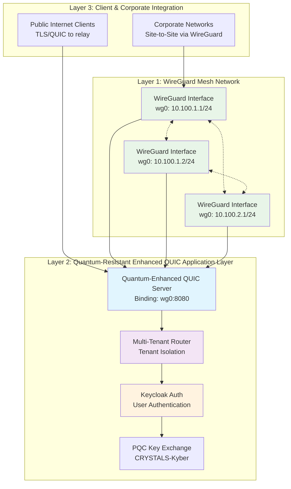

# WireGuard P2P Mesh Network: Детальный план реализации

## 🏗️ **Архитектурная модель: "Quantum-Resistant Enhanced QUIC over WireGuard"**

### **Концептуальная схема**



---

## 📋 **Компоненты для реализации**

### **🔧 Новые модули WireGuard**

```
internal/
├── quantum/
│   ├── pqc_config.go                # Post-Quantum Cryptography configuration
│   ├── wireguard_pqc.go             # Quantum-resistant WireGuard
│   ├── enhanced_quic_pqc.go         # Quantum-resistant Enhanced QUIC
│   ├── key_exchange.go              # Quantum key exchange (CRYSTALS-Kyber)
│   ├── signature.go                 # Quantum signatures (CRYSTALS-Dilithium)
│   └── hybrid_crypto.go             # Hybrid classical + quantum cryptography
├── wireguard/
│   ├── interface/
│   │   ├── wg_interface.go          # WireGuard interface management
│   │   ├── wg_config.go             # WireGuard configuration
│   │   └── wg_peer.go               # WireGuard peer management
│   ├── mesh/
│   │   ├── mesh_topology.go         # WireGuard mesh topology
│   │   ├── peer_discovery.go        # Automatic peer discovery
│   │   └── key_exchange.go          # Cryptographic key management
│   ├── routing/
│   │   ├── wg_router.go             # WireGuard-aware routing
│   │   ├── site_to_site.go          # Site-to-site routing
│   │   └── hybrid_router.go         # WireGuard + Enhanced QUIC routing
│   └── integration/
│       ├── quic_over_wg.go          # Enhanced QUIC over WireGuard
│       ├── keycloak_wg_auth.go      # Keycloak for WireGuard key exchange
│       └── metrics_wg.go            # WireGuard-specific metrics
```

### **🔄 Расширения существующих модулей**

```
internal/quic/enhanced.go            # + WireGuard transport support
internal/balancer/balancer.go        # + WireGuard peer balancing
internal/connection/pool.go          # + WireGuard connection pooling
internal/metrics/enhanced_quic.go    # + WireGuard metrics
cmd/relay/main.go                    # + WireGuard initialization
```

---

## 🛠️ **Детальная реализация по фазам**

### **🔸 Phase 0: Quantum-Resistant Cryptography Foundation (Недели 0-1)**

#### **Week 0: Post-Quantum Cryptography Research & Planning**

**Задача 0.1: Создать `internal/quantum/crypto_research.md`**
```markdown
# Post-Quantum Cryptography для CloudBridge Relay

## Стандарты NIST PQC (Post-Quantum Cryptography)

### Криптографические примитивы для квантово-устойчивого шифрования:

1. **CRYSTALS-Kyber** (Key Encapsulation Mechanism)
   - Выбран NIST как основной стандарт
   - Размер ключа: 800-1184 bytes
   - Уровень безопасности: 128-256 bits
   - Применение: Key exchange для WireGuard

2. **CRYSTALS-Dilithium** (Digital Signature)
   - Выбран NIST как основной стандарт  
   - Размер подписи: 2700-3366 bytes
   - Уровень безопасности: 128-256 bits
   - Применение: Peer authentication

3. **SPHINCS+** (Hash-based Signature)
   - Backup signature scheme
   - Размер подписи: 8080-49216 bytes
   - Применение: Fallback authentication

4. **Falcon** (Lattice-based Signature)
   - Альтернативный signature scheme
   - Компактные подписи: 666-1280 bytes
   - Применение: Compact authentication

## Гибридные схемы для CloudBridge Relay

### WireGuard + Post-Quantum Hybrid:
- **Classical**: X25519 для текущей безопасности
- **Quantum-resistant**: CRYSTALS-Kyber для future-proofing
- **Hybrid approach**: Both algorithms simultaneously
- **Fallback**: Pure classical при недоступности PQC

### Enhanced QUIC + Post-Quantum:
- **TLS 1.3**: с PQC cipher suites
- **Certificate chains**: с PQC signatures
- **Key exchange**: Hybrid X25519 + Kyber
```

**Задача 0.2: Создать `internal/quantum/pqc_config.go`**
```go
package quantum

import (
    "crypto/rand"
    "encoding/base64"
    "time"
)

// Post-Quantum Cryptography Configuration
type PQCConfig struct {
    Enabled           bool                `yaml:"enabled"`
    Algorithm         PQCAlgorithm        `yaml:"algorithm"`
    HybridMode        bool                `yaml:"hybrid_mode"`
    KeySize           PQCKeySize          `yaml:"key_size"`
    SignatureScheme   PQCSignatureScheme  `yaml:"signature_scheme"`
    FallbackEnabled   bool                `yaml:"fallback_enabled"`
    KeyRotationDays   int                 `yaml:"key_rotation_days"`
}

type PQCAlgorithm string
const (
    PQCKyber        PQCAlgorithm = "kyber"
    PQCDilithium    PQCAlgorithm = "dilithium"
    PQCFalcon       PQCAlgorithm = "falcon"
    PQCSphincsPlus  PQCAlgorithm = "sphincs_plus"
    PQCHybrid       PQCAlgorithm = "hybrid"
)

type PQCKeySize int
const (
    PQCLevel1 PQCKeySize = 128  // Kyber-512, Dilithium2
    PQCLevel3 PQCKeySize = 192  // Kyber-768, Dilithium3  
    PQCLevel5 PQCKeySize = 256  // Kyber-1024, Dilithium5
)

type PQCSignatureScheme string
const (
    PQCSigDilithium   PQCSignatureScheme = "dilithium"
    PQCSigFalcon      PQCSignatureScheme = "falcon"
    PQCSigSphincsPlus PQCSignatureScheme = "sphincs_plus"
)

// Quantum-resistant key pair
type PQCKeyPair struct {
    PublicKey     []byte
    PrivateKey    []byte
    Algorithm     PQCAlgorithm
    KeySize       PQCKeySize
    CreatedAt     time.Time
    ExpiresAt     time.Time
    HybridMode    bool
}

// Hybrid key pair (Classical + Quantum-resistant)
type HybridKeyPair struct {
    Classical     *ClassicalKeyPair
    Quantum       *PQCKeyPair
    Combined      []byte  // Combined public key
}

type ClassicalKeyPair struct {
    PublicKey     []byte
    PrivateKey    []byte
    Algorithm     string  // "X25519", "RSA-2048", etc.
}
```

#### **Week 1: Quantum-Resistant WireGuard Implementation**

**Задача 1.1: Создать `internal/quantum/wireguard_pqc.go`**
```go
package quantum

import (
    "crypto/rand"
    "fmt"
    "time"
    
    "golang.zx2c4.com/wireguard/wgctrl/wgtypes"
)

// Quantum-resistant WireGuard interface
type QuantumWireGuardInterface struct {
    wgInterface     *wginterface.WireGuardInterface
    pqcConfig       *PQCConfig
    hybridKeyPair   *HybridKeyPair
    peerKeys        map[string]*HybridKeyPair
    keyExchange     *QuantumKeyExchange
    mu              sync.RWMutex
}

// Quantum-resistant key exchange
type QuantumKeyExchange struct {
    localHybridKey  *HybridKeyPair
    peerHybridKeys  map[string]*HybridKeyPair
    sessionKeys     map[string]*QuantumSessionKey
    keyRotationTicker *time.Ticker
}

type QuantumSessionKey struct {
    ClassicalKey    []byte
    QuantumKey      []byte
    CombinedKey     []byte
    PeerID          string
    CreatedAt       time.Time
    ExpiresAt       time.Time
    Algorithm       PQCAlgorithm
}

// Methods for quantum-resistant WireGuard
func NewQuantumWireGuardInterface(wgInterface *wginterface.WireGuardInterface, pqcConfig *PQCConfig) *QuantumWireGuardInterface
func (qwg *QuantumWireGuardInterface) GenerateHybridKeyPair() (*HybridKeyPair, error)
func (qwg *QuantumWireGuardInterface) ExchangeQuantumKeys(peerID string, peerHybridKey *HybridKeyPair) (*QuantumSessionKey, error)
func (qwg *QuantumWireGuardInterface) EstablishQuantumTunnel(peerID string) error
func (qwg *QuantumWireGuardInterface) RotateQuantumKeys() error
func (qwg *QuantumWireGuardInterface) ValidateQuantumSignature(data []byte, signature []byte, peerID string) error
```

**Задача 1.2: Создать `internal/quantum/enhanced_quic_pqc.go`**
```go
package quantum

import (
    "crypto/tls"
    "crypto/x509"
)

// Quantum-resistant Enhanced QUIC
type QuantumEnhancedQUIC struct {
    enhancedQUIC    *quic.EnhancedConnection
    pqcConfig       *PQCConfig
    tlsConfig       *QuantumTLSConfig
    certificate     *QuantumCertificate
    mu              sync.RWMutex
}

type QuantumTLSConfig struct {
    *tls.Config
    PQCEnabled      bool
    PQCAlgorithm    PQCAlgorithm
    HybridMode      bool
    PQCCipherSuites []uint16
}

type QuantumCertificate struct {
    *x509.Certificate
    PQCAlgorithm    PQCAlgorithm
    PQCKeyPair      *PQCKeyPair
    HybridKeyPair   *HybridKeyPair
    QuantumSignature []byte
}

// Methods for quantum-resistant Enhanced QUIC
func NewQuantumEnhancedQUIC(enhancedQUIC *quic.EnhancedConnection, pqcConfig *PQCConfig) *QuantumEnhancedQUIC
func (qeq *QuantumEnhancedQUIC) GenerateQuantumCertificate() (*QuantumCertificate, error)
func (qeq *QuantumEnhancedQUIC) EstablishQuantumConnection(peerID string) error
func (qeq *QuantumEnhancedQUIC) ValidateQuantumCertificate(cert *QuantumCertificate) error
func (qeq *QuantumEnhancedQUIC) SendQuantumEncryptedData(data []byte, peerID string) error
```

### **🔸 Phase 1: WireGuard Foundation (Недели 2-4)**

#### **Week 1: WireGuard Interface Management**

**Задача 1.1: Создать `internal/wireguard/interface/wg_interface.go`**
```go
package wginterface

import (
    "net"
    "github.com/vishvananda/netlink"
    "golang.zx2c4.com/wireguard/wgctrl"
    "golang.zx2c4.com/wireguard/wgctrl/wgtypes"
)

type WireGuardInterface struct {
    Name        string
    PrivateKey  wgtypes.Key
    PublicKey   wgtypes.Key
    ListenPort  int
    Address     *net.IPNet
    Peers       map[string]*WireGuardPeer
    client      *wgctrl.Client
    logger      *zap.Logger
}

type WireGuardPeer struct {
    PublicKey    wgtypes.Key
    Endpoint     *net.UDPAddr
    AllowedIPs   []net.IPNet
    LastHandshake time.Time
    ReceiveBytes int64
    TransmitBytes int64
}

// Методы для управления WireGuard interface
func NewWireGuardInterface(name string, port int) (*WireGuardInterface, error)
func (wg *WireGuardInterface) CreateInterface() error
func (wg *WireGuardInterface) AddPeer(peer *WireGuardPeer) error
func (wg *WireGuardInterface) RemovePeer(publicKey wgtypes.Key) error
func (wg *WireGuardInterface) UpdatePeerEndpoint(publicKey wgtypes.Key, endpoint *net.UDPAddr) error
func (wg *WireGuardInterface) GetInterfaceStats() (*InterfaceStats, error)
func (wg *WireGuardInterface) Destroy() error
```

**Задача 1.2: Создать `internal/wireguard/interface/wg_config.go`**
```go
type WireGuardConfig struct {
    InterfaceName  string              `yaml:"interface_name"`
    PrivateKey     string              `yaml:"private_key,omitempty"`
    ListenPort     int                 `yaml:"listen_port"`
    Address        string              `yaml:"address"`
    DNS            []string            `yaml:"dns,omitempty"`
    MTU            int                 `yaml:"mtu"`
    Table          string              `yaml:"table"`
    PreUp          []string            `yaml:"pre_up,omitempty"`
    PostUp         []string            `yaml:"post_up,omitempty"`
    PreDown        []string            `yaml:"pre_down,omitempty"`
    PostDown       []string            `yaml:"post_down,omitempty"`
    Peers          []WireGuardPeerConfig `yaml:"peers"`
}

type WireGuardPeerConfig struct {
    PublicKey    string   `yaml:"public_key"`
    Endpoint     string   `yaml:"endpoint,omitempty"`
    AllowedIPs   []string `yaml:"allowed_ips"`
    PresharedKey string   `yaml:"preshared_key,omitempty"`
    KeepAlive    int      `yaml:"keep_alive,omitempty"`
}

func LoadWireGuardConfig(filepath string) (*WireGuardConfig, error)
func (wc *WireGuardConfig) GenerateKeys() error
func (wc *WireGuardConfig) SaveConfig(filepath string) error
func (wc *WireGuardConfig) ToWgQuickFormat() string
```

**Задача 1.3: Создать базовую конфигурацию `configs/wireguard.yaml`**
```yaml
wireguard:
  enabled: true
  mesh:
    interface_name: "wg-mesh0"
    listen_port: 51820
    network: "10.100.0.0/16"
    auto_assign_ip: true
    mtu: 1420
  
  discovery:
    registry_url: "https://edge.2gc.ru/wg/peers"
    heartbeat_interval: "25s"
    peer_exchange_interval: "5m"
    
  security:
    preshared_keys: true
    key_rotation_interval: "24h"
    allowed_key_age: "168h"  # 7 days
    
  integration:
    enhanced_quic: true
    bind_to_wg_interface: true
    fallback_to_public: true
```

#### **Week 2: Peer Discovery & Key Exchange**

**Задача 2.1: Создать `internal/wireguard/mesh/peer_discovery.go`**
```go
type WireGuardPeerDiscovery struct {
    config         *WireGuardConfig
    localInterface *wginterface.WireGuardInterface
    registryClient *PeerRegistryClient
    discoveredPeers map[string]*DiscoveredPeer
    keycloakAuth   *quic.KeycloakAuth  // Интеграция с Keycloak
    mu             sync.RWMutex
}

type DiscoveredPeer struct {
    PeerID         string
    PublicKey      wgtypes.Key
    Endpoint       *net.UDPAddr
    Region         string
    Capabilities   []string
    TenantSupport  []string
    LastSeen       time.Time
    TrustLevel     TrustLevel
    KeycloakToken  string
}

type TrustLevel int
const (
    TrustNone TrustLevel = iota
    TrustBasic           // Verified via Keycloak
    TrustFull            // Full cryptographic verification
)

// Методы
func NewWireGuardPeerDiscovery(config *WireGuardConfig, wgInterface *wginterface.WireGuardInterface, auth *quic.KeycloakAuth) *WireGuardPeerDiscovery
func (wpd *WireGuardPeerDiscovery) StartDiscovery(ctx context.Context) error
func (wpd *WireGuardPeerDiscovery) RegisterWithRegistry() error
func (wpd *WireGuardPeerDiscovery) DiscoverPeers(region string) ([]*DiscoveredPeer, error)
func (wpd *WireGuardPeerDiscovery) ValidatePeerWithKeycloak(peer *DiscoveredPeer) error
func (wpd *WireGuardPeerDiscovery) HandleNewPeer(peer *DiscoveredPeer) error
```

**Задача 2.2: Создать `internal/wireguard/mesh/key_exchange.go`**
```go
type WireGuardKeyExchange struct {
    localPrivateKey wgtypes.Key
    localPublicKey  wgtypes.Key
    keycloakAuth    *quic.KeycloakAuth
    peerKeys        map[string]*PeerKeyInfo
    keyRotationTicker *time.Ticker
}

type PeerKeyInfo struct {
    PublicKey     wgtypes.Key
    PresharedKey  wgtypes.Key
    CreatedAt     time.Time
    ExpiresAt     time.Time
    TenantID      string
    KeycloakToken string
}

// Secure key exchange via Keycloak
func (wke *WireGuardKeyExchange) ExchangeKeysWithPeer(peerID string, keycloakToken string) (*PeerKeyInfo, error)
func (wke *WireGuardKeyExchange) GeneratePresharedKey(peerID string) (wgtypes.Key, error)
func (wke *WireGuardKeyExchange) RotateKeys() error
func (wke *WireGuardKeyExchange) ValidateKeyAge(peer *PeerKeyInfo) bool
```

#### **Week 3: Basic Mesh Topology**

**Задача 3.1: Создать `internal/wireguard/mesh/mesh_topology.go`**
```go
type WireGuardMeshTopology struct {
    localPeerID     string
    wgInterface     *wginterface.WireGuardInterface
    activePeers     map[string]*ActivePeer
    routingTable    *WireGuardRoutingTable
    geoRouter       *quic.GeographicRouter  // Интеграция с существующим
    balancer        *balancer.Balancer      // Интеграция с существующим
    healthChecker   *MeshHealthChecker
    mu              sync.RWMutex
}

type ActivePeer struct {
    PeerInfo        *DiscoveredPeer
    WireGuardPeer   *wginterface.WireGuardPeer
    ConnectionState ConnectionState
    LastHeartbeat   time.Time
    Metrics         *PeerMetrics
}

type ConnectionState int
const (
    StateConnecting ConnectionState = iota
    StateConnected
    StateHandshakeOK
    StateFailed
)

type WireGuardRoutingTable struct {
    DirectRoutes    map[string]string      // destination -> peer_id
    MeshRoutes      map[string][]string    // destination -> [peer1, peer2]
    SiteToSiteRoutes map[string]string     // corporate_network -> peer_id
}

func (wmt *WireGuardMeshTopology) AddPeerToMesh(peer *DiscoveredPeer) error
func (wmt *WireGuardMeshTopology) RemovePeerFromMesh(peerID string) error
func (wmt *WireGuardMeshTopology) UpdateRoutingTable() error
func (wmt *WireGuardMeshTopology) GetOptimalWireGuardRoute(destination, tenantID string) (*WireGuardRoute, error)
func (wmt *WireGuardMeshTopology) GetMeshHealth() *MeshHealthReport
```

### **🔸 Phase 2: Enhanced QUIC over WireGuard (Недели 4-6)**

#### **Week 4: QUIC Transport over WireGuard**

**Задача 4.1: Создать `internal/wireguard/integration/quic_over_wg.go`**
```go
type QUICOverWireGuard struct {
    wgInterface     *wginterface.WireGuardInterface
    meshTopology    *mesh.WireGuardMeshTopology
    enhancedConfig  *quic.EnhancedConfig
    quicListeners   map[string]*quic.Listener  // peer_id -> listener
    connections     map[string]*quic.EnhancedConnection
    tenantManager   *quic.TenantManager
    mu              sync.RWMutex
}

type WireGuardRoute struct {
    TargetPeerID    string
    WireGuardPeer   *wginterface.WireGuardPeer
    QUICEndpoint    string
    RouteType       RouteType
    Latency         time.Duration
    TenantID        string
}

type RouteType int
const (
    RouteTypeDirect RouteType = iota
    RouteTypeMultiHop
    RouteTypeFallback
)

// Методы для QUIC over WireGuard
func NewQUICOverWireGuard(wgInterface *wginterface.WireGuardInterface, enhancedConfig *quic.EnhancedConfig) *QUICOverWireGuard
func (qow *QUICOverWireGuard) StartQUICListener(wgPeerID string) error
func (qow *QUICOverWireGuard) EstablishQUICConnection(route *WireGuardRoute, tenantID string) (*quic.EnhancedConnection, error)
func (qow *QUICOverWireGuard) RouteTrafficOverWireGuard(data []byte, destination, tenantID string) error
func (qow *QUICOverWireGuard) HandleMultiTenantRouting(conn *quic.EnhancedConnection, tenantID string) error
```

**Задача 4.2: Расширить `internal/quic/enhanced.go`**
```go
// Добавить в EnhancedConfig
type EnhancedConfig struct {
    // ... существующие поля ...
    
    // WireGuard integration
    WireGuardEnabled     bool                           `yaml:"wireguard_enabled"`
    WireGuardInterface   *wireguard.WireGuardInterface  `yaml:"-"`
    WireGuardMesh        *wireguard.MeshTopology        `yaml:"-"`
    QUICOverWireGuard    *wireguard.QUICOverWireGuard   `yaml:"-"`
    WireGuardRouting     bool                           `yaml:"wireguard_routing"`
}

// Добавить в EnhancedConnection
type EnhancedConnection struct {
    // ... существующие поля ...
    
    // WireGuard fields
    wireGuardRoute       *wireguard.WireGuardRoute
    isOverWireGuard      bool
    wireGuardPeerID      string
}

// Новые методы
func (ec *EnhancedConnection) DialOverWireGuard(peerID, tenantID string) error
func (ec *EnhancedConnection) SendOverWireGuardMesh(data []byte, destination, tenantID string) error
func (ec *EnhancedConnection) IsWireGuardRoute() bool
```

#### **Week 5: Hybrid Routing Engine**

**Задача 5.1: Создать `internal/wireguard/routing/hybrid_router.go`**
```go
type HybridRouter struct {
    enhancedBalancer    *balancer.Balancer              // Существующий
    wireGuardMesh       *mesh.WireGuardMeshTopology
    geoRouter           *quic.GeographicRouter          // Существующий
    routingStrategy     RoutingStrategy
    performanceMetrics  *RoutingMetrics
    fallbackEnabled     bool
}

type RoutingStrategy int
const (
    StrategyWireGuardFirst RoutingStrategy = iota  // Предпочтение WireGuard
    StrategyPerformanceOptimal                     // Выбор по производительности
    StrategyGeographicOptimal                      // Выбор по географии
    StrategyHybrid                                 // Комбинированный подход
)

type RoutingDecision struct {
    RouteType           RouteType
    WireGuardRoute      *WireGuardRoute
    EnhancedQUICRoute   *balancer.Server
    Reason              string
    EstimatedLatency    time.Duration
    TenantID            string
}

func (hr *HybridRouter) MakeRoutingDecision(destination, tenantID, clientIP string) (*RoutingDecision, error)
func (hr *HybridRouter) ShouldUseWireGuard(destination, tenantID string) bool
func (hr *HybridRouter) GetFallbackRoute(failedRoute *RoutingDecision) (*RoutingDecision, error)
func (hr *HybridRouter) UpdateRoutingMetrics(decision *RoutingDecision, latency time.Duration, success bool)
```

#### **Week 6: Site-to-Site Implementation**

**Задача 6.1: Создать `internal/wireguard/routing/site_to_site.go`**
```go
type SiteToSiteManager struct {
    wireGuardMesh       *mesh.WireGuardMeshTopology
    corporateNetworks   map[string]*CorporateNetwork
    siteRoutes          map[string]*SiteRoute
    hybridRouter        *HybridRouter
    tenantManager       *quic.TenantManager
}

type CorporateNetwork struct {
    NetworkID     string
    CIDR          *net.IPNet
    TenantID      string
    ConnectedVia  string  // WireGuard peer ID
    VPNReplacement bool   // Indicates if this replaces traditional VPN
    Subnets       []*net.IPNet
}

type SiteRoute struct {
    FromNetwork   string
    ToNetwork     string
    ViaWireGuard  string  // WireGuard peer ID
    BackupRoute   string  // Fallback peer ID
    Metrics       *SiteMetrics
}

// Corporate VPN replacement methods
func (ssm *SiteToSiteManager) RegisterCorporateNetwork(network *CorporateNetwork) error
func (ssm *SiteToSiteManager) EstablishSiteToSiteConnection(fromNetwork, toNetwork string) error
func (ssm *SiteToSiteManager) RouteCorporateTraffic(packet []byte, fromNetwork, toNetwork string) error
func (ssm *SiteToSiteManager) MigrationFromTraditionalVPN(oldVPNConfig *VPNMigrationConfig) error
```

### **🔸 Phase 3: Security & Authentication (Недели 7-9)**

#### **Week 7: Keycloak WireGuard Authentication**

**Задача 7.1: Создать `internal/wireguard/integration/keycloak_wg_auth.go`**
```go
type KeycloakWireGuardAuth struct {
    keycloakAuth    *quic.KeycloakAuth      // Существующий
    wgKeyExchange   *mesh.WireGuardKeyExchange
    peerTrustStore  *PeerTrustStore
    tokenValidator  *WireGuardTokenValidator
}

type PeerTrustStore struct {
    trustedPeers    map[string]*TrustedPeer
    trustPolicies   map[string]*TrustPolicy
    mu              sync.RWMutex
}

type TrustedPeer struct {
    PeerID          string
    PublicKey       wgtypes.Key
    TenantIDs       []string
    TrustLevel      TrustLevel
    ValidatedAt     time.Time
    KeycloakSubject string
    Capabilities    []string
}

type TrustPolicy struct {
    TenantID        string
    RequiredTrust   TrustLevel
    AllowedPeers    []string
    DeniedPeers     []string
}

// Zero Trust WireGuard authentication
func (kwa *KeycloakWireGuardAuth) AuthenticateWireGuardPeer(peerID, token string) (*TrustedPeer, error)
func (kwa *KeycloakWireGuardAuth) ValidateWireGuardAccess(peerID, tenantID string) error
func (kwa *KeycloakWireGuardAuth) ExchangeWireGuardKeys(peerID, token string) (*PeerKeyInfo, error)
func (kwa *KeycloakWireGuardAuth) UpdatePeerTrust(peerID string, newTrustLevel TrustLevel) error
```

### **🔸 Phase 4: Integration & Testing (Недели 10-12)**

#### **Week 10: Main Application Integration**

**Задача 10.1: Расширить `cmd/relay/main.go`**
```go
// Добавить в Server struct
type Server struct {
    // ... существующие поля ...
    
    // WireGuard components
    wireGuardEnabled    bool
    wgInterface         *wireguard.WireGuardInterface
    wgMeshTopology      *wireguard.MeshTopology
    wgPeerDiscovery     *wireguard.PeerDiscovery
    quicOverWireGuard   *wireguard.QUICOverWireGuard
    hybridRouter        *wireguard.HybridRouter
    siteToSiteManager   *wireguard.SiteToSiteManager
}

// Модифицировать NewServer
func NewServer(cfg *config.Config) (*Server, error) {
    // ... существующий код ...
    
    // Initialize WireGuard if enabled
    if cfg.WireGuard.Enabled {
        // Create WireGuard interface
        wgInterface, err := wireguard.NewWireGuardInterface(
            cfg.WireGuard.InterfaceName, 
            cfg.WireGuard.ListenPort,
        )
        if err != nil {
            return nil, fmt.Errorf("failed to create WireGuard interface: %v", err)
        }
        
        // Initialize mesh topology
        wgMeshTopology := wireguard.NewMeshTopology(wgInterface, geoRouter, balancerInstance)
        
        // Initialize peer discovery
        wgPeerDiscovery := wireguard.NewPeerDiscovery(cfg.WireGuard, wgInterface, authAdapter.KeycloakAuth)
        
        // Initialize QUIC over WireGuard
        quicOverWireGuard := wireguard.NewQUICOverWireGuard(wgInterface, enhancedQUICManager.Config)
        
        // Initialize hybrid router
        hybridRouter := wireguard.NewHybridRouter(balancerInstance, wgMeshTopology, geoRouter)
        
        // Initialize site-to-site manager
        siteToSiteManager := wireguard.NewSiteToSiteManager(wgMeshTopology, tenantManager)
        
        server.wireGuardEnabled = true
        server.wgInterface = wgInterface
        server.wgMeshTopology = wgMeshTopology
        server.wgPeerDiscovery = wgPeerDiscovery
        server.quicOverWireGuard = quicOverWireGuard
        server.hybridRouter = hybridRouter
        server.siteToSiteManager = siteToSiteManager
        
        // Enable WireGuard in existing components
        enhancedQUICManager.EnableWireGuard(wgInterface, wgMeshTopology)
        balancerInstance.EnableWireGuard(hybridRouter)
        
        loggerInstance.Info("WireGuard P2P Mesh initialized",
            zap.String("interface", cfg.WireGuard.InterfaceName),
            zap.Int("listen_port", cfg.WireGuard.ListenPort),
        )
    }
}
```

**Задача 10.2: Модифицировать `processConnection` для WireGuard routing**
```go
func (s *Server) processConnection(conn net.Conn) error {
    // ... existing authentication and tenant validation ...
    
    // Hybrid routing decision (WireGuard vs Public Enhanced QUIC)
    if s.wireGuardEnabled && s.hybridRouter != nil {
        routingDecision, err := s.hybridRouter.MakeRoutingDecision(destination, tenantID, clientIP)
        if err != nil {
            s.logger.Error("Failed to make routing decision", zap.Error(err))
            return s.handleFallbackConnection(conn, destination, tenantID)
        }
        
        switch routingDecision.RouteType {
        case wireguard.RouteTypeWireGuard:
            return s.handleWireGuardConnection(conn, routingDecision)
        case wireguard.RouteTypeEnhancedQUIC:
            return s.handleEnhancedQUICConnection(conn, routingDecision)
        case wireguard.RouteTypeHybrid:
            return s.handleHybridConnection(conn, routingDecision)
        default:
            return s.handleFallbackConnection(conn, destination, tenantID)
        }
    }
    
    // Fallback to traditional Enhanced QUIC
    return s.handleEnhancedQUICConnection(conn, nil)
}

func (s *Server) handleWireGuardConnection(conn net.Conn, decision *wireguard.RoutingDecision) error {
    // Route through WireGuard mesh
    wgConn, err := s.quicOverWireGuard.EstablishQUICConnection(decision.WireGuardRoute, decision.TenantID)
    if err != nil {
        // Fallback to public Enhanced QUIC
        return s.handleFallbackConnection(conn, decision.WireGuardRoute.QUICEndpoint, decision.TenantID)
    }
    
    // Handle traffic through WireGuard + Enhanced QUIC
    return s.handleEnhancedQUICOverWireGuard(conn, wgConn, decision)
}
```

---

## 📊 **Конфигурация и развертывание**

### **Полная конфигурация `configs/config.yaml`**
```yaml
# Existing configuration...

wireguard:
  enabled: true
  
  # Interface configuration
  interface:
    name: "wg-mesh0"
    listen_port: 51820
    private_key: ""  # Auto-generated if empty
    address: "10.100.1.1/24"
    mtu: 1420
    
  # Mesh network configuration
  mesh:
    network: "10.100.0.0/16"
    auto_assign_ip: true
    max_peers: 50
    heartbeat_interval: "25s"
    
  # Peer discovery
  discovery:
    enabled: true
    registry_url: "https://edge.2gc.ru/wg/peers"
    discovery_interval: "5m"
    region_preference: ["ru", "eu", "us", "asia"]
    
  # Security
  security:
    preshared_keys: true
    key_rotation_interval: "24h"
    allowed_key_age: "168h"
    require_keycloak_auth: true
    trust_level_required: "basic"
    
  # Integration with Enhanced QUIC
  integration:
    enhanced_quic: true
    bind_to_wg_interface: true
    fallback_to_public: true
    hybrid_routing: true
    
  # Site-to-Site VPN replacement
  site_to_site:
    enabled: true
    corporate_networks:
      - network_id: "corp-a"
        cidr: "192.168.1.0/24"
        tenant_id: "tenant-a"
      - network_id: "corp-b"
        cidr: "192.168.2.0/24"
        tenant_id: "tenant-b"
    
  # Performance tuning
  performance:
    routing_strategy: "hybrid"  # wireguard_first, performance_optimal, geographic_optimal, hybrid
    connection_pooling: true
    keepalive_interval: "25s"
    
enhanced_quic:
  # Existing Enhanced QUIC configuration
  wireguard_integration:
    enabled: true
    prefer_wireguard_routes: true
    fallback_timeout: "10s"
    tenant_isolation_over_wg: true
```

---

## 🎯 **Ключевые преимущества Quantum-Resistant WireGuard P2P подхода**

### **✅ Технические преимущества:**
1. **🔒 Quantum-Resistant Security**: CRYSTALS-Kyber + CRYSTALS-Dilithium для future-proof cryptography
2. **⚡ Performance**: Kernel-space WireGuard + userspace Enhanced QUIC = optimal performance  
3. **🌐 NAT Traversal**: WireGuard's UDP hole punching + Enhanced QUIC reliability
4. **🔄 VPN Replacement**: Direct site-to-site connectivity без traditional VPN complexity
5. **📊 Unified Management**: Single platform for client access + corporate connectivity
6. **🔮 Future-Proof**: Post-quantum cryptography готов к квантовым компьютерам

### **✅ Бизнес преимущества:**
1. **💰 Cost Reduction**: Замена дорогих VPN appliances на software solution
2. **⚙️ Simplified Management**: Unified dashboard для WireGuard + Enhanced QUIC + PQC
3. **📈 Market Differentiation**: Единственное Quantum-Resistant WireGuard + QUIC enterprise решение
4. **🚀 Competitive Edge**: Modern technology stack vs legacy VPN vendors
5. **🔮 Future-Proof Investment**: Quantum-resistant cryptography защищает от future threats

---

## 🧪 **Тестирование WireGuard P2P**

### **Unit Tests:**
- `internal/wireguard/interface/*_test.go` (WireGuard interface management)
- `internal/wireguard/mesh/*_test.go` (Mesh topology, peer discovery)
- `internal/wireguard/routing/*_test.go` (Hybrid routing, site-to-site)
- `internal/wireguard/integration/*_test.go` (QUIC over WireGuard, Keycloak auth)

### **Integration Tests:**
- Multi-node WireGuard mesh formation
- Enhanced QUIC over WireGuard functionality
- Failover scenarios (WireGuard peer failures)
- Site-to-site corporate network connectivity
- Keycloak authentication for WireGuard peers

### **Performance Benchmarks:**
- WireGuard vs Direct Enhanced QUIC latency
- Throughput through WireGuard tunnels
- Mesh scalability (10, 25, 50 peers)
- Site-to-site bandwidth vs traditional VPN

---

**Этот план реализует полноценную Quantum-Resistant WireGuard P2P Mesh архитектуру с интеграцией Enhanced QUIC для замены корпоративных VPN решений и защиты от квантовых угроз!** 🚀🔮
