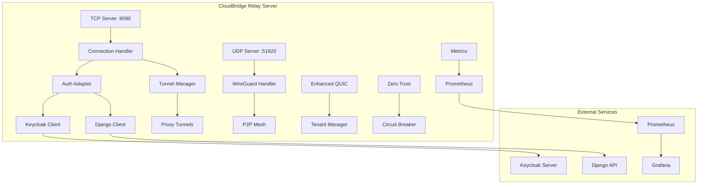
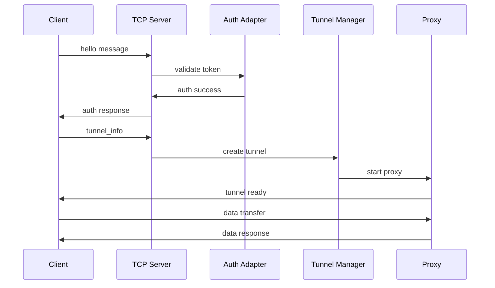
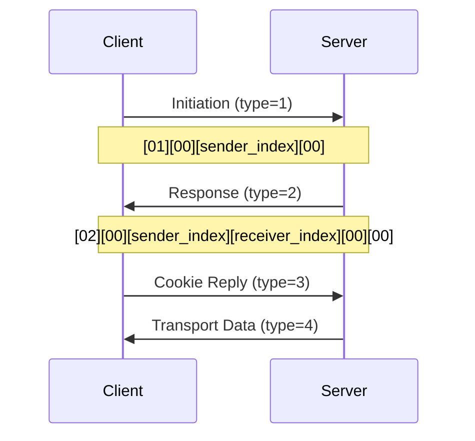
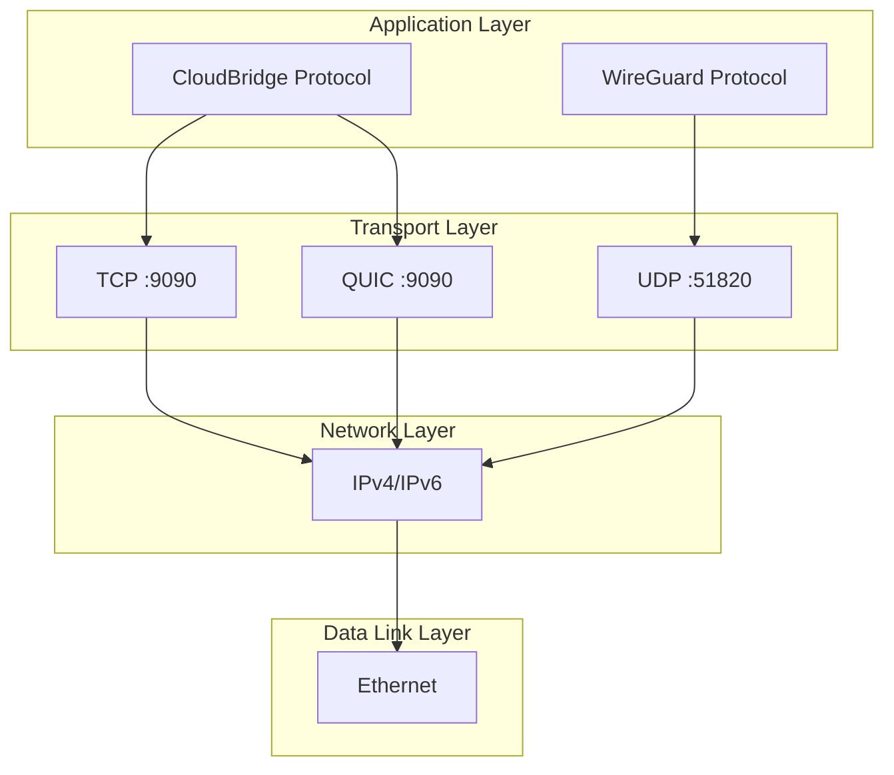

# CloudBridge Relay Server - Полная документация

## 📋 Содержание
1. [Архитектура сервера](#1-архитектура-сервера)
2. [Сетевые возможности](#2-сетевые-возможности)
3. [Аутентификация и авторизация](#3-аутентификация-и-авторизация)
4. [Протоколы и форматы сообщений](#4-протоколы-и-форматы-сообщений)
5. [Производительность и масштабирование](#5-производительность-и-масштабирование)
6. [Мониторинг и логирование](#6-мониторинг-и-логирование)
7. [Безопасность](#7-безопасность)
8. [Развертывание и конфигурация](#8-развертывание-и-конфигурация)

---

## 1. Архитектура сервера

### 1.1 Общая схема

CloudBridge Relay Server - это высокопроизводительный сервер для создания P2P mesh сетей с поддержкой WireGuard, QUIC и mTLS протоколов.



### 1.2 Основные компоненты

#### **TCP Server (Port 9090)**
- **Назначение**: Обработка клиент-сервер соединений
- **Протоколы**: QUIC, HTTP/2, TLS 1.3
- **Функции**: Аутентификация, создание туннелей, heartbeat

#### **UDP Server (Port 51820)**
- **Назначение**: WireGuard P2P mesh сеть
- **Протокол**: WireGuard handshake
- **Функции**: P2P соединения, mesh routing

#### **Auth Adapter**
- **Назначение**: Универсальная аутентификация
- **Поддержка**: Keycloak, Django API, JWT
- **Функции**: Валидация токенов, multi-tenancy

#### **Tunnel Manager**
- **Назначение**: Управление прокси туннелями
- **Функции**: Создание, мониторинг, закрытие туннелей
- **Лимиты**: До 1000 одновременных туннелей

#### **Enhanced QUIC**
- **Назначение**: Высокопроизводительная передача данных
- **Функции**: DDoS защита, географическая маршрутизация
- **Оптимизации**: Post-quantum криптография

### 1.3 Взаимодействие компонентов



---

## 2. Сетевые возможности

### 2.1 TCP 9090 - Основной API

#### **Назначение**
Основной порт для клиент-сервер взаимодействия через CloudBridge протокол.

#### **Поддерживаемые протоколы**
- **QUIC** (приоритетный) - UDP-based, низкая задержка
- **HTTP/2** (fallback) - TCP-based, совместимость
- **TLS 1.3** - минимальная версия для безопасности

#### **Конфигурация**
```json
{
  "server": {
    "port": 9090,
    "max_tunnels": 1000,
    "timeout": 30
  },
  "protocol": {
    "preferred": "quic",
    "fallback": "http2"
  },
  "security": {
    "min_tls_version": "1.2",
    "cipher_suites": ["TLS_AES_256_GCM_SHA384"]
  }
}
```

#### **Метрики**
- Количество активных соединений
- Время отклика (latency)
- Пропускная способность (throughput)
- Количество ошибок

### 2.2 UDP 51820 - WireGuard P2P

#### **Назначение**
P2P mesh сеть для сервер-сервер соединений через WireGuard протокол.

#### **Принцип работы**
1. **Initiation** - клиент отправляет пакет типа 1
2. **Response** - сервер отвечает пакетом типа 2
3. **Handshake** - установка безопасного соединения
4. **Transport** - передача данных

#### **Формат пакетов**
```
Initiation: [01][00][sender_index][00]
Response:   [02][00][sender_index][receiver_index][00][00]
```

#### **Конфигурация**
```json
{
  "wireguard": {
    "enabled": true,
    "port": 51820,
    "interface": "wg-mesh0",
    "peer_discovery": true,
    "mesh_enabled": true
  }
}
```

### 2.3 Проксирование

#### **TCP Proxy**
- **Назначение**: Проксирование TCP трафика (RDP, SSH, VNC)
- **Принцип**: Двунаправленная передача данных
- **Лимиты**: Настраиваемые per tenant

#### **UDP Proxy**
- **Назначение**: Проксирование UDP трафика
- **Применение**: VoIP, gaming, real-time приложения
- **Оптимизация**: Буферизация и batch processing

### 2.4 Туннелирование

#### **Создание туннеля**
```json
{
  "type": "tunnel_info",
  "mode": "proxy",
  "remote_host": "192.168.1.100",
  "remote_port": 3389,
  "tenant_id": "relay-test-tenant"
}
```

#### **Управление туннелями**
- **Heartbeat**: Поддержание соединения
- **Monitoring**: Мониторинг состояния
- **Cleanup**: Автоматическое закрытие

---

## 3. Аутентификация и авторизация

### 3.1 Keycloak интеграция

#### **Назначение**
Централизованная аутентификация через Keycloak Identity Provider.

#### **Принцип работы**
1. Клиент получает JWT токен от Keycloak
2. Relay сервер валидирует токен через публичные ключи
3. Извлекаются claims (client_id, tenant_id, roles)
4. Применяются политики доступа

#### **Конфигурация**
```json
{
  "keycloak": {
    "enabled": false,
    "server_url": "https://keycloak.example.com",
    "realm": "cloudbridge",
    "client_id": "relay-server",
    "public_key_url": "/auth/realms/cloudbridge/protocol/openid-connect/certs"
  }
}
```

### 3.2 Django API интеграция

#### **Назначение**
Альтернативная аутентификация через Django API (2GC Personal Account).

#### **Принцип работы**
1. Клиент получает JWT токен от Django API
2. Relay сервер отправляет POST запрос на валидацию
3. Django API проверяет токен и возвращает результат
4. Применяются tenant-specific политики

#### **Конфигурация**
```json
{
  "django": {
    "enabled": true,
    "api_endpoint": "http://localhost:8000/api/validate-relay-token/",
    "timeout": 5,
    "retry_count": 3
  }
}
```

### 3.3 JWT токены

#### **Структура токена**
```json
{
  "client_id": "relay-client-001",
  "tenant_id": "relay-test-tenant",
  "exp": 1691234567,
  "iat": 1691230000,
  "type": "relay",
  "permissions": ["tunnel:create", "tunnel:read"]
}
```

#### **Валидация**
- **Signature**: Проверка подписи
- **Expiration**: Проверка срока действия
- **Claims**: Валидация обязательных полей
- **Tenant**: Проверка принадлежности к tenant

### 3.4 Multi-tenancy

#### **Назначение**
Изоляция клиентов и ресурсов по tenant'ам.

#### **Конфигурация tenant'а**
```json
{
  "tenants": {
    "relay-test-tenant": {
      "bandwidth_limit": 104857600,
      "connection_limit": 20,
      "rate_limit": 500,
      "burst": 100,
      "jwt": {
        "enabled": true,
        "required_claims": ["client_id", "tenant_id"]
      }
    }
  }
}
```

#### **Лимиты**
- **Bandwidth**: Пропускная способность (bytes/sec)
- **Connections**: Количество одновременных соединений
- **Rate**: Частота запросов (requests/sec)
- **Burst**: Пиковая нагрузка

---

## 4. Протоколы и форматы сообщений

### 4.1 CloudBridge Protocol

#### **Назначение**
Собственный протокол для управления туннелями и аутентификации.

#### **Типы сообщений**

##### **Hello Message**
```json
{
  "type": "hello",
  "version": "1.0.0",
  "features": ["tls", "jwt", "tunneling"]
}
```

##### **Auth Message**
```json
{
  "type": "auth",
  "token": "eyJhbGciOiJSUzI1NiIsInR5cCI6IkpXVCJ9...",
  "tenant_id": "relay-test-tenant"
}
```

##### **Tunnel Info Message**
```json
{
  "type": "tunnel_info",
  "mode": "proxy",
  "remote_host": "192.168.1.100",
  "remote_port": 3389,
  "protocol": "tcp"
}
```

##### **Heartbeat Message**
```json
{
  "type": "heartbeat",
  "tunnel_id": "tunnel-12345"
}
```

##### **Tunnel Close Message**
```json
{
  "type": "tunnel_close",
  "tunnel_id": "tunnel-12345"
}
```

##### **Error Message**
```json
{
  "type": "error",
  "code": "AUTH_FAILED",
  "message": "Invalid JWT token",
  "details": "Token expired"
}
```

### 4.2 WireGuard Handshake

#### **Процесс установки соединения**



#### **Формат пакетов**
- **Initiation**: 4 байта - [тип][reserved][sender_index][reserved]
- **Response**: 6 байт - [тип][reserved][sender_index][receiver_index][reserved][reserved]
- **Cookie Reply**: 64 байта - cookie + MAC
- **Transport**: переменная длина - зашифрованные данные

### 4.3 Heartbeat Mechanism

#### **Назначение**
Поддержание активных соединений и обнаружение разрывов.

#### **Принцип работы**
1. Клиент отправляет heartbeat каждые 30 секунд
2. Сервер отвечает heartbeat_response
3. При отсутствии ответа соединение закрывается
4. Автоматическая очистка ресурсов

#### **Конфигурация**
```json
{
  "heartbeat": {
    "interval": 30,
    "timeout": 60,
    "retry_count": 3
  }
}
```

---

## 5. Производительность и масштабирование

### 5.1 Метрики производительности

#### **Сетевые метрики**
- **Connections/sec**: Новые соединения в секунду
- **Active connections**: Активные соединения
- **Bytes/sec**: Пропускная способность
- **Latency**: Задержка (P50, P95, P99)

#### **Системные метрики**
- **CPU usage**: Использование процессора
- **Memory usage**: Использование памяти
- **Goroutines**: Количество горутин
- **GC pauses**: Паузы сборщика мусора

#### **Бизнес метрики**
- **Tunnels created**: Созданные туннели
- **Tunnels active**: Активные туннели
- **Auth requests**: Запросы аутентификации
- **Errors**: Количество ошибок

### 5.2 Масштабирование

#### **Горизонтальное масштабирование**
- **Load Balancer**: Распределение нагрузки
- **Multiple instances**: Несколько экземпляров
- **Session affinity**: Привязка сессий
- **Health checks**: Проверки здоровья

#### **Вертикальное масштабирование**
- **CPU**: Увеличение ядер процессора
- **Memory**: Увеличение RAM
- **Network**: Увеличение пропускной способности
- **Storage**: SSD для логов и метрик

### 5.3 Оптимизация

#### **Сетевые оптимизации**
- **Connection pooling**: Пул соединений
- **Keep-alive**: Поддержание соединений
- **Compression**: Сжатие данных
- **Batch processing**: Пакетная обработка

#### **Кодовые оптимизации**
- **Goroutine pools**: Пул горутин
- **Memory pools**: Пул памяти
- **Lock-free**: Без блокировок
- **SIMD**: Векторные инструкции

---

## 6. Мониторинг и логирование

### 6.1 Метрики

#### **Prometheus метрики**
```go
// Счетчики
cloudbridge_connections_total
cloudbridge_tunnels_created_total
cloudbridge_auth_requests_total
cloudbridge_errors_total

// Гистограммы
cloudbridge_request_duration_seconds
cloudbridge_tunnel_duration_seconds
cloudbridge_auth_duration_seconds

// Gauges
cloudbridge_active_connections
cloudbridge_active_tunnels
cloudbridge_memory_usage_bytes
```

#### **Grafana дашборды**
- **Overview**: Общий обзор системы
- **Performance**: Производительность
- **Errors**: Ошибки и алерты
- **Tenants**: Статистика по tenant'ам

### 6.2 Логирование

#### **Уровни логов**
- **DEBUG**: Детальная отладочная информация
- **INFO**: Общая информация о работе
- **WARN**: Предупреждения
- **ERROR**: Ошибки
- **FATAL**: Критические ошибки

#### **Структурированные логи**
```json
{
  "level": "INFO",
  "timestamp": "2025-09-04T11:29:14.125Z",
  "caller": "logger/logger.go:132",
  "msg": "WireGuard response sent successfully",
  "to": "90.156.150.25:51192",
  "bytes_sent": 6
}
```

### 6.3 Алерты

#### **Критические алерты**
- **High error rate**: Высокий процент ошибок
- **High latency**: Высокая задержка
- **Memory usage**: Высокое использование памяти
- **Connection failures**: Сбои соединений

#### **Предупреждающие алерты**
- **High CPU usage**: Высокое использование CPU
- **Disk space**: Мало места на диске
- **Slow responses**: Медленные ответы
- **Auth failures**: Сбои аутентификации

---

## 7. Безопасность

### 7.1 TLS/SSL

#### **Минимальные требования**
- **TLS 1.2**: Минимальная версия
- **TLS 1.3**: Рекомендуемая версия
- **Perfect Forward Secrecy**: PFS обязателен
- **Strong ciphers**: Только сильные шифры

#### **Поддерживаемые шифры**
```
TLS_AES_256_GCM_SHA384
TLS_CHACHA20_POLY1305_SHA256
TLS_AES_128_GCM_SHA256
```

### 7.2 Сертификаты

#### **Управление сертификатами**
- **Auto-renewal**: Автоматическое обновление
- **Certificate rotation**: Ротация сертификатов
- **OCSP stapling**: Проверка отзыва
- **HSTS**: HTTP Strict Transport Security

### 7.3 Файрвол

#### **UFW правила**
```bash
# Разрешенные порты
ufw allow 22/tcp      # SSH
ufw allow 80/tcp      # HTTP
ufw allow 443/tcp     # HTTPS
ufw allow 9090/tcp    # CloudBridge API
ufw allow 51820/udp   # WireGuard
ufw allow 8084/tcp    # Metrics

# Запрещенные порты
ufw deny 9000         # Внутренние сервисы
ufw deny 8082         # Внутренние сервисы
```

#### **Fail2Ban**
- **SSH protection**: Защита SSH
- **HTTP protection**: Защита HTTP
- **Custom rules**: Пользовательские правила

### 7.4 DDoS защита

#### **Enhanced QUIC защита**
- **Rate limiting**: Ограничение скорости
- **Connection limits**: Лимиты соединений
- **Geographic filtering**: Географическая фильтрация
- **Behavioral analysis**: Анализ поведения

---

## 8. Развертывание и конфигурация

### 8.1 Docker

#### **Docker Compose**
```yaml
version: '3.8'
services:
  cloudbridge-relay:
    build: .
    container_name: cloudbridge-relay
    restart: unless-stopped
    network_mode: host
    volumes:
      - ./configs:/app/configs:ro
      - ./logs:/app/logs
    environment:
      - CONFIG_PATH=/app/configs/config.json
      - LOG_LEVEL=info
    healthcheck:
      test: ["CMD", "curl", "-f", "http://localhost:9090/health"]
      interval: 30s
      timeout: 10s
      retries: 3
```

#### **Dockerfile**
```dockerfile
FROM golang:1.21-alpine AS builder
WORKDIR /app
COPY . .
RUN go build -o cloudbridge-relay cmd/relay/main.go

FROM alpine:latest
RUN apk --no-cache add ca-certificates curl
WORKDIR /root/
COPY --from=builder /app/cloudbridge-relay .
COPY --from=builder /app/configs ./configs
EXPOSE 9090 9090/udp 51820/udp 8084
HEALTHCHECK --interval=30s --timeout=10s --start-period=40s --retries=3 \
  CMD curl -f http://localhost:9090/health || exit 1
CMD ["./cloudbridge-relay", "--config", "configs/config.json"]
```

### 8.2 Kubernetes

#### **Deployment**
```yaml
apiVersion: apps/v1
kind: Deployment
metadata:
  name: cloudbridge-relay
spec:
  replicas: 3
  selector:
    matchLabels:
      app: cloudbridge-relay
  template:
    metadata:
      labels:
        app: cloudbridge-relay
    spec:
      containers:
      - name: cloudbridge-relay
        image: cloudbridge-relay:latest
        ports:
        - containerPort: 9090
        - containerPort: 51820
          protocol: UDP
        env:
        - name: CONFIG_PATH
          value: "/app/configs/config.json"
        - name: LOG_LEVEL
          value: "info"
        volumeMounts:
        - name: config
          mountPath: /app/configs
        livenessProbe:
          httpGet:
            path: /health
            port: 9090
          initialDelaySeconds: 40
          periodSeconds: 30
        readinessProbe:
          httpGet:
            path: /health
            port: 9090
          initialDelaySeconds: 10
          periodSeconds: 10
      volumes:
      - name: config
        configMap:
          name: cloudbridge-config
```

#### **Service**
```yaml
apiVersion: v1
kind: Service
metadata:
  name: cloudbridge-relay-service
spec:
  selector:
    app: cloudbridge-relay
  ports:
  - name: tcp-api
    port: 9090
    targetPort: 9090
  - name: udp-wireguard
    port: 51820
    targetPort: 51820
    protocol: UDP
  type: LoadBalancer
```

### 8.3 Конфигурация

#### **Основной конфиг**
```json
{
  "server": {
    "port": 9090,
    "max_tunnels": 1000,
    "timeout": 30
  },
  "django": {
    "enabled": true,
    "api_endpoint": "http://localhost:8000/api/validate-relay-token/",
    "timeout": 5,
    "retry_count": 3
  },
  "security": {
    "min_tls_version": "1.2",
    "cipher_suites": ["TLS_AES_256_GCM_SHA384"]
  },
  "wireguard": {
    "enabled": true,
    "port": 51820,
    "interface": "wg-mesh0",
    "peer_discovery": true,
    "mesh_enabled": true
  },
  "tenants": {
    "relay-test-tenant": {
      "bandwidth_limit": 104857600,
      "connection_limit": 20,
      "rate_limit": 500,
      "burst": 100
    }
  }
}
```

### 8.4 Переменные окружения

#### **Обязательные переменные**
```bash
CONFIG_PATH=/app/configs/config.json
LOG_LEVEL=info
WIREGUARD_ENABLED=true
TZ=UTC
```

#### **Опциональные переменные**
```bash
METRICS_PORT=8084
HEALTH_CHECK_INTERVAL=30s
CIRCUIT_BREAKER_ENABLED=false
ZERO_TRUST_ENABLED=false
```

---

## 📊 Диаграммы архитектуры

### Общая архитектура


### Сетевой стек


---

## 🔧 Troubleshooting Guide

### Частые проблемы

#### **1. Сервер не запускается**
```bash
# Проверить порты
netstat -tuln | grep -E "(9090|51820)"

# Проверить логи
docker-compose logs cloudbridge-relay

# Проверить конфигурацию
./cloudbridge-relay --config configs/config.json --validate
```

#### **2. Аутентификация не работает**
```bash
# Проверить Django API
curl -X POST http://localhost:8000/api/validate-relay-token/ \
  -H "Content-Type: application/json" \
  -d '{"token": "your-jwt-token"}'

# Проверить Keycloak
curl https://keycloak.example.com/auth/realms/cloudbridge/protocol/openid-connect/certs
```

#### **3. WireGuard не отвечает**
```bash
# Проверить UDP порт
nc -zu localhost 51820

# Проверить firewall
sudo ufw status

# Проверить Docker network
docker network inspect cloudbridge-relay-installer_cloudbridge-network
```

#### **4. Высокая задержка**
```bash
# Проверить метрики
curl http://localhost:8084/metrics

# Проверить ресурсы
docker stats cloudbridge-relay

# Проверить логи
docker-compose logs cloudbridge-relay | grep -i "slow\|timeout"
```

---

## 📋 FAQ

### **Q: Какой максимальный размер туннеля?**
A: По умолчанию 1000 одновременных туннелей, настраивается в конфиге.

### **Q: Поддерживается ли IPv6?**
A: Да, сервер поддерживает как IPv4, так и IPv6.

### **Q: Можно ли использовать без Docker?**
A: Да, можно запустить напрямую: `./cloudbridge-relay --config configs/config.json`

### **Q: Как настроить SSL сертификаты?**
A: Поместите сертификаты в папку `certs/` и укажите пути в конфиге.

### **Q: Поддерживается ли кластеризация?**
A: Да, через Kubernetes или Docker Swarm с внешним load balancer.

---

## 📚 Дополнительные ресурсы

- [CloudBridge Protocol Specification](./docs/protocol.md)
- [API Reference](./docs/api.md)
- [Configuration Guide](./docs/configuration.md)
- [Security Best Practices](./docs/security.md)
- [Performance Tuning](./docs/performance.md)
- [Monitoring Setup](./docs/monitoring.md)

---

*Документация обновлена: 2025-09-04*
*Версия CloudBridge Relay Server: v1.0.0*
