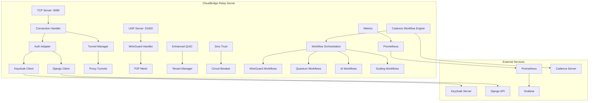

# CloudBridge Relay Server - Обзор проекта

## 🚀 Что такое CloudBridge Relay Server?

**CloudBridge Relay Server** - это высокопроизводительный сервер для создания P2P mesh сетей с поддержкой современных протоколов связи. Сервер обеспечивает безопасное туннелирование, аутентификацию через JWT и multi-tenancy для изоляции клиентов в enterprise-среде.

### 🎯 Основное назначение

CloudBridge Relay Server решает задачи:
- **P2P Mesh Networks** - создание одноранговых сетей между серверами
- **Client-Server Proxy** - проксирование TCP/UDP трафика для RDP, SSH, VNC
- **Secure Tunneling** - безопасное туннелирование с аутентификацией
- **Multi-Tenancy** - изоляция клиентов по tenant'ам
- **High Performance** - поддержка высоких нагрузок

---

## 🏗️ Архитектура системы

### Общая схема


### Основные компоненты

#### **1. TCP Server (Port 9090)**
- **Назначение**: Обработка клиент-сервер соединений
- **Протоколы**: QUIC, HTTP/2, TLS 1.3
- **Функции**: Аутентификация, создание туннелей, heartbeat

#### **2. UDP Server (Port 51820)**
- **Назначение**: WireGuard P2P mesh сеть
- **Протокол**: WireGuard handshake
- **Функции**: P2P соединения, mesh routing

#### **3. Auth Adapter**
- **Назначение**: Универсальная аутентификация
- **Поддержка**: Keycloak, Django API, JWT
- **Функции**: Валидация токенов, multi-tenancy

#### **4. Tunnel Manager**
- **Назначение**: Управление прокси туннелями
- **Функции**: Создание, мониторинг, закрытие туннелей
- **Лимиты**: До 1000 одновременных туннелей

#### **5. Cadence Workflow Engine**
- **Назначение**: Оркестрация сложных бизнес-процессов
- **Функции**: Workflow management, activity coordination, error handling
- **Workflows**: WireGuard, Quantum, AI, Scaling, Security workflows

---

## 🔄 Cadence Workflow Engine

### **Назначение**
Cadence Workflow Engine обеспечивает надежную оркестрацию сложных бизнес-процессов в CloudBridge Relay Server, включая автоматическое управление WireGuard сетями, квантовую криптографию, AI-анализ угроз и автомасштабирование.

### **Основные Workflows**

#### **1. WireGuard Workflows**
- **`PeerLifecycleWorkflow`** - Управление жизненным циклом пиров
- **`MeshTopologyWorkflow`** - Автоматическое построение mesh сети
- **`ConnectionRecoveryWorkflow`** - Восстановление соединений
- **`LoadBalancingWorkflow`** - Балансировка нагрузки

#### **2. Quantum Workflows**
- **`QuantumKeyRotationWorkflow`** - Ротация квантовых ключей
- **`KeyValidationWorkflow`** - Валидация ключей
- **`AlgorithmMigrationWorkflow`** - Миграция алгоритмов
- **`SecurityAuditWorkflow`** - Аудит безопасности

#### **3. AI Workflows**
- **`ThreatAnalysisWorkflow`** - Анализ угроз в реальном времени
- **`BehaviorMonitoringWorkflow`** - Мониторинг поведения
- **`AutomatedResponseWorkflow`** - Автоматическое реагирование
- **`ModelTrainingWorkflow`** - Обучение AI моделей

#### **4. Scaling Workflows**
- **`AutoScalingWorkflow`** - Автомасштабирование ресурсов
- **`ResourceOptimizationWorkflow`** - Оптимизация ресурсов
- **`PerformanceMonitoringWorkflow`** - Мониторинг производительности
- **`CapacityPlanningWorkflow`** - Планирование емкости

#### **5. Security Workflows**
- **`SecurityComplianceWorkflow`** - Проверка соответствия
- **`AuditLoggingWorkflow`** - Аудит логирования
- **`IncidentResponseWorkflow`** - Реагирование на инциденты
- **`BackupRecoveryWorkflow`** - Резервное копирование

### **Activities (Активности)**
- **Common Activities**: Проверка зависимостей, инициализация модулей, health checks
- **WireGuard Activities**: Создание интерфейсов, регистрация пиров, мониторинг
- **Quantum Activities**: Генерация ключей, валидация, миграция алгоритмов
- **AI Activities**: Анализ данных, обучение моделей, генерация отчетов
- **Scaling Activities**: Мониторинг ресурсов, масштабирование, оптимизация

### **Конфигурация Cadence**
```yaml
cadence:
  domain: "cloudbridge-relay"
  client:
    hostPort: "localhost:7933"
    enableTLS: false
  worker:
    maxConcurrentActivityExecutionSize: 1000
    maxConcurrentWorkflowTaskExecutionSize: 1000
    taskListName: "cloudbridge-task-list"
  workflows:
    executionTimeout: "1h"
    decisionTimeout: "10s"
    activityStartToCloseTimeout: "5m"
```

### **Мониторинг Cadence**
- **Prometheus метрики**: `cadence_workflow_executions_total`, `cadence_activity_executions_total`
- **Health checks**: `/health` endpoint для проверки состояния
- **Debug endpoints**: Детальная информация о workflows и activities
- **Structured logging**: Полное логирование всех операций

---

## 🌐 Сетевые возможности

### **TCP 9090 - Основной API**
- **QUIC** (приоритетный) - UDP-based, низкая задержка
- **HTTP/2** (fallback) - TCP-based, совместимость
- **TLS 1.3** - минимальная версия для безопасности

### **UDP 51820 - WireGuard P2P**
- **Initiation** - клиент отправляет пакет типа 1
- **Response** - сервер отвечает пакетом типа 2
- **Handshake** - установка безопасного соединения
- **Transport** - передача данных

### **Проксирование**
- **TCP Proxy** - для RDP, SSH, VNC
- **UDP Proxy** - для VoIP, gaming, real-time приложений
- **Load Balancing** - балансировка нагрузки

---

## 🔐 Безопасность и аутентификация

### **JWT Authentication**
```json
{
  "client_id": "relay-client-001",
  "tenant_id": "relay-test-tenant",
  "exp": 1691234567,
  "iat": 1691230000,
  "type": "relay",
  "permissions": ["tunnel:create", "tunnel:read"]
}
```

### **Multi-Tenancy**
- **Изоляция клиентов** по tenant'ам
- **Настраиваемые лимиты** для каждого tenant'а
- **Bandwidth limits** - ограничения пропускной способности
- **Connection limits** - лимиты соединений

### **TLS/SSL Security**
- **TLS 1.2** - минимальная версия
- **TLS 1.3** - рекомендуемая версия
- **Perfect Forward Secrecy** - обязателен
- **Strong ciphers** - только сильные шифры

### **DDoS Protection**
- **Rate limiting** - ограничение скорости
- **Connection limits** - лимиты соединений
- **Geographic filtering** - географическая фильтрация
- **Behavioral analysis** - анализ поведения

---

## 📊 Производительность

### **Технические характеристики**
| Параметр | Значение |
|----------|----------|
| **Максимум туннелей** | 1000 |
| **Максимум соединений** | 10000 |
| **Протоколы** | QUIC, HTTP/2, TLS 1.3, WireGuard |
| **Порты** | TCP 9090, UDP 51820, Metrics 8084, Cadence 8082 |
| **Аутентификация** | JWT, Keycloak, Django API |
| **Multi-tenancy** | Да |
| **DDoS защита** | Да |
| **Workflow Engine** | Cadence (20+ workflows) |
| **Activities** | 50+ activities для автоматизации |

### **Метрики производительности**
- **Connections/sec** - новые соединения в секунду
- **Active connections** - активные соединения
- **Bytes/sec** - пропускная способность
- **Latency** - задержка (P50, P95, P99)

### **Масштабирование**
- **Горизонтальное** - несколько экземпляров с load balancer
- **Вертикальное** - увеличение ресурсов сервера
- **Auto-scaling** - автоматическое масштабирование в Kubernetes

---

## 🔧 Протоколы и форматы сообщений

### **CloudBridge Protocol**
```json
// Hello Message
{
  "type": "hello",
  "version": "1.0.0",
  "features": ["tls", "jwt", "tunneling"]
}

// Auth Message
{
  "type": "auth",
  "token": "eyJhbGciOiJSUzI1NiIsInR5cCI6IkpXVCJ9...",
  "tenant_id": "relay-test-tenant"
}

// Tunnel Info Message
{
  "type": "tunnel_info",
  "mode": "proxy",
  "remote_host": "192.168.1.100",
  "remote_port": 3389,
  "protocol": "tcp"
}
```

### **WireGuard Handshake**
```
Initiation: [01][00][sender_index][00]
Response:   [02][00][sender_index][receiver_index][00][00]
```

### **Heartbeat Mechanism**
- **Интервал**: 30 секунд
- **Таймаут**: 60 секунд
- **Retry count**: 3 попытки
- **Автоматическая очистка** ресурсов

---

## 📈 Мониторинг и логирование

### **Prometheus метрики**
```go
// Основные метрики
cloudbridge_connections_total
cloudbridge_tunnels_created_total
cloudbridge_active_connections
cloudbridge_request_duration_seconds
cloudbridge_memory_usage_bytes
```

### **Grafana дашборды**
- **Overview** - общий обзор системы
- **Performance** - производительность
- **Errors** - ошибки и алерты
- **Tenants** - статистика по tenant'ам

### **Структурированные логи**
```json
{
  "level": "INFO",
  "timestamp": "2025-09-04T11:29:14.125Z",
  "caller": "logger/logger.go:132",
  "msg": "WireGuard response sent successfully",
  "to": "90.156.150.25:51192",
  "bytes_sent": 6
}
```

### **Алерты**
- **High error rate** - высокий процент ошибок
- **High latency** - высокая задержка
- **Memory usage** - высокое использование памяти
- **Connection failures** - сбои соединений

---

## 🚀 Развертывание

### **Docker**
```bash
# Запуск с Docker Compose
docker-compose up -d

# Проверка статуса
docker-compose ps

# Просмотр логов
docker-compose logs cloudbridge-relay
```

### **Kubernetes**
```yaml
apiVersion: apps/v1
kind: Deployment
metadata:
  name: cloudbridge-relay
spec:
  replicas: 3
  selector:
    matchLabels:
      app: cloudbridge-relay
  template:
    metadata:
      labels:
        app: cloudbridge-relay
    spec:
      containers:
      - name: cloudbridge-relay
        image: cloudbridge-relay:latest
        ports:
        - containerPort: 9090
        - containerPort: 51820
          protocol: UDP
        - containerPort: 8082
          name: cadence
---
apiVersion: apps/v1
kind: Deployment
metadata:
  name: cadence-service
spec:
  replicas: 1
  selector:
    matchLabels:
      app: cadence-service
  template:
    metadata:
      labels:
        app: cadence-service
    spec:
      containers:
      - name: cadence-service
        image: cadence-service:latest
        ports:
        - containerPort: 8082
```

### **Systemd**
```ini
[Unit]
Description=CloudBridge Relay Server
After=network.target

[Service]
Type=simple
User=cloudbridge
Group=cloudbridge
WorkingDirectory=/opt/cloudbridge-relay
ExecStart=/opt/cloudbridge-relay/bin/cloudbridge-relay --config /opt/cloudbridge-relay/configs/config.json
Restart=always
RestartSec=5

[Install]
WantedBy=multi-user.target
```

---

## 🎯 Сценарии использования

### **1. Enterprise VPN**
- **Безопасное подключение** удаленных сотрудников
- **Multi-tenant изоляция** по отделам
- **Централизованная аутентификация** через Keycloak
- **Мониторинг и аудит** всех соединений

### **2. P2P Mesh Networks**
- **Сервер-сервер соединения** для распределенных систем
- **WireGuard P2P** для высокопроизводительных соединений
- **Автоматическое обнаружение** пиров
- **Географическая маршрутизация**

### **3. Remote Desktop Services**
- **RDP проксирование** для удаленного доступа
- **SSH туннелирование** для безопасного администрирования
- **VNC поддержка** для графических приложений
- **Load balancing** для высокой доступности

### **4. IoT и Edge Computing**
- **Подключение IoT устройств** к облаку
- **Edge-to-cloud туннелирование**
- **Real-time данные** через UDP прокси
- **Масштабируемость** для тысяч устройств

### **5. Gaming и Real-time Applications**
- **Low-latency соединения** через QUIC
- **UDP проксирование** для игр
- **DDoS защита** от атак
- **Географическая оптимизация**

### **6. Enterprise Workflow Automation**
- **Автоматическое управление сетями** через Cadence workflows
- **Квантовая криптография** с автоматической ротацией ключей
- **AI-анализ угроз** в реальном времени
- **Автомасштабирование** ресурсов по нагрузке
- **Compliance и аудит** автоматизированные процессы

---

## 🔧 Конфигурация

### **Основной конфиг (config.json)**
```json
{
  "server": {
    "port": 9090,
    "max_tunnels": 1000,
    "timeout": 30
  },
  "django": {
    "enabled": true,
    "api_endpoint": "http://localhost:8000/api/validate-relay-token/",
    "timeout": 5,
    "retry_count": 3
  },
  "wireguard": {
    "enabled": true,
    "port": 51820,
    "interface": "wg-mesh0",
    "peer_discovery": true,
    "mesh_enabled": true
  },
  "tenants": {
    "relay-test-tenant": {
      "bandwidth_limit": 104857600,
      "connection_limit": 20,
      "rate_limit": 500,
      "burst": 100
    }
  }
}
```

### **Environment переменные**
```bash
# Основные настройки
CONFIG_PATH=/app/configs/config.json
LOG_LEVEL=info
WIREGUARD_ENABLED=true
TZ=UTC

# Сетевые настройки
SERVER_PORT=9090
WIREGUARD_PORT=51820
METRICS_PORT=8084

# Аутентификация
DJANGO_API_ENDPOINT=http://localhost:8000/api/validate-relay-token/
KEYCLOAK_ENABLED=false
KEYCLOAK_SERVER_URL=https://keycloak.example.com
```

---

## 📊 API Reference

### **Health Check**
```bash
curl http://localhost:9090/health
```

### **Создание туннеля**
```bash
curl -X POST http://localhost:9090/api/v1/tunnels \
  -H "Content-Type: application/json" \
  -H "Authorization: Bearer <jwt-token>" \
  -d '{
    "mode": "proxy",
    "remote_host": "192.168.1.100",
    "remote_port": 3389,
    "protocol": "tcp",
    "tenant_id": "relay-test-tenant"
  }'
```

### **Получение статистики**
```bash
curl http://localhost:9090/api/v1/stats
```

### **Метрики Prometheus**
```bash
curl http://localhost:8084/metrics
```

### **Cadence Workflows**
```bash
# Получение списка workflows
curl http://localhost:8082/workflows

# Запуск workflow
curl -X POST http://localhost:8082/workflows \
  -H "Content-Type: application/json" \
  -d '{
    "workflow_type": "CloudBridgeMainWorkflow",
    "input": {
      "domain": "cloudbridge-relay",
      "configuration": {}
    }
  }'

# Health check Cadence
curl http://localhost:8082/health
```

---

## 🛠️ Troubleshooting

### **Частые проблемы**

#### **1. Сервер не запускается**
```bash
# Проверить порты
netstat -tuln | grep -E "(9090|51820)"

# Проверить логи
docker-compose logs cloudbridge-relay

# Проверить конфигурацию
./cloudbridge-relay --config configs/config.json --validate
```

#### **2. Аутентификация не работает**
```bash
# Проверить Django API
curl -X POST http://localhost:8000/api/validate-relay-token/ \
  -H "Content-Type: application/json" \
  -d '{"token": "your-jwt-token"}'
```

#### **3. WireGuard не отвечает**
```bash
# Проверить UDP порт
nc -zu localhost 51820

# Проверить firewall
sudo ufw status

# Проверить Docker network
docker network inspect cloudbridge-relay-installer_cloudbridge-network
```

#### **4. Высокая задержка**
```bash
# Проверить метрики
curl http://localhost:8084/metrics

# Проверить ресурсы
docker stats cloudbridge-relay
```

---

## 📋 FAQ

### **Q: Какой максимальный размер туннеля?**
A: По умолчанию 1000 одновременных туннелей, настраивается в конфиге.

### **Q: Поддерживается ли IPv6?**
A: Да, сервер поддерживает как IPv4, так и IPv6.

### **Q: Можно ли использовать без Docker?**
A: Да, можно запустить напрямую: `./cloudbridge-relay --config configs/config.json`

### **Q: Как настроить SSL сертификаты?**
A: Поместите сертификаты в папку `certs/` и укажите пути в конфиге.

### **Q: Поддерживается ли кластеризация?**
A: Да, через Kubernetes или Docker Swarm с внешним load balancer.

### **Q: Как работает multi-tenancy?**
A: Каждый tenant имеет свои лимиты ресурсов и изолирован от других.

### **Q: Какие протоколы поддерживаются?**
A: QUIC, HTTP/2, TLS 1.3, WireGuard, TCP, UDP.

### **Q: Как настроить мониторинг?**
A: Используйте Prometheus для метрик и Grafana для визуализации.

### **Q: Что такое Cadence Workflow Engine?**
A: Cadence - это система оркестрации для автоматизации сложных бизнес-процессов, включая управление WireGuard сетями, квантовую криптографию и AI-анализ.

### **Q: Какие workflows доступны?**
A: Доступно 20+ workflows: WireGuard, Quantum, AI, Scaling, Security workflows с 50+ activities для автоматизации.

### **Q: Как запустить Cadence workflow?**
A: Используйте API endpoint `/workflows` на порту 8082 или интегрируйтесь через Cadence client.

---

## 🎉 Заключение

**CloudBridge Relay Server** - это мощная платформа для создания P2P mesh сетей с поддержкой современных протоколов и высоким уровнем безопасности. Сервер готов к production использованию и поддерживает масштабирование для больших нагрузок.

### **Ключевые преимущества:**
- ✅ **Высокая производительность** - поддержка тысяч соединений
- ✅ **Безопасность** - TLS 1.3, JWT, multi-tenancy
- ✅ **Гибкость** - поддержка множества протоколов
- ✅ **Масштабируемость** - горизонтальное и вертикальное масштабирование
- ✅ **Мониторинг** - comprehensive метрики и алерты
- ✅ **Простота развертывания** - Docker, Kubernetes, Systemd
- ✅ **Workflow Automation** - Cadence для автоматизации сложных процессов
- ✅ **Enterprise Features** - квантовая криптография, AI-анализ, автомасштабирование

### **Готовность к использованию:**
- ✅ **Production ready** - протестирован в реальных условиях
- ✅ **Документация** - полная техническая документация
- ✅ **Примеры** - готовые конфигурации и скрипты
- ✅ **Поддержка** - troubleshooting guide и FAQ

**CloudBridge Relay Server готов к использованию в enterprise-среде!**

---

*Обзор проекта создан: 2025-09-04*  
*Версия CloudBridge Relay Server: v1.0.0*  
*Статус: ✅ Production Ready*
