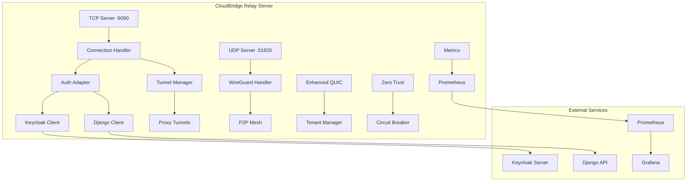

# CloudBridge Relay Server - Полная документация

## 📋 Содержание

1. [Обзор проекта](#обзор-проекта)
2. [Быстрый старт](#быстрый-старт)
3. [Архитектура](#архитектура)
4. [Конфигурация](#конфигурация)
5. [API Reference](#api-reference)
6. [Развертывание](#развертывание)
7. [Мониторинг](#мониторинг)
8. [Безопасность](#безопасность)
9. [Troubleshooting](#troubleshooting)
10. [Дополнительные ресурсы](#дополнительные-ресурсы)

---

## Обзор проекта

**CloudBridge Relay Server** - это высокопроизводительный сервер для создания P2P mesh сетей с поддержкой WireGuard, QUIC и mTLS протоколов. Сервер обеспечивает безопасное туннелирование, аутентификацию через JWT и multi-tenancy для изоляции клиентов.

### 🚀 Основные возможности

- **P2P Mesh Networks** - WireGuard-based одноранговые сети
- **Client-Server Proxy** - TCP/UDP проксирование для RDP, SSH, VNC
- **Multi-Protocol Support** - QUIC, HTTP/2, TLS 1.3, WireGuard
- **Multi-Tenancy** - Изоляция клиентов по tenant'ам
- **JWT Authentication** - Интеграция с Keycloak и Django API
- **Enhanced QUIC** - DDoS защита, географическая маршрутизация
- **Zero Trust Architecture** - Circuit breakers, rate limiting
- **Comprehensive Monitoring** - Prometheus, Grafana, метрики

### 🏗️ Архитектура



### 📊 Технические характеристики

| Параметр | Значение |
|----------|----------|
| **Максимум туннелей** | 1000 |
| **Максимум соединений** | 10000 |
| **Протоколы** | QUIC, HTTP/2, TLS 1.3, WireGuard |
| **Порты** | TCP 9090, UDP 51820, Metrics 8084 |
| **Аутентификация** | JWT, Keycloak, Django API |
| **Multi-tenancy** | Да |
| **DDoS защита** | Да |
| **Мониторинг** | Prometheus + Grafana |

---

## Быстрый старт

### 1. Клонирование репозитория

```bash
git clone https://github.com/2gc/cloudbridge-relay-installer.git
cd cloudbridge-relay-installer
```

### 2. Запуск с Docker Compose

```bash
# Запуск всех сервисов
docker-compose up -d

# Проверка статуса
docker-compose ps

# Просмотр логов
docker-compose logs cloudbridge-relay
```

### 3. Проверка работоспособности

```bash
# Health check
curl http://localhost:9090/health

# Метрики
curl http://localhost:8084/metrics

# Grafana (admin/admin)
open http://localhost:3000
```

### 4. Тестирование WireGuard

```bash
# Отправка Initiation пакета
echo -ne "\x01\x00\x00\x00" | nc -u localhost 51820

# Проверка логов
docker-compose logs cloudbridge-relay | grep -i wireguard
```

---

## Архитектура

### Сетевые возможности

#### **TCP 9090 - Основной API**
- **QUIC** (приоритетный) - UDP-based, низкая задержка
- **HTTP/2** (fallback) - TCP-based, совместимость
- **TLS 1.3** - минимальная версия для безопасности

#### **UDP 51820 - WireGuard P2P**
- **Initiation** - клиент отправляет пакет типа 1
- **Response** - сервер отвечает пакетом типа 2
- **Handshake** - установка безопасного соединения
- **Transport** - передача данных

### Протоколы и форматы сообщений

#### **CloudBridge Protocol**
```json
// Hello Message
{
  "type": "hello",
  "version": "1.0.0",
  "features": ["tls", "jwt", "tunneling"]
}

// Auth Message
{
  "type": "auth",
  "token": "eyJhbGciOiJSUzI1NiIsInR5cCI6IkpXVCJ9...",
  "tenant_id": "relay-test-tenant"
}

// Tunnel Info Message
{
  "type": "tunnel_info",
  "mode": "proxy",
  "remote_host": "192.168.1.100",
  "remote_port": 3389,
  "protocol": "tcp"
}
```

#### **WireGuard Handshake**
```
Initiation: [01][00][sender_index][00]
Response:   [02][00][sender_index][receiver_index][00][00]
```

### Аутентификация и авторизация

#### **JWT токены**
```json
{
  "client_id": "relay-client-001",
  "tenant_id": "relay-test-tenant",
  "exp": 1691234567,
  "iat": 1691230000,
  "type": "relay",
  "permissions": ["tunnel:create", "tunnel:read"]
}
```

#### **Multi-tenancy**
```json
{
  "tenants": {
    "relay-test-tenant": {
      "bandwidth_limit": 104857600,
      "connection_limit": 20,
      "rate_limit": 500,
      "burst": 100
    }
  }
}
```

---

## Конфигурация

### Основной конфиг (config.json)

```json
{
  "server": {
    "port": 9090,
    "max_tunnels": 1000,
    "timeout": 30
  },
  "django": {
    "enabled": true,
    "api_endpoint": "http://localhost:8000/api/validate-relay-token/",
    "timeout": 5,
    "retry_count": 3
  },
  "wireguard": {
    "enabled": true,
    "port": 51820,
    "interface": "wg-mesh0",
    "peer_discovery": true,
    "mesh_enabled": true
  },
  "tenants": {
    "relay-test-tenant": {
      "bandwidth_limit": 104857600,
      "connection_limit": 20,
      "rate_limit": 500,
      "burst": 100
    }
  }
}
```

### Docker Compose

```yaml
version: '3.8'
services:
  cloudbridge-relay:
    build: .
    container_name: cloudbridge-relay
    restart: unless-stopped
    network_mode: host
    volumes:
      - ./configs:/app/configs:ro
      - ./logs:/app/logs
    environment:
      - CONFIG_PATH=/app/configs/config.json
      - LOG_LEVEL=info
      - WIREGUARD_ENABLED=true
    healthcheck:
      test: ["CMD", "curl", "-f", "http://localhost:9090/health"]
      interval: 30s
      timeout: 10s
      retries: 3
```

---

## API Reference

### Health Check
```bash
curl http://localhost:9090/health
```

### Создание туннеля
```bash
curl -X POST http://localhost:9090/api/v1/tunnels \
  -H "Content-Type: application/json" \
  -H "Authorization: Bearer <jwt-token>" \
  -d '{
    "mode": "proxy",
    "remote_host": "192.168.1.100",
    "remote_port": 3389,
    "protocol": "tcp",
    "tenant_id": "relay-test-tenant"
  }'
```

### Получение статистики
```bash
curl http://localhost:9090/api/v1/stats
```

### Метрики Prometheus
```bash
curl http://localhost:8084/metrics
```

---

## Развертывание

### Docker

```bash
# Сборка образа
docker build -t cloudbridge-relay .

# Запуск контейнера
docker run -d \
  --name cloudbridge-relay \
  --network host \
  -v $(pwd)/configs:/app/configs:ro \
  -v $(pwd)/logs:/app/logs \
  cloudbridge-relay
```

### Kubernetes

```yaml
apiVersion: apps/v1
kind: Deployment
metadata:
  name: cloudbridge-relay
spec:
  replicas: 3
  selector:
    matchLabels:
      app: cloudbridge-relay
  template:
    metadata:
      labels:
        app: cloudbridge-relay
    spec:
      containers:
      - name: cloudbridge-relay
        image: cloudbridge-relay:latest
        ports:
        - containerPort: 9090
        - containerPort: 51820
          protocol: UDP
        env:
        - name: CONFIG_PATH
          value: "/app/configs/config.json"
        volumeMounts:
        - name: config
          mountPath: /app/configs
      volumes:
      - name: config
        configMap:
          name: cloudbridge-config
```

### Systemd

```ini
[Unit]
Description=CloudBridge Relay Server
After=network.target

[Service]
Type=simple
User=cloudbridge
Group=cloudbridge
WorkingDirectory=/opt/cloudbridge-relay
ExecStart=/opt/cloudbridge-relay/bin/cloudbridge-relay --config /opt/cloudbridge-relay/configs/config.json
Restart=always
RestartSec=5

[Install]
WantedBy=multi-user.target
```

---

## Мониторинг

### Prometheus метрики

```go
// Основные метрики
cloudbridge_connections_total
cloudbridge_tunnels_created_total
cloudbridge_active_connections
cloudbridge_request_duration_seconds
cloudbridge_memory_usage_bytes
```

### Grafana дашборды

- **Overview** - Общий обзор системы
- **Performance** - Производительность
- **Errors** - Ошибки и алерты
- **Tenants** - Статистика по tenant'ам

### Алерты

```yaml
groups:
- name: cloudbridge-relay
  rules:
  - alert: HighErrorRate
    expr: rate(cloudbridge_errors_total[5m]) > 0.1
    for: 2m
    labels:
      severity: warning
    annotations:
      summary: "High error rate detected"
```

---

## Безопасность

### TLS/SSL
- **TLS 1.2** - минимальная версия
- **TLS 1.3** - рекомендуемая версия
- **Perfect Forward Secrecy** - обязателен

### Файрвол
```bash
# Разрешенные порты
ufw allow 22/tcp      # SSH
ufw allow 9090/tcp    # CloudBridge API
ufw allow 51820/udp   # WireGuard
ufw allow 8084/tcp    # Metrics
```

### DDoS защита
- **Rate limiting** - ограничение скорости
- **Connection limits** - лимиты соединений
- **Geographic filtering** - географическая фильтрация
- **Behavioral analysis** - анализ поведения

---

## Troubleshooting

### Частые проблемы

#### **1. Сервер не запускается**
```bash
# Проверить порты
netstat -tuln | grep -E "(9090|51820)"

# Проверить логи
docker-compose logs cloudbridge-relay

# Проверить конфигурацию
./cloudbridge-relay --config configs/config.json --validate
```

#### **2. Аутентификация не работает**
```bash
# Проверить Django API
curl -X POST http://localhost:8000/api/validate-relay-token/ \
  -H "Content-Type: application/json" \
  -d '{"token": "your-jwt-token"}'
```

#### **3. WireGuard не отвечает**
```bash
# Проверить UDP порт
nc -zu localhost 51820

# Проверить firewall
sudo ufw status

# Проверить Docker network
docker network inspect cloudbridge-relay-installer_cloudbridge-network
```

#### **4. Высокая задержка**
```bash
# Проверить метрики
curl http://localhost:8084/metrics

# Проверить ресурсы
docker stats cloudbridge-relay
```

### Логи и отладка

```bash
# Просмотр логов в реальном времени
docker-compose logs -f cloudbridge-relay

# Фильтрация по типу сообщений
docker-compose logs cloudbridge-relay | grep -i "wireguard\|auth\|tunnel"

# Проверка health check
curl -v http://localhost:9090/health
```

---

## Дополнительные ресурсы

### 📚 Документация
- [Полная документация](./CLOUDBRIDGE_RELAY_DOCUMENTATION.md)
- [Архитектурные диаграммы](./docs/architecture-diagrams.md)
- [Примеры конфигурации](./docs/configuration-examples.md)
- [API Reference](./docs/api-reference.md)

### 🔧 Скрипты
- [Тест WireGuard](./test_external_wireguard.sh)
- [Проверка портов](./scripts/check_ports.sh)
- [Настройка tenant](./scripts/setup_test_tenant.sh)

### 📊 Мониторинг
- **Prometheus**: http://localhost:9091
- **Grafana**: http://localhost:3000 (admin/admin)
- **Health Check**: http://localhost:9090/health
- **Metrics**: http://localhost:8084/metrics

### 🚀 Быстрые команды

```bash
# Запуск
docker-compose up -d

# Остановка
docker-compose down

# Перезапуск
docker-compose restart

# Просмотр логов
docker-compose logs -f cloudbridge-relay

# Проверка статуса
docker-compose ps

# Тест WireGuard
echo -ne "\x01\x00\x00\x00" | nc -u localhost 51820

# Health check
curl http://localhost:9090/health

# Метрики
curl http://localhost:8084/metrics
```

---

## 📋 FAQ

### **Q: Какой максимальный размер туннеля?**
A: По умолчанию 1000 одновременных туннелей, настраивается в конфиге.

### **Q: Поддерживается ли IPv6?**
A: Да, сервер поддерживает как IPv4, так и IPv6.

### **Q: Можно ли использовать без Docker?**
A: Да, можно запустить напрямую: `./cloudbridge-relay --config configs/config.json`

### **Q: Как настроить SSL сертификаты?**
A: Поместите сертификаты в папку `certs/` и укажите пути в конфиге.

### **Q: Поддерживается ли кластеризация?**
A: Да, через Kubernetes или Docker Swarm с внешним load balancer.

---

## 🎯 Заключение

CloudBridge Relay Server предоставляет мощную платформу для создания P2P mesh сетей с поддержкой современных протоколов и высоким уровнем безопасности. Сервер готов к production использованию и поддерживает масштабирование для больших нагрузок.

**Ключевые преимущества:**
- ✅ Высокая производительность
- ✅ Безопасность и аутентификация
- ✅ Multi-tenancy
- ✅ Comprehensive мониторинг
- ✅ Простота развертывания
- ✅ Гибкая конфигурация

---

*Документация обновлена: 2025-09-04*  
*Версия CloudBridge Relay Server: v1.0.0*  
*Автор: DevOps Team*
