# CloudBridge Relay Server - Архитектурные диаграммы

## 1. Общая архитектура системы

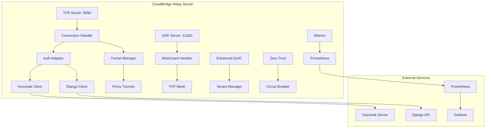

## 2. Сетевой стек протоколов

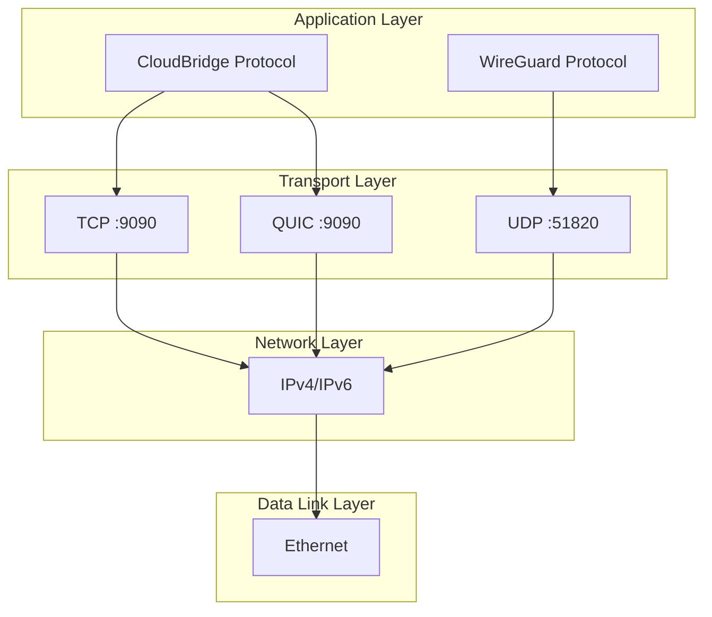

## 3. Процесс аутентификации

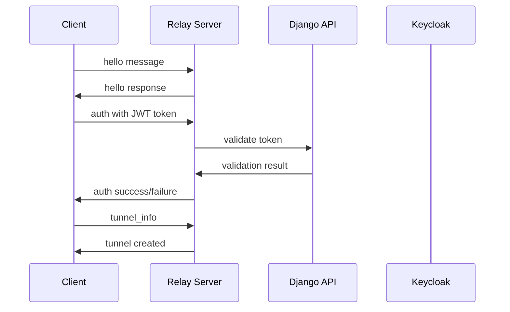

## 4. WireGuard P2P Handshake

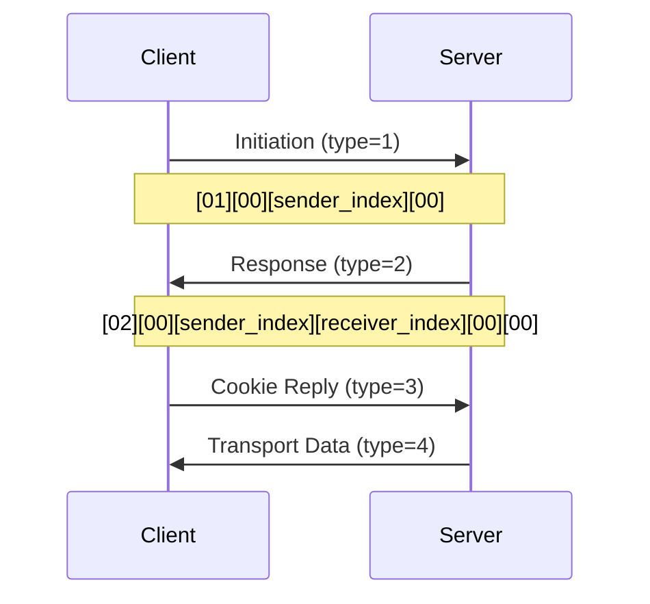

## 5. Создание и управление туннелями

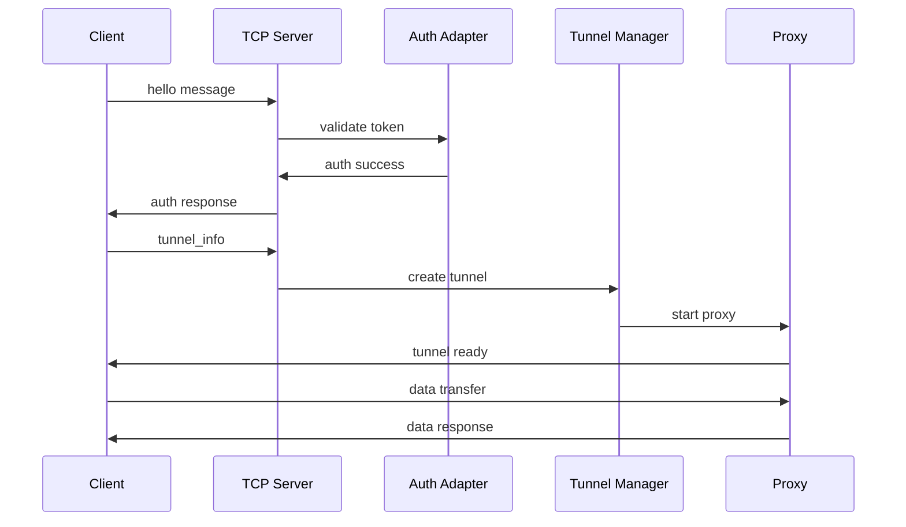

## 6. Multi-tenancy архитектура

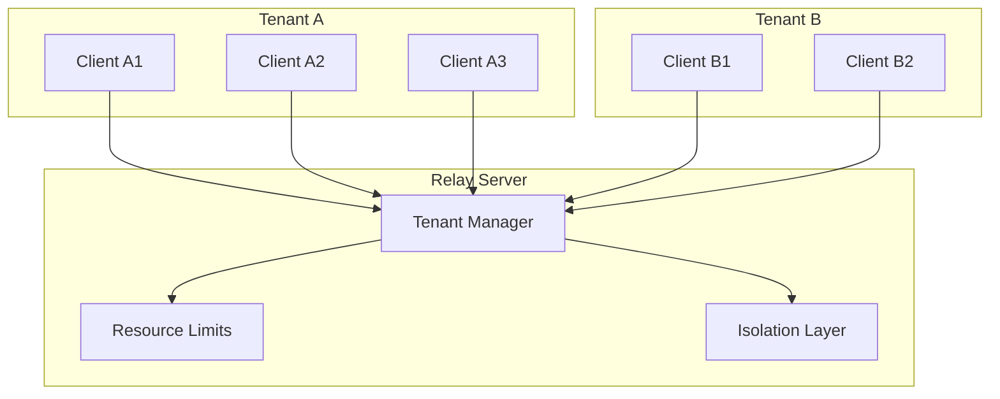

## 7. Мониторинг и метрики

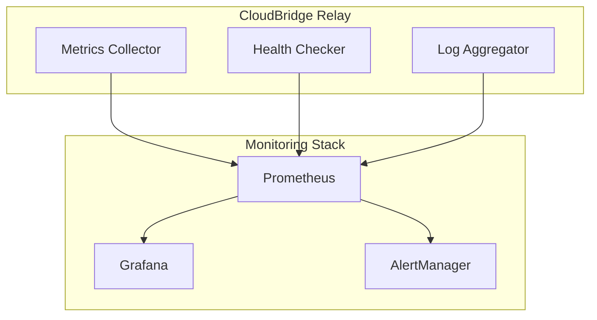

## 8. Безопасность и защита

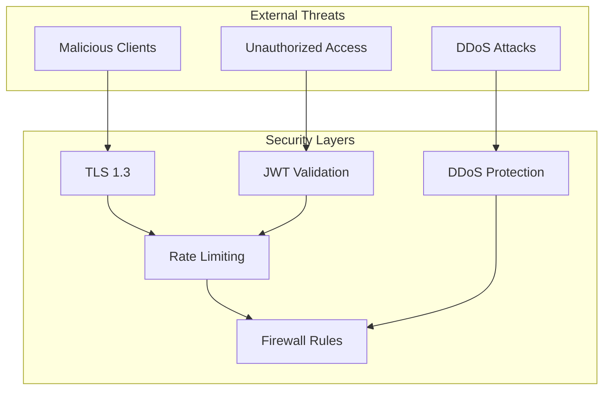

## 9. Развертывание в Kubernetes

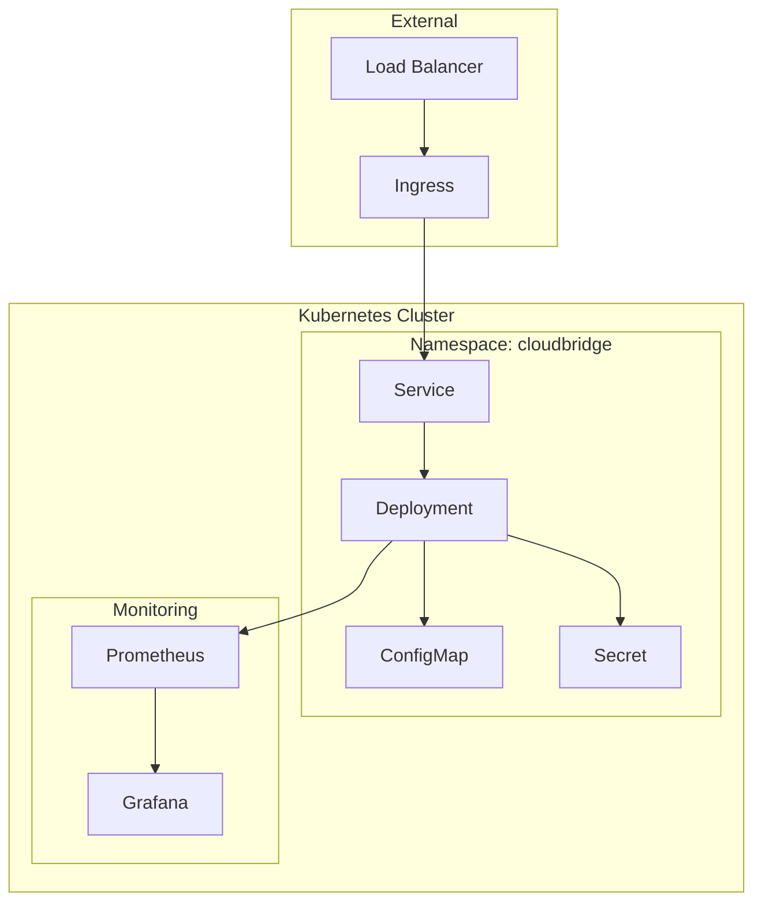

## 10. Поток данных в системе

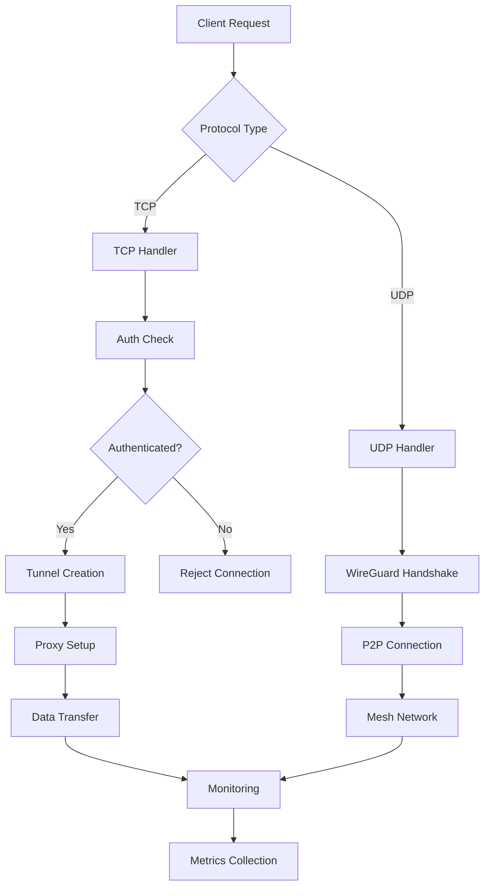

## 11. Обработка ошибок и восстановление

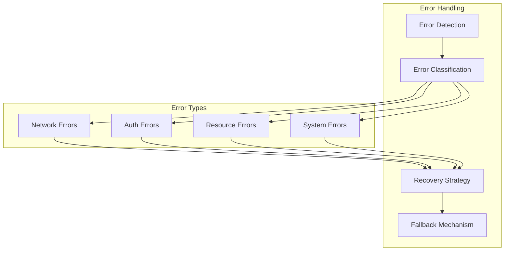

## 12. Масштабирование системы

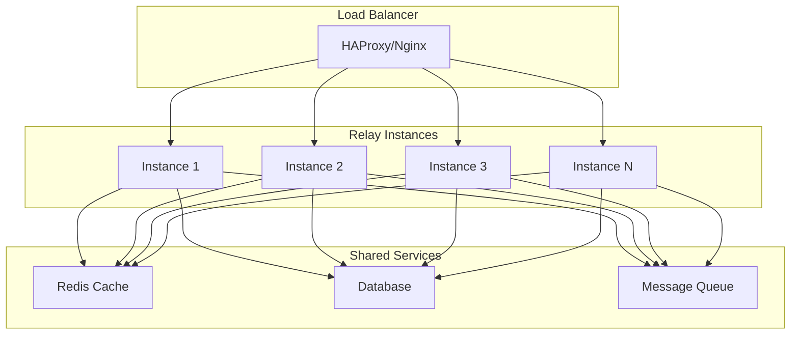

---

*Диаграммы созданы с помощью Mermaid.js*
*Для просмотра используйте Mermaid Live Editor или поддерживаемые плагины*
