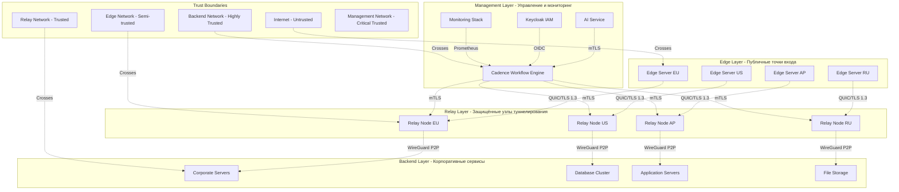
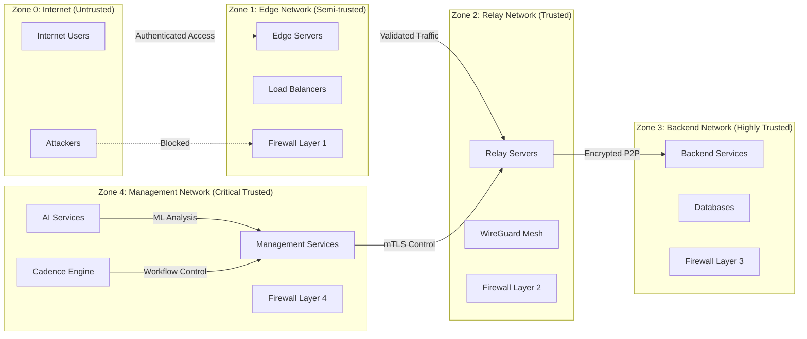
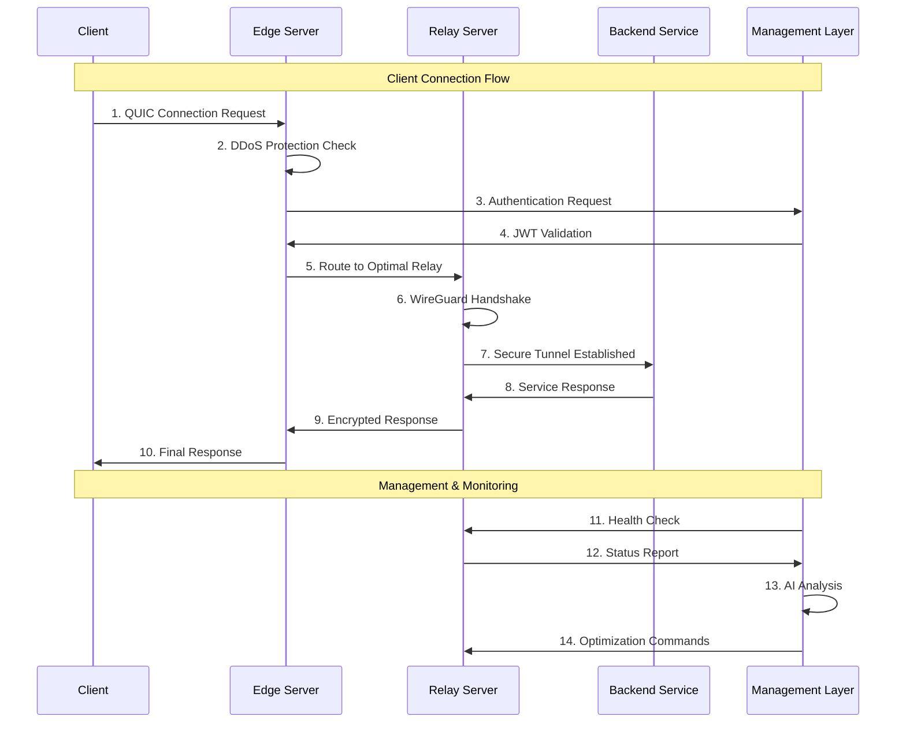
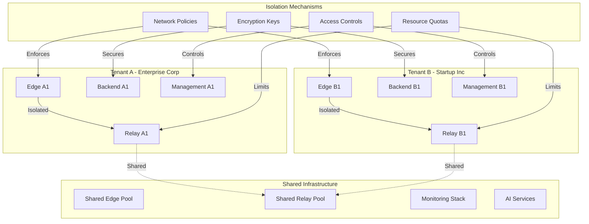
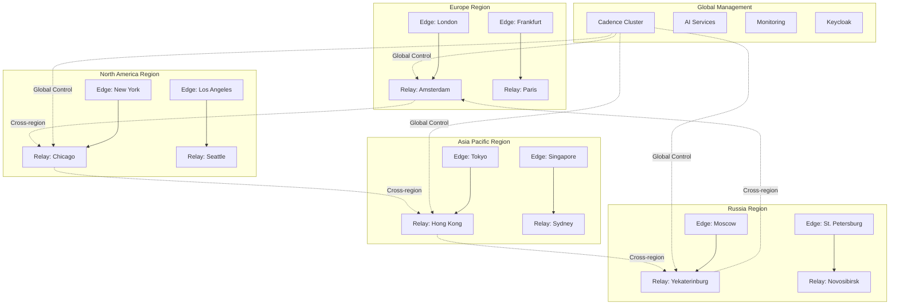
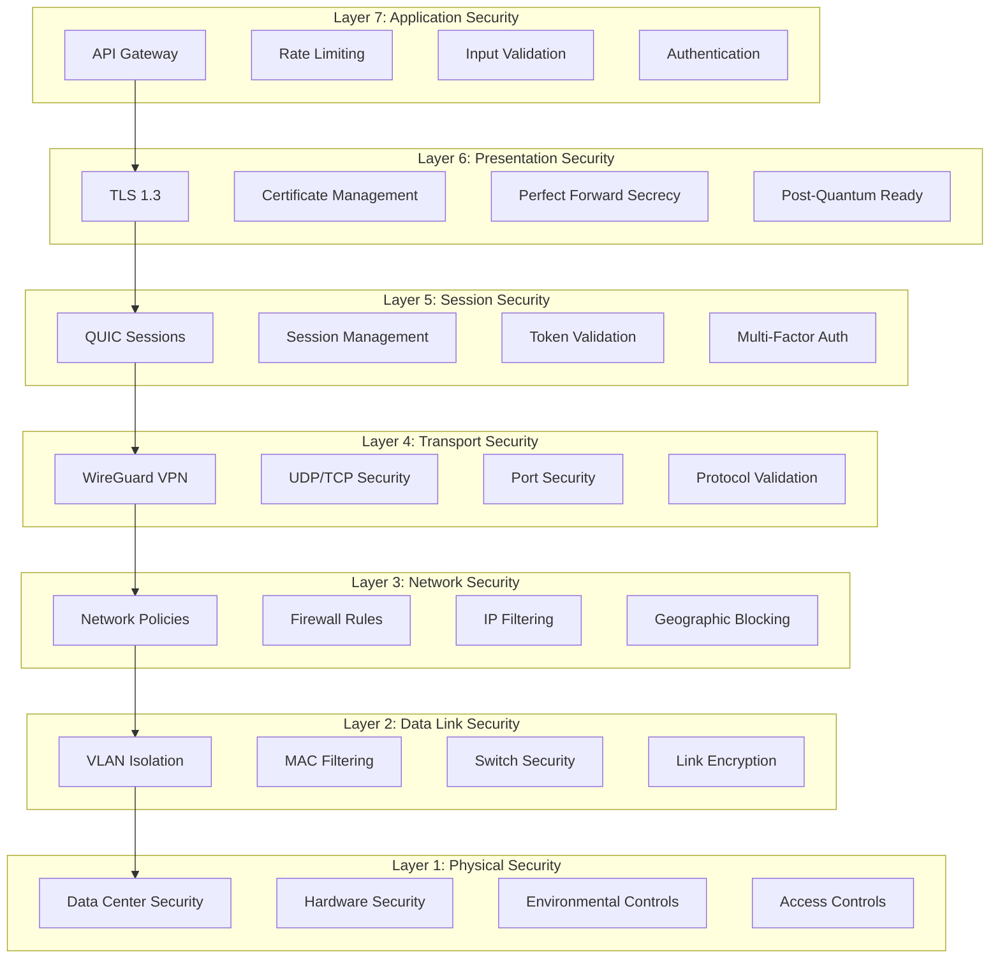

# Архитектурные схемы CloudBridge Relay

## 1. Общая архитектурная схема (Edge → Relay → Backend → Management)

## 2. Trust Boundaries и Security Zones

## 3. Data Flow Architecture

## 4. Multi-Tenant Architecture

## 5. Geographic Distribution

## 6. Security Architecture Layers

---

*Эти архитектурные схемы демонстрируют многоуровневую архитектуру CloudBridge Relay с четкими trust boundaries, обеспечивающими безопасность и изоляцию на каждом уровне системы.*
