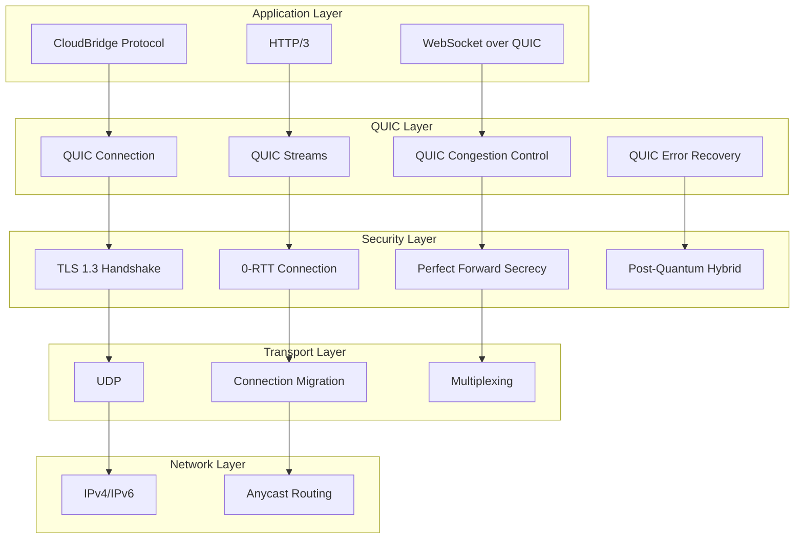
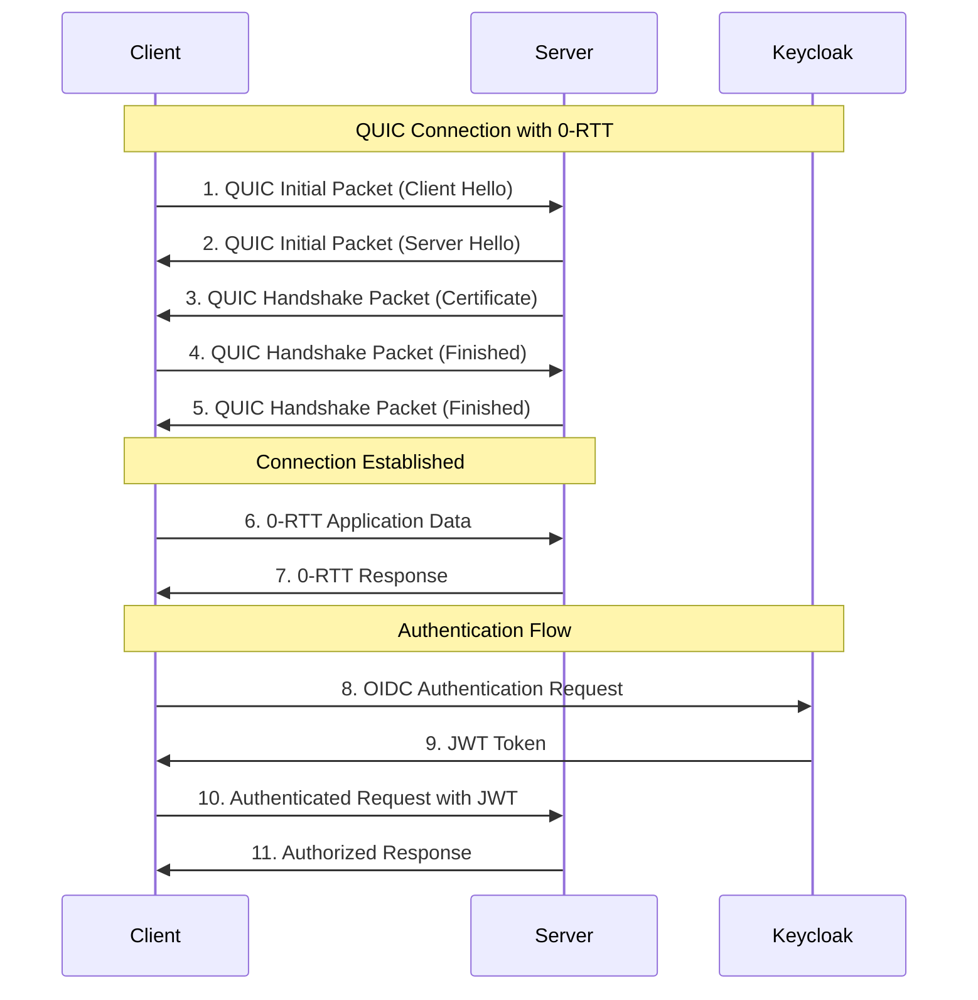
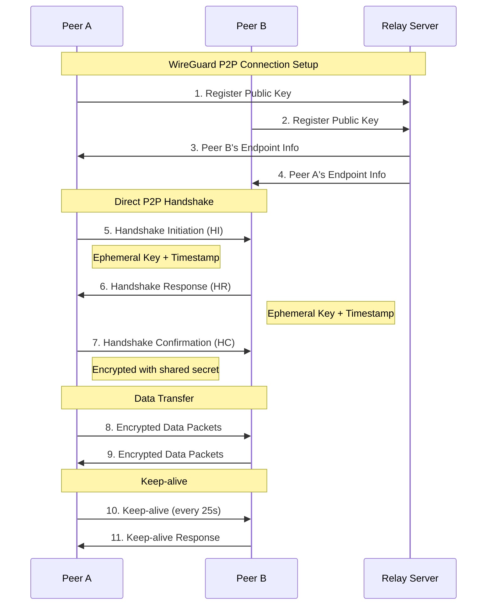
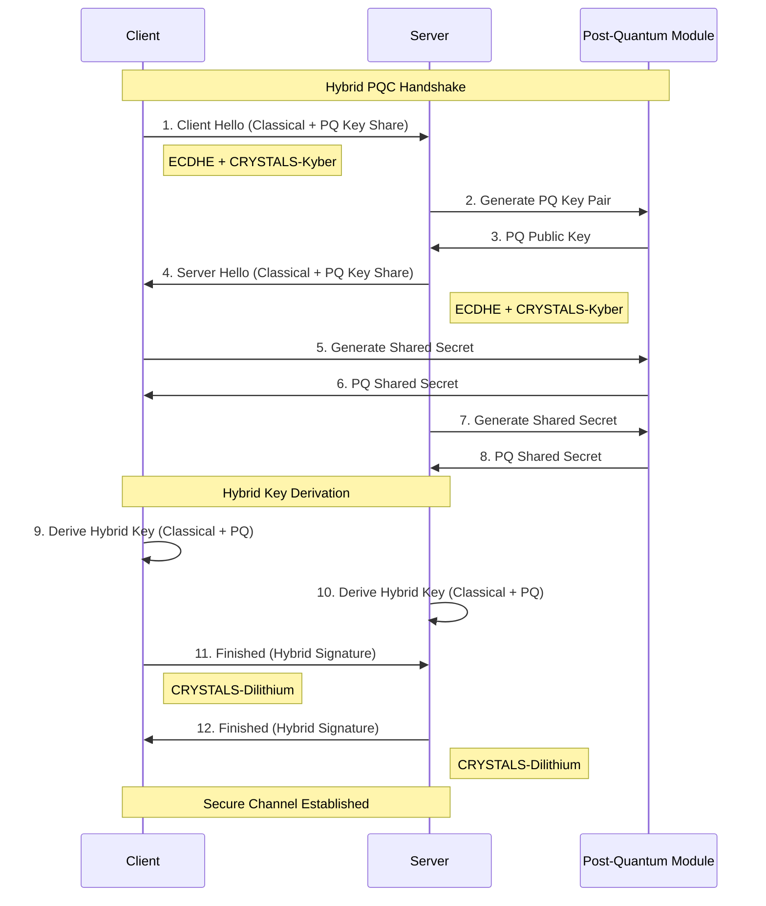
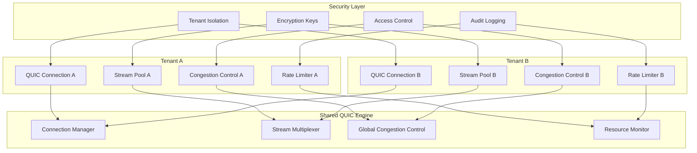
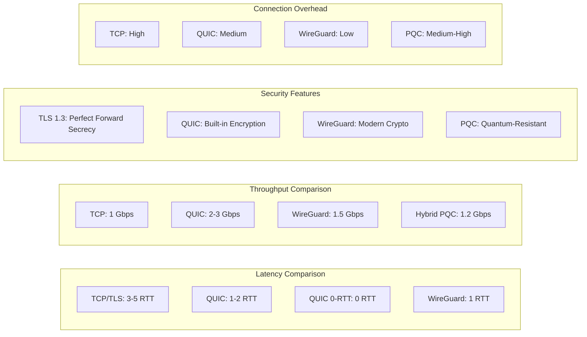
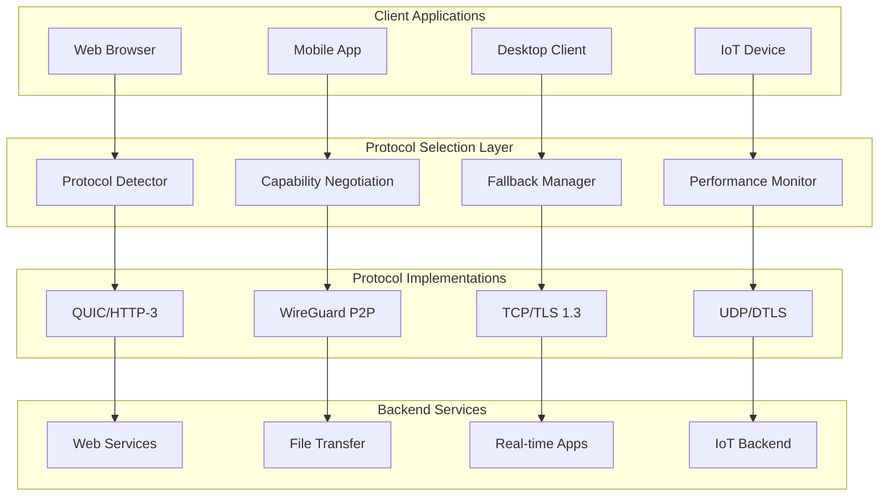
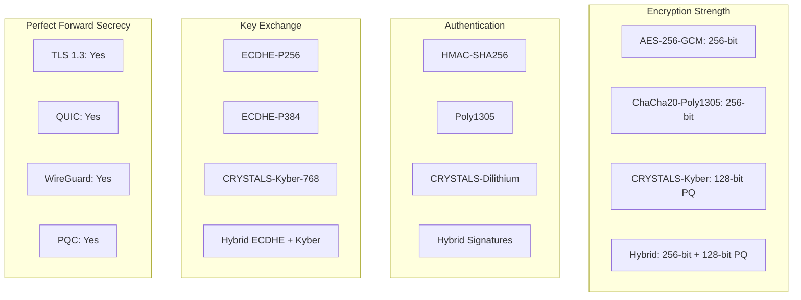
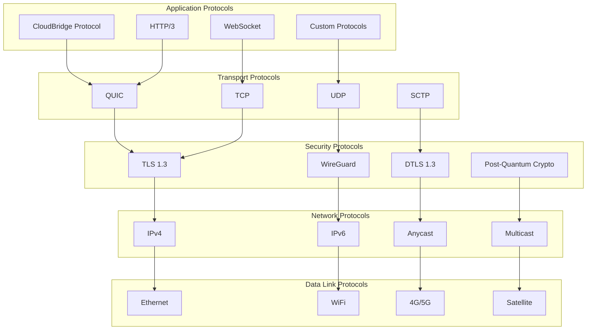

# Протокольные диаграммы CloudBridge Relay

## 1. QUIC/HTTP-3 Protocol Stack

## 2. QUIC Connection Establishment

## 3. WireGuard P2P Handshake

## 4. Hybrid Post-Quantum Cryptography Handshake

## 5. Enhanced QUIC with Multi-Tenancy

## 6. Protocol Performance Comparison

## 7. Multi-Protocol Architecture

## 8. Protocol Security Matrix

## 9. Network Protocol Stack

---

*Эти протокольные диаграммы демонстрируют современные сетевые протоколы, используемые в CloudBridge Relay, включая QUIC/HTTP-3, WireGuard P2P, и гибридную пост-квантовую криптографию для обеспечения максимальной производительности и безопасности.*
