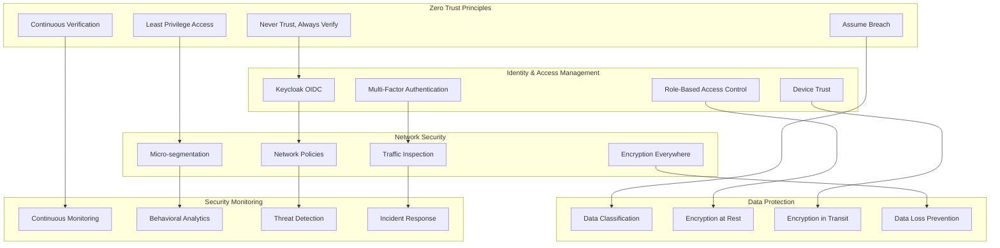
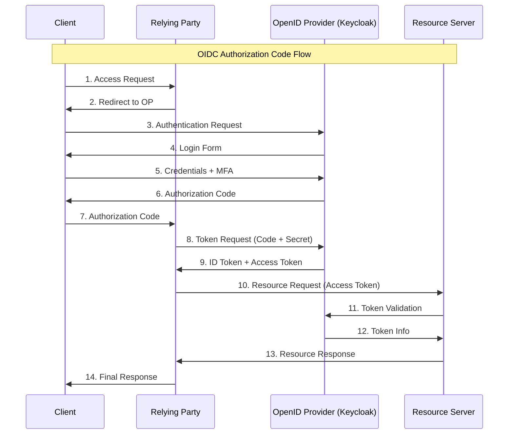
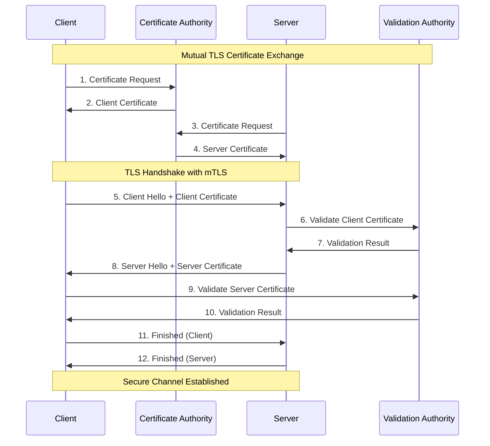
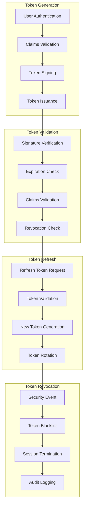
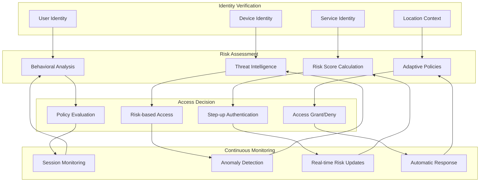
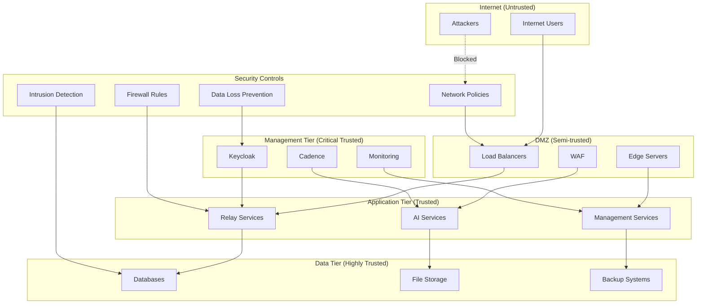
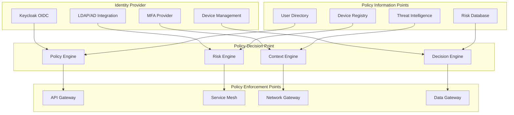
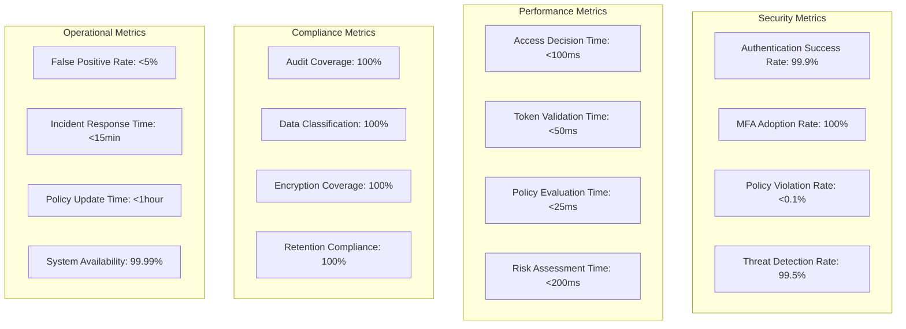

# Zero Trust Security Model CloudBridge Relay

## 1. Zero Trust Architecture Overview



## 2. OIDC Authentication Flow



## 3. mTLS Certificate Flow



## 4. JWT Token Lifecycle



## 5. Policy-as-Code Examples

### 5.1 Network Access Policy

```yaml
# Network Access Policy
apiVersion: security.cloudbridge.io/v1
kind: NetworkAccessPolicy
metadata:
  name: tenant-isolation-policy
spec:
  rules:
    - name: tenant-a-access
      source:
        tenant: "tenant-a"
        identity: "user-*"
      destination:
        tenant: "tenant-a"
        services: ["backend-a", "database-a"]
      action: ALLOW
      conditions:
        - mfa_required: true
        - device_trust: high
        - time_window: "08:00-18:00"
    
    - name: cross-tenant-deny
      source:
        tenant: "*"
      destination:
        tenant: "!source.tenant"
      action: DENY
      log: true
```

### 5.2 Data Access Policy

```yaml
# Data Access Policy
apiVersion: security.cloudbridge.io/v1
kind: DataAccessPolicy
metadata:
  name: pii-protection-policy
spec:
  rules:
    - name: pii-access-control
      data_classification: "PII"
      access_conditions:
        - role: "data-analyst"
        - clearance_level: "high"
        - purpose: "business-justified"
        - consent: "explicit"
      encryption_required: true
      audit_logging: true
      retention_period: "30d"
    
    - name: gdpr-compliance
      data_classification: "GDPR"
      access_conditions:
        - legal_basis: "consent"
        - data_subject_rights: "respected"
      encryption_required: true
      audit_logging: true
      retention_period: "7y"
```

### 5.3 Service Access Policy

```yaml
# Service Access Policy
apiVersion: security.cloudbridge.io/v1
kind: ServiceAccessPolicy
metadata:
  name: microservice-access-policy
spec:
  rules:
    - name: internal-service-communication
      source:
        service: "relay-service"
        namespace: "cloudbridge"
      destination:
        service: "ai-service"
        namespace: "cloudbridge"
      action: ALLOW
      conditions:
        - mTLS_required: true
        - service_mesh: true
        - rate_limit: "1000/min"
    
    - name: external-api-access
      source:
        service: "*"
      destination:
        external: true
      action: DENY
      exceptions:
        - service: "monitoring-service"
          destination: "prometheus.io"
          action: ALLOW
```

## 6. Continuous Verification Model



## 7. Zero Trust Network Segmentation



## 8. Policy Enforcement Points



## 9. Zero Trust Metrics and KPIs



---

*Эта Zero Trust модель демонстрирует комплексный подход к безопасности CloudBridge Relay, включая OIDC аутентификацию, mTLS, JWT токены и policy-as-code для обеспечения непрерывной верификации и минимальных привилегий доступа.*
