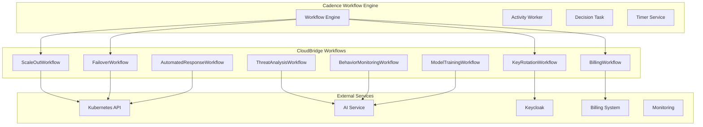
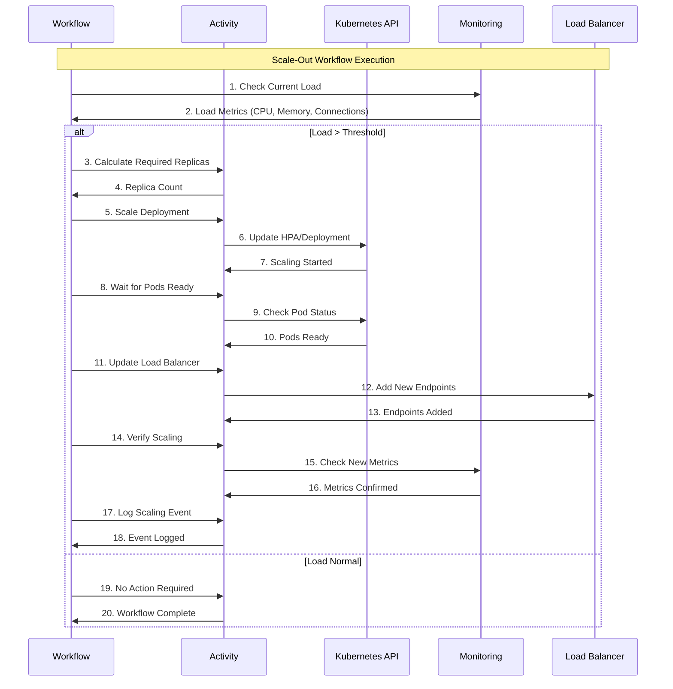
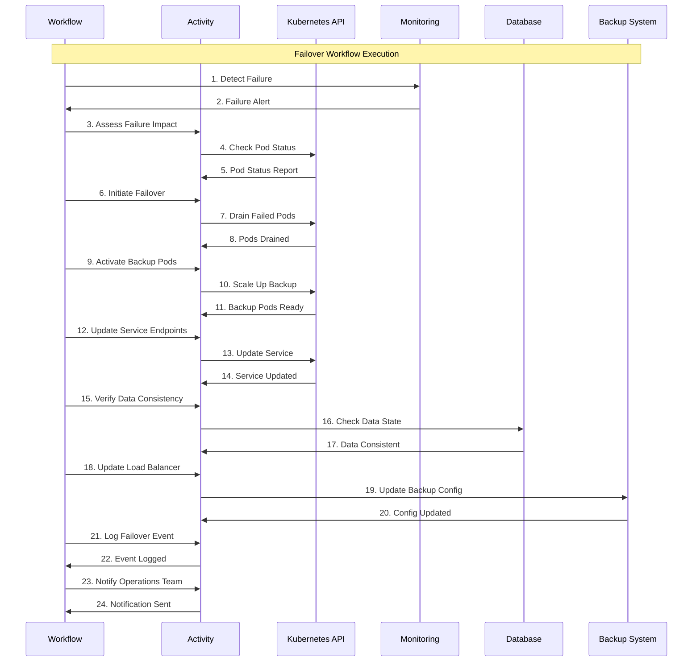
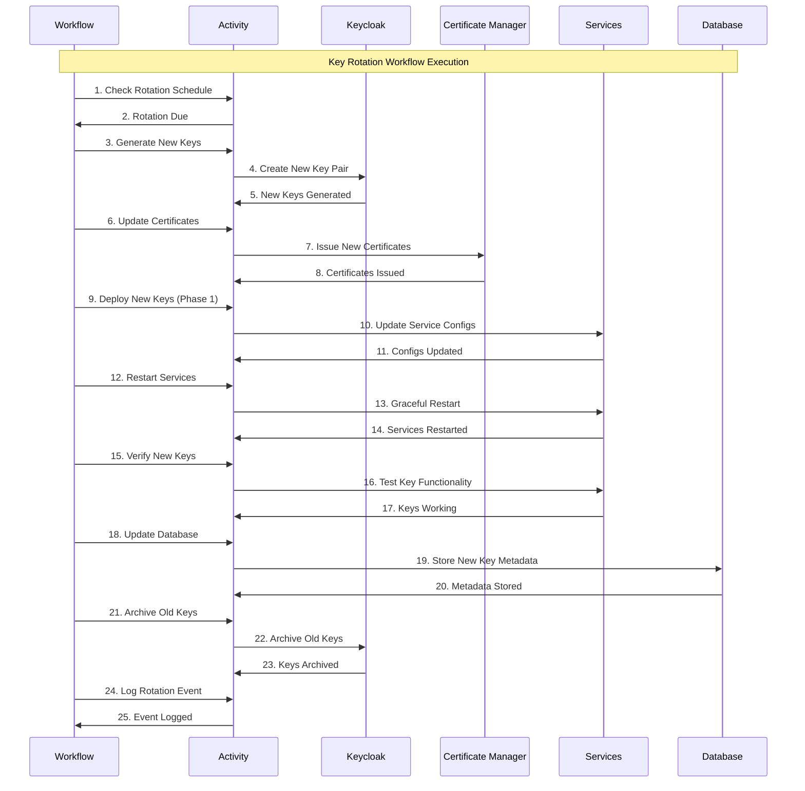
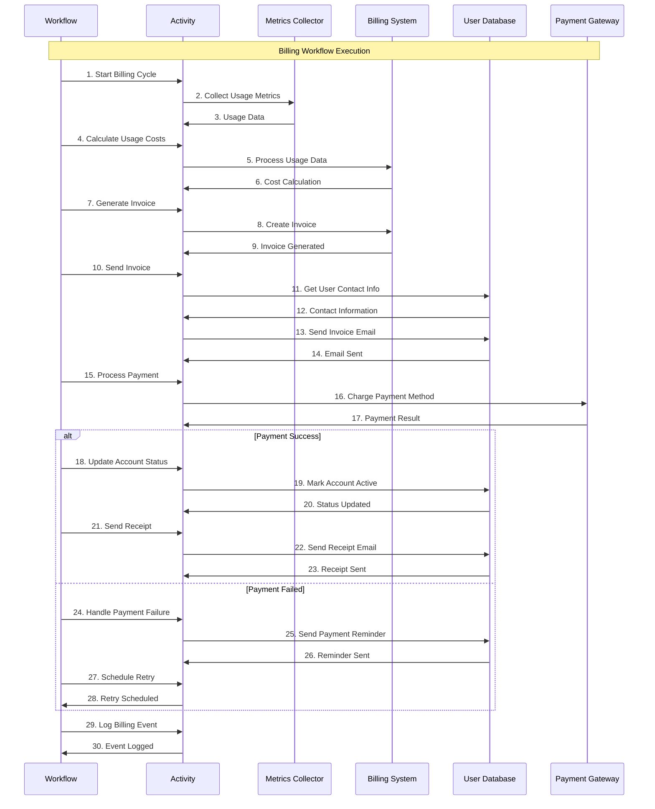
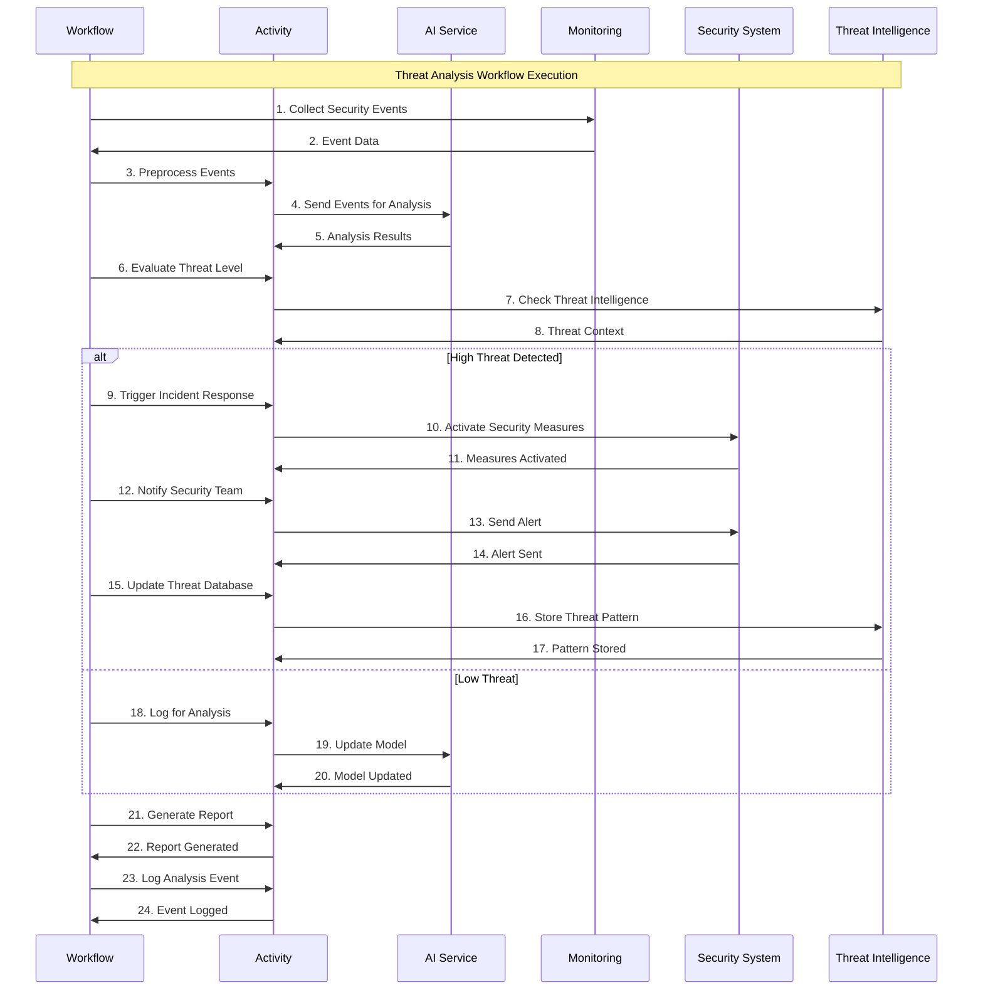
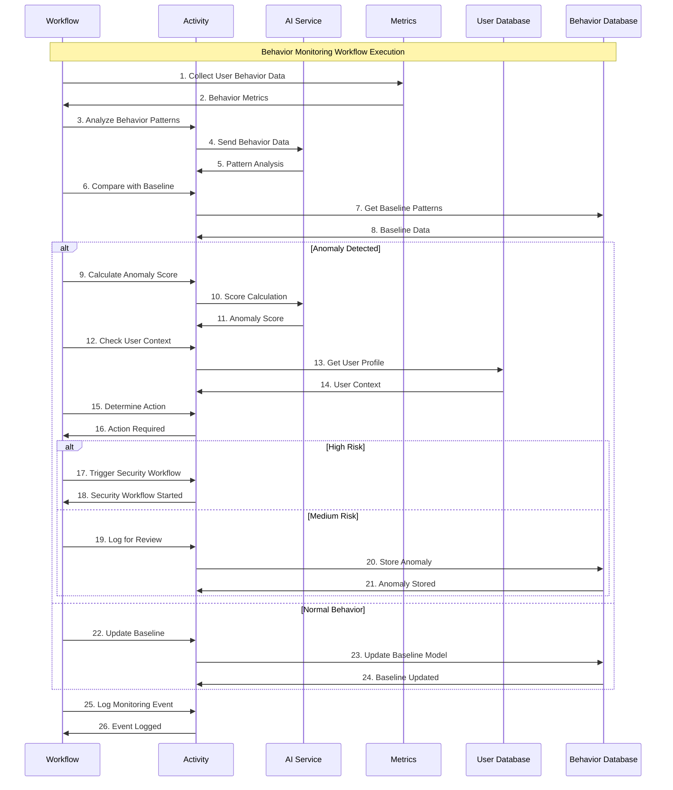
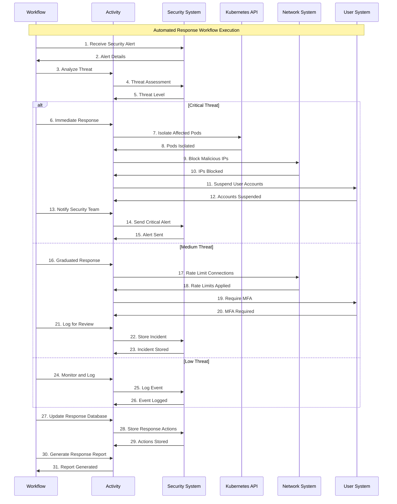
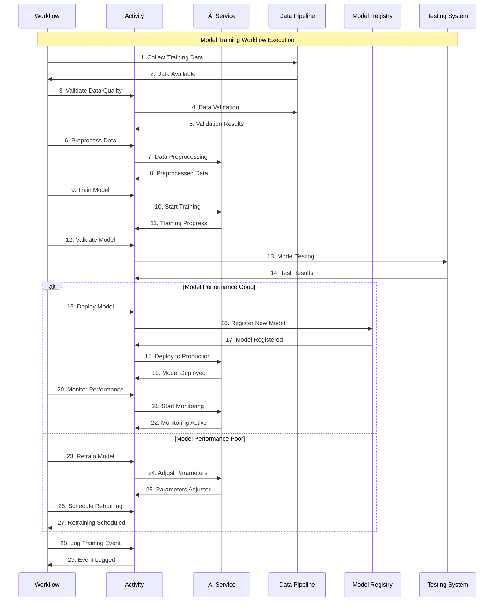

# Workflow Schemas CloudBridge Relay

## 1. Cadence Workflow Architecture



## 2. Scale-Out Workflow



## 3. Failover Workflow



## 4. Key Rotation Workflow



## 5. Billing Workflow



## 6. Threat Analysis Workflow



## 7. Behavior Monitoring Workflow



## 8. Automated Response Workflow



## 9. Model Training Workflow



## 10. Workflow Configuration

### 10.1 Cadence Domain Configuration

```yaml
# cadence-domain-config.yml
apiVersion: v1
kind: ConfigMap
metadata:
  name: cadence-domain-config
data:
  domain-config.yaml: |
    domains:
      - name: cloudbridge
        description: "CloudBridge Relay Workflows"
        retentionDays: 30
        emitMetric: true
        archivalBucketName: "cloudbridge-archival"
        archivalStatus: "enabled"
        archivalURI: "s3://cloudbridge-archival"
        badBinaries:
          binaries:
            - reason: "Bug fix for scale-out workflow"
              createdTime: "2024-01-01T00:00:00Z"
              operator: "admin@cloudbridge.io"
              binaryChecksum: "abc123"
    workflowTypes:
      - name: "ScaleOutWorkflow"
        taskList: "scale-out-tasks"
        executionStartToCloseTimeout: "10m"
        taskStartToCloseTimeout: "1m"
        retryPolicy:
          initialInterval: "1s"
          backoffCoefficient: 2.0
          maximumInterval: "100s"
          maximumAttempts: 3
      - name: "FailoverWorkflow"
        taskList: "failover-tasks"
        executionStartToCloseTimeout: "5m"
        taskStartToCloseTimeout: "30s"
        retryPolicy:
          initialInterval: "1s"
          backoffCoefficient: 2.0
          maximumInterval: "60s"
          maximumAttempts: 5
      - name: "KeyRotationWorkflow"
        taskList: "key-rotation-tasks"
        executionStartToCloseTimeout: "30m"
        taskStartToCloseTimeout: "5m"
        retryPolicy:
          initialInterval: "1s"
          backoffCoefficient: 2.0
          maximumInterval: "300s"
          maximumAttempts: 3
      - name: "BillingWorkflow"
        taskList: "billing-tasks"
        executionStartToCloseTimeout: "1h"
        taskStartToCloseTimeout: "10m"
        retryPolicy:
          initialInterval: "1s"
          backoffCoefficient: 2.0
          maximumInterval: "600s"
          maximumAttempts: 3
```

### 10.2 Workflow Deployment

```yaml
# workflow-deployment.yml
apiVersion: apps/v1
kind: Deployment
metadata:
  name: cloudbridge-workflow-worker
spec:
  replicas: 3
  selector:
    matchLabels:
      app: cloudbridge-workflow-worker
  template:
    metadata:
      labels:
        app: cloudbridge-workflow-worker
    spec:
      containers:
        - name: workflow-worker
          image: cloudbridge/workflow-worker:2.0.0
          env:
            - name: CADENCE_HOST
              value: "cadence-service:7933"
            - name: CADENCE_DOMAIN
              value: "cloudbridge"
            - name: TASK_LIST
              value: "cloudbridge-tasks"
          resources:
            requests:
              cpu: 100m
              memory: 256Mi
            limits:
              cpu: 500m
              memory: 512Mi
          livenessProbe:
            httpGet:
              path: /health
              port: 8080
            initialDelaySeconds: 30
            periodSeconds: 10
          readinessProbe:
            httpGet:
              path: /ready
              port: 8080
            initialDelaySeconds: 5
            periodSeconds: 5
```

---

*Эти workflow схемы демонстрируют комплексную автоматизацию CloudBridge Relay через Cadence Workflow Engine, включая масштабирование, отказоустойчивость, ротацию ключей, биллинг, анализ угроз, мониторинг поведения и автоматическое реагирование.*
