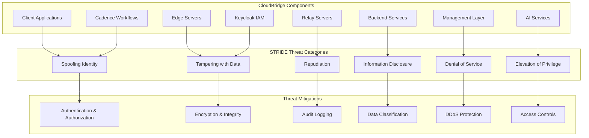
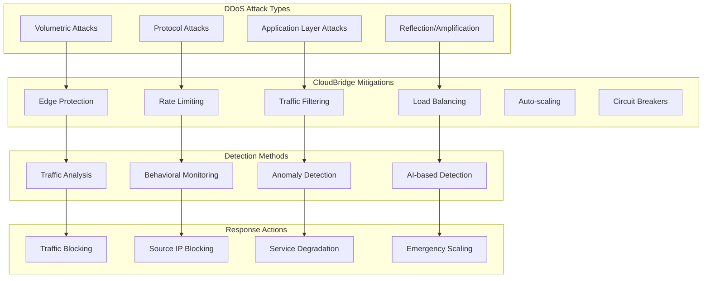

# Security Threat Model CloudBridge Relay

## 1. STRIDE Threat Model Analysis

### 1.1 STRIDE Framework Overview



### 1.2 Detailed STRIDE Analysis

```yaml
# stride-threat-analysis.yml
stride_analysis:
  spoofing_identity:
    threats:
      - name: "Impersonation Attack"
        description: "Attacker impersonates legitimate user"
        target_components: ["Client Applications", "Edge Servers"]
        attack_vectors: ["Stolen Credentials", "Session Hijacking", "Token Theft"]
        likelihood: "Medium"
        impact: "High"
        mitigations:
          - "Multi-Factor Authentication (MFA)"
          - "JWT Token Validation"
          - "Certificate-based Authentication"
          - "Device Trust Verification"
          - "Behavioral Analytics"
      
      - name: "Service Impersonation"
        description: "Attacker impersonates CloudBridge service"
        target_components: ["Relay Servers", "Backend Services"]
        attack_vectors: ["DNS Spoofing", "Certificate Spoofing", "Man-in-the-Middle"]
        likelihood: "Low"
        impact: "Critical"
        mitigations:
          - "mTLS Certificate Validation"
          - "Certificate Pinning"
          - "DNS Security (DNSSEC)"
          - "Network Segmentation"
          - "Service Mesh Security"
    
    risk_score: 7.5
    
  tampering_with_data:
    threats:
      - name: "Data in Transit Tampering"
        description: "Attacker modifies data during transmission"
        target_components: ["All Network Communications"]
        attack_vectors: ["Man-in-the-Middle", "Protocol Exploitation", "Replay Attacks"]
        likelihood: "Medium"
        impact: "High"
        mitigations:
          - "TLS 1.3 Encryption"
          - "QUIC Protocol Security"
          - "WireGuard Encryption"
          - "Message Authentication Codes (MAC)"
          - "Perfect Forward Secrecy"
      
      - name: "Data at Rest Tampering"
        description: "Attacker modifies stored data"
        target_components: ["Databases", "File Storage", "Configuration Files"]
        attack_vectors: ["Database Injection", "File System Access", "Configuration Manipulation"]
        likelihood: "Low"
        impact: "Critical"
        mitigations:
          - "Database Encryption"
          - "File System Encryption"
          - "Configuration Signing"
          - "Access Controls"
          - "Integrity Monitoring"
    
    risk_score: 8.0
    
  repudiation:
    threats:
      - name: "Transaction Repudiation"
        description: "User denies performing actions"
        target_components: ["All User Interactions"]
        attack_vectors: ["Account Compromise", "Shared Credentials", "Session Sharing"]
        likelihood: "Medium"
        impact: "Medium"
        mitigations:
          - "Comprehensive Audit Logging"
          - "Digital Signatures"
          - "Non-repudiation Tokens"
          - "User Behavior Analytics"
          - "Session Management"
      
      - name: "Administrative Action Repudiation"
        description: "Admin denies performing administrative actions"
        target_components: ["Management Layer", "Configuration Changes"]
        attack_vectors: ["Privileged Account Compromise", "Insider Threat"]
        likelihood: "Low"
        impact: "High"
        mitigations:
          - "Administrative Audit Logs"
          - "Privileged Access Management"
          - "Change Management Process"
          - "Multi-person Approval"
          - "Immutable Logs"
    
    risk_score: 6.5
    
  information_disclosure:
    threats:
      - name: "Data Leakage"
        description: "Sensitive data exposed to unauthorized parties"
        target_components: ["All Data Storage", "Network Communications"]
        attack_vectors: ["SQL Injection", "Cross-Site Scripting", "Data Exfiltration"]
        likelihood: "Medium"
        impact: "Critical"
        mitigations:
          - "Data Classification"
          - "Encryption at Rest and in Transit"
          - "Data Loss Prevention (DLP)"
          - "Access Controls"
          - "Data Masking"
      
      - name: "Metadata Disclosure"
        description: "System metadata reveals sensitive information"
        target_components: ["Logs", "Error Messages", "API Responses"]
        attack_vectors: ["Information Gathering", "Error Analysis", "Log Analysis"]
        likelihood: "High"
        impact: "Medium"
        mitigations:
          - "Log Sanitization"
          - "Error Message Obfuscation"
          - "API Response Filtering"
          - "Metadata Classification"
          - "Information Security Policies"
    
    risk_score: 7.0
    
  denial_of_service:
    threats:
      - name: "Distributed Denial of Service (DDoS)"
        description: "Overwhelm system with traffic"
        target_components: ["Edge Servers", "Relay Servers", "Network Infrastructure"]
        attack_vectors: ["Volumetric Attacks", "Protocol Attacks", "Application Layer Attacks"]
        likelihood: "High"
        impact: "High"
        mitigations:
          - "DDoS Mitigation Services"
          - "Rate Limiting"
          - "Traffic Filtering"
          - "Load Balancing"
          - "Auto-scaling"
      
      - name: "Resource Exhaustion"
        description: "Exhaust system resources"
        target_components: ["CPU", "Memory", "Storage", "Network Bandwidth"]
        attack_vectors: ["Memory Exhaustion", "CPU Intensive Operations", "Storage Filling"]
        likelihood: "Medium"
        impact: "High"
        mitigations:
          - "Resource Limits"
          - "Quota Management"
          - "Resource Monitoring"
          - "Auto-scaling"
          - "Circuit Breakers"
    
    risk_score: 8.5
    
  elevation_of_privilege:
    threats:
      - name: "Privilege Escalation"
        description: "Gain higher privileges than authorized"
        target_components: ["User Accounts", "Service Accounts", "Administrative Interfaces"]
        attack_vectors: ["Buffer Overflow", "Race Conditions", "Configuration Vulnerabilities"]
        likelihood: "Low"
        impact: "Critical"
        mitigations:
          - "Principle of Least Privilege"
          - "Regular Security Updates"
          - "Vulnerability Scanning"
          - "Code Review"
          - "Runtime Protection"
      
      - name: "Lateral Movement"
        description: "Move between systems with compromised credentials"
        target_components: ["Internal Network", "Service-to-Service Communication"]
        attack_vectors: ["Credential Theft", "Pass-the-Hash", "Kerberoasting"]
        likelihood: "Medium"
        impact: "High"
        mitigations:
          - "Network Segmentation"
          - "Zero Trust Architecture"
          - "Service Mesh Security"
          - "Credential Management"
          - "Behavioral Analytics"
    
    risk_score: 7.5
```

## 2. MITRE ATT&CK Framework Mapping

### 2.1 ATT&CK Tactics and Techniques

```mermaid
graph TB
    subgraph "Initial Access"
        IA1[Phishing]
        IA2[External Remote Services]
        IA3[Supply Chain Compromise]
        IA4[Trusted Relationship]
    end
    
    subgraph "Execution"
        EX1[Command and Scripting Interpreter]
        EX2[User Execution]
        EX3[System Services]
        EX4[Container Administration Command]
    end
    
    subgraph "Persistence"
        PS1[Create Account]
        PS2[Web Shell]
        PS3[Server Software Component]
        PS4[Container Image]
    end
    
    subgraph "Privilege Escalation"
        PE1[Exploitation for Privilege Escalation]
        PE2[Process Injection]
        PE3[Container Escape]
        PE4[Abuse Elevation Control Mechanism]
    end
    
    subgraph "Defense Evasion"
        DE1[Clear Command History]
        DE2[Disable Security Tools]
        DE3[Hide Artifacts]
        DE4[Impair Defenses]
    end
    
    subgraph "Credential Access"
        CA1[Brute Force]
        CA2[Forced Authentication]
        CA3[Input Capture]
        CA4[Network Sniffing]
    end
    
    subgraph "Discovery"
        DI1[Network Service Scanning]
        DI2[Process Discovery]
        DI3[System Information Discovery]
        DI4[Container and Resource Discovery]
    end
    
    subgraph "Lateral Movement"
        LM1[Remote Services]
        LM2[Pass the Hash]
        LM3[Pass the Ticket]
        LM4[Container Administration Command]
    end
    
    subgraph "Collection"
        CO1[Data from Information Repositories]
        CO2[Data from Local System]
        CO3[Data from Network Shared Drive]
        CO4[Data from Cloud Storage]
    end
    
    subgraph "Command and Control"
        CC1[Application Layer Protocol]
        CC2[Communication Through Removable Media]
        CC3[Data Encoding]
        CC4[Data Obfuscation]
    end
    
    subgraph "Exfiltration"
        EXF1[Exfiltration Over C2 Channel]
        EXF2[Exfiltration Over Alternative Protocol]
        EXF3[Exfiltration Over Physical Medium]
        EXF4[Exfiltration to Cloud Storage]
    end
    
    subgraph "Impact"
        IM1[Data Encrypted for Impact]
        IM2[Data Destruction]
        IM3[Defacement]
        IM4[Resource Hijacking]
    end
```



### 2.2 CloudBridge-Specific ATT&CK Mapping

```yaml
# mitre-attack-mapping.yml
mitre_attack_mapping:
  initial_access:
    techniques:
      - technique_id: "T1566"
        name: "Phishing"
        description: "Target CloudBridge users with phishing emails"
        cloudbridge_mitigations:
          - "User Security Awareness Training"
          - "Email Security Gateway"
          - "Multi-Factor Authentication"
          - "Phishing Simulation"
        detection_methods:
          - "Email Security Monitoring"
          - "User Behavior Analytics"
          - "Login Anomaly Detection"
      
      - technique_id: "T1133"
        name: "External Remote Services"
        description: "Exploit exposed CloudBridge services"
        cloudbridge_mitigations:
          - "Network Segmentation"
          - "Firewall Rules"
          - "VPN Access Control"
          - "Service Authentication"
        detection_methods:
          - "Network Traffic Analysis"
          - "Authentication Logs"
          - "Service Access Monitoring"
  
  execution:
    techniques:
      - technique_id: "T1059"
        name: "Command and Scripting Interpreter"
        description: "Execute malicious commands on CloudBridge systems"
        cloudbridge_mitigations:
          - "Process Whitelisting"
          - "Command Line Monitoring"
          - "Container Security"
          - "Runtime Protection"
        detection_methods:
          - "Process Monitoring"
          - "Command Line Logging"
          - "Container Runtime Security"
      
      - technique_id: "T1204"
        name: "User Execution"
        description: "Trick users into executing malicious code"
        cloudbridge_mitigations:
          - "Application Whitelisting"
          - "User Training"
          - "Code Signing"
          - "Sandboxing"
        detection_methods:
          - "Application Execution Monitoring"
          - "User Behavior Analytics"
          - "File Integrity Monitoring"
  
  persistence:
    techniques:
      - technique_id: "T1136"
        name: "Create Account"
        description: "Create persistent accounts in CloudBridge"
        cloudbridge_mitigations:
          - "Identity and Access Management"
          - "Account Lifecycle Management"
          - "Privileged Access Management"
          - "Regular Account Audits"
        detection_methods:
          - "Account Creation Monitoring"
          - "Privilege Escalation Detection"
          - "Unusual Account Activity"
      
      - technique_id: "T1505"
        name: "Server Software Component"
        description: "Install malicious components in CloudBridge"
        cloudbridge_mitigations:
          - "Code Signing"
          - "Container Image Scanning"
          - "Software Composition Analysis"
          - "Immutable Infrastructure"
        detection_methods:
          - "File Integrity Monitoring"
          - "Container Runtime Security"
          - "Software Inventory"
  
  privilege_escalation:
    techniques:
      - technique_id: "T1068"
        name: "Exploitation for Privilege Escalation"
        description: "Exploit vulnerabilities to gain higher privileges"
        cloudbridge_mitigations:
          - "Regular Security Updates"
          - "Vulnerability Management"
          - "Runtime Protection"
          - "Principle of Least Privilege"
        detection_methods:
          - "Vulnerability Scanning"
          - "Privilege Escalation Detection"
          - "System Call Monitoring"
      
      - technique_id: "T1055"
        name: "Process Injection"
        description: "Inject malicious code into CloudBridge processes"
        cloudbridge_mitigations:
          - "Process Isolation"
          - "Runtime Protection"
          - "Container Security"
          - "Memory Protection"
        detection_methods:
          - "Process Monitoring"
          - "Memory Analysis"
          - "Behavioral Analytics"
  
  defense_evasion:
    techniques:
      - technique_id: "T1070"
        name: "Clear Command History"
        description: "Clear logs to hide malicious activity"
        cloudbridge_mitigations:
          - "Immutable Logging"
          - "Log Integrity Protection"
          - "Centralized Logging"
          - "Log Analysis"
        detection_methods:
          - "Log Tampering Detection"
          - "Log Analysis"
          - "Audit Trail Monitoring"
      
      - technique_id: "T1562"
        name: "Impair Defenses"
        description: "Disable CloudBridge security controls"
        cloudbridge_mitigations:
          - "Defense in Depth"
          - "Security Control Monitoring"
          - "Automated Response"
          - "Redundant Security Controls"
        detection_methods:
          - "Security Control Monitoring"
          - "Configuration Change Detection"
          - "Anomaly Detection"
  
  credential_access:
    techniques:
      - technique_id: "T1110"
        name: "Brute Force"
        description: "Brute force CloudBridge credentials"
        cloudbridge_mitigations:
          - "Account Lockout Policies"
          - "Rate Limiting"
          - "Strong Password Policies"
          - "Multi-Factor Authentication"
        detection_methods:
          - "Failed Login Monitoring"
          - "Brute Force Detection"
          - "Account Lockout Alerts"
      
      - technique_id: "T1056"
        name: "Input Capture"
        description: "Capture user input in CloudBridge"
        cloudbridge_mitigations:
          - "Input Validation"
          - "Secure Input Handling"
          - "Keylogger Detection"
          - "Secure Communication"
        detection_methods:
          - "Input Monitoring"
          - "Keystroke Logging Detection"
          - "Network Traffic Analysis"
  
  discovery:
    techniques:
      - technique_id: "T1046"
        name: "Network Service Scanning"
        description: "Scan CloudBridge network services"
        cloudbridge_mitigations:
          - "Network Segmentation"
          - "Service Discovery Protection"
          - "Port Security"
          - "Network Monitoring"
        detection_methods:
          - "Network Scanning Detection"
          - "Port Scan Monitoring"
          - "Service Discovery Alerts"
      
      - technique_id: "T1082"
        name: "System Information Discovery"
        description: "Gather information about CloudBridge systems"
        cloudbridge_mitigations:
          - "Information Disclosure Prevention"
          - "System Hardening"
          - "Error Message Obfuscation"
          - "Metadata Protection"
        detection_methods:
          - "Information Gathering Detection"
          - "System Information Leakage"
          - "Metadata Analysis"
  
  lateral_movement:
    techniques:
      - technique_id: "T1021"
        name: "Remote Services"
        description: "Use remote services to move laterally"
        cloudbridge_mitigations:
          - "Network Segmentation"
          - "Zero Trust Architecture"
          - "Service Authentication"
          - "Lateral Movement Detection"
        detection_methods:
          - "Lateral Movement Monitoring"
          - "Remote Access Logging"
          - "Network Traffic Analysis"
      
      - technique_id: "T1075"
        name: "Pass the Hash"
        description: "Use hashed credentials for lateral movement"
        cloudbridge_mitigations:
          - "Credential Protection"
          - "Kerberos Authentication"
          - "Credential Guard"
          - "Lateral Movement Prevention"
        detection_methods:
          - "Credential Theft Detection"
          - "Hash Reuse Monitoring"
          - "Authentication Anomalies"
  
  collection:
    techniques:
      - technique_id: "T1213"
        name: "Data from Information Repositories"
        description: "Collect data from CloudBridge repositories"
        cloudbridge_mitigations:
          - "Data Classification"
          - "Access Controls"
          - "Data Loss Prevention"
          - "Repository Security"
        detection_methods:
          - "Data Access Monitoring"
          - "Repository Access Logs"
          - "Data Exfiltration Detection"
      
      - technique_id: "T1005"
        name: "Data from Local System"
        description: "Collect data from CloudBridge local systems"
        cloudbridge_mitigations:
          - "Data Encryption"
          - "Access Controls"
          - "Data Classification"
          - "Local System Security"
        detection_methods:
          - "Local Data Access Monitoring"
          - "File System Monitoring"
          - "Data Collection Detection"
  
  command_and_control:
    techniques:
      - technique_id: "T1071"
        name: "Application Layer Protocol"
        description: "Use application protocols for C2"
        cloudbridge_mitigations:
          - "Protocol Filtering"
          - "Traffic Analysis"
          - "Application Control"
          - "Network Monitoring"
        detection_methods:
          - "Protocol Anomaly Detection"
          - "Traffic Pattern Analysis"
          - "C2 Communication Detection"
      
      - technique_id: "T1132"
        name: "Data Encoding"
        description: "Encode data to evade detection"
        cloudbridge_mitigations:
          - "Data Analysis"
          - "Encoding Detection"
          - "Traffic Inspection"
          - "Behavioral Analysis"
        detection_methods:
          - "Encoding Pattern Detection"
          - "Data Analysis"
          - "Traffic Inspection"
  
  exfiltration:
    techniques:
      - technique_id: "T1041"
        name: "Exfiltration Over C2 Channel"
        description: "Exfiltrate data over C2 channels"
        cloudbridge_mitigations:
          - "Data Loss Prevention"
          - "Traffic Analysis"
          - "Data Classification"
          - "Network Monitoring"
        detection_methods:
          - "Data Exfiltration Detection"
          - "Traffic Volume Analysis"
          - "Data Flow Monitoring"
      
      - technique_id: "T1048"
        name: "Exfiltration Over Alternative Protocol"
        description: "Use alternative protocols for exfiltration"
        cloudbridge_mitigations:
          - "Protocol Monitoring"
          - "Data Loss Prevention"
          - "Traffic Analysis"
          - "Alternative Protocol Detection"
        detection_methods:
          - "Protocol Anomaly Detection"
          - "Data Exfiltration Monitoring"
          - "Traffic Pattern Analysis"
  
  impact:
    techniques:
      - technique_id: "T1486"
        name: "Data Encrypted for Impact"
        description: "Encrypt CloudBridge data for ransom"
        cloudbridge_mitigations:
          - "Data Backup"
          - "Ransomware Protection"
          - "Data Encryption"
          - "Incident Response"
        detection_methods:
          - "Ransomware Detection"
          - "Data Encryption Monitoring"
          - "File System Monitoring"
      
      - technique_id: "T1485"
        name: "Data Destruction"
        description: "Destroy CloudBridge data"
        cloudbridge_mitigations:
          - "Data Backup"
          - "Data Recovery"
          - "Access Controls"
          - "Data Protection"
        detection_methods:
          - "Data Destruction Detection"
          - "File System Monitoring"
          - "Data Loss Alerts"
```

## 3. DDoS Mitigation Strategy

### 3.1 DDoS Attack Types and Mitigations



### 3.2 DDoS Mitigation Configuration

```yaml
# ddos-mitigation-config.yml
ddos_mitigation:
  edge_protection:
    cloudflare:
      enabled: true
      protection_level: "high"
      challenge_passage: "5m"
      browser_integrity_check: true
      always_use_https: true
      min_tls_version: "1.2"
    
    aws_shield:
      enabled: true
      protection_level: "advanced"
      auto_scaling: true
      cost_protection: true
    
    custom_edge:
      enabled: true
      rate_limiting:
        requests_per_second: 1000
        burst_size: 2000
        window_size: "1m"
      
      ip_filtering:
        whitelist: ["trusted_ips"]
        blacklist: ["malicious_ips"]
        geo_blocking: ["high_risk_countries"]
      
      protocol_protection:
        tcp_syn_flood: true
        udp_flood: true
        icmp_flood: true
        http_flood: true
  
  application_layer_protection:
    waf:
      enabled: true
      rules:
        - name: "SQL Injection Protection"
          action: "block"
          severity: "high"
        
        - name: "XSS Protection"
          action: "block"
          severity: "high"
        
        - name: "Rate Limiting"
          action: "challenge"
          severity: "medium"
        
        - name: "Bot Protection"
          action: "challenge"
          severity: "medium"
    
    api_protection:
      rate_limiting:
        per_user: "100 requests/min"
        per_ip: "1000 requests/min"
        per_endpoint: "10000 requests/min"
      
      authentication:
        required: true
        token_validation: true
        rate_limit_by_user: true
      
      request_validation:
        max_payload_size: "10MB"
        max_headers: 50
        max_header_size: "8KB"
  
  network_layer_protection:
    firewall:
      enabled: true
      rules:
        - name: "Block Known Bad IPs"
          action: "drop"
          source: "threat_intelligence"
        
        - name: "Rate Limit Connections"
          action: "limit"
          max_connections: 100
          time_window: "1m"
        
        - name: "Block Suspicious Patterns"
          action: "drop"
          pattern: "suspicious_traffic"
    
    load_balancer:
      enabled: true
      health_checks:
        interval: "10s"
        timeout: "5s"
        unhealthy_threshold: 3
        healthy_threshold: 2
      
      session_persistence:
        enabled: true
        method: "cookie"
        cookie_name: "CLOUDBRIDGE_SESSION"
      
      connection_limits:
        max_connections: 10000
        max_connections_per_ip: 100
        connection_timeout: "30s"
  
  monitoring_and_detection:
    traffic_analysis:
      enabled: true
      metrics:
        - "packets_per_second"
        - "bytes_per_second"
        - "connection_rate"
        - "error_rate"
        - "response_time"
      
      thresholds:
        packets_per_second: 100000
        bytes_per_second: 1000000000  # 1GB/s
        connection_rate: 10000
        error_rate: 0.1
        response_time: 1000  # 1s
    
    behavioral_monitoring:
      enabled: true
      ai_detection: true
      baseline_learning: "7d"
      anomaly_threshold: 3.0
      
      patterns:
        - name: "Traffic Spike"
          threshold: 5.0
          time_window: "5m"
        
        - name: "Geographic Anomaly"
          threshold: 2.0
          time_window: "1h"
        
        - name: "Protocol Anomaly"
          threshold: 3.0
          time_window: "10m"
    
    alerting:
      enabled: true
      channels:
        - type: "email"
          recipients: ["security@cloudbridge.io"]
          threshold: "high"
        
        - type: "slack"
          channel: "#security-alerts"
          threshold: "critical"
        
        - type: "webhook"
          url: "https://security-system.cloudbridge.io/alerts"
          threshold: "all"
      
      escalation:
        level_1: "5m"
        level_2: "15m"
        level_3: "30m"
  
  response_actions:
    automatic_response:
      enabled: true
      actions:
        - name: "Rate Limiting"
          trigger: "traffic_spike"
          action: "limit_rate"
          parameters:
            rate: "50%"
            duration: "10m"
        
        - name: "IP Blocking"
          trigger: "malicious_ip"
          action: "block_ip"
          parameters:
            duration: "1h"
            reason: "malicious_activity"
        
        - name: "Service Degradation"
          trigger: "severe_attack"
          action: "degrade_service"
          parameters:
            level: "essential_only"
            duration: "30m"
        
        - name: "Emergency Scaling"
          trigger: "resource_exhaustion"
          action: "scale_emergency"
          parameters:
            scale_factor: 2.0
            max_instances: 100
    
    manual_response:
      enabled: true
      playbooks:
        - name: "DDoS Response"
          steps:
            - "Assess attack severity"
            - "Activate emergency procedures"
            - "Notify stakeholders"
            - "Coordinate with providers"
            - "Monitor recovery"
            - "Post-incident analysis"
        
        - name: "False Positive Response"
          steps:
            - "Verify false positive"
            - "Adjust detection rules"
            - "Restore service"
            - "Update documentation"
```

## 4. Audit and Log Retention

### 4.1 Audit Logging Strategy

```yaml
# audit-logging-strategy.yml
audit_logging:
  log_categories:
    authentication:
      events:
        - "login_success"
        - "login_failure"
        - "logout"
        - "password_change"
        - "mfa_enrollment"
        - "mfa_verification"
        - "account_lockout"
        - "account_unlock"
      
      fields:
        - "timestamp"
        - "user_id"
        - "ip_address"
        - "user_agent"
        - "session_id"
        - "result"
        - "failure_reason"
        - "mfa_method"
    
    authorization:
      events:
        - "permission_granted"
        - "permission_denied"
        - "role_assignment"
        - "role_removal"
        - "privilege_escalation"
        - "access_attempt"
        - "resource_access"
      
      fields:
        - "timestamp"
        - "user_id"
        - "resource"
        - "action"
        - "result"
        - "permissions"
        - "context"
    
    data_access:
      events:
        - "data_read"
        - "data_write"
        - "data_delete"
        - "data_export"
        - "data_import"
        - "data_modification"
        - "data_classification_change"
      
      fields:
        - "timestamp"
        - "user_id"
        - "data_type"
        - "data_classification"
        - "operation"
        - "record_count"
        - "data_source"
        - "data_destination"
    
    system_events:
      events:
        - "service_start"
        - "service_stop"
        - "service_restart"
        - "configuration_change"
        - "system_error"
        - "performance_alert"
        - "security_alert"
        - "backup_start"
        - "backup_complete"
        - "restore_start"
        - "restore_complete"
      
      fields:
        - "timestamp"
        - "service_name"
        - "event_type"
        - "severity"
        - "message"
        - "error_code"
        - "configuration_changes"
        - "performance_metrics"
    
    network_events:
      events:
        - "connection_established"
        - "connection_closed"
        - "connection_failed"
        - "traffic_blocked"
        - "traffic_allowed"
        - "ddos_detected"
        - "ddos_mitigated"
        - "anomaly_detected"
      
      fields:
        - "timestamp"
        - "source_ip"
        - "destination_ip"
        - "protocol"
        - "port"
        - "bytes_transferred"
        - "connection_duration"
        - "result"
        - "threat_level"
  
  log_retention:
    policies:
      - category: "authentication"
        retention_period: "7 years"
        storage_tier: "hot"
        encryption: "AES-256"
        compression: "gzip"
        backup: "daily"
      
      - category: "authorization"
        retention_period: "7 years"
        storage_tier: "hot"
        encryption: "AES-256"
        compression: "gzip"
        backup: "daily"
      
      - category: "data_access"
        retention_period: "7 years"
        storage_tier: "hot"
        encryption: "AES-256"
        compression: "gzip"
        backup: "daily"
      
      - category: "system_events"
        retention_period: "3 years"
        storage_tier: "warm"
        encryption: "AES-256"
        compression: "gzip"
        backup: "weekly"
      
      - category: "network_events"
        retention_period: "1 year"
        storage_tier: "cold"
        encryption: "AES-256"
        compression: "gzip"
        backup: "monthly"
    
    storage_tiers:
      hot:
        storage_type: "SSD"
        access_time: "< 1ms"
        cost: "high"
        use_case: "frequent_access"
      
      warm:
        storage_type: "HDD"
        access_time: "< 100ms"
        cost: "medium"
        use_case: "occasional_access"
      
      cold:
        storage_type: "Object Storage"
        access_time: "< 1s"
        cost: "low"
        use_case: "archival"
  
  log_integrity:
    protection:
      - "Digital Signatures"
      - "Hash Chains"
      - "Immutable Storage"
      - "Access Controls"
      - "Audit Trail"
    
    verification:
      - "Regular Integrity Checks"
      - "Hash Validation"
      - "Signature Verification"
      - "Tamper Detection"
      - "Forensic Analysis"
    
    compliance:
      - "SOX Compliance"
      - "PCI DSS Compliance"
      - "GDPR Compliance"
      - "HIPAA Compliance"
      - "ISO 27001 Compliance"
  
  log_analysis:
    real_time:
      enabled: true
      tools:
        - "ELK Stack"
        - "Splunk"
        - "QRadar"
        - "Custom Analytics"
      
      use_cases:
        - "Security Monitoring"
        - "Performance Analysis"
        - "Compliance Reporting"
        - "Incident Response"
        - "Forensic Analysis"
    
    batch_processing:
      enabled: true
      schedule: "daily"
      tools:
        - "Apache Spark"
        - "Hadoop"
        - "Custom ETL"
      
      use_cases:
        - "Trend Analysis"
        - "Compliance Reporting"
        - "Data Mining"
        - "Machine Learning"
        - "Long-term Analytics"
```

### 4.2 Log Retention Implementation

```yaml
# log-retention-implementation.yml
log_retention_implementation:
  storage_architecture:
    hot_storage:
      provider: "AWS S3"
      storage_class: "STANDARD"
      encryption: "AES-256"
      lifecycle_policy:
        - name: "Move to IA after 30 days"
          action: "transition"
          target_storage_class: "STANDARD_IA"
          days: 30
        
        - name: "Move to Glacier after 90 days"
          action: "transition"
          target_storage_class: "GLACIER"
          days: 90
        
        - name: "Delete after 7 years"
          action: "delete"
          days: 2555
    
    warm_storage:
      provider: "AWS S3"
      storage_class: "STANDARD_IA"
      encryption: "AES-256"
      lifecycle_policy:
        - name: "Move to Glacier after 1 year"
          action: "transition"
          target_storage_class: "GLACIER"
          days: 365
        
        - name: "Delete after 3 years"
          action: "delete"
          days: 1095
    
    cold_storage:
      provider: "AWS S3"
      storage_class: "GLACIER"
      encryption: "AES-256"
      lifecycle_policy:
        - name: "Move to Deep Archive after 1 year"
          action: "transition"
          target_storage_class: "DEEP_ARCHIVE"
          days: 365
        
        - name: "Delete after 1 year"
          action: "delete"
          days: 365
  
  data_governance:
    data_classification:
      public: "No retention requirements"
      internal: "3 years retention"
      confidential: "7 years retention"
      restricted: "7 years retention + encryption"
    
    access_controls:
      read_access:
        - "Security Team"
        - "Compliance Team"
        - "Audit Team"
        - "Legal Team"
      
      write_access:
        - "Security Team"
        - "System Administrators"
      
      delete_access:
        - "Data Protection Officer"
        - "Legal Team"
        - "Compliance Team"
    
    data_subject_rights:
      gdpr_compliance:
        right_to_access: "Yes"
        right_to_rectification: "Yes"
        right_to_erasure: "Yes"
        right_to_portability: "Yes"
        right_to_restriction: "Yes"
        right_to_object: "Yes"
      
      data_processing:
        lawful_basis: "Legitimate Interest"
        purpose: "Security and Compliance"
        retention_period: "7 years"
        data_minimization: "Yes"
        purpose_limitation: "Yes"
  
  monitoring_and_alerting:
    log_health_monitoring:
      metrics:
        - "log_volume"
        - "log_ingestion_rate"
        - "log_processing_time"
        - "log_storage_usage"
        - "log_retention_compliance"
      
      thresholds:
        log_volume: "1TB/day"
        log_ingestion_rate: "10000 events/sec"
        log_processing_time: "5s"
        log_storage_usage: "80%"
        log_retention_compliance: "100%"
    
    alerting:
      channels:
        - type: "email"
          recipients: ["security@cloudbridge.io"]
          severity: "high"
        
        - type: "slack"
          channel: "#security-alerts"
          severity: "critical"
        
        - type: "webhook"
          url: "https://security-system.cloudbridge.io/alerts"
          severity: "all"
      
      escalation:
        level_1: "5m"
        level_2: "15m"
        level_3: "30m"
```

---

*Эта модель угроз безопасности демонстрирует комплексный подход к защите CloudBridge Relay, включая анализ STRIDE, mapping MITRE ATT&CK, стратегию DDoS митигации и политики аудита и ретеншн логов для обеспечения максимальной безопасности системы.*
