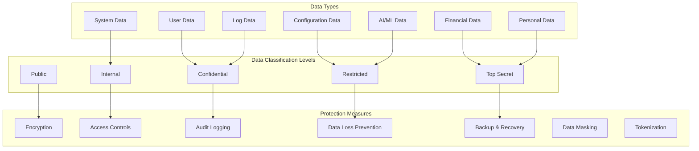
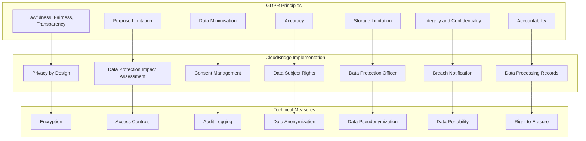
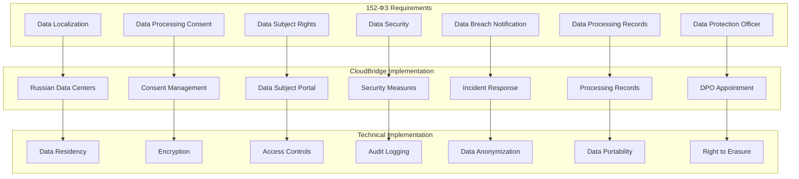

# Data Protection CloudBridge Relay

## 1. Data Classification and Protection Framework

### 1.1 Data Classification Schema



### 1.2 Data Classification Matrix

```yaml
# data-classification-matrix.yml
data_classification:
  public:
    description: "Information that can be freely shared"
    examples:
      - "Public API documentation"
      - "Marketing materials"
      - "Public service status"
    protection_requirements:
      - "Basic access controls"
      - "No encryption required"
      - "Standard backup"
    retention_period: "Indefinite"
    gdpr_status: "Not applicable"
    152_fz_status: "Not applicable"
  
  internal:
    description: "Information for internal use only"
    examples:
      - "Internal documentation"
      - "System metrics"
      - "Internal communications"
    protection_requirements:
      - "Access controls"
      - "Encryption in transit"
      - "Regular backup"
      - "Audit logging"
    retention_period: "3 years"
    gdpr_status: "Not applicable"
    152_fz_status: "Not applicable"
  
  confidential:
    description: "Sensitive business information"
    examples:
      - "User session data"
      - "System logs"
      - "Performance metrics"
      - "Configuration details"
    protection_requirements:
      - "Strong access controls"
      - "Encryption at rest and in transit"
      - "Regular backup"
      - "Comprehensive audit logging"
      - "Data loss prevention"
    retention_period: "7 years"
    gdpr_status: "May apply"
    152_fz_status: "May apply"
  
  restricted:
    description: "Highly sensitive information"
    examples:
      - "User credentials"
      - "API keys"
      - "Certificates"
      - "Encryption keys"
      - "AI model data"
    protection_requirements:
      - "Strict access controls"
      - "Strong encryption at rest and in transit"
      - "Frequent backup"
      - "Comprehensive audit logging"
      - "Data loss prevention"
      - "Data masking"
      - "Tokenization"
    retention_period: "7 years"
    gdpr_status: "Applies"
    152_fz_status: "Applies"
  
  top_secret:
    description: "Most sensitive information"
    examples:
      - "Personal data (PII)"
      - "Financial data"
      - "Health data"
      - "Biometric data"
      - "Government data"
    protection_requirements:
      - "Maximum access controls"
      - "Strongest encryption at rest and in transit"
      - "Daily backup"
      - "Comprehensive audit logging"
      - "Data loss prevention"
      - "Data masking"
      - "Tokenization"
      - "Pseudonymization"
      - "Anonymization"
    retention_period: "7 years"
    gdpr_status: "Applies"
    152_fz_status: "Applies"
```

## 2. GDPR Compliance Framework

### 2.1 GDPR Data Processing Principles



### 2.2 GDPR Data Processing Records

```yaml
# gdpr-data-processing-records.yml
gdpr_compliance:
  data_processing_records:
    cloudbridge_relay_service:
      controller: "CloudBridge Technologies Ltd"
      processor: "CloudBridge Technologies Ltd"
      dpo: "dpo@cloudbridge.io"
      
      purposes:
        - name: "Service Provision"
          description: "Providing CloudBridge Relay services"
          lawful_basis: "Contract"
          data_categories:
            - "Identity data"
            - "Contact data"
            - "Technical data"
            - "Usage data"
            - "Marketing data"
          retention_period: "7 years"
          data_subjects: "Service users"
          recipients: "Internal teams, third-party providers"
          transfers: "EU to US (adequacy decision)"
          safeguards: "Standard Contractual Clauses"
        
        - name: "Security and Fraud Prevention"
          description: "Protecting against security threats and fraud"
          lawful_basis: "Legitimate Interest"
          data_categories:
            - "Identity data"
            - "Technical data"
            - "Usage data"
            - "Security data"
          retention_period: "7 years"
          data_subjects: "Service users"
          recipients: "Security team, law enforcement"
          transfers: "EU to US (adequacy decision)"
          safeguards: "Standard Contractual Clauses"
        
        - name: "Marketing and Communications"
          description: "Sending marketing communications"
          lawful_basis: "Consent"
          data_categories:
            - "Identity data"
            - "Contact data"
            - "Marketing data"
            - "Preference data"
          retention_period: "3 years"
          data_subjects: "Service users"
          recipients: "Marketing team, third-party providers"
          transfers: "EU to US (adequacy decision)"
          safeguards: "Standard Contractual Clauses"
      
      data_categories:
        identity_data:
          description: "Personal identifiers"
          examples:
            - "Name"
            - "Email address"
            - "User ID"
            - "Account number"
          sensitivity: "High"
          encryption: "AES-256"
          access_controls: "Role-based"
        
        contact_data:
          description: "Contact information"
          examples:
            - "Email address"
            - "Phone number"
            - "Mailing address"
            - "Emergency contact"
          sensitivity: "High"
          encryption: "AES-256"
          access_controls: "Role-based"
        
        technical_data:
          description: "Technical information"
          examples:
            - "IP address"
            - "Device information"
            - "Browser type"
            - "Operating system"
          sensitivity: "Medium"
          encryption: "AES-256"
          access_controls: "Role-based"
        
        usage_data:
          description: "Usage information"
          examples:
            - "Service usage"
            - "Feature usage"
            - "Performance data"
            - "Error logs"
          sensitivity: "Medium"
          encryption: "AES-256"
          access_controls: "Role-based"
        
        marketing_data:
          description: "Marketing information"
          examples:
            - "Marketing preferences"
            - "Communication preferences"
            - "Campaign data"
            - "Response data"
          sensitivity: "Low"
          encryption: "AES-256"
          access_controls: "Role-based"
        
        security_data:
          description: "Security information"
          examples:
            - "Login attempts"
            - "Security events"
            - "Threat data"
            - "Incident data"
          sensitivity: "High"
          encryption: "AES-256"
          access_controls: "Role-based"
      
      data_subject_rights:
        right_to_access:
          description: "Right to access personal data"
          implementation:
            - "Data subject portal"
            - "API access"
            - "Manual request process"
          response_time: "30 days"
          format: "JSON, CSV, PDF"
        
        right_to_rectification:
          description: "Right to correct personal data"
          implementation:
            - "Self-service portal"
            - "API access"
            - "Manual request process"
          response_time: "30 days"
          validation: "Automated and manual"
        
        right_to_erasure:
          description: "Right to delete personal data"
          implementation:
            - "Self-service portal"
            - "API access"
            - "Manual request process"
          response_time: "30 days"
          exceptions: "Legal obligations, legitimate interests"
        
        right_to_portability:
          description: "Right to data portability"
          implementation:
            - "Data export API"
            - "Self-service portal"
            - "Manual request process"
          response_time: "30 days"
          format: "JSON, CSV, XML"
        
        right_to_restriction:
          description: "Right to restrict processing"
          implementation:
            - "Processing controls"
            - "Data flagging"
            - "Access restrictions"
          response_time: "30 days"
          duration: "Until resolved"
        
        right_to_object:
          description: "Right to object to processing"
          implementation:
            - "Opt-out mechanisms"
            - "Processing controls"
            - "Data flagging"
          response_time: "30 days"
          exceptions: "Legal obligations, legitimate interests"
      
      data_protection_measures:
        technical_measures:
          - "Encryption at rest (AES-256)"
          - "Encryption in transit (TLS 1.3)"
          - "Access controls (RBAC)"
          - "Audit logging"
          - "Data loss prevention"
          - "Data masking"
          - "Tokenization"
          - "Pseudonymization"
          - "Anonymization"
        
        organizational_measures:
          - "Data protection policies"
          - "Staff training"
          - "Data protection impact assessments"
          - "Privacy by design"
          - "Data minimization"
          - "Purpose limitation"
          - "Storage limitation"
          - "Accuracy"
          - "Integrity and confidentiality"
          - "Accountability"
        
        physical_measures:
          - "Secure data centers"
          - "Access controls"
          - "Environmental controls"
          - "Disaster recovery"
          - "Business continuity"
          - "Incident response"
          - "Vendor management"
          - "Third-party assessments"
```

## 3. 152-ФЗ Compliance Framework

### 3.1 Russian Data Localization Requirements



### 3.2 152-ФЗ Compliance Implementation

```yaml
# 152-fz-compliance.yml
russian_compliance:
  data_localization:
    requirement: "Personal data of Russian citizens must be stored in Russia"
    implementation:
      - "Primary data storage in Russian data centers"
      - "Backup data storage in Russian data centers"
      - "Processing data in Russian data centers"
      - "No cross-border transfers without consent"
    
    data_centers:
      - name: "Moscow Data Center"
        location: "Moscow, Russia"
        provider: "Yandex Cloud"
        certification: "ISO 27001, PCI DSS"
        data_types: "All personal data"
      
      - name: "St. Petersburg Data Center"
        location: "St. Petersburg, Russia"
        provider: "VK Cloud"
        certification: "ISO 27001, PCI DSS"
        data_types: "Backup data"
    
    cross_border_transfers:
      allowed: false
      exceptions:
        - "Explicit consent from data subject"
        - "International agreements"
        - "Public interest"
        - "Legal obligations"
      safeguards:
        - "Standard Contractual Clauses"
        - "Binding Corporate Rules"
        - "Certification schemes"
        - "Codes of conduct"
  
  data_processing_consent:
    requirement: "Explicit consent for personal data processing"
    implementation:
      - "Consent management system"
      - "Granular consent options"
      - "Consent withdrawal mechanism"
      - "Consent audit trail"
    
    consent_types:
      - name: "Service Provision"
        description: "Processing data for service provision"
        required: true
        withdrawal_allowed: true
        impact: "Service termination"
      
      - name: "Marketing Communications"
        description: "Sending marketing communications"
        required: false
        withdrawal_allowed: true
        impact: "No marketing communications"
      
      - name: "Analytics and Improvement"
        description: "Using data for analytics and service improvement"
        required: false
        withdrawal_allowed: true
        impact: "No personalized analytics"
      
      - name: "Security and Fraud Prevention"
        description: "Using data for security and fraud prevention"
        required: true
        withdrawal_allowed: false
        impact: "Service termination"
    
    consent_management:
      collection:
        - "Clear and plain language"
        - "Specific purpose"
        - "Granular options"
        - "Easy to understand"
        - "No pre-ticked boxes"
      
      storage:
        - "Consent timestamp"
        - "Consent version"
        - "Consent method"
        - "IP address"
        - "User agent"
        - "Consent text"
      
      withdrawal:
        - "Easy withdrawal mechanism"
        - "Immediate effect"
        - "Confirmation of withdrawal"
        - "Impact explanation"
        - "Alternative options"
  
  data_subject_rights:
    right_to_access:
      description: "Right to access personal data"
      implementation:
        - "Data subject portal"
        - "API access"
        - "Manual request process"
      response_time: "30 days"
      format: "JSON, CSV, PDF"
      language: "Russian"
    
    right_to_rectification:
      description: "Right to correct personal data"
      implementation:
        - "Self-service portal"
        - "API access"
        - "Manual request process"
      response_time: "30 days"
      validation: "Automated and manual"
      language: "Russian"
    
    right_to_erasure:
      description: "Right to delete personal data"
      implementation:
        - "Self-service portal"
        - "API access"
        - "Manual request process"
      response_time: "30 days"
      exceptions: "Legal obligations, legitimate interests"
      language: "Russian"
    
    right_to_portability:
      description: "Right to data portability"
      implementation:
        - "Data export API"
        - "Self-service portal"
        - "Manual request process"
      response_time: "30 days"
      format: "JSON, CSV, XML"
      language: "Russian"
    
    right_to_restriction:
      description: "Right to restrict processing"
      implementation:
        - "Processing controls"
        - "Data flagging"
        - "Access restrictions"
      response_time: "30 days"
      duration: "Until resolved"
      language: "Russian"
    
    right_to_object:
      description: "Right to object to processing"
      implementation:
        - "Opt-out mechanisms"
        - "Processing controls"
        - "Data flagging"
      response_time: "30 days"
      exceptions: "Legal obligations, legitimate interests"
      language: "Russian"
  
  data_security:
    technical_measures:
      - "Encryption at rest (AES-256)"
      - "Encryption in transit (TLS 1.3)"
      - "Access controls (RBAC)"
      - "Audit logging"
      - "Data loss prevention"
      - "Data masking"
      - "Tokenization"
      - "Pseudonymization"
      - "Anonymization"
      - "Network segmentation"
      - "Firewall rules"
      - "Intrusion detection"
      - "Vulnerability management"
      - "Security monitoring"
    
    organizational_measures:
      - "Data protection policies"
      - "Staff training"
      - "Data protection impact assessments"
      - "Privacy by design"
      - "Data minimization"
      - "Purpose limitation"
      - "Storage limitation"
      - "Accuracy"
      - "Integrity and confidentiality"
      - "Accountability"
      - "Incident response"
      - "Business continuity"
      - "Vendor management"
      - "Third-party assessments"
    
    physical_measures:
      - "Secure data centers"
      - "Access controls"
      - "Environmental controls"
      - "Disaster recovery"
      - "Business continuity"
      - "Incident response"
      - "Vendor management"
      - "Third-party assessments"
      - "CCTV monitoring"
      - "Biometric access"
      - "Visitor management"
      - "Equipment security"
  
  data_breach_notification:
    requirement: "Notify authorities and data subjects of data breaches"
    implementation:
      - "Incident response plan"
      - "Breach detection system"
      - "Notification procedures"
      - "Communication templates"
    
    notification_timeline:
      authorities: "72 hours"
      data_subjects: "Without undue delay"
      internal: "Immediately"
    
    notification_content:
      authorities:
        - "Nature of breach"
        - "Categories of data"
        - "Number of data subjects"
        - "Likely consequences"
        - "Measures taken"
        - "Contact details"
      
      data_subjects:
        - "Nature of breach"
        - "Likely consequences"
        - "Measures taken"
        - "Contact details"
        - "Recommendations"
    
    notification_channels:
      authorities:
        - "Roskomnadzor portal"
        - "Email notification"
        - "Phone notification"
      
      data_subjects:
        - "Email notification"
        - "SMS notification"
        - "In-app notification"
        - "Website notification"
        - "Media notification"
```

## 4. Encryption Implementation

### 4.1 Encryption at Rest

```yaml
# encryption-at-rest.yml
encryption_at_rest:
  database_encryption:
    primary_database:
      provider: "PostgreSQL"
      encryption: "AES-256"
      key_management: "AWS KMS"
      key_rotation: "90 days"
      backup_encryption: "AES-256"
      replication_encryption: "AES-256"
    
    cache_database:
      provider: "Redis"
      encryption: "AES-256"
      key_management: "AWS KMS"
      key_rotation: "90 days"
      backup_encryption: "AES-256"
      replication_encryption: "AES-256"
    
    analytics_database:
      provider: "Cassandra"
      encryption: "AES-256"
      key_management: "AWS KMS"
      key_rotation: "90 days"
      backup_encryption: "AES-256"
      replication_encryption: "AES-256"
  
  file_storage_encryption:
    object_storage:
      provider: "AWS S3"
      encryption: "AES-256"
      key_management: "AWS KMS"
      key_rotation: "90 days"
      backup_encryption: "AES-256"
      replication_encryption: "AES-256"
    
    file_system:
      provider: "EFS"
      encryption: "AES-256"
      key_management: "AWS KMS"
      key_rotation: "90 days"
      backup_encryption: "AES-256"
      replication_encryption: "AES-256"
    
    backup_storage:
      provider: "AWS S3 Glacier"
      encryption: "AES-256"
      key_management: "AWS KMS"
      key_rotation: "90 days"
      backup_encryption: "AES-256"
      replication_encryption: "AES-256"
  
  application_encryption:
    configuration_files:
      encryption: "AES-256"
      key_management: "AWS KMS"
      key_rotation: "90 days"
      backup_encryption: "AES-256"
      replication_encryption: "AES-256"
    
    log_files:
      encryption: "AES-256"
      key_management: "AWS KMS"
      key_rotation: "90 days"
      backup_encryption: "AES-256"
      replication_encryption: "AES-256"
    
    temporary_files:
      encryption: "AES-256"
      key_management: "AWS KMS"
      key_rotation: "90 days"
      backup_encryption: "AES-256"
      replication_encryption: "AES-256"
  
  key_management:
    aws_kms:
      enabled: true
      key_types:
        - "Symmetric keys (AES-256)"
        - "Asymmetric keys (RSA-2048)"
        - "HMAC keys (SHA-256)"
      key_rotation: "90 days"
      key_backup: "AWS KMS"
      key_restore: "AWS KMS"
      key_audit: "AWS CloudTrail"
    
    hashicorp_vault:
      enabled: true
      key_types:
        - "Symmetric keys (AES-256)"
        - "Asymmetric keys (RSA-2048)"
        - "HMAC keys (SHA-256)"
      key_rotation: "90 days"
      key_backup: "HashiCorp Vault"
      key_restore: "HashiCorp Vault"
      key_audit: "HashiCorp Vault"
    
    custom_key_management:
      enabled: false
      key_types: []
      key_rotation: "90 days"
      key_backup: "Custom"
      key_restore: "Custom"
      key_audit: "Custom"
```

### 4.2 Encryption in Transit

```yaml
# encryption-in-transit.yml
encryption_in_transit:
  tls_encryption:
    tls_1_3:
      enabled: true
      cipher_suites:
        - "TLS_AES_256_GCM_SHA384"
        - "TLS_CHACHA20_POLY1305_SHA256"
        - "TLS_AES_128_GCM_SHA256"
      key_exchange: "ECDHE"
      authentication: "RSA-2048"
      perfect_forward_secrecy: true
      certificate_validation: "Strict"
      certificate_pinning: true
    
    tls_1_2:
      enabled: true
      cipher_suites:
        - "TLS_ECDHE_RSA_WITH_AES_256_GCM_SHA384"
        - "TLS_ECDHE_RSA_WITH_CHACHA20_POLY1305_SHA256"
        - "TLS_ECDHE_RSA_WITH_AES_128_GCM_SHA256"
      key_exchange: "ECDHE"
      authentication: "RSA-2048"
      perfect_forward_secrecy: true
      certificate_validation: "Strict"
      certificate_pinning: true
  
  quic_encryption:
    quic_protocol:
      enabled: true
      encryption: "AES-256-GCM"
      key_exchange: "ECDHE"
      authentication: "RSA-2048"
      perfect_forward_secrecy: true
      certificate_validation: "Strict"
      certificate_pinning: true
      connection_migration: true
      multipath: true
  
  wireguard_encryption:
    wireguard_protocol:
      enabled: true
      encryption: "ChaCha20-Poly1305"
      key_exchange: "Curve25519"
      authentication: "Poly1305"
      perfect_forward_secrecy: true
      certificate_validation: "Strict"
      certificate_pinning: true
      connection_migration: true
      multipath: true
  
  post_quantum_encryption:
    post_quantum_crypto:
      enabled: true
      algorithms:
        - "CRYSTALS-Kyber (Key Exchange)"
        - "CRYSTALS-Dilithium (Digital Signatures)"
        - "SPHINCS+ (Digital Signatures)"
      hybrid_mode: true
      fallback: "Classical algorithms"
      certificate_validation: "Strict"
      certificate_pinning: true
  
  certificate_management:
    certificate_authority:
      provider: "Let's Encrypt"
      certificate_type: "DV"
      validation: "DNS-01"
      renewal: "Automatic"
      backup: "AWS S3"
      restore: "AWS S3"
      audit: "AWS CloudTrail"
    
    certificate_storage:
      provider: "AWS S3"
      encryption: "AES-256"
      key_management: "AWS KMS"
      key_rotation: "90 days"
      backup_encryption: "AES-256"
      replication_encryption: "AES-256"
    
    certificate_validation:
      ocsp_stapling: true
      certificate_transparency: true
      certificate_pinning: true
      certificate_revocation: true
      certificate_validation: "Strict"
      certificate_audit: "AWS CloudTrail"
```

## 5. Data Anonymization and Pseudonymization

### 5.1 Data Anonymization Framework

```yaml
# data-anonymization.yml
data_anonymization:
  anonymization_techniques:
    generalization:
      description: "Replace specific values with general categories"
      examples:
        - "Age: 25 -> Age Group: 20-30"
        - "Salary: $75,000 -> Salary Range: $70,000-$80,000"
        - "Location: Moscow -> Region: Central"
      use_cases:
        - "Analytics and reporting"
        - "Research and development"
        - "Marketing analysis"
      privacy_level: "High"
      utility_level: "Medium"
    
    suppression:
      description: "Remove sensitive data entirely"
      examples:
        - "Remove PII from logs"
        - "Remove sensitive fields from exports"
        - "Remove identifying information"
      use_cases:
        - "Log analysis"
        - "Data exports"
        - "Third-party sharing"
      privacy_level: "Very High"
      utility_level: "Low"
    
    perturbation:
      description: "Add noise to data values"
      examples:
        - "Add random noise to numerical values"
        - "Slightly modify timestamps"
        - "Add random variations to coordinates"
      use_cases:
        - "Statistical analysis"
        - "Machine learning"
        - "Research"
      privacy_level: "High"
      utility_level: "High"
    
    aggregation:
      description: "Combine multiple records into groups"
      examples:
        - "Group users by region"
        - "Aggregate usage statistics"
        - "Combine transaction data"
      use_cases:
        - "Business intelligence"
        - "Performance analysis"
        - "Trend analysis"
      privacy_level: "Very High"
      utility_level: "High"
    
    k_anonymity:
      description: "Ensure each record is indistinguishable from k-1 others"
      examples:
        - "k=5: Each record appears with at least 4 others"
        - "k=10: Each record appears with at least 9 others"
        - "k=20: Each record appears with at least 19 others"
      use_cases:
        - "Data publishing"
        - "Research sharing"
        - "Third-party analysis"
      privacy_level: "Very High"
      utility_level: "Medium"
    
    l_diversity:
      description: "Ensure each group has at least l distinct values"
      examples:
        - "l=2: Each group has at least 2 distinct values"
        - "l=3: Each group has at least 3 distinct values"
        - "l=5: Each group has at least 5 distinct values"
      use_cases:
        - "Data publishing"
        - "Research sharing"
        - "Third-party analysis"
      privacy_level: "Very High"
      utility_level: "Medium"
    
    t_closeness:
      description: "Ensure distribution of sensitive attributes is close to overall distribution"
      examples:
        - "t=0.1: Distribution within 10% of overall"
        - "t=0.2: Distribution within 20% of overall"
        - "t=0.3: Distribution within 30% of overall"
      use_cases:
        - "Data publishing"
        - "Research sharing"
        - "Third-party analysis"
      privacy_level: "Very High"
      utility_level: "Medium"
  
  pseudonymization_techniques:
    tokenization:
      description: "Replace sensitive data with tokens"
      examples:
        - "Credit card: 1234-5678-9012-3456 -> TOKEN_ABC123"
        - "Email: user@example.com -> TOKEN_XYZ789"
        - "Phone: +7-123-456-7890 -> TOKEN_DEF456"
      use_cases:
        - "Payment processing"
        - "Data storage"
        - "Third-party integration"
      privacy_level: "High"
      utility_level: "High"
    
    hashing:
      description: "Replace sensitive data with hash values"
      examples:
        - "Email: user@example.com -> SHA256 hash"
        - "Phone: +7-123-456-7890 -> SHA256 hash"
        - "ID: 12345 -> SHA256 hash"
      use_cases:
        - "Data matching"
        - "Analytics"
        - "Research"
      privacy_level: "High"
      utility_level: "Medium"
    
    encryption:
      description: "Replace sensitive data with encrypted values"
      examples:
        - "Name: John Doe -> AES-256 encrypted value"
        - "Address: 123 Main St -> AES-256 encrypted value"
        - "SSN: 123-45-6789 -> AES-256 encrypted value"
      use_cases:
        - "Data storage"
        - "Data transmission"
        - "Data processing"
      privacy_level: "Very High"
      utility_level: "High"
    
    format_preserving_encryption:
      description: "Encrypt data while preserving format"
      examples:
        - "Credit card: 1234-5678-9012-3456 -> 9876-5432-1098-7654"
        - "Phone: +7-123-456-7890 -> +7-987-654-3210"
        - "Email: user@example.com -> xyz@domain.net"
      use_cases:
        - "Data storage"
        - "Data processing"
        - "Third-party integration"
      privacy_level: "Very High"
      utility_level: "Very High"
  
  implementation:
    data_classification:
      - "Identify sensitive data"
      - "Classify data by sensitivity"
      - "Determine anonymization requirements"
      - "Select appropriate techniques"
      - "Implement anonymization"
      - "Validate results"
      - "Monitor compliance"
    
    data_flow:
      - "Data collection"
      - "Data classification"
      - "Data anonymization"
      - "Data storage"
      - "Data processing"
      - "Data sharing"
      - "Data disposal"
    
    quality_assurance:
      - "Anonymization validation"
      - "Privacy impact assessment"
      - "Utility assessment"
      - "Compliance verification"
      - "Regular audits"
      - "Continuous monitoring"
      - "Incident response"
```

---

*Эта схема защиты данных демонстрирует комплексный подход к обеспечению соответствия GDPR и 152-ФЗ, включая классификацию данных, шифрование на всех уровнях, анонимизацию и псевдонимизацию для максимальной защиты персональных данных.*


