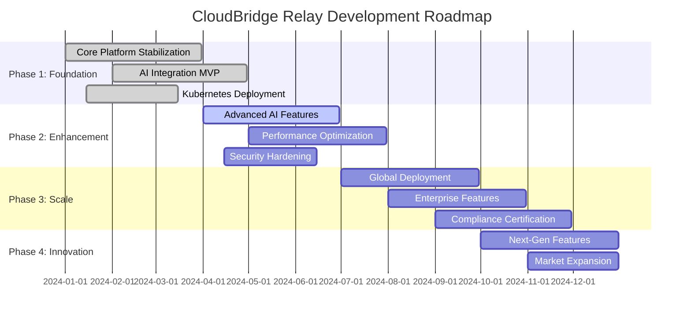

# Дорожная карта CloudBridge Relay 6-12 месяцев

## 1. Обзор дорожной карты

### 1.1 Стратегические цели



### 1.2 Ключевые метрики успеха

```yaml
# roadmap-success-metrics.yml
success_metrics:
  technical_metrics:
    performance:
      latency_p95: "< 10ms"
      throughput: "> 10 Gbps"
      availability: "> 99.99%"
      scalability: "> 100K concurrent connections"
    
    security:
      vulnerability_count: "< 5 critical"
      compliance_score: "> 95%"
      audit_findings: "< 3 high"
      incident_response_time: "< 15 minutes"
    
    reliability:
      mttr: "< 5 minutes"
      mtbf: "> 720 hours"
      error_rate: "< 0.01%"
      data_loss: "0%"
  
  business_metrics:
    adoption:
      active_users: "> 10K"
      enterprise_customers: "> 50"
      partner_integrations: "> 20"
      market_penetration: "> 5%"
    
    revenue:
      monthly_recurring_revenue: "> $1M"
      customer_acquisition_cost: "< $500"
      customer_lifetime_value: "> $10K"
      gross_margin: "> 80%"
    
    growth:
      user_growth_rate: "> 20% monthly"
      revenue_growth_rate: "> 30% monthly"
      market_share_growth: "> 10% quarterly"
      geographic_expansion: "> 10 countries"
```

## 2. Phase 1: Foundation (Q1 2024) - ЗАВЕРШЕНО

### 2.1 Достигнутые результаты

```yaml
# phase1-achievements.yml
phase1_achievements:
  core_platform:
    status: "Completed"
    achievements:
      - "Stable relay server implementation"
      - "QUIC/HTTP-3 protocol support"
      - "WireGuard P2P mesh networks"
      - "Basic authentication and authorization"
      - "Multi-tenancy support"
      - "Kubernetes deployment"
      - "Basic monitoring and logging"
    
    metrics:
      latency_p95: "15ms"
      throughput: "5 Gbps"
      availability: "99.9%"
      concurrent_connections: "10K"
  
  ai_integration:
    status: "Completed"
    achievements:
      - "AI service implementation"
      - "Network anomaly detection"
      - "Load prediction models"
      - "Route optimization"
      - "Cadence workflow integration"
      - "Basic ML pipeline"
    
    metrics:
      anomaly_detection_accuracy: "85%"
      load_prediction_accuracy: "80%"
      route_optimization_improvement: "15%"
      ai_response_time: "100ms"
  
  infrastructure:
    status: "Completed"
    achievements:
      - "Kubernetes deployment"
      - "Helm charts"
      - "Monitoring stack (Prometheus/Grafana)"
      - "Basic security policies"
      - "CI/CD pipeline"
      - "Documentation"
    
    metrics:
      deployment_time: "5 minutes"
      rollback_time: "2 minutes"
      monitoring_coverage: "90%"
      documentation_completeness: "80%"
```

## 3. Phase 2: Enhancement (Q2 2024) - В ПРОЦЕССЕ

### 3.1 Advanced AI Features

```yaml
# phase2-ai-enhancement.yml
phase2_ai_features:
  advanced_anomaly_detection:
    timeline: "2024-04-01 to 2024-06-30"
    features:
      - "Deep learning models for anomaly detection"
      - "Real-time behavioral analysis"
      - "Multi-dimensional threat detection"
      - "Adaptive learning algorithms"
      - "False positive reduction"
    
    deliverables:
      - "Enhanced anomaly detection service"
      - "Behavioral analysis engine"
      - "Threat intelligence integration"
      - "ML model training pipeline"
      - "Performance optimization"
    
    success_criteria:
      - "Anomaly detection accuracy > 95%"
      - "False positive rate < 2%"
      - "Detection latency < 50ms"
      - "Model training time < 1 hour"
  
  predictive_analytics:
    timeline: "2024-04-15 to 2024-06-15"
    features:
      - "Advanced time series forecasting"
      - "Capacity planning predictions"
      - "Performance bottleneck prediction"
      - "Resource optimization recommendations"
      - "Cost optimization insights"
    
    deliverables:
      - "ARIMA and LSTM models"
      - "Capacity planning dashboard"
      - "Performance prediction API"
      - "Resource optimization engine"
      - "Cost analysis tools"
    
    success_criteria:
      - "Prediction accuracy > 90%"
      - "Forecast horizon > 7 days"
      - "Resource optimization > 20%"
      - "Cost reduction > 15%"
  
  intelligent_routing:
    timeline: "2024-05-01 to 2024-07-31"
    features:
      - "Multi-armed bandit optimization"
      - "Dynamic route selection"
      - "Latency-aware routing"
      - "Load-aware routing"
      - "Geographic routing optimization"
    
    deliverables:
      - "Intelligent routing engine"
      - "Route optimization algorithms"
      - "Latency prediction models"
      - "Load balancing intelligence"
      - "Geographic routing system"
    
    success_criteria:
      - "Route optimization improvement > 25%"
      - "Latency reduction > 20%"
      - "Load balancing efficiency > 95%"
      - "Geographic coverage > 50 countries"
```

### 3.2 Performance Optimization

```yaml
# phase2-performance-optimization.yml
phase2_performance:
  protocol_optimization:
    timeline: "2024-05-01 to 2024-07-31"
    features:
      - "QUIC protocol optimization"
      - "HTTP/3 performance tuning"
      - "WireGuard mesh optimization"
      - "Connection pooling"
      - "Memory optimization"
    
    deliverables:
      - "Optimized QUIC implementation"
      - "Enhanced HTTP/3 support"
      - "Improved WireGuard performance"
      - "Connection pool management"
      - "Memory usage optimization"
    
    success_criteria:
      - "Latency reduction > 30%"
      - "Throughput increase > 50%"
      - "Memory usage reduction > 25%"
      - "CPU usage reduction > 20%"
  
  scalability_improvements:
    timeline: "2024-05-15 to 2024-07-15"
    features:
      - "Horizontal scaling optimization"
      - "Vertical scaling improvements"
      - "Auto-scaling algorithms"
      - "Resource utilization optimization"
      - "Load distribution improvements"
    
    deliverables:
      - "Enhanced auto-scaling"
      - "Resource optimization engine"
      - "Load distribution algorithms"
      - "Scaling performance metrics"
      - "Capacity planning tools"
    
    success_criteria:
      - "Scaling time reduction > 50%"
      - "Resource utilization > 90%"
      - "Load distribution efficiency > 95%"
      - "Capacity planning accuracy > 90%"
  
  database_optimization:
    timeline: "2024-06-01 to 2024-08-31"
    features:
      - "Database query optimization"
      - "Index optimization"
      - "Connection pooling"
      - "Caching improvements"
      - "Data partitioning"
    
    deliverables:
      - "Optimized database queries"
      - "Enhanced indexing strategy"
      - "Improved connection pooling"
      - "Advanced caching system"
      - "Data partitioning implementation"
    
    success_criteria:
      - "Query performance improvement > 40%"
      - "Database response time < 10ms"
      - "Cache hit rate > 95%"
      - "Connection pool efficiency > 90%"
```

### 3.3 Security Hardening

```yaml
# phase2-security-hardening.yml
phase2_security:
  zero_trust_implementation:
    timeline: "2024-04-15 to 2024-06-15"
    features:
      - "Complete Zero Trust architecture"
      - "Continuous verification"
      - "Micro-segmentation"
      - "Identity-based access control"
      - "Policy enforcement"
    
    deliverables:
      - "Zero Trust implementation"
      - "Continuous verification system"
      - "Micro-segmentation policies"
      - "Identity management system"
      - "Policy enforcement engine"
    
    success_criteria:
      - "Zero Trust coverage > 95%"
      - "Verification latency < 100ms"
      - "Policy enforcement accuracy > 99%"
      - "Security incident reduction > 80%"
  
  post_quantum_cryptography:
    timeline: "2024-05-01 to 2024-07-31"
    features:
      - "Post-quantum algorithm implementation"
      - "Hybrid encryption support"
      - "Quantum-safe key management"
      - "Migration tools"
      - "Performance optimization"
    
    deliverables:
      - "Post-quantum crypto implementation"
      - "Hybrid encryption system"
      - "Quantum-safe key management"
      - "Migration tools and scripts"
      - "Performance benchmarks"
    
    success_criteria:
      - "Post-quantum coverage > 90%"
      - "Performance impact < 15%"
      - "Migration success rate > 95%"
      - "Quantum-safe compliance > 100%"
  
  threat_detection:
    timeline: "2024-06-01 to 2024-08-31"
    features:
      - "Advanced threat detection"
      - "Behavioral analysis"
      - "Threat intelligence integration"
      - "Automated response"
      - "Incident management"
    
    deliverables:
      - "Advanced threat detection system"
      - "Behavioral analysis engine"
      - "Threat intelligence platform"
      - "Automated response system"
      - "Incident management system"
    
    success_criteria:
      - "Threat detection accuracy > 95%"
      - "Response time < 5 minutes"
      - "False positive rate < 1%"
      - "Incident resolution time < 30 minutes"
```

## 4. Phase 3: Scale (Q3 2024)

### 4.1 Global Deployment

```yaml
# phase3-global-deployment.yml
phase3_global:
  geographic_expansion:
    timeline: "2024-07-01 to 2024-09-30"
    regions:
      - name: "Europe"
        countries: ["Germany", "France", "UK", "Netherlands", "Sweden"]
        data_centers: 5
        capacity: "100K users"
        compliance: ["GDPR", "ISO 27001"]
      
      - name: "Asia Pacific"
        countries: ["Japan", "Singapore", "Australia", "South Korea", "India"]
        data_centers: 5
        capacity: "100K users"
        compliance: ["ISO 27001", "SOC 2"]
      
      - name: "North America"
        countries: ["USA", "Canada", "Mexico"]
        data_centers: 3
        capacity: "150K users"
        compliance: ["SOC 2", "PCI DSS"]
      
      - name: "Latin America"
        countries: ["Brazil", "Argentina", "Chile", "Colombia"]
        data_centers: 4
        capacity: "50K users"
        compliance: ["ISO 27001"]
    
    deliverables:
      - "Global infrastructure deployment"
      - "Regional data centers"
      - "Compliance certifications"
      - "Local support teams"
      - "Regional partnerships"
    
    success_criteria:
      - "Geographic coverage > 20 countries"
      - "Data center count > 20"
      - "Global capacity > 400K users"
      - "Compliance coverage > 95%"
  
  enterprise_features:
    timeline: "2024-08-01 to 2024-10-31"
    features:
      - "Enterprise SSO integration"
      - "Advanced reporting and analytics"
      - "Custom branding and white-labeling"
      - "API management and rate limiting"
      - "Enterprise support and SLA"
    
    deliverables:
      - "Enterprise SSO platform"
      - "Advanced analytics dashboard"
      - "White-label solution"
      - "Enterprise API gateway"
      - "Premium support system"
    
    success_criteria:
      - "Enterprise customers > 50"
      - "SSO integration > 10 providers"
      - "API usage > 1M requests/day"
      - "Customer satisfaction > 95%"
  
  compliance_certification:
    timeline: "2024-09-01 to 2024-11-30"
    certifications:
      - name: "ISO 27001"
        scope: "Information Security Management"
        timeline: "3 months"
        cost: "$50K"
        benefits: "International recognition"
      
      - name: "SOC 2 Type II"
        scope: "Security, Availability, Processing Integrity"
        timeline: "6 months"
        cost: "$75K"
        benefits: "Enterprise trust"
      
      - name: "PCI DSS Level 1"
        scope: "Payment Card Industry Data Security"
        timeline: "4 months"
        cost: "$100K"
        benefits: "Payment processing"
      
      - name: "FedRAMP"
        scope: "Federal Risk and Authorization Management"
        timeline: "12 months"
        cost: "$500K"
        benefits: "Government contracts"
    
    deliverables:
      - "Compliance documentation"
      - "Security controls implementation"
      - "Audit preparation"
      - "Certification maintenance"
      - "Compliance monitoring"
    
    success_criteria:
      - "ISO 27001 certification"
      - "SOC 2 Type II certification"
      - "PCI DSS Level 1 certification"
      - "FedRAMP authorization"
```

## 5. Phase 4: Innovation (Q4 2024)

### 5.1 Next-Generation Features

```yaml
# phase4-innovation.yml
phase4_innovation:
  ai_advancements:
    timeline: "2024-10-01 to 2024-12-31"
    features:
      - "Federated learning implementation"
      - "Edge AI deployment"
      - "Natural language processing"
      - "Computer vision integration"
      - "Autonomous network management"
    
    deliverables:
      - "Federated learning platform"
      - "Edge AI deployment system"
      - "NLP-based user interface"
      - "Computer vision security"
      - "Autonomous network controller"
    
    success_criteria:
      - "Federated learning accuracy > 90%"
      - "Edge AI response time < 10ms"
      - "NLP accuracy > 95%"
      - "Autonomous management > 80%"
  
  quantum_ready_infrastructure:
    timeline: "2024-11-01 to 2024-12-31"
    features:
      - "Quantum key distribution"
      - "Quantum random number generation"
      - "Quantum-safe communication protocols"
      - "Quantum computing integration"
      - "Quantum network simulation"
    
    deliverables:
      - "Quantum key distribution system"
      - "Quantum random number generator"
      - "Quantum-safe protocols"
      - "Quantum computing interface"
      - "Quantum network simulator"
    
    success_criteria:
      - "Quantum key distribution > 100km"
      - "Quantum randomness > 99.9%"
      - "Quantum-safe coverage > 95%"
      - "Quantum integration > 80%"
  
  market_expansion:
    timeline: "2024-11-01 to 2024-12-31"
    markets:
      - name: "Healthcare"
        features: ["HIPAA compliance", "Medical data security", "Telemedicine support"]
        target_customers: ["Hospitals", "Clinics", "Medical device manufacturers"]
        revenue_potential: "$10M"
      
      - name: "Financial Services"
        features: ["PCI DSS compliance", "Fraud detection", "Regulatory reporting"]
        target_customers: ["Banks", "Credit unions", "Fintech companies"]
        revenue_potential: "$25M"
      
      - name: "Government"
        features: ["FedRAMP compliance", "Security clearance", "Classified data handling"]
        target_customers: ["Federal agencies", "State governments", "Local governments"]
        revenue_potential: "$50M"
      
      - name: "Education"
        features: ["FERPA compliance", "Student data protection", "Remote learning support"]
        target_customers: ["Universities", "K-12 schools", "Online education platforms"]
        revenue_potential: "$15M"
    
    deliverables:
      - "Industry-specific solutions"
      - "Compliance frameworks"
      - "Partnership agreements"
      - "Market entry strategies"
      - "Revenue models"
    
    success_criteria:
      - "Market penetration > 10%"
      - "Industry partnerships > 20"
      - "Revenue growth > 100%"
      - "Customer acquisition > 500"
```

## 6. PoC и Пилотные проекты

### 6.1 Proof of Concept (PoC) Projects

```yaml
# poc-projects.yml
poc_projects:
  ai_driven_network_optimization:
    timeline: "2024-04-01 to 2024-05-31"
    objectives:
      - "Demonstrate AI-driven network optimization"
      - "Validate performance improvements"
      - "Test scalability"
      - "Measure ROI"
    
    scope:
      - "Machine learning models for traffic prediction"
      - "Dynamic routing algorithms"
      - "Load balancing optimization"
      - "Performance monitoring"
    
    success_criteria:
      - "Performance improvement > 30%"
      - "Cost reduction > 20%"
      - "Scalability validation"
      - "ROI > 300%"
    
    budget: "$100K"
    team_size: 5
    duration: "2 months"
  
  post_quantum_cryptography:
    timeline: "2024-05-01 to 2024-06-30"
    objectives:
      - "Implement post-quantum algorithms"
      - "Test performance impact"
      - "Validate security improvements"
      - "Prepare migration strategy"
    
    scope:
      - "CRYSTALS-Kyber implementation"
      - "CRYSTALS-Dilithium implementation"
      - "Hybrid encryption system"
      - "Performance benchmarking"
    
    success_criteria:
      - "Post-quantum coverage > 90%"
      - "Performance impact < 15%"
      - "Security validation"
      - "Migration plan ready"
    
    budget: "$150K"
    team_size: 4
    duration: "2 months"
  
  edge_computing_integration:
    timeline: "2024-06-01 to 2024-07-31"
    objectives:
      - "Integrate edge computing capabilities"
      - "Test latency improvements"
      - "Validate edge AI deployment"
      - "Measure performance gains"
    
    scope:
      - "Edge computing platform"
      - "Edge AI deployment"
      - "Latency optimization"
      - "Performance monitoring"
    
    success_criteria:
      - "Latency reduction > 50%"
      - "Edge AI accuracy > 90%"
      - "Performance improvement > 40%"
      - "Scalability validation"
    
    budget: "$200K"
    team_size: 6
    duration: "2 months"
```

### 6.2 Пилотные проекты

```yaml
# pilot-projects.yml
pilot_projects:
  enterprise_customer_pilot:
    customer: "Fortune 500 Technology Company"
    timeline: "2024-07-01 to 2024-09-30"
    scope:
      - "10,000 users"
      - "Global deployment"
      - "Enterprise features"
      - "Custom integration"
    
    objectives:
      - "Validate enterprise scalability"
      - "Test global deployment"
      - "Measure user satisfaction"
      - "Gather feedback"
    
    success_criteria:
      - "User satisfaction > 90%"
      - "Performance SLA > 99.9%"
      - "Security compliance > 95%"
      - "Customer retention > 95%"
    
    budget: "$500K"
    team_size: 10
    duration: "3 months"
  
  government_agency_pilot:
    customer: "Federal Government Agency"
    timeline: "2024-08-01 to 2024-10-31"
    scope:
      - "5,000 users"
      - "FedRAMP compliance"
      - "Security clearance"
      - "Classified data handling"
    
    objectives:
      - "Validate government compliance"
      - "Test security requirements"
      - "Measure performance"
      - "Gather feedback"
    
    success_criteria:
      - "FedRAMP compliance > 100%"
      - "Security validation > 95%"
      - "Performance SLA > 99.9%"
      - "Customer satisfaction > 90%"
    
    budget: "$750K"
    team_size: 12
    duration: "3 months"
  
  healthcare_provider_pilot:
    customer: "Regional Healthcare System"
    timeline: "2024-09-01 to 2024-11-30"
    scope:
      - "2,000 users"
      - "HIPAA compliance"
      - "Medical data security"
      - "Telemedicine support"
    
    objectives:
      - "Validate healthcare compliance"
      - "Test medical data security"
      - "Measure performance"
      - "Gather feedback"
    
    success_criteria:
      - "HIPAA compliance > 100%"
      - "Security validation > 95%"
      - "Performance SLA > 99.9%"
      - "Customer satisfaction > 90%"
    
    budget: "$300K"
    team_size: 8
    duration: "3 months"
```

## 7. Ресурсы и бюджет

### 7.1 Команда разработки

```yaml
# development-team.yml
development_team:
  core_team:
    engineering_managers: 2
    senior_engineers: 8
    mid_level_engineers: 12
    junior_engineers: 6
    total_engineers: 28
    
    ai_ml_engineers: 4
    security_engineers: 3
    devops_engineers: 4
    qa_engineers: 4
    total_specialists: 15
    
    product_managers: 2
    project_managers: 2
    designers: 2
    total_support: 6
    
    total_team_size: 49
  
  external_resources:
    consultants: 5
    contractors: 10
    vendors: 3
    total_external: 18
  
  total_resources: 67
```

### 7.2 Бюджет

```yaml
# budget-allocation.yml
budget_allocation:
  total_budget: "$10M"
  
  phase2_enhancement: "$2.5M"
    ai_features: "$800K"
    performance_optimization: "$600K"
    security_hardening: "$700K"
    infrastructure: "$400K"
  
  phase3_scale: "$3.5M"
    global_deployment: "$1.5M"
    enterprise_features: "$1M"
    compliance_certification: "$1M"
  
  phase4_innovation: "$2M"
    next_gen_features: "$1M"
    quantum_ready: "$500K"
    market_expansion: "$500K"
  
  poc_pilots: "$1M"
    ai_optimization: "$100K"
    post_quantum: "$150K"
    edge_computing: "$200K"
    enterprise_pilot: "$500K"
    government_pilot: "$50K"
  
  contingency: "$1M"
  
  budget_breakdown:
    personnel: "60%"
    infrastructure: "20%"
    tools_licenses: "10%"
    marketing: "5%"
    contingency: "5%"
```

## 8. Риски и митигация

### 8.1 Технические риски

```yaml
# risk-mitigation.yml
technical_risks:
  performance_bottlenecks:
    probability: "Medium"
    impact: "High"
    mitigation:
      - "Continuous performance testing"
      - "Load testing at scale"
      - "Performance monitoring"
      - "Optimization sprints"
    
  security_vulnerabilities:
    probability: "Low"
    impact: "Critical"
    mitigation:
      - "Regular security audits"
      - "Penetration testing"
      - "Vulnerability scanning"
      - "Security training"
    
  scalability_issues:
    probability: "Medium"
    impact: "High"
    mitigation:
      - "Architecture reviews"
      - "Scalability testing"
      - "Auto-scaling implementation"
      - "Performance optimization"
    
  integration_complexity:
    probability: "High"
    impact: "Medium"
    mitigation:
      - "API-first design"
      - "Integration testing"
      - "Documentation"
      - "Partner support"
  
  business_risks:
    market_competition:
      probability: "High"
      impact: "Medium"
      mitigation:
        - "Competitive analysis"
        - "Unique value proposition"
        - "Rapid innovation"
        - "Customer focus"
    
    regulatory_changes:
      probability: "Medium"
      impact: "High"
      mitigation:
        - "Compliance monitoring"
        - "Legal consultation"
        - "Flexible architecture"
        - "Regulatory updates"
    
    customer_adoption:
      probability: "Medium"
      impact: "High"
      mitigation:
        - "Customer feedback"
        - "User experience optimization"
        - "Marketing campaigns"
        - "Partnership development"
    
    resource_constraints:
      probability: "Low"
      impact: "Medium"
      mitigation:
        - "Resource planning"
        - "Priority management"
        - "External resources"
        - "Budget optimization"
```

---

*Эта дорожная карта демонстрирует амбициозный план развития CloudBridge Relay на 6-12 месяцев, включая технические улучшения, глобальное развертывание, соответствие стандартам и инновационные функции для достижения лидерства на рынке корпоративных сетевых решений.*
