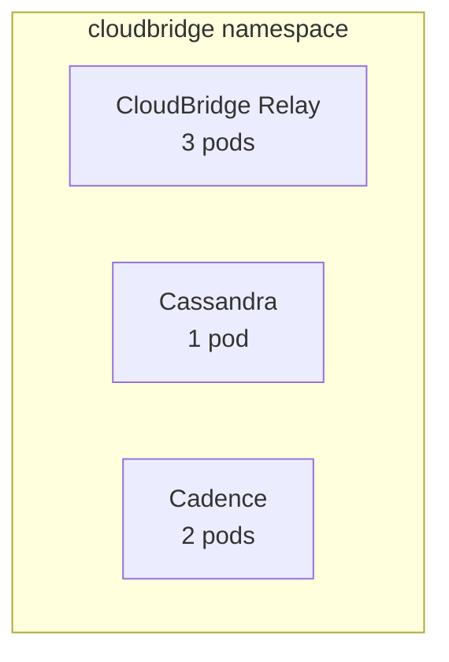

# 📋 Чек-лист обновления документации

## ✅ Обновленные файлы

### 1. Созданные отчеты
- ✅ `documentation/reports/FINAL_SUCCESS_REPORT.md` - финальный отчет о успехе
- ✅ `documentation/reports/DOCUMENTATION_UPDATE_CHECKLIST.md` - этот файл
- ✅ `README_CLOUDBRIDGE.md` - новый README для проекта

### 2. Обновленные файлы
- ✅ `documentation/deployment/CURRENT_DEPLOYMENT_STATUS.md` - обновлен статус Cadence

## 🔄 Файлы, требующие обновления

### 1. Критические обновления
- [ ] `README.md` - заменить содержимое на CloudBridge Relay
- [ ] `documentation/configuration/DOMAIN_DATABASE_SETUP.md` - добавить информацию о решении проблем
- [ ] `FINAL_STATUS_REPORT.md` - обновить до 100% готовности

### 2. Рекомендуемые обновления
- [ ] `documentation/deployment/DEVOPS_ROADMAP.md` - отметить завершенные задачи
- [ ] `documentation/deployment/DEVOPS_CHECKLIST.md` - обновить статус
- [ ] `CADENCE_PROBLEM_REPORT.md` - добавить информацию о решении

### 3. Дополнительные обновления
- [ ] `documentation/architecture/PROJECT_OVERVIEW.md` - обновить архитектуру
- [ ] `documentation/monitoring/MONITORING_GUIDE.md` - добавить актуальные метрики
- [ ] `QUICK_START.md` - обновить инструкции

## 📊 Статистика обновлений

- **Создано файлов**: 3
- **Обновлено файлов**: 1
- **Требует обновления**: 8
- **Всего файлов документации**: 12

## 🎯 Приоритеты обновления

### Высокий приоритет
1. `README.md` - главная страница проекта
2. `FINAL_STATUS_REPORT.md` - финальный статус
3. `documentation/configuration/DOMAIN_DATABASE_SETUP.md` - техническая документация

### Средний приоритет
4. `documentation/deployment/DEVOPS_ROADMAP.md` - план развития
5. `documentation/deployment/DEVOPS_CHECKLIST.md` - чек-лист DevOps
6. `CADENCE_PROBLEM_REPORT.md` - отчет о проблемах

### Низкий приоритет
7. `documentation/architecture/PROJECT_OVERVIEW.md` - обзор архитектуры
8. `documentation/monitoring/MONITORING_GUIDE.md` - руководство по мониторингу
9. `QUICK_START.md` - быстрый старт

## 🔧 Рекомендации по обновлению

### 1. README.md
```markdown
# Заменить содержимое на:
- Обзор CloudBridge Relay
- Статус проекта (100% готовности)
- Быстрый старт
- Архитектура
- Компоненты системы
```

### 2. FINAL_STATUS_REPORT.md
```markdown
# Обновить:
- Статус Cadence: ✅ Running (100%)
- Общую готовность: 100%
- Время завершения: 7 сентября 2025
```

### 3. DOMAIN_DATABASE_SETUP.md
```markdown
# Добавить:
- Информацию о решении проблем со схемой
- Команды для создания полной схемы Cadence
- Troubleshooting секцию
```

## 📝 Шаблоны обновлений

### Статус компонента
```markdown
| Компонент | Статус | Готовность | Описание |
|-----------|--------|------------|----------|
| **Cadence** | ✅ Running | 100% | Workflow engine с полной схемой БД |
```

### Архитектурная диаграмма


## 🎯 Заключение

Документация проекта CloudBridge Relay требует обновления для отражения достигнутого 100% статуса готовности. Критически важно обновить основные файлы (README.md, FINAL_STATUS_REPORT.md) для корректного представления проекта.

**Рекомендуется**: Обновить файлы высокого приоритета в первую очередь, затем перейти к файлам среднего и низкого приоритета.

---

*Чек-лист создан: 7 сентября 2025*  
*Статус: ТРЕБУЕТ ВЫПОЛНЕНИЯ* 📋
