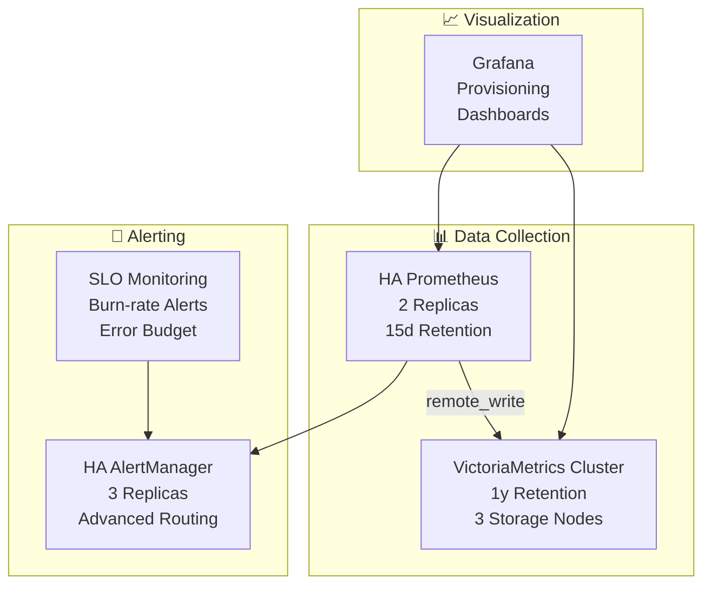

# 🌐 CloudBridge Monitoring Stack

## 📊 Overview

This directory contains a production-ready monitoring stack for CloudBridge, implemented based on industry-leading reference repositories:

- **kube-prometheus** - HA Prometheus with Operator
- **VictoriaMetrics** - Long-term storage and cluster setup
- **Sloth** - SLO as Code with burn-rate alerts
- **Grafana** - Visualization and provisioning
- **AlertManager** - Advanced alert routing

## 🏗️ Architecture

### **Monitoring Stack Components**


## 📁 Files

### **Core Monitoring**
- `prometheus-ha.yaml` - HA Prometheus with remote write
- `prometheus-rbac.yaml` - RBAC for Prometheus
- `alertmanager-ha.yaml` - HA AlertManager
- `alertmanager-config.yaml` - Alert routing and notifications

### **Storage & Performance**
- `victoriametrics-cluster.yaml` - VictoriaMetrics cluster (vmstorage, vminsert, vmselect)
- `cloudbridge-slo.yaml` - SLO monitoring with Sloth

### **Visualization**
- `grafana-provisioning.yaml` - Grafana datasources and dashboards

### **Deployment**
- `deploy-monitoring-stack.sh` - Automated deployment script

## 🚀 Quick Start

### **1. Deploy Monitoring Stack**
```bash
# Deploy all monitoring components
./scripts/deploy-monitoring-stack.sh
```

### **2. Verify Deployment**
```bash
# Check all components
kubectl get all -n monitoring -l app.kubernetes.io/part-of=cloudbridge-monitoring

# Check Prometheus
kubectl get prometheus -n monitoring

# Check AlertManager
kubectl get alertmanager -n monitoring

# Check VictoriaMetrics
kubectl get statefulsets,deployments -n monitoring -l app.kubernetes.io/name=victoriametrics
```

### **3. Access Services**
```bash
# Prometheus
kubectl port-forward svc/cloudbridge-prometheus 9090:9090 -n monitoring

# AlertManager
kubectl port-forward svc/cloudbridge-alertmanager 9093:9093 -n monitoring

# VictoriaMetrics
kubectl port-forward svc/vmselect 8481:8481 -n monitoring

# Grafana
kubectl port-forward svc/grafana 3000:3000 -n monitoring
```

## 📊 Features

### **HA Prometheus (2 Replicas)**
- **Retention**: 15 days local + 1 year VictoriaMetrics
- **Remote Write**: Automatic forwarding to VictoriaMetrics
- **Storage**: 50Gi per replica with fast-ssd storage class
- **Resources**: 2Gi memory, 500m CPU per replica

### **HA AlertManager (3 Replicas)**
- **Advanced Routing**: Critical, Warning, BGP, Anycast, CloudBridge
- **Notifications**: Email + Slack integration
- **Inhibition Rules**: Prevents alert spam
- **Storage**: 2Gi per replica for alert state

### **VictoriaMetrics Cluster**
- **Storage**: 3 replicas with 100Gi each (300Gi total)
- **Retention**: 1 year
- **Components**: vmstorage (3), vminsert (2), vmselect (2)
- **Performance**: Optimized for high cardinality metrics

### **SLO Monitoring**
- **CloudBridge Relay**: 99.9% availability
- **BGP Sessions**: 99.95% availability  
- **Anycast Service**: 99.99% availability
- **Latency**: 99.5% under 100ms
- **Burn-rate Alerts**: Multi-window detection

### **Grafana Provisioning**
- **Datasources**: Prometheus, VictoriaMetrics, BGP
- **Dashboards**: CloudBridge Overview, SLO Monitoring
- **Auto-discovery**: Automatic dashboard loading

## 🚨 Alert Configuration

### **Alert Routing**
```yaml
# Critical Alerts
critical-alerts:
  - email: oncall@cloudbridge.com
  - slack: #alerts-critical
  - conditions: severity=critical

# Warning Alerts  
warning-alerts:
  - email: team@cloudbridge.com
  - slack: #alerts-warning
  - conditions: severity=warning

# BGP Alerts
bgp-alerts:
  - email: network-team@cloudbridge.com
  - slack: #network-bgp
  - conditions: component=bgp

# Anycast Alerts
anycast-alerts:
  - email: sre@cloudbridge.com
  - slack: #sre-anycast
  - conditions: component=anycast
```

### **Inhibition Rules**
- Critical alerts inhibit warning alerts
- BGP exporter down inhibits BGP session alerts
- Prevents alert spam and noise

## 📈 SLO Monitoring

### **SLO Definitions**
```yaml
# CloudBridge Relay
service: "cloudbridge-relay"
objective: 99.9%
period: 30d
error_budget: 0.1%

# BGP Sessions
service: "cloudbridge-bgp"  
objective: 99.95%
period: 30d
error_budget: 0.05%

# Anycast Service
service: "cloudbridge-anycast"
objective: 99.99%
period: 30d
error_budget: 0.01%
```

### **Burn-rate Alerts**
- **Quick**: 5m/1h windows for immediate response
- **Slow**: 30m/6h windows for sustained issues
- **Ticket**: 2h/24h windows for escalation

## 🔧 Configuration

### **Storage Classes**
```yaml
# Required storage classes
fast-ssd: # For Prometheus and AlertManager
standard: # For VictoriaMetrics (optional)
```

### **Resource Requirements**
```yaml
# Minimum cluster requirements
nodes: 3
cpu: 6 cores
memory: 12Gi
storage: 500Gi
```

### **Network Policies**
```yaml
# Required network access
prometheus: 9090/tcp
alertmanager: 9093/tcp
victoriametrics: 8480-8482/tcp
grafana: 3000/tcp
```

## 📊 Dashboards

### **CloudBridge Overview**
- Service status across all components
- Request rate and response time
- Error rate and availability
- Resource utilization

### **SLO Overview**
- SLO status for all services
- Error budget consumption
- Burn-rate trends
- Alert frequency

### **BGP Monitoring**
- BGP session status
- Route table size
- Prefix counts
- Session uptime

## 🛠️ Troubleshooting

### **Common Issues**

#### **1. Prometheus Not Scraping**
```bash
# Check Prometheus status
kubectl get prometheus -n monitoring
kubectl describe prometheus cloudbridge-prometheus -n monitoring

# Check ServiceMonitors
kubectl get servicemonitors -n monitoring
```

#### **2. AlertManager Not Sending Alerts**
```bash
# Check AlertManager config
kubectl get secret cloudbridge-alertmanager-config -n monitoring -o yaml

# Check AlertManager logs
kubectl logs -n monitoring deployment/cloudbridge-alertmanager
```

#### **3. VictoriaMetrics Not Receiving Data**
```bash
# Check VictoriaMetrics cluster
kubectl get statefulsets,deployments -n monitoring -l app.kubernetes.io/name=victoriametrics

# Check remote write
kubectl logs -n monitoring deployment/cloudbridge-prometheus | grep remote
```

#### **4. Grafana Not Loading Dashboards**
```bash
# Check Grafana provisioning
kubectl get configmaps -n monitoring -l app.kubernetes.io/name=grafana

# Check Grafana logs
kubectl logs -n monitoring deployment/grafana
```

## 📚 References

- [kube-prometheus](https://github.com/prometheus-operator/kube-prometheus)
- [VictoriaMetrics](https://github.com/VictoriaMetrics/VictoriaMetrics)
- [Sloth](https://github.com/slok/sloth)
- [Grafana](https://github.com/grafana/grafana)
- [AlertManager](https://github.com/prometheus/alertmanager)

## 🎯 Next Steps

1. **Configure SMTP/Slack** in AlertManager config
2. **Import additional dashboards** for specific services
3. **Set up BGP monitoring** (see k8s/bgp-monitoring/)
4. **Configure anycast health checks**
5. **Set up log aggregation** (Loki/ELK)
6. **Implement distributed tracing** (Jaeger)

---

**CloudBridge Monitoring Stack provides enterprise-grade observability with industry best practices from leading open-source projects.**


