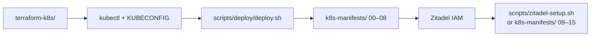

# Canonical Deployment Path

This page defines the **single supported production path** for CloudBridge Relay on VK Cloud Kubernetes. All other infrastructure trees in the repository are legacy or component-level — see [Non-canonical alternatives](#non-canonical-alternatives).

**Consolidation context:** [docs/audit/CONSOLIDATION_PLAN.md](../docs/audit/CONSOLIDATION_PLAN.md)

---

## Overview



| Stage | Canonical path | Purpose |
|-------|----------------|---------|
| 1. Cluster | `terraform-k8s/` | VK Cloud Kubernetes cluster + node group |
| 2. Core stack | `scripts/deploy/deploy.sh` + `k8s-manifests/` (`00–08`) | Namespace, PVC, secrets, relay, AI, Cadence, ingress, ServiceMonitor |
| 3. IAM | Zitadel | Identity provider (OIDC) for relay and API |

---

## Prerequisites

- **Go 1.25.12+**, **Docker 20.10+**, **kubectl 1.28+**, **Helm 3.12+**, **Terraform 1.5+**
- VK Cloud account with Kubernetes access
- OpenStack RC file v3 — sourced via `scripts/deploy/openstack_auth.sh`
- `KUBECONFIG` pointing at the VK Cloud cluster (e.g. `~/.kube/config-vkcloud`)

See also: [Quickstart — Prerequisites](quickstart.md#prerequisites)

---

## Step 1 — Provision the Kubernetes cluster

**Canonical:** `terraform-k8s/`

```bash
source scripts/deploy/openstack_auth.sh
export KUBECONFIG=~/.kube/config-vkcloud

cd terraform-k8s
terraform init
terraform plan
terraform apply -auto-approve
```

**Resources:** VK Cloud provider (`vk-cs/vkcs`), Kubernetes 1.28 cluster, worker node group (ME1 region).  
**Outputs:** kubeconfig / cluster credentials (configure `kubectl` before step 2).

---

## Step 2 — Deploy the core application stack

**Canonical:** `scripts/deploy/deploy.sh` applying numbered manifests from `k8s-manifests/`

```bash
# From repository root
./scripts/deploy/deploy.sh
```

The script applies manifests in order:

| File | Layer |
|------|-------|
| `00-namespace.yaml` | `cloudbridge` namespace |
| `01-pvc.yaml` | Persistent volumes (logs, Cadence, registry) |
| `02-secrets.yaml` | Application secrets (update before production) |
| `03-configmap.yaml` | Relay configuration |
| `04-registry.yaml` | In-cluster Docker registry |
| `05-deployments.yaml` | Relay (3 replicas), AI service, Cadence, Cassandra |
| `06-services.yaml` | ClusterIP services |
| `07-ingress.yaml` | NGINX Ingress with TLS |
| `08-servicemonitor.yaml` | Prometheus ServiceMonitor |

The script also builds/pushes local images to the in-cluster registry when needed.

**Manual equivalent (core only):**

```bash
kubectl apply -f k8s-manifests/00-namespace.yaml
kubectl apply -f k8s-manifests/01-pvc.yaml
# … through 08-servicemonitor.yaml
```

> **Note:** `deploy.sh` does **not** apply Zitadel manifests (`09–15`). IAM is a separate step below.

---

## Step 3 — Deploy Zitadel (IAM)

Zitadel is the **canonical identity provider** (Keycloak removed). Deploy after the core stack is healthy.

### Option A — Numbered manifests (matches `k8s-manifests/` ordering)

```bash
kubectl apply -f k8s-manifests/09-zitadel.yaml
kubectl apply -f k8s-manifests/10-zitadel-complete.yaml
kubectl apply -f k8s-manifests/11-postgres-zitadel.yaml
kubectl apply -f k8s-manifests/15-zitadel-root-ingress.yaml
# Optional: default backend / homepage manifests 12–14
```

### Option B — Component scripts + Helm values (recommended for customization)

```bash
./scripts/zitadel-setup.sh
# Post-deploy CloudBridge ↔ Zitadel integration:
./scripts/setup-cloudbridge-zitadel.sh
```

Uses Helm values and ingress under `k8s/zitadel/` (component-level tree — see [CONSOLIDATION_PLAN §1](../docs/audit/CONSOLIDATION_PLAN.md)).

**Verify access:**

```bash
./scripts/deploy/check-zitadel-access.sh
kubectl get pods -n zitadel
```

**Human guides:** [docs/guides/ZITADEL_SETUP.md](../docs/guides/ZITADEL_SETUP.md), [docs/guides/ZITADEL_DEPLOYMENT_GUIDE.md](../docs/guides/ZITADEL_DEPLOYMENT_GUIDE.md)

---

## Verification

```bash
# Cluster
kubectl cluster-info
kubectl get nodes

# Core stack
kubectl get pods,svc,ingress -n cloudbridge
kubectl get pvc -n cloudbridge

# Zitadel
kubectl get pods,ingress -n zitadel
```

---

## Non-canonical alternatives

These directories exist for historical reasons, component ops, or future consolidation. **Do not use them as the primary production entry point** until migration completes.

| Path | Status | Use instead | Plan |
|------|--------|-------------|------|
| `k8s/` | **Non-canonical** for ordered prod deploy | `k8s-manifests/` + `deploy.sh` for core; `k8s/zitadel/` for Zitadel Helm/ops only | [CONSOLIDATION_PLAN §1](../docs/audit/CONSOLIDATION_PLAN.md) |
| `terraform/` | **Non-canonical** | `terraform-k8s/` | [CONSOLIDATION_PLAN §2](../docs/audit/CONSOLIDATION_PLAN.md) |
| `infra/` | **Non-canonical** (single-VM PoC) | `terraform-k8s/` (+ K8s deploy) | [CONSOLIDATION_PLAN §2](../docs/audit/CONSOLIDATION_PLAN.md) |

**Still valid from `k8s/`:** domain-specific ops manifests (monitoring-stack, BGP, Cadence schema jobs, Kyverno policies) invoked by individual scripts under `scripts/` — not part of the numbered prod deploy path.

**Other deployment paths (different products):**

| Path | Audience |
|------|----------|
| `mws/` + OVA build | B2B marketplace appliances (Docker Compose on VM) |
| `ansible/` | Bare-metal Docker stack |
| Local `make build` | Development |

See [Operations — OVA Marketplace](operations.md#ova-marketplace-build-mws) for OVA details.

---

## Related pages

| Page | Content |
|------|---------|
| [Quickstart](quickstart.md) | Repository overview, all quick-start paths |
| [Operations](operations.md) | CI/CD, monitoring, compliance, manifest reference |
| [Port Scheme](port-scheme.md) | Canonical service → port table |
| [Architecture](architecture.md) | Auth (Zitadel OIDC), inter-service patterns |
| [CONSOLIDATION_PLAN](../docs/audit/CONSOLIDATION_PLAN.md) | Merge/archive plan for duplicate infra trees |
